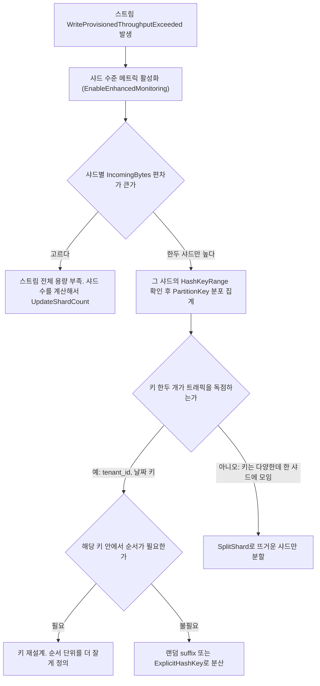
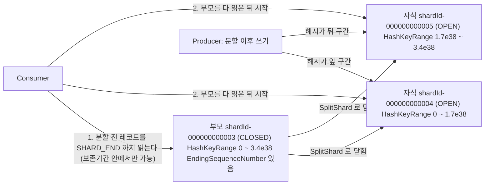
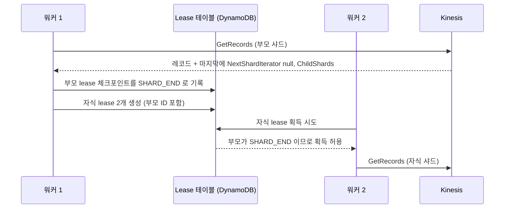

# Kinesis Data Streams 샤드 용량 설계와 리샤딩 운영

샤드 수를 한 번 정하고 끝나는 스트림은 드물다. 트래픽이 늘면 샤드를 더하고, 이벤트가 끝나면 줄이고, 특정 키가 몰리면 샤드 하나만 쪼갠다. 이 문서는 그 세 가지 작업에서 실제로 막히는 지점을 다룬다. 서비스 전반은 [Kinesis](Kinesis.md)에 있고, 여기서는 샤드 계산, 용량 모드 전환, 핫 샤드 진단, 리샤딩 절차, 리샤딩 중 읽기 순서만 판다.

한도 수치는 공식 문서([Quotas and Limits](https://docs.aws.amazon.com/streams/latest/dev/service-sizes-and-limits.html))를 따랐다. 실제 계정에서 한도까지 밀어붙여 확인한 값이 아니므로, 본문에서 "문서 기준"이라고 적은 값은 운영에 쓰기 전에 해당 링크에서 현재 값을 다시 본다. 로컬에서 직접 돌려 확인한 것은 샤드 수 계산, 파티션 키 해시 분포, boto3 호출 파라미터 검증(botocore Stubber)이다. AWS에 실제로 호출한 결과는 없다.

## 샤드 수를 숫자로 잡기

샤드 하나가 받는 쓰기는 1MB/s 또는 1,000 records/s 중 먼저 닿는 쪽에서 막힌다. 읽기는 Standard 소비자 전체가 2MB/s를 나눠 쓴다. 필요한 샤드 수는 쓰기 바이트, 쓰기 건수, 읽기 세 값 중 가장 큰 값이다.

피크 배수와 여유율을 빼먹으면 계산은 맞는데 운영에서 스로틀이 난다. 평균으로만 계산한 샤드 수는 피크 시간대에 바로 모자라고, 한도 100%까지 쓰는 계획은 해시가 완벽히 고르지 않다는 점을 무시한다. 해시가 고른 uuid 키로 100,000건을 8개 샤드에 넣어 봐도 샤드별 비율이 12.4~12.6%로 흩어진다. 아래 스크립트는 피크 배수를 곱하고 한도의 70%만 쓴다는 가정을 넣었다. 70%는 내가 잡은 값이지 AWS 권고치가 아니다.

```python
import math
from dataclasses import dataclass

WRITE_BYTES = 1_000_000
WRITE_RECORDS = 1_000
READ_BYTES = 2_000_000


@dataclass
class Workload:
    avg_record_bytes: int
    avg_records_per_sec: float
    peak_multiplier: float
    standard_consumers: int = 1
    headroom: float = 0.7


def required_shards(w: Workload) -> dict:
    peak_rps = w.avg_records_per_sec * w.peak_multiplier
    peak_bps = peak_rps * w.avg_record_bytes
    cap = lambda limit: limit * w.headroom
    by_bytes = math.ceil(peak_bps / cap(WRITE_BYTES))
    by_records = math.ceil(peak_rps / cap(WRITE_RECORDS))
    by_read = math.ceil(peak_bps * w.standard_consumers / cap(READ_BYTES))
    return {
        "peak_rps": peak_rps,
        "peak_MBps": round(peak_bps / 1e6, 2),
        "by_bytes": by_bytes,
        "by_records": by_records,
        "by_read": by_read,
        "shards": max(by_bytes, by_records, by_read),
    }
```

세 가지 워크로드로 돌린 결과다.

| 워크로드 | 평균 | 피크 배수 | 소비자 | 바이트 기준 | 건수 기준 | 읽기 기준 | 필요 샤드 |
|---|---|---|---|---|---|---|---|
| 주문 이벤트 1KB | 800 rec/s | 4배 | 2 | 5 | 5 | 5 | 5 |
| 센서 200B | 6,000 rec/s | 3배 | 1 | 6 | 26 | 3 | 26 |
| 클릭 로그 500B | 3,000 rec/s | 5배 | 3 | 11 | 22 | 17 | 22 |

센서 워크로드는 피크가 3.6MB/s라 바이트로는 6개면 되는데 건수 때문에 26개가 필요하다. 18,000 rec/s를 샤드당 700 rec/s(1,000의 70%)로 나눈 값이다. 레코드가 작을수록 건수 한도가 먼저 오기 때문에, 이런 스트림은 샤드를 늘리기 전에 KPL 집계나 배치로 레코드 수를 줄이는 쪽을 먼저 본다. 클릭 로그는 소비자 3개가 모두 읽는 탓에 읽기 기준이 17까지 올라간다. 소비자가 늘어서 샤드가 늘어나는 구조라면 Enhanced Fan-Out으로 읽기 항 자체를 없애는 편이 샤드를 사는 것보다 싸게 먹히는 경우가 있다.

PutRecords는 한 번에 보낼 수 있는 건수와 요청 크기에 상한이 있다(현재 값은 Quotas 문서 확인). 호출 하나가 전부 성공하거나 전부 실패하지 않는다. 스로틀이 나면 `FailedRecordCount`가 0보다 크고 실패한 항목만 응답 배열에 `ErrorCode`를 달고 온다. 재시도는 이 항목만 골라 보낸다. 성공한 항목까지 다시 보내면 중복 레코드가 생긴다.

```python
import time, random

def put_with_retry(kinesis, stream, records, max_attempts=5):
    pending = records
    for attempt in range(max_attempts):
        resp = kinesis.put_records(StreamName=stream, Records=pending)
        if resp["FailedRecordCount"] == 0:
            return []
        pending = [r for r, res in zip(pending, resp["Records"]) if "ErrorCode" in res]
        time.sleep(min(2 ** attempt * 0.1, 2) * random.uniform(0.5, 1.5))
    return pending
```

실패 항목을 남긴 채 반환하므로 호출하는 쪽에서 DLQ나 로컬 버퍼로 보낸다. 이 함수는 가짜 클라이언트로 첫 호출에 두 건 중 한 건 실패, 두 번째 호출에 한 건만 전송되는 흐름을 확인했다(호출 건수 2건, 1건).

## Provisioned와 On-Demand

두 모드의 차이는 요금보다 "누가 샤드 수를 책임지느냐"에 있다. Provisioned는 샤드 수를 내가 정하고, On-Demand는 AWS가 처리량을 보고 늘린다. 문제는 On-Demand의 확장이 즉시가 아니라는 점이다.

| 항목 | Provisioned | On-Demand |
|---|---|---|
| 용량 단위 | 샤드. 직접 지정 | 스트림. 처리량에 맞춰 자동 조절 |
| 과금 | 샤드 시간 + PUT 페이로드 단위 | 스트림 시간 + 쓰기·읽기 GB |
| 확장 속도 | UpdateShardCount가 끝나야 반영 | 직전 피크 기준으로 따라가는 방식. 급증에는 스로틀 구간이 있다 |
| 급증 대응 | 미리 샤드를 늘려둔다 | 직전 30일 피크의 2배까지 수용한다고 문서에 있다. 그 이상으로 짧은 시간에 튀면 스로틀 |
| 리샤딩 API | SplitShard, MergeShards, UpdateShardCount | 샤드 수를 직접 조작하는 용도가 아니다 |
| 모드 전환 | 24시간에 두 번까지 | 24시간에 두 번까지 |
| 어울리는 경우 | 부하가 예측되고 일정하다 | 부하 폭이 크고 예측이 안 된다 |

모드 전환 횟수와 2배 규칙은 문서 기준이다([Choosing the data stream capacity mode](https://docs.aws.amazon.com/streams/latest/dev/how-do-i-size-a-stream.html)). On-Demand 스트림에 리샤딩 API를 호출했을 때의 응답은 직접 확인하지 못했다. 리샤딩이 필요한 상황이면 Provisioned로 바꾼 뒤에 쓴다고 생각하면 된다.

급증 트래픽에서 `WriteProvisionedThroughputExceeded`가 나는 장면은 이렇다. 평소 피크가 5MB/s인 On-Demand 스트림에 프로모션 알림이 나가서 30초 만에 20MB/s가 들어온다. 문서 기준으로 수용 상한이 직전 피크의 2배인 10MB/s 근처이므로, 그 이상은 용량이 따라오는 동안 스로틀이 난다. "On-Demand라서 알아서 늘어난다"고 믿고 한도 계획을 안 세운 경우에 자주 나온다. 이벤트 일정을 아는 트래픽이라면 두 가지 대응이 있다.

첫째는 Provisioned로 전환해서 필요한 샤드 수를 이벤트 전에 만들어 두는 것이다. 단, 전환 횟수가 24시간에 두 번이라 이벤트 전에 올리고 끝난 뒤 내리면 그날의 횟수를 다 쓴다. 이벤트가 하루 안에 두 번 겹치면 두 번째에서 막힌다. 전환을 걸 때는 되돌릴 횟수를 남겨 둔다.

둘째는 On-Demand를 유지한 채 미리 처리량을 키워 두는 방법이다. 내가 쓴 botocore 1.43 서비스 모델의 `UpdateStreamMode`에 `WarmThroughputMiBps` 파라미터가 있고, 문서에는 "On-Demand로 전환할 때 즉시 쓸 수 있는 쓰기 용량"으로 설명돼 있다. 동작과 과금은 직접 확인하지 못했으므로 [Kinesis 요금](https://aws.amazon.com/kinesis/data-streams/pricing/)과 API 문서를 먼저 읽고 쓴다.

```bash
# 현재 모드와 샤드 수
aws kinesis describe-stream-summary --stream-name orders-stream \
  --query 'StreamDescriptionSummary.[StreamModeDetails.StreamMode,OpenShardCount]'

# 모드 전환. 24시간에 두 번까지라 아무 때나 호출하지 않는다
aws kinesis update-stream-mode \
  --stream-arn arn:aws:kinesis:ap-northeast-2:111122223333:stream/orders-stream \
  --stream-mode-details StreamMode=PROVISIONED
```

## 핫 샤드를 찾는 과정

스트림 전체의 `IncomingBytes`는 용량의 30%밖에 안 되는데 `WriteProvisionedThroughputExceeded`가 계속 뜬다면 핫 샤드를 먼저 의심한다. 스트림 단위 메트릭은 샤드 8개의 값을 합쳐 보여주기 때문에 한 샤드만 한도를 넘어도 평균은 낮게 보인다.

진단은 아래 순서로 한다. 편차가 보이면 키 분포를 보고, 키 한두 개가 원인인지 해시 범위 자체가 좁은지로 갈라서 조치를 정한다.



샤드 수준 메트릭은 기본이 꺼져 있고 켜면 메트릭당 추가 요금이 붙는다. 장애 한복판에서 켜면 켜기 전 시간대의 샤드별 값이 없으므로 평소에 `IncomingBytes`와 `WriteProvisionedThroughputExceeded` 두 개만 켜 두는 쪽이 낫다.

```bash
aws kinesis enable-enhanced-monitoring \
  --stream-name orders-stream \
  --shard-level-metrics IncomingBytes IncomingRecords WriteProvisionedThroughputExceeded

aws cloudwatch get-metric-statistics \
  --namespace AWS/Kinesis --metric-name IncomingBytes \
  --dimensions Name=StreamName,Value=orders-stream Name=ShardId,Value=shardId-000000000003 \
  --start-time 2026-10-22T00:00:00Z --end-time 2026-10-22T01:00:00Z \
  --period 60 --statistics Sum
```

활성화 가능한 지표 이름은 botocore 서비스 모델의 `MetricsName` 열거형(`IncomingBytes`, `IncomingRecords`, `OutgoingBytes`, `OutgoingRecords`, `WriteProvisionedThroughputExceeded`, `ReadProvisionedThroughputExceeded`, `IteratorAgeMilliseconds`, `ALL`)에서 확인했다. 샤드 차원은 `StreamName`과 `ShardId`다.

### 키 분포가 샤드에 어떻게 떨어지는지

키가 어떻게 쏠리는지 직접 시뮬레이션해 봤다. 파티션 키의 MD5 값을 128비트 해시 공간 8등분에 넣고 10만 건을 보냈다. 테넌트는 50개이고 한 테넌트가 트래픽의 약 67%를 차지하게 했다(시드 고정).

| 키 | 샤드 0~7 비율(%) |
|---|---|
| `tenant_id` | 2.1, 4.7, 3.3, **72.5**, 6.6, 4.6, 2.0, 4.2 |
| `tenant_id#0~9` (suffix 10개) | 10.5, 11.6, 11.0, **23.8**, 4.9, 3.8, 17.3, 17.0 |
| `tenant_id#0~63` (suffix 64개) | 14.4, 15.7, 13.8, 11.3, 9.3, 9.4, 12.5, 13.6 |
| 날짜 키 (`2026-10-22`) | 0, 0, **100**, 0, 0, 0, 0, 0 |
| 랜덤 uuid | 12.4, 12.5, 12.4, 12.4, 12.6, 12.6, 12.6, 12.4 |

두 가지가 보인다. 날짜 키는 하루 종일 샤드 하나가 전체 트래픽을 받는다. 샤드를 100개로 늘려도 같은 키는 같은 샤드로 가므로 아무것도 달라지지 않는다. 그리고 suffix를 10개만 붙여도 8개 샤드에서는 23.8%가 한 샤드에 남는다. 키가 10개뿐이면 해시가 8개 구간에 고르게 흩어진다는 보장이 없다. suffix를 64개로 늘리자 9.3~15.7%로 줄었다. suffix 개수는 샤드 수보다 한참 크게 잡아야 효과가 난다.

### suffix를 붙이는 대가

랜덤 suffix는 한 키를 여러 개 키로 쪼갠다. `tenant_001#3`과 `tenant_001#7`은 서로 다른 샤드로 갈 수 있고, 샤드 간에는 순서 보장이 없다. 같은 테넌트의 `created` 이벤트와 `cancelled` 이벤트가 다른 suffix를 받으면 소비자가 `cancelled`를 먼저 읽을 수 있다. 이게 문제가 되는 도메인에서는 suffix를 랜덤이 아니라 순서 단위에 맞춰 정한다. 예를 들어 `tenant_id` 대신 `tenant_id + order_id`를 키로 쓰면 주문 안에서는 순서가 보존되고, 테넌트 안의 서로 다른 주문끼리는 순서를 포기한다. 소비자는 키 분산 이후 같은 `tenant_id`의 레코드가 흩어져 오는 것도 받아낼 수 있어야 한다. 집계가 `tenant_id` 단위라면 소비 측에서 합쳐야 한다.

## UpdateShardCount와 수동 분할·병합

리샤딩에는 두 방법이 있다. `UpdateShardCount`는 목표 개수만 주면 AWS가 샤드를 균등하게 쪼개거나 합친다. `SplitShard`와 `MergeShards`는 특정 샤드를 직접 골라 처리한다. 스트림 전체가 부족하면 전자, 뜨거운 샤드 하나만 문제면 후자를 쓴다.

UpdateShardCount의 제약은 문서 기준으로 아래 표와 같다([UpdateShardCount API](https://docs.aws.amazon.com/kinesis/latest/APIReference/API_UpdateShardCount.html)).

| 제약 | 내용 |
|---|---|
| 확장 상한 | 현재 열린 샤드 수의 2배를 넘지 못한다 |
| 축소 하한 | 현재의 절반 미만으로 못 줄인다 |
| 횟수 | 스트림당 24시간(rolling)에 정해진 횟수를 넘기면 `LimitExceededException`. 현재 횟수는 문서 확인 |
| 계정 한도 | 계정의 리전별 샤드 한도를 넘지 못한다 |
| 방식 | `UNIFORM_SCALING`만 지원. 서비스 모델에서 열거형 값이 이것 하나다 |

예를 들어 4개에서 8개는 되지만 9개는 안 된다. 10개에서 5개는 되고 4개는 안 된다. 4개 스트림을 32개로 늘리려면 4→8→16→32로 세 번 나눠 호출해야 하고, 중간마다 스트림이 `ACTIVE`로 돌아오기를 기다린다. 처음 계획을 세울 때 횟수 제한까지 따져서 목표값을 잡아 둔다.

```bash
aws kinesis update-shard-count \
  --stream-name orders-stream \
  --target-shard-count 8 \
  --scaling-type UNIFORM_SCALING

aws kinesis wait stream-exists --stream-name orders-stream
aws kinesis describe-stream-summary --stream-name orders-stream \
  --query 'StreamDescriptionSummary.[StreamStatus,OpenShardCount]'
```

UpdateShardCount 중에는 스트림 상태가 `UPDATING`이 되고, 이 동안 다른 리샤딩 호출은 막힌다. 목표가 현재 샤드 수의 약수나 배수가 아니면 균등하게 나뉘지 않는 샤드가 생기므로 가능하면 정수배로 맞춘다.

### 수동 분할과 병합

핫 샤드 하나만 쪼갤 때는 `SplitShard`를 쓴다. 쪼갤 위치는 `NewStartingHashKey`로 지정하며, 이 값이 두 번째 자식의 시작 키가 된다. 중간값을 주면 반으로 갈린다. 핫 키가 한쪽 구간에 치우쳐 있으면 중간이 아닌 위치로 나눠야 의미가 있다. 분할 후에도 같은 키는 한 자식 샤드에만 간다는 점은 변하지 않는다.

```bash
# 열린 샤드만 조회
aws kinesis list-shards --stream-name orders-stream \
  --shard-filter Type=AT_LATEST

# HashKeyRange 의 중간값 계산 (begin + (end - begin) // 2 + 1)
python3 -c "lo=0; hi=2**128-1; print(lo + (hi-lo)//2 + 1)"
# 170141183460469231731687303715884105728

aws kinesis split-shard \
  --stream-name orders-stream \
  --shard-to-split shardId-000000000003 \
  --new-starting-hash-key 170141183460469231731687303715884105728

aws kinesis wait stream-exists --stream-name orders-stream
```

`MergeShards`는 해시 범위가 맞붙은 두 샤드만 합칠 수 있다. 서로 떨어진 샤드를 지정하면 오류가 난다. 분할이 쌓여서 낮은 트래픽의 샤드가 여럿 남았을 때 정리용으로 쓴다.

```bash
aws kinesis merge-shards \
  --stream-name orders-stream \
  --shard-to-merge shardId-000000000004 \
  --adjacent-shard-to-merge shardId-000000000005
```

같은 작업을 boto3로 짠 코드다. `list_shards`에서 열린 샤드를 골라 반으로 쪼개고 병합하고 전체 개수를 맞춘다. 이 코드는 botocore Stubber로 파라미터 형식과 응답 처리만 확인했고 실제 스트림에 호출한 적은 없다.

```python
import boto3
from botocore.exceptions import ClientError

STREAM = "orders-stream"
kinesis = boto3.client("kinesis", region_name="ap-northeast-2")


def open_shards(stream):
    shards, token = [], None
    while True:
        kw = {"NextToken": token} if token else {"StreamName": stream}
        resp = kinesis.list_shards(**kw)
        shards += resp["Shards"]
        token = resp.get("NextToken")
        if not token:
            break
    return [s for s in shards if "EndingSequenceNumber" not in s["SequenceNumberRange"]]


def split_in_half(stream, shard):
    lo = int(shard["HashKeyRange"]["StartingHashKey"])
    hi = int(shard["HashKeyRange"]["EndingHashKey"])
    kinesis.split_shard(
        StreamName=stream,
        ShardToSplit=shard["ShardId"],
        NewStartingHashKey=str(lo + (hi - lo) // 2 + 1),
    )


def merge_adjacent(stream, a, b):
    kinesis.merge_shards(
        StreamName=stream,
        ShardToMerge=a["ShardId"],
        AdjacentShardToMerge=b["ShardId"],
    )


def update_count(stream, target):
    try:
        return kinesis.update_shard_count(
            StreamName=stream,
            TargetShardCount=target,
            ScalingType="UNIFORM_SCALING",
        )
    except ClientError as e:
        if e.response["Error"]["Code"] in ("LimitExceededException", "InvalidArgumentException"):
            print("UpdateShardCount 거부:", e.response["Error"]["Message"])
        raise
```

`list_shards`에서 열린 샤드를 구분하는 기준은 `SequenceNumberRange`에 `EndingSequenceNumber`가 있느냐다. 닫힌 샤드는 이 값을 가진다. `ShardFilter`의 `AT_LATEST`를 쓰면 서버에서 열린 샤드만 걸러 주므로 CLI에서는 그 쪽이 간단하다.

## 리샤딩 중 부모와 자식 샤드

샤드를 쪼개면 원래 샤드(부모)는 `CLOSED`가 되어 새 쓰기를 받지 않고, 자식 두 개가 부모의 해시 범위를 나눠 가진다. 부모는 지워지지 않는다. 보존기간이 끝날 때까지 남아 있어서 소비자가 못 읽은 데이터를 계속 읽을 수 있다. 아래 도식은 해시 범위가 나뉘는 모습과, 쓰기와 읽기 경로가 어떻게 바뀌는지를 보여준다.



도식에서 볼 부분은 소비자의 1번과 2번 순서다. 분할 전에 들어온 레코드는 부모에, 분할 후에 들어온 레코드는 자식에 있다. 같은 파티션 키의 레코드가 부모에서 자식으로 이어지므로, 자식을 먼저 읽으면 같은 키의 최신 레코드를 옛 레코드보다 앞서 처리하게 된다. 순서가 보장된다는 것은 부모를 다 읽은 다음에 자식을 읽는다는 조건 위에서만 성립한다.

부모 읽기는 `GetRecords`에서 `NextShardIterator`가 `null`로 돌아오면 끝이다. 이때 응답에 `ChildShards`가 들어 있다(botocore 서비스 모델의 `GetRecords` 출력에 `ChildShards` 필드가 있고, 항목은 `ShardId`, `ParentShards`, `HashKeyRange`를 가진다). 병합은 반대로 자식 하나에 부모 둘이 있으므로 두 부모를 모두 읽은 뒤에 자식을 읽어야 한다.

보존기간이 24시간인 스트림에서 소비자가 하루 넘게 밀려 있으면 부모가 먼저 만료돼 사라진다. 이 경우 읽지 못한 부모 데이터는 복구할 수 없고, 자식부터 읽게 된다. 리샤딩 직전에 `GetRecords.IteratorAgeMilliseconds`를 확인해서 지연이 큰 스트림은 먼저 소비를 따라잡거나 `IncreaseStreamRetentionPeriod`로 보존기간을 늘려 둔다.

### KCL이 이 순서를 처리하는 방식

KCL은 샤드마다 lease를 DynamoDB 테이블에 기록한다. 샤드 목록을 동기화하면서 자식 샤드의 lease에 부모 샤드 ID를 함께 남기고, 부모 lease가 `SHARD_END`까지 체크포인트되기 전에는 자식 lease를 어느 워커도 가져가지 못한다. 순서를 지키는 책임이 소비자 코드가 아니라 lease 테이블에 있는 구조다.



자식 lease 생성 시점과 획득 조건은 KCL 버전마다 구현이 다르다. 사용하는 버전의 소스와 [KCL 문서](https://docs.aws.amazon.com/streams/latest/dev/shared-throughput-kcl-consumers.html)를 확인한다. 이 시퀀스는 문서에 나온 동작을 단순화한 것이고 실제 KCL을 띄워서 본 것은 아니다.

KCL을 쓰지 않고 `ListShards`로 샤드 목록을 받아 샤드마다 `GetShardIterator`와 `GetRecords` 루프를 직접 돌리는 소비자는 이 순서 처리가 없다. `TRIM_HORIZON`으로 시작하면 리샤딩 후 목록에 부모와 자식이 모두 나오는데, 이걸 병렬로 읽으면 순서가 깨진다. 직접 구현해야 한다면 `ParentShardId`와 `AdjacentParentShardId`(`list_shards`의 샤드 항목에 있다)를 보고, 부모가 `SHARD_END`에 닿기 전에는 자식 읽기를 시작하지 않는 규칙을 코드에 넣는다. 이 규칙을 넣을 자신이 없으면 KCL이나 Lambda 이벤트 소스 매핑을 쓴다.

## 출처

- [Kinesis Data Streams Quotas and Limits](https://docs.aws.amazon.com/streams/latest/dev/service-sizes-and-limits.html): 샤드당 쓰기·읽기 한도, API 호출 한도
- [Choosing the data stream capacity mode](https://docs.aws.amazon.com/streams/latest/dev/how-do-i-size-a-stream.html): On-Demand와 Provisioned, 모드 전환 횟수, 2배 확장 규칙
- [UpdateShardCount API](https://docs.aws.amazon.com/kinesis/latest/APIReference/API_UpdateShardCount.html): 2배·절반 제약과 횟수 제한
- [Resharding a stream](https://docs.aws.amazon.com/streams/latest/dev/kinesis-using-sdk-java-resharding.html): SplitShard, MergeShards, 부모·자식 샤드 읽기 순서
- [Monitoring with CloudWatch](https://docs.aws.amazon.com/streams/latest/dev/monitoring-with-cloudwatch.html): 샤드 수준 메트릭
- [KCL 소비자](https://docs.aws.amazon.com/streams/latest/dev/shared-throughput-kcl-consumers.html): lease와 리샤딩 처리
- [Kinesis Data Streams 요금](https://aws.amazon.com/kinesis/data-streams/pricing/)
