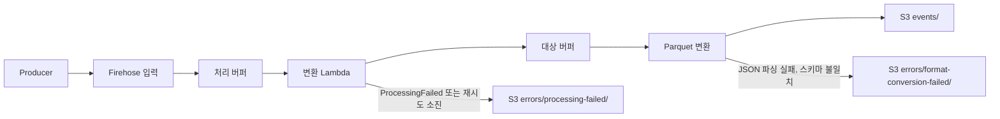
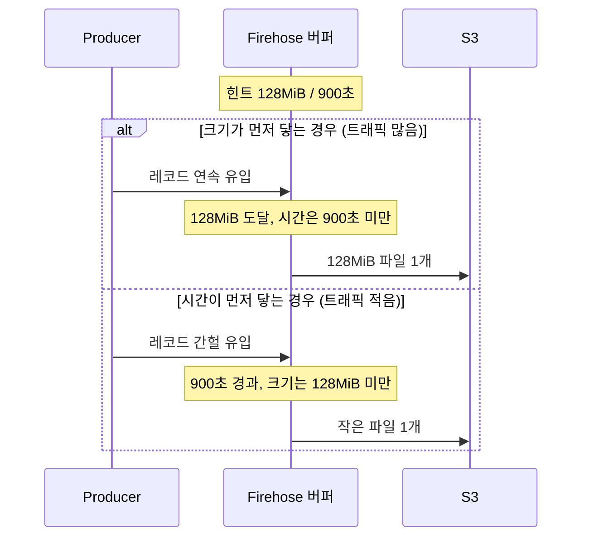
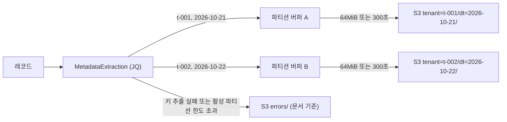
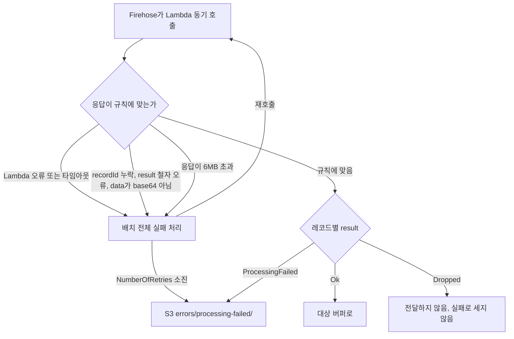
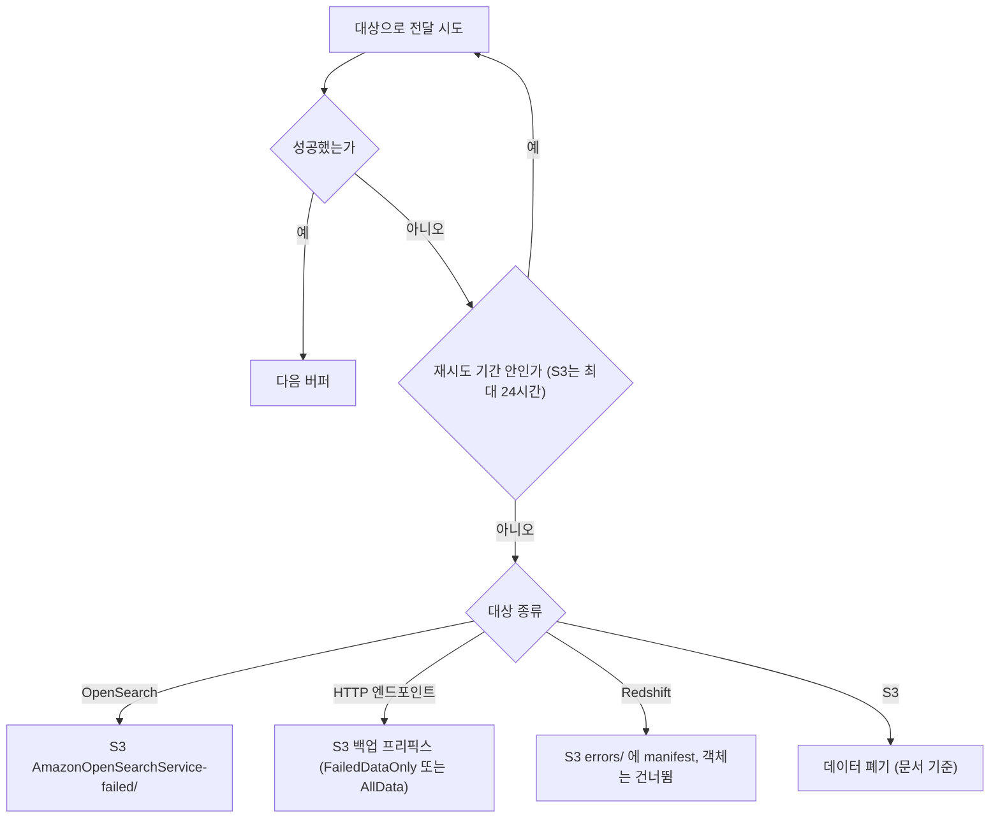
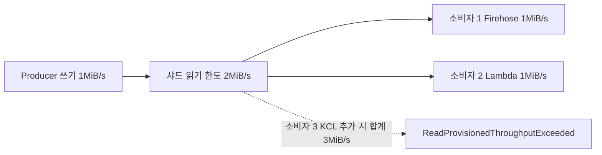
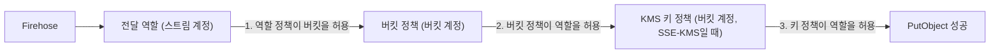
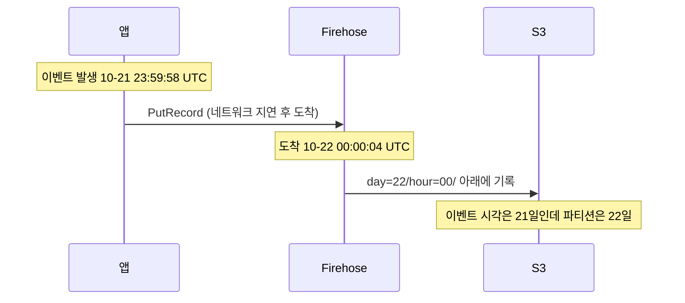

# Firehose 전달 운영

Firehose는 만들 때는 쉽고 운영하면서 문제가 나온다. 콘솔에서 S3 대상을 고르고 기본값으로 만들면 데이터는 들어가지만, 며칠 뒤 Athena 쿼리가 느려져서 열어 보면 S3에 수 KB짜리 파일이 수만 개 쌓여 있다. 변환 Lambda를 붙인 날에는 레코드가 전부 실패 폴더로 간다. 동적 파티셔닝을 켜고 나서는 파티션 한도에 걸리고, 이미 만든 스트림에는 켤 수도 없다는 걸 알게 된다. 이 문서는 S3·Redshift·OpenSearch·HTTP 대상으로 전달하는 단계에서 설정이 어떻게 맞물리는지, 어디서 조용히 틀어지는지를 다룬다. 서비스 전체 구조는 [Amazon Kinesis](Kinesis.md), 샤드 용량은 [Kinesis Data Streams 샤드 용량 설계와 리샤딩 운영](Kinesis_Data_Streams_Capacity_And_Resharding.md), Lambda·KCL 소비자는 [Kinesis Consumer 구현과 장애 대응](Kinesis_Consumer_KCL_And_Lambda.md)에 있다.

이 문서에서 직접 확인한 것과 확인하지 못한 것을 나눠 둔다.

- 직접 실행한 것: botocore 1.43.117 서비스 모델에서 읽은 파라미터 범위·열거값·API 설명, 같은 모델로 한 CLI JSON 파라미터 검증(`validate_parameters`), Terraform 1.9.8과 AWS provider 5.100.0의 `terraform validate`, jq 1.6으로 돌린 파티션 키 쿼리, 변환 Lambda 핸들러(Python 3.10) 단위 실행, 작은 파일 수 계산.
- 실행하지 못한 것: 실제 Firehose·S3·Athena 호출. AWS 계정에 붙여서 만든 결과는 없다. 동적 파티셔닝 한도, Lambda 응답 규칙의 실패 처리, 재시도 24시간 같은 서비스 쪽 동작은 [AWS 공식 문서](https://docs.aws.amazon.com/firehose/latest/dev/what-is-this-service.html) 기준이고, 본문에서 "문서 기준"이라고 적었다. 운영에 쓰기 전에 해당 문서의 현재 값을 다시 본다.

## 레코드가 S3에 닿기까지

Producer가 보낸 레코드는 바로 S3로 가지 않는다. 변환 Lambda 앞에 버퍼가 하나, 대상 앞에 버퍼가 또 하나 있고, 어느 단계에서 실패하느냐에 따라 레코드가 가는 폴더가 달라진다. 아래 그림에서 실선은 정상 경로, 화살표 라벨이 붙은 선은 실패 경로다.



처리 버퍼는 Lambda를 호출하기 전에 레코드를 모으는 버퍼이고, 대상 버퍼는 S3에 쓰기 전에 모으는 버퍼다. 두 버퍼의 설정은 서로 다른 항목이다. 처리 버퍼는 Lambda 프로세서의 `BufferSizeInMBs`, `BufferIntervalInSeconds` 파라미터로, 대상 버퍼는 `BufferingHints`로 정한다. 지연은 둘이 더해질 수 있다고 보고 계산한다. 변환 Lambda도 Parquet 변환도 쓰지 않으면 `Producer → 대상 버퍼 → S3` 한 단계만 남는다.

`errors/` 아래 폴더 이름은 `ErrorOutputPrefix`에 `!{firehose:error-output-type}`를 넣으면 실패 종류별로 자동으로 갈린다. 이름을 외울 필요가 없고, 이 값을 넣지 않으면 서로 다른 실패가 한 폴더에 섞여 원인 분류에 시간이 든다. 폴더 이름으로 `processing-failed`, `format-conversion-failed`, `http-endpoint-failed`, `splunk-failed`를 알고 있고(문서 기준), OpenSearch는 모델 설명에 `AmazonOpenSearchService-failed/`가 키 프리픽스 뒤에 붙는다고 적혀 있다. 첫 배포 뒤에 일부러 실패를 한 번 만들어서 실제 폴더 이름을 눈으로 본다.

## 버퍼 힌트와 작은 파일

### 범위와 기본값

버퍼는 크기와 시간 두 조건이 있고 먼저 닿는 쪽이 전달을 일으킨다. 범위는 대상마다 다르다. botocore 모델에서 읽은 값이다.

| 대상 | 크기(MiB) | 시간(초) | 모델에 있는 기본값 |
|---|---|---|---|
| S3 | 1~128 | 0~900 | 5MiB / 300초 |
| OpenSearch | 1~100 | 0~900 | 5MiB / 300초 |
| HTTP 엔드포인트 | 1~64 | 0~900 | 5MiB / 300초 |

시간 하한은 API 모델상 0이다. 0은 버퍼링을 사실상 끄는 값이고, 그만큼 작은 파일이 더 빨리 쌓인다. 이 문서의 계산은 60초 이상을 전제로 한다. 모델 설명에는 "크기를 평소 10초 동안 들어오는 양보다 크게 잡으라"는 권고가 있다. 1MiB/s로 들어오는 스트림이면 10MiB 이상이다.

이 값들은 이름 그대로 힌트다. 모델 설명에도 Firehose가 더 나은 값이 있으면 다른 값을 쓸 수 있고, 레코드 경계 때문에 크기가 조금 넘거나 모자랄 수 있다고 적혀 있다. 파일 크기를 정확히 128MiB로 맞추는 용도로 쓸 수 없다.

동적 파티셔닝을 쓰면 크기를 64MiB 이상으로 잡아야 한다(문서 기준). 파티션마다 버퍼가 따로 생기기 때문에 파티션당 파일이 너무 작아지지 않게 하려는 제약이다.

### 먼저 닿는 쪽이 전달을 일으킨다



위 그림에서 볼 것은 두 갈래의 결과가 다르다는 점이다. 같은 설정이어도 트래픽이 많은 시간대에는 큰 파일이 만들어지고, 새벽에는 작은 파일이 만들어진다. 트래픽이 낮은 시간대의 파일 크기는 설정이 아니라 유입량이 정한다. 파일 크기를 키우고 싶으면 크기 값이 아니라 시간 값을 올려야 하는 경우가 많다.

### 작은 파일이 얼마나 쌓이는지

유입량이 일정하고 파티션에 고르게 나뉜다고 가정하고 하루에 만들어지는 파일 수를 계산했다. 실제 유입은 시간대별로 출렁이므로 이 숫자는 이상적인 경우의 값이다.

| 설정 | 유입 | 파티션 | 먼저 닿는 조건 | 하루 파일 수 | 파일당 크기 |
|---|---|---|---|---|---|
| 5MiB / 300초 | 50KB/s | 1 | 크기 | 844 | 5MiB |
| 128MiB / 900초 | 50KB/s | 1 | 시간 | 96 | 약 44MiB |
| 5MiB / 300초 | 5KB/s | 1 | 시간 | 288 | 약 1.5MiB |
| 64MiB / 300초 | 50KB/s | 400 | 시간 | 115,200 | 약 37KB |
| 128MiB / 900초 | 50KB/s | 400 | 시간 | 38,400 | 약 110KB |

마지막 두 행이 문제다. 하루 4.1GB밖에 안 되는 데이터가 파티션 400개로 쪼개지면 파일이 수만 개가 된다. 시간 조건이 전달을 일으키는 구간에서는 파티션 수에 비례해서 파일이 늘어나기 때문이다. 유입량을 400배로 올린 같은 설정(5000KB/s)에서도 파일 수는 38,400개 그대로이고 크기만 약 11MiB로 커진다. 파일 수는 유입량이 아니라 `파티션 수 × (86400 / 시간 조건)`으로 정해진다는 뜻이다.

Athena와 Parquet 리더는 파일마다 열고, footer를 읽고, S3에 GET을 한 번씩 보낸다. 파일이 작을수록 읽는 데이터 양보다 호출 횟수가 비용과 시간을 좌우한다. 그래서 파티션 키를 설계할 때 "이 키 조합이 몇 개나 되는지"를 먼저 센다.

파일 크기는 데이터 압축률에 따라 힌트보다 작게 나올 수 있다. GZIP이나 Parquet 변환을 켜면 특히 그렇다. 이 부분은 직접 재 보지 못했다. 첫 배포 뒤에 `aws s3 ls s3://버킷/프리픽스/ --recursive --human-readable`로 실제 크기를 확인하고 힌트를 조정한다.

## Parquet 변환과 변환 실패 레코드

### Glue 스키마가 변환 동작을 정한다

Parquet·ORC 변환은 JSON 입력만 받는다. 입력 역직렬화기는 OpenX JSON SerDe와 Hive JSON SerDe 둘 중 하나이고, 출력 열 정보는 Glue Data Catalog 테이블에서 가져온다. 모델 설명 기준으로 알아 둘 것이 네 가지다.

1. Glue 연결 역할(`SchemaConfiguration.RoleARN`)은 Firehose와 같은 계정에 있어야 한다. 교차 계정 역할은 허용되지 않는다.
2. `VersionId`를 생략하거나 `LATEST`로 두면 Glue 테이블이 바뀔 때마다 변환 결과가 같이 바뀐다. 누가 Glue 컬럼 타입을 고치면 Firehose 설정은 그대로인데 변환 실패가 갑자기 생긴다. 컬럼을 자주 바꾸는 테이블이면 버전을 고정한다.
3. OpenX SerDe는 `CaseInsensitive`가 기본 true다. JSON 키를 소문자로 바꿔서 읽는다. `userId`와 `userid`가 한 레코드에 같이 있는 경우는 드물지만, Glue 컬럼 이름은 소문자로 맞춰 두어야 한다.
4. 타임스탬프를 `2026-10-22T03:00:00Z` 같은 문자열로 보내면서 Glue 컬럼을 `timestamp`로 정의하면 파싱 방식이 문제가 된다. Hive JSON SerDe는 `TimestampFormats`로 패턴을 받는다. 어느 쪽이 어떤 형식을 받아 주는지는 직접 돌려 보지 못했으므로, 이벤트 시각은 일단 `string` 컬럼으로 두고 Athena에서 변환하는 쪽이 안전하다.

Parquet 직렬화기의 `BlockSizeBytes` 기본값은 256MiB, 최솟값은 64MiB다. HDFS로 복사할 때를 염두에 둔 옵션이라 S3에서 Athena로만 읽는다면 건드릴 일이 거의 없다.

### 변환 실패 레코드

변환에 실패한 레코드는 S3의 `ErrorOutputPrefix` 경로로 간다. 앞의 구성처럼 `errors/!{firehose:error-output-type}/dt=!{timestamp:yyyy-MM-dd}/`로 두면 `errors/format-conversion-failed/dt=2026-10-22/` 아래에 들어간다. 파일 안의 레코드는 JSON 한 줄이고 원본이 base64로 `rawData` 필드에 들어 있는 것으로 알고 있다(문서 기준). 이 형식을 가정해 직접 만든 샘플을 jq 1.6으로 풀어 본 결과다.

```bash
$ jq -r '[.errorMessage, (.rawData | @base64d)] | @tsv' err.jsonl
sample	{"tenant_id":"t-1","amount":"abc"}
```

실패 파일이 쌓이는데 아무도 안 보면 데이터가 조용히 사라지는 것과 같다. `FailedConversion.Records` 메트릭(문서 기준)을 알람에 걸고, 알람이 울리면 위 jq로 `rawData`를 풀어서 어떤 필드가 문제인지 본다. 원인은 대개 Glue 컬럼 타입과 실제 값이 안 맞는 것이다. 예제의 `amount`가 숫자 컬럼인데 `"abc"`가 들어온 경우가 그렇다.

## 동적 파티셔닝

### 키를 뽑는 두 가지 방법

동적 파티셔닝은 레코드 내용에서 키를 꺼내 S3 프리픽스를 레코드마다 다르게 만든다. 키를 꺼내는 방법은 두 가지다.

- JQ: `MetadataExtraction` 프로세서에 `JsonParsingEngine=JQ-1.6`과 `MetadataExtractionQuery`를 준다. 프리픽스에는 `!{partitionKeyFromQuery:키이름}`을 쓴다. 별도 Lambda 함수를 두지 않아도 된다.
- Lambda: 변환 Lambda가 응답 레코드에 `metadata.partitionKeys`를 넣어 돌려준다. 프리픽스에는 `!{partitionKeyFromLambda:키이름}`을 쓴다. JSON이 아닌 입력이거나 키 계산에 로직이 필요할 때 쓴다.

```json
{"recordId": "r1", "result": "Ok", "data": "...", "metadata": {"partitionKeys": {"tenant_id": "t-001"}}}
```

키를 뽑은 뒤의 흐름은 이렇다. 파티션 키 조합마다 버퍼가 따로 생기고, 각 버퍼가 자기 크기·시간 조건으로 비워진다. 그림에서 파티션 버퍼가 몇 개 열려 있는지가 곧 활성 파티션 수다.



JQ로 충분한 경우가 대부분이다. 다만 JQ 쿼리는 틀렸을 때 조용히 이상한 값을 만든다. 로컬 jq 1.6(Firehose가 쓰는 엔진 버전과 같다)으로 입력 5건에 두 가지 쿼리를 돌려 본 결과다.

| 입력 | 단순 쿼리 `{tenant_id: .tenant_id, event_date: .event_time[0:10]}` | 방어한 쿼리 |
|---|---|---|
| `tenant_id`, ISO 시각 정상 | `t-001`, `2026-10-21` | 동일 |
| `+09:00` 오프셋이 붙은 시각 | `2026-10-22` | `2026-10-22` |
| `tenant_id` 없음 | `null`, 날짜 정상 | `unknown`, 날짜 정상 |
| `event_time` 없음 | 날짜 `null` | `0000-00-00` |
| `event_time`이 숫자(epoch 초) | jq 오류 `Cannot index number with object` | `2025-10-22` |

`null`이 파티션 키가 되면 프리픽스가 비정상으로 만들어진다. Firehose가 그 레코드를 어떻게 처리하는지는 직접 확인하지 못했다. `null` 키가 나오지 않게 쿼리에서 기본값을 주는 편이 낫다. 숫자 시각은 jq가 오류를 내는데, 이 경우 레코드 한 건의 실패인지 배치 전체의 문제인지도 확인하지 못했다. 그래서 쿼리 안에서 타입을 분기한다.

```text
{tenant_id: (.tenant_id // "unknown"),
 event_date: (.event_time | if type == "number" then strftime("%Y-%m-%d")
                            elif type == "string" then .[0:10]
                            else "0000-00-00" end)}
```

2행의 오프셋 입력은 주의할 점이다. `2026-10-22T00:00:03+09:00`의 앞 10글자는 `2026-10-22`이다. UTC로 바꾸면 `2026-10-21`이다. 문자열 슬라이스는 시각을 그대로 잘라 내므로 프로듀서가 보낸 시간대를 따른다. 프로듀서마다 시간대가 다르면 같은 날의 데이터가 다른 파티션으로 갈라지거나 서로 다른 날이 섞인다. 이벤트 시각을 UTC로 통일한다고 프로듀서 쪽과 약속하거나, 쿼리에서 `fromdateiso8601`로 파싱한 뒤 `strftime`으로 꺼낸다. 후자는 오프셋 표기가 있는 문자열을 못 읽는 경우가 있어서 이 문서에서는 돌려 보지 않았다.

### 제약과 한도

- 새 스트림을 만들 때만 켤 수 있다. 이미 만든 스트림에 동적 파티셔닝을 켜는 것은 문서에서 지원하지 않는다고 알고 있다(문서 기준). 켜려면 새 스트림을 만들고 프로듀서를 옮긴다. 대상은 S3만 가능하다(모델 설명에도 같은 내용이 있다).
- 활성 파티션 수 한도가 있다. 문서 기준 기본값은 스트림당 500개이고 상향 요청이 가능하다. 활성 파티션은 버퍼에 데이터가 있고 아직 전달되지 않은 파티션이다. 한도를 넘기면 해당 레코드는 에러 프리픽스로 가는 것으로 알고 있는데 직접 확인하지 못했다. `PartitionCountExceeded` 메트릭(문서 기준)에 알람을 건다.
- 쓰면 `ErrorOutputPrefix`를 넣어야 한다. 위 설정에서는 `errors/!{firehose:error-output-type}/dt=!{timestamp:yyyy-MM-dd}/`를 썼다.
- 레코드 사이에 구분자가 안 들어간다. JSON 레코드를 줄 단위로 읽으려면 `AppendDelimiterToRecord` 프로세서로 `\n`을 붙인다. 파라미터 값은 JSON에서 `"\\n"`, HCL에서 `"\\n"`이다. 두 글자(백슬래시, n)로 들어가야 하는데, 이 값이 실제 개행 문자로 풀리는지 두 글자로 남는지는 서비스 쪽 동작이라 확인하지 못했다. 문서 예시를 그대로 따랐다.
- 재시도(`RetryOptions`)는 S3 프리픽스 전달 실패에 대한 설정이고 0~7200초다.

### 파티션 키 카디널리티

400개 키가 하루 종일 고르게 들어오면 활성 파티션이 최대 400개다. 문제는 이벤트 시각으로 날짜를 뽑을 때다. 위 쿼리의 `event_date`는 이벤트 안의 시각이라서, 프로듀서가 일주일 전 데이터를 재전송하거나 모바일 앱이 오프라인 로그를 한꺼번에 올리면 `(tenant_id, event_date)` 조합이 한 번에 늘어난다. 테넌트 400개에 날짜 7개면 활성 파티션이 2,800개로 뛸 수 있다. 한도 500을 한 번에 넘긴다. 이벤트 시각이 키에 들어가는 설계에서는 늦게 도착하는 데이터의 최대 지연 폭을 먼저 묻는다.

## 변환 Lambda 응답 계약

### 맞춰야 하는 세 가지

변환 Lambda는 입력 레코드와 같은 `recordId`를 가진 레코드를 전부 돌려줘야 한다. 각 응답 레코드에 필요한 것은 세 가지다.

- `recordId`: 입력의 값을 그대로. 없애거나 바꾸면 안 된다.
- `result`: `Ok`, `Dropped`, `ProcessingFailed` 셋 중 하나. 철자와 대소문자가 정확해야 한다.
- `data`: base64 문자열. 변환한 본문을 base64로 인코딩해서 넣는다.

하나라도 틀리면 그 레코드가 아니라 호출 전체를 실패로 처리하는 것으로 문서에 적혀 있다. 레코드 하나의 `result`에 `OK`라고 쓰면 같은 배치의 정상 레코드도 같이 나간다. 이 동작은 직접 확인하지 못했다. 같은 이유로 예외 처리를 레코드 단위가 아니라 핸들러 전체에 걸어 두고 `except`에서 빈 응답을 돌려주는 형태는 위험하다.



그림에서 볼 곳은 `R`로 모이는 세 갈래다. Lambda가 에러를 낸 경우, 응답 모양이 틀린 경우, 응답이 너무 큰 경우가 모두 같은 "배치 전체 실패" 경로를 탄다. 증상(`processing-failed` 폴더에 레코드가 쌓임)이 같아서 로그를 보지 않으면 원인을 구분할 수 없다.

### 핸들러

`Dropped`는 헬스체크 같은 버릴 레코드에 쓴다. 에러가 아니라서 알람에 안 걸린다. `ProcessingFailed`는 파싱할 수 없는 레코드에 쓰고, `data`에는 원본을 그대로 넣는다. 아래는 이 규칙을 지키도록 만든 핸들러이고, 실행해서 확인했다.

```python
import base64
import json


def handler(event, context):
    out = []
    for rec in event["records"]:
        rid = rec["recordId"]
        try:
            doc = json.loads(base64.b64decode(rec["data"]))
            if doc.get("type") == "healthcheck":
                out.append({"recordId": rid, "result": "Dropped", "data": rec["data"]})
                continue
            doc.pop("phone", None)
            body = json.dumps(doc, ensure_ascii=False, separators=(",", ":")) + "\n"
            out.append({
                "recordId": rid,
                "result": "Ok",
                "data": base64.b64encode(body.encode("utf-8")).decode("ascii"),
            })
        except Exception:
            out.append({"recordId": rid, "result": "ProcessingFailed", "data": rec["data"]})
    return {"records": out}
```

정상 JSON, 헬스체크, 깨진 JSON, 유효하지 않은 UTF-8 바이트 네 건을 넣었을 때 결과다.

```text
r1 Ok               {"tenant_id":"t-1","type":"click","msg":"한글"}\n
r2 Dropped          {"type":"healthcheck"}
r3 ProcessingFailed not json
r4 ProcessingFailed \xff\xfe
```

응답 규칙은 문서를 읽고 내가 해석해서 만든 검사 함수로 확인했고, Firehose 자체의 판정은 아니다. 이 검사 함수로 일부러 틀린 응답 네 종류를 걸러 봤다.

```text
레코드 1개 누락   -> recordId 불일치 in=[r1..r4] out=[r1, r2, r3]
result 오타 OK    -> r1 result='OK'
data base64 안 함 -> r1 data base64 아님
recordId 빠짐     -> recordId 불일치 out=[None, None, None, None]
```

본문 끝의 `\n`도 중요하다. Parquet 변환을 안 쓰는 JSON 출력이면 이 개행이 없을 때 레코드가 한 줄로 이어 붙는다. Athena가 그 파일을 읽으면 첫 JSON만 읽거나 파싱 오류를 낸다.

### 6MB 제한과 버퍼 크기

Lambda 동기 호출은 요청과 응답이 각각 6MB로 제한된다. Firehose 문서는 처리 버퍼 크기를 이 한도 이하로 두고, 응답도 6MB를 넘지 않게 하라고 한다. 처리 버퍼는 0.2~3MiB 범위로 알고 있는데(문서 기준) botocore 모델은 `BufferSizeInMBs`를 문자열 값으로만 받아서 범위를 확인하지 못했다.

함정은 응답 쪽이다. 요청은 base64로 부풀려진 데이터가 들어가고, 응답도 base64로 되돌려야 한다. 변환이 레코드를 키우면(엔리치먼트로 필드를 붙이는 경우) 요청은 한도 안인데 응답이 한도를 넘는다. 레코드 1KB를 3MiB 어치(raw 기준으로 가정) 모아서 호출한 경우를 만들어 JSON 크기를 쟀다.

| 처리 버퍼 | 레코드 확장 배율 | 요청 크기 | 응답 크기 | 6MB 한도 |
|---|---|---|---|---|
| 3MiB | x1 | 4.24MiB | 4.16MiB | 통과 |
| 3MiB | x2 | 4.24MiB | 8.15MiB | 응답 초과 |
| 1MiB | x2 | 1.41MiB | 2.72MiB | 통과 |
| 1MiB | x4 | 1.41MiB | 5.38MiB | 아슬아슬 |

버퍼가 raw 기준인지 base64 기준인지는 확인하지 못했다. 표는 raw 기준으로 가정한 계산이다. 어느 쪽이든 확장 배율이 큰 변환에는 처리 버퍼를 작게(1MiB 이하) 두는 것이 안전하다. 처리 버퍼는 Lambda 호출 한 번이 다루는 레코드 수를 정하므로, 호출 시간이 길어서 타임아웃이 나는 경우에도 같은 값을 줄이면 효과가 있다.

Lambda 함수의 타임아웃은 Firehose가 기다리는 상한(문서 기준 5분) 이하로 맞춘다. 함수를 외부 API나 DB 조회에 의존하게 만들면 재시도 때 같은 레코드가 다시 처리된다. 변환은 레코드 안의 값만 쓰는 순수 함수로 두는 편이 낫다.

## 대상별 재시도와 S3 백업

### 비교

S3는 대상 자체가 S3라서 백업 개념이 없고, 나머지 대상은 전달에 실패한 레코드를 S3로 돌린다. 아래는 botocore 모델과 문서 설명에서 읽은 값이다.

재시도 기간 안에서는 같은 배치를 계속 다시 보내고, 기간이 끝나면 대상 종류별로 갈라진다. 그림에서 마지막 갈래가 대상마다 다르다는 점이 아래 표의 내용이다.



| 대상 | 재시도 기간 | 재시도가 끝난 뒤 | S3 백업 모드 값 |
|---|---|---|---|
| S3 | 설정 항목 없음, 문서상 최대 24시간 | 24시간을 넘기면 데이터 폐기 | 소스 레코드 백업만 `Enabled`/`Disabled` |
| Redshift | 0~7200초, 기본 3600초(첫 시도 포함) | 해당 S3 객체를 건너뛰고 manifest를 `errors/` 폴더에 기록 | `Enabled`/`Disabled` |
| OpenSearch | 0~7200초, 기본 300초(첫 시도 포함), 0이면 재시도 없음 | 실패 문서를 S3 백업 프리픽스 아래 `AmazonOpenSearchService-failed/`에 기록 | `FailedDocumentsOnly`/`AllDocuments` |
| HTTP 엔드포인트 | 0~7200초, 첫 실패 이후부터 센다(응답 대기 시간 제외) | 실패 데이터를 S3에 기록 | `FailedDataOnly`/`AllData` |

세부 사항을 정리한다.

- Redshift는 항상 중간 S3 버킷에 먼저 쓰고 거기서 COPY한다. 이 중간 버킷에는 SNAPPY나 ZIP 압축을 쓸 수 없다(COPY가 읽지 못한다). 실패하면 건너뛴 객체 목록이 manifest로 `errors/`에 남으므로, 사람이 그 manifest로 COPY를 다시 돌려야 한다. 재시도 기간 안에 첫 시도가 끝나지 않으면 재시도 자체를 하지 않는다.
- OpenSearch는 재시도 기간이 첫 시도를 포함한다. 5분 기본값이면 도메인 점검이나 블루/그린 배포 때 쉽게 넘어간다. 실패 문서는 S3 백업 버킷에 쌓이고, 도메인을 복구한 뒤에 그 파일을 다시 넣는 작업은 직접 해야 한다.
- HTTP는 응답 대기 시간이 재시도 기간에서 빠진다. 대신 수신 쪽이 200을 안 주고 느리게 응답하면 시도 하나가 길어진다. 엔드포인트 응답 형식을 못 지키면 성공해도 실패로 취급된다는 것이 `RetryOptions` 설명에 있다.
- 백업 모드는 한번 켜면 끌 수 없다(모델 설명 기준: "If backup is enabled, you can't update the Firehose stream to disable it"). 켜기 전에 백업 버킷의 수명 주기를 같이 정한다.
- `AllData`/`AllDocuments`는 전체 원본을 S3에 한 부 더 쓴다. 대상이 외부 SaaS일 때 감사용으로 쓴다. 비용이 두 배 든다고 생각하고 켠다.

S3 24시간 폐기는 Direct PUT 기준으로 확인했다. PutRecord 설명에 "레코드는 24시간 동안 저장되고, 그동안 대상에 닿지 못하면 사라진다"는 문장이 있다. 스트림 소스일 때 어떻게 동작하는지는 문서 문구를 직접 읽어야 하는데, 어느 쪽이든 권한 오류나 버킷 삭제는 하루 안에 고쳐야 한다.

## Data Streams가 소스일 때

소스를 Kinesis Data Streams로 하면(`DeliveryStreamType=KinesisStreamAsSource`) Firehose가 그 스트림의 소비자 하나가 된다. Enhanced Fan-Out이 아닌 공유 폴링 소비자로 계산해 둔다([Amazon Kinesis](Kinesis.md)에도 같은 내용이 있다). 샤드 읽기 한도는 초당 2MiB, 5회 `GetRecords`이고 모든 소비자가 나눠 쓴다.

샤드당 쓰기가 w MiB/s이면 소비자가 하나 늘 때마다 읽는 양이 w MiB/s 늘어난다. 모든 소비자가 전부 읽기 때문이다.



| 샤드당 쓰기 | Firehose 포함 소비자 수 | 읽는 총량 | 한도 2MiB/s |
|---|---|---|---|
| 0.5MiB/s | 3 | 1.5MiB/s | 여유 |
| 0.5MiB/s | 5 | 2.5MiB/s | 초과 |
| 1MiB/s | 2 | 2.0MiB/s | 한계 |
| 1MiB/s | 3 | 3.0MiB/s | 초과 |

Firehose 하나를 붙이는 것만으로도 기존 소비자와 합쳐 한도를 넘을 수 있다. 증상은 새 소비자가 아니라 기존 소비자의 `IteratorAge`가 오르는 것으로 나타난다. 이 계산은 정상 상태의 값이다. Firehose 전달이 몇 시간 막혔다 풀리면 쌓인 데이터를 따라잡느라 한동안 한도 전체를 먹어서 다른 소비자의 지연이 더 길게 보이는 경우가 있다.

소스가 Data Streams이면 Firehose 스트림에 직접 `PutRecord`하는 것은 안 된다(문서 기준). 서버 측 암호화(`StartDeliveryStreamEncryption`)는 Direct PUT 스트림에만 켤 수 있다고 모델 설명에 적혀 있다. 소스가 Data Streams면 암호화는 소스 스트림의 KMS 설정이 맡는다.

## 암호화와 KMS 권한

암호화는 위치가 셋이다. 각각 별도로 설정하고 권한도 따로 필요하다.

1. Firehose가 받은 레코드를 보관하는 구간: Direct PUT 스트림에만 `StartDeliveryStreamEncryption`(`KeyType`은 `AWS_OWNED_CMK` 또는 `CUSTOMER_MANAGED_CMK`)을 켠다. 고객 관리형 키를 쓰면 Firehose가 KMS 그랜트를 만든다. 이때 호출한 자격 증명이 6시간보다 오래된 세션 자격이면 그랜트 생성이 실패한다고 모델 설명에 있다. CI에서 오래 열린 세션으로 `create-delivery-stream`을 돌리면 이 때문에 `CREATE_KMS_GRANT_FAILED`가 날 수 있다(실패 유형 열거값에 있다).
2. S3에 쓸 때: 버킷 기본 암호화 또는 `EncryptionConfiguration`(Terraform의 `kms_key_arn`)으로 SSE-KMS를 지정한다. 버킷 정책이 SSE-KMS 헤더를 요구하는데 스트림 쪽에서 키를 안 주면 쓰기가 거부된다.
3. 소스 스트림이 SSE-KMS인 경우: 읽는 역할에 `kms:Decrypt`가 필요하다.

전달 역할의 권한은 아래처럼 목적별로 나눈다. 역할 정책 JSON은 구문 검사만 했고 실제 Firehose에는 붙여 보지 못했다.

```json
{
  "Version": "2012-10-17",
  "Statement": [
    {
      "Sid": "WriteToBucket",
      "Effect": "Allow",
      "Action": ["s3:AbortMultipartUpload", "s3:GetBucketLocation", "s3:GetObject",
                 "s3:ListBucket", "s3:ListBucketMultipartUploads", "s3:PutObject"],
      "Resource": ["arn:aws:s3:::my-lake", "arn:aws:s3:::my-lake/*"]
    },
    {
      "Sid": "KmsForS3Objects",
      "Effect": "Allow",
      "Action": ["kms:GenerateDataKey", "kms:Decrypt"],
      "Resource": "arn:aws:kms:ap-northeast-2:111122223333:key/11111111-2222-3333-4444-555555555555",
      "Condition": {
        "StringEquals": {"kms:ViaService": "s3.ap-northeast-2.amazonaws.com"},
        "StringLike": {"kms:EncryptionContext:aws:s3:arn": "arn:aws:s3:::my-lake/*"}
      }
    },
    {
      "Sid": "ReadSourceStream",
      "Effect": "Allow",
      "Action": ["kinesis:DescribeStream", "kinesis:GetShardIterator", "kinesis:GetRecords", "kinesis:ListShards"],
      "Resource": "arn:aws:kinesis:ap-northeast-2:111122223333:stream/events"
    },
    {
      "Sid": "GlueSchema",
      "Effect": "Allow",
      "Action": ["glue:GetTable", "glue:GetTableVersion", "glue:GetTableVersions"],
      "Resource": ["arn:aws:glue:ap-northeast-2:111122223333:catalog",
                   "arn:aws:glue:ap-northeast-2:111122223333:database/lake",
                   "arn:aws:glue:ap-northeast-2:111122223333:table/lake/events"]
    },
    {
      "Sid": "InvokeTransform",
      "Effect": "Allow",
      "Action": ["lambda:InvokeFunction", "lambda:GetFunctionConfiguration"],
      "Resource": "arn:aws:lambda:ap-northeast-2:111122223333:function:firehose-transform:*"
    }
  ]
}
```

`kms:ViaService` 조건의 리전이 버킷 리전과 다르면 KMS가 거부한다. 리전을 옮긴 스트림에서 정책만 그대로 복사했다가 `AccessDenied`가 나는 경우가 있다. `Resource`의 Lambda ARN 끝 `:*`는 버전이나 별칭을 붙여 호출하기 때문이다. Terraform 예제도 `${람다 ARN}:$LATEST`로 호출한다.

## 교차 계정 전달

다른 계정의 버킷에 쓰려면 양쪽이 모두 허용해야 한다. 스트림 계정의 전달 역할 정책에 위 `WriteToBucket`이 있어야 하고, 버킷 계정의 버킷 정책이 그 역할을 허용해야 한다.

세 군데가 모두 허용해야 쓰기가 성공하고, 하나라도 빠지면 `AccessDenied`가 난다. SSE-KMS 버킷이 아니면 세 번째 칸은 없다.



```json
{
  "Version": "2012-10-17",
  "Statement": [
    {
      "Sid": "AllowFirehoseRoleFromOtherAccount",
      "Effect": "Allow",
      "Principal": {"AWS": "arn:aws:iam::111122223333:role/firehose-delivery"},
      "Action": ["s3:AbortMultipartUpload", "s3:GetBucketLocation", "s3:GetObject",
                 "s3:ListBucket", "s3:ListBucketMultipartUploads", "s3:PutObject"],
      "Resource": ["arn:aws:s3:::partner-lake", "arn:aws:s3:::partner-lake/*"]
    }
  ]
}
```

주의할 것이 셋이다.

- 객체 소유권: 버킷의 Object Ownership을 `BucketOwnerEnforced`(ACL 비활성)로 두면 쓴 쪽 계정이 아니라 버킷 계정이 소유자가 된다. ACL이 켜져 있으면 객체 소유자가 Firehose 역할의 계정이 되어 버킷 계정이 못 읽을 수 있다. Firehose가 ACL을 어떻게 설정하는지는 직접 확인하지 못했으므로 `BucketOwnerEnforced`를 기본으로 한다.
- KMS: 대상 버킷이 고객 관리형 키로 암호화되어 있으면 그 키의 키 정책이 전달 역할을 허용하고, 전달 역할 쪽 정책도 그 키를 허용해야 한다. 키 정책만 열고 역할 정책에서 빼먹으면 실패한다.
- Glue: Parquet 변환의 스키마 테이블은 스트림 계정의 Glue에 있어야 한다. 앞에서 적었듯 `SchemaConfiguration.RoleARN`은 교차 계정이 안 된다.

## Athena에서 읽기 좋은 S3 프리픽스

### Hive 스타일 프리픽스

기본 프리픽스는 `YYYY/MM/dd/HH/`이다. Athena는 이 구조로 파티션을 자동 인식하지 않는다. 키 이름이 들어간 Hive 스타일로 쓰면 Glue 크롤러나 `MSCK REPAIR TABLE`, 파티션 프로젝션이 그대로 읽는다.

```text
prefix:  events/year=!{timestamp:yyyy}/month=!{timestamp:MM}/day=!{timestamp:dd}/hour=!{timestamp:HH}/
결과 키:  events/year=2026/month=10/day=22/hour=03/<스트림명>-1-2026-10-22-03-00-12-<uuid>
```

파티션이 수천 개 쌓이면 Glue 크롤러보다 파티션 프로젝션이 낫다. 파티션 메타데이터를 만들지 않고 쿼리 시점에 경로를 계산한다. 아래 DDL은 Athena에서 직접 실행해 보지 못했다. 파티션 컬럼(`year`, `month`, `day`, `hour`)이 데이터 컬럼 이름과 겹치지 않게 한다.

```sql
CREATE EXTERNAL TABLE events (
  tenant_id string,
  type string,
  event_time string
)
PARTITIONED BY (year string, month string, day string, hour string)
STORED AS PARQUET
LOCATION 's3://my-lake/events/'
TBLPROPERTIES (
  'projection.enabled' = 'true',
  'projection.year.type' = 'integer',  'projection.year.range' = '2026,2030', 'projection.year.digits' = '4',
  'projection.month.type' = 'integer', 'projection.month.range' = '1,12',     'projection.month.digits' = '2',
  'projection.day.type' = 'integer',   'projection.day.range' = '1,31',       'projection.day.digits' = '2',
  'projection.hour.type' = 'integer',  'projection.hour.range' = '0,23',      'projection.hour.digits' = '2',
  'storage.location.template' = 's3://my-lake/events/year=${year}/month=${month}/day=${day}/hour=${hour}/'
);
```

### 시간 기준은 도착 시각이다

`!{timestamp:...}`은 이벤트에 찍힌 시각이 아니라 Firehose에 도착한 시각으로 계산된다(문서 기준. Data Streams 소스일 때 어느 시각이 기준인지는 문서 문구를 직접 확인해야 한다). 이벤트가 23시 59분 58초에 발생해도 6초 걸려 도착하면 다음 날 `day=` 아래로 들어간다.



"10월 21일 매출"을 `day=21` 파티션만 스캔해서 구하면 21일 직전의 몇 초~몇 분어치 이벤트가 빠진다. 배치 재처리나 장애 복구로 몇 시간 뒤에 도착한 이벤트는 그만큼 오차가 커진다. 선택지는 두 가지다.

- 파티션 프루닝은 도착 시각 파티션으로 하고, 정확한 일 집계는 `WHERE event_time` 조건을 같이 건다. 읽는 파티션 범위를 하루 앞뒤로 한 칸씩 넓힌다.
- 동적 파티셔닝으로 이벤트 시각을 키로 뽑는다. 이 경우 앞에서 본 활성 파티션 폭증과 늦게 도착하는 데이터 문제를 감수한다.

시간대도 챙긴다. 프리픽스는 기본 UTC다. `day=22`가 KST 기준 22일 09시부터 23일 09시까지라는 뜻이라, 한국 업무일로 읽으려면 쿼리마다 변환이 필요하다. API에는 `CustomTimeZone`(모델 설명: "UTC is the default")이 있고 Terraform에서는 `custom_time_zone = "Asia/Seoul"`이다. 이미 운영 중인 스트림에서 이 값을 바꾸면 같은 날짜 경로에 서로 다른 기준의 파일이 섞이므로, 바꿀 때는 새 프리픽스(`events_kst/`)로 같이 옮긴다.

## 설정 예제

### CLI

동적 파티셔닝 스트림을 Data Streams 소스로 만드는 입력 JSON이다. botocore의 `validate_parameters`로 `CreateDeliveryStream` 입력 형식을 확인했다. 서비스 쪽 검증(예: 64MiB 하한, 프리픽스 표현식)은 확인하지 못했다.

```json
{
  "DeliveryStreamName": "events-by-tenant",
  "DeliveryStreamType": "KinesisStreamAsSource",
  "KinesisStreamSourceConfiguration": {
    "KinesisStreamARN": "arn:aws:kinesis:ap-northeast-2:111122223333:stream/events",
    "RoleARN": "arn:aws:iam::111122223333:role/firehose-delivery"
  },
  "ExtendedS3DestinationConfiguration": {
    "RoleARN": "arn:aws:iam::111122223333:role/firehose-delivery",
    "BucketARN": "arn:aws:s3:::my-lake",
    "Prefix": "tenant=!{partitionKeyFromQuery:tenant_id}/dt=!{partitionKeyFromQuery:event_date}/",
    "ErrorOutputPrefix": "errors/!{firehose:error-output-type}/dt=!{timestamp:yyyy-MM-dd}/",
    "BufferingHints": {"SizeInMBs": 64, "IntervalInSeconds": 300},
    "CompressionFormat": "GZIP",
    "DynamicPartitioningConfiguration": {"Enabled": true, "RetryOptions": {"DurationInSeconds": 300}},
    "ProcessingConfiguration": {
      "Enabled": true,
      "Processors": [
        {
          "Type": "MetadataExtraction",
          "Parameters": [
            {"ParameterName": "JsonParsingEngine", "ParameterValue": "JQ-1.6"},
            {"ParameterName": "MetadataExtractionQuery",
             "ParameterValue": "{tenant_id: (.tenant_id // \"unknown\"), event_date: (.event_time | if type == \"number\" then strftime(\"%Y-%m-%d\") elif type == \"string\" then .[0:10] else \"0000-00-00\" end)}"}
          ]
        },
        {
          "Type": "AppendDelimiterToRecord",
          "Parameters": [{"ParameterName": "Delimiter", "ParameterValue": "\\n"}]
        }
      ]
    },
    "CloudWatchLoggingOptions": {"Enabled": true, "LogGroupName": "/aws/kinesisfirehose/events-by-tenant", "LogStreamName": "S3Delivery"}
  }
}
```

```bash
aws firehose create-delivery-stream --cli-input-json file://create.json
aws firehose describe-delivery-stream --delivery-stream-name events-by-tenant \
  --query 'DeliveryStreamDescription.[DeliveryStreamStatus,VersionId,Destinations[0].DestinationId]'
```

버퍼 힌트를 바꿀 때는 `describe`에서 얻은 `VersionId`와 `DestinationId`가 필요하다. 이 두 값이 현재와 다르면 업데이트가 거부된다.

```bash
aws firehose update-destination \
  --delivery-stream-name events-by-tenant \
  --current-delivery-stream-version-id 1 \
  --destination-id destinationId-000000000001 \
  --extended-s3-destination-update '{"BufferingHints":{"SizeInMBs":128,"IntervalInSeconds":900}}'
```

Direct PUT 스트림에 고객 관리형 키로 SSE를 켜는 명령은 이렇다.

```bash
aws firehose start-delivery-stream-encryption \
  --delivery-stream-name events-parquet \
  --delivery-stream-encryption-configuration-input \
  KeyType=CUSTOMER_MANAGED_CMK,KeyARN=arn:aws:kms:ap-northeast-2:111122223333:key/11111111-2222-3333-4444-555555555555
```

### Terraform

네 가지 스트림을 만드는 구성이다. `terraform validate`(Terraform 1.9.8, AWS provider 5.100.0)는 통과했다. `plan`/`apply`는 하지 않았다. 역할·버킷·Lambda·Glue 리소스는 변수(`var.*`)로 받는다고 가정했다.

```hcl
# 1) Lambda 변환 + Parquet 변환
resource "aws_kinesis_firehose_delivery_stream" "events_parquet" {
  name        = "events-parquet"
  destination = "extended_s3"

  extended_s3_configuration {
    role_arn            = var.firehose_role_arn
    bucket_arn          = var.bucket_arn
    buffering_size      = 128
    buffering_interval  = 900
    custom_time_zone    = "Asia/Seoul"
    kms_key_arn         = var.kms_key_arn
    prefix              = "events/year=!{timestamp:yyyy}/month=!{timestamp:MM}/day=!{timestamp:dd}/hour=!{timestamp:HH}/"
    error_output_prefix = "errors/!{firehose:error-output-type}/dt=!{timestamp:yyyy-MM-dd}/"

    processing_configuration {
      enabled = true
      processors {
        type = "Lambda"
        parameters {
          parameter_name  = "LambdaArn"
          parameter_value = "${var.transform_lambda_arn}:$LATEST"
        }
        parameters {
          parameter_name  = "BufferSizeInMBs"
          parameter_value = "1"
        }
        parameters {
          parameter_name  = "BufferIntervalInSeconds"
          parameter_value = "60"
        }
        parameters {
          parameter_name  = "NumberOfRetries"
          parameter_value = "3"
        }
      }
    }

    data_format_conversion_configuration {
      input_format_configuration {
        deserializer {
          open_x_json_ser_de {}
        }
      }
      output_format_configuration {
        serializer {
          parquet_ser_de {
            compression = "SNAPPY"
          }
        }
      }
      schema_configuration {
        database_name = "lake"
        table_name    = "events"
        role_arn      = var.firehose_role_arn
        region        = "ap-northeast-2"
      }
    }
  }
}

# 2) 동적 파티셔닝, 소스는 Data Streams
resource "aws_kinesis_firehose_delivery_stream" "events_by_tenant" {
  name        = "events-by-tenant"
  destination = "extended_s3"

  kinesis_source_configuration {
    kinesis_stream_arn = var.source_stream_arn
    role_arn           = var.firehose_role_arn
  }

  extended_s3_configuration {
    role_arn            = var.firehose_role_arn
    bucket_arn          = var.bucket_arn
    buffering_size      = 64
    buffering_interval  = 300
    compression_format  = "GZIP"
    prefix              = "tenant=!{partitionKeyFromQuery:tenant_id}/dt=!{partitionKeyFromQuery:event_date}/"
    error_output_prefix = "errors/!{firehose:error-output-type}/dt=!{timestamp:yyyy-MM-dd}/"

    dynamic_partitioning_configuration {
      enabled        = true
      retry_duration = 300
    }

    processing_configuration {
      enabled = true
      processors {
        type = "MetadataExtraction"
        parameters {
          parameter_name  = "JsonParsingEngine"
          parameter_value = "JQ-1.6"
        }
        parameters {
          parameter_name  = "MetadataExtractionQuery"
          parameter_value = "{tenant_id: (.tenant_id // \"unknown\"), event_date: (.event_time | if type == \"number\" then strftime(\"%Y-%m-%d\") elif type == \"string\" then .[0:10] else \"0000-00-00\" end)}"
        }
      }
      processors {
        type = "AppendDelimiterToRecord"
        parameters {
          parameter_name  = "Delimiter"
          parameter_value = "\\n"
        }
      }
    }
  }
}

# 3) OpenSearch, 실패 문서만 S3 백업
resource "aws_kinesis_firehose_delivery_stream" "to_opensearch" {
  name        = "events-to-opensearch"
  destination = "opensearch"

  opensearch_configuration {
    domain_arn            = var.domain_arn
    role_arn              = var.firehose_role_arn
    index_name            = "events"
    index_rotation_period = "OneDay"
    buffering_size        = 10
    buffering_interval    = 60
    retry_duration        = 300
    s3_backup_mode        = "FailedDocumentsOnly"

    s3_configuration {
      role_arn           = var.firehose_role_arn
      bucket_arn         = var.bucket_arn
      prefix             = "opensearch-backup/"
      buffering_size     = 64
      buffering_interval = 300
      compression_format = "GZIP"
    }
  }
}

# 4) HTTP 엔드포인트, 전체 원본 백업
resource "aws_kinesis_firehose_delivery_stream" "to_http" {
  name        = "events-to-http"
  destination = "http_endpoint"

  http_endpoint_configuration {
    url                = var.http_url
    name               = "ingest"
    access_key         = var.http_key
    role_arn           = var.firehose_role_arn
    buffering_size     = 5
    buffering_interval = 60
    retry_duration     = 300
    s3_backup_mode     = "AllData"

    s3_configuration {
      role_arn           = var.firehose_role_arn
      bucket_arn         = var.bucket_arn
      prefix             = "http-backup/"
      buffering_size     = 64
      buffering_interval = 300
      compression_format = "GZIP"
    }
  }
}
```

Terraform에서 `$LATEST`는 보간 문법이 아니라서 그대로 문자열에 들어간다. 대상 버킷에 쓰는 `prefix` 안의 `!{...}`도 마찬가지다. `\"`로 이스케이프한 JQ 쿼리와 `"\\n"` 구분자는 HCL 문자열 규칙에 따른 표기이므로, 복사해서 쓸 때 이스케이프를 한 번 더 하지 않는다.

## 트러블슈팅

### 작은 파일이 폭증한다

먼저 파일 크기 분포를 본다. 쿼리를 날리기 전에 이것부터 한다.

```bash
aws s3 ls s3://my-lake/events/ --recursive --summarize | tail -3
aws s3 ls s3://my-lake/events/year=2026/month=10/day=22/ --recursive \
  | awk '{ if ($3 < 1048576) small++; total++ } END { print small, "/", total }'
```

원인은 거의 셋 중 하나다.

- 시간 조건이 짧다: 5분 기본값에 유입이 적으면 5분마다 파일이 하나 나온다. 시간 조건을 15분까지 올린다.
- 파티션 카디널리티: 동적 파티셔닝 키가 많으면 파티션 수만큼 파일이 늘어난다. 시간 키를 시(hour)에서 일(day)로 올려서 줄인다.
- 같은 프리픽스에 스트림 여러 개: 스트림이 늘어난 만큼 곱해진다.

이미 쌓인 파일은 Athena CTAS 같은 주기 작업으로 큰 파일로 합쳐서 원본 프리픽스를 대체한다. 합친 결과를 다른 프리픽스에 쓰고 테이블 위치를 바꾸는 방식이 안전하다. 이 작업은 이 문서에서 실행해 보지 않았다.

### 변환 Lambda가 타임아웃 나거나 전부 실패한다

증상은 `DeliveryToS3.DataFreshness`(가장 오래된 레코드 나이, 문서 기준)가 오르고 `ExecuteProcessing.Success`가 떨어지고, `errors/processing-failed/`에 파일이 쌓이는 것이다. 순서대로 본다.

1. 실패 파일의 `errorCode`와 `errorMessage`를 읽는다. Lambda 호출 권한 문제, 함수 오류, 응답 크기 초과, 응답 형식 오류가 여기서 구분된다. 문서 오류 코드 목록에는 `Lambda.InvokeAccessDenied`, `Lambda.JsonMappingException`, `Lambda.ResponseSizeTooLarge` 같은 이름이 있다. 직접 재현해 보지는 못했다.
2. 응답 형식 오류로 보이는 코드(`JsonMappingException` 같은)가 나오면 위 핸들러 절의 세 가지(`recordId`, `result`, `data` base64)와 개행을 확인한다. 손으로 호출해 본다.
3. 타임아웃이면 처리 버퍼 크기(`BufferSizeInMBs`)를 줄여서 호출 한 번이 다루는 레코드를 줄이고, 함수 안의 외부 호출을 뺀다. 함수 타임아웃은 5분 이하로 둔다.
4. 동시 호출이 늘어서 스로틀되는 경우 함수 예약 동시성을 올린다. 샤드나 파티션이 많을수록 병렬 호출이 늘어난다.

함수만 따로 호출해서 확인한다.

```bash
aws lambda invoke --function-name firehose-transform \
  --cli-binary-format raw-in-base64-out \
  --payload '{"records":[{"recordId":"r1","data":"eyJ0eXBlIjoiY2xpY2sifQ=="}]}' /tmp/out.json && cat /tmp/out.json
```

### 권한 오류로 전달이 멈춘다

CloudWatch Logs의 `/aws/kinesisfirehose/<스트림명>`에 `ErrorCode`와 메시지가 남는다. `CloudWatchLoggingOptions`를 켜지 않았으면 로그가 없으므로, 스트림을 만들 때 꼭 켠다. 같은 증상이어도 원인은 다르다.

| 증상 | 확인할 곳 |
|---|---|
| S3 `AccessDenied` | 전달 역할 정책의 버킷·객체 ARN 두 개, 버킷 정책의 명시적 Deny, 교차 계정이면 양쪽 정책 |
| KMS 관련 `AccessDenied` | 키 정책, 역할 정책, `kms:ViaService` 리전, 키가 비활성화되었는지(`DISABLED_KMS_KEY`), 키가 삭제 예약인지 |
| 스트림 생성은 됐는데 SSE 활성화 실패 | 호출 자격 증명의 세션 나이(6시간), `CREATE_KMS_GRANT_FAILED` |
| Lambda 호출 거부 | 역할의 `lambda:InvokeFunction`, 리소스가 `:*` 버전을 포함하는지 |
| Glue 접근 오류 | 역할의 `glue:GetTable*`, Glue 역할이 같은 계정인지 |
| Data Streams 읽기 실패 | `kinesis:GetRecords` 등, 소스가 SSE-KMS면 `kms:Decrypt` |

역할의 신뢰 정책 주체는 `firehose.amazonaws.com`이다. 권한 정책만 고치고 신뢰 정책을 놓치면 역할을 맡지 못하는 오류가 난다.

어느 경우든 `DeliveryToS3.Success`가 떨어지는 시점과 에러 로그의 첫 줄을 같이 본다. 첫 오류가 난 시각이 마지막 정책·키·버킷 변경 시각과 맞으면 거기가 원인이다. 전달이 멈춘 상태로 24시간(Direct PUT 기준)이 넘으면 데이터가 사라지므로, 권한 오류 알람은 `DeliveryToS3.Success` 하나만 걸어도 반드시 둔다.

## 출처

- [Firehose 개발자 가이드](https://docs.aws.amazon.com/firehose/latest/dev/what-is-this-service.html): 전달 방식, 재시도, 오류 처리, 쿼터
- [Firehose API 레퍼런스](https://docs.aws.amazon.com/firehose/latest/APIReference/Welcome.html): `CreateDeliveryStream`, `BufferingHints`, `RetryOptions` 등. 본문의 파라미터 범위는 이 문서의 botocore 서비스 모델(1.43.117)로 확인
- [동적 파티셔닝](https://docs.aws.amazon.com/firehose/latest/dev/dynamic-partitioning.html), [S3 객체 접두사 사용자 지정](https://docs.aws.amazon.com/firehose/latest/dev/s3-prefixes.html), [데이터 변환](https://docs.aws.amazon.com/firehose/latest/dev/data-transformation.html), [레코드 형식 변환](https://docs.aws.amazon.com/firehose/latest/dev/record-format-conversion.html)
- [Athena 파티션 프로젝션](https://docs.aws.amazon.com/athena/latest/ug/partition-projection.html)
