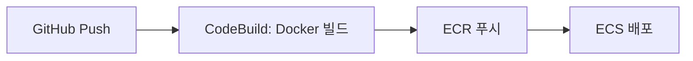
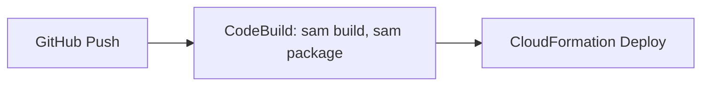
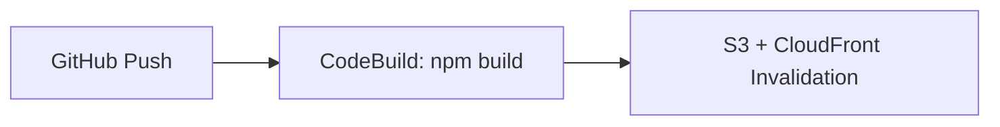

# AWS CodePipeline

## 개요

CodePipeline은 CI/CD 파이프라인 서비스다. 소스 변경부터 배포까지 자동화한다. GitHub, Bitbucket, CodeCommit 등과 연동한다. CodeBuild로 빌드하고 CodeDeploy로 배포한다. Lambda, ECS, EC2, S3 등을 배포 대상으로 지원한다.

### 왜 필요한가

수동 배포는 실수가 많다.


수동 배포는 이 순서로 진행한다.

1. 개발자가 코드를 푸시
2. Jenkins/로컬에서 빌드
3. 빌드 결과물을 서버에 업로드
4. 서버 재시작
5. 테스트 확인

이 방식에는 이런 문제가 있다.

- 매번 반복 작업
- 빌드 환경이 다름 (로컬 vs 서버)
- 실수로 잘못된 브랜치 배포
- 배포 이력 추적 어려움
- 롤백 복잡

CodePipeline으로 바꾸면 이렇게 달라진다.

- Git Push → 자동 빌드 → 자동 배포
- 일관된 빌드/배포 환경
- 승인 단계 추가 가능
- 배포 이력 자동 기록
- 원클릭 롤백

## GitHub Actions vs CodePipeline

### GitHub Actions

GitHub Actions의 장점은 이렇다.

- GitHub와 완전히 통합
- YAML 파일로 관리 (코드와 함께 버전 관리)
- 무료 티어 관대 (Public 무제한, Private 2,000분/월)
- Marketplace에 공개된 Action이 많음
- 셀프 호스트 러너 지원

단점은 이렇다.

- GitHub 종속
- AWS 배포 시 추가 설정 필요
- 복잡한 승인 프로세스 구현 어려움

`.github/workflows/deploy.yml` 예시다.

```yaml
name: Deploy to AWS
on:
  push:
    branches: [main]

jobs:
  deploy:
    runs-on: ubuntu-latest
    steps:
      - uses: actions/checkout@v3
      - name: Configure AWS credentials
        uses: aws-actions/configure-aws-credentials@v2
        with:
          aws-access-key-id: ${{ secrets.AWS_ACCESS_KEY_ID }}
          aws-secret-access-key: ${{ secrets.AWS_SECRET_ACCESS_KEY }}
          aws-region: us-west-2
      - name: Build and push Docker image
        run: |
          docker build -t my-app .
          docker tag my-app:latest $ECR_REGISTRY/my-app:latest
          docker push $ECR_REGISTRY/my-app:latest
      - name: Deploy to ECS
        run: |
          aws ecs update-service --cluster my-cluster --service my-service --force-new-deployment
```

### CodePipeline

CodePipeline의 장점은 이렇다.

- AWS 서비스와 완벽하게 통합
- IAM 기반 권한 관리
- 승인 단계 기본 제공
- CloudWatch Events 연동
- 여러 AWS 계정 간 배포 간편

단점은 이렇다.

- GitHub Actions보다 비쌈
- YAML 파일로 관리 불가 (콘솔 또는 CloudFormation)
- Git 외부 소스에서만 강점

CodePipeline은 이런 경우에 쓴다.

- 여러 AWS 계정 배포
- 복잡한 승인 프로세스
- AWS 서비스만 사용하는 환경
- 감사 추적 중요

### Bitbucket Pipeline

Bitbucket Pipeline의 특징은 이렇다.

- Bitbucket과 통합
- YAML 파일로 관리
- 매월 50분 무료 (소규모에는 부족)

`bitbucket-pipelines.yml` 예시다.

```yaml
pipelines:
  branches:
    main:
      - step:
          name: Build and Deploy
          image: node:18
          script:
            - npm install
            - npm run build
            - pipe: atlassian/aws-elasticbeanstalk-deploy:1.0.0
              variables:
                AWS_ACCESS_KEY_ID: $AWS_ACCESS_KEY_ID
                AWS_SECRET_ACCESS_KEY: $AWS_SECRET_ACCESS_KEY
                APPLICATION_NAME: 'my-app'
                ENVIRONMENT_NAME: 'production'
                ZIP_FILE: 'app.zip'
```

### 비교 표

| 항목 | GitHub Actions | CodePipeline | Bitbucket Pipeline |
|------|----------------|--------------|-------------------|
| 관리 | YAML | 콘솔/IaC | YAML |
| AWS 통합 | 수동 설정 | 네이티브 | 수동 설정 |
| 무료 티어 | 2,000분/월 | 1개 파이프라인 | 50분/월 |
| 승인 | Environments | 기본 제공 | 수동 |
| 멀티 계정 | 복잡 | 간편 | 복잡 |
| 러닝 커브 | 낮음 | 중간 | 낮음 |

## CodePipeline 구성

### 기본 파이프라인

기본 파이프라인은 Source → Build → Deploy 순서다.

각 단계의 구성은 이렇다.

1. Source: GitHub
2. Build: CodeBuild
3. Deploy: ECS

콘솔에서 만드는 순서는 이렇다.

1. CodePipeline 콘솔
2. "Create pipeline"
3. 이름: production-deploy
4. Service role: 새로 생성
5. Next

Source 단계는 이렇게 설정한다.

- Provider: GitHub (Version 2)
- Connection: GitHub 연결 (OAuth)
- Repository: my-org/my-app
- Branch: main
- Output artifact: SourceArtifact

Build 단계는 이렇게 설정한다.

- Provider: CodeBuild
- Project: my-app-build
- Input artifact: SourceArtifact
- Output artifact: BuildArtifact

Deploy 단계는 이렇게 설정한다.

- Provider: ECS
- Cluster: production
- Service: my-app-service
- Input artifact: BuildArtifact

CloudFormation 템플릿으로는 이렇게 만든다.

```yaml
Resources:
  Pipeline:
    Type: AWS::CodePipeline::Pipeline
    Properties:
      Name: production-deploy
      RoleArn: !GetAtt PipelineRole.Arn
      ArtifactStore:
        Type: S3
        Location: !Ref ArtifactBucket
      Stages:
        - Name: Source
          Actions:
            - Name: SourceAction
              ActionTypeId:
                Category: Source
                Owner: AWS
                Provider: CodeStarSourceConnection
                Version: 1
              Configuration:
                ConnectionArn: !Ref GitHubConnection
                FullRepositoryId: my-org/my-app
                BranchName: main
              OutputArtifacts:
                - Name: SourceArtifact
        - Name: Build
          Actions:
            - Name: BuildAction
              ActionTypeId:
                Category: Build
                Owner: AWS
                Provider: CodeBuild
                Version: 1
              Configuration:
                ProjectName: !Ref BuildProject
              InputArtifacts:
                - Name: SourceArtifact
              OutputArtifacts:
                - Name: BuildArtifact
        - Name: Deploy
          Actions:
            - Name: DeployAction
              ActionTypeId:
                Category: Deploy
                Owner: AWS
                Provider: ECS
                Version: 1
              Configuration:
                ClusterName: production
                ServiceName: my-app-service
              InputArtifacts:
                - Name: BuildArtifact
```

## 고급 기능

### 수동 승인

프로덕션 배포 전에 승인을 받는다.

Approval Stage를 추가한다.

```yaml
- Name: Approval
  Actions:
    - Name: ManualApproval
      ActionTypeId:
        Category: Approval
        Owner: AWS
        Provider: Manual
        Version: 1
      Configuration:
        NotificationArn: !Ref ApprovalTopic
        CustomData: "프로덕션 배포를 승인하시겠습니까?"
```

승인 흐름은 이렇다.

1. Build 완료
2. SNS로 알림 발송 (Slack, Email)
3. 승인자가 콘솔에서 승인/거부
4. 승인 시 배포 진행

### 병렬 실행

여러 작업을 동시에 실행한다.

테스트를 병렬로 실행하는 예시다.

```yaml
- Name: Test
  Actions:
    - Name: UnitTest
      ActionTypeId:
        Category: Test
        Owner: AWS
        Provider: CodeBuild
        Version: 1
      Configuration:
        ProjectName: unit-test
      InputArtifacts:
        - Name: SourceArtifact
      RunOrder: 1
    - Name: IntegrationTest
      ActionTypeId:
        Category: Test
        Owner: AWS
        Provider: CodeBuild
        Version: 1
      Configuration:
        ProjectName: integration-test
      InputArtifacts:
        - Name: SourceArtifact
      RunOrder: 1
```

`RunOrder: 1`이 같으면 병렬로 실행된다.

### 다중 배포

스테이징 → 프로덕션 순차 배포.

```yaml
- Name: Deploy-Staging
  Actions:
    - Name: DeployToStaging
      ActionTypeId:
        Category: Deploy
        Owner: AWS
        Provider: ECS
        Version: 1
      Configuration:
        ClusterName: staging
        ServiceName: my-app-service
      InputArtifacts:
        - Name: BuildArtifact

- Name: Approval
  Actions:
    - Name: ApproveProduction
      ActionTypeId:
        Category: Approval
        Owner: AWS
        Provider: Manual
        Version: 1

- Name: Deploy-Production
  Actions:
    - Name: DeployToProduction
      ActionTypeId:
        Category: Deploy
        Owner: AWS
        Provider: ECS
        Version: 1
      Configuration:
        ClusterName: production
        ServiceName: my-app-service
      InputArtifacts:
        - Name: BuildArtifact
```

### Lambda 호출

커스텀 작업을 Lambda로 실행한다.

슬랙 알림 예시다.

```yaml
- Name: Notify
  Actions:
    - Name: SlackNotify
      ActionTypeId:
        Category: Invoke
        Owner: AWS
        Provider: Lambda
        Version: 1
      Configuration:
        FunctionName: slack-notify
        UserParameters: '{"message": "배포 완료"}'
```

호출되는 Lambda 함수는 이렇다.

```python
import json
import urllib.request

def lambda_handler(event, context):
    job_data = event['CodePipeline.job']['data']
    user_params = json.loads(job_data['actionConfiguration']['configuration']['UserParameters'])
    
    # Slack Webhook
    webhook_url = "https://hooks.slack.com/services/YOUR/WEBHOOK/URL"
    message = {"text": user_params['message']}
    
    req = urllib.request.Request(
        webhook_url,
        data=json.dumps(message).encode('utf-8'),
        headers={'Content-Type': 'application/json'}
    )
    
    urllib.request.urlopen(req)
    
    # CodePipeline에 성공 알림
    codepipeline = boto3.client('codepipeline')
    codepipeline.put_job_success_result(jobId=event['CodePipeline.job']['id'])
    
    return {'statusCode': 200}
```

## 실무 파이프라인

### ECS 배포 파이프라인

아래 도식은 GitHub Push 이후 CodeBuild가 이미지를 빌드해 ECR에 푸시하고, ECS에 배포하는 흐름을 보여준다.



`buildspec.yml`은 이렇다.

```yaml
version: 0.2
phases:
  pre_build:
    commands:
      - echo Logging in to Amazon ECR...
      - aws ecr get-login-password --region $AWS_REGION | docker login --username AWS --password-stdin $ECR_REGISTRY
      - COMMIT_HASH=$(echo $CODEBUILD_RESOLVED_SOURCE_VERSION | cut -c 1-7)
      - IMAGE_TAG=${COMMIT_HASH:=latest}
  build:
    commands:
      - echo Build started on `date`
      - docker build -t $ECR_REGISTRY/$IMAGE_REPO:$IMAGE_TAG .
      - docker tag $ECR_REGISTRY/$IMAGE_REPO:$IMAGE_TAG $ECR_REGISTRY/$IMAGE_REPO:latest
  post_build:
    commands:
      - echo Pushing Docker image...
      - docker push $ECR_REGISTRY/$IMAGE_REPO:$IMAGE_TAG
      - docker push $ECR_REGISTRY/$IMAGE_REPO:latest
      - echo Writing image definitions file...
      - printf '[{"name":"my-container","imageUri":"%s"}]' $ECR_REGISTRY/$IMAGE_REPO:$IMAGE_TAG > imagedefinitions.json
artifacts:
  files:
    - imagedefinitions.json
```

`imagedefinitions.json`은 ECS가 어떤 이미지를 배포할지 정의한다.

### Lambda 배포 파이프라인

아래 도식은 SAM으로 빌드한 결과를 CloudFormation으로 배포하는 흐름을 보여준다.



`buildspec.yml`은 이렇다.

```yaml
version: 0.2
phases:
  install:
    runtime-versions:
      python: 3.11
    commands:
      - pip install aws-sam-cli
  build:
    commands:
      - sam build
      - sam package --output-template-file packaged.yaml --s3-bucket $ARTIFACT_BUCKET
artifacts:
  files:
    - packaged.yaml
    - template.yml
```

Deploy Stage는 이렇게 설정한다.

- Provider: CloudFormation
- Action mode: CREATE_UPDATE
- Stack name: my-lambda-stack
- Template: packaged.yaml
- Capabilities: CAPABILITY_IAM

### S3 정적 사이트 배포

아래 도식은 React나 Vue 앱을 빌드해 S3에 올리고 CloudFront 캐시를 무효화하는 흐름을 보여준다.



`buildspec.yml`은 이렇다.

```yaml
version: 0.2
phases:
  install:
    runtime-versions:
      nodejs: 18
  pre_build:
    commands:
      - npm install
  build:
    commands:
      - npm run build
  post_build:
    commands:
      - aws s3 sync build/ s3://$S3_BUCKET --delete
      - aws cloudfront create-invalidation --distribution-id $CLOUDFRONT_ID --paths "/*"
artifacts:
  files:
    - '**/*'
  base-directory: build
```

## 모니터링

### CloudWatch Events

파이프라인 상태 변경을 감지한다.

EventBridge Rule은 이렇게 만든다.

```json
{
  "source": ["aws.codepipeline"],
  "detail-type": ["CodePipeline Pipeline Execution State Change"],
  "detail": {
    "state": ["FAILED"],
    "pipeline": ["production-deploy"]
  }
}
```

알림을 보내는 Lambda는 이렇다.

```python
def lambda_handler(event, context):
    detail = event['detail']
    pipeline = detail['pipeline']
    state = detail['state']
    execution_id = detail['execution-id']
    
    # Slack 알림
    send_slack_message(f"❌ 파이프라인 실패: {pipeline} (ID: {execution_id})")
```

### 실행 이력

콘솔에서 모든 실행 이력을 확인한다.

콘솔에는 이런 항목이 나온다.

- 실행 ID
- 시작 시간
- 소스 커밋
- 각 Stage 상태
- 실행 시간

CLI로도 확인할 수 있다.

```bash
aws codepipeline list-pipeline-executions --pipeline-name production-deploy
```

## 롤백

### 자동 롤백

배포 실패 시 자동으로 이전 버전으로 돌아간다.

CodeDeploy 설정은 이렇다.

```yaml
DeploymentConfigName: CodeDeployDefault.ECSAllAtOnce
AutoRollbackConfiguration:
  Enabled: true
  Events:
    - DEPLOYMENT_FAILURE
    - DEPLOYMENT_STOP_ON_ALARM
```

CloudWatch Alarm을 연동하면 에러율이 5%를 넘을 때 자동 롤백한다.

```bash
aws codedeploy create-deployment-group \
  --application-name my-app \
  --deployment-group-name production \
  --auto-rollback-configuration enabled=true,events=DEPLOYMENT_FAILURE,DEPLOYMENT_STOP_ON_ALARM \
  --alarm-configuration enabled=true,alarms=[{name=high-error-rate}]
```

### 수동 롤백

이전 실행을 다시 릴리스한다.

콘솔에서는 이렇게 한다.

1. 파이프라인 선택
2. 실행 이력에서 이전 성공 실행 선택
3. "Retry" 또는 "Release change"

CLI에서는 이렇게 한다.

```bash
# 특정 커밋으로 재배포
aws codepipeline start-pipeline-execution \
  --name production-deploy
```

## 비용

### 파이프라인 비용

무료 티어는 이렇다.

- 매월 1개 활성 파이프라인 무료

유료 구간은 이렇다.

- $1.00 per active pipeline per month

파이프라인이 5개인 경우를 계산하면 이렇다.

- 파이프라인 5개
- 비용: (5 - 1) × $1 = $4/월

매우 저렴하다.

### 실행 비용

파이프라인 실행 자체는 무료. 하지만 연결된 서비스는 별도 과금.

CodeBuild는 일반 인스턴스 기준 build minute당 $0.005다.

S3 아티팩트 저장은 $0.023/GB-월이다.

CloudWatch Events는 규칙 제한 안에서 무료다.

### 최적화

오래된 빌드 결과물을 삭제한다.

S3 Lifecycle 규칙은 이렇다.

```json
{
  "Rules": [
    {
      "Id": "DeleteOldArtifacts",
      "Status": "Enabled",
      "Expiration": {
        "Days": 30
      }
    }
  ]
}
```

30일 후 자동 삭제. 스토리지 비용 절감.

## GitHub Actions와 함께 사용

GitHub Actions로 빌드하고 CodePipeline으로 배포할 수도 있다.

GitHub Actions로 ECR에 푸시하는 예시다.

```yaml
name: Build and Push
on:
  push:
    branches: [main]

jobs:
  build:
    runs-on: ubuntu-latest
    steps:
      - uses: actions/checkout@v3
      - name: Configure AWS
        uses: aws-actions/configure-aws-credentials@v2
        with:
          aws-access-key-id: ${{ secrets.AWS_ACCESS_KEY_ID }}
          aws-secret-access-key: ${{ secrets.AWS_SECRET_ACCESS_KEY }}
          aws-region: us-west-2
      - name: Build and Push
        run: |
          docker build -t $ECR_REGISTRY/my-app:$GITHUB_SHA .
          docker push $ECR_REGISTRY/my-app:$GITHUB_SHA
```

CodePipeline에서는 이렇게 배포한다.

- Source: ECR
- Deploy: ECS

이 조합의 장점은 이렇다.

- GitHub Actions의 빠른 빌드
- CodePipeline의 승인 프로세스

## 참고

- CodePipeline 개발자 가이드: https://docs.aws.amazon.com/codepipeline/
- CodePipeline 요금: https://aws.amazon.com/codepipeline/pricing/
- GitHub Actions vs CodePipeline: https://aws.amazon.com/blogs/devops/
- Best Practices: https://docs.aws.amazon.com/codepipeline/latest/userguide/best-practices.html

