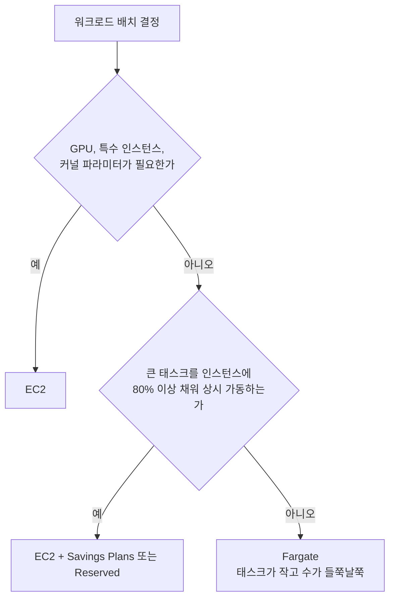
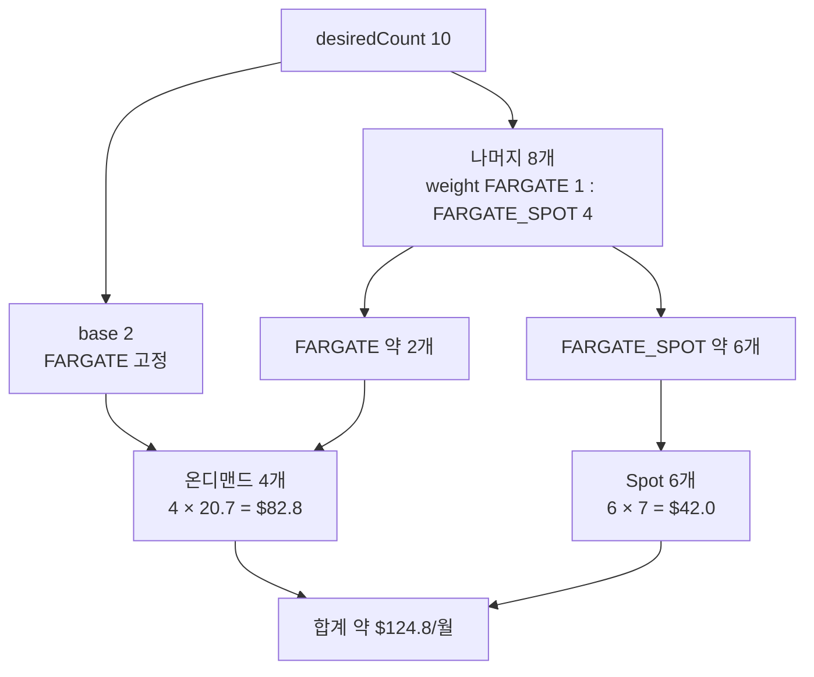
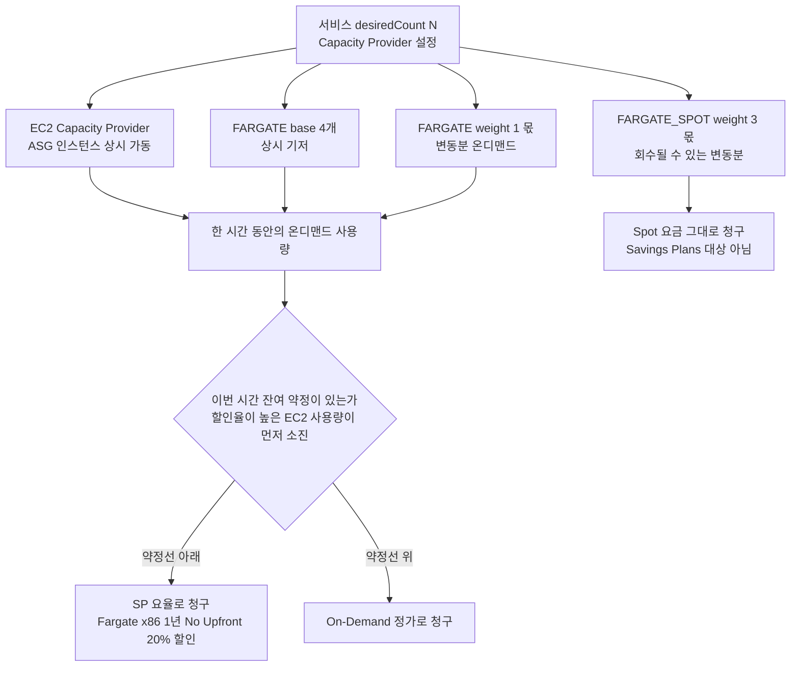
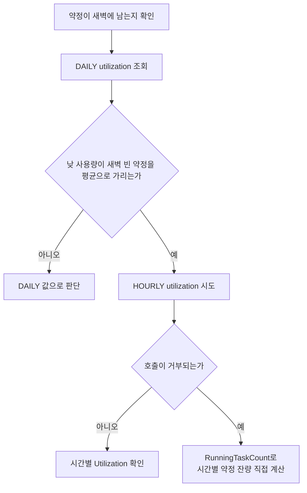
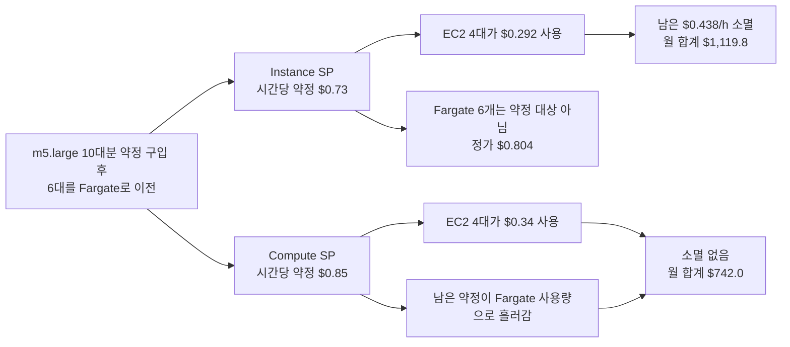
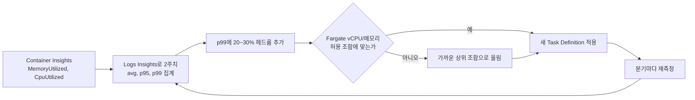
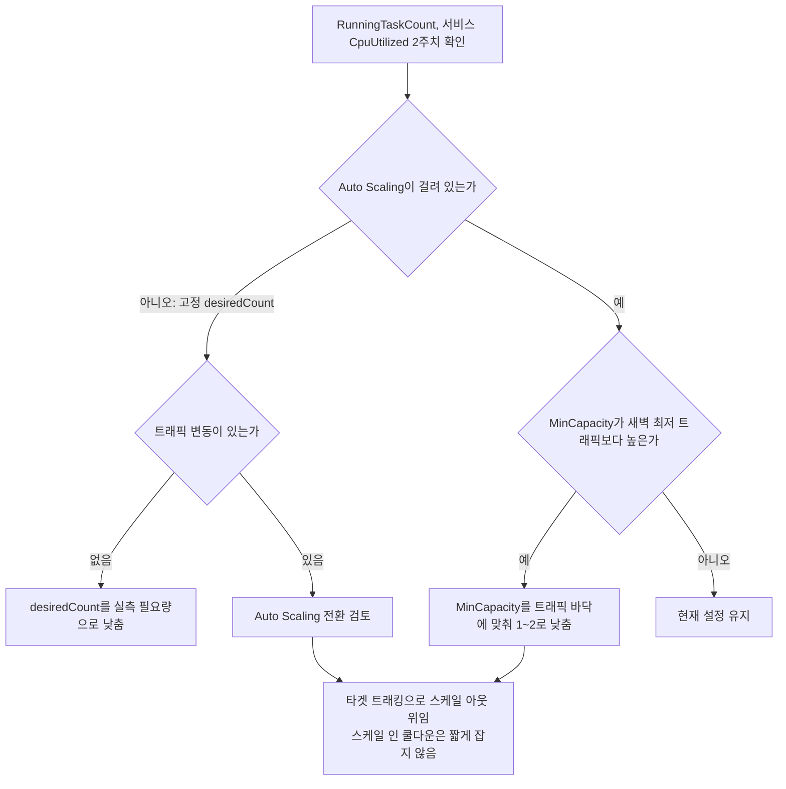

# ECS 비용 산정과 절감

ECS 클러스터 비용이 슬금슬금 오르는데 원인을 못 짚는 경우가 많다. 인스턴스를 줄이자니 트래픽 스파이크가 무섭고, 그대로 두자니 청구서가 부담이다. 이 문서는 Fargate와 EC2 모드의 실비용을 어떻게 계산하는지, 어디서 돈이 새는지, Savings Plans와 Spot을 비용 관점에서 어떻게 섞는지를 다룬다.

base/weight 파라미터의 동작 원리는 [ECS Capacity Providers](ECS_Capacity_Providers.md)에, Spot 회수 대응과 체크포인팅은 [Fargate Spot 운영 심화](Fargate_Spot.md)에, 지표의 Reserved/Utilized 구분은 [ECS Container Insights](ECS_Container_Insights.md)에 정리돼 있다. 여기서는 그 메커니즘을 다시 설명하지 않고 비용 숫자를 잡는 데만 집중한다.

## Fargate 요금이 어떻게 매겨지는가

Fargate는 인스턴스 단위가 아니라 태스크가 점유한 vCPU와 메모리를 **초 단위**로 과금한다. 최소 1분은 보장된다. 서울 리전(ap-northeast-2) 기준 온디맨드 단가는 대략 이렇다(요금은 수시로 바뀌므로 항상 [공식 요금표](https://aws.amazon.com/fargate/pricing/)로 재확인해야 한다).

- vCPU: 시간당 약 $0.04656
- 메모리: GB당 시간당 약 $0.00511

태스크 하나의 시간당 비용은 단순하다.

```
태스크 시간당 비용 = (vCPU 수 × 0.04656) + (메모리 GB × 0.00511)
```

0.5 vCPU / 1GB 태스크를 한 달(730시간) 돌리면:

```
(0.5 × 0.04656 + 1 × 0.00511) × 730
= (0.02328 + 0.00511) × 730
= 0.02839 × 730
≈ $20.7/월
```

이 태스크를 desiredCount 4로 상시 띄우면 약 $83/월이다. 여기에 ALB, NAT Gateway, CloudWatch Logs 수집 비용이 별도로 붙는다. 컴퓨팅만 보면 작아 보여도 NAT Gateway 데이터 처리 요금이 컴퓨팅보다 큰 경우도 흔하다. 비용을 볼 때 Fargate 라인만 보지 말고 같은 서비스가 끌고 오는 부수 비용까지 한 줄에 묶어서 봐야 한다.

태스크 크기는 vCPU와 메모리를 아무 조합으로나 못 정한다. 0.25 vCPU는 0.5~2GB, 1 vCPU는 2~8GB 식으로 조합이 정해져 있다. right-sizing할 때 이 제약 때문에 "메모리만 줄이고 싶은데 CPU 단계가 강제로 같이 내려가는" 상황이 생긴다.

## Fargate vs EC2, 어느 쪽이 싼지 계산해 보기

"Fargate가 비싸다"는 말은 절반만 맞다. 비교는 **인스턴스 점유율(packing)**에 달려 있다.

EC2 모드는 인스턴스 요금을 통째로 낸다. m5.large(2 vCPU, 8GB)가 서울 온디맨드 시간당 약 $0.118이다. 한 달이면 약 $86이다. 이 인스턴스 한 대에 태스크를 얼마나 빽빽하게 채우느냐가 관건이다.

같은 0.5 vCPU / 1GB 태스크를 EC2에 올린다고 하자. m5.large 한 대에 vCPU 기준으로는 4개(2 / 0.5), 메모리 기준으로는 8개(8 / 1)가 들어간다. 둘 중 작은 쪽인 4개가 한 대 한계다. 실제로는 ECS 에이전트와 시스템이 약간 먹으므로 3개 정도로 잡는 게 안전하다.

```
EC2 모드: m5.large 1대에 태스크 3개
대당 $86 → 태스크당 약 $28.7/월

Fargate 모드: 태스크당 약 $20.7/월
```

이 조합에서는 오히려 Fargate가 싸다. 태스크를 빽빽하게 못 채우면 EC2의 "통째 과금"이 손해로 돌아온다. 반대로 인스턴스를 거의 100% 채울 수 있는 워크로드(예: vCPU를 꽉 쓰는 배치 작업, 큰 태스크 여러 개)라면 EC2가 유리해진다.

판단 기준을 아래 flowchart로 먼저 훑고, 이어지는 목록에서 이유를 본다.



- 태스크 크기가 작고 수가 들쭉날쭉하다 → Fargate. 인스턴스 관리 비용(패치, AMI, ASG 튜닝)까지 빼면 차이가 더 좁혀진다.
- 큰 태스크를 인스턴스에 꽉 채워 상시 돌린다 → EC2 + Savings Plans 또는 Reserved.
- GPU, 특수 인스턴스 타입, 커스텀 커널 파라미터가 필요하다 → EC2(Fargate는 선택지가 없다).

EC2를 고를 때 잊기 쉬운 비용이 **빈 공간**이다. 인스턴스 점유율이 60%면 나머지 40%는 아무도 안 쓰는데 돈은 나간다. Fargate는 이 빈 공간이 구조적으로 없다(태스크 단위 과금이라). EC2의 절감 효과를 누리려면 bin-packing 배치 전략과 [Container Insights](ECS_Container_Insights.md)로 점유율을 꾸준히 80% 이상 유지해야 한다. 점유율 관리를 안 할 거면 EC2의 단가 우위는 환상이다.

## Fargate Spot으로 컴퓨팅 단가 낮추기

Fargate Spot은 온디맨드 대비 보통 60~70% 싸다. 위의 $20.7/월 태스크가 Spot이면 $6~8/월 수준이다. 회수만 감당할 수 있으면 절감폭이 가장 크다.

Capacity Provider Strategy의 weight를 조정해서 온디맨드와 Spot 비율을 정한다. weight 동작 원리는 [Capacity Providers 문서](ECS_Capacity_Providers.md)에 있고, 여기서는 비용이 어떻게 갈리는지만 본다.

desiredCount 10인 서비스를 예로 든다.

```json
[
  {"capacityProvider": "FARGATE",      "base": 2, "weight": 1},
  {"capacityProvider": "FARGATE_SPOT", "base": 0, "weight": 4}
]
```

base 2는 온디맨드로 고정되고, 나머지 8개를 1:4로 나눠서 대략 온디맨드 4 / Spot 6이 된다. 비용을 계산하면:

```
온디맨드 4개: 4 × 20.7 = $82.8
Spot 6개:     6 × 7   = $42.0
합계: 약 $124.8/월
```

아래 flowchart는 desiredCount 10이 base와 weight를 거쳐 두 풀로 나뉘는 과정이다. base가 먼저 떼어지고 나머지 8개만 weight 비율로 갈린다는 점을 보면 된다.



전부 온디맨드(10개)로 돌리면 $207/월이니, 이 구성으로 약 40% 절감이다. base를 0으로 낮추고 weight를 더 Spot 쪽으로 밀면 더 싸지지만, Spot 풀이 동시에 회수되면 살아남는 태스크가 줄어든다. base는 "Spot이 전부 회수돼도 서비스가 죽지 않을 최소 개수"로 잡는다. 절감액과 가용성을 맞바꾸는 다이얼이라고 보면 된다.

가중치를 바꿀 때는 회수율을 같이 봐야 한다. Spot 비율을 70%로 올려놨는데 그 리전·태스크 크기의 회수가 잦으면, 재시작과 ALB 헬스체크 흔들림으로 생기는 운영 비용이 절감액을 갉아먹는다. 회수 빈도를 숫자로 보는 방법은 [Fargate Spot 문서](Fargate_Spot.md)에 있다.

## Compute Savings Plans가 어디까지 덮는가

Compute Savings Plans는 시간당 일정 금액을 1년 또는 3년 약정하고, 그 금액만큼의 온디맨드 사용에 할인을 적용한다. 서울 리전 Fargate x86 기준으로 1년 No Upfront는 20%, 3년 No Upfront는 40% 할인이다. ARM(Graviton)은 각각 약 21%, 46%다. 요율을 뽑아 계산한 과정은 아래 "Fargate는 vCPU와 메모리에 각각 요율이 붙는다" 절에 있다. 할인율은 리전과 결제 옵션마다 달라서 구매 직전에 Cost Explorer 추천값과 공식 요율로 다시 확인한다.

커버리지 범위를 정확히 알아야 약정 금액을 잘못 잡지 않는다.

- 덮는다: Fargate 온디맨드, EC2 온디맨드(인스턴스 패밀리·리전 무관), Lambda.
- 안 덮는다: **Fargate Spot, EC2 Spot**. Spot은 이미 할인 가격이라 Savings Plans 대상이 아니다.

여기서 가장 흔한 실수가 Spot 사용량까지 약정에 넣는 것이다. Spot은 Savings Plans와 겹치지 않으니, Spot으로 돌릴 부분을 빼고 **상시 떠 있는 온디맨드 양에만 맞춰** 약정해야 한다. 약정이 실제 온디맨드보다 크면 못 쓴 약정액이 그대로 손실이다. 이 계산을 거꾸로 잡았을 때 생기는 두 방향의 함정은 [Fargate Spot 문서의 "Savings Plans와 Spot을 같이 쓸 때" 절](Fargate_Spot.md)에 자세히 있으니 참고한다.

약정 금액을 잡는 순서는 이렇다.

1. base로 항상 떠 있는 온디맨드 태스크의 시간당 컴퓨팅 비용을 계산한다.
2. 그 금액의 70~80% 정도만 약정한다. 100%를 약정하면 트래픽이 줄어 태스크가 스케일 인할 때 약정이 비게 된다.
3. Cost Explorer의 Savings Plans utilization을 매달 본다. 100% 미만이면 약정이 남는 것이고, 다음 갱신 때 약정을 줄인다.

위의 온디맨드 4개 상시 구성($82.8/월)에 1년 No Upfront 20%를 적용하면 약 $66.2/월이 된다. Spot 6개는 약정과 무관하게 그대로 $42다. 약정을 살 때 이 $82.8 기준선을 넘기지 않는 게 핵심이다.

기준선을 어떻게 잡는지, 태스크 수가 오르내릴 때 약정 위아래가 어떻게 청구되는지는 아래에서 숫자로 푼다. 약정 자체의 구매 절차와 반품은 [AWS Savings Plans](../Cost/Savings_Plans.md)에 있다.

### 한 시간 청구서가 세 갈래로 나뉘는 구조

EC2 Capacity Provider, FARGATE, FARGATE_SPOT을 한 서비스에 섞으면 같은 한 시간이 세 갈래로 청구된다. 아래 flowchart에서 Compute SP 약정이 붙는 쪽은 EC2와 Fargate 온디맨드 사용량이 모이는 가운데 풀이고, Spot 갈래는 약정과 만나지 않는다. 예제 서비스는 x86 0.5 vCPU / 1GB 태스크이고, FARGATE base 4에 FARGATE 1 : FARGATE_SPOT 3 weight로 나머지를 나눈다.



상시 기저 4개는 어느 시간대에도 약정선 아래에 있다. 변동분 온디맨드는 트래픽이 오르면 약정선을 넘어가 정가로 나간다. EC2와 Fargate가 같은 약정 풀을 나눠 쓰는 점도 놓치기 쉽다. 할인율이 높은 EC2 사용량이 약정을 먼저 가져가므로(순서 규칙은 [Savings Plans 문서](../Cost/Savings_Plans.md)에 있다) ASG 인스턴스가 늘어나는 시간대에는 Fargate에 남는 약정이 줄고, Fargate Coverage가 이유 없이 내려간 것처럼 보인다. 이때는 Fargate 쪽 설정이 아니라 EC2 인스턴스 수 변화부터 본다. 아래 계산은 Fargate 갈래만 센다.

### 태스크 수에 따라 약정선 위아래 청구가 갈린다

Auto Scaling으로 하루 동안 태스크 수가 아래 네 구간을 오간다고 하자. base 4 + 1 : 3 weight이므로 총 N개 중 온디맨드는 4 + (N-4)/4, Spot은 나머지다.

| 구간 | 시간 | 총 태스크 | 온디맨드 | Spot | 온디맨드 사용량 (SP 요율 환산, $/h) |
|---|---|---|---|---|---|
| 야간 | 8h | 4 | 4 | 0 | 0.0908 |
| 완만 | 6h | 8 | 5 | 3 | 0.1136 |
| 업무 | 6h | 12 | 6 | 6 | 0.1363 |
| 피크 | 4h | 16 | 7 | 9 | 0.1590 |

SP 요율 환산은 온디맨드 태스크 수에 0.022712를 곱한 값이다. 태스크 하나가 SP 요율로 시간당 `0.5 × 0.037248 + 1 × 0.004088 = 0.022712`이기 때문이다(단가의 출처는 다음 절). 약정 금액은 정가가 아니라 이 SP 요율 환산 값으로 정한다. 온디맨드 4개의 정가 사용량은 시간당 $0.11356이지만 이걸 덮는 약정은 그 80%인 $0.0908이다. 정가 숫자를 그대로 약정하면 20% 과다 약정이 된다.

약정선을 어디에 긋느냐에 따라 하루가 이렇게 달라진다. 월은 일 청구에 730/24를 곱했다. 온디맨드 파트만 센 값이고 Spot은 약정과 무관하다.

| 약정 (SP 요율 기준 태스크 수) | 시간당 약정 | 월 청구 | Utilization | 약정 없을 때 대비 |
|---|---|---|---|---|
| 없음 | 0 | $108.8 | - | 기준 |
| 4개 (야간 하한) | $0.0908 | $92.2 | 100.0% | -$16.6 |
| 5개 | $0.1136 | $95.0 | 93.3% | -$13.8 |
| 6개 | $0.1363 | $102.9 | 84.7% | -$5.9 |
| 7개 (피크 맞춤) | $0.1590 | $116.1 | 75.0% | +$7.3 |

피크에 맞춰 7개를 약정하면 아무것도 안 산 것보다 월 $7.3 비싸다. 20시간 동안 약정이 남는데 남은 약정도 전액 청구되기 때문이다. 할인율이 20%이면 약정으로 덮은 부분의 Utilization이 80% 밑으로 내려가는 순간 손해로 돌아선다. 손익분기가 `1 - 할인율`이다. 6개 약정은 84.7%라 간신히 이득이고, 7개는 75.0%라 손해다.

야간 하한 4개는 100%로 잡았다. 이 예제의 4개는 base로 가용성 때문에 고정한 하한이어서 약정이 비지 않는다. base나 MinCapacity를 1년 안에 낮출 계획이 있으면 위의 70~80% 규칙대로 낮춰 잡는다. base를 4에서 2로 줄이면 약정 4개 중 2개가 1년 내내 소멸한다.

Spot까지 합친 월 총액은 전부 온디맨드 $186.5, Spot 혼합만 적용하면 $135.1(온디맨드 $108.8 + Spot $26.3), 거기에 4개 약정을 얹으면 $118.5다. 절감의 대부분은 Spot에서 나오고(-$51.4) 약정이 보태는 건 -$16.6다. 약정부터 고민하게 되지만 이 구성에서는 Spot 비중이 금액을 좌우한다. Savings Plans와 Spot을 같이 쓸 때 약정이 비는 경우는 [Fargate Spot 운영 심화](Fargate_Spot.md)에도 따로 정리돼 있다.

### Fargate는 vCPU와 메모리에 각각 요율이 붙는다

Savings Plans는 Fargate 태스크를 한 덩어리로 보지 않고 vCPU-시간과 GB-시간 두 줄로 따로 요율을 적용한다. 아래 단가는 AWS Price List API에서 서울 리전(ap-northeast-2)을 직접 내려받아 뽑았다. 온디맨드는 2026-09-11 게시본(`AmazonECS`), Savings Plans 요율은 2026-10-13 게시본(`AWSComputeSavingsPlan`, 파일이 260MB라 Fargate 항목만 필터링했다)이다.

| 항목 | x86 온디맨드 | x86 SP 1년 No Upfront | ARM 온디맨드 | ARM SP 1년 No Upfront |
|---|---|---|---|---|
| vCPU-시간 | $0.04656 | $0.037248 | $0.03725 | $0.02933 |
| 메모리 GB-시간 | $0.00511 | $0.004088 | $0.00409 | $0.00322 |
| 같은 아키텍처 온디맨드 대비 할인 | - | 20.0% | - | 21.3% |

3년 No Upfront는 x86이 vCPU $0.027936, 메모리 $0.003066(40.0% 할인), ARM이 vCPU $0.02011, 메모리 $0.00221(약 46.0% 할인)이다. vCPU와 메모리의 할인율이 같아서 CPU 대비 메모리 비중이 큰 태스크라고 할인율이 달라지지는 않는다. Windows Fargate는 별도 요율 줄이 있고, 서울 리전 Compute SP 파일에서 임시 스토리지 추가분(20GB 초과) 항목은 찾지 못했다. 스토리지를 크게 잡는 태스크는 그 부분이 약정 밖에 남는다고 보고 계산한다.

ARM 할인율은 두 겹이다. ARM 온디맨드가 이미 x86보다 20.0% 싸고, 그 위에 SP 21.3%가 붙는다. 0.5 vCPU / 1GB 태스크를 730시간 돌리는 비용으로 비교한다.

| 구성 | 시간당 | 월 (730h) | x86 온디맨드 대비 |
|---|---|---|---|
| x86 온디맨드 | $0.02839 | $20.72 | 기준 |
| x86 SP 1년 | $0.02271 | $16.58 | -20.0% |
| ARM 온디맨드 | $0.02272 | $16.58 | -20.0% |
| ARM SP 1년 | $0.01788 | $13.06 | -37.0% |
| x86 SP 3년 | $0.01703 | $12.43 | -40.0% |
| ARM SP 3년 | $0.01226 | $8.95 | -56.8% |

ARM 온디맨드가 x86 SP 1년과 단가가 사실상 같다. 이미지를 arm64로 빌드하고 Task Definition의 `runtimePlatform.cpuArchitecture`를 `ARM64`로 바꾸는 작업이 끝나면 약정 없이도 1년 약정 수준의 단가가 나온다. 약정을 먼저 사고 ARM 이전을 미루는 순서보다 ARM 이전을 먼저 하고 약정을 사는 순서가 낫다.

ARM 이전을 약정 이후에 하면 함정이 있다. 4개 태스크 몫으로 x86 기준 $0.09/h를 약정해 둔 상태에서 4개를 ARM으로 옮기면 SP 요율 환산 사용량이 `4 × 0.017885 = $0.0715/h`로 줄어든다. 약정 $0.09 중 $0.0185/h가 매시간 소멸해서 Utilization이 79.5%이고 월 $13.5가 날아간다. 같은 태스크 수인데도 약정이 비는 원인이 아키텍처 변경이라는 걸 모르면 한참 헤맨다. ARM 이전 계획이 있으면 이전 후 환산 값(위 표의 ARM SP 시간당 단가 × 태스크 수)으로 약정을 잡는다.

### 새벽에 Task가 줄어들 때 약정이 남는지 CLI로 보기

위 표의 야간 구간처럼 Task 수가 줄어든 시간대에 약정이 얼마나 남는지는 Utilization으로 본다. 약정은 시간 단위로 평가되고 남은 약정이 이월되지 않는 규칙은 [Savings Plans 문서](../Cost/Savings_Plans.md)에 있으니 여기서는 확인 방법만 적는다.

일 단위로 7일을 조회하는 명령이다.

```bash
aws ce get-savings-plans-utilization \
  --time-period Start=2026-10-07,End=2026-10-14 \
  --granularity DAILY \
  --query 'SavingsPlansUtilizationsByTime[].{day:TimePeriod.Start,total:Utilization.TotalCommitment,used:Utilization.UsedCommitment,unused:Utilization.UnusedCommitment,pct:Utilization.UtilizationPercentage}' \
  --output table
```

DAILY 값의 맹점은 새벽의 빈 약정을 낮의 사용량이 평균으로 가린다는 점이다. 앞 표의 5개 약정은 하루 평균 Utilization이 93.3%로 멀쩡해 보이지만 야간 8시간만 보면 80%($0.0908 / $0.1136)다. 시간 단위로 보려면 `--granularity HOURLY`에 타임스탬프 범위를 넣는다.

```bash
aws ce get-savings-plans-utilization \
  --time-period Start=2026-10-13T00:00:00Z,End=2026-10-14T00:00:00Z \
  --granularity HOURLY
```

이 HOURLY 호출은 직접 실행해서 확인하지 못했다. 이 문서를 쓰는 환경에 AWS 자격증명이 없다. API 문서의 Granularity 항목에 Valid Values로 `DAILY | MONTHLY | HOURLY`가 적혀 있는데, 같은 항목에 "이 오퍼레이션은 DAILY와 MONTHLY만 지원한다"는 문장도 함께 있어서 서로 어긋난다. 호출이 거부되면 Container Insights의 시간별 태스크 수로 약정 잔량을 직접 계산하는 방법이 있다. 아래 flowchart는 어느 쪽 확인 경로를 타는지 정리한 것이다.




```bash
COMMIT=0.1136      # 시간당 약정
RATE=0.022712      # 태스크 1개의 SP 요율 (0.5 vCPU / 1GB, x86, 1년 No Upfront)
BASE=4             # FARGATE base
SHARE=0.25         # base 초과분 중 FARGATE(온디맨드) 몫 = 1 / (1 + 3)

aws cloudwatch get-metric-statistics \
  --namespace ECS/ContainerInsights --metric-name RunningTaskCount \
  --dimensions Name=ClusterName,Value=my-cluster Name=ServiceName,Value=my-service \
  --start-time 2026-10-13T00:00:00Z --end-time 2026-10-14T00:00:00Z \
  --period 3600 --statistics Average --output json |
jq -r --argjson c "$COMMIT" --argjson r "$RATE" --argjson b "$BASE" --argjson s "$SHARE" '
  .Datapoints | sort_by(.Timestamp)[]
  | ($b + ([.Average - $b, 0] | max) * $s) as $od
  | ($od * $r) as $used
  | [.Timestamp, .Average, $od, $used, ([$c - $used, 0] | max)] | @tsv'
```

출력 열은 시각, 총 태스크 수, 온디맨드 추정 태스크 수, SP 요율 환산 사용량, 남은 약정이다. `RunningTaskCount`는 Spot 태스크를 포함한 전체 개수라서 `BASE`와 `SHARE`로 온디맨드 몫을 추정한다. 실제 배치와 어긋날 수 있으니 절대값보다 어느 시간대부터 약정이 남는지 보는 용도로 쓴다. jq 부분은 샘플 JSON으로 돌려 계산이 맞는 것까지 확인했다. 샘플에서 총 태스크 4개인 시간은 남은 약정이 $0.0228/h, 12개와 16개인 시간은 0으로 나온다.

남는 시간대가 정해져 있으면 대응은 두 가지다. 약정을 그 시간대의 사용량으로 낮추거나, 남는 시간대에 돌려도 되는 배치 작업을 Fargate 온디맨드로 옮겨 약정을 채운다. 후자는 약정이 이미 지불된 상태라 그 시간만큼은 추가 비용 없이 돌아간다. 다만 배치 때문에 Auto Scaling 하한을 올리면 낮 시간 약정선 위 청구가 같이 늘 수 있으니 시간대를 맞춰야 한다.

### EC2 Instance SP를 사고 Fargate 비중을 올릴 때

EC2 Instance SP는 Compute SP보다 할인율이 높아서 EC2가 주력이면 끌린다. 서울 m5.large 1년 No Upfront 요율을 같은 방식으로 뽑으면 온디맨드 $0.118, Instance SP $0.073(38.1% 할인), Compute SP $0.085(28.0% 할인)다. 문제는 Instance SP가 Fargate에 적용되지 않는다는 점이다.

m5.large 상시 10대로 시작해서 6대분을 Fargate로 옮기고 EC2를 4대만 남기는 경우를 보자. Fargate는 같은 규모인 2 vCPU / 8GB x86 태스크 6개(온디맨드 `2 × 0.04656 + 8 × 0.00511 = $0.134/h`)로 가정한다.

| 약정 | 시간당 약정 | 이전 후 EC2 사용 | 약정 소멸 | Fargate 6개 청구 | 월 합계 |
|---|---|---|---|---|---|
| Instance SP (10대분) | $0.73 | 4 × $0.073 = $0.292 | $0.438/h | 정가 $0.804 | $1,119.8 |
| Compute SP (10대분) | $0.85 | 4 × $0.085 = $0.34 | 0 | 약정이 $0.51 덮고 나머지 $0.1665 정가 | $742.0 |
| 약정 없음 | 0 | 4 × $0.118 = $0.472 | 0 | 정가 $0.804 | $931.5 |

아래 flowchart는 m5.large 10대분 약정을 산 뒤 6대를 Fargate로 옮겼을 때 두 약정이 갈리는 지점을 비교한다. Instance SP 쪽에만 Fargate로 가는 길이 막혀 있다.



Instance SP는 소멸하는 $0.438/h가 월 $319.7이고, 합계가 약정 없이 쓸 때($931.5)보다 비싸다. Compute SP는 이전 후에도 남는 약정이 Fargate 사용량으로 흘러가서 소멸이 없다. 이전 전 할인율이 10대 기준으로 월 $87.6 더 높았던 Instance SP가 이전 한 번에 뒤집힌다. 같은 조직의 다른 계정에 m5 사용량이 있고 약정 공유가 켜져 있으면 소멸분을 거기서 흡수할 수 있다. 그 사용량이 이미 다른 약정이나 RI로 덮여 있으면 기대할 수 없다.

Instance SP는 패밀리와 리전을 고정하므로 Fargate 이전뿐 아니라 m5에서 m7g(Graviton)로 옮기는 경우에도 같은 일이 생긴다. Fargate나 Graviton 이전이 1년 안에 계획에 있으면 약정을 Compute SP로 사고, Instance SP는 이전 계획이 없는 EC2 하한 몫에만 쓴다. 7일 이내 반품 규정이 있지만 구매한 달 안이어야 하는 조건 때문에 달 말에는 창이 짧다. 구매 전에 이전 일정부터 확인하는 쪽이 낫다.

## Container Insights 지표로 태스크 right-sizing

비용이 새는 가장 큰 구멍은 태스크에 메모리·CPU를 과하게 잡아둔 것이다. Task Definition에 메모리 2048(2GB)을 박아놨는데 실제로는 700MB만 쓰고 있으면, 나머지 1.3GB는 매시간 돈을 내면서 노는 셈이다.

[Container Insights](ECS_Container_Insights.md)를 켜면 태스크·서비스 단위로 실제 사용량이 나온다. right-sizing은 이 지표에서 시작한다. CloudWatch에서 봐야 할 지표는 다음이다.

- `CpuUtilized` / `CpuReserved`: 실제 쓴 vCPU 대 예약한 vCPU
- `MemoryUtilized` / `MemoryReserved`: 실제 쓴 메모리 대 예약한 메모리

CloudWatch Logs Insights로 최근 2주 사용량의 분포를 뽑는다. 평균만 보면 안 되고 p95, p99를 같이 봐야 한다. 평균이 700MB여도 p99가 1.4GB면 2GB 예약이 과한 게 아니라 적정에 가깝다.

```
fields @timestamp, MemoryUtilized, CpuUtilized
| filter Type = "Task"
| stats avg(MemoryUtilized) as avg_mem,
        pct(MemoryUtilized, 95) as p95_mem,
        pct(MemoryUtilized, 99) as p99_mem,
        avg(CpuUtilized) as avg_cpu,
        pct(CpuUtilized, 99) as p99_cpu
  by bin(1d)
```

right-sizing이 지표에서 새 예약량까지 이어지는 순서를 아래 flowchart로 정리했다. 마지막 단계에서 Fargate 조합 제약 때문에 값이 한 번 더 보정된다는 점을 보면 된다.



right-sizing 기준은 보수적으로 잡는다. p99에 20~30% 헤드룸을 더한 값을 새 예약량으로 정한다. 예를 들어 p99 메모리가 1.1GB면 1.1 × 1.3 ≈ 1.4GB, Fargate 조합 제약에 맞춰 1.5GB나 2GB 중 가까운 쪽으로 내린다. 2GB에서 1GB로 줄이면 메모리 비용이 절반이 되는데, 한 태스크에서는 작아도 desiredCount × 태스크 수로 곱하면 무시 못 할 금액이다.

조심할 점이 몇 가지 있다.

- **OOM 여유는 남겨야 한다.** 메모리를 너무 빡빡하게 줄이면 트래픽 스파이크나 GC 순간에 OOM Killed로 태스크가 죽는다. 죽은 태스크 재시작 비용과 사용자 영향이 절감액보다 크다. 메모리는 p99 + 헤드룸을 지키고, 애매하면 한 단계 위로 둔다.
- **CPU는 burst 특성을 본다.** 평소 0.2 vCPU를 쓰다가 배포·캐시 워밍 순간에 1 vCPU를 치는 워크로드가 있다. 평균만 보고 CPU를 깎으면 그 순간 응답이 느려진다. 이런 워크로드는 max를 기준으로 잡는다.
- **JVM은 힙 외 메모리를 본다.** 컨테이너 메모리는 힙뿐 아니라 메타스페이스, 스레드 스택, 네이티브 메모리를 합한 값이다. `-Xmx`만 보고 예약을 잡으면 모자란다. `MemoryUtilized`(실측)를 기준으로 잡아야 정확하다.

right-sizing은 한 번 하고 끝나는 게 아니라 분기에 한 번씩 다시 본다. 코드가 바뀌면 메모리 프로파일도 바뀐다.

## 과다 프로비저닝된 desiredCount와 min capacity 찾기

태스크 크기를 줄여도, 안 쓰는 태스크를 여러 개 띄워두면 소용없다. 낭비가 가장 잘 숨는 곳이 Service Auto Scaling의 `MinCapacity`와 고정 `desiredCount`다.

흔한 패턴은 이렇다. 처음 서비스를 만들 때 불안해서 desiredCount를 6으로 잡았다. 그 뒤로 트래픽은 평소 2개면 충분한데, 아무도 desiredCount를 다시 안 내렸다. 6개가 1년 내내 떠 있으면서 4개는 거의 노는 중이다.

찾는 방법은 [Container Insights](ECS_Container_Insights.md)의 서비스 단위 지표에서 시작한다.

- `RunningTaskCount`가 항상 `DesiredTaskCount`와 같고 변동이 없다 → Auto Scaling이 안 걸려 있거나 MinCapacity가 너무 높다.
- 서비스 전체 `CpuUtilized` 합이 예약 대비 20% 미만으로 며칠째 깔려 있다 → 태스크 수가 과하다.

Service Auto Scaling 설정에서 봐야 할 값:

```bash
aws application-autoscaling describe-scalable-targets \
  --service-namespace ecs \
  --resource-ids service/my-cluster/my-service
```

`MinCapacity`가 실제 새벽 최저 트래픽보다 높게 잡혀 있으면, 그 차이만큼 매일 밤 낭비다. 새벽에 0건 트래픽인 내부 서비스를 MinCapacity 4로 두는 식의 설정이 자주 보인다. MinCapacity를 트래픽 바닥에 맞춰 1~2로 내리고, 타겟 트래킹 정책(예: CPU 50% 타겟)으로 낮에만 늘어나게 두면 야간 비용이 빠진다.

과다 프로비저닝을 줄일 때 순서는 이렇다.

1. 2주치 `RunningTaskCount`와 서비스 CPU/메모리 사용률을 시간대별로 본다.
2. 트래픽 바닥 시간대의 실제 필요량을 확인하고 MinCapacity를 거기에 맞춘다.
3. 타겟 트래킹으로 스케일 아웃을 맡기되, 스케일 인 쿨다운을 너무 짧게 잡지 않는다(스파이크마다 태스크가 떴다 사라지면 콜드 스타트 비용이 든다).
4. 고정 desiredCount로 운영 중이면 Auto Scaling으로 전환을 검토한다. 변동이 없는 워크로드라면 desiredCount를 실측 필요량으로 낮추는 것만으로 끝난다.

아래 flowchart는 위 네 단계를 "지표를 본다 → MinCapacity를 내린다 → 정책으로 늘린다" 순서의 판단 흐름으로 그린 것이다. 고정 desiredCount 서비스가 어느 갈래로 빠지는지 보면 된다.



스케줄 기반 스케일링도 같이 본다. 업무 시간에만 트래픽이 있는 사내 서비스라면 [Scheduled Scaling](ECS_Service_Auto_Scaling.md)으로 밤·주말에 태스크를 1개로 줄였다가 아침에 올리는 게 가장 단순하면서 큰 절감이다. 24시간 × 7일을 다 띄울 이유가 없는 서비스가 생각보다 많다.

## 비용을 어디서 확인하나

절감 작업을 했으면 결과를 숫자로 확인해야 한다. 추측으로 "줄었겠지" 하면 안 된다.

- **Cost Explorer**: 서비스별·태그별 일/월 비용 추이. ECS 태스크에 `team`, `service`, `env` 태그를 달아두면 누가 얼마 쓰는지 분해된다. 태그 없이 운영하면 어느 서비스가 비용을 끄는지 영영 모른다.
- **Savings Plans utilization/coverage 리포트**: 약정이 남는지(utilization < 100%) 모자라는지(coverage < 목표) 본다.
- **Container Insights**: 태스크 단위 실사용량. right-sizing 전후 비교의 근거.
- **AWS Cost Anomaly Detection**: 비용이 갑자기 튀면 알림을 준다. 잘못된 배포로 desiredCount가 폭증하거나 로그가 폭주할 때 며칠 안에 잡힌다.

태그 기반 비용 배분(cost allocation tag)을 켜는 데 하루 정도 걸리지만, 이걸 안 해두면 위의 모든 절감 작업이 "체감상 줄었다" 수준에 머문다. 가장 먼저 해둬야 할 작업이다.

## 참고

- [ECS Capacity Providers](ECS_Capacity_Providers.md) — base/weight 동작 원리
- [Fargate Spot 운영 심화](Fargate_Spot.md) — Spot 회수 대응, Savings Plans+Spot 함정
- [AWS Savings Plans](../Cost/Savings_Plans.md) — 약정 소진 순서, 구매·반품 절차
- [ECS Container Insights](ECS_Container_Insights.md) — 실사용량 지표
- [ECS Service Auto Scaling](ECS_Service_Auto_Scaling.md) — 스케일링 정책
- [AWS Fargate Pricing](https://aws.amazon.com/fargate/pricing/)
- [Compute Savings Plans](https://aws.amazon.com/savingsplans/compute-pricing/)
