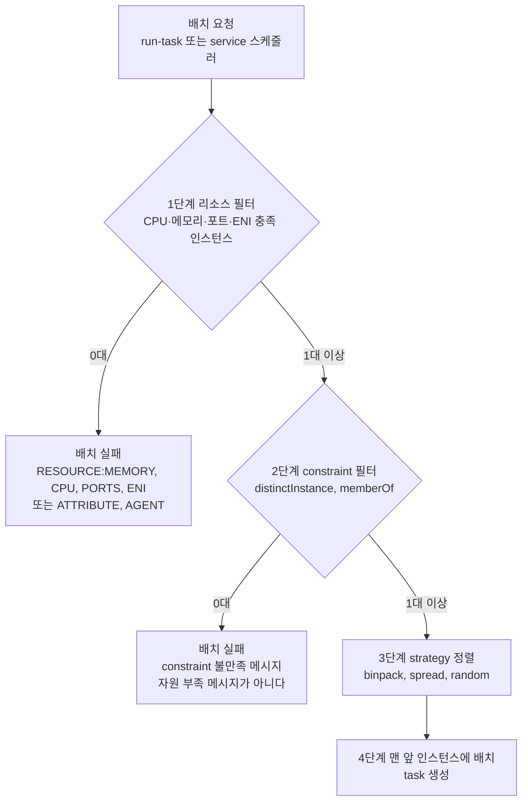
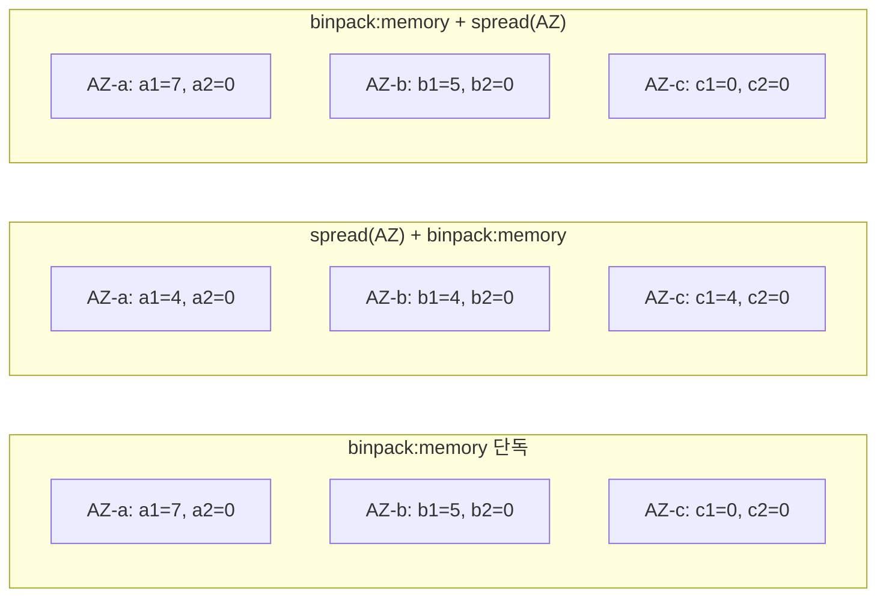
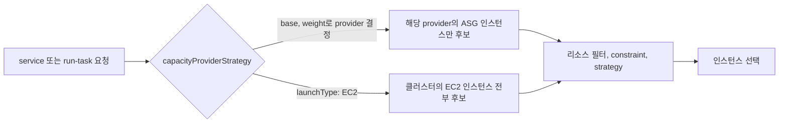
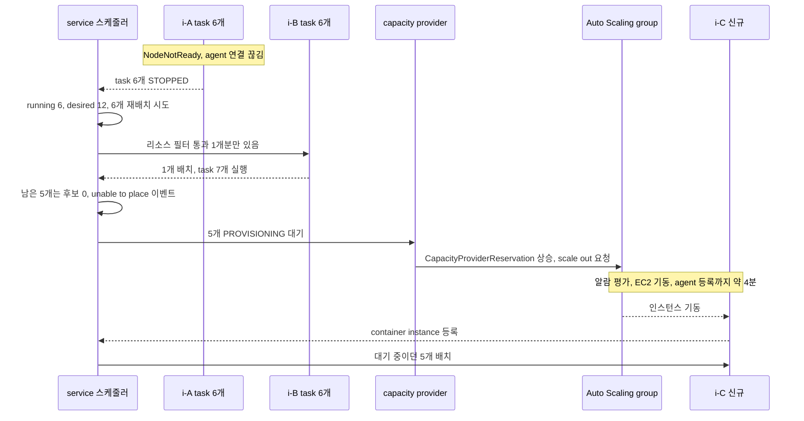
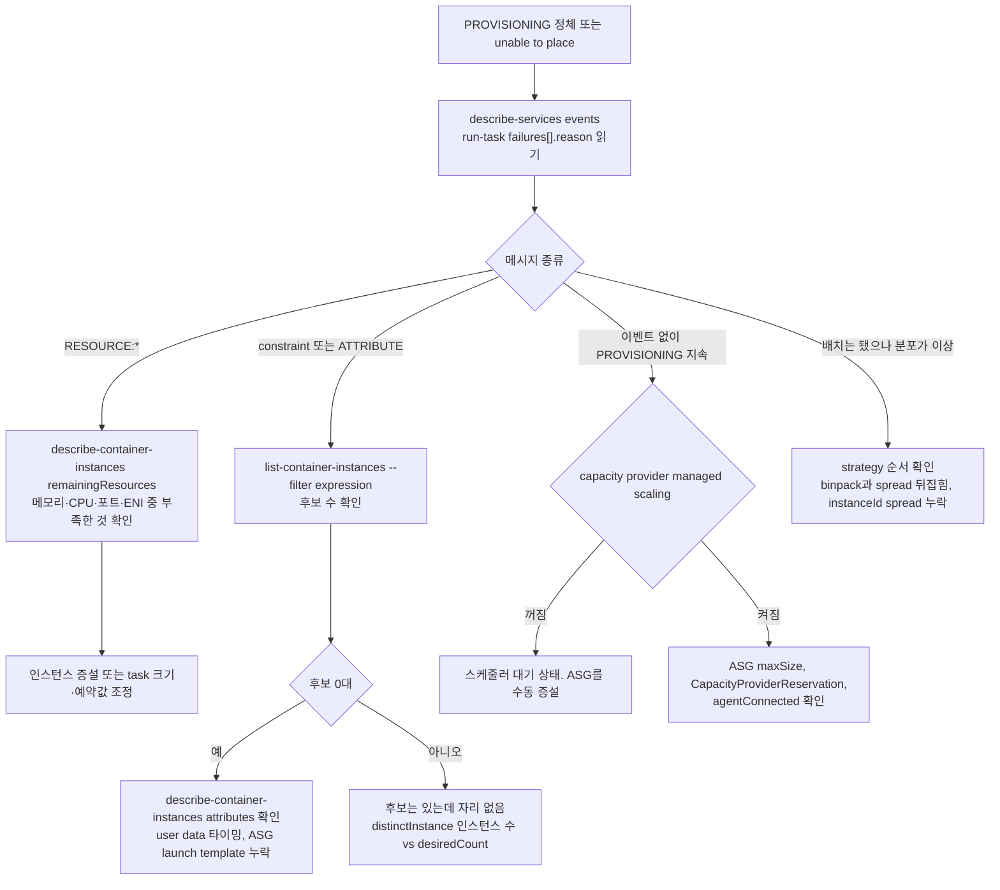

# ECS Task Placement

## 개요

EC2 launch type에서 task가 들어갈 인스턴스를 정하는 규칙이다. 후보를 탈락시키는 **constraint**와 순서를 매기는 **strategy**로 돌아간다.



후보가 0이 되는 자리는 1, 2단계뿐이다. 배치 실패는 task가 만들어지기 전이라 `stoppedReason`이 아니라 service events와 run-task의 `failures[].reason`에 남는다. 문구는 시점마다 달라서 `RESOURCE:` 접두어면 1단계, constraint 언급이면 2단계로 본다.

## Placement Strategy 세 종류

| type | field | 동작 | 맞는 자리 |
|---|---|---|---|
| binpack | cpu, memory | 남은 자원이 가장 적고 task는 들어가는 인스턴스 | 비용 절감, scale-in 대상 인스턴스 확보 |
| spread | instanceId, host, attribute:* | 필드 값별 task 수가 적은 쪽 | AZ·인스턴스 단위 가용성 |
| random | 없음 | 후보 중 임의 | 테스트, 짧은 job |

### binpack

```json
{
  "placementStrategy": [
    { "type": "binpack", "field": "memory" }
  ]
}
```

한 대를 거의 채운 뒤에야 다음 인스턴스를 쓴다. 빈 인스턴스가 생겨 scale-in이 쉬워서 비용 요구가 있으면 가장 먼저 나온다. 대가는 가용성이다.

### binpack 계산 예제

binpack은 실제 사용량이 아니라 **예약량**으로 센다. 인스턴스에서 빼는 값은 아래 순서로 정해진다(register-task-definition 도움말 기준).

| 지정 | 인스턴스에서 빼는 값 |
|---|---|
| task 레벨 `memory` | task 전체 예약량 |
| 컨테이너 `memoryReservation` | 그 값 (soft limit) |
| 컨테이너 `memory`만 | 그 값 (hard limit) |

예약 1GiB에 실사용 2GiB인 task를 채우면 스케줄러는 여유가 있다고 보는데 인스턴스는 OOM으로 간다. field는 먼저 차는 자원으로 고른다.

| 상황 | field | 이유 |
|---|---|---|
| JVM, 캐시처럼 메모리가 먼저 차는 서비스 | memory | 대부분 여기에 해당한다 |
| CPU 바운드이고 task가 cpu를 명시 예약 | cpu | 메모리는 남는데 cpu가 먼저 바닥난다 |
| cpu를 안 적은 task가 섞여 있음 | memory | cpu 예약이 0인 task는 인스턴스를 구분할 값이 없다 |

m5.large 등록 메모리를 7,680MiB(약 7.5GiB)로 가정하고 3대에 task를 도착 순서대로 넣었다.

| 순서 | task 예약 | 선택 | A 남은 MiB | B 남은 MiB | C 남은 MiB |
|---|---|---|---|---|---|
| 시작 | - | - | 7680 | 7680 | 7680 |
| 1 | 2048 | A (전부 동률, 임의) | 5632 | 7680 | 7680 |
| 2 | 2048 | A | 3584 | 7680 | 7680 |
| 3 | 1024 | A | 2560 | 7680 | 7680 |
| 4 | 2048 | A | 512 | 7680 | 7680 |
| 5 | 1024 | B (A는 512라 못 들어감) | 512 | 6656 | 7680 |
| 6 | 1024 | B | 512 | 5632 | 7680 |
| 7 | 2048 | B | 512 | 3584 | 7680 |
| 8 | 1024 | B | 512 | 2560 | 7680 |

A의 512MiB는 못 쓰는 조각이다. 실제 등록값과 남은 값은 아래로 본다.

```bash
aws ecs describe-container-instances --cluster prod-ec2 \
  --container-instances $(aws ecs list-container-instances --cluster prod-ec2 \
      --query 'containerInstanceArns' --output text) \
  --query "containerInstances[].{id:ec2InstanceId,remaining:remainingResources[?name=='MEMORY'].integerValue|[0],registered:registeredResources[?name=='MEMORY'].integerValue|[0]}" \
  --output table
```

### spread

```json
{
  "placementStrategy": [
    { "type": "spread", "field": "attribute:ecs.availability-zone" },
    { "type": "spread", "field": "instanceId" }
  ]
}
```

`host`는 `instanceId`와 같다. 위 조합은 콘솔이 replica service에 자동으로 넣는 값이다. spread는 균등 보장이 아니라 task 수가 적은 쪽을 고르는 규칙이라서, 그쪽 인스턴스에 자리가 없으면 다른 AZ로 흘러간다.

### random

후보 중 하나를 임의로 고른다. 운영 서비스에 단독으로 쓸 일은 없다.

## Placement Strategy 조합과 우선순위

strategy는 최대 5개이고 두 번째부터는 앞 항목의 동률을 푸는 타이브레이커다.

```json
{
  "placementStrategy": [
    { "type": "spread",  "field": "attribute:ecs.availability-zone" },
    { "type": "binpack", "field": "memory" }
  ]
}
```

AZ 분산을 지키고 AZ 안에서 채우는 구성이다. 순서를 뒤집으면 점유율이 다른 인스턴스 사이에 동률이 안 생겨 AZ spread가 무시된다. task 12개(인스턴스당 7개 수용)를 AZ 3곳 x 인스턴스 2대에 넣은 단순 모델이고 숫자는 인스턴스별 task 수다.



첫 번째와 세 번째가 같다. binpack이 앞이면 spread는 첫 task의 동률에서만 개입한다. 가운데는 a2, b2, c2가 비어 scale-in 대상이 된다.

| 구성 | 사용 인스턴스 | AZ 장애 시 소실 | 인스턴스 1대 장애 시 소실 |
|---|---|---|---|
| binpack 단독 | 2대 | 최대 7 | 최대 7 |
| spread(AZ) + binpack | 3대 | 4 | 4 |
| binpack + spread(AZ) | 2대 | 최대 7 | 최대 7 |

## Placement Constraint

constraint는 정렬이 아니라 **탈락**이다.

### distinctInstance

같은 service의 task를 한 인스턴스에 하나만 둔다.

```json
{
  "placementConstraints": [
    { "type": "distinctInstance" }
  ]
}
```

ENI 고갈이나 EBS·포트 충돌을 피하려고 쓴다. desiredCount 10에 인스턴스 7대면 3개는 못 뜬다. managed scaling은 constraint 불만족에 반응하지 않으므로 ASG 최소 크기를 desiredCount 이상으로 둔다.

### memberOf

cluster query language 표현식을 만족하는 인스턴스만 남긴다. 기본 attribute는 `ecs.instance-type`, `ecs.availability-zone`, `ecs.os-type`, `ecs.ami-id`, `ecs.cpu-architecture`다.

```json
{
  "placementConstraints": [
    {
      "type": "memberOf",
      "expression": "attribute:ecs.cpu-architecture == arm64 and attribute:ecs.instance-type =~ c7g.*"
    }
  ]
}
```

### memberOf 표현식을 미리 돌려보기

같은 문법이라 `list-container-instances --filter`에 넣으면 후보가 몇 대 남는지 나온다.

```bash
aws ecs list-container-instances --cluster prod-ec2 --status ACTIVE \
  --filter "attribute:workload == gpu-inference and attribute:ecs.availability-zone in [ap-northeast-2a, ap-northeast-2c]" \
  --query 'length(containerInstanceArns)'
```

```text
2
```

`--status`를 안 주면 DRAINING까지 세서 후보가 부풀려진다. 0대여도 에러 없이 빈 배열이 나온다. 필터 없이 센 수와 비교하면 attribute가 빠진 인스턴스 수가 나온다.

### 사용자 정의 attribute 달기

launch template user data에서 `ECS_INSTANCE_ATTRIBUTES`를 `/etc/ecs/ecs.config`에 JSON으로 쓴다.

```bash
#!/bin/bash
cat <<'EOF' >> /etc/ecs/ecs.config
ECS_CLUSTER=prod-ec2
ECS_INSTANCE_ATTRIBUTES={"workload":"gpu-inference","tier":"batch"}
EOF
```

등록된 인스턴스에는 `put-attributes`로 붙인다(호출당 10개까지, 인스턴스 role에 `ecs:PutAttributes` 필요).

```bash
aws ecs put-attributes --cluster prod-ec2 \
  --attributes name=workload,value=gpu-inference,targetType=container-instance,targetId=<container-instance-arn>
```

부팅 타이밍에서 두 번 깨졌다.

| 사례 | 증상 | 대응 |
|---|---|---|
| user data가 에이전트 기동 뒤에 `ecs.config`를 씀 | attribute가 등록에 안 실림. 등록된 인스턴스는 config만 고쳐서는 반영 안 됨 | 인스턴스 교체 또는 put-attributes |
| put-attributes를 에이전트 등록 전에 호출 | 대상 ARN이 없어 실패. 인스턴스는 정상이라 ASG는 멀쩡해 보이고 memberOf service만 task가 안 뜸 | 아래 스크립트로 등록 대기 |

```bash
ARN=""
for i in $(seq 1 60); do
  ARN=$(curl -sf http://localhost:51678/v1/metadata \
    | sed -n 's/.*"ContainerInstanceArn":"\([^"]*\)".*/\1/p')
  [ -n "$ARN" ] && break
  sleep 5
done
[ -n "$ARN" ] || { echo "agent 등록 대기 초과" >&2; exit 1; }
aws ecs put-attributes --cluster prod-ec2 --region ap-northeast-2 \
  --attributes name=workload,value=gpu-inference,targetType=container-instance,targetId="$ARN"
```

로그는 `/var/log/cloud-init-output.log`에 있다.

### Task Definition 레벨 constraint vs Service 레벨 constraint

Task Definition의 constraint는 그 task가 어디서 실행되든 따라간다. task definition을 공유하는 service마다 위치가 다르면 service 레벨에 둔다. 둘이 같이 있으면 AND다.

## Capacity Provider와 placement의 순서

capacity provider가 먼저 정해지고, 그 provider의 인스턴스 안에서 placement가 돈다. placement strategy가 provider를 고르지는 않는다.



| 지정 | 결과 |
|---|---|
| `capacityProviderStrategy`와 `launchType` 동시 | 불가. 하나만 쓴다 |
| 둘 다 생략 | 클러스터 default capacity provider strategy 적용 |
| cluster auto scaling 사용 | `capacityProviderStrategy` 필수 |
| launchType으로 만든 service를 provider 방식으로 | 불가, 재생성 ([ECS Capacity Providers](ECS_Capacity_Providers.md)) |

launchType 없이 run-task를 호출하면 default provider로 가서 의도와 다른 인스턴스에 놓이기도 한다. 분포가 중요하면 provider를 써도 strategy를 명시한다.

## run-task와 service의 기본값

| | service (REPLICA) | run-task |
|---|---|---|
| strategy 미지정 | 스케줄러가 AZ spread 기본 적용 | 도움말에 기본 동작 언급 없음, 항상 직접 지정 |
| 콘솔 기본 | spread(AZ) + spread(instanceId) 자동 입력 | 해당 없음 |
| 재배치 | 장애·배포 때 스케줄러가 다시 배치 | 한 번 놓으면 끝, 죽어도 안 띄움 |
| Fargate | strategy 무시, AZ 균등 시도 | strategy 무시 |

run-task로 수십 개를 띄우는 job은 strategy를 안 주면 분포를 예측할 수 없으니 최소한 AZ spread는 넣는다.

## DAEMON 스케줄링과 placement

DAEMON은 constraint를 만족하는 ACTIVE 인스턴스마다 task를 하나씩 띄운다. strategy는 비우고 constraint만 건다. 스케줄러가 constraint를 계속 평가해 불만족 인스턴스의 task는 내린다.

| 항목 | 값 |
|---|---|
| desiredCount, strategy | 필요 없음 |
| minimumHealthyPercent 기본 | CLI·API 0%, 콘솔 50% |

## 배치 변경은 기존 task를 옮기지 않는다

`update-service --placement-strategy`는 새 배포를 일으키지 않는다(도움말 기준). 떠 있는 task는 그대로고 이후 뜨는 task부터 새 기준이다. 기존 분포를 바꾸려면 `--force-new-deployment`로 롤링을 돌린다.

```bash
aws ecs update-service --cluster prod-ec2 --service api \
  --placement-strategy type=spread,field=attribute:ecs.availability-zone type=binpack,field=memory
aws ecs update-service --cluster prod-ec2 --service api --force-new-deployment
```

롤링 중에는 min/max percent가 배치 결과를 좌우한다.

| minimumHealthyPercent / maximumPercent | 동작 | 배치 영향 |
|---|---|---|
| 100 / 200 | 새 task를 먼저 띄우고 구 task를 내림 | 인스턴스에 여유가 없으면 새 task가 자리를 못 찾아 정체. binpack으로 꽉 찬 클러스터에서 자주 걸림 |
| 50 / 100 | 구 task 절반을 먼저 내려 자리를 만든 뒤 새 task 배치 | 자리 걱정은 없으나 용량이 일시적으로 절반 |

새 task는 구 task가 남은 상태에서 놓이므로 배포 후 분포가 의도와 다를 수 있다. 쏠렸으면 한 번 더 돌린다. `availability-zone-rebalancing`은 생성 시 기본 ENABLED, 설정한 적 없는 기존 service는 DISABLED로 취급된다(create-service 도움말).

## Fargate의 동작

Fargate는 인스턴스가 보이지 않는다.

| 항목 | 동작 |
|---|---|
| placement strategy | 입력해도 반영되지 않음 |
| AZ 분산 | ECS가 알아서 spread 시도. 끄거나 강화 불가 |
| placement constraint | 지원 안 함 (update-service 도움말) |
| os·cpu architecture 지정 | task definition의 `runtimePlatform` |

## 실무에서 자주 만나는 함정

### binpack으로 묶다가 동시 장애

8GB task 12개를 `m5.4xlarge`(64GB) 2대에 binpack으로 채웠다. 한 대가 NodeNotReady로 빠지자 task 6개가 사라졌고, 남은 한 대에는 1개분 자리뿐이라 처리량이 4분쯤 절반이었다.



재배치 실패는 즉시 끝나고 그 뒤 4분이 전부 인스턴스 기동 대기다. 이후로 binpack 앞에 AZ spread를 두고, capacity provider `targetCapacity`는 100이 아닌 80~90으로 둬서 한 대가 빠져도 옮길 여유를 남긴다.

### distinctInstance와 ASG 사이즈 불일치

desiredCount를 6에서 12로 올렸는데 task 6개가 PROVISIONING에서 30분 넘게 멈췄다. `distinctInstance`가 걸려 있었고 인스턴스는 6대였다. ASG를 수동으로 12까지 올린 뒤에야 풀렸다. service auto scaling을 쓰면 ASG min capacity도 같은 알람에 묶는다.

### memberOf로 인스턴스 타입을 박아두고 잊어버림

추론 service에 `ecs.instance-type == g4dn.xlarge`를 걸어뒀다. g4dn 재고가 떨어져 ASG가 g5를 띄웠는데 expression이 타입을 박아놔서 ECS가 g5를 후보에서 뺐다. 이후로는 `workload=gpu` attribute로 의도를 적고, 어떤 타입이 GPU 노드인지는 launch template에서 정한다.

### spread가 비대칭이 되는 경우

AZ 3곳에 EC2 5대씩, task 30개는 처음엔 AZ별 10개씩 나뉜다. AZ-c 인스턴스 두 대가 spot interruption으로 빠져 용량이 부족해지자 신규 task가 AZ-a와 AZ-b로만 몰렸다. spread는 task를 거부하지 않는다. 후보가 한쪽에만 있으면 그쪽으로 간다.

### Spot 혼합 클러스터에서 AZ 분배

Spot은 AZ별 재고가 따로 움직여서 interruption이 한 AZ에 몰리고 교체도 그 AZ에 못 뜬다.

| 증상 | 원인 | 설정 |
|---|---|---|
| 한 AZ 인스턴스가 연달아 사라짐 | 그 AZ의 Spot 풀 재고 부족 | ASG `capacity-rebalance`를 켜 rebalance 권고 시점에 교체 인스턴스를 먼저 띄움 |
| 교체 인스턴스가 다른 AZ에 뜸 | ASG 기본값 `balanced-best-effort`는 실패한 AZ 대신 다른 AZ에 띄움 | AZ 균형이 우선이면 `balanced-only`. 해당 AZ에 못 뜨면 계속 재시도하므로 가용 용량은 줄 수 있음 |
| 종료되는 인스턴스의 task가 한꺼번에 사라짐 | 2분 경고 때 drain이 안 걸림 | agent `ECS_ENABLE_SPOT_INSTANCE_DRAINING=true`, capacity provider `managedDraining` |
| 복구 후에도 쏠림이 남음 | 기존 task는 안 옮겨짐 | force-new-deployment 또는 service AZ rebalancing |

`balanced-best-effort`가 기본이라 설정 안 한 ASG는 쏠림을 이미 허용한다. AZ별 task 수를 CloudWatch metric으로 내보내 알람을 거는 것도 같이 둔다.

## 디버깅 흐름

메시지 종류로 갈래를 나눈다.



strategy 평가 과정은 노출되지 않아 분포는 결과로만 본다. Container Insights에 AZ·instance ID 차원을 두면 평소 분포를 보기 쉽다.

## 배치 시각화

AZ·인스턴스별 task 분포를 눈으로 확인하는 방법은 [ECS Task Placement Visualization](ECS_Task_Placement_Visualization.md)에 정리했다.
