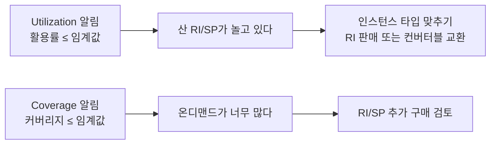
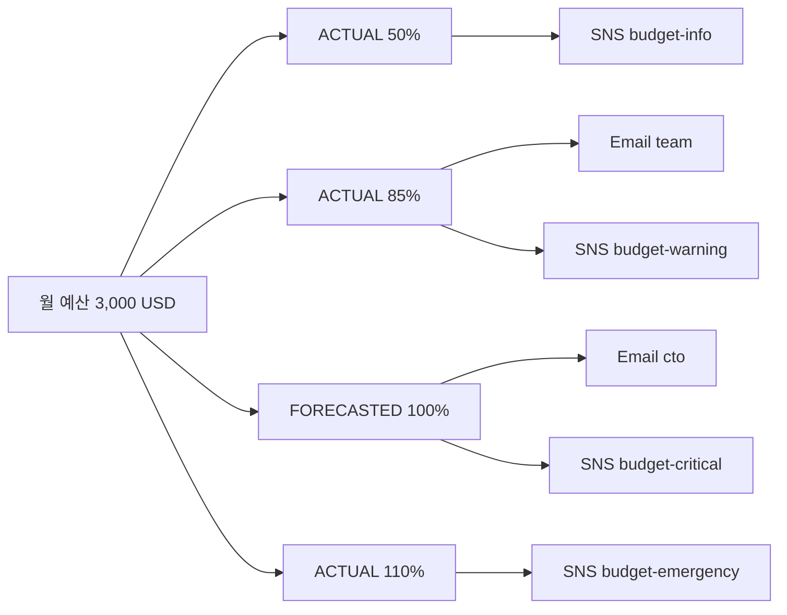
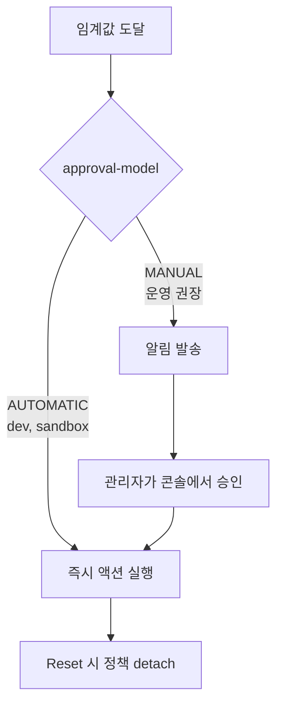
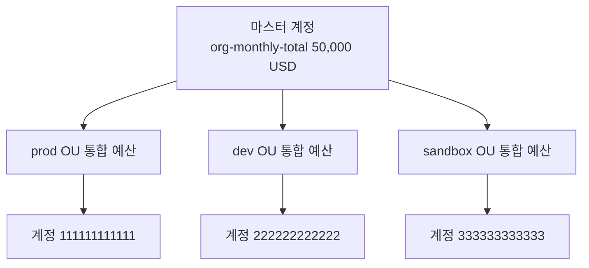
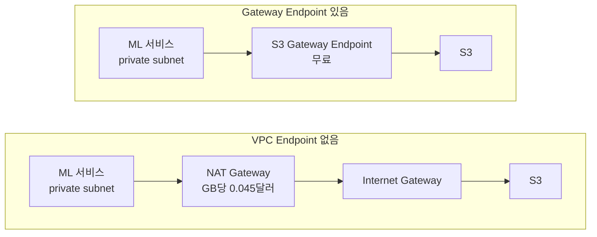
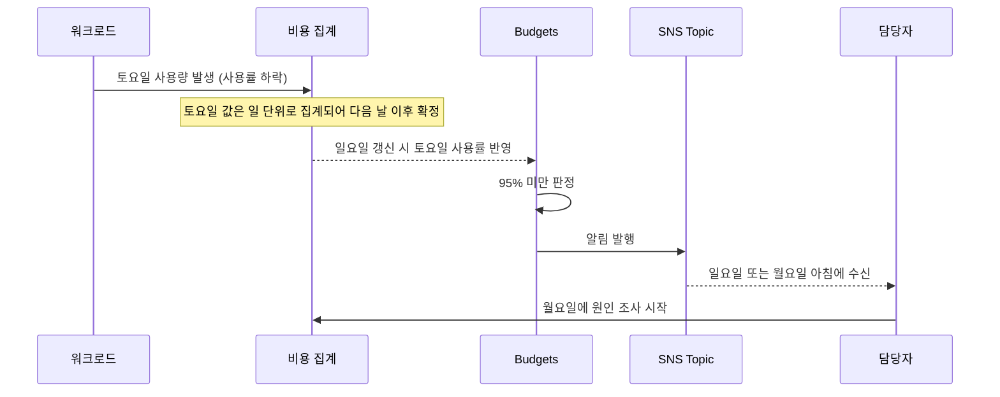
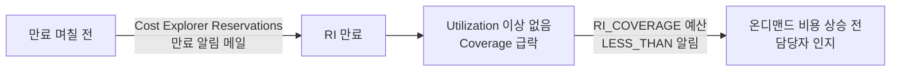
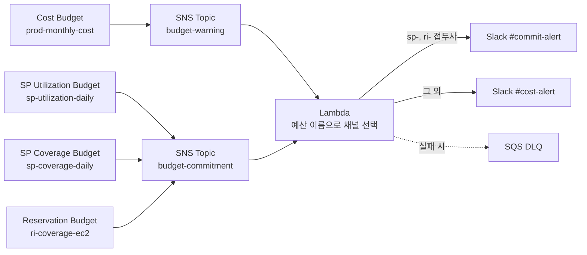
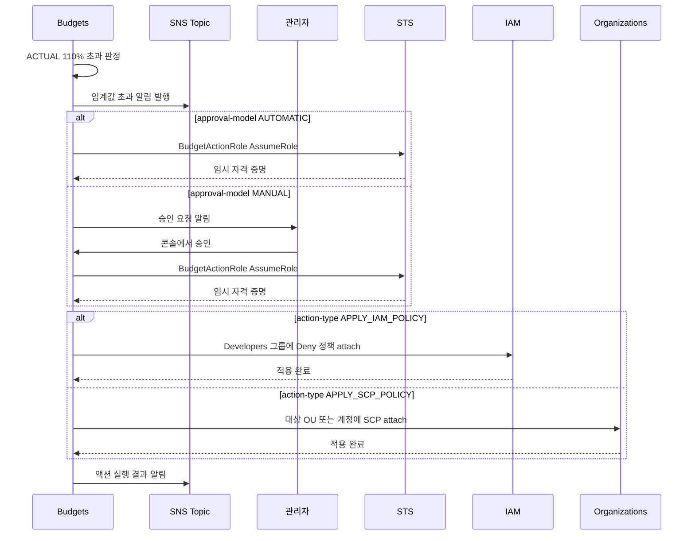

# AWS Budgets

## 왜 Budgets를 먼저 세팅해야 하는가

AWS 청구서를 받고 나서 비용 폭증을 발견하면 이미 늦다. Cost Explorer는 사후 분석 도구이고, Cost Anomaly Detection은 패턴이 비정상으로 잡혀야 동작한다. 둘 다 "이미 쓴 돈"을 본다. Budgets는 임계값을 넘는 즉시 알림을 보내는 거의 유일한 표준 도구다.

신규 계정이라면 루트 사용자 잠그고 MFA 거는 일과 거의 같은 우선순위로 예산 알림을 걸어야 한다. 5분이면 끝나고, 한 번이라도 r5.8xlarge를 잊고 켜둔 경험이 있으면 이 5분이 수백 달러를 막는다.

실제로 자주 발생하는 사고 유형을 보면 이렇다.

- 부하 테스트용 NAT Gateway 두 개를 종료하지 않고 출장을 떠남
- DMS 인스턴스를 켜두고 마이그레이션 끝났다고 슬랙에만 공지
- CloudWatch Logs `Never expire` 설정으로 두고 디버그 로그를 6개월간 적재
- 스팟 인스턴스인 줄 알고 넉넉히 띄웠는데 온디맨드로 fallback
- 외부 트래픽 공격으로 인한 outbound 데이터 전송 비용 급증

이 중 다수는 하루 단위 예산만 걸려 있어도 첫날에 잡힌다.

## 예산 타입 네 가지

Budgets는 추적하는 메트릭에 따라 타입이 나뉜다. 헷갈리는 사람이 많은데, 각 타입은 보는 숫자가 다르고 알림 트리거 의미도 다르다.

| 타입 | 추적 대상 | 단위 | 트리거 | 자주 쓰는 곳 |
|---|---|---|---|---|
| Cost | 실제 청구 비용 | USD | 비용 ≥ 임계값 | 월 한도 보호 |
| Usage | 사용량 (시간, GB, 요청 수) | HOURS, GB, COUNT 등 | 사용량 ≥ 임계값 | Free Tier 보호, 초과 사용 감시 |
| RI Utilization | RI 활용률 | PERCENT | 활용률 ≤ 임계값 | RI 낭비 감지 |
| RI Coverage | 온디맨드 대비 RI 커버리지 | PERCENT | 커버리지 ≤ 임계값 | RI 추가 구매 시점 판단 |
| Savings Plans Utilization | SP 사용률 | PERCENT | 사용률 ≤ 임계값 | SP 낭비 감지 |
| Savings Plans Coverage | 전체 사용 중 SP 커버 비율 | PERCENT | 커버리지 ≤ 임계값 | SP 추가 구매 시점 판단 |

Cost Budget은 가장 흔하고 단순하다. "5월에 EC2 비용 3,000달러 넘으면 알려줘" 같은 요구를 그대로 표현한다.

Usage Budget이 헷갈리는 부분은 단위가 서비스마다 다르다는 점이다. EC2는 인스턴스 시간, S3는 GB-월, Lambda는 요청 수와 GB-초가 따로 잡힌다. 한 예산에 하나의 사용량 메트릭만 묶을 수 있다. Free Tier 한도를 넘기 전에 막고 싶다면 Usage 타입으로 서비스별 한도 직전에 알림을 걸어두는 식이다.

RI/SP Utilization과 Coverage는 헷갈리기 쉬운데 보는 방향이 반대다.

- Utilization은 "산 RI/SP 중 얼마나 썼나"다. 100%면 최대 활용. 60%면 40%만큼은 돈 내고 안 쓰는 중이다.
- Coverage는 "전체 사용량 중 RI/SP가 얼마나 덮었나"다. 100%면 전부 RI/SP로 결제. 30%면 70%는 온디맨드로 비싸게 결제하는 중이다.

Utilization 알림이 떴다 = 산 RI가 놀고 있다 → 인스턴스 타입 맞추거나 RI 판매(컨버터블의 경우 교환).
Coverage 알림이 떴다 = 온디맨드가 너무 많다 → RI/SP 추가 구매 검토.



두 알림은 임계값 방향이 같아도 가리키는 문제와 후속 조치가 정반대라는 점을 보면 된다.

## Cost Budget 만들기

콘솔에서는 Billing → Budgets → Create budget 순서로 들어가지만, 운영 환경에서는 Terraform이나 CLI로 관리하는 편이 낫다. 콘솔로 만들면 누가 만들었는지, 왜 만들었는지 추적이 어렵다.

CLI로 한 번 만들고 그 JSON을 IaC로 옮기는 방식이 빠르다.

```bash
aws budgets create-budget \
  --account-id 123456789012 \
  --budget file://budget.json \
  --notifications-with-subscribers file://notifications.json
```

`budget.json`:

```json
{
  "BudgetName": "prod-monthly-cost",
  "BudgetLimit": { "Amount": "3000", "Unit": "USD" },
  "TimeUnit": "MONTHLY",
  "BudgetType": "COST",
  "CostFilters": {
    "TagKeyValue": ["user:Environment$Production"]
  },
  "CostTypes": {
    "IncludeTax": true,
    "IncludeSubscription": true,
    "UseBlended": false,
    "IncludeRefund": false,
    "IncludeCredit": false,
    "IncludeUpfront": true,
    "IncludeRecurring": true,
    "IncludeOtherSubscription": true,
    "IncludeSupport": true,
    "IncludeDiscount": true,
    "UseAmortized": false
  }
}
```

`CostTypes` 옵션이 함정이다. 기본값은 크레딧과 환불을 포함해서 계산한다. 신규 계정이 AWS 크레딧으로 결제 중이면 크레딧 차감 후 금액으로 예산이 잡혀서, 크레딧이 떨어지는 순간 예산이 갑자기 폭발한다. 운영 환경에서는 `IncludeCredit: false`, `IncludeRefund: false`로 두는 편이 안전하다. "실제로 우리가 낼 돈"을 보고 싶다는 의도와 맞다.

`UseAmortized`는 RI나 SP의 선결제 비용을 매월 분할해서 보여줄지 정한다. 회계상 월별 비용을 평탄하게 보고 싶으면 `true`. 실제 현금 흐름 기준으로 보고 싶으면 `false`.

## 알림 임계값 설계

임계값 하나만 걸어두는 사람이 많은데, 단계별로 거는 편이 실용적이다. 한 번에 100% 알림 받으면 이미 손쓸 시간이 부족하다.

`notifications.json`:

```json
[
  {
    "Notification": {
      "NotificationType": "ACTUAL",
      "ComparisonOperator": "GREATER_THAN",
      "Threshold": 50,
      "ThresholdType": "PERCENTAGE"
    },
    "Subscribers": [
      { "SubscriptionType": "SNS", "Address": "arn:aws:sns:ap-northeast-2:123456789012:budget-info" }
    ]
  },
  {
    "Notification": {
      "NotificationType": "ACTUAL",
      "ComparisonOperator": "GREATER_THAN",
      "Threshold": 85,
      "ThresholdType": "PERCENTAGE"
    },
    "Subscribers": [
      { "SubscriptionType": "EMAIL", "Address": "team@example.com" },
      { "SubscriptionType": "SNS", "Address": "arn:aws:sns:ap-northeast-2:123456789012:budget-warning" }
    ]
  },
  {
    "Notification": {
      "NotificationType": "FORECASTED",
      "ComparisonOperator": "GREATER_THAN",
      "Threshold": 100,
      "ThresholdType": "PERCENTAGE"
    },
    "Subscribers": [
      { "SubscriptionType": "EMAIL", "Address": "cto@example.com" },
      { "SubscriptionType": "SNS", "Address": "arn:aws:sns:ap-northeast-2:123456789012:budget-critical" }
    ]
  },
  {
    "Notification": {
      "NotificationType": "ACTUAL",
      "ComparisonOperator": "GREATER_THAN",
      "Threshold": 110,
      "ThresholdType": "PERCENTAGE"
    },
    "Subscribers": [
      { "SubscriptionType": "SNS", "Address": "arn:aws:sns:ap-northeast-2:123456789012:budget-emergency" }
    ]
  }
]
```

`NotificationType`은 두 가지다.

- `ACTUAL`: 실제 발생한 비용이 임계값을 넘으면 알림. 사후 알림.
- `FORECASTED`: AWS가 추세 분석해서 월말 예상치가 임계값을 넘을 것 같으면 알림. 사전 알림.

`FORECASTED`는 신규 예산에서는 동작하지 않는다. 5일 이상 데이터가 쌓여야 예측 모델이 동작한다. 새 계정 만들고 첫 주에 forecast 알림이 안 와도 정상이다.

알림 발송에는 약간의 지연이 있다. AWS 문서상 8~12시간 단위로 평가한다고 나와 있고, 실제로도 임계값을 정확히 넘은 시점에서 수 시간 뒤에 메일이 온다. "실시간 보호"를 기대하면 안 된다. 단기 폭증 대응은 CloudWatch 알람과 Cost Anomaly Detection을 병행해야 한다.



위 `notifications.json`의 네 단계가 각각 어떤 수신처로 가는지 한눈에 보는 그림이다. 단계가 올라갈수록 수신 대상이 사람 쪽(Email, 임원)으로 넓어진다.

## SNS Topic 연동과 알림 분기

이메일만 받으면 사람이 자는 시간에 못 잡는다. SNS로 받아서 Slack, PagerDuty, Lambda로 분기하는 구조가 표준이다.

```
Budget Alert → SNS Topic → ┬─ Email
                           ├─ Lambda (Slack webhook)
                           ├─ Lambda (PagerDuty)
                           └─ Lambda (자동 조치)
```

SNS Topic 생성 시 주의할 점은 Budgets 서비스에 publish 권한을 줘야 한다는 것이다. 콘솔에서 생성하면 자동으로 정책이 붙지만 IaC로 만들 때 빠뜨리기 쉽다.

```json
{
  "Version": "2012-10-17",
  "Statement": [
    {
      "Sid": "AWSBudgetsSNSPublishingPermissions",
      "Effect": "Allow",
      "Principal": { "Service": "budgets.amazonaws.com" },
      "Action": "SNS:Publish",
      "Resource": "arn:aws:sns:ap-northeast-2:123456789012:budget-warning"
    }
  ]
}
```

이 정책 빠뜨리면 예산은 만들어지지만 알림이 안 간다. 만든 직후에는 임계값에 못 미쳐서 모르고 지나가다가, 정작 사고 났을 때 알림이 안 가는 게 가장 흔한 실패 사례다. 만들고 나면 임계값을 일부러 0%로 한 번 트리거시켜서 끝까지 도달하는지 확인하는 편이 좋다.

Slack 연동 Lambda는 단순하다.

```python
import json
import os
import urllib.request

WEBHOOK_URL = os.environ['SLACK_WEBHOOK_URL']

def lambda_handler(event, context):
    raw = event['Records'][0]['Sns']['Message']
    # Budgets는 텍스트 메시지로 보낸다. JSON이 아니다.
    # "AWS Budget Notification June 01, 2026..." 같은 형식.

    payload = {
        "text": "AWS Budget Alert",
        "attachments": [{
            "color": "warning",
            "text": raw,
            "footer": "AWS Budgets"
        }]
    }

    req = urllib.request.Request(
        WEBHOOK_URL,
        data=json.dumps(payload).encode('utf-8'),
        headers={'Content-Type': 'application/json'}
    )
    urllib.request.urlopen(req)
    return {'statusCode': 200}
```

여기서 한 가지 주의. Budgets가 SNS로 보내는 메시지는 JSON이 아니라 텍스트다. Cost Anomaly Detection이나 다른 AWS 서비스의 SNS 알림은 JSON 구조를 보내지만, Budgets는 사람이 읽을 수 있는 형태로 보낸다. 처음 연동할 때 `json.loads(message)`로 파싱하려다가 에러나는 경우가 흔하다.

메시지 안에서 예산 이름이나 금액을 추출하려면 정규식이 필요하다.

```python
import re

def parse_budget_message(text):
    name_match = re.search(r'Budget Name: (.+)', text)
    threshold_match = re.search(r'Alert Type: (.+)', text)
    threshold_pct_match = re.search(r'Threshold: ([\d.]+)%', text)
    actual_match = re.search(r'Actual\s+(?:Amount|Costs):\s*\$([\d,.]+)', text)

    return {
        'name': name_match.group(1) if name_match else None,
        'alert_type': threshold_match.group(1) if threshold_match else None,
        'threshold_pct': float(threshold_pct_match.group(1)) if threshold_pct_match else None,
        'actual': float(actual_match.group(1).replace(',', '')) if actual_match else None,
    }
```

## Budget Actions 자동 조치

여기서부터가 Budgets의 진짜 가치다. 알림만 받으면 결국 사람이 새벽에 일어나야 한다. Budget Actions는 임계값 도달 시 IAM 정책 적용, EC2/RDS 중지, SSM Document 실행을 자동으로 한다.

지원되는 액션은 세 종류다.

1. **IAM 정책 적용**: 지정한 사용자/그룹/역할에 deny 정책을 attach한다. 비용 유발 액션을 차단할 때 쓴다.
2. **SCP 적용**: Organizations에서 특정 OU나 계정에 SCP를 attach한다. 계정 단위 차단.
3. **인스턴스 중지/종료**: EC2 또는 RDS 인스턴스를 중지한다.

Budget Actions가 동작하려면 별도 IAM 역할이 필요하다. Budgets 서비스가 이 역할을 assume해서 액션을 실행한다.

```json
{
  "Version": "2012-10-17",
  "Statement": [
    {
      "Effect": "Allow",
      "Principal": { "Service": "budgets.amazonaws.com" },
      "Action": "sts:AssumeRole",
      "Condition": {
        "StringEquals": {
          "aws:SourceAccount": "123456789012"
        }
      }
    }
  ]
}
```

`SourceAccount` 조건을 빼두면 confused deputy 문제가 생긴다. 다른 계정이 우리 역할을 assume할 수 있게 된다.

### IAM 정책 자동 적용 시나리오

개발 계정에서 예산 110% 초과 시 EC2 RunInstances를 막고 싶다면, 미리 deny 정책을 만들어두고 Budget Action에서 그 정책을 사용자 그룹에 attach하도록 설정한다.

먼저 차단용 정책을 만든다.

```json
{
  "Version": "2012-10-17",
  "Statement": [
    {
      "Effect": "Deny",
      "Action": [
        "ec2:RunInstances",
        "rds:CreateDBInstance",
        "ec2:StartInstances"
      ],
      "Resource": "*"
    }
  ]
}
```

Budget Action 생성:

```bash
aws budgets create-budget-action \
  --account-id 123456789012 \
  --budget-name "dev-monthly-cost" \
  --notification-type ACTUAL \
  --action-type APPLY_IAM_POLICY \
  --action-threshold ActionThresholdValue=110,ActionThresholdType=PERCENTAGE \
  --execution-role-arn arn:aws:iam::123456789012:role/BudgetActionRole \
  --approval-model AUTOMATIC \
  --definition '{
    "IamActionDefinition": {
      "PolicyArn": "arn:aws:iam::123456789012:policy/DenyExpensiveActions",
      "Groups": ["Developers"]
    }
  }' \
  --subscribers SubscriptionType=EMAIL,Address=admin@example.com
```

`approval-model`이 중요한 옵션이다.

- `AUTOMATIC`: 임계값 도달 시 즉시 액션 실행.
- `MANUAL`: 알림만 보내고 관리자가 콘솔에서 승인해야 실행.

운영 환경에서는 `MANUAL`을 권장한다. 자동 차단은 정상 트래픽에서 발생한 합당한 비용 증가도 막아버린다. 개발 환경이나 샌드박스 계정에서만 `AUTOMATIC`을 쓴다.



두 모델의 차이는 사람의 승인 단계가 끼느냐 여부이고, 승인 단계가 있으면 정상 비용 증가를 오인해 막는 사고를 거를 수 있다.

차단된 뒤 복구는 같은 사용자가 콘솔의 Budget Actions에서 "Reset" 한 번 누르면 정책이 detach된다. 다음 청구 주기가 시작되거나 비용이 임계값 아래로 떨어지면 자동으로 reset되도록 설정도 가능하다.

### EC2/RDS 자동 중지

```bash
aws budgets create-budget-action \
  --account-id 123456789012 \
  --budget-name "dev-monthly-cost" \
  --notification-type ACTUAL \
  --action-type RUN_SSM_DOCUMENTS \
  --action-threshold ActionThresholdValue=100,ActionThresholdType=PERCENTAGE \
  --execution-role-arn arn:aws:iam::123456789012:role/BudgetActionRole \
  --approval-model AUTOMATIC \
  --definition '{
    "SsmActionDefinition": {
      "ActionSubType": "STOP_EC2_INSTANCES",
      "Region": "ap-northeast-2",
      "InstanceIds": ["i-0abc123", "i-0def456"]
    }
  }' \
  --subscribers SubscriptionType=EMAIL,Address=admin@example.com
```

`InstanceIds`를 직접 지정해야 한다. 태그로 동적으로 잡고 싶다면 SSM Automation Document를 따로 만들어서 그 안에서 태그 기반 필터링을 하고 Budget Action은 그 Document를 호출하는 구조로 가야 한다.

### Lambda를 통한 유연한 자동 조치

Budget Action이 직접 지원하지 않는 작업은 SNS → Lambda 조합으로 처리한다. Budget Action이 지원하는 액션은 3종으로 제한적이라, 복잡한 조건 분기는 Lambda 쪽이 자유도가 높다.

```python
import boto3

def lambda_handler(event, context):
    ec2 = boto3.client('ec2')

    response = ec2.describe_instances(
        Filters=[
            {'Name': 'tag:Environment', 'Values': ['dev', 'staging']},
            {'Name': 'tag:AutoStopOnBudgetExceeded', 'Values': ['true']},
            {'Name': 'instance-state-name', 'Values': ['running']}
        ]
    )

    targets = [
        i['InstanceId']
        for r in response['Reservations']
        for i in r['Instances']
    ]

    if not targets:
        return {'statusCode': 200, 'body': 'no instances to stop'}

    ec2.stop_instances(InstanceIds=targets)
    return {'statusCode': 200, 'body': f'stopped {len(targets)} instances'}
```

태그로 옵트인하는 방식을 권장한다. `AutoStopOnBudgetExceeded=true` 태그가 있는 인스턴스만 멈추도록 해두면, 영향받기 싫은 워크로드는 태그를 안 붙이면 된다. 모든 dev 인스턴스를 무차별로 멈추면 빌드 서버나 데이터 적재 잡까지 죽어서 다음날 더 큰 문제가 된다.

## AWS Organizations 통합 예산

여러 계정을 운영하면 계정마다 예산을 따로 만드는 일이 번거롭다. Organizations 마스터 계정에서 통합 예산을 만들면 여러 계정 비용을 합산해서 추적할 수 있다.

```json
{
  "BudgetName": "org-monthly-total",
  "BudgetLimit": { "Amount": "50000", "Unit": "USD" },
  "TimeUnit": "MONTHLY",
  "BudgetType": "COST",
  "CostFilters": {
    "LinkedAccount": [
      "111111111111",
      "222222222222",
      "333333333333"
    ]
  }
}
```

`LinkedAccount` 필터로 특정 계정만, 또는 전체 조직을 묶는다. 마스터 계정에서 만들기 때문에 결제 데이터에 대한 권한도 마스터 계정 IAM이 가진다.

조직 구조에 따라 권장하는 패턴이 다르다.

- 단일 OU에 단일 워크로드: OU 내 모든 계정 묶어 통합 예산 1개 + 계정별 알림 예산 N개
- 환경별 OU 분리(prod, dev, sandbox): OU별로 통합 예산을 만들어 환경별 한도 추적
- 팀별 계정 분리: 팀 OU 단위 통합 예산 + 마스터 계정에 전체 한도 예산



마스터 계정의 전체 한도 예산 아래에 OU별 통합 예산이 걸리고, `LinkedAccount` 필터가 각 계정을 묶는 구조다.

마스터 계정에서 멤버 계정 예산을 만들려면 두 가지 설정이 미리 되어 있어야 한다.

1. Organizations에 "All features" 모드 활성화 (Consolidated Billing only로는 부족)
2. 마스터 계정에서 "View Billing data of linked accounts" 권한 활성화

처음 만들 때 한 번 거치면 끝나는데, 신규 조직 셋업 시 빠뜨리고 나중에 멤버 계정 비용이 안 보여서 헤맨다.

## 비용 폭증 실제 사례와 대응

5년쯤 운영하면서 본 사례들을 패턴별로 정리한다. 각 사례는 실제로 한 번 이상 일어난 일이다.

### NAT Gateway + outbound 트래픽

가장 흔한 사고 유형. NAT Gateway는 시간당 0.045달러에 GB당 0.045달러를 추가로 받는다. 보통 한 가용영역당 하나, 멀티 AZ면 2~3개를 운영한다.

문제는 GB당 비용이 outbound뿐 아니라 NAT를 통과하는 모든 트래픽에 붙는다는 점이다. ECR pull, S3 같은 리전 내 트래픽도 VPC Endpoint를 안 만들었으면 NAT를 거쳐서 GB 요금을 낸다.

한 번은 ML 서비스가 S3에서 모델 파일을 다운로드하는데 VPC Endpoint가 없어서 모든 트래픽이 NAT로 흘렀다. 모델 파일 4GB × 시간당 60회 × 24시간 × NAT 운영 0.045달러 → 하루 250달러가 추가로 나갔다. 한 달 모르고 두면 7,500달러.



같은 S3 다운로드가 왼쪽 경로에서는 NAT를 거쳐 GB 요금이 붙고, 오른쪽 경로에서는 NAT를 우회해 추가 요금이 없다.

대응 패턴:

- Cost 예산을 서비스별로 분리하지 말고 "Data Transfer" 카테고리로 별도 예산을 건다. EC2-Other 카테고리 안에 데이터 전송 비용이 잡힌다.
- VPC Endpoint(특히 S3, ECR, DynamoDB Gateway Endpoint는 무료) 누락 여부 점검을 운영 체크리스트에 포함.
- CloudWatch Metric `BytesOutToDestination` 알람을 NAT Gateway별로 건다.

### 잊혀진 부하 테스트 인프라

부하 테스트용 인스턴스를 띄우고 종료를 잊는 사고. r5.8xlarge 같은 큰 타입을 여러 개 띄워둔 채 출장이나 휴가가 겹치면 1주일에 수천 달러가 빠진다.

대응 패턴:

- "Environment=loadtest" 태그를 강제하고 해당 태그 기반 일일 예산을 24시간 단위로 건다. 일일 예산은 매일 리셋되므로 다음날 또 알림이 온다.
- Auto Stop Lambda를 EventBridge 스케줄로 매일 23시에 실행. `loadtest` 태그가 붙은 모든 EC2를 무조건 stop. 다음날 필요하면 다시 켠다.
- IaC로 부하 테스트 환경을 띄울 때 TTL 태그를 강제. SSM Automation으로 TTL 지난 리소스 정리.

### CloudWatch Logs 무한 적재

CloudWatch Logs 보관 기간 기본값이 "Never expire"라서, 로그 그룹을 만들고 보관 기간을 안 정하면 영원히 적재된다. 적재량은 GB당 0.5달러 수준이라 작아 보이지만, debug 레벨 로그를 매분 수십 MB씩 쌓는 서비스가 1년 돌면 수 TB가 된다.

한 번은 Lambda 로그 그룹 200개에 평균 200GB씩 쌓여서 보관 비용만 월 2,000달러가 나갔다. 본 운영에 쓰지도 않는 로그였다.

대응 패턴:

- Cost 예산 안에서 Service 필터를 `AmazonCloudWatch`로 잡아 별도 예산.
- AWS Config Rule로 `cloudwatch-log-group-encrypted`와 함께 보관 기간 미설정 그룹을 비준수 표기.
- 신규 Log Group 생성 시 Lambda로 자동 보관기간 설정 (EventBridge → Lambda).

### 외부 트래픽 공격으로 인한 outbound 폭증

CloudFront나 ALB 앞단 없이 EC2 퍼블릭 IP로 직접 노출된 서비스가 DDoS나 크롤링을 받으면 outbound 데이터 전송 비용이 폭증한다. AWS는 outbound GB당 0.09달러를 받는다. 100Gbps 공격을 1시간 받으면 그 자체로 4,000달러 가까이 나간다.

대응 패턴:

- CloudFront나 ALB 앞단을 의무화하고 EC2 직접 노출 금지를 SCP로 막는다 (PublicAccess 차단).
- Cost Anomaly Detection을 활성화. Budget의 forecast보다 빠르게 잡는다.
- Budget의 daily 예산을 별도로 운영. 월간 예산은 이런 단기 폭증을 못 잡는다.
- AWS Shield Standard는 자동 적용되지만, Shield Advanced 가입 시에는 cost protection 기능이 있어 공격성 트래픽으로 인한 비용 일부를 환불받는다.

### 잊혀진 EBS 스냅샷과 미사용 EIP

EBS 스냅샷은 GB당 0.05달러로 싸 보이지만 수년간 누적되면 만만치 않다. 인스턴스 삭제 후 스냅샷만 남는 케이스가 흔하다. EIP는 인스턴스에 연결되지 않은 채로 두면 시간당 0.005달러를 받는다. 한 개당 월 3.6달러. 수십 개 쌓이면 수백 달러.

이 둘은 단기 폭증이 아니라 서서히 쌓이는 비용이라 예산보다 정기 청소가 효과적이다. 분기 1회 정도 AWS Trusted Advisor의 비용 최적화 항목을 돌려서 정리한다.

## Budget Reports

Budget Reports는 예산 상태를 정기적으로 이메일로 발송하는 기능이다. 일/주/월 단위로 모든 예산의 상태를 한 번에 받는다.

쓰임새는 두 가지다.

1. 정기 점검 리듬 만들기. 매주 월요일 아침에 모든 예산 보고서를 받으면 사람이 알림 한 번씩은 본다.
2. 임계값 미도달 예산도 추적. 알림은 임계값 넘어야 오는데, Reports는 진행률을 정기적으로 보낸다. "이번 달은 평소보다 적게 쓰고 있네" 같은 신호도 잡힌다.

```bash
aws budgets create-budget \
  --account-id 123456789012 \
  --budget file://budget.json
# 그 후 콘솔에서 Budgets Reports → Create budget report
```

CLI로는 직접 Reports 생성이 안 되고 콘솔이나 SDK를 써야 한다. Reports 자체는 무료지만, 예산 1개당 별도 비용 처리는 그대로 적용된다.

Reports의 한계는 PDF나 콘솔 링크가 아니라 이메일 본문에 텍스트 표로만 온다는 점이다. BI 대시보드에 통합하려면 CUR(Cost and Usage Report)을 따로 활성화해서 S3로 받아 Athena/QuickSight로 가공해야 한다. Reports는 사람이 읽는 용도, CUR은 자동화 용도.

## 비용

Budget 자체 비용은 다음과 같다.

- 처음 2개 예산: 무료
- 추가 예산: $0.02/일/예산 (월 약 $0.60)
- Budget Actions: 액션 1회 실행당 $0.10

10개 예산을 운영하면 (10 - 2) × $0.60 = $4.80/월. 작은 회사 한 사람 점심값보다 적다. 실제로 한 번이라도 비용 폭증을 막으면 백배 이상 회수된다. 비용이 부담이라 예산을 줄이는 결정은 거의 항상 잘못된 결정이다.

## 운영 시 자주 놓치는 점

- 신규 계정에서 forecast 알림이 안 와도 정상. 5일 데이터 누적 후 동작.
- SNS Topic에 publish 정책이 없으면 알림이 조용히 누락. 만든 후 0% 임계값으로 끝까지 도달 테스트.
- `IncludeCredit: true` 기본값이 크레딧 소진 시점에 예산을 폭발시킨다. 운영 계정은 `false`로.
- Budget Action `AUTOMATIC`은 운영 계정에서는 위험. dev/sandbox만.
- Budget Action 실행 IAM 역할에 `aws:SourceAccount` 조건 필수.
- CloudWatch Logs, NAT Gateway 데이터 전송, 잊혀진 EIP 같은 항목은 특정 서비스 예산이 아닌 카테고리 단위로 별도 예산을 걸어야 잡힌다.
- 일일 예산은 단기 폭증을, 월간 예산은 누적 추세를 본다. 둘 다 필요하다.

## Savings Plans 약정을 Budgets로 감시하기

약정을 사는 방법과 층 구성은 [AWS Savings Plans](Savings_Plans.md)와 [Savings Plans 약정 포트폴리오 운영](Savings_Plans_Commitment_Portfolio.md)에 있다. 이 절은 약정을 산 뒤 그 약정이 제대로 쓰이는지 Budgets로 지켜보는 쪽만 다룬다. 위의 타입 표에서 Savings Plans Utilization과 Coverage는 한 줄씩만 나왔는데, 실제로는 이 두 예산이 약정 운영의 경보 장치 전부다.

SP 예산은 Cost 예산과 성격이 다르다. 금액이 아니라 비율을 보고, 임계값을 넘는 방향이 아래쪽이다. 비용은 올라가면 문제이고 사용률은 내려가면 문제다. 그래서 알림 조건이 `GREATER_THAN`이 아니라 `LESS_THAN`이다. Cost 예산 설정을 복사해서 시작하면 이 연산자를 안 바꾸고 넘어가기 쉬운데, 그러면 사용률이 95%를 넘는 정상 상태에서 알림이 울린다.

### 두 지표의 관계

Utilization은 산 약정을 얼마나 채웠는가, Coverage는 전체 사용량 중 약정이 덮은 비율이다. 약정을 늘리면 Coverage는 오르고 Utilization은 내려간다. 사용량이 줄면 Coverage는 그대로인데 Utilization이 먼저 내려간다. 한쪽만 보면 반대쪽에서 생기는 문제를 놓친다.

| 상황 | Utilization | Coverage | 해야 할 일 |
|---|---|---|---|
| 약정 추가 구매 직후 | 내려간다 | 오른다 | 며칠 지켜보고 판단 |
| 서비스 일부 종료, 인스턴스 축소 | 내려간다 | 유지 또는 오른다 | 약정 초과분 확인, 남는 사용처 찾기 |
| 신규 워크로드 배포 | 유지 | 내려간다 | 기저 사용량이 늘었는지 확인 후 추가 구매 검토 |
| 약정 만료 | 해당 약정 빠짐 | 급락 | 갱신 여부 결정 (만료 전에 잡아야 한다) |

### 콘솔에서 만들기

Billing and Cost Management → Budgets → Create budget에서 Customize (advanced)를 고르고 Budget types에서 Savings Plans budget을 선택한다. 메뉴 이름은 콘솔 개편 때마다 조금씩 바뀐다. 이어서 Utilization과 Coverage 중 하나를 고른다.

1. Period는 Daily로 둔다. Monthly로 두면 월초부터의 누적 평균으로 계산되기 때문에 며칠 사용률이 빠져도 평균에 묻혀 알림이 늦어진다.
2. Utilization 예산은 기준을 100%로 두고 알림 조건을 "less than 95% of budgeted amount"로 건다.
3. Coverage 예산은 기준을 100%로 두고 알림 조건을 목표 Coverage보다 몇 포인트 낮게 건다. 목표가 70%면 65% 정도다.
4. 약정을 조직 전체가 공유한다면 관리 계정에서 만든다. 멤버 계정에서 만든 예산은 그 계정 몫만 보는 경우가 있어서, 관리 계정에서 만들고 필요하면 연결 계정 필터로 좁히는 편이 숫자가 맞다.

기준을 100으로 두는 이유가 있다. 비율 예산에서 `ThresholdType`을 `PERCENTAGE`로 두면 임계값이 기준값 대비 비율로 해석되고, `ABSOLUTE_VALUE`로 두면 절대값으로 해석된다. 기준을 100으로 맞추면 두 해석이 같은 숫자(95)가 되어서 헷갈릴 일이 없다.

### CLI로 만들기

`BudgetType`에 들어가는 값은 `SAVINGS_PLANS_UTILIZATION`과 `SAVINGS_PLANS_COVERAGE`다. Utilization 예산 본문이다.

```json
{
  "BudgetName": "sp-utilization-daily",
  "BudgetType": "SAVINGS_PLANS_UTILIZATION",
  "TimeUnit": "DAILY",
  "BudgetLimit": { "Amount": "100", "Unit": "PERCENTAGE" },
  "CostTypes": {
    "IncludeTax": false,
    "IncludeSubscription": true,
    "UseBlended": false,
    "IncludeRefund": false,
    "IncludeCredit": false,
    "IncludeUpfront": true,
    "IncludeRecurring": true,
    "IncludeOtherSubscription": true,
    "IncludeSupport": false,
    "IncludeDiscount": true,
    "UseAmortized": false
  }
}
```

알림 본문은 사용률이 95% 미만으로 내려갈 때 SNS로 보낸다.

```json
[
  {
    "Notification": {
      "NotificationType": "ACTUAL",
      "ComparisonOperator": "LESS_THAN",
      "Threshold": 95,
      "ThresholdType": "PERCENTAGE"
    },
    "Subscribers": [
      { "SubscriptionType": "SNS", "Address": "arn:aws:sns:ap-northeast-2:123456789012:budget-commitment" }
    ]
  }
]
```

```bash
aws budgets create-budget \
  --account-id 123456789012 \
  --budget file://sp-util.json \
  --notifications-with-subscribers file://sp-util-noti.json
```

Coverage 예산은 `BudgetName`을 `sp-coverage-daily`로, `BudgetType`을 `SAVINGS_PLANS_COVERAGE`로 바꾸고, 알림의 `Threshold`를 목표에 맞춰 65 같은 값으로 바꾸면 된다. 나머지 필드는 같다.

이 JSON은 문서에 있는 필드 구조를 따라 쓴 것이고 실제 계정에 적용해 보지는 않았다. `CostTypes`에 허용되는 조합이나 SP 유형·연결 계정 필터 문법은 계정 설정에 따라 거부될 수 있으니, 콘솔에서 한 건 만든 뒤 `aws budgets describe-budget`으로 받은 결과와 대조해서 IaC로 옮기는 순서가 안전하다. SP 예산에는 `FORECASTED` 알림을 쓰지 않는다. 사용률과 커버리지는 예측하는 지표가 아니라 지난 값을 보는 지표라서 `ACTUAL`만 건다.

### 임계값을 이렇게 잡는 이유

Utilization은 95% 미만으로 건다. 시간당 약정이 10달러면 한 달 약정액이 10 × 730 = 7,300달러다. 사용률 95%는 5%인 365달러가 쓰이지 못하고 나가는 상태다. 100% 미만으로 걸면 주말처럼 사용량이 조금만 빠져도 매주 알림이 울리고, 알림이 습관적으로 무시되기 시작한다. 반대로 90%까지 기다리면 한 달에 730달러가 나간 뒤에야 안다. 95%는 노이즈와 손실 사이에서 고른 값이고, 약정 규모가 크면 97~98%로 올리는 편이 맞다. 시간당 약정이 100달러이면 5%가 월 3,650달러라서 같은 95%라도 체감이 전혀 다르다.

Coverage는 100%를 목표로 잡지 않는다. 사용량이 출렁이는 변동분은 온디맨드나 스팟으로 두는 게 정상이고, 그 비율을 [포트폴리오 문서](Savings_Plans_Commitment_Portfolio.md)에서 정한 목표값으로 삼는다. 알림은 그 목표 아래로 내려갈 때 건다. 목표를 70%로 정했으면 Coverage 알림이 오는 건 신규 워크로드가 기저 사용량을 밀어 올렸거나 약정이 만료되었다는 뜻이다.

### 알림이 늦게 오는 이유

SP 예산은 하루 단위 집계를 기준으로 평가된다. 오늘 사용량의 최종 사용률은 오늘 안에 나오지 않는다. Budgets 자체도 하루에 최대 세 번 정도 갱신되므로, 사용률이 떨어진 날과 알림이 오는 날 사이에 하루 이상 간격이 생기는 경우가 있다.



도식은 사용률이 내려간 시점과 담당자가 알림을 받는 시점이 며칠 벌어질 수 있다는 점을 보여준다. 토요일에 인스턴스 그룹을 줄였다면 월요일에야 알게 되고, 그 사이 이틀치 약정이 낭비된다.

Budgets 알림은 방향이 맞는지 알려주는 용도로 쓰고, 당일 상태가 궁금하면 Cost Explorer API를 직접 호출하는 쪽이 낫다. 이것도 당일 값이 확정은 아니지만 Budgets의 갱신 주기를 기다리지 않는다.

```bash
aws ce get-savings-plans-utilization \
  --time-period Start=2026-10-12,End=2026-10-15 \
  --granularity DAILY
```

`End`는 포함되지 않는 날짜다. 이 호출을 EventBridge 스케줄 Lambda에 넣어 매일 아침 한 번 Slack으로 보내면 Budgets 알림과 별개로 일 단위 확인 루틴이 생긴다. 지연을 없애지는 못하지만 최소한 월요일까지 기다리지 않는다.

## RI 만료와 Reservation 예산

Savings Plans로 넘어가는 중이어도 RI가 남아 있는 계정이 많다. 문제는 Budgets에 RI 만료일을 직접 감시하는 예산 타입이 없다는 점이다. `RI_UTILIZATION`과 `RI_COVERAGE`는 지금 상태를 보는 지표다. RI가 만료되는 순간 사용률은 이상이 없고(없어진 RI는 사용률 계산에서 빠진다), Coverage만 떨어진다. 그래서 만료는 두 겹으로 잡는다.

만료 전에 잡는 쪽은 Cost Explorer의 Reservations 화면 설정에 있는 만료 알림이다. 만료 며칠 전에 메일을 받을 날짜를 고를 수 있고, 이건 Budgets가 아니라 Cost Explorer 쪽 기능이다. 이 메일을 받는 주소를 개인 메일로 두면 담당자가 바뀔 때 끊기므로 팀 메일링 리스트로 둔다.

만료 후에 잡는 쪽이 Reservation 예산이다. 만료를 놓쳤을 때 온디맨드 비용이 올라가기 전에 Coverage 하락으로 알아채는 안전망이다.



두 겹 중 앞쪽은 Cost Explorer 기능이고 뒤쪽만 Budgets라는 점, 그리고 만료 뒤에는 Utilization이 아니라 Coverage만 떨어진다는 점이 핵심이다.

```json
{
  "BudgetName": "ri-coverage-ec2",
  "BudgetType": "RI_COVERAGE",
  "TimeUnit": "MONTHLY",
  "BudgetLimit": { "Amount": "100", "Unit": "PERCENTAGE" },
  "CostFilters": {
    "Service": ["Amazon Elastic Compute Cloud - Compute"]
  }
}
```

RI 예산은 서비스 필터가 있어야 하고, 필터에 들어가는 서비스 이름은 청구서에 찍히는 전체 이름 그대로여야 한다. `EC2`처럼 줄여 쓰면 만들어지지 않거나 아무것도 매칭하지 않는다. RDS, ElastiCache, OpenSearch RI를 같이 쓴다면 서비스마다 예산을 따로 만든다. `TimeUnit`은 만료 후 조치가 느려도 되는 RI라면 `MONTHLY`, 만료 즉시 알아야 하면 `DAILY`로 둔다. 알림은 SP와 같은 방식으로 `LESS_THAN`에 현재 Coverage보다 5~10포인트 낮은 값을 건다.

한 가지 주의할 점이 있다. RI를 SP로 갈아타는 도중에는 RI Coverage가 일부러 내려간다. 이때 알림이 계속 울리니 갈아타기 계획이 잡혀 있다면 해당 기간 동안 RI Coverage 예산의 임계값을 낮추거나 알림 구독을 잠시 꺼 둔다.

## SNS, Lambda, Slack으로 이어지는 알림 흐름

앞에서 SNS에서 Lambda로 분기하는 구조를 간단히 그렸다. 약정 예산이 추가되면 Cost 알림과 약정 알림을 한 채널에 섞지 않는 게 중요하다. 비용 알림은 한도에 가까워지면 즉시 대응하는 알림이고, 약정 알림은 하루나 이틀 안에 확인하면 되는 알림이다. 같은 채널에 섞으면 급한 알림이 약정 알림에 묻힌다.



도식에서 볼 부분은 Topic이 두 개로 나뉘어 있어도 Lambda는 하나라는 점이다. 라우팅을 예산 이름 접두사로 하기 때문에, 예산 이름 규칙(`sp-`, `ri-`)을 팀이 지켜야 동작한다. 규칙 없이 이름을 짓기 시작하면 약정 알림이 Cost 채널로 들어간다.

```python
import json
import os
import re
import urllib.request

COMMIT_PREFIXES = ("sp-", "ri-")


def pick_webhook(budget_name):
    if budget_name.startswith(COMMIT_PREFIXES):
        return os.environ["SLACK_WEBHOOK_COMMIT"]
    return os.environ["SLACK_WEBHOOK_COST"]


def lambda_handler(event, context):
    for record in event["Records"]:
        text = record["Sns"]["Message"]
        found = re.search(r"Budget Name:\s*(.+)", text)
        name = found.group(1).strip() if found else ""

        body = json.dumps({"text": f"[{name or 'unknown'}]\n{text}"}).encode("utf-8")
        req = urllib.request.Request(
            pick_webhook(name),
            data=body,
            headers={"Content-Type": "application/json"},
        )
        urllib.request.urlopen(req, timeout=5)
```

접두사 라우팅 부분은 로컬에서 `sp-utilization-daily`, `ri-coverage-ec2`는 약정 채널로, `prod-monthly-cost`는 비용 채널로 가는 것을 확인했다. 본문 파싱은 앞에서 설명한 대로 Budgets 메시지가 텍스트라는 점에 의존한다. SP 예산의 메시지가 Cost 예산과 같은 `Budget Name:` 줄을 갖는지는 첫 알림이 오면 CloudWatch Logs에서 원문을 보고 확인한다. 이름을 못 찾으면 `unknown`으로 비용 채널에 떨어지므로 알림이 사라지지는 않는다.

Slack 호출이 실패하면 `urlopen`이 예외를 던지고, SNS가 Lambda를 비동기로 호출하기 때문에 Lambda가 두 번 더 재시도한다. 그래도 실패하는 경우를 위해 Lambda의 실패 대상(on-failure destination)이나 DLQ를 붙여 둔다. 약정 알림은 하루에 한두 번밖에 안 오는 대신, 한 번 누락되면 다음 알림까지 며칠이 비는 경우가 있다. Webhook URL은 환경변수에 평문으로 두기보다 Secrets Manager나 암호화된 환경변수로 둔다.

## Budget Action이 동작하는 흐름

위의 Budget Actions 절에서 설정 방법은 설명했다. 여기서는 임계값이 넘은 순간부터 정책이 붙을 때까지 누가 무엇을 호출하는지를 본다. 장애가 나면 어느 단계에서 막혔는지 알아야 하기 때문이다.

Budget Action은 Cost 예산과 Usage 예산에 붙이는 기능으로, SP Utilization 예산에는 붙이지 않는다. 사용률이 낮은 상태에서 막을 수 있는 리소스가 없다. 약정이 남는 걸 해결하려면 워크로드를 늘리거나 약정을 정리해야 하는데 그건 사람이 판단할 일이다.



도식에서 `BudgetActionRole`을 assume하는 단계가 `MANUAL`이든 `AUTOMATIC`이든 공통이라는 점을 봐야 한다. 신뢰 정책에 `aws:SourceAccount` 조건이 잘못 들어가 있거나 역할에 `iam:AttachGroupPolicy` 권한이 없으면, 임계값 알림은 정상으로 오는데 정책만 안 붙는다. 알림이 왔으니 문제없다고 판단하기 쉬운 지점이다. 액션 실행 결과 알림(마지막 단계)까지 받는지 확인해야 한다.

SCP 액션은 정책 대상 지정 방식이 IAM과 다르다. IAM 액션은 `IamActionDefinition`에 `PolicyArn`과 `Users`, `Groups`, `Roles`를 넣고, SCP 액션은 `ScpActionDefinition`에 `PolicyId`와 `TargetIds`(계정 ID 또는 OU ID)를 넣는다.

```bash
aws budgets create-budget-action \
  --account-id 123456789012 \
  --budget-name "sandbox-monthly-cost" \
  --notification-type ACTUAL \
  --action-type APPLY_SCP_POLICY \
  --action-threshold ActionThresholdValue=120,ActionThresholdType=PERCENTAGE \
  --execution-role-arn arn:aws:iam::123456789012:role/BudgetActionRole \
  --approval-model MANUAL \
  --definition '{
    "ScpActionDefinition": {
      "PolicyId": "p-examplepolicy",
      "TargetIds": ["ou-exam-12345678"]
    }
  }' \
  --subscribers SubscriptionType=EMAIL,Address=admin@example.com
```

SCP 액션은 Organizations 관리 계정에서 만든 예산에 붙인다. SCP는 관리 계정 자신에게는 적용되지 않으므로, 관리 계정에서 직접 돌리는 워크로드의 비용은 이 방법으로 못 막는다. 샌드박스 OU 같은 멤버 계정에서만 쓴다. 또 Deny 정책은 새로 만드는 리소스를 막을 뿐이고 이미 떠 있는 인스턴스는 계속 돈다. 비용이 이미 새는 중이라면 앞에서 본 SSM 중지 액션이나 Lambda 자동 중지를 같이 걸어야 한다.

## 참고

- AWS Budgets 사용자 가이드: https://docs.aws.amazon.com/cost-management/latest/userguide/budgets-managing-costs.html
- Budgets API 레퍼런스: https://docs.aws.amazon.com/aws-cost-management/latest/APIReference/API_Operations_AWS_Budgets.html
- Budget Actions: https://docs.aws.amazon.com/cost-management/latest/userguide/budgets-controls.html
- Cost and Usage Reports: https://docs.aws.amazon.com/cur/latest/userguide/what-is-cur.html
