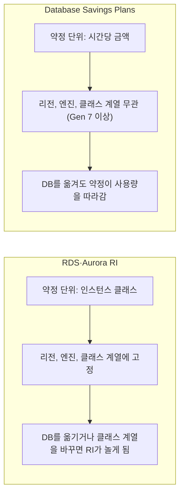
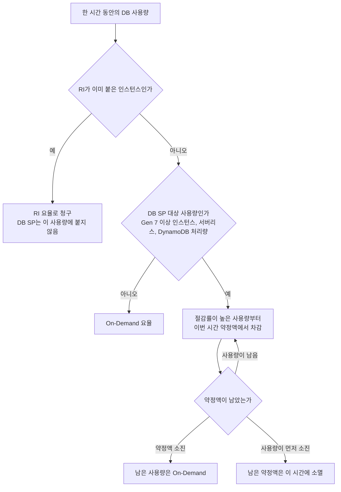
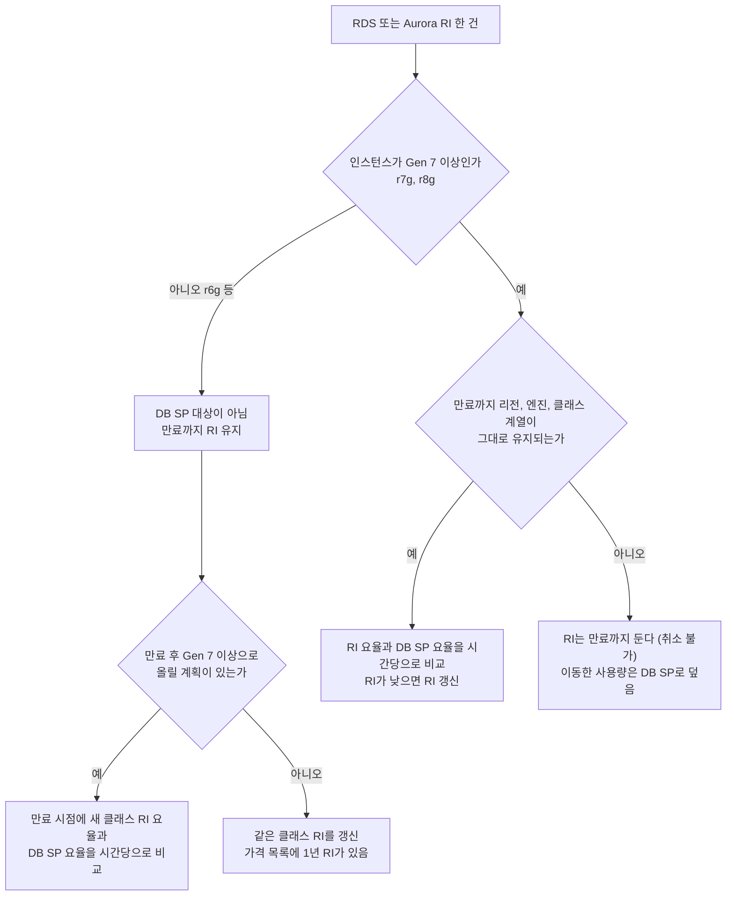
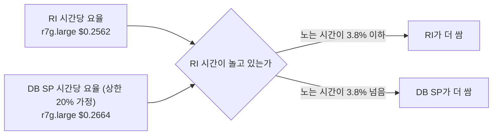
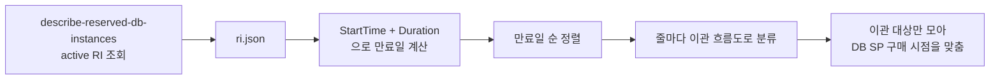
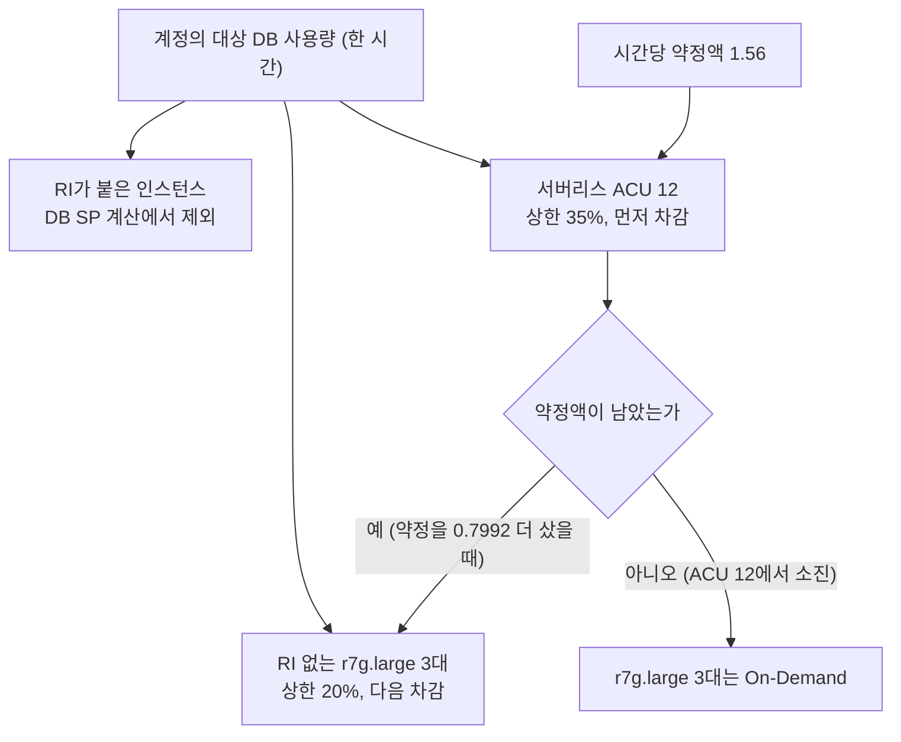
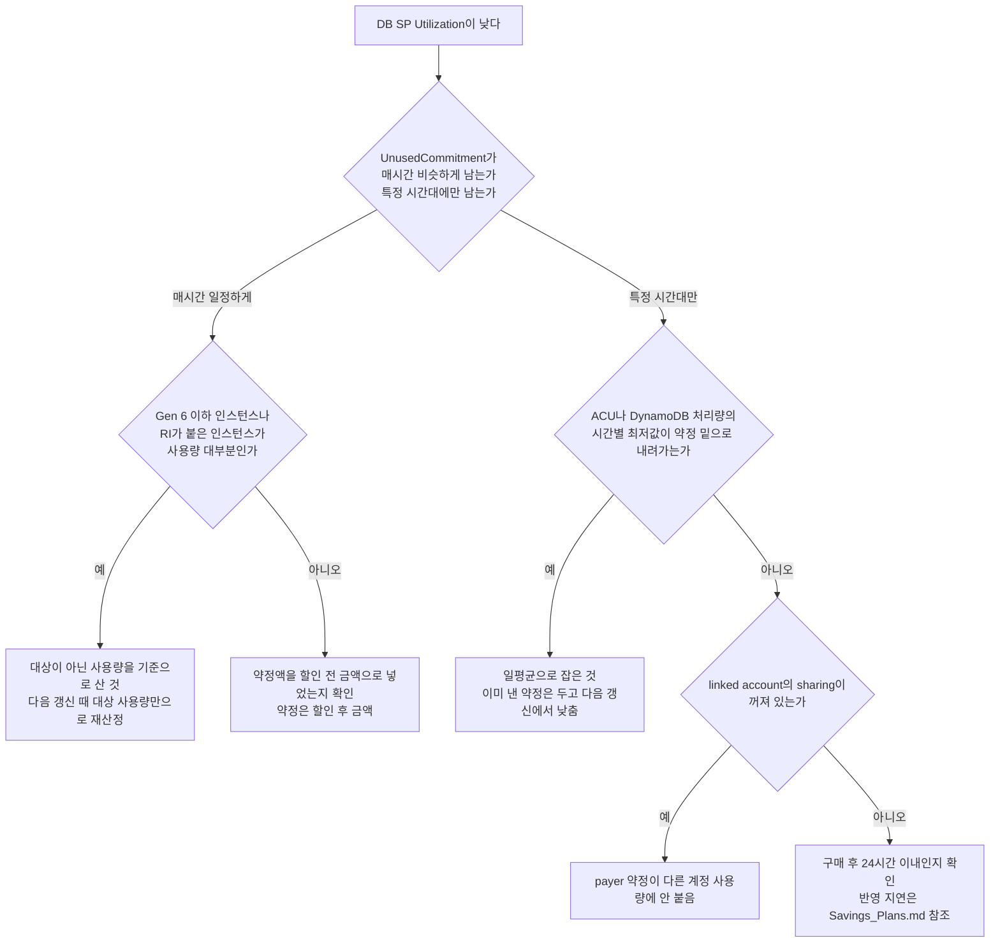

# Database Savings Plans

2025년 12월에 나온 DB 전용 약정 요금제다. 시간당 금액($/hour)을 1년 동안 약정하면 Aurora, RDS, DynamoDB, ElastiCache 같은 DB 사용량에 할인이 붙는다. 공식 발표에 나온 할인 상한은 서버리스 35%, 프로비저닝 인스턴스 20%, DynamoDB·Keyspaces 온디맨드 처리량 18%, 프로비저닝 처리량 12%다([AWS News Blog](https://aws.amazon.com/blogs/aws/introducing-database-savings-plans-for-aws-databases/)).

[Savings_Plans.md](Savings_Plans.md)와 [Cost_Explorer.md](Cost_Explorer.md)에는 "RDS·ElastiCache는 Savings Plans 대상이 아니라 RI를 써야 한다"고 적혀 있다. Compute·EC2 Instance Savings Plans만 놓고 보면 지금도 맞는 말이다. DB 사용량은 2025년 12월부터 약정 대상이 되었으니 그 문장은 DB 쪽에서는 낡았다.

그렇다고 RI를 걷어내고 갈아타면 되는 건 아니다. 이 문서를 쓰면서 공식 문서와 서울 리전 가격표를 대조해 보니 갈아타면 손해인 구간이 분명히 있었다. 프로비저닝 인스턴스는 할인 상한이 20%라서 서울 리전 r7g·r8g RI(No Upfront 기준 23.1%, 33.0%)보다 낮고, r6g는 아예 대상이 아니다. DB SP가 이기는 자리는 서버리스 사용량과, RI가 중간에 놀게 될 사용량이다.

## 공식 문서끼리 다르게 말하는 부분

읽은 문서가 네 군데인데 서로 어긋나는 대목이 세 개 있다.

| 항목 | 발표 글 | FAQ·User Guide·가격 페이지 |
|---|---|---|
| 대상 서비스 | 9개 (OpenSearch 없음) | OpenSearch Service까지 10개 |
| 선납 | "no upfront", 1년 | 선납하려면 Billing 콘솔의 advance pay 기능을 쓴다 |
| 인스턴스 세대 | 언급 없음 | FAQ는 "Generation 7 and newer", User Guide는 "latest provisioned instance generations" |

선납 항목은 약정 자체에 Partial·All Upfront 옵션이 없다는 뜻이다. `aws savingsplans`의 `--payment-options` 값(`All Upfront`, `Partial Upfront`, `No Upfront`)은 Savings Plans 전체가 공유하는 enum이라 DB SP에서 어느 값이 받아들여지는지는 알려주지 않는다. 약정 기간도 문서에는 1년만 나온다. RI는 3년이 있고 DB SP에는 없으니, 3년 RI로 깔아 둔 사용량은 DB SP가 대체할 수 없다.

세대 항목이 이 문서에서 가장 영향이 크다. 이 내용은 아래 "r6g는 대상이 아니다"에서 따로 다룬다.

참고한 문서는 [Savings Plans FAQ](https://aws.amazon.com/savingsplans/faqs/), [User Guide의 plan types](https://docs.aws.amazon.com/savingsplans/latest/userguide/plan-types.html), [가격 페이지](https://aws.amazon.com/savingsplans/database-pricing/)다.

## 대상 서비스와 할인율

할인 상한은 서비스별이 아니라 배포 방식별로 공개되어 있다. 서비스 이름과 상한을 한 표로 묶었고, "명시된 대상"에는 문서에 실제로 적힌 것만 넣었다.

| 서비스 | 문서에 명시된 대상 사용량 | 공개된 상한 |
|---|---|---|
| Aurora | 프로비저닝 인스턴스, Aurora Serverless, Aurora PostgreSQL Limitless | 20% / 35% |
| RDS | 프로비저닝 인스턴스. SQL Server는 인스턴스 가격에만 적용 | 20% |
| ElastiCache | 프로비저닝 노드, ElastiCache Serverless for Valkey | 20% / 35% |
| DocumentDB | 프로비저닝 인스턴스, DocumentDB Serverless | 20% / 35% |
| Neptune | 프로비저닝 인스턴스, Neptune Serverless | 20% / 35% |
| DynamoDB | 온디맨드 처리량, 프로비저닝 처리량 | 18% / 12% |
| Keyspaces | 온디맨드 처리량, 프로비저닝 처리량 | 18% / 12% |
| Timestream | 서비스 목록에만 있음 | 개별 값 확인 못 함 |
| DMS | 서비스 목록에만 있음 | 개별 값 확인 못 함 |
| OpenSearch Service | 목록에 있고 OpenSearch Serverless가 명시됨 | 개별 값 확인 못 함 |

"20% / 35%"는 앞이 프로비저닝, 뒤가 서버리스다. 두 숫자는 "지원하는 DB 서비스 전반의 프로비저닝 인스턴스는 최대 20%, 서버리스 배포는 최대 35%"라는 발표 문구에서 가져왔고, Timestream·DMS·OpenSearch는 어느 쪽에 해당하는지 개별 표를 가져오지 못해 비워 뒀다. 가격 페이지의 서비스별 표를 직접 확인해야 한다.

공식 서비스 목록에 없는 것도 구분해 둔다. MemoryDB, DAX, Redshift는 목록에 없다. RI로 덮던 사용량이 이쪽이면 DB SP로 옮길 수 없다.

35%와 20%는 "up to"로 표기된 상한이라서 클래스·서비스별 실제 요율은 이보다 낮을 수 있다. 서울 리전 r7g의 DB SP 요율은 공개된 가격 파일에서 찾지 못했다. 그래서 아래 숫자 예제는 20%를 "가장 유리한 경우"로 놓고 계산한다.

## RDS RI와 무엇이 다른가

RI는 "어떤 DB를 예약했는가"에 묶이고 DB SP는 "시간당 얼마를 쓰기로 했는가"에 묶인다. 묶이는 축이 다르니 DB를 옮기거나 바꿀 때 행동도 달라진다.

아래 도식은 두 방식이 무엇에 묶이고 DB를 옮기면 어떻게 되는지를 나란히 놓은 것이다.



| 항목 | RDS·Aurora RI | Database Savings Plans |
|---|---|---|
| 약정 단위 | 인스턴스 클래스 | 시간당 금액($/hour) |
| 기간 | 1년, 3년 | 1년만 |
| 선납 | No·Partial·All Upfront. No Upfront는 1년만 | 선납 없음. 선납하려면 advance pay |
| 엔진 | 고정 (MySQL RI는 PostgreSQL에 안 붙음). 엔진 버전은 무관 | 무관 |
| 인스턴스 클래스 계열 | 고정. r6i RI는 r6id나 r7g에 안 붙음 | 무관 (Gen 7 이상) |
| 크기 | 같은 계열 안에서 자동 적용 (RDS Oracle LI, SQL Server 제외) | 무관 |
| 리전 | 고정 | 무관 |
| Multi-AZ·Single-AZ | RDS는 RI가 둘 다 적용됨 | 무관 |
| 취소 | 불가 | 약정 기간 중 취소 불가 |

RI 쪽 규칙은 [RDS](https://docs.aws.amazon.com/AmazonRDS/latest/UserGuide/USER_WorkingWithReservedDBInstances.html)와 [Aurora](https://docs.aws.amazon.com/AmazonRDS/latest/AuroraUserGuide/USER_WorkingWithReservedDBInstances.html) 문서에서 읽었다. Aurora MySQL·PostgreSQL RI는 같은 리전·엔진·클래스 계열 안에서 크기가 달라도 붙는다. [Cost_Explorer.md](Cost_Explorer.md) 290행은 "RI는 크기까지 정확히 일치해야 적용된다"고 쓰는데 이 두 엔진과 RDS MySQL·PostgreSQL·MariaDB에서는 맞지 않는다. 크기 유연성이 없는 쪽은 RDS SQL Server와 License Included Oracle다.

리전을 옮기면 RI는 쓸 곳이 없다. 문서는 "할인이 인스턴스 타입과 리전에 묶인다"고만 쓰고 있으니, 서울에서 도쿄로 DB를 옮기면 서울 RI는 남은 기간 동안 그대로 청구된다. DB SP는 리전을 가리지 않고 따라간다.

RI는 DB 인스턴스를 지워도 사라지지 않는다. 같은 조건의 인스턴스를 다시 만들면 약정 기간 안에서는 할인이 이어진다. 그래서 RI 보유 인스턴스를 다른 클래스로 바꾸는 순간만 문제이고, 지우고 되돌리는 작업은 문제가 안 된다.

## 같은 워크로드에는 겹치지 않는다

가격 페이지의 문장은 이렇다. "같은 워크로드에 Database Savings Plans와 RDS Reserved Instances, DynamoDB reserved capacity 할인을 함께 적용할 수 없다. 한 워크로드에는 RI를, 다른 워크로드에는 DB SP를 쓰는 것은 가능하다."

"워크로드"가 인스턴스 하나인지 클러스터인지 문서가 정의하지 않는다. 인스턴스 단위로 읽는 게 자연스럽지만 확인한 것은 아니다. 구매 후 Cost Explorer에서 RI가 붙은 인스턴스가 DB SP Coverage에 잡히는지 한 번 대조해야 한다.

한 시간 안에서 약정이 소진되는 순서는 [Savings Plans 적용 문서](https://docs.aws.amazon.com/savingsplans/latest/userguide/sp-applying.html)를 따른다. 이 문서는 EC2 예시로 쓰여 있고 DB SP를 직접 다루지는 않지만, "약정은 절감률이 높은 사용량부터 배정되고, 한 시간의 약정은 그 시간 안에서만 쓰이며 이월되지 않는다"는 규칙은 Savings Plans 전체에 걸린 서술이다.



흐름도에서 볼 부분은 `W` 노드다. 새벽에 ACU가 줄어든 시간의 남은 약정액은 오후 피크의 부족분을 메우지 못한다. 일평균으로 약정을 잡으면 이 구조 때문에 Utilization이 기대보다 낮게 나온다. 계산 원리는 [Savings_Plans.md](Savings_Plans.md)의 약정 금액 절과 같다.

## r6g는 대상이 아니다

FAQ는 Database Savings Plans가 "Generation 7 and newer instances"를 대상으로 한다고 쓴다. User Guide는 "최신 프로비저닝 인스턴스 세대"라고 쓰면서 `db.r7g`와 `db.r8g` 사이를 오가는 예를 든다. 두 문서가 같은 방향이다. r6g는 6세대라서 DB SP로 덮이지 않는 것으로 읽는 게 맞다.

그래서 "r6g RI를 DB SP로 전환"은 성립하지 않는다. r6g RI는 만료까지 RI로 남고, 갈아탈 수 있는 것은 r7g·r8g 이상으로 올린 뒤의 사용량이다. 이 문서의 가격 비교에서 r6g는 RI 갱신과 상위 세대 이전의 비교 대상으로만 나온다.

r6g가 실제로 빠지는지는 요율 조회로 확인한다. r7g는 요율이 나오고 r6g는 안 나오면 FAQ 문구와 맞는 것이다.

```bash
aws savingsplans describe-savings-plans-offerings \
  --plan-types Database \
  --payment-options "No Upfront" \
  --durations 31536000 \
  --currencies USD \
  --region us-east-1

# 위에서 받은 offeringId를 넣는다. usage-types 값은 가격 파일의 usagetype 필드 값이다
aws savingsplans describe-savings-plans-offering-rates \
  --savings-plan-offering-ids <offering-id> \
  --products RDS \
  --service-codes AmazonRDS \
  --usage-types APN2-InstanceUsage:db.r6g.large APN2-InstanceUsage:db.r7g.large \
  --region us-east-1
```

두 명령은 인자 파싱까지만 로컬에서 확인했고 실제 호출은 하지 못했다(자격 증명이 없는 환경이다). `--plan-types`의 `Database`, `--products`의 `RDS`, `--service-codes`의 `AmazonRDS`는 `aws savingsplans ... help`의 허용값에서 가져왔다. 응답이 비어 있거나 usage type 문자열이 가격 파일과 다르면 `--filters name=instanceType,values=db.r7g.large`로 바꿔 본다.

## RI 보유분을 이관할지 판단하는 순서

RI 한 건마다 이 흐름도로 분류한다. 세대 분기가 맨 위에 있는 이유는 r6g 이하면 나머지 질문이 필요 없기 때문이다.



`L` 분기의 답이 "아니오"가 되는 경우는 리전 이전, 엔진 변경(Oracle에서 Aurora PostgreSQL로 이전 같은 것), 클래스 계열 변경(r7g에서 r8g)이다. 이 셋은 RI가 놀게 되는 정확한 원인이고, DB SP가 문서에서 내세우는 장점도 이 셋이다.

서버리스 사용량은 이 흐름도에 들어오지 않는다. Aurora Serverless v2의 ACU에는 RI가 없다. 서울 리전 가격 파일에서 `ServerlessV2Usage` 계열 SKU의 Reserved 항목을 세어 보면 0건이다. 서버리스는 DB SP가 유일한 약정 수단이다.

## 서울 리전 Aurora 숫자 비교

가격은 AWS Price List에서 직접 받았다. 파일의 `publicationDate`가 2026-10-06T22:40:50Z이고, Aurora MySQL·PostgreSQL Single-AZ, Aurora Standard(I/O-Optimized 아님), `db.*.large` 기준이다. 두 엔진의 가격이 같다.

```python
import json, urllib.request

URL = "https://pricing.us-east-1.amazonaws.com/offers/v1.0/aws/AmazonRDS/current/ap-northeast-2/index.json"
d = json.load(urllib.request.urlopen(URL))          # 약 18MB
print(d["publicationDate"])

for sku, p in d["products"].items():
    a = p["attributes"]
    if a.get("databaseEngine") != "Aurora MySQL" or a.get("deploymentOption") != "Single-AZ":
        continue
    if a.get("usagetype") not in {f"APN2-InstanceUsage:db.{g}.large" for g in ("r6g", "r7g", "r8g")}:
        continue
    od = [pd["pricePerUnit"]["USD"] for t in d["terms"]["OnDemand"][sku].values() for pd in t["priceDimensions"].values()]
    print(a["usagetype"], "OnDemand", od)
    for t in d["terms"].get("Reserved", {}).get(sku, {}).values():
        ta = t["termAttributes"]
        for pd in t["priceDimensions"].values():
            print("  ", ta["LeaseContractLength"], ta["PurchaseOption"], pd["unit"], pd["pricePerUnit"]["USD"])
```

시간당 환산 결과다. Partial·All Upfront는 선납금을 8,760시간으로 나눠 시간당 요율에 더했다.

| 클래스 | On-Demand | RI 1년 No Upfront | RI 1년 Partial Upfront 환산 | RI 1년 All Upfront 환산 | DB SP (상한 20% 가정) |
|---|---|---|---|---|---|
| db.r6g.large | $0.313 | $0.2059 (34.2%) | $0.1776 (43.3%) | $0.1741 (44.4%) | 대상 아님 |
| db.r7g.large | $0.333 | $0.2562 (23.1%) | $0.2496 (25.1%) | $0.2429 (27.1%) | $0.2664 |
| db.r8g.large | $0.333 | $0.2231 (33.0%) | $0.2165 (35.0%) | $0.2098 (37.0%) | $0.2664 |

괄호 안은 On-Demand 대비 할인율이다. 이 표에서 눈에 띄는 것은 r7g RI의 할인율이 세 클래스 중 가장 낮다는 점이다. r7g는 RI가 23.1%밖에 안 되니 DB SP 상한 20%와의 차이가 3.1%p로 좁다.

같은 가정으로 10대를 1년 쓸 때의 총액이다(단위 USD).

| 클래스 | On-Demand | RI No Upfront | DB SP (20% 가정) | RI가 DB SP보다 적은 금액 |
|---|---|---|---|---|
| r6g × 10 | 27,419 | 18,037 | 해당 없음 | - |
| r7g × 10 | 29,171 | 22,443 | 23,337 | 894 |
| r8g × 10 | 29,171 | 19,544 | 23,337 | 3,793 |

DB SP가 RI를 따라잡으려면 필요한 할인율을 거꾸로 계산하면 r7g는 23.1%, r8g는 33.0%다. 공개된 프로비저닝 상한 20%를 넘는다. 사용량이 RI와 끝까지 맞물려 돌아가는 한 서울 리전에서 프로비저닝 인스턴스는 RI가 이긴다.

RI가 지는 경우는 RI 시간이 놀 때다. RI는 사용 여부와 무관하게 시간당 요율을 내므로 사용 비율을 u라고 하면 쓰는 시간당 실질 요율이 `RI 요율 / u`가 된다. DB SP가 상한 20%로 모든 사용량에 붙는다고 보면 손익분기는 `u = 0.2562 / 0.2664 = 0.9617`이다. RI 시간 중 3.8% 이상이 놀면 r7g에서는 DB SP가 낫다.

도식은 이 손익분기를 한 번에 보이게 한 것이다. 두 요율이 만나는 지점이 사용 비율 0.9617이다.



예를 들어 r7g.large 10대를 RI로 잡고 6개월째에 3대를 r8g로 옮기는 경우를 계산한다. RI 쪽은 10대분 연간 22,443에 옮긴 3대의 후반 6개월 On-Demand 4,376(= 3 × 4,380시간 × $0.333)이 붙어 26,819다. DB SP는 모든 사용량이 20%로 붙는다고 보면 23,337이다. 차이는 3,482로 DB SP가 낫다. 이 수치는 DB SP 상한을 그대로 쓴 가장 유리한 경우이고, 옮긴 3대에 r8g RI를 새로 샀다면 RI 쪽이 달라진다. 갈아타는 판단은 "RI가 만료까지 놀지 않는가"에 달려 있다.

## RI 만료 시점 정리

RI가 만료되면 그 인스턴스는 계속 돌지만, 맞는 RI가 없으면 On-Demand 요율로 청구된다는 문서 규칙에 따라 요금이 바로 오른다. 만료일은 `StartTime + Duration`으로 직접 구해야 한다. `Duration`은 초 단위다.

```bash
aws rds describe-reserved-db-instances \
  --query 'ReservedDBInstances[?State==`active`].[ReservedDBInstanceId,DBInstanceClass,DBInstanceCount,ProductDescription,OfferingType,StartTime,Duration]' \
  --output json > ri.json
```

```python
import datetime as dt, json

rows = []
for rid, cls, cnt, eng, offer, start, dur in json.load(open("ri.json")):
    end = dt.datetime.fromisoformat(start.replace("Z", "+00:00")) + dt.timedelta(seconds=dur)
    rows.append((end, cls, cnt, eng, offer, rid))

for end, cls, cnt, eng, offer, rid in sorted(rows):
    print(f"{end:%Y-%m-%d}  {cls:16} x{cnt:<3} {eng:16} {offer:16} {rid}")
```

만료일 순으로 정렬해 놓고 각 줄을 앞의 흐름도에 넣는다. 만료일이 달마다 흩어져 있는 경우가 많은데, 이관 대상인 줄만 골라 DB SP 구매 시점을 몰아 두면 약정이 여러 개로 쪼개지지 않는다. 구매 시각을 미리 걸어 두는 `--purchase-time`은 `create-savings-plan`의 공통 파라미터로 [Savings_Plans.md](Savings_Plans.md)에서 다룬다. Database 플랜에서 대기열 구매가 같은 방식으로 동작하는지는 실행해 보지 못했다.

CLI 조회부터 구매 시점을 정하기까지의 순서는 아래와 같다.



RI가 남은 인스턴스를 서버리스로 옮기기로 했다면 RI를 처분할 방법이 없다. 문서는 RI를 취소할 수 없고 선납금도 사용 여부와 무관하게 청구된다고 쓴다. 이 경우 RI 잔여 기간 비용은 매몰 비용으로 두고, 서버리스 쪽 DB SP 약정은 RI와 겹치지 않는 사용량 기준으로만 잡는다.

## Serverless v2와 Provisioned가 섞인 클러스터

DB SP에는 클러스터 단위 설정이 없다. 약정 한 건이 계정(payer 아래라면 통합 청구 전체)의 대상 사용량 전체에 시간 단위로 붙는다. "이 클러스터에 얼마를 약정한다"가 아니라 "이 계정의 대상 DB 사용량 아래쪽에 얼마를 깐다"로 생각해야 한다.

문서에서 걸리는 지점이 하나 있다. FAQ는 "Aurora Serverless"라고만 쓰고 Serverless v2를 명시하지 않는다. 가격 파일에서 v1은 `APN2-Aurora:ServerlessUsage`, v2는 `APN2-Aurora:ServerlessV2Usage`로 나뉜다. 현재 Aurora의 서버리스는 v2이므로 포함되는 것으로 읽히지만, 구매 전에 위의 `describe-savings-plans-offering-rates`에 `--usage-types APN2-Aurora:ServerlessV2Usage`를 넣어 요율이 나오는지 확인한다. 이 호출은 실행해 보지 못했다.

서울 리전 ACU 단가는 가격 파일 기준으로 Aurora Standard가 $0.20, I/O-Optimized가 $0.26이다. I/O-Optimized 클러스터의 인스턴스·ACU 시간 요금이 DB SP 대상인지는 읽은 문서에 명시가 없다. I/O-Optimized를 쓰는 클러스터가 많다면 Purchase Analyzer에서 그 사용량이 Coverage에 잡히는지 먼저 본다.

약정액은 시간별 ACU 최저선에서 잡는다. 클러스터의 `ServerlessDatabaseCapacity` 지표를 1시간 단위 Minimum으로 뽑는다.

```bash
aws cloudwatch get-metric-statistics \
  --namespace AWS/RDS \
  --metric-name ServerlessDatabaseCapacity \
  --dimensions Name=DBClusterIdentifier,Value=orders-aurora \
  --statistics Minimum \
  --period 3600 \
  --start-time 2026-10-01T00:00:00Z \
  --end-time 2026-10-15T00:00:00Z
```

2주치 시간별 최솟값의 하위 10~30% 지점이 12 ACU라고 하자. 약정액은 할인 후 금액이라서 `12 × $0.20 × (1 - 할인율)`이다. 할인율을 얼마로 넣느냐에 따라 안전한 쪽이 갈린다.

| 가정한 할인율 | 약정액($/hr) | 실제 할인율이 35%일 때 | 실제 할인율이 25%일 때 |
|---|---|---|---|
| 35% (상한) | 1.56 | 12 ACU 전부 덮임 | 10.4 ACU만 덮임. 약정은 전부 사용됨 |
| 25% | 1.80 | 약정 중 $0.24/hr 소멸 (연 약 $2,102) | 12 ACU 전부 덮임 |

상한값으로 약정액을 잡으면 실제 할인율이 그보다 낮아도 약정은 빠짐없이 쓰인다. 덮이는 ACU 수가 줄어들 뿐이다. 반대로 낮은 할인율을 가정해서 크게 잡으면 실제 할인율이 높게 나올 때 그 차액이 소멸한다. 요율을 모르는 상태에서 처음 사는 약정은 상한 쪽 가정이 틀려도 덜 아프다. 실제 요율은 구매 직전에 offering rates로 확인한다.

프로비저닝 인스턴스가 같은 클러스터에 섞여 있으면 RI가 붙은 인스턴스는 계산에서 뺀다. RI가 없는 Gen 7 이상 인스턴스는 DB SP 대상이다. 일반 적용 규칙대로라면 절감률이 높은 서버리스(상한 35%)가 프로비저닝(상한 20%)보다 먼저 약정을 가져간다. r7g.large 3대가 RI 없이 돈다면 상한 가정으로 `3 × $0.333 × 0.8 = $0.7992/hr`이 추가로 필요하고, 약정을 1.56으로만 사면 ACU 12까지만 덮고 인스턴스 3대는 On-Demand로 남는다.

이 시간 단위 배정을 그리면 아래와 같다. 약정이 서버리스 ACU에서 먼저 소진되고 프로비저닝 인스턴스는 뒤로 밀리는 순서를 보면 된다.



## 약정이 붙지 않는 항목

| 항목 | 상태 | 근거 |
|---|---|---|
| Gen 6 이하 인스턴스(r6g 등) | 대상 아님 | FAQ "Generation 7 and newer" |
| Aurora·RDS 스토리지, I/O 요청, 백업·스냅샷, 데이터 전송 | 대상 사용량에 나열되지 않음. 명시적 제외 문구는 확인 못 함 | 발표·FAQ가 대상을 서버리스·프로비저닝 인스턴스 사용량과 DynamoDB·Keyspaces 처리량으로 한정 |
| RDS SQL Server의 Windows Server·SQL Server 라이선스료 | 제외, On-Demand로 청구 | 가격 페이지 |
| RI·DynamoDB reserved capacity가 붙은 같은 워크로드 | 겹치지 않음 | 가격 페이지 |
| MemoryDB, DAX, Redshift | 공식 서비스 목록에 없음 | FAQ의 서비스 목록 |

스토리지·I/O·백업에는 RI도 할인을 주지 않는다. RDS 문서가 "RI는 스토리지, 백업, I/O 비용에 할인을 주지 않고 시간당 인스턴스 사용에만 할인을 준다"고 쓴다. DB SP는 이 항목에 대한 문구가 없다. 어느 쪽이든 인스턴스 할인율을 청구서 전체에 곱하면 절감액이 과대 계산된다. 약정 전에 청구서에서 인스턴스·ACU 시간 요금이 차지하는 비중을 따로 재 둔다.

서비스별 Coverage는 이렇게 본다.

```bash
aws ce get-savings-plans-coverage \
  --time-period Start=2026-10-01,End=2026-10-15 \
  --granularity MONTHLY \
  --group-by Type=DIMENSION,Key=SERVICE
```

## CLI로 추천받기

Cost Explorer의 추천 API에서 DB용 plan type은 `DATABASE_SP`다. `aws ce get-savings-plans-purchase-recommendation help`의 허용값은 `COMPUTE_SP`, `EC2_INSTANCE_SP`, `SAGEMAKER_SP`, `DATABASE_SP` 네 개다. 추천은 먼저 생성을 요청하고 그다음에 조회한다. 생성 요청은 통합 청구 단위로 하루 3번까지 갱신할 수 있다.

```bash
aws ce start-savings-plans-purchase-recommendation-generation

aws ce get-savings-plans-purchase-recommendation \
  --savings-plans-type DATABASE_SP \
  --term-in-years ONE_YEAR \
  --payment-option NO_UPFRONT \
  --lookback-period-in-days THIRTY_DAYS \
  --account-scope PAYER \
  --query 'SavingsPlansPurchaseRecommendation.SavingsPlansPurchaseRecommendationSummary.{Hourly:HourlyCommitmentToPurchase,SavingsPct:EstimatedSavingsPercentage,MonthlySavings:EstimatedMonthlySavingsAmount}'
```

공식 문서가 1년·선납 없음만 제시하므로 이 조합으로 호출한다. `THREE_YEARS`나 `ALL_UPFRONT`를 넣었을 때 어떻게 응답하는지는 호출해 보지 못했다. `--lookback-period-in-days`는 `SEVEN_DAYS`, `THIRTY_DAYS`, `SIXTY_DAYS` 중 하나이고, `--account-scope`는 `PAYER`(관리 계정과 멤버 계정을 합산) 또는 `LINKED`(멤버 계정별)다.

CLI는 로컬에 설치해 `help` 출력과 인자 파싱까지 확인했다. 로컬 환경에 AWS 계정이 없어서 실제 응답은 받아 보지 못했고, `--query`의 키 이름은 서비스 모델의 응답 필드(`HourlyCommitmentToPurchase`, `EstimatedSavingsPercentage`, `EstimatedMonthlySavingsAmount`)와 대조했다. 추천값이 RI가 붙은 인스턴스를 제외하고 계산됐는지는 문서에서 확인하지 못했다. 추천 `HourlyCommitmentToPurchase`를 그대로 사지 말고 위의 시간별 최저선 계산과 대조한다.

## Utilization이 낮을 때 원인 추적

약정을 샀는데 Utilization이 낮으면 `UnusedCommitment`가 시간대에 따라 어떻게 남는지부터 본다.

```bash
aws ce get-savings-plans-utilization-details \
  --time-period Start=2026-10-01,End=2026-10-15 \
  --query 'SavingsPlansUtilizationDetails[*].{ARN:SavingsPlanArn,Used:Utilization.UsedCommitment,Unused:Utilization.UnusedCommitment,Pct:Utilization.UtilizationPercentage}'
```



흐름도의 첫 분기가 중요하다. 매시간 일정하게 남는다면 약정에 붙을 사용량 자체가 없다는 뜻이고, 특정 시간대에만 남는다면 사용량이 있는데 기저 계산이 틀린 것이다. 앞쪽은 구성 문제이고 뒤쪽은 계산 문제라서 대응이 다르다.

원인 후보를 구성 문제 쪽에서 꼽으면 이렇다.

- r7g에서 r8g로 올리면서 RI를 새로 샀다. RI가 붙은 인스턴스는 DB SP에서 빠지므로 DB SP 약정이 놀게 된다.
- 계정의 DB 사용량 대부분이 r6g인 상태에서 DB SP를 샀다. 대상 사용량이 작으니 약정에 붙을 사용량도 작다.
- 서버리스 클러스터의 최소 ACU를 낮추고 약정은 예전 기준으로 뒀다. 약정은 기간 중 줄일 수 없으니 ACU 설정을 바꾸기 전에 약정액과 먼저 대조한다.

계산 문제 쪽은 DynamoDB 온디맨드 처리량처럼 시간별 편차가 큰 사용량에서 나온다. 일평균으로 잡으면 새벽 시간에 약정이 소멸하고, 소멸분은 이월되지 않는다.

정확한 원인이 사용량인지 설정인지 헷갈리면 Cost Explorer의 Savings Plans 화면에서 서비스별 Coverage를 본다. 해당 서비스의 Coverage가 0이면 적용 대상 또는 RI 겹침 문제이고, 0이 아닌데 Utilization만 낮으면 시간별 기저 문제다.

## 문서로 확인하지 못한 것

| 항목 | 상태 |
|---|---|
| Serverless v2 ACU가 대상인지 | FAQ는 "Aurora Serverless"로만 표기. offering rates 호출로 확인 필요 |
| Aurora I/O-Optimized 클러스터의 인스턴스·ACU 요금이 대상인지 | 명시 없음 |
| 서울 리전 r7g·r8g의 DB SP 실제 요율 | 공개 가격 파일에서 찾지 못함. 숫자 예제는 상한 20% 가정 |
| Timestream, DMS, OpenSearch의 개별 할인율 | 서비스별 표를 가져오지 못함 |
| 구매 후 7일 반품 규정이 DB SP에 적용되는지 | Savings Plans 일반 규정만 확인. DB SP 개별 문구 없음 |
| RDS RI가 붙은 인스턴스에 DB SP가 붙지 않는 단위 | "같은 워크로드"의 범위가 정의되어 있지 않음 |
| 3년 약정과 선납 옵션의 API 동작 | 문서상 1년·선납 없음만 확인. 다른 조합은 호출해 보지 못함 |

숫자 예제와 CLI 파싱은 로컬에서 직접 확인했고 AWS 계정을 쓰는 호출은 하나도 실행하지 못했다. 구매 전에 위 표의 항목은 Purchase Analyzer와 offering rates로 확인해야 한다.

## 관련 문서

- [Savings Plans](Savings_Plans.md): Compute·EC2 Instance Savings Plans의 약정 계산과 반품, Organizations 공유
- [RDS](../Database/RDS.md): RDS 인스턴스와 비용 구조
- [Aurora Serverless v2](../Database/Aurora_Serverless_V2.md): ACU 설정과 `ServerlessDatabaseCapacity` 지표
