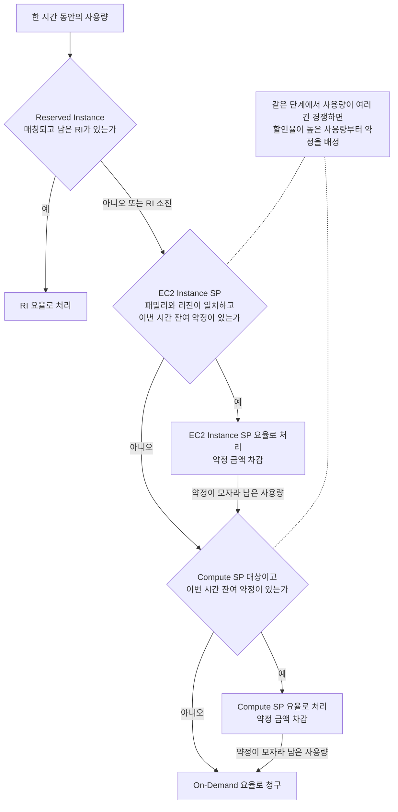
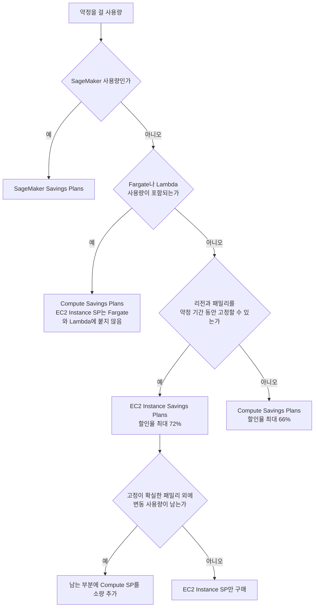
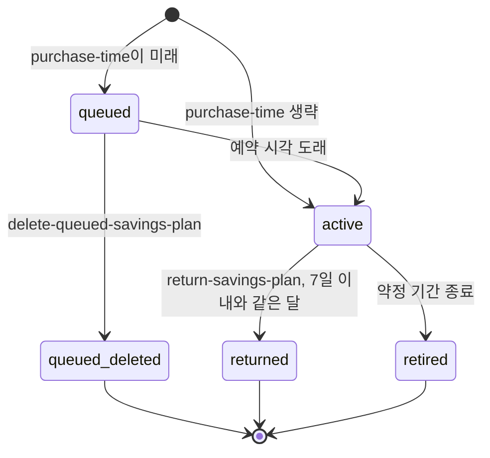
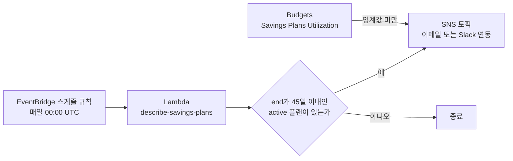

# AWS Savings Plans

1년 또는 3년 동안 "시간당 $X를 쓰겠다"고 약정하고 On-Demand 대비 할인을 받는 요금제다. 공개된 최대 할인율은 EC2 Instance Savings Plans 72%, Compute Savings Plans 66%, SageMaker Savings Plans 64%다. Reserved Instances(RI)와 달리 인스턴스 수량이 아니라 금액을 약정하므로 인스턴스 유형을 바꿔도 약정이 따라온다.

문서 대부분은 할인율 소개보다 "약정이 어떤 순서로 사용량에 붙고, 어디서 조용히 새는가"에 쓴다. 구매 버튼은 쉽게 눌리지만 잘못 산 약정은 1년 동안 매달 청구된다.

## Reserved Instances와 구조적 차이

RI는 인스턴스 단위 예약이다. Standard RI는 패밀리·OS·테넌시가 묶이고, 지역(Regional) RI라면 같은 패밀리 안에서 크기 변동은 흡수한다. 패밀리를 바꾸려면 Convertible RI로 교환해야 하고, 리전을 옮기면 예약분은 쓸 곳이 없다.

Savings Plans는 금액 단위다. 인스턴스 타입을 바꾸고 크기를 조정해도 약정 금액 안에서는 할인이 자동으로 붙는다. 인스턴스 유형을 자주 바꾸는 팀은 RI보다 Savings Plans 쪽이 관리가 단순하다.

적용 서비스도 다르다. RI는 EC2, RDS, ElastiCache, OpenSearch, Redshift를 서비스별로 따로 예약한다. Compute Savings Plans 하나는 EC2, Fargate, Lambda를 한 번에 덮는다. 반대로 RDS나 ElastiCache처럼 Savings Plans 대상이 아닌 서비스는 여전히 RI를 써야 한다. "Savings Plans 하나로 전부 해결된다"고 보고 RI 만료를 방치하면 해당 서비스 비용이 On-Demand로 튄다.

결제 옵션은 둘 다 All Upfront, Partial Upfront, No Upfront 중에서 고른다. 선납 비율이 높을수록 할인율이 올라간다.

| 구분 | Savings Plans | Reserved Instances |
|---|---|---|
| 약정 단위 | 시간당 금액 ($) | 인스턴스 수량 |
| 적용 서비스 | EC2, Fargate, Lambda, SageMaker | EC2, RDS, ElastiCache, OpenSearch, Redshift 등 |
| 인스턴스 유형 변경 | Compute SP는 자유, EC2 Instance SP는 패밀리·리전 고정 | Standard RI는 패밀리 고정, Convertible RI는 교환 가능 |
| 최대 할인율 | EC2 Instance SP 72%, Compute SP 66% | Standard RI 72%, Convertible RI 66% |
| 중도 처분 | 구매 후 7일 이내, 같은 달 안에서만 반품 | Standard RI는 Marketplace 재판매 가능 |

할인율 상한만 보면 같은 조건에서 Standard RI와 EC2 Instance SP는 비슷하고, Convertible RI와 Compute SP도 비슷하다. 선택 기준은 할인율이 아니라 "얼마나 바꿀 수 있는가"와 "어떤 서비스를 덮는가"다.

## 플랜 유형별 차이

### Compute Savings Plans

EC2, Fargate, Lambda 전부에 적용된다. 인스턴스 패밀리, 리전, OS, 테넌시를 고정하지 않는다. 할인율은 최대 66%로 세 종류 중 EC2 Instance SP보다 낮지만 제약이 가장 적다. 아키텍처를 자주 바꾸거나 멀티 리전으로 운영한다면 이쪽이다.

서비스마다 할인율이 다르다는 점이 중요하다. 공개된 최대치 기준으로 EC2는 66%, Fargate는 52%, Lambda는 17% 수준이다. 이 차이가 다음 절의 "할인율 높은 사용량부터 약정을 소진한다"는 규칙과 맞물려 Lambda나 Fargate가 약정에서 밀리는 일이 생긴다.

Fargate는 vCPU 시간과 메모리 GB-시간에 할인이 붙는다. Lambda는 실행 시간(GB-초) 과금에 붙고, 요청 수 과금(백만 건당 $0.20)은 대상이 아니다. 함수 비용이 실행 시간에서 나오는지 요청 수에서 나오는지 먼저 갈라 봐야 계산이 맞는다.

### EC2 Instance Savings Plans

패밀리와 리전을 지정한다. `us-east-1`의 M 패밀리로 약정하면 `m5.large`, `m5.xlarge`, `m6i.large`처럼 M 계열은 크기와 세대가 달라도 할인이 붙는다. OS와 테넌시는 바꿀 수 있다. 최대 72%로 세 종류 중 가장 높다. 특정 리전에서 특정 패밀리를 장기간 쓰는 게 확실한 서비스에 맞다.

Fargate와 Lambda에는 적용되지 않는다. Fargate가 주력인 팀이 EC2 Instance SP를 사면 Fargate 비용은 그대로 On-Demand로 나간다. 이 실수는 흔하다.

### SageMaker Savings Plans

SageMaker 워크로드 전용이고 최대 64%다. 인스턴스 패밀리, 크기, 리전, 컴포넌트(Training, Inference, Processing 등)를 가리지 않고 붙는다. ML 파이프라인을 상시 돌리는 팀에만 맞는다. 학습 잡을 간헐적으로 돌리는 팀은 약정 금액을 채우지 못해 손해를 본다.

## 사용량이 약정에 붙는 순서

한 시간 동안 발생한 사용량은 RI, EC2 Instance SP, Compute SP, On-Demand 순서로 소진된다. 아래 흐름도는 한 시간 치 사용량 하나가 거치는 경로다. 점선으로 연결한 메모가 같은 단계 안의 우선순위 규칙이다.



규칙은 세 가지로 정리된다.

1. RI가 먼저 가져간다. RI로 덮이지 않은 사용량만 Savings Plans로 넘어온다.
2. Savings Plans끼리는 할인율이 높은 사용량부터 약정을 배정한다. EC2 Instance SP는 자기 패밀리·리전 사용량에 대해 Compute SP보다 할인율이 높으므로 먼저 소진된다. 그래서 두 플랜을 동시에 가지고 있으면 EC2 Instance SP가 해당 패밀리를 먼저 가져가고, 남은 사용량과 다른 서비스 사용량이 Compute SP로 간다.
3. Compute SP 안에서도 할인율이 높은 EC2 사용량이 먼저 약정을 가져간다. 약정이 빠듯하면 할인율이 낮은 Lambda 사용량이 맨 마지막까지 On-Demand로 남는다. Lambda를 약정으로 덮고 싶어서 Compute SP를 샀는데 EC2 사용량이 약정을 다 먹어서 Lambda 쪽 Coverage가 0에 가까운 경우가 있다.

### 남은 약정은 이월되지 않는다

이 흐름도에서 가장 오해하기 쉬운 부분은 "이번 시간 잔여 약정"이다. 약정은 시간 단위로 평가된다. 그 시간에 쓰지 못한 약정 금액은 다음 시간으로 넘어가지 않고, 다른 날의 초과 사용량을 메우는 데 쓰이지도 않는다. 새벽에 남은 약정과 점심에 모자란 약정은 서로 상쇄되지 않는다.

예를 들어 시간당 $7을 약정했는데 새벽 3시의 사용량이 약정 환산 $5 어치뿐이면 $2는 그 시간에 소멸한다. 오후 2시에 사용량이 약정 환산 $9가 되어도 $7만 약정으로 처리되고 나머지 $2는 On-Demand다. 일별·월별 합계로 "평균 사용량이 약정보다 크니까 괜찮다"고 판단하면 틀린다. 월 평균이 약정을 넘어도 Utilization은 100%보다 한참 낮게 나올 수 있다.

RI와 겹치는 경우도 같은 원리다. `m5.large` 10대를 RI로 잡아두고 Compute SP도 샀는데 실제로 `m5.large` 10대만 쓴다면 RI가 전부 가져가고 Compute SP 약정은 그 시간 내내 소멸한다. RI 만료 일정과 Savings Plans 구매 일정을 맞추거나, 새 워크로드에는 Savings Plans만 쓰고 기존 RI는 만료까지 그대로 두는 식으로 분리해야 한다.

## 약정이 붙지 않는 사용량

### Spot

Spot 인스턴스 사용량은 Savings Plans 대상이 아니다. Fargate Spot도 마찬가지다. Spot은 이미 할인된 별도 요금으로 청구되고 약정 금액을 소진하지 않는다.

여기서 생기는 실수가 있다. Karpenter나 Spot Fleet으로 On-Demand 노드 일부를 Spot으로 옮기면 On-Demand 기저 사용량이 줄어든다. 그 전에 계산해 둔 약정 금액은 그대로인데 붙을 사용량이 줄어서 Utilization이 하락한다. Spot 전환 계획이 있으면 구매 전에 전환 이후의 On-Demand 기저 사용량을 기준으로 약정을 잡아야 한다.

### Windows와 BYOL

Windows, RHEL, SQL Server처럼 라이선스가 요금에 포함된 인스턴스도 Savings Plans 대상이다. 다만 할인율은 Linux와 다르게 나오므로 Linux 기준 할인율로 약정 금액을 역산하면 어긋난다. 구매 전에 OS별 요율을 조회해서 계산한다.

```bash
aws savingsplans describe-savings-plans-offering-rates \
  --savings-plan-offering-ids <offering-id> \
  --products EC2 \
  --service-codes AmazonEC2
```

BYOL은 대부분 Dedicated Host 위에서 돌린다. Dedicated Host는 Savings Plans 대상이 아니고 호스트 단위 예약(Dedicated Host Reservation)으로 처리한다. Dedicated Instance(테넌시가 dedicated인 일반 인스턴스)는 대상이다. 라이선스 때문에 Dedicated Host를 쓰는 환경이라면 Cost Explorer의 Savings Plans 추천 금액에 그 비용이 들어 있는지 확인한다.

## 약정 금액 계산

핵심은 "할인 환산 후 금액"과 "시간 단위 최저선"이다. 이 두 가지를 놓치면 대부분의 구매 실수가 여기서 나온다.

약정 금액($/hr)은 할인이 적용된 요율로 청구되는 금액이다. 할인율이 30%라면 약정 $7이 On-Demand 기준 $10 어치 사용량을 덮는다. Cost Explorer에서 보는 On-Demand 비용 $10/hr를 그대로 약정으로 넣으면 안 된다. 그리고 기준은 일별 합계가 아니라 시간별 최저선이다. 약정이 시간 단위로 평가되기 때문이다.

### 숫자 예제

할인율은 30%(실제 요율은 인스턴스와 옵션마다 다르다)로 가정하고, 평일 22일은 낮 16시간에 On-Demand 환산 $12/hr, 밤 8시간에 $6/hr를 쓴다. 평일 하루는 192 + 48 = $240이다. 주말 8일은 종일 $6/hr로 하루 $144다. 월 총 On-Demand 환산 사용량은 22 × 240 + 8 × 144 = $6,432다.

"최근 3개월 중 가장 낮은 날이 $240이니 시간당 $10, 그중 70%인 $7을 약정한다"고 하면 일별 합계로 판단한 것이다. 실제로는 이렇게 된다.

| 구분 | 평일 하루 | 주말 하루 |
|---|---|---|
| 약정 $7/hr 청구액 | $168 | $168 |
| 약정이 덮은 사용량 (On-Demand 환산) | $208 (낮 16h × $10 + 밤 8h × $6) | $144 |
| 약정에서 소멸한 금액 | 밤 8h × $2.8 = $22.4 | 24h × $2.8 = $67.2 |
| 덮지 못한 사용량 (On-Demand) | $32 | $0 |
| 하루 청구 합계 | $200 | $168 |
| On-Demand였다면 | $240 | $144 |
| 하루 절감액 | +$40 | -$24 |

평일은 절감이지만 주말은 약정 때문에 오히려 $24씩 더 낸다. 월 합계는 평일 22 × $40 = $880 절감, 주말 8 × -$24 = -$192이므로 순절감 $688이다. 손실 쪽을 따로 보면 소멸한 약정이 22 × $22.4 + 8 × $67.2 = $1,030.4다. 약정이 실제로 덮어서 얻은 총 이득은 $1,718.4인데 소멸분 $1,030.4가 이 중 60%를 깎아 먹었다.

같은 사용량 곡선에서 약정 금액만 바꿔서 월 단위로 계산하면 이렇게 나온다.

| 약정 ($/hr) | 순절감 | Utilization | Coverage | 소멸한 약정 | Effective Savings Rate |
|---|---|---|---|---|---|
| 3 | $926 | 100% | 48% | $0 | 14.4% |
| 4.2 | $1,296 | 100% | 67% | $0 | 20.1% |
| 5 | $1,122 | 91.8% | 73% | $294 | 17.4% |
| 7 | $688 | 79.6% | 89% | $1,030 | 10.7% |
| 8 | $471 | 75.7% | 97% | $1,398 | 7.3% |
| 10 | -$768 | 62.5% | 100% | $2,698 | -11.9% |

Coverage는 이 표에서 On-Demand 환산 사용량 기준으로 계산했다. Cost Explorer의 Coverage 정의는 API 응답의 `SpendCoveredBySavingsPlans`와 `OnDemandCost`로 직접 계산해서 맞춰 보는 편이 안전하다.

```
xychart-beta
    title "약정 금액별 월 순절감액 (달러)"
    x-axis ["3", "4.2", "5", "6", "7", "8", "10"]
    y-axis "순절감액" -1000 --> 1500
    bar [926, 1296, 1122, 905, 688, 471, -768]
```

순절감은 약정 $4.2에서 정점을 찍고 이후 내려간다. 4.2는 "가장 낮은 시간의 사용량 $6 × (1 - 0.3)"이다. 시간별 최저선과 일치하는 지점이다. 약정을 올릴수록 Coverage는 올라가지만 순절감은 줄고, $10에서는 Coverage 100%인데 On-Demand보다 비싸다. Coverage만 보고 약정을 늘리면 안 되는 이유다.

한계 약정 1달러가 이득인지 따지는 기준도 여기서 나온다. 할인율이 d일 때 약정을 $1 늘리면 그 시간에 사용량이 있으면 $1/(1-d)만큼의 On-Demand 비용을 대체하고, 사용량이 없으면 $1이 소멸한다. 그 $1이 실제로 쓰이는 시간의 비율을 p라고 하면 손익분기는 p = 1 - d다. 할인율 30%면 늘린 약정이 전체 시간의 70% 이상에서 쓰여야 이득이다. 이게 Utilization 하한선의 근거이고, 사용량 곡선의 하위 30% 백분위 위쪽에 약정을 걸지 말라는 말과 같다.

### 월 단위 Effective Savings Rate

광고된 할인율(30%)과 실제로 받은 절감률은 다르다. 월 단위로 이렇게 계산한다.

```text
ESR = (On-Demand 환산 총 사용량 - 실제 청구액) / On-Demand 환산 총 사용량

실제 청구액 = 약정 청구액(약정 × 시간 수) + 약정이 덮지 못한 On-Demand 청구액
```

위 예제에서 $7 약정은 (6,432 - 5,744) / 6,432 = 10.7%다. 약정 청구액 $5,040에 덮이지 못한 On-Demand $704를 더한 값이 $5,744다. 할인율 30%짜리 상품으로 10.7%를 받은 셈이다. 매월 이 숫자를 기록하고 구매 시점의 기대치와 비교하면 약정이 사용량과 어긋나는 시점이 보인다. Cost Explorer에서 AmortizedCost를 쓰는 이유는 선납분을 기간에 걸쳐 나눠서 보기 위해서다.

### 단계별 절차

최근 3개월의 On-Demand 사용량을 시간 단위로 본다. Cost Explorer의 시간 단위 조회는 별도로 켜야 하고 보존 기간이 짧아서, 일별 데이터만 있으면 CUR과 Athena로 시간별 분포를 구한다. 기저는 시간별 사용량의 하위 백분위(10~30% 부근)로 잡고, 일별 최저 합계는 쓰지 않는다. 그 기저에 (1 - 할인율)을 곱하면 약정 후보가 나온다. 처음에는 후보의 70~80%로 시작하고 Utilization을 보면서 올린다.

```bash
# 최근 30일 On-Demand 일별 비용 조회
aws ce get-cost-and-usage \
  --time-period Start=2026-09-15,End=2026-10-15 \
  --granularity DAILY \
  --metrics AmortizedCost \
  --filter '{"Dimensions":{"Key":"PURCHASE_TYPE","Values":["On Demand"]}}' \
  --query 'ResultsByTime[*].[TimePeriod.Start,Total.AmortizedCost.Amount]' \
  --output table

# Savings Plans 추천 조회 (60일 이력 기반)
aws ce get-savings-plans-purchase-recommendation \
  --savings-plans-type COMPUTE_SP \
  --term-in-years ONE_YEAR \
  --payment-option NO_UPFRONT \
  --lookback-period-in-days SIXTY_DAYS

# 현재 Savings Plans 사용률 조회
aws ce get-savings-plans-utilization \
  --time-period Start=2026-10-01,End=2026-10-15

# Savings Plans 커버리지 조회
aws ce get-savings-plans-coverage \
  --time-period Start=2026-10-01,End=2026-10-15 \
  --granularity MONTHLY
```

Cost Explorer의 Savings Plans → Recommendations 화면에서도 추천 금액을 볼 수 있다. 최소 14일의 사용 이력이 있어야 의미 있는 추천이 나온다. 추천 금액은 참고용이다. 이력 기간에 Spot 전환이나 대규모 이벤트가 끼어 있으면 그대로 따를 수 없다.

## 어떤 플랜을 살지

플랜 선택은 워크로드 구성에서 갈린다. 아래 흐름도가 분기 순서다. 위쪽 분기일수록 선택지가 하나로 정해진다.



Fargate나 Lambda가 일부라도 있으면 Compute SP 쪽으로 간다. 이 경우 EC2 부분까지 EC2 Instance SP로 쪼개서 사고 싶은 유혹이 생기는데, 약정 두 개를 관리하는 비용이 할인율 차이(최대 6%p)보다 커지는 경우가 많다. 패밀리가 확정된 대형 상시 워크로드가 있을 때만 쪼갠다.

RDS, ElastiCache, OpenSearch는 이 분기에 나오지 않는다. 이 서비스들은 RI가 기본이다.

## 구매 방법

### CLI

구매는 두 단계다. 먼저 조건에 맞는 offering ID를 조회하고, 그 ID로 `create-savings-plan`을 호출한다. Savings Plans API는 `us-east-1` 엔드포인트를 쓴다.

```bash
# 1. Compute SP, 1년, No Upfront offering 조회 (기간 단위는 초: 1년 31536000, 3년 94608000)
aws savingsplans describe-savings-plans-offerings \
  --plan-types Compute \
  --payment-options "No Upfront" \
  --durations 31536000 \
  --currencies USD \
  --region us-east-1

# 2. 구매 (--commitment 가 시간당 약정 금액)
aws savingsplans create-savings-plan \
  --savings-plan-offering-id <offering-id> \
  --commitment 4.2 \
  --client-token sp-compute-2026-11 \
  --tags purpose=compute-baseline \
  --region us-east-1
```

`--client-token`을 반드시 넣는다. 같은 토큰으로 재시도하면 중복 구매 대신 기존 요청이 반환된다. 스크립트가 타임아웃 후 재실행되어 약정이 두 번 잡히는 사고를 막는다. 응답에 나오는 `savingsPlanId`는 반품에도 쓰이니 기록해 둔다.

offering 조회 결과가 여러 건이면 `productTypes`와 `usageType`을 보고 고른다. 1년 약정이 시간당 $4.2라면 한 번 누르는 순간 연간 약 $36,792가 약정된다. `--commitment` 숫자를 잘못 입력하면 되돌릴 방법이 7일 이내 반품밖에 없다.

### 대기열 예약 구매

`create-savings-plan`의 `--purchase-time`에 미래 시각(UTC)을 넣으면 그 시각에 구매가 실행되고, 그때까지 플랜은 `queued` 상태로 남는다. 쓰임새는 두 가지다.

- RI 만료 시각에 맞춰 Savings Plans를 시작한다. RI가 만료되는 시점과 약정 시작 사이에 On-Demand 공백이 생기지 않는다.
- 월초 00:00 UTC로 구매 시각을 맞춘다. 반품이 "구매 후 7일 이내이고 같은 달 안"이라는 조건이어서 달 말에 사면 반품 가능 기간이 7일보다 짧아진다. 25일에 샀다면 이번 달 말일까지 6일뿐이다.

```bash
aws savingsplans create-savings-plan \
  --savings-plan-offering-id <offering-id> \
  --commitment 4.2 \
  --purchase-time 2026-11-01T00:00:00Z \
  --client-token sp-compute-2026-11 \
  --region us-east-1

# 실행 전 대기열 취소
aws savingsplans delete-queued-savings-plan \
  --savings-plan-id <queued-savings-plan-id> \
  --region us-east-1
```

대기열에 올려 둔 플랜은 아직 청구되지 않았으므로 반품이 아니라 삭제로 취소한다. 그 사이 서비스 구성이 바뀌었다면 구매 직전에 삭제하고 다시 계산한다.



그림에서 `active` 이후 빠져나가는 경로는 반품과 만료뿐이다. 중간에 해지하는 경로는 없다.

### Terraform

내가 확인한 범위에서는 AWS provider에 Savings Plans 구매용 리소스가 없다. 확실하지 않으므로 사용하는 provider 버전의 문서에서 `aws_savingsplans_*`가 있는지 먼저 본다. 없다면 `terraform_data`에서 CLI를 호출하는 방식으로 구매 이력을 코드에 남길 수 있다.

```hcl
variable "offering_id" {
  type = string
}

resource "terraform_data" "compute_sp" {
  triggers_replace = [var.offering_id, "4.2", "2026-11-01T00:00:00Z"]

  provisioner "local-exec" {
    command = <<-EOT
      aws savingsplans create-savings-plan \
        --savings-plan-offering-id ${var.offering_id} \
        --commitment 4.2 \
        --purchase-time 2026-11-01T00:00:00Z \
        --client-token sp-compute-2026-11 \
        --region us-east-1
    EOT
  }
}
```

이 방식에는 두 가지 한계가 있다. 첫째, `terraform destroy`는 약정을 해지하지 못한다. 리소스는 state에서 사라져도 AWS의 플랜은 그대로 청구된다. 둘째, `triggers_replace` 값이 바뀌면 리소스가 재생성되면서 구매 명령이 한 번 더 실행된다. 금액이나 offering ID를 고치려다 약정이 두 개가 되는 사고가 이 경로로 나올 수 있다. `client-token`을 그대로 두면 같은 요청의 재시도는 막아 주지만, 값을 바꾼 재실행까지 막아 준다고 기대하면 안 된다. 구매를 코드로 두더라도 `plan` 출력을 사람이 확인하고 `apply`는 수동으로 실행하게 하고, CI에서 자동 실행되지 않게 막아야 한다. 이 예제는 내 환경에 Terraform과 AWS 자격증명이 없어 실행해서 확인하지 못했다.

## 반품과 취소

Savings Plans는 중도 해지가 없다. 다만 구매 직후 실수를 되돌리는 반품 규정이 있다. 구매 후 7일 이내이면서 구매한 달(UTC)과 같은 달 안이어야 하고, 시간당 약정이 $100 이하여야 하며, 연간 반품 횟수에 상한이 있다. 7일과 같은 달, 두 조건을 모두 만족해야 하므로 달 말에 사면 창이 7일보다 짧아진다.

조건은 바뀔 수 있으니 반품이 필요한 상황이면 Savings Plans User Guide의 최신 문구로 확인한다. 반품한 뒤 올바른 금액으로 다시 구매하는 것은 가능하다.

```bash
aws savingsplans return-savings-plan \
  --savings-plan-id <savings-plan-id> \
  --region us-east-1
```

구매 첫날 Utilization이 낮아 보여 당황해서 반품하는 경우가 있는데, 구매 직후 반영에 최대 24시간이 걸린다. 반영 전 수치를 근거로 반품하지 않는다. 반대로 7일이 지나면 방법이 없다. 이전 문서에서 쓰던 "AWS Marketplace에서 재판매" 경로는 Standard RI에만 해당하고 Savings Plans는 재판매 대상이 아니다.

## Organizations 멀티 계정 적용

AWS Organizations 환경에서 payer(관리) 계정이 Savings Plans를 구매하면 linked account 전체에 할인이 공유된다. linked account에서 개별 구매하면 그 계정에만 적용된다.

공유가 중요한 이유는 약정 활용률 때문이다. 계정별로 따로 사면 A 계정은 약정을 초과해서 쓰고 B 계정은 약정이 남는다. 약정이 시간 단위로 소멸한다는 점을 생각하면 합산해서 쓰는 쪽이 소멸을 줄인다. payer 계정에서 하나로 구매하면 AWS가 모든 linked account 사용량을 합산해서 할인을 배분한다.

**sharing on (기본값):** payer 계정의 Savings Plans가 모든 linked account 사용량에 자동 적용된다. 비용 배분 리포트에는 계정별 절감액이 표시된다.

**sharing off:** 각 계정이 자기 약정만 쓴다. 팀별 비용 책임을 엄격히 나눌 때 쓴다. 공유를 끄면 payer의 약정이 놀아도 다른 계정에 넘어가지 않으므로 소멸이 늘 수 있다.

구매 시점을 조율하지 않으면 linked account 담당자들이 각자 구매해서 중복이 생긴다. payer 계정 담당자만 구매권을 갖고, linked account는 Cost Explorer에서 추천만 보는 방식으로 운영한다.

```bash
# payer 계정에서 전체 Savings Plans 상태 확인
aws savingsplans describe-savings-plans \
  --states active \
  --query 'savingsPlans[*].{ARN:savingsPlanArn,Type:savingsPlanType,Region:region,Commitment:commitment,Currency:currency,End:end}'

# Organizations 내 계정별 Savings Plans 커버리지 확인
aws ce get-savings-plans-coverage \
  --time-period Start=2026-10-01,End=2026-10-15 \
  --granularity MONTHLY \
  --group-by '[{"Type":"DIMENSION","Key":"LINKED_ACCOUNT"}]'
```

## 구매 실수 사례

**피크 기준으로 약정을 잡은 경우.** 스케일다운 계획이 있거나 이벤트성 트래픽이 있는 서비스에서 자주 나온다. 피크 $15/hr에 맞춰 사놓고 평소 $8/hr(약정 환산 기준)으로 내려가면 매달 $7 × 720시간 = $5,040이 소멸한다. 약정은 사용 여부와 무관하게 청구된다.

**일별 합계로 기저를 잡은 경우.** 앞 절의 예제가 이 경우다. 일별 합계는 같아도 시간별 분포가 다르면 소멸하는 약정이 달라진다. 야간 배치가 없는 서비스나 주말 트래픽이 급감하는 서비스에서 특히 크다.

**EC2 Instance SP와 Compute SP를 겹쳐 산 경우.** 패밀리가 겹치면 EC2 Instance SP가 먼저 적용되고 남은 사용량에 Compute SP가 붙는다. 의도한 조합이 아니라면 Compute SP 약정이 시간 단위로 소멸한다. 패밀리가 확정된 대형 상시 워크로드는 EC2 Instance SP로, 나머지 변동 사용량에만 Compute SP를 소량 잡는 구성이 현실적이다.

**Fargate나 Lambda 사용량이 EC2 Instance SP에 포함된다고 본 경우.** EC2 Instance SP는 Fargate와 Lambda에 붙지 않는다. Fargate가 있으면 Compute SP를 써야 한다.

**Lambda 요청 수 비용까지 포함해서 계산한 경우.** Savings Plans는 실행 시간 비용에만 붙는다. 요청 수에서 비용이 대부분 나오는 함수는 약정을 잡아도 절감이 거의 없다. 함수별 비용 구성을 먼저 확인한다.

**Spot 전환을 고려하지 않은 경우.** 약정 구매 후 비용 절감 차원에서 Spot 비중을 늘리면 On-Demand 기저가 줄어서 Utilization이 떨어진다. Spot으로 아낀 만큼 약정이 놀게 되어 절감분이 서로 깎인다.

**만료일 관리 실패.** 여러 시점에 나눠서 사면 만료일이 분산된다. 만료 후 재약정을 놓치면 그 기간은 전부 On-Demand다. 이 부분은 아래 "만료 알림" 절에서 따로 다룬다.

## 약정을 샀는데 할인이 안 들어올 때

Cost Explorer → Savings Plans → Utilization 화면을 먼저 본다. Utilization이 낮으면 약정이 사용량에 붙지 않는 것이다. 원인은 아래 표 순서로 확인한다.

| 증상 | 원인 | 확인할 곳 |
|---|---|---|
| EC2 Instance SP인데 Utilization이 급락 | 운영 중 다른 패밀리로 인스턴스를 바꿨다 | 인스턴스 패밀리별 사용량 |
| EC2 Instance SP인데 Utilization이 낮음 | 약정한 리전이 아닌 곳에서 쓰고 있다 | 리전별 사용량 |
| Compute SP인데 Utilization이 낮음 | RI가 먼저 적용되어 SP가 덮을 사용량이 없다 | RI Utilization과 보유 RI 수량 |
| Compute SP인데 Utilization이 낮음 | Spot으로 옮겨서 On-Demand 기저가 줄었다 | `PURCHASE_TYPE`별 사용량 |
| linked account에서 할인이 안 보임 | Organizations에서 sharing이 off다 | payer 계정의 공유 설정 |
| 구매 당일부터 0%대 | 반영까지 최대 24시간이 걸린다 | 구매 시각과 현재 시각 |

```bash
# 활성 Savings Plans 목록과 약정 내용 확인
aws savingsplans describe-savings-plans \
  --states active \
  --query 'savingsPlans[*].{Type:savingsPlanType,Region:region,Commitment:commitment,End:end}'

# 기간별 미사용 약정 금액 조회
aws ce get-savings-plans-utilization-details \
  --time-period Start=2026-10-01,End=2026-10-15 \
  --query 'SavingsPlansUtilizationDetails[*].{ARN:SavingsPlanArn,Used:Utilization.UsedCommitment,Unused:Utilization.UnusedCommitment,Pct:Utilization.UtilizationPercentage}'
```

## 만료 알림

만료를 놓치면 그날부터 해당 사용량 전체가 On-Demand로 나간다. 약정이 평소 월 $5,000 이상을 덮고 있었다면 하루만 놓쳐도 할인분만큼 손해다. 콘솔의 Savings Plans 알림 설정에도 만료 알림이 있지만 메뉴 위치는 콘솔 개편마다 바뀌고 수신자를 코드로 관리하기 어렵다. 그래서 EventBridge 스케줄 + Lambda로 `end` 값을 직접 보는 방식을 같이 둔다.



위 구성에서 Lambda는 `describe-savings-plans`로 활성 플랜의 `end`를 읽는다. 로직은 이 정도다.

```python
import datetime as dt
import os

import boto3

sp = boto3.client("savingsplans", region_name="us-east-1")
sns = boto3.client("sns")
WARN_DAYS = 45


def handler(event, context):
    limit = dt.datetime.now(dt.timezone.utc) + dt.timedelta(days=WARN_DAYS)
    soon = []
    token = None
    while True:
        kwargs = {"states": ["active"]}
        if token:
            kwargs["nextToken"] = token
        resp = sp.describe_savings_plans(**kwargs)
        for p in resp["savingsPlans"]:
            end = dt.datetime.fromisoformat(p["end"].replace("Z", "+00:00"))
            if end <= limit:
                soon.append(f'{p["savingsPlanId"]} {p["savingsPlanType"]} ${p["commitment"]}/hr end={p["end"]}')
        token = resp.get("nextToken")
        if not token:
            break
    if soon:
        sns.publish(
            TopicArn=os.environ["TOPIC_ARN"],
            Subject="Savings Plans 만료 임박",
            Message="\n".join(soon),
        )
    return {"expiring": len(soon)}
```

실행 역할에는 `savingsplans:DescribeSavingsPlans`와 `sns:Publish`가 필요하다. 만료 45일 전을 기준으로 잡은 이유는 재약정 금액을 계산하고 승인받는 데 걸리는 시간 때문이다. 대기열 예약 구매를 같이 쓰면 만료 시각에 맞춰 새 플랜이 시작되도록 미리 걸어 둘 수 있다.

Utilization 하락은 Budgets로 잡는다. Savings Plans Utilization 예산을 만들어 90% 아래로 내려가면 알림이 가게 한다.

```hcl
resource "aws_budgets_budget" "sp_utilization" {
  name         = "sp-utilization-floor"
  budget_type  = "SAVINGS_PLANS_UTILIZATION"
  limit_amount = "100"
  limit_unit   = "PERCENTAGE"
  time_unit    = "DAILY"

  notification {
    comparison_operator        = "LESS_THAN"
    threshold                  = 90
    threshold_type             = "PERCENTAGE"
    notification_type          = "ACTUAL"
    subscriber_email_addresses = ["finops@example.com"]
  }
}
```

이 HCL도 `terraform plan`으로 속성 조합이 받아들여지는지 확인한 뒤에 쓴다. Budgets 문서의 Utilization 예산 설명은 [Budgets](Budgets.md)에 있다. 일 단위 예산은 하루 값 하나에 흔들려서 알림이 잦을 수 있으니, 주말 효과가 큰 서비스라면 월 단위로 두고 별도 대시보드로 일 단위를 본다.

## 운영 시 주의사항

구매 후 사용량이 줄어도 약정은 그대로 청구된다. 반품은 구매 후 7일 이내이고 같은 달 안이라는 좁은 창만 열려 있다. 이 창을 지나면 약정이 끝날 때까지 가는 수밖에 없으므로, 구매 직후 1주일은 Utilization을 매일 보고 계산이 어긋났으면 그 안에서 반품한다.

No Upfront는 매달 나눠 청구되어 현금 흐름 부담이 적지만 All Upfront보다 할인율이 낮다. 초기 비용이 부담되는 스타트업은 No Upfront로 시작하고, 서비스가 안정되면 다음 약정에서 All Upfront로 옮기는 경우가 많다.

3년 약정은 할인율이 확실히 높지만 같은 구성이 3년 이상 유지된다는 확신이 있을 때만 쓴다. 빠르게 변하는 워크로드라면 1년이 낫다.

도입 후에는 매주 두 지표를 본다. 두 지표는 서로 다른 문제를 가리킨다.

| 지표 | 의미 | 낮을 때 | 판단 기준 |
|---|---|---|---|
| Utilization | 산 약정 중 쓰인 비율 | 약정이 놀고 있다. 이미 낸 돈이 소멸하는 중 | 90% 아래로 내려가면 약정이 과하다는 신호 |
| Coverage | 대상 사용량 중 약정이 덮은 비율 | 약정이 부족하다. 새 약정 검토 대상 | 높아도 문제가 아니고 낮으면 추가 구매 여지 |

"Coverage가 90%를 넘으면 약정이 과하다"는 판단은 틀렸다. Coverage는 높아도 Utilization이 100%이면 손해가 없다. 과도한 약정의 증거는 Utilization 하락이다. 위 계산표에서 Coverage 97%인 $8 약정은 Utilization이 75.7%라서 문제였고, Coverage 67%인 $4.2 약정은 Utilization 100%라서 가장 많이 절감했다. Coverage는 "더 살 여지가 있는가"를 보는 지표이지 "너무 샀는가"를 판단하는 지표가 아니다.
