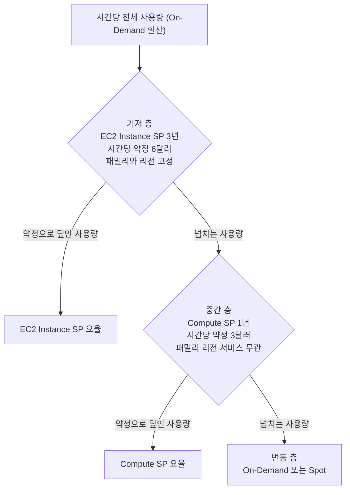
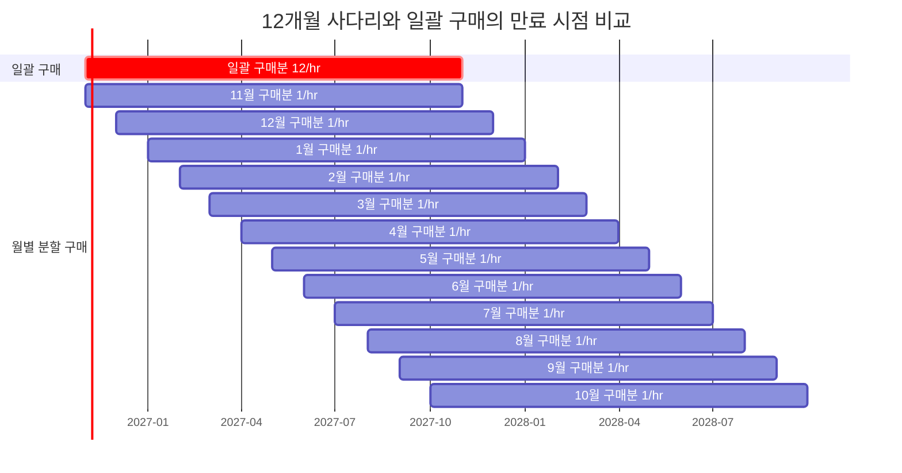
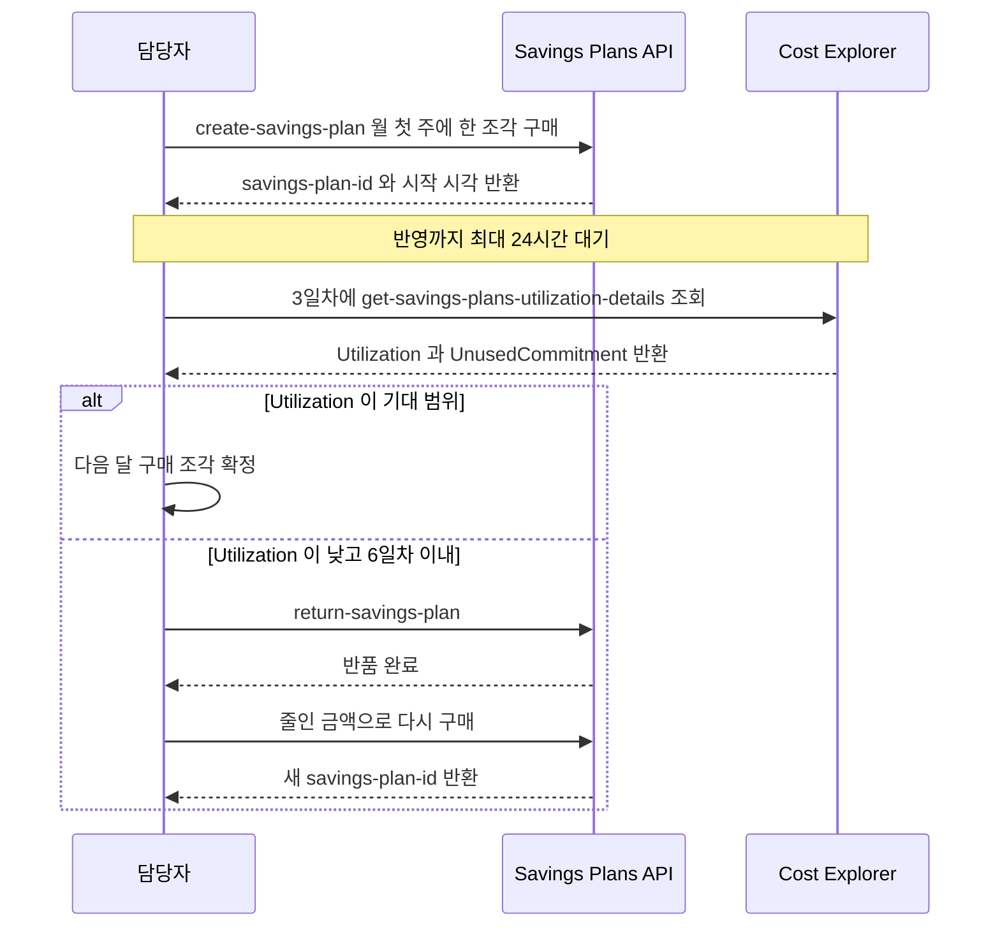

# Savings Plans 약정 포트폴리오 운영

약정 한 건을 사는 방법은 [AWS Savings Plans](Savings_Plans.md)에 정리했다. 이 문서는 그다음 단계를 다룬다. 약정이 두 건, 열 건으로 늘어나면 문제가 바뀐다. 한 건일 때는 금액만 맞으면 됐지만, 여러 건이 되면 어느 약정이 어느 사용량을 덮는지, 만료일이 어디에 몰려 있는지, 사용량이 줄었을 때 어느 약정이 먼저 비는지를 같이 관리해야 한다.

숫자 예제는 전부 같은 가정으로 직접 계산했다. 할인율은 30%, 한 달은 730시간, 월 안에서는 시간대별 사용량 변동이 없다고 본다. 실제 할인율은 인스턴스 패밀리, 기간, 결제 옵션마다 달라서 그대로 옮겨 쓰면 안 되고 구조를 이해하는 용도로 봐야 한다.

## 약정을 층으로 나누는 구성

사용량 곡선은 시간대와 요일에 따라 출렁인다. 하루 종일, 1년 내내 깔려 있는 부분(기저)과 낮에만 올라오는 부분, 이벤트 때만 튀는 부분은 약정 기간을 다르게 가져가는 편이 자연스럽다. 기저는 3년 EC2 Instance SP, 중간은 1년 Compute SP, 변동분은 On-Demand나 Spot으로 두는 구성이 가장 흔하다.



위 흐름은 [사용량이 약정에 붙는 순서](Savings_Plans.md)와 같은 규칙이다. 할인율이 높은 EC2 Instance SP가 자기 패밀리 사용량을 먼저 가져가고, 남은 사용량과 다른 서비스 사용량이 Compute SP로 넘어간다. 변동 층에서 Spot으로 처리되는 사용량은 약정을 소모하지 않는다.

층별 약정 의무액을 구매 시점 기준으로 계산하면 이렇다.

| 층 | 상품 | 시간당 약정 | 계산 | 의무액 | 묶이는 것 |
|---|---|---|---|---|---|
| 기저 | EC2 Instance SP 3년 | 6달러 | 6 × 8,760 × 3 | 157,680달러 | 패밀리, 리전 |
| 중간 | Compute SP 1년 | 3달러 | 3 × 8,760 | 26,280달러 | 없음 |
| 변동 | On-Demand, Spot | 0 | 0 | 0 | 없음 |

의무액 합계는 183,960달러이고 이 중 85.7%가 기저 층 하나에 있다. 시간당 금액은 기저가 두 배인데 기간까지 3배라서 의무액 비율이 6배 차이가 난다. 이 구성의 단점은 대부분 이 한 줄에서 나온다.

### 이 구성이 깨지는 지점

**패밀리 세대 교체.** 기저 층을 `m5`에 걸어두고 2년쯤 뒤 `m7i`나 Graviton으로 옮기면 기저 층은 붙을 사용량이 없어진다. EC2 Instance SP는 패밀리가 고정이라 Compute SP처럼 따라오지 않는다. 새 패밀리 사용량은 중간 층 3달러까지만 덮이고 나머지는 On-Demand다. 3년짜리 약정을 걸 때 "3년 동안 이 패밀리를 쓸 것인가"를 먼저 따져야 하는 이유다. 세대 교체 계획이 1년 안에 있는 패밀리는 기저 층에 넣지 않고 Compute SP 쪽에 둔다.

**층별 Utilization이 합산에 가려진다.** 기저 층 Utilization이 70%인데 중간 층이 100%이면 계정 전체 Utilization은 90% 부근으로 나와서 문제가 안 보인다. Cost Explorer의 요약 화면은 합산 값이라 층 단위로 보려면 `SavingsPlanArn`별로 따로 봐야 한다. 월간 점검 절에서 이 쿼리를 다룬다.

**중간 층이 기저 층의 빈자리를 채우지 못한다.** 기저 층이 비었을 때 Compute SP가 대신 쓰이는 게 아니다. 기저 층의 소멸은 그대로 손실이고, Compute SP는 자기 약정 금액 안에서 기존 사용량을 덮을 뿐이다. 두 층을 "서로 보험"으로 생각하면 틀린다.

**추적할 만료일이 늘어난다.** 층이 둘이면 만료일도 둘이고, 아래 절의 분할 구매를 병행하면 열두 개 이상이 된다. 스프레드시트로 관리하다 한 건을 놓쳐서 해당 사용량이 한 달 동안 On-Demand로 나간 사례가 있다. 만료 알림은 [만료 알림](Savings_Plans.md) 절의 EventBridge 구성으로 코드화해 두는 편이 안전하다.

기저 층의 크기는 "시간별 사용량의 하위 백분위"로 정한다. 일별 최저값이 아니라 시간별 분포에서 하위 10~20% 구간을 잡고, 그 수치에 (1 - 할인율)을 곱한다. 3년 층이 놓치는 손해는 1년 층의 3배 길이로 이어지므로, 같은 백분위를 쓰더라도 3년 층은 한 단계 낮은 백분위에서 시작하는 편이 낫다.

## 만료를 한 번에 몰지 않는 방법

약정 전체를 한 날 사면 1년 뒤 같은 날 전부 만료된다. 그날 놓치면 전체 사용량이 On-Demand로 나가고, 그날 판단이 틀리면 전체 약정이 다시 틀린 크기로 1년 간다. 월별로 나눠 사면 만료도 월별로 흩어져서 매달 1/12씩만 재결정한다. 이 구조를 사다리(laddering)라고 부른다.



붉은 막대가 일괄 구매다. 2027년 11월 1일에 12/hr 전체가 한꺼번에 사라진다. 아래 12개 막대는 매달 1/hr씩 사서 2027년 11월부터 2028년 10월까지 매달 1/hr씩 만료된다. 사다리는 첫 12개월 동안 약정이 서서히 쌓이는 구간이 있어서, 이 구간의 비용이 얼마인지부터 계산해야 한다.

### 12개월 시뮬레이션

두 방식을 같은 사용량에 놓고 12개월 동안 청구액을 계산했다. 목표 약정은 시간당 12달러다. 일괄 방식은 1월차 첫날 12달러를 사고, 분할 방식은 매월 1일에 1달러씩 12번 산다. 사용량은 세 가지로 나눈다.

- A: On-Demand 환산 시간당 20달러가 12개월 내내 유지된다.
- B: 7개월차부터 시간당 15달러로 줄어든다.
- C: 4개월차부터 시간당 10달러로 줄어든다.

약정 C달러가 덮는 사용량은 C / 0.7이다. 월 청구액은 730 × (C + max(0, 사용량 - C / 0.7))으로 계산했다. 분할 방식은 그 달에 살아 있는 약정 누계(1월차 1, 2월차 2, … 12월차 12)를 쓴다.

| 시나리오 | On-Demand였다면 | 방식 | 12개월 청구액 | 순절감 | 소멸한 약정 | 12개월 시점에 남은 약정 의무 |
|---|---|---|---|---|---|---|
| A 유지 | 175,200달러 | 일괄 | 130,149달러 | 45,051달러 | 0 | 0 |
| A 유지 | 175,200달러 | 분할 | 150,797달러 | 24,403달러 | 0 | 48,180달러 |
| B 7개월차 감소 | 153,300달러 | 일괄 | 117,634달러 | 35,666달러 | 6,570달러 | 0 |
| B 7개월차 감소 | 153,300달러 | 분할 | 130,983달러 | 22,317달러 | 1,460달러 | 48,180달러 |
| C 4개월차 감소 | 109,500달러 | 일괄 | 111,377달러 | -1,877달러 | 32,850달러 | 0 |
| C 4개월차 감소 | 109,500달러 | 분할 | 100,740달러 | 8,760달러 | 10,950달러 | 48,180달러 |

마지막 열은 12개월이 지난 시점에 분할 방식에 아직 남아 있는 약정 의무다. 분할 조각 12개는 모두 1년짜리라 전체 의무가 12 × 8,760 = 105,120달러인데, 12개월 창 안에서 지나간 몫은 누계 1 + 2 + … + 12 = 78조각-월에 730을 곱한 56,940달러다. 나머지 48,180달러는 13개월 이후로 넘어간다. 12개월 창 안의 숫자만 보면 분할 쪽이 실제보다 유리하게 나온다. C 시나리오에서 분할 방식은 13개월차부터 16개월차까지 약정 소멸이 7,300달러 더 나온다.

표를 읽는 법은 세 가지다.

사용량이 유지되면 일괄 구매가 20,648달러 더 절감한다(A). 분할 방식은 첫 달에 1달러만 걸려 있는 상태에서 시작하므로, 처음 몇 달 동안 덮이지 않는 사용량이 On-Demand로 나간다. 이 차이는 사다리를 타는 비용이다.

사용량이 중간에 줄어도(B) 일괄 구매가 여전히 더 많이 절감한다. 소멸한 약정은 일괄이 6,570달러로 분할의 1,460달러보다 크지만, 첫 6개월 동안 12달러 전체가 일한 이득이 그걸 덮는다.

분할이 이기는 구간은 사용량이 초반에 크게 줄어드는 경우(C)뿐이다. 4개월차에 시간당 10달러로 내려가면 일괄 구매는 12개월 창 안에서 손해(-1,877달러)다. 일괄 구매의 손실은 이 12개월에서 끝나고 13개월차에 줄어든 사용량에 맞춰 다시 산다. 분할 방식은 이익이 났어도 뒤로 넘어간 의무가 남아 있다.

그래서 실무에서는 두 방식을 섞는다. 첫 구매는 최근 6개월 시간별 최저선으로 확신할 수 있는 금액까지 일괄로 사고, 그 위쪽은 분할로 올린다. 첫 구매 이후 1년이 지나 갱신할 때는 만료를 12개월에 걸쳐 분산하도록 갱신분을 월별로 쪼갠다. 사다리의 가치는 첫 해 절감액이 아니라 갱신 시점의 판단 부담과 만료 누락 위험을 나누는 데 있다.

분할 구매의 조각 크기는 처음에 정하지 말고 월별 Utilization을 보고 정한다. Utilization이 100%로 3개월 이어지면 다음 조각을 키우고, 100%에서 내려오면 조각을 멈춘다. 이 조정이 사다리 방식의 실제 이점이고, 위 표의 분할 행은 조정 없이 기계적으로 산 경우다.

## 기존 RI에서 Savings Plans로 넘어가는 순서

RI를 이미 많이 가진 계정은 Savings Plans를 먼저 사면 안 된다. 사용량이 RI에 먼저 붙기 때문에 RI가 살아 있는 동안 새 약정은 남은 사용량만 덮는다. RI를 그대로 두고 SP를 사면 SP의 Utilization이 낮게 나오고, 반대로 SP 구매를 미루면 RI가 만료된 날부터 On-Demand로 나간다. 순서는 RI의 종류와 만료월로 정한다.

먼저 인벤토리를 만든다. EC2 RI만 대상이다. RDS, ElastiCache, OpenSearch, Redshift RI는 Savings Plans 대상이 아니라서 이 작업에서 제외하고 RI로 갱신한다.

```bash
aws ec2 describe-reserved-instances \
  --filters Name=state,Values=active \
  --query 'sort_by(ReservedInstances,&End)[].{Id:ReservedInstancesId,Type:InstanceType,Count:InstanceCount,Class:OfferingClass,Scope:Scope,End:End}' \
  --output table
```

만료일 순으로 정렬해서 월별로 묶는다. 예를 들어 이런 계정이 있다고 하자. 단가는 계산을 쉽게 하려고 가정한 값이다.

| RI | 수량 | 종류 | 만료 | 가정 단가 | On-Demand 환산 | 약정 후보 (× 0.7) |
|---|---|---|---|---|---|---|
| m5.large | 10 | Convertible | 2027-03 | 0.10달러/hr | 1.00달러/hr | 0.70달러/hr |
| c5.xlarge | 6 | Standard | 2027-08 | 0.20달러/hr | 1.20달러/hr | 0.84달러/hr |
| r5.large | 4 | Standard | 2027-12 | 0.15달러/hr | 0.60달러/hr | 0.42달러/hr |

각 RI가 만료되는 달의 1일에 해당 약정 후보만큼 SP를 산다. 2027년 3월에 0.70달러/hr, 8월에 0.84달러/hr, 12월에 0.42달러/hr다. 이렇게 하면 RI와 SP가 겹치는 구간이 없어서 새 약정이 RI 때문에 비는 일이 없고, 전환기에 이중 지출도 없다. 사다리를 따로 만들 필요 없이 RI 만료 일정이 곧 사다리가 된다. RI가 실제로 100% 쓰이고 있었다는 전제이므로, 사용률이 낮았던 RI는 약정 후보를 그만큼 줄여서 산다.

### Convertible RI 교환

Convertible RI는 Savings Plans로 바꿀 수 없다. 교환은 다른 Convertible RI로만 된다. 그래도 교환을 쓰는 경우가 있다. 사용량이 이미 다른 패밀리나 크기로 이동했는데 RI가 옛 구성에 묶여 있을 때다. 이런 RI는 쓰이지 않아서 만료까지 그대로 비용이 된다. 실사용 구성으로 교환하면 RI가 다시 일하고, 만료월에 SP로 넘기는 계획을 유지할 수 있다.

```bash
aws ec2 get-reserved-instances-exchange-quote \
  --reserved-instance-ids <ri-id> \
  --target-configurations OfferingId=<offering-id>,InstanceCount=10

aws ec2 accept-reserved-instances-exchange-quote \
  --reserved-instance-ids <ri-id> \
  --target-configurations OfferingId=<offering-id>,InstanceCount=10
```

견적 응답에서 확인할 것은 두 가지다. 교환 후 RI의 만료일이 원래와 어떻게 달라지는지, 그리고 추가 지불액이 있는지다. 만료일이 뒤로 밀리면 위 표의 SP 구매 일정이 같이 밀린다. 교환을 승인하고 나서 만료일을 확인하면 이미 되돌릴 수 없다.

### Standard RI 판매

Standard RI는 RI Marketplace에서 팔 수 있고 Convertible RI는 팔 수 없다. 판매자 등록, 활성 기간 조건, 수수료율은 EC2 User Guide의 Reserved Instance Marketplace 항목에 있고 바뀔 수 있으니 판매 전에 최신 문구를 확인한다. 선결제 금액이 크고 남은 기간이 긴 RI만 시도할 만하다. 남은 기간이 몇 달이면 팔릴 때까지 걸리는 시간 동안 만료가 오는 경우가 있어서, 만료 시점 맞추기를 우선하는 편이 낫다.

판매는 구매자가 나타나야 성사되므로 시점을 통제하지 못한다. 판매가 성사되는 순간 그 RI의 사용량은 SP나 On-Demand로 넘어간다. SP를 미리 샀다면 판매 전까지는 Utilization이 낮고, SP를 사지 않았다면 판매 직후부터 On-Demand다. 어느 쪽이든 짧은 어긋남이 생기므로, 판매 목록에 올릴 RI는 사용량이 이미 줄어서 비어 있는 것으로 한정한다.

## 사용량이 줄었을 때의 손실과 7일 구간

약정은 중도 해지가 없다. 사용량이 줄면 선택지는 구매를 멈추는 것과 약정에 맞춰 사용량을 옮기는 것 두 가지뿐이고, 이미 낸 약정은 되돌릴 수 없는 비용이다. 손실 규모는 이 식으로 계산한다.

```text
시간당 소멸액 = max(0, 약정 - (1 - 할인율) × 줄어든 뒤의 On-Demand 환산 사용량)
남은 기간 총 소멸액 = 시간당 소멸액 × 730 × 남은 개월 수
```

앞의 기저 층(3년, 시간당 6달러)에서 해당 패밀리가 완전히 종료된 경우, 시간당 6달러가 전부 소멸한다. 월 4,380달러다. 종료 시점에 따른 총 손실은 이렇다.

| 종료 시점 | 남은 개월 | 총 소멸액 |
|---|---|---|
| 6개월차 | 30 | 131,400달러 |
| 18개월차 | 18 | 78,840달러 |
| 30개월차 | 6 | 26,280달러 |

부분 감소도 같은 식이다. 기저 층 패밀리 사용량이 On-Demand 환산 시간당 12달러에서 5달러로 줄면 필요 약정은 0.7 × 5 = 3.5달러이므로 시간당 2.5달러가 소멸한다. 월 1,825달러이고 30개월이 남았다면 54,750달러다. 3년 약정의 실제 할인율은 30%보다 높아서 같은 사용량 감소에서 소멸액이 이보다 크게 나올 수 있다.

### 7일 반품을 쓰는 구매 절차

반품 규정은 [반품과 취소](Savings_Plans.md) 절에 있다. 구매 후 7일 이내이면서 구매한 달(UTC)과 같은 달이어야 하고, 시간당 약정이 100달러 이하여야 한다. 이 규정을 안전장치로 쓰려면 구매 날짜와 검증 날짜를 미리 정해 둬야 한다.

달 말에 사면 창이 7일보다 짧아진다. 28일에 산 약정은 31일이 지나면 반품 창이 닫힌다. 달 말에 구매해서 반품 창이 이틀뿐이었던 사례가 있다. 구매는 매월 첫 주에 한다.

구매 직후 Utilization은 반영까지 최대 24시간이 걸리고 첫날은 부분 시간이라 의미가 없다. 구매 후 3일차에 검증하면 반품 판단에 4일이 남는다.



시퀀스에서 봐야 할 지점은 `alt` 분기다. 7일이 지나면 두 번째 분기가 닫혀서 첫 번째 분기만 남는다. 조각 단위로 사야 이 절차가 의미 있다. 12달러짜리 약정을 한 번에 사고 3일차에 판단이 틀렸음을 알면 반품할 수는 있어도 이미 시간당 12달러 규모로 결정한 판단 자체를 되돌리는 일이라 부담이 크다. 1달러 조각이면 반품 판단이 가볍다.

구매 직후 Utilization이 낮다고 바로 반품하는 것도 문제다. 시작 시각이 오전이면 첫 시간 일부만 반영되어 Utilization이 낮게 보일 수 있다. 3일차 값이 낮고 UnusedCommitment가 시간당 약정과 가깝다면 그때 반품한다.

## 월간 점검에 쓰는 세 지표

여러 약정을 운영하면 지표를 매달 같은 방식으로 뽑아야 변화가 보인다. 세 가지를 쓴다.

| 지표 | 계산 | 낮을 때 의미 |
|---|---|---|
| Utilization | 사용한 약정 / 전체 약정 | 약정이 사용량보다 큼. 과구매이거나 사용량이 줄었다 |
| Coverage | 약정이 덮은 사용량 / 덮을 수 있는 전체 사용량 (On-Demand 환산) | 약정이 사용량보다 작음. 추가 구매 여지가 있다 |
| Effective Savings Rate | (On-Demand 환산 총 사용량 - 실제 청구액) / On-Demand 환산 총 사용량 | 위 두 지표가 정상인데 낮으면 요율, OS, 결제 옵션 구성이 달라졌다 |

Utilization과 Coverage는 서로 반대 방향으로 움직인다. 약정을 늘리면 Coverage가 오르고 Utilization이 내려간다. 둘 중 하나만 보고 판단하면 과구매나 과소구매로 간다. Effective Savings Rate는 두 지표의 결과를 금액으로 보여주는 값이라 월별 추세를 같이 기록한다.

### CLI로 약정별 값 뽑기

계정 전체 합산이 아니라 약정 한 건씩 보려면 `get-savings-plans-utilization-details`를 쓴다. `ce` API는 `us-east-1`에서 호출한다.

```bash
aws ce get-savings-plans-utilization-details \
  --region us-east-1 \
  --time-period Start=2026-09-01,End=2026-10-01 \
  --query 'SavingsPlansUtilizationDetails[].{Arn:SavingsPlanArn,Util:Utilization.UtilizationPercentage,Unused:Utilization.UnusedCommitment,Net:Savings.NetSavings,OD:Savings.OnDemandCostEquivalent}' \
  --output json > /tmp/sp_util.json

jq -r '.[] | [(.Arn|split("/")[-1]), .Util, .Unused, (((.Net|tonumber)/(.OD|tonumber)*1000|round)/10)] | @tsv' /tmp/sp_util.json
```

출력 열은 약정 ID 끝부분, Utilization(%), 소멸한 약정 금액, 약정별 절감률(%)이다. 절감률은 `NetSavings / OnDemandCostEquivalent`로 계산한 값이고 그 약정이 덮은 사용량 기준이다. 덮지 못한 On-Demand는 들어가지 않는다. 계정 전체 Effective Savings Rate는 아래 CUR 쿼리로 구한다. CLI는 달 단위 합계만 주기 때문에 시간대별 분포나 계정별 분해는 CUR로 본다.

### CUR와 Athena로 뽑기

CUR에서 Savings Plans 비용은 `line_item_line_item_type` 값으로 구분한다. 사용량 중 약정으로 처리된 행은 `SavingsPlanCoveredUsage`, 약정의 청구 행은 `SavingsPlanRecurringFee`다. `savingsPlanCoveredUsage`는 컬럼 이름이 아니라 이 컬럼에 들어가는 값이다. 약정으로 처리된 행의 비용은 `savings_plan_savings_plan_effective_cost` 컬럼에 있고, 이 컬럼이 CUR의 `savingsPlan/SavingsPlanEffectiveCost`에 해당한다. Athena 테이블에서는 대소문자 경계마다 밑줄이 붙은 이름이 되며, ARN은 `savings_plan_savings_plan_a_r_n`이다. 테이블을 만든 직후 `DESCRIBE`로 컬럼 이름을 한 번 확인하면 오타를 막을 수 있다.

약정별 Utilization은 `SavingsPlanRecurringFee` 행에서 구한다.

```sql
SELECT
  savings_plan_savings_plan_a_r_n AS sp_arn,
  SUM(savings_plan_total_commitment_to_date) AS total_commitment,
  SUM(savings_plan_used_commitment) AS used_commitment,
  SUM(savings_plan_total_commitment_to_date) - SUM(savings_plan_used_commitment) AS unused_commitment,
  ROUND(SUM(savings_plan_used_commitment)
        / NULLIF(SUM(savings_plan_total_commitment_to_date), 0) * 100, 1) AS utilization_pct
FROM cur_db.cur_table
WHERE year = '2026' AND month = '9'
  AND line_item_line_item_type = 'SavingsPlanRecurringFee'
GROUP BY 1
ORDER BY utilization_pct;
```

Coverage와 Effective Savings Rate는 한 쿼리로 같이 구한다. 약정으로 덮인 사용량의 On-Demand 환산 금액은 `pricing_public_on_demand_cost`, 실제 비용은 `savings_plan_savings_plan_effective_cost`다. 덮이지 않은 EC2 사용량은 `Usage` 행의 `line_item_unblended_cost`다. Spot 사용량은 `BoxUsage`가 아니라 `SpotUsage`로 기록되어서 `LIKE '%BoxUsage%'`에 걸리지 않는다.

```sql
WITH covered AS (
  SELECT SUM(pricing_public_on_demand_cost) AS od_equiv_covered,
         SUM(savings_plan_savings_plan_effective_cost) AS covered_effective_cost
  FROM cur_db.cur_table
  WHERE year = '2026' AND month = '9'
    AND line_item_line_item_type = 'SavingsPlanCoveredUsage'
),
unused AS (
  SELECT SUM(savings_plan_total_commitment_to_date)
         - SUM(savings_plan_used_commitment) AS unused_commitment
  FROM cur_db.cur_table
  WHERE year = '2026' AND month = '9'
    AND line_item_line_item_type = 'SavingsPlanRecurringFee'
),
uncovered AS (
  SELECT SUM(line_item_unblended_cost) AS od_uncovered
  FROM cur_db.cur_table
  WHERE year = '2026' AND month = '9'
    AND line_item_line_item_type = 'Usage'
    AND line_item_product_code = 'AmazonEC2'
    AND line_item_usage_type LIKE '%BoxUsage%'
)
SELECT
  ROUND(c.od_equiv_covered
        / NULLIF(c.od_equiv_covered + u.od_uncovered, 0) * 100, 1) AS coverage_pct,
  ROUND((c.od_equiv_covered - c.covered_effective_cost - n.unused_commitment)
        / NULLIF(c.od_equiv_covered + u.od_uncovered, 0) * 100, 1) AS effective_savings_rate_pct
FROM covered c CROSS JOIN unused n CROSS JOIN uncovered u;
```

Effective Savings Rate 식에서 분자는 "덮은 사용량의 On-Demand 환산 - 덮은 사용량의 약정 비용 - 소멸한 약정"이다. 소멸한 약정을 빼야 [약정 금액 계산](Savings_Plans.md)의 7달러 약정 예제처럼 실제 절감률이 나온다. 소멸분을 빼지 않으면 약정을 과하게 사도 ESR이 좋게 나온다. 이 쿼리는 No Upfront 약정을 기준으로 썼다. 선결제가 있는 약정은 `total_commitment_to_date`에 선결제 분할액이 어떻게 섞이는지 한 달 값을 CLI의 `UnusedCommitment`와 대조해서 확인한다.

두 방법의 값이 맞는지는 처음 한 번 대조한다. CLI의 약정별 `UnusedCommitment` 합과 첫 번째 SQL의 `unused_commitment` 합이 센트 단위로 일치하는지 본다. 차이가 크면 `year`, `month` 파티션 조건이나 계정 범위가 다른 경우가 대부분이다.

## 사용량이 급감하는 이벤트 앞에서

마이그레이션, 서비스 종료, 리전 이전은 사용량 곡선을 한 번에 꺾는다. 이벤트가 정해지면 약정에서 해야 할 일은 이벤트 날짜 기준으로 정리된다.

가장 먼저 해당 워크로드를 어느 약정이 덮고 있는지 분해한다. 합산 Utilization으로는 알 수 없다. 이벤트 대상 계정과 패밀리 단위로 약정별 기여분을 본다.

```sql
SELECT
  line_item_usage_account_id AS account_id,
  product_instance_type_family AS family,
  savings_plan_savings_plan_a_r_n AS sp_arn,
  ROUND(SUM(pricing_public_on_demand_cost), 2) AS od_equiv_covered
FROM cur_db.cur_table
WHERE year = '2026' AND month = '9'
  AND line_item_line_item_type = 'SavingsPlanCoveredUsage'
GROUP BY 1, 2, 3
ORDER BY od_equiv_covered DESC;
```

이 결과에서 이벤트 대상 패밀리를 덮는 약정이 EC2 Instance SP이면 문제가 크다. 사용량이 사라지면 그 약정은 통째로 비고 다른 워크로드로 대체할 수 없다. Compute SP이면 약정 금액 안에서 다른 워크로드가 가져가므로 손실이 작다. 이 구분이 이벤트 전에 확인할 가장 중요한 지점이다.

| 이벤트 | 먼저 영향받는 층 | 이벤트 전에 할 일 |
|---|---|---|
| 같은 리전에서 패밀리 교체 | 기저(EC2 Instance SP) | 새 패밀리 사용량이 중간 층 Compute SP에 붙는지 확인하고, 교체 일정을 약정 만료 이후로 미룰 수 있는지 검토 |
| 서비스 종료 | 해당 서비스를 덮던 층 | 소멸액을 위 식으로 계산하고, 옮겨 태울 수 있는 dev, test, 배치 워크로드를 같은 패밀리로 모음 |
| 리전 이전 | 기저(EC2 Instance SP는 리전 고정) | 이전 리전의 EC2 Instance SP는 이전 후 비므로, 이전 일정과 만료일 차이를 계산 |
| 단계적 이관 | 중간(Compute SP) | 병행 운영 기간 동안 늘어난 사용량이 구매 판단에 섞이지 않도록 분리 |

**병행 운영 기간의 사용량에 속지 않는다.** 이관 중에는 구 환경과 신 환경이 같이 돈다. 이 시기의 Utilization은 100%에 가깝고 Cost Explorer의 추천 금액도 부풀어 있다. 추천은 최근 60일 이력을 쓰므로, 이관이 끝난 직후 추천치를 그대로 구매하면 병행 기간의 사용량을 기준으로 약정을 사게 된다. 이 추천을 따라 샀다가 이관 완료 후 Utilization이 떨어진 사례가 있다. 이관 후에는 최소 한 달의 안정된 사용량이 쌓인 뒤 구매 판단을 한다.

**예정된 분할 구매를 멈춘다.** 사다리의 다음 조각이나 대기열 예약 구매가 이벤트 직후에 걸려 있으면 그대로 실행되어 줄어든 사용량에 새 약정이 붙는다. 대기열에 걸어둔 구매는 실행 전에 취소할 수 있다. 취소 방법은 [대기열 예약 구매](Savings_Plans.md) 절에 있다. 이벤트 1~2개월 전부터 신규 구매를 멈추고 이벤트 후 안정된 사용량으로 다시 계산한다.

**3년 층의 세대 교체는 사후에 해결되지 않는다.** 3년 EC2 Instance SP를 `m5`에 걸었다가 세대 교체로 층이 비어버린 사례가 있다. 그 약정은 반품 기간이 지났고 재판매도 안 되므로 남은 기간 동안 같은 패밀리로 옮겨 태울 워크로드를 찾는 것이 유일한 방법이었다. 3년 층은 구매할 때 이 질문에 답이 있어야 한다.

AWS 지원 케이스로 구제를 문의할 수는 있지만 받아들여진다고 가정하고 계획을 세우지 않는다. 약정 구매 전에 확인한 규정이 전부이고, 그 이후의 손실은 위 표의 계산대로 확정된다.
