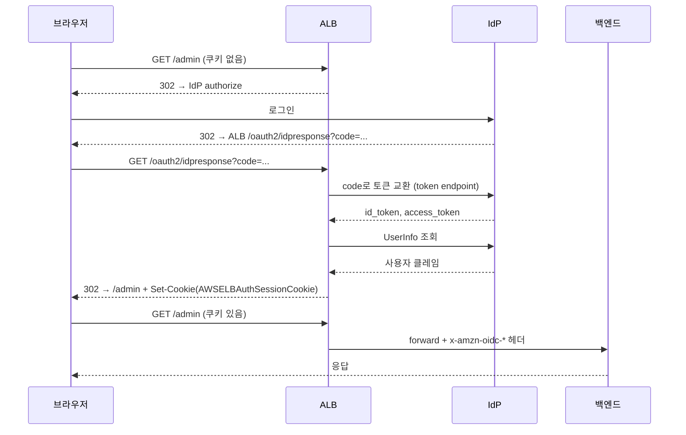

# ALB 내장 인증 — OIDC·Cognito

ALB 리스너 규칙에는 `forward`, `redirect`, `fixed-response` 말고 인증 액션이 두 개 더 있다. `authenticate-oidc`와 `authenticate-cognito`다. 백엔드 앞단에서 ALB가 직접 OIDC 인증을 처리하고, 인증이 끝난 요청만 백엔드로 흘려보낸다. 애플리케이션 코드에 인증 로직을 안 넣어도 로그인 게이트를 세울 수 있다.

사내 어드민, 대시보드, 내부 도구처럼 "직원만 들어오면 되는" 화면 앞에 붙이기 좋다. Grafana, Kibana, 사내 배포 콘솔 앞에 ALB 인증을 깔고 Google Workspace나 Okta를 IdP로 물리는 구성이 흔하다.

문제는 이게 브라우저 세션 기반이라는 점이다. 쿠키로 세션을 들고 다니고, 302 리다이렉트로 IdP를 왕복한다. 그래서 브라우저가 아닌 클라이언트(서버 간 호출, CLI, 모바일 네이티브)가 같은 경로로 들어오면 막힌다. 이 동작을 모르고 붙였다가 API 트래픽이 통째로 죽는 사고가 자주 난다.

## 두 액션의 차이

`authenticate-cognito`는 Cognito User Pool을 IdP로 쓴다. User Pool ARN, App Client ID, User Pool Domain 세 개만 넣으면 된다. Cognito가 OIDC 디스커버리, 토큰 엔드포인트, JWKS를 다 관리해준다.

`authenticate-oidc`는 임의의 OIDC 제공자를 직접 연결한다. Issuer, Authorization Endpoint, Token Endpoint, UserInfo Endpoint, Client ID, Client Secret을 전부 손으로 적어야 한다. Google, Okta, Azure AD, Auth0, Keycloak 같은 외부 IdP를 붙일 때 쓴다.

기능적으로는 둘 다 똑같이 동작한다. 쿠키 발급, 헤더 주입, 세션 관리 방식이 동일하다. Cognito를 중간에 끼우느냐 마느냐의 차이다. Cognito를 굳이 안 쓸 거면 `authenticate-oidc`로 IdP에 바로 붙이는 게 구성 요소가 적어 디버깅이 쉽다.

## 인증 흐름

ALB가 인증되지 않은 요청을 받으면 IdP로 302를 던지고, IdP에서 로그인을 마치고 돌아오면 ALB가 콜백을 받아 토큰을 교환한 뒤 세션 쿠키를 굽는다.



콜백 경로 `/oauth2/idpresponse`는 ALB가 예약한 경로다. IdP의 App Client 설정에서 Redirect URI(Callback URL)에 `https://도메인/oauth2/idpresponse`를 반드시 등록해야 한다. 안 그러면 IdP가 `redirect_uri_mismatch`를 뱉고 로그인 루프에 빠진다. 이 경로는 ALB가 가로채므로 백엔드까지 가지 않는다.

## Terraform 설정

`authenticate-oidc`를 Google에 붙이는 예시다. 인증 액션을 먼저 평가하고, 통과하면 `forward`로 넘기는 구조다. 액션 순서가 중요하다. `authenticate-oidc`의 `order`가 `forward`보다 작아야 한다.

```hcl
resource "aws_lb_listener_rule" "admin_auth" {
  listener_arn = aws_lb_listener.https.arn
  priority     = 100

  action {
    type  = "authenticate-oidc"
    order = 1

    authenticate_oidc {
      issuer                 = "https://accounts.google.com"
      authorization_endpoint = "https://accounts.google.com/o/oauth2/v2/auth"
      token_endpoint         = "https://oauth2.googleapis.com/token"
      user_info_endpoint     = "https://openidconnect.googleapis.com/v1/userinfo"
      client_id              = var.google_client_id
      client_secret          = var.google_client_secret

      scope                          = "openid email"
      session_cookie_name            = "AWSELBAuthSessionCookie"
      session_timeout                = 3600
      on_unauthenticated_request     = "authenticate"
    }
  }

  action {
    type             = "forward"
    order            = 2
    target_group_arn = aws_lb_target_group.admin.arn
  }

  condition {
    path_pattern {
      values = ["/admin/*"]
    }
  }
}
```

`client_secret`은 Terraform state에 평문으로 박힌다. state를 S3 + KMS로 암호화하거나 Secrets Manager 참조로 빼야 한다. 그리고 `client_secret`은 `terraform plan`에서 항상 변경된 것처럼 잡힌다(ALB API가 secret을 다시 안 돌려줘서 비교 불가). `ignore_changes`로 막든가 매번 무시하든가 해야 한다.

`authenticate-cognito`는 더 짧다.

```hcl
action {
  type  = "authenticate-cognito"
  order = 1

  authenticate_cognito {
    user_pool_arn       = aws_cognito_user_pool.this.arn
    user_pool_client_id = aws_cognito_user_pool_client.this.id
    user_pool_domain    = aws_cognito_user_pool_domain.this.domain
    session_timeout     = 3600
  }
}
```

CLI로 같은 걸 하면 이렇게 된다.

```bash
aws elbv2 modify-listener \
  --listener-arn "$LISTENER_ARN" \
  --default-actions '[
    {
      "Type": "authenticate-oidc",
      "Order": 1,
      "AuthenticateOidcConfig": {
        "Issuer": "https://accounts.google.com",
        "AuthorizationEndpoint": "https://accounts.google.com/o/oauth2/v2/auth",
        "TokenEndpoint": "https://oauth2.googleapis.com/token",
        "UserInfoEndpoint": "https://openidconnect.googleapis.com/v1/userinfo",
        "ClientId": "...",
        "ClientSecret": "...",
        "Scope": "openid email",
        "SessionTimeout": 3600,
        "OnUnauthenticatedRequest": "authenticate"
      }
    },
    {"Type": "forward", "Order": 2, "TargetGroupArn": "'"$TG_ARN"'"}
  ]'
```

## 세션 쿠키와 4KB 분할 문제

인증이 끝나면 ALB가 `AWSELBAuthSessionCookie`라는 쿠키를 굽는다. 이 안에 암호화된 토큰 정보가 들어간다. 그런데 id_token이 크면 쿠키 하나에 안 들어간다. HTTP 헤더 하나의 크기 제한(브라우저/서버 기준 보통 4KB~8KB) 때문에 ALB는 쿠키를 쪼갠다.

쪼개진 쿠키는 `AWSELBAuthSessionCookie-0`, `AWSELBAuthSessionCookie-1`처럼 인덱스가 붙는다. 클레임이 많은 IdP(Azure AD가 그룹 클레임을 잔뜩 실어 보내는 경우)에서는 쿠키가 2~3개로 쪼개진다.

여기서 실무 사고가 두 가지 난다.

첫째, 백엔드나 중간 프록시(nginx, CloudFront)의 헤더 크기 제한에 걸린다. 쿠키가 3개로 쪼개지면 Cookie 헤더 전체가 12KB를 넘기도 한다. nginx 기본 `large_client_header_buffers`는 `4 8k`라 넘치면 `400 Bad Request`가 뜬다. 갑자기 일부 사용자만 400을 맞는데 그 사용자들이 죄다 그룹이 많은 계정이면 이거다.

```nginx
# nginx를 ALB 뒤에 또 두는 경우 (드물지만 있다)
large_client_header_buffers 8 16k;
```

둘째, ALB 앞에 CloudFront를 두면 CloudFront가 쿠키를 origin으로 안 넘기게 설정돼 있을 때 세션이 통째로 깨진다. CloudFront 캐시 정책에서 `AWSELBAuthSessionCookie*`를 origin으로 forward하도록 명시해야 한다. 와일드카드로 잡아야 `-0`, `-1`까지 다 넘어간다.

세션 쿠키를 줄이려면 `scope`를 최소화하는 게 답이다. `openid email`만 받고 그룹/프로필을 안 받으면 토큰이 작아진다. 정말 그룹 정보가 필요하면 토큰에 다 싣지 말고 백엔드에서 UserInfo를 별도 조회하는 방향으로 빼는 게 낫다.

## OnUnauthenticatedRequest 분기

인증 안 된 요청을 어떻게 처리할지를 `OnUnauthenticatedRequest`가 정한다. 값이 세 개다.

- `authenticate` (기본값): IdP로 302 리다이렉트해서 로그인시킨다. 브라우저 화면 앞에 쓴다.
- `deny`: 401을 즉시 반환한다. 로그인 시도조차 안 시킨다.
- `allow`: 인증 없이 그냥 백엔드로 통과시킨다. 단, 쿠키가 있으면 검증해서 헤더는 채워준다.

`allow`가 헷갈리는데, 이건 "인증을 옵션으로" 만들 때 쓴다. 로그인한 사용자에게는 `x-amzn-oidc-*` 헤더를 주고, 안 한 사용자는 그냥 통과시킨다. 백엔드가 헤더 유무로 분기하는 구조에 맞는다. 공개 페이지인데 로그인하면 개인화되는 사이트 같은 거다.

브라우저용과 API용 경로를 같은 ALB에서 나눌 때 이걸 쓴다. 사람이 보는 `/admin/*`은 `authenticate`, 머신이 때리는 `/api/*`은 `deny`(또는 인증 액션을 아예 안 걸기)로 규칙을 분리한다.

<div class="ygd-alb-on-unauthenticated-request" id="ygd-alb-on-unauthenticated-request">
<style>
.ygd-alb-on-unauthenticated-request{--ygd-surface:#f6f7f9;--ygd-node:#ffffff;--ygd-border:#c3c9d2;--ygd-text:#1f2328;--ygd-muted:#566070;--ygd-blue:#0969da;--ygd-green:#1a7f37;--ygd-red:#cf222e;--ygd-gray:#6b7480;--ygd-tab-bg:#eef0f3;--ygd-tab-on:#ffffff;max-width:760px;margin-left:auto;margin-right:auto;margin-top:16px;margin-bottom:16px;color:var(--ygd-text);font-size:15px;line-height:1.55;box-sizing:border-box}
body[data-md-color-scheme="slate"] .ygd-alb-on-unauthenticated-request{--ygd-surface:#1e2227;--ygd-node:#2a3038;--ygd-border:#485060;--ygd-text:#e6edf3;--ygd-muted:#a3adb9;--ygd-blue:#6cb6ff;--ygd-green:#3fb950;--ygd-red:#ff7b72;--ygd-gray:#9aa4b0;--ygd-tab-bg:#262b32;--ygd-tab-on:#363d47}
.ygd-alb-on-unauthenticated-request *{box-sizing:border-box}
.ygd-alb-on-unauthenticated-request .ygd-tabs{display:flex;gap:6px;margin:0 0 10px 0;padding:0}
.ygd-alb-on-unauthenticated-request .ygd-tab{flex:1 1 0;min-width:0;margin:0;padding:8px 4px;font:inherit;font-size:14px;line-height:1.3;color:var(--ygd-text);background:var(--ygd-tab-bg);border:2px solid var(--ygd-border);border-radius:8px;cursor:pointer;text-align:center}
.ygd-alb-on-unauthenticated-request .ygd-tab[aria-selected="true"]{background:var(--ygd-tab-on);border-color:var(--ygd-blue);font-weight:700}
.ygd-alb-on-unauthenticated-request .ygd-tab-name{display:block;font-family:ui-monospace,SFMono-Regular,Menlo,Consolas,monospace;font-size:14px;word-break:break-all}
.ygd-alb-on-unauthenticated-request .ygd-tab-tag{display:block;font-size:14px;color:var(--ygd-muted)}
.ygd-alb-on-unauthenticated-request .ygd-btn{margin:0;padding:8px 14px;font:inherit;font-size:14px;color:var(--ygd-text);background:var(--ygd-tab-bg);border:2px solid var(--ygd-border);border-radius:8px;cursor:pointer}
.ygd-alb-on-unauthenticated-request .ygd-btn-main{border-color:var(--ygd-blue);font-weight:700}
.ygd-alb-on-unauthenticated-request .ygd-tab:focus-visible,.ygd-alb-on-unauthenticated-request .ygd-btn:focus-visible{outline:3px solid var(--ygd-blue);outline-offset:2px}
.ygd-alb-on-unauthenticated-request .ygd-stage{background:var(--ygd-surface);border:1px solid var(--ygd-border);border-radius:10px;padding:6px}
.ygd-alb-on-unauthenticated-request .ygd-svg{display:block;width:100%;height:auto;max-width:100%}
.ygd-alb-on-unauthenticated-request .ygd-lane-bg{fill:var(--ygd-node);stroke:var(--ygd-border);stroke-width:1}
.ygd-alb-on-unauthenticated-request .ygd-lane-label{fill:var(--ygd-text);font-size:12px;font-weight:700}
.ygd-alb-on-unauthenticated-request .ygd-node{fill:var(--ygd-surface);stroke:var(--ygd-border);stroke-width:1.5}
.ygd-alb-on-unauthenticated-request .ygd-node-name{fill:var(--ygd-text);font-size:13px;font-weight:700;text-anchor:middle}
.ygd-alb-on-unauthenticated-request .ygd-node-sub{fill:var(--ygd-muted);font-size:11px;text-anchor:middle}
.ygd-alb-on-unauthenticated-request .ygd-ring{fill:none;stroke:var(--ygd-blue);stroke-width:3;opacity:0}
.ygd-alb-on-unauthenticated-request .ygd-ring.ygd-cur{opacity:1}
.ygd-alb-on-unauthenticated-request .ygd-item{opacity:.45}
.ygd-alb-on-unauthenticated-request .ygd-item.ygd-lit{opacity:1}
.ygd-alb-on-unauthenticated-request .ygd-item.ygd-off,.ygd-alb-on-unauthenticated-request .ygd-item.ygd-off.ygd-lit{opacity:.45}
.ygd-alb-on-unauthenticated-request .ygd-line{fill:none;stroke:var(--ygd-gray);stroke-width:2}
.ygd-alb-on-unauthenticated-request .ygd-item.ygd-cur .ygd-line{stroke-width:3}
.ygd-alb-on-unauthenticated-request .ygd-dash{stroke-dasharray:5 4}
.ygd-alb-on-unauthenticated-request .ygd-elabel{fill:var(--ygd-text);font-size:11px;text-anchor:middle}
.ygd-alb-on-unauthenticated-request .ygd-cap{fill:var(--ygd-text);font-size:12px;font-weight:700;text-anchor:middle}
.ygd-alb-on-unauthenticated-request [data-c="blue"] .ygd-line{stroke:var(--ygd-blue)}
.ygd-alb-on-unauthenticated-request [data-c="green"] .ygd-line{stroke:var(--ygd-green)}
.ygd-alb-on-unauthenticated-request [data-c="red"] .ygd-line{stroke:var(--ygd-red)}
.ygd-alb-on-unauthenticated-request [data-c="blue"] .ygd-cap,.ygd-alb-on-unauthenticated-request [data-c="blue"] .ygd-elabel{fill:var(--ygd-blue)}
.ygd-alb-on-unauthenticated-request [data-c="green"] .ygd-cap,.ygd-alb-on-unauthenticated-request [data-c="green"] .ygd-elabel{fill:var(--ygd-green)}
.ygd-alb-on-unauthenticated-request [data-c="red"] .ygd-cap,.ygd-alb-on-unauthenticated-request [data-c="red"] .ygd-elabel{fill:var(--ygd-red)}
.ygd-alb-on-unauthenticated-request .ygd-node-r[data-c="blue"] .ygd-node{stroke:var(--ygd-blue)}
.ygd-alb-on-unauthenticated-request .ygd-node-r[data-c="green"] .ygd-node{stroke:var(--ygd-green)}
.ygd-alb-on-unauthenticated-request .ygd-node-r[data-c="red"] .ygd-node{stroke:var(--ygd-red)}
.ygd-alb-on-unauthenticated-request .ygd-ah-gray{fill:var(--ygd-gray)}
.ygd-alb-on-unauthenticated-request .ygd-ah-blue{fill:var(--ygd-blue)}
.ygd-alb-on-unauthenticated-request .ygd-ah-green{fill:var(--ygd-green)}
.ygd-alb-on-unauthenticated-request .ygd-ah-red{fill:var(--ygd-red)}
.ygd-alb-on-unauthenticated-request .ygd-dot{fill:var(--ygd-text);stroke:var(--ygd-node);stroke-width:1.5}
.ygd-alb-on-unauthenticated-request .ygd-controls{display:flex;flex-wrap:wrap;gap:8px;align-items:center;margin:10px 0 8px 0}
.ygd-alb-on-unauthenticated-request .ygd-step-label{font-size:14px;color:var(--ygd-muted);margin-left:auto}
.ygd-alb-on-unauthenticated-request .ygd-panel{min-height:9.5em;padding:10px 12px;font-size:15px;line-height:1.6;background:var(--ygd-surface);border:1px solid var(--ygd-border);border-left:4px solid var(--ygd-blue);border-radius:8px}
.ygd-alb-on-unauthenticated-request .ygd-analogy{margin-top:8px;font-size:14px;line-height:1.6;color:var(--ygd-muted)}
.ygd-alb-on-unauthenticated-request .ygd-item,.ygd-alb-on-unauthenticated-request .ygd-line{transition:opacity .3s,stroke-width .3s}
@media (prefers-reduced-motion:reduce){.ygd-alb-on-unauthenticated-request .ygd-item,.ygd-alb-on-unauthenticated-request .ygd-line,.ygd-alb-on-unauthenticated-request .ygd-ring{transition:none}}
</style>
<div class="ygd-tabs" role="tablist" aria-label="OnUnauthenticatedRequest 값 선택">
<button type="button" class="ygd-tab" role="tab" id="ygd-alb-on-unauthenticated-request-tab-0" aria-controls="ygd-alb-on-unauthenticated-request-view" aria-selected="true" tabindex="0" data-mode="0"><span class="ygd-tab-name">authenticate</span><span class="ygd-tab-tag">302</span></button>
<button type="button" class="ygd-tab" role="tab" id="ygd-alb-on-unauthenticated-request-tab-1" aria-controls="ygd-alb-on-unauthenticated-request-view" aria-selected="false" tabindex="-1" data-mode="1"><span class="ygd-tab-name">deny</span><span class="ygd-tab-tag">401</span></button>
<button type="button" class="ygd-tab" role="tab" id="ygd-alb-on-unauthenticated-request-tab-2" aria-controls="ygd-alb-on-unauthenticated-request-view" aria-selected="false" tabindex="-1" data-mode="2"><span class="ygd-tab-name">allow</span><span class="ygd-tab-tag">통과</span></button>
</div>
<div class="ygd-stage" id="ygd-alb-on-unauthenticated-request-view" role="tabpanel" aria-labelledby="ygd-alb-on-unauthenticated-request-tab-0">
<svg class="ygd-svg" viewBox="0 0 360 310" role="img" aria-label="OnUnauthenticatedRequest 분기 다이어그램">
<defs>
<marker id="ygd-alb-on-unauthenticated-request-ah-gray" viewBox="0 0 10 10" refX="10" refY="5" markerWidth="9" markerHeight="9" markerUnits="userSpaceOnUse" orient="auto"><path class="ygd-ah-gray" d="M0 0L10 5L0 10z"/></marker>
<marker id="ygd-alb-on-unauthenticated-request-ah-blue" viewBox="0 0 10 10" refX="10" refY="5" markerWidth="9" markerHeight="9" markerUnits="userSpaceOnUse" orient="auto"><path class="ygd-ah-blue" d="M0 0L10 5L0 10z"/></marker>
<marker id="ygd-alb-on-unauthenticated-request-ah-green" viewBox="0 0 10 10" refX="10" refY="5" markerWidth="9" markerHeight="9" markerUnits="userSpaceOnUse" orient="auto"><path class="ygd-ah-green" d="M0 0L10 5L0 10z"/></marker>
<marker id="ygd-alb-on-unauthenticated-request-ah-red" viewBox="0 0 10 10" refX="10" refY="5" markerWidth="9" markerHeight="9" markerUnits="userSpaceOnUse" orient="auto"><path class="ygd-ah-red" d="M0 0L10 5L0 10z"/></marker>
</defs>
<g class="ygd-lane" data-lane="0" transform="translate(0,0)">
<rect class="ygd-lane-bg" x="4" y="6" width="352" height="144" rx="8"/>
<text class="ygd-lane-label" x="14" y="26">쿠키 없는 브라우저 요청</text>
<rect class="ygd-node" x="12" y="40" width="68" height="66" rx="8"/>
<text class="ygd-node-name" x="46" y="67">브라우저</text>
<text class="ygd-node-sub" x="46" y="87">쿠키 없음</text>
<rect class="ygd-node" x="146" y="40" width="68" height="66" rx="8"/>
<text class="ygd-node-name" x="180" y="67">ALB</text>
<text class="ygd-node-sub ygd-albsub" x="180" y="87">인증 액션</text>
<rect class="ygd-ring" data-t="2" x="143" y="37" width="74" height="72" rx="10"/>
<g class="ygd-item" data-t="1" data-role="req" data-c="gray"><path class="ygd-line" d="M82 62H144" marker-end="url(#ygd-alb-on-unauthenticated-request-ah-gray)"/><text class="ygd-elabel" x="113" y="52">GET</text></g>
<g class="ygd-item" data-t="3" data-role="res" data-c="blue"><path class="ygd-line" d="M144 82H82" marker-end="url(#ygd-alb-on-unauthenticated-request-ah-blue)"/><text class="ygd-elabel ygd-reslabel" x="113" y="100">302</text></g>
<g class="ygd-item" data-t="3" data-role="fwd" data-c="gray"><path class="ygd-line" d="M216 62H278" marker-end="url(#ygd-alb-on-unauthenticated-request-ah-gray)"/><text class="ygd-elabel ygd-fwdlabel" x="247" y="52">헤더 없이</text></g>
<g class="ygd-item" data-t="3" data-role="bypass" data-c="blue"><path class="ygd-line ygd-dash" d="M46 108V119H314V108" marker-end="url(#ygd-alb-on-unauthenticated-request-ah-blue)"/></g>
<g class="ygd-item ygd-node-r" data-t="3" data-role="right" data-c="blue"><rect class="ygd-node" x="280" y="40" width="68" height="66" rx="8"/><text class="ygd-node-name ygd-rname" x="314" y="67">IdP</text><text class="ygd-node-sub ygd-rsub" x="314" y="87">로그인 화면</text></g>
<g class="ygd-item" data-t="3" data-role="cap" data-c="blue"><text class="ygd-cap" x="180" y="138">캡션</text></g>
<g class="ygd-dots"></g>
</g>
<g class="ygd-lane" data-lane="1" transform="translate(0,154)">
<rect class="ygd-lane-bg" x="4" y="6" width="352" height="144" rx="8"/>
<text class="ygd-lane-label" x="14" y="26">쿠키 있는 요청 (세션 쿠키 포함)</text>
<rect class="ygd-node" x="12" y="40" width="68" height="66" rx="8"/>
<text class="ygd-node-name" x="46" y="67">브라우저</text>
<text class="ygd-node-sub" x="46" y="87">쿠키 보유</text>
<rect class="ygd-node" x="146" y="40" width="68" height="66" rx="8"/>
<text class="ygd-node-name" x="180" y="67">ALB</text>
<text class="ygd-node-sub ygd-albsub" x="180" y="87">인증 액션</text>
<rect class="ygd-ring" data-t="5" x="143" y="37" width="74" height="72" rx="10"/>
<g class="ygd-item" data-t="4" data-role="req" data-c="gray"><path class="ygd-line" d="M82 62H144" marker-end="url(#ygd-alb-on-unauthenticated-request-ah-gray)"/><text class="ygd-elabel" x="113" y="52">GET + 쿠키</text></g>
<g class="ygd-item" data-t="6" data-role="fwd" data-c="green"><path class="ygd-line" d="M216 62H278" marker-end="url(#ygd-alb-on-unauthenticated-request-ah-green)"/><text class="ygd-elabel" x="247" y="52">헤더 추가</text></g>
<g class="ygd-item ygd-node-r" data-t="6" data-role="right" data-c="green"><rect class="ygd-node" x="280" y="40" width="68" height="66" rx="8"/><text class="ygd-node-name" x="314" y="67">백엔드</text><text class="ygd-node-sub" x="314" y="87">헤더 수신</text></g>
<g class="ygd-item" data-t="6" data-role="cap" data-c="green"><text class="ygd-cap" x="180" y="138">캡션</text></g>
<g class="ygd-dots"></g>
</g>
</svg>
</div>
<div class="ygd-controls">
<button type="button" class="ygd-btn ygd-btn-main" data-act="play">재생</button>
<button type="button" class="ygd-btn" data-act="next">다음 단계</button>
<span class="ygd-step-label" aria-hidden="true">개요</span>
</div>
<div class="ygd-panel" aria-live="polite"></div>
<div class="ygd-analogy">비유: 건물 안내 데스크가 출입증 없는 방문자를 맞는 세 가지 방식과 같다. authenticate는 발급처 위치를 알려 직접 가게 하고, deny는 바로 출입 불가를 알리고, allow는 그냥 들여보내되 출입증이 있으면 이름표를 붙여 준다.</div>
<script>
(function(){
var root=document.getElementById('ygd-alb-on-unauthenticated-request');
if(!root)return;
var P='ygd-alb-on-unauthenticated-request-';
var svg=root.querySelector('.ygd-svg');
var lanes=root.querySelectorAll('.ygd-lane');
var tabs=root.querySelectorAll('.ygd-tab');
var panel=root.querySelector('.ygd-panel');
var stepLabel=root.querySelector('.ygd-step-label');
var playBtn=root.querySelector('[data-act="play"]');
var nextBtn=root.querySelector('[data-act="next"]');
var view=root.querySelector('.ygd-stage');
var reduced=window.matchMedia&&window.matchMedia('(prefers-reduced-motion: reduce)').matches;
var S1='세션 쿠키가 없는 브라우저가 ALB로 GET 요청을 보낸다.';
var S4='이번에는 세션 쿠키를 가진 브라우저가 같은 경로로 요청한다.';
var HDR='ALB가 x-amzn-oidc-accesstoken, x-amzn-oidc-identity, x-amzn-oidc-data 헤더를 붙여 백엔드로 forward한다.';
var MODES=[
{key:'authenticate',
a:{res:{c:'blue',label:'302'},fwd:null,bypass:true,rname:'IdP',rsub:'로그인 화면',roff:false,rc:'blue',cap:'302 → 브라우저가 IdP로 이동',capc:'blue'},
b:{cap:'x-amzn-oidc 헤더를 채워 전달'},
text:['기본값이다. 쿠키가 없으면 ALB가 302로 IdP 로그인으로 보내고, 쿠키가 있으면 검증한 뒤 x-amzn-oidc 헤더를 붙여 백엔드로 넘긴다. 사람이 브라우저로 보는 화면 앞에 맞다.',S1,'ALB가 세션 쿠키가 없는 미인증 요청임을 확인한다. 값이 authenticate이므로 로그인 절차를 시작한다.','ALB가 백엔드로 보내지 않고 302를 돌려준다. 브라우저가 Location에 적힌 IdP 로그인 화면으로 이동한다.',S4,'ALB가 쿠키를 검증해 인증된 요청으로 판단한다. 인증된 요청이므로 미인증 분기를 타지 않는다.',HDR]},
{key:'deny',
a:{res:{c:'red',label:'401'},fwd:null,bypass:false,rname:'백엔드',rsub:'도달 안 함',roff:true,rc:'red',cap:'401 즉시 반환, 로그인 시도 없음',capc:'red'},
b:{cap:'x-amzn-oidc 헤더를 채워 전달'},
text:['미인증 요청에 401을 즉시 반환한다. 로그인 시도조차 시키지 않는다. 쿠키가 있는 인증된 요청은 헤더가 붙어 백엔드로 간다. 머신이 호출하는 API 경로에 맞다.',S1,'ALB가 세션 쿠키가 없는 미인증 요청임을 확인한다. 값이 deny이므로 로그인 절차 없이 거절한다.','ALB가 401을 즉시 반환하고 끝난다. IdP로 리다이렉트하지 않고 백엔드에도 도달하지 않는다.',S4,'ALB가 쿠키를 검증해 인증된 요청으로 판단한다. 인증된 요청이므로 deny는 적용되지 않는다.',HDR]},
{key:'allow',
a:{res:null,fwd:{c:'gray',label:'헤더 없이'},bypass:false,rname:'백엔드',rsub:'요청 수신',roff:false,rc:'gray',cap:'인증 없이 통과, 헤더 없음',capc:'gray'},
b:{cap:'x-amzn-oidc 헤더를 채워 전달'},
text:['인증 없이 그냥 백엔드로 통과시킨다. 단, 쿠키가 있으면 검증해서 x-amzn-oidc 헤더는 채워 준다. 로그인하면 개인화되는 공개 페이지처럼 인증을 옵션으로 둘 때 쓴다.',S1,'ALB가 세션 쿠키가 없는 미인증 요청임을 확인한다. 값이 allow이므로 막지도, 로그인시키지도 않는다.','ALB가 요청을 x-amzn-oidc 헤더 없이 백엔드로 통과시킨다. 백엔드는 헤더가 없으면 비로그인으로 분기해야 한다.',S4,'ALB가 쿠키를 검증해 로그인한 사용자임을 확인한다.','ALB가 x-amzn-oidc 헤더를 채워 백엔드로 전달한다. 백엔드는 헤더 유무로 로그인 여부를 구분한다.']}
];
var mode=0,step=0,playing=false,timer=null;
function q(lane,role){return lanes[lane].querySelector('[data-role="'+role+'"]');}
function setColor(g,c){g.setAttribute('data-c',c);var l=g.querySelector('.ygd-line');if(l)l.setAttribute('marker-end','url(#'+P+'ah-'+c+')');}
function show(g,on){g.style.display=on?'':'none';}
function renderMode(){
var m=MODES[mode],a=m.a;
var res=q(0,'res'),fwd=q(0,'fwd'),byp=q(0,'bypass'),right=q(0,'right'),cap=q(0,'cap');
show(res,!!a.res);
if(a.res){setColor(res,a.res.c);res.querySelector('.ygd-reslabel').textContent=a.res.label;}
show(fwd,!!a.fwd);
if(a.fwd){setColor(fwd,a.fwd.c);fwd.querySelector('.ygd-fwdlabel').textContent=a.fwd.label;}
show(byp,a.bypass);
right.setAttribute('data-c',a.rc);
right.querySelector('.ygd-rname').textContent=a.rname;
right.querySelector('.ygd-rsub').textContent=a.rsub;
right.classList.toggle('ygd-off',a.roff);
cap.setAttribute('data-c',a.capc);
cap.querySelector('.ygd-cap').textContent=a.cap;
q(1,'cap').querySelector('.ygd-cap').textContent=m.b.cap;
var aLabel={authenticate:'쿠키 없는 요청은 ALB가 302로 IdP 로그인으로 보내고, 쿠키 있는 요청은 헤더가 붙어 백엔드로 간다.',deny:'쿠키 없는 요청은 ALB가 401로 끝내고, 쿠키 있는 요청은 헤더가 붙어 백엔드로 간다.',allow:'쿠키 없는 요청은 헤더 없이 백엔드로 통과하고, 쿠키 있는 요청은 헤더가 붙어 백엔드로 간다.'}[m.key];
svg.setAttribute('aria-label','OnUnauthenticatedRequest '+m.key+' 분기. '+aLabel);
view.setAttribute('aria-labelledby',P+'tab-'+mode);
}
function apply(){
var items=root.querySelectorAll('.ygd-item'),i,t,el;
for(i=0;i<items.length;i++){el=items[i];t=+el.getAttribute('data-t');
el.classList.toggle('ygd-lit',step===0||step>=t);
el.classList.toggle('ygd-cur',step===t);}
var rings=root.querySelectorAll('.ygd-ring');
for(i=0;i<rings.length;i++){rings[i].classList.toggle('ygd-cur',step===+rings[i].getAttribute('data-t'));}
var subs=root.querySelectorAll('.ygd-albsub');
subs[0].textContent=(step===0||step>=2)?'미인증':'인증 액션';
subs[1].textContent=(step===0||step>=5)?'인증됨':'인증 액션';
panel.textContent=MODES[mode].text[step];
stepLabel.textContent=step===0?'개요':'단계 '+step+' / 6';
playBtn.textContent=playing?'일시정지':(step===6?'다시 재생':'재생');
}
function fly(lane,pts,delay,color){
if(reduced)return;
var g=lanes[lane].querySelector('.ygd-dots');
if(!g||!g.parentNode||!document.createElementNS)return;
var c=document.createElementNS('http://www.w3.org/2000/svg','circle');
c.setAttribute('class','ygd-dot');c.setAttribute('r','4.5');c.setAttribute('cx','0');c.setAttribute('cy','0');
c.style.opacity='0';
g.appendChild(c);
if(!c.animate){g.removeChild(c);return;}
var kf=[],i;
for(i=0;i<pts.length;i++){kf.push({transform:'translate('+pts[i][0]+'px,'+pts[i][1]+'px)',opacity:1});}
var an=c.animate(kf,{duration:700,delay:delay||0,fill:'both',easing:'ease-in-out'});
an.onfinish=function(){setTimeout(function(){if(c.parentNode)c.parentNode.removeChild(c);},250);};
}
function effects(){
var a=MODES[mode].a;
if(step===1)fly(0,[[82,62],[144,62]],0);
else if(step===4)fly(1,[[82,62],[144,62]],0);
else if(step===3){
if(a.res)fly(0,[[144,82],[82,82]],0);
if(a.bypass)fly(0,[[46,108],[46,119],[314,119],[314,108]],700);
if(a.fwd)fly(0,[[216,62],[278,62]],0);
}
else if(step===6)fly(1,[[216,62],[278,62]],0);
}
function go(n,fx){step=n;apply();if(fx)effects();}
function stop(){if(timer){clearTimeout(timer);timer=null;}playing=false;apply();}
function tick(){
if(step>=6){stop();return;}
go(step+1,true);
timer=setTimeout(tick,3200);
}
function play(){
if(playing){stop();return;}
if(reduced){go(1,false);return;}
playing=true;
go(1,true);
timer=setTimeout(tick,3200);
}
function next(){
if(playing){stop();}
go(step>=6?1:step+1,true);
}
function selectMode(n,focus){
stop();
mode=n;
for(var i=0;i<tabs.length;i++){
var on=i===n;
tabs[i].setAttribute('aria-selected',on?'true':'false');
tabs[i].setAttribute('tabindex',on?'0':'-1');
}
if(focus)tabs[n].focus();
renderMode();
go(0,false);
}
for(var k=0;k<tabs.length;k++){
(function(idx){
tabs[idx].addEventListener('click',function(){selectMode(idx,false);});
tabs[idx].addEventListener('keydown',function(e){
var n=null;
if(e.key==='ArrowRight')n=(idx+1)%tabs.length;
else if(e.key==='ArrowLeft')n=(idx+tabs.length-1)%tabs.length;
else if(e.key==='Home')n=0;
else if(e.key==='End')n=tabs.length-1;
if(n!==null){e.preventDefault();selectMode(n,true);}
});
})(k);
}
playBtn.addEventListener('click',play);
nextBtn.addEventListener('click',next);
renderMode();
go(0,false);
})();
</script>
</div>

## 비브라우저 클라이언트가 302에 막히는 문제

`authenticate` 모드는 인증 안 된 요청에 무조건 302를 던진다. 브라우저는 302를 따라가 로그인 폼을 보여주지만, `curl`, axios, 서버 SDK, 모바일 네이티브 HTTP 클라이언트는 302를 받으면 그냥 IdP 로그인 페이지의 HTML을 받거나 리다이렉트를 못 따라가 깨진다.

```bash
# 인증 걸린 경로를 API로 때리면
curl -i https://admin.example.com/api/users
# HTTP/2 302
# location: https://accounts.google.com/o/oauth2/v2/auth?...
# → JSON 기대했는데 IdP 로그인 페이지로 튕긴다
```

해결은 경로를 분리하는 거다. 같은 ALB라도 리스너 규칙을 나눠서 머신 트래픽 경로에는 인증 액션을 안 걸거나, 걸더라도 IdP 토큰을 직접 검증하는 별도 인증을 백엔드에 두고 ALB 인증은 빼야 한다. ALB 내장 인증은 본질이 브라우저 세션이라 서버 간 통신에 끼우는 물건이 아니다.

굳이 같은 IdP를 머신에도 쓰고 싶으면 클라이언트가 client_credentials 그랜트로 받은 토큰을 `Authorization: Bearer`에 실어 보내고, 그 경로는 ALB 인증 없이 백엔드에서 직접 JWT를 검증하게 한다. ALB 인증과 백엔드 JWT 검증을 경로별로 갈라야 한다.

## 백엔드로 넘어오는 헤더와 서명 검증

인증을 통과한 요청을 백엔드로 forward할 때 ALB가 헤더 세 개를 추가한다.

- `x-amzn-oidc-accesstoken`: IdP가 발급한 access token 원본
- `x-amzn-oidc-identity`: 사용자 식별자(subject)
- `x-amzn-oidc-data`: 사용자 클레임을 담은 JWT. **이걸 검증해야 한다.**

`x-amzn-oidc-data`는 ALB가 자기 키로 서명한 JWT다. 그냥 디코드해서 쓰면 안 된다. 누군가 백엔드에 직접 도달할 수 있으면(같은 VPC 안, 보안그룹 구멍) 이 헤더를 위조해서 보낼 수 있다. ALB의 공개키로 서명을 검증해야 진짜 ALB가 붙인 헤더라고 신뢰할 수 있다.

검증 절차가 좀 까다롭다. JWT 헤더의 `kid`(키 ID)와 `signer`(ALB ARN)를 읽어서, 리전별 공개키 엔드포인트에서 PEM을 받아 ES256으로 검증한다.

```
https://public-keys.auth.elb.{region}.amazonaws.com/{kid}
```

Node.js 검증 예시다.

```javascript
const jwt = require('jsonwebtoken');

async function verifyAlbToken(token, region) {
  // 1. 서명 없이 헤더만 먼저 디코드해서 kid를 꺼낸다
  const decoded = jwt.decode(token, { complete: true });
  if (!decoded) throw new Error('malformed token');

  const { kid, signer, alg } = decoded.header;
  if (alg !== 'ES256') throw new Error('unexpected alg');

  // 2. signer가 우리 ALB ARN인지 확인 (다른 ALB의 토큰 차단)
  if (signer !== process.env.EXPECTED_ALB_ARN) {
    throw new Error('unexpected signer');
  }

  // 3. 리전별 엔드포인트에서 공개키 PEM을 받는다
  const url = `https://public-keys.auth.elb.${region}.amazonaws.com/${kid}`;
  const res = await fetch(url);
  const pubKey = await res.text();

  // 4. ES256으로 서명 검증
  const claims = jwt.verify(token, pubKey, { algorithms: ['ES256'] });
  return claims; // email, sub, exp 등
}
```

여기서 자주 틀리는 게 두 가지다. 하나, `alg`를 검증 안 하면 `none` 알고리즘 우회 공격에 노출된다. 받은 토큰의 `alg`가 `ES256`인지 코드에서 강제해야 한다. 둘, `signer`를 확인 안 하면 같은 리전의 다른 누군가의 ALB가 서명한 토큰도 통과한다. 공개키 엔드포인트는 리전 단위로 공유되므로 `kid`만으로는 우리 ALB가 보낸 게 맞는지 보장이 안 된다. ARN을 반드시 대조해야 한다.

공개키는 자주 안 바뀌지만 캐싱할 때 `kid`를 키로 캐싱해야 한다. ALB가 키를 로테이션하면 새 `kid`가 오므로 `kid`별로 받아두면 자동으로 갱신된다.

<div class="ygd-alb-oidc-data-jwt-verification" id="ygd-alb-oidc-data-jwt-verification">
<style>
.ygd-alb-oidc-data-jwt-verification{--ygd-bg:rgb(253,251,250);--ygd-card:rgb(255,255,255);--ygd-panel:rgb(246,243,240);--ygd-line:rgb(205,198,190);--ygd-text:rgb(40,36,34);--ygd-muted:rgb(88,83,78);--ygd-accent:rgb(61,115,135);--ygd-accent-bg:rgb(224,238,244);--ygd-ok:rgb(30,120,70);--ygd-ok-bg:rgb(228,244,234);--ygd-bad:rgb(180,40,40);--ygd-bad-bg:rgb(253,234,232);--ygd-on:rgb(255,255,255);max-width:760px;margin-left:auto;margin-right:auto;margin-top:1.5em;margin-bottom:1.5em;box-sizing:border-box;padding:14px;border:1px solid var(--ygd-line);border-radius:12px;background:var(--ygd-bg);color:var(--ygd-text);font-family:inherit;line-height:1.5}
body[data-md-color-scheme="slate"] .ygd-alb-oidc-data-jwt-verification{--ygd-bg:rgb(31,28,30);--ygd-card:rgb(42,38,40);--ygd-panel:rgb(48,44,46);--ygd-line:rgb(95,89,92);--ygd-text:rgb(240,237,233);--ygd-muted:rgb(190,184,176);--ygd-accent:rgb(120,185,210);--ygd-accent-bg:rgb(34,58,70);--ygd-ok:rgb(110,205,150);--ygd-ok-bg:rgb(30,58,44);--ygd-bad:rgb(255,140,130);--ygd-bad-bg:rgb(72,36,36);--ygd-on:rgb(20,24,28)}
.ygd-alb-oidc-data-jwt-verification *,.ygd-alb-oidc-data-jwt-verification *::before,.ygd-alb-oidc-data-jwt-verification *::after{box-sizing:border-box}
.ygd-alb-oidc-data-jwt-verification .ygd-head{font-size:15px;font-weight:700;margin-bottom:10px;color:var(--ygd-text)}
.ygd-alb-oidc-data-jwt-verification .ygd-cases{display:grid;grid-template-columns:repeat(2,minmax(0,1fr));gap:8px;margin-bottom:10px}
@media (min-width:560px){.ygd-alb-oidc-data-jwt-verification .ygd-cases{grid-template-columns:repeat(4,minmax(0,1fr))}}
.ygd-alb-oidc-data-jwt-verification .ygd-case{display:block;width:100%;min-height:52px;margin:0;padding:8px 10px;text-align:left;font:inherit;font-size:14px;line-height:1.35;color:var(--ygd-text);background:var(--ygd-card);border:1px solid var(--ygd-line);border-radius:8px;cursor:pointer}
.ygd-alb-oidc-data-jwt-verification .ygd-case[aria-pressed="true"]{border:2px solid var(--ygd-accent);background:var(--ygd-accent-bg);padding:7px 9px}
.ygd-alb-oidc-data-jwt-verification .ygd-cn{display:block;font-weight:700;font-size:14px}
.ygd-alb-oidc-data-jwt-verification .ygd-ct{display:block;font-size:14px;color:var(--ygd-bad)}
.ygd-alb-oidc-data-jwt-verification .ygd-ct.ygd-ok{color:var(--ygd-ok)}
.ygd-alb-oidc-data-jwt-verification .ygd-ctl{display:flex;flex-wrap:wrap;gap:8px;margin-bottom:10px}
.ygd-alb-oidc-data-jwt-verification .ygd-btn{margin:0;min-height:40px;padding:8px 14px;font:inherit;font-size:14px;line-height:1.2;color:var(--ygd-text);background:var(--ygd-card);border:1px solid var(--ygd-line);border-radius:8px;cursor:pointer}
.ygd-alb-oidc-data-jwt-verification .ygd-btn.ygd-primary{background:var(--ygd-accent);border-color:var(--ygd-accent);color:var(--ygd-on);font-weight:700}
.ygd-alb-oidc-data-jwt-verification .ygd-btn[disabled]{opacity:.5;cursor:default}
.ygd-alb-oidc-data-jwt-verification .ygd-btn:focus-visible,.ygd-alb-oidc-data-jwt-verification .ygd-case:focus-visible{outline:3px solid var(--ygd-accent);outline-offset:2px}
.ygd-alb-oidc-data-jwt-verification .ygd-panel{min-height:11.5em;padding:12px 14px;margin-bottom:12px;background:var(--ygd-panel);border-left:4px solid var(--ygd-accent);border-radius:6px}
.ygd-alb-oidc-data-jwt-verification .ygd-pt{font-size:15px;font-weight:700;margin-bottom:4px;color:var(--ygd-text)}
.ygd-alb-oidc-data-jwt-verification .ygd-pb{font-size:14px;line-height:1.65;color:var(--ygd-text)}
.ygd-alb-oidc-data-jwt-verification .ygd-wrap{max-width:460px;margin:0 auto}
.ygd-alb-oidc-data-jwt-verification .ygd-svg{display:block;width:100%;height:auto;max-width:100%;font-family:inherit}
.ygd-alb-oidc-data-jwt-verification .ygd-node{opacity:.7;transition:opacity .3s}
.ygd-alb-oidc-data-jwt-verification .ygd-rect{fill:var(--ygd-card);stroke:var(--ygd-line);stroke-width:1.5;transition:fill .3s,stroke .3s}
.ygd-alb-oidc-data-jwt-verification .ygd-bc{fill:none;stroke:var(--ygd-muted);stroke-width:1.5}
.ygd-alb-oidc-data-jwt-verification .ygd-bn{fill:var(--ygd-muted);font-size:13px;font-weight:700}
.ygd-alb-oidc-data-jwt-verification .ygd-t{fill:var(--ygd-text);font-size:13.5px;font-weight:700}
.ygd-alb-oidc-data-jwt-verification .ygd-s{fill:var(--ygd-muted);font-size:11.5px}
.ygd-alb-oidc-data-jwt-verification .ygd-s.ygd-c{font-size:10.5px}
.ygd-alb-oidc-data-jwt-verification .ygd-start{opacity:1}
.ygd-alb-oidc-data-jwt-verification .ygd-start .ygd-rect{stroke:var(--ygd-accent);stroke-width:2}
.ygd-alb-oidc-data-jwt-verification .ygd-node[data-state="active"]{opacity:1}
.ygd-alb-oidc-data-jwt-verification .ygd-node[data-state="active"] .ygd-rect{fill:var(--ygd-accent-bg);stroke:var(--ygd-accent);stroke-width:2.5}
.ygd-alb-oidc-data-jwt-verification .ygd-node[data-state="active"] .ygd-bc{fill:var(--ygd-accent);stroke:var(--ygd-accent)}
.ygd-alb-oidc-data-jwt-verification .ygd-node[data-state="active"] .ygd-bn{fill:var(--ygd-on)}
.ygd-alb-oidc-data-jwt-verification .ygd-node[data-state="pass"]{opacity:1}
.ygd-alb-oidc-data-jwt-verification .ygd-node[data-state="pass"] .ygd-rect{fill:var(--ygd-ok-bg);stroke:var(--ygd-ok);stroke-width:2}
.ygd-alb-oidc-data-jwt-verification .ygd-node[data-state="pass"] .ygd-bc{fill:var(--ygd-ok);stroke:var(--ygd-ok)}
.ygd-alb-oidc-data-jwt-verification .ygd-node[data-state="pass"] .ygd-bn{fill:var(--ygd-on)}
.ygd-alb-oidc-data-jwt-verification .ygd-node[data-state="blocked"]{opacity:1}
.ygd-alb-oidc-data-jwt-verification .ygd-node[data-state="blocked"] .ygd-rect{fill:var(--ygd-bad-bg);stroke:var(--ygd-bad);stroke-width:2.5}
.ygd-alb-oidc-data-jwt-verification .ygd-node[data-state="blocked"] .ygd-bc{fill:var(--ygd-bad);stroke:var(--ygd-bad)}
.ygd-alb-oidc-data-jwt-verification .ygd-node[data-state="blocked"] .ygd-bn{fill:var(--ygd-on)}
.ygd-alb-oidc-data-jwt-verification .ygd-node[data-state="skipped"]{opacity:.5}
.ygd-alb-oidc-data-jwt-verification .ygd-node[data-state="skipped"] .ygd-rect{stroke-dasharray:4 3}
.ygd-alb-oidc-data-jwt-verification .ygd-arrow line{stroke:var(--ygd-muted);stroke-width:2;opacity:.5}
.ygd-alb-oidc-data-jwt-verification .ygd-arrow polygon{fill:var(--ygd-muted);opacity:.5}
.ygd-alb-oidc-data-jwt-verification .ygd-arrow[data-state="lit"] line,.ygd-alb-oidc-data-jwt-verification .ygd-arrow[data-state="flow"] line{stroke:var(--ygd-accent);opacity:1}
.ygd-alb-oidc-data-jwt-verification .ygd-arrow[data-state="lit"] polygon,.ygd-alb-oidc-data-jwt-verification .ygd-arrow[data-state="flow"] polygon{fill:var(--ygd-accent);opacity:1}
.ygd-alb-oidc-data-jwt-verification .ygd-arrow[data-state="flow"] line{stroke-dasharray:3 3;animation:ygd-alb-oidc-data-jwt-verification-flow .6s linear infinite}
.ygd-alb-oidc-data-jwt-verification .ygd-arrow[data-state="skip"] line{stroke-dasharray:3 3;opacity:.4}
.ygd-alb-oidc-data-jwt-verification .ygd-arrow[data-state="skip"] polygon{opacity:.4}
@keyframes ygd-alb-oidc-data-jwt-verification-flow{to{stroke-dashoffset:-6}}
.ygd-alb-oidc-data-jwt-verification .ygd-note{margin-top:12px;font-size:14px;line-height:1.65;color:var(--ygd-muted)}
@media (prefers-reduced-motion:reduce){.ygd-alb-oidc-data-jwt-verification .ygd-node,.ygd-alb-oidc-data-jwt-verification .ygd-rect{transition:none}.ygd-alb-oidc-data-jwt-verification .ygd-arrow[data-state="flow"] line{animation:none}}
</style>
<div class="ygd-head">x-amzn-oidc-data JWT를 받은 백엔드의 검증 순서</div>
<div class="ygd-cases" role="group" aria-label="검증할 토큰 케이스 선택">
<button type="button" class="ygd-case" data-case="ok" aria-pressed="true"><span class="ygd-cn">정상 토큰</span><span class="ygd-ct ygd-ok">끝까지 통과</span></button>
<button type="button" class="ygd-case" data-case="forged" aria-pressed="false"><span class="ygd-cn">위조 헤더</span><span class="ygd-ct">5단계에서 차단</span></button>
<button type="button" class="ygd-case" data-case="none" aria-pressed="false"><span class="ygd-cn">alg=none</span><span class="ygd-ct">2단계에서 차단</span></button>
<button type="button" class="ygd-case" data-case="other" aria-pressed="false"><span class="ygd-cn">다른 ALB 토큰</span><span class="ygd-ct">3단계에서 차단</span></button>
</div>
<div class="ygd-ctl">
<button type="button" class="ygd-btn ygd-primary" data-act="play">재생</button>
<button type="button" class="ygd-btn" data-act="next">다음 단계</button>
<button type="button" class="ygd-btn" data-act="reset">처음으로</button>
</div>
<div class="ygd-panel" role="status" aria-live="polite"><div class="ygd-pt" data-pt></div><div class="ygd-pb" data-pb></div></div>
<div class="ygd-wrap">
<svg class="ygd-svg" viewBox="0 0 360 490" role="img" aria-label="x-amzn-oidc-data JWT 검증 흐름. kid, signer, alg 읽기, alg가 ES256인지 확인, signer가 내 ALB ARN인지 확인, 리전 공개키 엔드포인트에서 PEM 조회, ES256 서명 검증 순서로 진행한다.">
<g class="ygd-node ygd-start" data-node="start">
<rect class="ygd-rect" x="8" y="6" width="344" height="36" rx="10"/>
<text class="ygd-t" x="180" y="29" text-anchor="middle" data-start></text>
</g>
<g class="ygd-arrow" data-arrow="1" data-state="off"><line x1="180" y1="42" x2="180" y2="50"/><polygon points="176,49 184,49 180,56"/></g>
<g class="ygd-node" data-node="1" data-state="pending">
<rect class="ygd-rect" x="8" y="56" width="344" height="62" rx="10"/>
<circle class="ygd-bc" cx="32" cy="87" r="13"/>
<text class="ygd-bn" x="32" y="92" text-anchor="middle">1</text>
<text class="ygd-t" x="56" y="78">kid · signer · alg 읽기</text>
<text class="ygd-s" x="56" y="95">서명 없이 헤더만 디코드, 형식 오류면 거절</text>
<text class="ygd-s ygd-c ygd-l2" x="56" y="110">jwt.decode로 헤더 3개 값을 꺼낸다</text>
</g>
<g class="ygd-arrow" data-arrow="2" data-state="off"><line x1="180" y1="118" x2="180" y2="126"/><polygon points="176,125 184,125 180,132"/></g>
<g class="ygd-node" data-node="2" data-state="pending">
<rect class="ygd-rect" x="8" y="132" width="344" height="62" rx="10"/>
<circle class="ygd-bc" cx="32" cy="163" r="13"/>
<text class="ygd-bn" x="32" y="168" text-anchor="middle">2</text>
<text class="ygd-t" x="56" y="154">alg가 ES256인가?</text>
<text class="ygd-s" x="56" y="171">아니면 즉시 거절 (none 우회 차단)</text>
<text class="ygd-s ygd-c ygd-l2" x="56" y="186">받은 alg가 ES256이어야 다음 단계로</text>
</g>
<g class="ygd-arrow" data-arrow="3" data-state="off"><line x1="180" y1="194" x2="180" y2="202"/><polygon points="176,201 184,201 180,208"/></g>
<g class="ygd-node" data-node="3" data-state="pending">
<rect class="ygd-rect" x="8" y="208" width="344" height="62" rx="10"/>
<circle class="ygd-bc" cx="32" cy="239" r="13"/>
<text class="ygd-bn" x="32" y="244" text-anchor="middle">3</text>
<text class="ygd-t" x="56" y="230">signer가 내 ALB ARN인가?</text>
<text class="ygd-s" x="56" y="247">다르면 거절 (다른 ALB 토큰 차단)</text>
<text class="ygd-s ygd-c ygd-l2" x="56" y="262">EXPECTED_ALB_ARN 환경변수와 대조</text>
</g>
<g class="ygd-arrow" data-arrow="4" data-state="off"><line x1="180" y1="270" x2="180" y2="278"/><polygon points="176,277 184,277 180,284"/></g>
<g class="ygd-node" data-node="4" data-state="pending">
<rect class="ygd-rect" x="8" y="284" width="344" height="62" rx="10"/>
<circle class="ygd-bc" cx="32" cy="315" r="13"/>
<text class="ygd-bn" x="32" y="320" text-anchor="middle">4</text>
<text class="ygd-t" x="56" y="306">리전 공개키 PEM 조회 (kid 캐시)</text>
<text class="ygd-s" x="56" y="323">kid가 캐시에 있으면 재사용, 없으면 요청</text>
<text class="ygd-s ygd-c ygd-l2" x="56" y="338">public-keys.auth.elb.{region}.amazonaws.com/{kid}</text>
</g>
<g class="ygd-arrow" data-arrow="5" data-state="off"><line x1="180" y1="346" x2="180" y2="354"/><polygon points="176,353 184,353 180,360"/></g>
<g class="ygd-node" data-node="5" data-state="pending">
<rect class="ygd-rect" x="8" y="360" width="344" height="62" rx="10"/>
<circle class="ygd-bc" cx="32" cy="391" r="13"/>
<text class="ygd-bn" x="32" y="396" text-anchor="middle">5</text>
<text class="ygd-t" x="56" y="382">ES256 서명 검증</text>
<text class="ygd-s" x="56" y="399">조회한 PEM 공개키로 서명을 확인</text>
<text class="ygd-s ygd-c ygd-l2" x="56" y="414">jwt.verify 호출 시 algorithms는 ES256만 허용</text>
</g>
<g class="ygd-arrow" data-arrow="6" data-state="off"><line x1="180" y1="422" x2="180" y2="430"/><polygon points="176,429 184,429 180,436"/></g>
<g class="ygd-node" data-node="end" data-state="pending">
<rect class="ygd-rect" x="8" y="436" width="344" height="48" rx="10"/>
<circle class="ygd-bc" cx="32" cy="460" r="13"/>
<text class="ygd-bn" x="32" y="465" text-anchor="middle">•</text>
<text class="ygd-t" x="56" y="456">검증 결과</text>
<text class="ygd-s" x="56" y="474">모든 단계를 통과해야 클레임을 쓴다</text>
</g>
</svg>
</div>
<div class="ygd-note">비유: 건물 경비의 출입증 검사. 카드 종류(alg)와 발급처(signer)는 카드에 적힌 글자라 누구나 베껴 쓸 수 있다. 그래서 마지막에 위조 방지 도장(서명)을 원본 도장과 대조해야 믿을 수 있다. 비유일 뿐이고 실제 검증은 위 5단계다.</div>
<script>
(function(){
var root=document.getElementById('ygd-alb-oidc-data-jwt-verification');
if(!root){return;}
var q=function(s){return root.querySelector(s);};
var qa=function(s){return Array.prototype.slice.call(root.querySelectorAll(s));};
var SC={
ok:{name:'정상 토큰',block:0,start:'ALB가 붙인 x-amzn-oidc-data 수신',alg:'ES256',signer:'내 ALB',algOk:true,signerOk:true,sigOk:true,intro:'이 케이스는 ALB가 붙인 정상 토큰이라 다섯 단계를 모두 통과한다.'},
forged:{name:'위조 헤더',block:5,start:'위조된 x-amzn-oidc-data 수신',alg:'ES256',signer:'내 ALB(베낌)',algOk:true,signerOk:true,sigOk:false,intro:'이 케이스는 백엔드에 직접 닿은 쪽이 헤더를 흉내 내어 만든 토큰이다.'},
none:{name:'alg=none',block:2,start:'alg=none 토큰 수신',alg:'none',signer:'내 ALB',algOk:false,signerOk:true,sigOk:false,intro:'이 케이스는 alg를 none으로 바꾼 토큰이다.'},
other:{name:'다른 ALB 토큰',block:3,start:'다른 ALB가 서명한 토큰 수신',alg:'ES256',signer:'다른 ALB',algOk:true,signerOk:false,sigOk:true,intro:'이 케이스는 같은 리전의 다른 ALB가 서명한 토큰이다.'}
};
var NAMES=['','kid, signer, alg 읽기','alg 확인','signer 확인','공개키 PEM 조회','ES256 서명 검증'];
var cur='ok',pos=0,timer=null;
var N=[null],A=[null],i,g;
for(i=1;i<=5;i++){g=q('[data-node="'+i+'"]');N.push({g:g,bn:g.querySelector('.ygd-bn'),l2:g.querySelector('.ygd-l2')});}
for(i=1;i<=6;i++){A.push(q('[data-arrow="'+i+'"]'));}
var E=q('[data-node="end"]');
var eb=E.querySelector('.ygd-bn'),et=E.querySelector('.ygd-t'),el=E.querySelector('.ygd-s');
var ST=q('[data-start]'),PT=q('[data-pt]'),PB=q('[data-pb]');
var bPlay=q('[data-act="play"]'),bNext=q('[data-act="next"]'),bReset=q('[data-act="reset"]');
var DEF=[null,'jwt.decode로 헤더 3개 값을 꺼낸다','받은 alg가 ES256이어야 다음 단계로','EXPECTED_ALB_ARN 환경변수와 대조','public-keys.auth.elb.{region}.amazonaws.com/{kid}','jwt.verify 호출 시 algorithms는 ES256만 허용'];
function last(){return SC[cur].block||6;}
function finished(){return pos>=last();}
function l2(n){
var sc=SC[cur];
if(pos<n){return DEF[n];}
if(n===1){return 'alg='+sc.alg+' · signer='+sc.signer+' · kid=k1';}
if(n===2){return 'alg='+sc.alg+(sc.algOk?' → ES256과 일치':' → ES256 아님, 거절');}
if(n===3){return 'signer='+sc.signer+(sc.signerOk?' → 문자열 일치':' → 불일치, 거절');}
if(n===5){return sc.sigOk?'서명 일치 → ALB가 붙인 헤더로 인정':'서명 불일치 → 거절';}
return DEF[n];
}
function nodeState(n){
var sc=SC[cur];
if(pos<n){return (finished()&&sc.block&&n>sc.block)?'skipped':'pending';}
if(n===sc.block){return 'blocked';}
return n===pos?'active':'pass';
}
function panel(){
var sc=SC[cur],p=pos,t,b;
if(p===0){return ['시작 전 · '+sc.name,'재생을 누르면 백엔드가 x-amzn-oidc-data를 받은 순간부터 한 단계씩 진행한다. '+sc.intro];}
if(p===6){return ['완료 · 검증 통과','다섯 단계를 모두 통과했으니 email, sub, exp 같은 클레임을 신뢰하고 쓴다. 이 검증이 없으면 백엔드에 직접 닿는 쪽(같은 VPC 안, 보안그룹 구멍)이 헤더를 위조해 보낼 수 있다.'];}
t=p+'/5 · '+NAMES[p]+(p===sc.block?' → 차단':'');
if(p===1){b='서명을 검증하기 전에 jwt.decode로 헤더만 꺼내 kid, signer, alg를 읽는다. 디코드가 안 되는 형식이면 여기서 거절한다. 이 값들은 아직 검증 전이라 믿을 수 있는 값이 아니다.';}
else if(p===2){
if(!sc.algOk){b='이 토큰은 alg=none이라 여기서 거절된다. alg를 검증하지 않으면 none 알고리즘 우회 공격에 노출되므로 코드에서 ES256을 강제해야 한다. 3~5단계는 실행되지 않는다.';}
else if(cur==='forged'){b='위조 토큰도 alg를 ES256으로 적어 두었기 때문에 여기서는 통과한다. 이 단계가 막는 것은 none 우회뿐이다.';}
else{b='alg가 ES256이라 통과한다. 다만 alg는 토큰을 보낸 쪽이 적은 값이라 이것만으로 신뢰할 수는 없다.';}
}
else if(p===3){
if(!sc.signerOk){b='signer가 우리 ALB ARN이 아니라서 거절한다. 공개키 엔드포인트는 리전 단위로 공유되므로 kid만으로는 우리 ALB가 보낸 것인지 보장이 안 된다. signer 대조를 빼면 같은 리전 다른 ALB의 토큰도 통과한다.';}
else if(cur==='forged'){b='위조 토큰은 signer에 우리 ALB ARN을 그대로 적어 두었다. 문자열 대조는 여기서도 통과한다. 진짜인지는 서명으로만 알 수 있다.';}
else{b='signer가 EXPECTED_ALB_ARN과 같아 통과한다. 다른 ALB가 서명한 토큰은 이 단계에서 걸러진다.';}
}
else if(p===4){b='리전별 엔드포인트의 kid 경로에서 PEM 공개키를 받는다. kid를 키로 캐시해 두면 같은 kid는 다시 요청하지 않는다. ALB가 키를 로테이션해 새 kid가 오면 캐시에 없으므로 새로 받아 자동으로 갱신된다.';}
else{
if(sc.sigOk){b='ES256으로 서명을 검증한다. 서명이 이 공개키와 맞아야 ALB가 붙인 헤더라고 믿을 수 있다. 일치하면 클레임을 읽는다.';}
else{b='위조한 쪽은 ALB의 서명 키가 없어서 서명이 공개키와 맞지 않는다. jwt.verify가 예외를 던져 거절한다. 앞 단계의 문자열 대조만으로는 이 공격을 막을 수 없다.';}
}
return [t,b];
}
function render(){
var sc=SC[cur],n,s,fin=finished(),pn;
ST.textContent=sc.start;
for(n=1;n<=5;n++){
s=nodeState(n);
N[n].g.setAttribute('data-state',s);
N[n].bn.textContent=s==='pass'?'✓':(s==='blocked'?'✕':String(n));
N[n].l2.textContent=l2(n);
}
for(n=1;n<=6;n++){
if(pos===n&&!fin){s='flow';}
else if(pos>=n&&(!sc.block||n<=sc.block)){s='lit';}
else if(fin&&sc.block&&n>sc.block){s='skip';}
else{s='off';}
A[n].setAttribute('data-state',s);
}
if(!fin){E.setAttribute('data-state','pending');eb.textContent='•';et.textContent='검증 결과';el.textContent='모든 단계를 통과해야 클레임을 쓴다';}
else if(sc.block){E.setAttribute('data-state','blocked');eb.textContent='✕';et.textContent='거절 · '+sc.block+'단계에서 차단';el.textContent='예외 발생, 이 헤더의 클레임은 쓰지 않음';}
else{E.setAttribute('data-state','pass');eb.textContent='✓';et.textContent='통과';el.textContent='email, sub, exp 클레임을 신뢰하고 사용';}
pn=panel();
PT.textContent=pn[0];
PB.textContent=pn[1];
bPlay.textContent=timer?'일시정지':(fin?'다시 재생':(pos>0?'이어서 재생':'재생'));
bNext.disabled=fin;
}
function stop(){if(timer){clearInterval(timer);timer=null;}}
function advance(){
if(pos<last()){pos++;}
if(finished()){stop();}
render();
}
function play(){
if(timer){stop();render();return;}
if(finished()){pos=0;}
advance();
if(!finished()){timer=setInterval(advance,2200);render();}
}
bPlay.addEventListener('click',play);
bNext.addEventListener('click',function(){stop();advance();});
bReset.addEventListener('click',function(){stop();pos=0;render();});
qa('.ygd-case').forEach(function(b){
b.addEventListener('click',function(){
stop();
cur=b.getAttribute('data-case');
pos=0;
qa('.ygd-case').forEach(function(o){o.setAttribute('aria-pressed',o===b?'true':'false');});
render();
});
});
render();
})();
</script>
</div>

## SessionTimeout과 토큰 갱신

`SessionTimeout`은 ALB 세션 쿠키의 수명이다. 기본 7일, 최대 7일이다. 이 시간이 지나면 쿠키가 만료돼 다시 로그인 흐름을 탄다.

헷갈리는 게, 이건 IdP의 access token 수명과 별개다. ALB는 자체 세션을 SessionTimeout만큼 유지하고, 그 안에서 IdP refresh token으로 access token을 갱신한다. 단, IdP가 refresh token을 줬을 때만 그렇다. `scope`에 `offline_access`를 안 넣으면 refresh token이 안 와서 access token이 만료되는 순간 ALB가 더 못 갱신하고, 백엔드로 넘어가는 `x-amzn-oidc-accesstoken`이 만료된 토큰이 된다.

백엔드가 그 access token으로 다른 API(Google API 등)를 호출한다면 이게 문제가 된다. `scope`에 `offline_access`를 넣어 refresh token을 받게 해야 ALB가 갱신을 이어간다.

```hcl
scope = "openid email offline_access"
```

SessionTimeout을 짧게 잡으면(예: 1시간) 보안은 올라가지만 한 시간마다 로그인 리다이렉트가 돈다. 이미 IdP 세션이 살아 있으면 사용자 눈에는 화면이 깜빡이고 마는 정도지만, IdP 세션도 끊겨 있으면 다시 로그인 폼을 본다.

<div class="ygd-alb-session-timeout-token-refresh" id="ygd-alb-session-timeout-token-refresh">
<style>
.ygd-alb-session-timeout-token-refresh{--ygd-bg:#ffffff;--ygd-fg:#1f2328;--ygd-muted:#4b5563;--ygd-track:#e5e7eb;--ygd-line:#6b7280;--ygd-ok:#1a7f37;--ygd-ok-bg:#d8f3e0;--ygd-info:#0b5cad;--ygd-info-bg:#d6e8fb;--ygd-bad:#b42318;--ygd-bad-bg:#fbdcd8;--ygd-accent:#0b5cad;--ygd-accent-fg:#ffffff;--ygd-border:#d0d7de;--ygd-panel:#f4f6f8;max-width:760px;margin-left:auto;margin-right:auto;box-sizing:border-box;padding:12px;border:1px solid var(--ygd-border);border-radius:8px;background:var(--ygd-bg);color:var(--ygd-fg);font-size:14px;line-height:1.6;overflow:hidden}
body[data-md-color-scheme="slate"] .ygd-alb-session-timeout-token-refresh{--ygd-bg:#1e2129;--ygd-fg:#e6e8eb;--ygd-muted:#aab2bd;--ygd-track:#343a46;--ygd-line:#8b93a0;--ygd-ok:#4cc38a;--ygd-ok-bg:#1d4a34;--ygd-info:#7ab7f5;--ygd-info-bg:#1f3c5e;--ygd-bad:#ff8a80;--ygd-bad-bg:#5a2623;--ygd-accent:#7ab7f5;--ygd-accent-fg:#0b1220;--ygd-border:#3a414d;--ygd-panel:#272c36}
.ygd-alb-session-timeout-token-refresh *{box-sizing:border-box}
.ygd-alb-session-timeout-token-refresh .ygd-bar{display:flex;flex-wrap:wrap;gap:8px;margin:0 0 10px 0}
.ygd-alb-session-timeout-token-refresh .ygd-grp{display:flex;flex-wrap:wrap;gap:8px}
.ygd-alb-session-timeout-token-refresh .ygd-btn{font:inherit;font-size:14px;line-height:1.2;min-height:40px;padding:8px 14px;border:1px solid var(--ygd-border);border-radius:6px;background:var(--ygd-panel);color:var(--ygd-fg);cursor:pointer}
.ygd-alb-session-timeout-token-refresh .ygd-btn:hover{border-color:var(--ygd-accent)}
.ygd-alb-session-timeout-token-refresh .ygd-btn:focus-visible{outline:3px solid var(--ygd-accent);outline-offset:2px}
.ygd-alb-session-timeout-token-refresh .ygd-btn[aria-pressed="true"]{background:var(--ygd-accent);color:var(--ygd-accent-fg);border-color:var(--ygd-accent)}
.ygd-alb-session-timeout-token-refresh .ygd-svg{display:block;width:100%;height:auto;max-width:100%}
.ygd-alb-session-timeout-token-refresh .ygd-lbl{fill:var(--ygd-fg);font-size:12px;font-weight:600}
.ygd-alb-session-timeout-token-refresh .ygd-tick{fill:var(--ygd-muted);font-size:11px}
.ygd-alb-session-timeout-token-refresh .ygd-txt{fill:var(--ygd-fg);font-size:12px}
.ygd-alb-session-timeout-token-refresh .ygd-track{fill:var(--ygd-track)}
.ygd-alb-session-timeout-token-refresh .ygd-sfill{transform-box:view-box;transform-origin:20px 0px;transform:scaleX(0);transition:transform .6s ease,fill .3s}
.ygd-alb-session-timeout-token-refresh .ygd-sfill.ygd-k-ok{fill:var(--ygd-ok-bg)}
.ygd-alb-session-timeout-token-refresh .ygd-sfill.ygd-k-bad{fill:var(--ygd-bad-bg)}
.ygd-alb-session-timeout-token-refresh .ygd-dash{stroke:var(--ygd-line);stroke-width:1;stroke-dasharray:3 3;fill:none;opacity:.7}
.ygd-alb-session-timeout-token-refresh .ygd-endline{stroke:var(--ygd-bad);stroke-width:1.5;stroke-dasharray:4 3;fill:none;opacity:.5;transition:opacity .3s}
.ygd-alb-session-timeout-token-refresh .ygd-endline.ygd-on{opacity:1}
.ygd-alb-session-timeout-token-refresh .ygd-head{stroke:var(--ygd-accent);stroke-width:2;transform:translateX(20px);transition:transform .6s ease}
.ygd-alb-session-timeout-token-refresh .ygd-seg,.ygd-alb-session-timeout-token-refresh .ygd-dot,.ygd-alb-session-timeout-token-refresh .ygd-redir{opacity:.5;transition:opacity .3s}
.ygd-alb-session-timeout-token-refresh .ygd-on{opacity:1}
.ygd-alb-session-timeout-token-refresh .ygd-seg rect{stroke-width:1.5}
.ygd-alb-session-timeout-token-refresh .ygd-k-ok rect,.ygd-alb-session-timeout-token-refresh .ygd-k-ok circle{fill:var(--ygd-ok-bg);stroke:var(--ygd-ok)}
.ygd-alb-session-timeout-token-refresh .ygd-k-info rect,.ygd-alb-session-timeout-token-refresh .ygd-k-info circle{fill:var(--ygd-info-bg);stroke:var(--ygd-info)}
.ygd-alb-session-timeout-token-refresh .ygd-k-bad rect,.ygd-alb-session-timeout-token-refresh .ygd-k-bad circle{fill:var(--ygd-bad-bg);stroke:var(--ygd-bad)}
.ygd-alb-session-timeout-token-refresh .ygd-dot circle{stroke-width:1.5}
.ygd-alb-session-timeout-token-refresh .ygd-dot text{fill:var(--ygd-fg);font-size:13px;font-weight:700}
.ygd-alb-session-timeout-token-refresh .ygd-redir rect{fill:var(--ygd-bad-bg);stroke:var(--ygd-bad);stroke-width:1.5}
.ygd-alb-session-timeout-token-refresh .ygd-cap{margin:6px 0 10px 0;font-size:14px;color:var(--ygd-muted)}
.ygd-alb-session-timeout-token-refresh .ygd-panel{background:var(--ygd-panel);border:1px solid var(--ygd-border);border-radius:6px;padding:10px 12px}
.ygd-alb-session-timeout-token-refresh .ygd-stepno{display:block;font-size:14px;font-weight:700;color:var(--ygd-accent);margin:0 0 2px 0}
.ygd-alb-session-timeout-token-refresh .ygd-desc{margin:0;font-size:14px;color:var(--ygd-fg)}
.ygd-alb-session-timeout-token-refresh .ygd-note{margin:10px 0 0 0;font-size:14px;color:var(--ygd-muted)}
@media (prefers-reduced-motion:reduce){.ygd-alb-session-timeout-token-refresh .ygd-sfill,.ygd-alb-session-timeout-token-refresh .ygd-head,.ygd-alb-session-timeout-token-refresh .ygd-seg,.ygd-alb-session-timeout-token-refresh .ygd-dot,.ygd-alb-session-timeout-token-refresh .ygd-redir,.ygd-alb-session-timeout-token-refresh .ygd-endline{transition:none}}
</style>
<div class="ygd-bar">
<div class="ygd-grp" role="group" aria-label="scope 선택">
<button type="button" class="ygd-btn" data-ygd-mode="on" aria-pressed="true">offline_access 있음</button>
<button type="button" class="ygd-btn" data-ygd-mode="off" aria-pressed="false">offline_access 없음</button>
</div>
<div class="ygd-grp" role="group" aria-label="재생 제어">
<button type="button" class="ygd-btn" data-ygd-act="play">재생</button>
<button type="button" class="ygd-btn" data-ygd-act="next">다음 단계</button>
<button type="button" class="ygd-btn" data-ygd-act="reset">처음으로</button>
</div>
</div>
<svg class="ygd-svg" viewBox="0 0 420 260" role="img" aria-label="타임라인 다이어그램. 위쪽 시간축은 ALB 세션 쿠키 수명인 SessionTimeout, 가운데는 IdP access token 수명, 아래는 백엔드로 전달되는 x-amzn-oidc-accesstoken 상태. offline_access가 있으면 access token 만료마다 refresh token으로 갱신되어 세션 만료까지 이어지고, 없으면 만료된 토큰이 그대로 전달된다. 세션이 만료되면 로그인으로 리다이렉트된다.">
<text class="ygd-lbl" x="20" y="18">ALB 세션 쿠키 (SessionTimeout)</text>
<text class="ygd-lbl" x="400" y="18" text-anchor="end">세션 만료</text>
<rect class="ygd-track" x="20" y="26" width="380" height="22" rx="4"></rect>
<rect class="ygd-sfill ygd-k-ok" x="20" y="26" width="380" height="22"></rect>
<text class="ygd-txt" x="28" y="41" data-ygd="stxt">세션 쿠키 유효</text>
<text class="ygd-lbl" x="20" y="82">IdP access token (점선 = 만료 시점)</text>
<text class="ygd-lbl" x="20" y="146">백엔드가 받는 x-amzn-oidc-accesstoken</text>
<line class="ygd-dash" x1="120" y1="26" x2="120" y2="180"></line>
<line class="ygd-dash" x1="220" y1="26" x2="220" y2="180"></line>
<line class="ygd-dash" x1="320" y1="26" x2="320" y2="180"></line>
<g class="ygd-seg ygd-k-ok" data-ygd="l2" data-need="0"><rect x="20" y="90" width="100" height="22"></rect><text class="ygd-txt" x="70" y="105" text-anchor="middle">유효</text></g>
<g class="ygd-seg ygd-k-info" data-ygd="l2" data-need="2"><rect x="120" y="90" width="100" height="22"></rect><text class="ygd-txt" x="170" y="105" text-anchor="middle">갱신됨</text></g>
<g class="ygd-seg ygd-k-info" data-ygd="l2" data-need="3"><rect x="220" y="90" width="100" height="22"></rect><text class="ygd-txt" x="270" y="105" text-anchor="middle">갱신됨</text></g>
<g class="ygd-seg ygd-k-info" data-ygd="l2" data-need="3"><rect x="320" y="90" width="80" height="22"></rect><text class="ygd-txt" x="360" y="105" text-anchor="middle">갱신됨</text></g>
<g class="ygd-dot ygd-k-info" data-ygd="dot" data-need="2"><circle cx="120" cy="101" r="9"></circle><text x="120" y="106" text-anchor="middle">↻</text></g>
<g class="ygd-dot ygd-k-info" data-ygd="dot" data-need="3"><circle cx="220" cy="101" r="9"></circle><text x="220" y="106" text-anchor="middle">↻</text></g>
<g class="ygd-dot ygd-k-info" data-ygd="dot" data-need="3"><circle cx="320" cy="101" r="9"></circle><text x="320" y="106" text-anchor="middle">↻</text></g>
<g class="ygd-seg ygd-k-ok" data-ygd="l3" data-need="0"><rect x="20" y="154" width="100" height="22"></rect><text class="ygd-txt" x="70" y="169" text-anchor="middle">유효</text></g>
<g class="ygd-seg ygd-k-info" data-ygd="l3" data-need="2"><rect x="120" y="154" width="100" height="22"></rect><text class="ygd-txt" x="170" y="169" text-anchor="middle">갱신본</text></g>
<g class="ygd-seg ygd-k-info" data-ygd="l3" data-need="3"><rect x="220" y="154" width="100" height="22"></rect><text class="ygd-txt" x="270" y="169" text-anchor="middle">갱신본</text></g>
<g class="ygd-seg ygd-k-info" data-ygd="l3" data-need="3"><rect x="320" y="154" width="80" height="22"></rect><text class="ygd-txt" x="360" y="169" text-anchor="middle">갱신본</text></g>
<text class="ygd-tick" x="120" y="194" text-anchor="middle">만료 ①</text>
<text class="ygd-tick" x="220" y="194" text-anchor="middle">만료 ②</text>
<text class="ygd-tick" x="320" y="194" text-anchor="middle">만료 ③</text>
<line class="ygd-endline" data-ygd="end" x1="400" y1="48" x2="400" y2="214"></line>
<g class="ygd-redir" data-ygd="redir"><rect x="110" y="214" width="290" height="40" rx="6"></rect><text class="ygd-txt" x="255" y="231" text-anchor="middle">세션 만료 → 로그인 리다이렉트</text><text class="ygd-txt" x="255" y="247" text-anchor="middle">IdP 세션이 살아 있으면 곧바로 복귀</text></g>
<line class="ygd-head" data-ygd="head" x1="0" y1="24" x2="0" y2="182"></line>
</svg>
<p class="ygd-cap">↻ = refresh token으로 갱신, × = 갱신 불가. 구간 길이는 흐름을 보여 주는 모식도이며 실제 수명 비율이 아니다.</p>
<div class="ygd-panel" aria-live="polite">
<span class="ygd-stepno" data-ygd="stepno"></span>
<p class="ygd-desc" data-ygd="desc"></p>
</div>
<p class="ygd-note">비유: 호텔 투숙 기간(SessionTimeout)과 객실 키카드(access token)와 같다. 재발급 권한(refresh token)이 있으면 프런트가 투숙 기간 안에서 키카드를 계속 새로 주고, 없으면 키카드는 만료된 채 손에 남는다. 다만 ALB는 만료된 토큰 때문에 요청을 막지 않고, 그 토큰을 그대로 백엔드에 넘긴다는 점이 다르다.</p>
<script>
(function(){
var root=document.getElementById('ygd-alb-session-timeout-token-refresh');
if(!root){return;}
function q(s){return root.querySelector(s);}
function qa(s){return Array.prototype.slice.call(root.querySelectorAll(s));}
var PX=[20,70,120,320,400];
var TITLES={
on:['로그인 완료','토큰 유효','access token 만료 ① → refresh 갱신','만료 ②, ③에도 갱신 반복','세션 만료 → 재로그인'],
off:['로그인 완료','토큰 유효','access token 만료 ① → 갱신 불가','만료된 토큰이 백엔드로 전달','세션 만료 → 재로그인']
};
var DESC={
on:[
'IdP 인증을 마치면 ALB가 세션 쿠키를 발급하고 SessionTimeout 시간이 흐르기 시작한다. scope에 offline_access가 있으므로 IdP가 refresh token도 함께 준다.',
'세션 쿠키도 access token도 유효하다. 백엔드는 x-amzn-oidc-accesstoken 헤더로 유효한 토큰을 받는다.',
'access token이 만료되면 ALB가 refresh token으로 새 access token을 받아 온다. 세션 쿠키는 그대로 유지되고 백엔드에는 갱신된 토큰이 전달된다.',
'만료 ②, ③에서도 같은 갱신이 반복된다. 갱신은 세션 쿠키가 살아 있는 동안, 즉 SessionTimeout 안에서 이어진다.',
'SessionTimeout이 끝나 세션 쿠키가 만료되면 ALB가 사용자를 IdP 로그인으로 리다이렉트한다. IdP 세션이 살아 있으면 화면이 깜빡이는 정도이고, 끊겨 있으면 로그인 폼을 다시 본다.'
],
off:[
'IdP 인증을 마치면 ALB가 세션 쿠키를 발급하고 SessionTimeout 시간이 흐르기 시작한다. scope에 offline_access가 없어서 refresh token은 오지 않는다.',
'세션 쿠키도 access token도 유효하다. 백엔드는 x-amzn-oidc-accesstoken 헤더로 유효한 토큰을 받는다.',
'access token이 만료됐지만 refresh token이 없어 ALB가 더 이상 갱신하지 못한다. 세션 쿠키는 아직 유효하다.',
'세션 쿠키가 살아 있으니 요청은 계속 들어오지만, x-amzn-oidc-accesstoken은 만료된 토큰인 채로 백엔드에 전달된다. 백엔드가 이 토큰으로 Google API 같은 외부 API를 호출하면 문제가 된다.',
'SessionTimeout이 끝나 세션 쿠키가 만료되면 ALB가 사용자를 IdP 로그인으로 리다이렉트한다. IdP 세션이 살아 있으면 화면이 깜빡이는 정도이고, 끊겨 있으면 로그인 폼을 다시 본다.'
]
};
var SEG={
on:{l2:[['유효','ok'],['갱신됨','info'],['갱신됨','info'],['갱신됨','info']],l3:[['유효','ok'],['갱신본','info'],['갱신본','info'],['갱신본','info']],dot:['↻','info']},
off:{l2:[['유효','ok'],['만료','bad'],['만료','bad'],['만료','bad']],l3:[['유효','ok'],['만료된 채','bad'],['만료된 채','bad'],['만료된 채','bad']],dot:['×','bad']}
};
var mode='on',step=0,timer=null;
var head=q('[data-ygd="head"]'),fill=q('.ygd-sfill'),stxt=q('[data-ygd="stxt"]');
var l2=qa('[data-ygd="l2"]'),l3=qa('[data-ygd="l3"]'),dots=qa('[data-ygd="dot"]');
var endl=q('[data-ygd="end"]'),redir=q('[data-ygd="redir"]');
var stepno=q('[data-ygd="stepno"]'),desc=q('[data-ygd="desc"]');
var playBtn=q('[data-ygd-act="play"]');
function setKind(el,kind){el.classList.remove('ygd-k-ok','ygd-k-info','ygd-k-bad');el.classList.add('ygd-k-'+kind);}
function toggle(el,on){if(on){el.classList.add('ygd-on');}else{el.classList.remove('ygd-on');}}
function render(){
var s=SEG[mode];
l2.forEach(function(g,i){setKind(g,s.l2[i][1]);g.querySelector('text').textContent=s.l2[i][0];toggle(g,step>=+g.getAttribute('data-need'));});
l3.forEach(function(g,i){setKind(g,s.l3[i][1]);g.querySelector('text').textContent=s.l3[i][0];toggle(g,step>=+g.getAttribute('data-need'));});
dots.forEach(function(g){setKind(g,s.dot[1]);g.querySelector('text').textContent=s.dot[0];toggle(g,step>=+g.getAttribute('data-need'));});
head.style.transform='translateX('+PX[step]+'px)';
fill.style.transform='scaleX('+((PX[step]-20)/380)+')';
var expired=step===4;
setKind(fill,expired?'bad':'ok');
stxt.textContent=expired?'세션 쿠키 만료':'세션 쿠키 유효';
toggle(endl,expired);
toggle(redir,expired);
stepno.textContent='단계 '+(step+1)+' / 5 · '+TITLES[mode][step];
desc.textContent=DESC[mode][step];
}
function stop(){if(timer){clearInterval(timer);timer=null;}playBtn.textContent='재생';}
function next(){if(step<4){step++;render();}if(step>=4){stop();}}
function play(){
if(timer){stop();return;}
if(step>=4){step=0;render();}
playBtn.textContent='일시정지';
timer=setInterval(next,2600);
}
function setMode(m){
stop();mode=m;step=0;
qa('[data-ygd-mode]').forEach(function(b){b.setAttribute('aria-pressed',b.getAttribute('data-ygd-mode')===m?'true':'false');});
render();
}
qa('[data-ygd-mode]').forEach(function(b){b.addEventListener('click',function(){setMode(b.getAttribute('data-ygd-mode'));});});
playBtn.addEventListener('click',play);
q('[data-ygd-act="next"]').addEventListener('click',function(){stop();if(step>=4){step=0;render();}else{next();}});
q('[data-ygd-act="reset"]').addEventListener('click',function(){stop();step=0;render();});
render();
})();
</script>
</div>

## SessionCookieName 함정

`SessionCookieName`을 기본값 `AWSELBAuthSessionCookie`에서 바꿀 수 있다. 같은 도메인에 여러 ALB나 여러 인증 규칙이 쿠키를 굽는 경우 이름이 충돌하면 세션이 섞인다. 그럴 때 규칙별로 다른 이름을 줘서 격리한다.

단, 이름을 바꾸면 위에서 말한 4KB 분할 쿠키도 그 이름 기준으로 `{이름}-0`, `{이름}-1`이 된다. CloudFront forward 설정이나 백엔드 헤더 필터를 기본 이름으로 하드코딩해놨으면 이름 바꾼 순간 세션이 안 넘어간다. 이름을 바꿀 거면 와일드카드로 잡힌 곳을 다 같이 바꿔야 한다.

도메인 단위 쿠키라 서브도메인 간 공유도 주의해야 한다. `Domain` 속성을 ALB가 어떻게 잡느냐에 따라 `a.example.com`에서 구운 쿠키가 `b.example.com`에 안 갈 수 있다. 멀티 서브도메인 SSO를 ALB 인증으로 흉내 내려다 안 되는 경우가 여기서 나온다.

## 로그아웃이 안 끊기는 문제

ALB 인증에는 표준 로그아웃 엔드포인트가 없다. 로그아웃을 구현하려면 `AWSELBAuthSessionCookie` 쿠키를 만료시키는 응답을 백엔드가 직접 내려줘야 한다.

```javascript
// 백엔드 로그아웃 핸들러
app.get('/logout', (req, res) => {
  // ALB 세션 쿠키 만료 (-0, -1 분할까지 다 지운다)
  res.cookie('AWSELBAuthSessionCookie-0', '', { expires: new Date(0), path: '/' });
  res.cookie('AWSELBAuthSessionCookie-1', '', { expires: new Date(0), path: '/' });
  res.redirect('/');
});
```

문제는 이게 ALB 세션만 지운다는 점이다. IdP쪽 세션(Google, Okta에 로그인된 상태)은 멀쩡하게 살아 있다. 그래서 로그아웃 누르고 다시 접속하면 ALB가 IdP로 302를 던지고, IdP는 이미 로그인된 상태라 로그인 폼 없이 바로 통과시켜버린다. 사용자 눈에는 "로그아웃했는데 다시 들어가진다"로 보인다.

진짜 로그아웃을 하려면 IdP의 로그아웃 엔드포인트까지 호출해야 한다. ALB 쿠키를 지운 다음 IdP의 end-session/logout URL로 리다이렉트한다.

```javascript
app.get('/logout', (req, res) => {
  res.cookie('AWSELBAuthSessionCookie-0', '', { expires: new Date(0), path: '/' });
  res.cookie('AWSELBAuthSessionCookie-1', '', { expires: new Date(0), path: '/' });
  // IdP 세션까지 끊는다 (Cognito 예시)
  const logoutUrl =
    `https://${domain}/logout?client_id=${clientId}` +
    `&logout_uri=${encodeURIComponent('https://admin.example.com/')}`;
  res.redirect(logoutUrl);
});
```

Cognito는 `/logout` 엔드포인트가 있고, Okta는 `/oauth2/v1/logout`, Azure AD는 `end_session_endpoint`가 있다. IdP마다 파라미터 이름이 다르니 디스커버리 문서(`/.well-known/openid-configuration`)의 `end_session_endpoint`를 보고 맞춰야 한다. 공유 PC에서 로그아웃이 안 끊기면 다음 사람이 그대로 들어가는 사고가 나므로 사내 도구에서 특히 챙겨야 한다.

<div class="ygd-alb-logout-idp-session" id="ygd-alb-logout-idp-session">
<style>
.ygd-alb-logout-idp-session{max-width:760px;margin-left:auto;margin-right:auto;box-sizing:border-box;--ygd-bg:rgb(250,249,247);--ygd-card:rgb(255,255,255);--ygd-text:rgb(38,38,42);--ygd-muted:rgb(95,98,108);--ygd-line:rgb(120,124,136);--ygd-border:rgb(208,210,216);--ygd-accent:rgb(29,78,216);--ygd-on-accent:rgb(255,255,255);--ygd-alive-bg:rgb(220,244,230);--ygd-alive-tx:rgb(14,100,56);--ygd-alive-bd:rgb(60,160,100);--ygd-dead-bg:rgb(253,228,226);--ygd-dead-tx:rgb(160,32,32);--ygd-dead-bd:rgb(220,100,100);--ygd-warn-bg:rgb(255,238,204);--ygd-warn-tx:rgb(130,70,0);--ygd-warn-bd:rgb(220,160,40);--ygd-idle-bg:rgb(238,240,245);--ygd-idle-tx:rgb(38,38,42);--ygd-idle-bd:rgb(170,174,186);color:var(--ygd-text);background:var(--ygd-bg);border:1px solid var(--ygd-border);border-radius:12px;padding:16px;font-size:14px;line-height:1.6}
body[data-md-color-scheme="slate"] .ygd-alb-logout-idp-session{--ygd-bg:rgb(30,31,36);--ygd-card:rgb(38,40,48);--ygd-text:rgb(236,236,240);--ygd-muted:rgb(176,178,188);--ygd-line:rgb(150,154,168);--ygd-border:rgb(72,76,88);--ygd-accent:rgb(130,176,255);--ygd-on-accent:rgb(10,20,40);--ygd-alive-bg:rgb(24,60,42);--ygd-alive-tx:rgb(130,225,170);--ygd-alive-bd:rgb(60,150,100);--ygd-dead-bg:rgb(72,28,30);--ygd-dead-tx:rgb(255,160,160);--ygd-dead-bd:rgb(190,80,80);--ygd-warn-bg:rgb(70,50,10);--ygd-warn-tx:rgb(255,206,110);--ygd-warn-bd:rgb(190,140,40);--ygd-idle-bg:rgb(50,53,64);--ygd-idle-tx:rgb(236,236,240);--ygd-idle-bd:rgb(110,114,130)}
.ygd-alb-logout-idp-session *{box-sizing:border-box}
.ygd-alb-logout-idp-session .ygd-title{font-size:16px;font-weight:700;margin:0 0 4px}
.ygd-alb-logout-idp-session .ygd-tabs{display:flex;flex-wrap:wrap;gap:8px;margin:12px 0}
.ygd-alb-logout-idp-session .ygd-tab{flex:1 1 200px;min-height:44px;padding:8px 12px;border:1px solid var(--ygd-border);border-radius:8px;background:var(--ygd-card);color:var(--ygd-text);font-family:inherit;font-size:14px;font-weight:600;cursor:pointer}
.ygd-alb-logout-idp-session .ygd-tab[aria-pressed="true"]{background:var(--ygd-accent);color:var(--ygd-on-accent);border-color:var(--ygd-accent)}
.ygd-alb-logout-idp-session .ygd-btn{min-height:44px;min-width:68px;padding:8px 14px;border:1px solid var(--ygd-border);border-radius:8px;background:var(--ygd-card);color:var(--ygd-text);font-family:inherit;font-size:14px;font-weight:600;cursor:pointer}
.ygd-alb-logout-idp-session .ygd-btn.ygd-primary{background:var(--ygd-accent);color:var(--ygd-on-accent);border-color:var(--ygd-accent)}
.ygd-alb-logout-idp-session .ygd-btn:disabled{opacity:.5;cursor:default}
.ygd-alb-logout-idp-session .ygd-tab:focus-visible,.ygd-alb-logout-idp-session .ygd-btn:focus-visible{outline:3px solid var(--ygd-accent);outline-offset:2px}
.ygd-alb-logout-idp-session .ygd-handler{font-size:14px;color:var(--ygd-muted);margin:0 0 10px}
.ygd-alb-logout-idp-session .ygd-svg{display:block;width:100%;max-width:520px;height:auto;margin:0 auto;background:var(--ygd-card);border:1px solid var(--ygd-border);border-radius:10px}
.ygd-alb-logout-idp-session .ygd-life{stroke:var(--ygd-border);stroke-width:1.5;stroke-dasharray:4 4}
.ygd-alb-logout-idp-session .ygd-abox{fill:var(--ygd-idle-bg);stroke:var(--ygd-idle-bd);stroke-width:1.2}
.ygd-alb-logout-idp-session .ygd-at{fill:var(--ygd-text);font-size:14px;font-weight:700;text-anchor:middle}
.ygd-alb-logout-idp-session .ygd-as{fill:var(--ygd-muted);font-size:10.5px;text-anchor:middle}
.ygd-alb-logout-idp-session .ygd-bbox{fill:var(--ygd-idle-bg);stroke:var(--ygd-idle-bd);stroke-width:1.5;transition:fill .3s,stroke .3s}
.ygd-alb-logout-idp-session .ygd-bl{fill:var(--ygd-muted);font-size:10.5px;text-anchor:middle}
.ygd-alb-logout-idp-session .ygd-bv{fill:var(--ygd-idle-tx);font-size:12px;font-weight:700;text-anchor:middle}
.ygd-alb-logout-idp-session .ygd-s-alive .ygd-bbox{fill:var(--ygd-alive-bg);stroke:var(--ygd-alive-bd)}
.ygd-alb-logout-idp-session .ygd-s-alive .ygd-bv{fill:var(--ygd-alive-tx)}
.ygd-alb-logout-idp-session .ygd-s-dead .ygd-bbox{fill:var(--ygd-dead-bg);stroke:var(--ygd-dead-bd)}
.ygd-alb-logout-idp-session .ygd-s-dead .ygd-bv{fill:var(--ygd-dead-tx)}
.ygd-alb-logout-idp-session .ygd-s-warn .ygd-bbox{fill:var(--ygd-warn-bg);stroke:var(--ygd-warn-bd)}
.ygd-alb-logout-idp-session .ygd-s-warn .ygd-bv{fill:var(--ygd-warn-tx)}
.ygd-alb-logout-idp-session .ygd-msg{transition:opacity .3s}
.ygd-alb-logout-idp-session .ygd-m-pending{opacity:.5}
.ygd-alb-logout-idp-session .ygd-m-done{opacity:.8}
.ygd-alb-logout-idp-session .ygd-m-on{opacity:1}
.ygd-alb-logout-idp-session .ygd-mline{stroke:var(--ygd-line);stroke-width:1.6;fill:none}
.ygd-alb-logout-idp-session .ygd-m-res .ygd-mline{stroke-dasharray:5 4}
.ygd-alb-logout-idp-session .ygd-m-on .ygd-mline{stroke:var(--ygd-accent);stroke-width:2.2}
.ygd-alb-logout-idp-session .ygd-ml{fill:var(--ygd-text);font-size:12px;text-anchor:middle;stroke:var(--ygd-card);stroke-width:4px;paint-order:stroke;stroke-linejoin:round}
.ygd-alb-logout-idp-session .ygd-m-on .ygd-ml{fill:var(--ygd-accent);font-weight:700}
.ygd-alb-logout-idp-session .ygd-mk{fill:var(--ygd-line)}
.ygd-alb-logout-idp-session .ygd-mk-on{fill:var(--ygd-accent)}
.ygd-alb-logout-idp-session .ygd-packet{fill:var(--ygd-accent)}
.ygd-alb-logout-idp-session .ygd-legend{font-size:14px;color:var(--ygd-muted);text-align:center;margin:8px 0 0}
.ygd-alb-logout-idp-session .ygd-panel{margin-top:12px;padding:12px 14px;border:1px solid var(--ygd-border);border-left:4px solid var(--ygd-accent);border-radius:8px;background:var(--ygd-card);min-height:112px}
.ygd-alb-logout-idp-session .ygd-step{font-size:14px;font-weight:700;color:var(--ygd-accent);margin:0 0 2px}
.ygd-alb-logout-idp-session .ygd-desc{font-size:15px;line-height:1.65;margin:0}
.ygd-alb-logout-idp-session .ygd-ctrl{display:flex;flex-wrap:wrap;gap:8px;margin-top:12px}
.ygd-alb-logout-idp-session .ygd-analogy{font-size:14px;color:var(--ygd-muted);margin:12px 0 0}
@media (prefers-reduced-motion:reduce){.ygd-alb-logout-idp-session .ygd-msg,.ygd-alb-logout-idp-session .ygd-bbox{transition:none}}
</style>
<div class="ygd-title">로그아웃 후 다시 접속하면 어떻게 되나</div>
<div class="ygd-tabs" role="group" aria-label="로그아웃 시나리오 선택">
<button type="button" class="ygd-tab" data-sc="a" aria-pressed="true">ALB 쿠키만 삭제</button>
<button type="button" class="ygd-tab" data-sc="b" aria-pressed="false">IdP 로그아웃까지 호출</button>
</div>
<p class="ygd-handler" aria-live="polite"></p>
<svg class="ygd-svg" viewBox="0 0 420 424" role="img" aria-label="ALB 로그아웃 시나리오 시퀀스 다이어그램">
<defs>
<marker id="ygd-alb-logout-idp-session-arr" viewBox="0 0 10 10" refX="9" refY="5" markerWidth="7" markerHeight="7" orient="auto"><path class="ygd-mk" d="M0 0L10 5L0 10z"></path></marker>
<marker id="ygd-alb-logout-idp-session-arr-on" viewBox="0 0 10 10" refX="9" refY="5" markerWidth="7" markerHeight="7" orient="auto"><path class="ygd-mk-on" d="M0 0L10 5L0 10z"></path></marker>
</defs>
<line class="ygd-life" x1="62" y1="98" x2="62" y2="418"></line>
<line class="ygd-life" x1="210" y1="98" x2="210" y2="418"></line>
<line class="ygd-life" x1="358" y1="98" x2="358" y2="418"></line>
<rect class="ygd-abox" x="6" y="4" width="112" height="40" rx="8"></rect>
<text class="ygd-at" x="62" y="22">브라우저</text>
<text class="ygd-as" x="62" y="37">사용자</text>
<rect class="ygd-abox" x="154" y="4" width="112" height="40" rx="8"></rect>
<text class="ygd-at" x="210" y="22">ALB</text>
<text class="ygd-as" x="210" y="37">백엔드 포함</text>
<rect class="ygd-abox" x="302" y="4" width="112" height="40" rx="8"></rect>
<text class="ygd-at" x="358" y="22">IdP</text>
<text class="ygd-as" x="358" y="37">Cognito, Okta 등</text>
<g class="ygd-badge ygd-s-idle" data-who="br"><rect class="ygd-bbox" x="6" y="52" width="112" height="46" rx="8"></rect><text class="ygd-bl" x="62" y="68">브라우저 상태</text><text class="ygd-bv" x="62" y="87"></text></g>
<g class="ygd-badge ygd-s-idle" data-who="alb"><rect class="ygd-bbox" x="154" y="52" width="112" height="46" rx="8"></rect><text class="ygd-bl" x="210" y="68">ALB 세션 쿠키</text><text class="ygd-bv" x="210" y="87"></text></g>
<g class="ygd-badge ygd-s-idle" data-who="idp"><rect class="ygd-bbox" x="302" y="52" width="112" height="46" rx="8"></rect><text class="ygd-bl" x="358" y="68">IdP 세션</text><text class="ygd-bv" x="358" y="87"></text></g>
<g class="ygd-msgs"></g>
<circle class="ygd-packet" r="4.5" cx="0" cy="0" style="display:none"></circle>
</svg>
<p class="ygd-legend">실선은 요청, 점선은 응답이나 리다이렉트</p>
<div class="ygd-panel" aria-live="polite"><p class="ygd-step"></p><p class="ygd-desc"></p></div>
<div class="ygd-ctrl">
<button type="button" class="ygd-btn ygd-primary" data-act="play">재생</button>
<button type="button" class="ygd-btn" data-act="prev">이전</button>
<button type="button" class="ygd-btn" data-act="next">다음</button>
<button type="button" class="ygd-btn" data-act="reset">처음으로</button>
</div>
<p class="ygd-analogy">비유: 사무실 출입 카드(ALB 쿠키)를 반납해도 본사 인사 시스템(IdP)에 재직 중 기록이 남아 있으면, 새 카드가 신원 확인 없이 바로 발급되는 것과 비슷하다. 실제로는 두 세션 모두 브라우저 쿠키로 유지되며 서로 독립적이다.</p>
<script>
(function(){
var ID='ygd-alb-logout-idp-session';
var root=document.getElementById(ID);
if(!root){return;}
var NS='http://www.w3.org/2000/svg';
var XS=[62,210,358];
var Y0=134;
var DY=46;
var DELAY=2800;
var AL=['alive','● 살아 있음'];
var DE=['dead','✕ 삭제됨'];
var NW=['alive','● 새로 생성됨'];
function br(t){return ['idle',t];}
var SC={
a:{
name:'ALB 쿠키만 삭제',
handler:'백엔드 /logout 핸들러: AWSELBAuthSessionCookie-0, -1 쿠키를 만료시키고 / 로 리다이렉트한다. IdP 호출은 없다.',
msgs:[[0,1,'req','GET /logout'],[1,0,'res','쿠키 만료 + 302'],[0,1,'req','GET / 재접속'],[1,0,'res','302 → IdP'],[0,2,'req','authorize 요청'],[2,0,'res','폼 없이 code 발급'],[0,1,'req','code 전달']],
st:[
[AL,AL,br('이용 중')],
[AL,AL,br('로그아웃 요청')],
[DE,AL,br('쿠키 없음')],
[DE,AL,br('재접속 중')],
[DE,AL,br('재인증 진행')],
[DE,AL,br('재인증 진행')],
[DE,AL,['warn','폼 없이 진행']],
[NW,AL,['warn','폼 없이 통과']]
],
desc:[
'시작 상태다. 사용자가 ALB 인증을 통과해서 ALB 세션 쿠키와 IdP 세션이 모두 살아 있다. 이 상태에서 로그아웃을 누른다.',
'로그아웃 요청이 ALB를 거쳐 백엔드의 /logout 핸들러에 닿는다. ALB 인증에는 표준 로그아웃 엔드포인트가 없어서 쿠키 만료는 백엔드가 직접 해야 한다.',
'백엔드가 AWSELBAuthSessionCookie-0, -1 을 과거 시각으로 만료시키는 응답을 내리고 / 로 리다이렉트한다. ALB 세션은 삭제됐지만 IdP 세션은 건드리지 않았으므로 그대로 살아 있다.',
'사용자가 다시 접속한다. 브라우저에 ALB 세션 쿠키가 없으니 ALB는 인증되지 않은 요청으로 처리한다.',
'ALB가 IdP로 가라는 302를 내려준다. 여기까지는 처음 로그인할 때와 같은 흐름이다.',
'브라우저가 IdP에 authorize 요청을 보낸다. IdP에는 로그인된 세션이 아직 남아 있다.',
'IdP는 이미 로그인된 상태라 로그인 폼 없이 바로 인가 코드를 돌려준다. 사용자는 아무것도 입력하지 않았다.',
'ALB가 코드를 받아 새 세션 쿠키를 만들고 요청을 통과시킨다. 사용자 눈에는 로그아웃했는데 다시 들어가진다로 보이고, 공유 PC라면 다음 사람이 그대로 들어간다.'
]
},
b:{
name:'IdP 로그아웃까지 호출',
handler:'백엔드 /logout 핸들러: 쿠키를 만료시킨 뒤 IdP의 end-session(로그아웃) URL로 리다이렉트한다.',
msgs:[[0,1,'req','GET /logout'],[1,0,'res','쿠키 만료+302→IdP'],[0,2,'req','end-session 요청'],[0,1,'req','GET / 재접속'],[1,0,'res','302 → IdP'],[0,2,'req','authorize 요청'],[2,0,'res','세션 없음: 로그인 폼']],
st:[
[AL,AL,br('이용 중')],
[AL,AL,br('로그아웃 요청')],
[DE,AL,br('쿠키 없음')],
[DE,DE,br('쿠키 없음')],
[DE,DE,br('재접속 중')],
[DE,DE,br('재인증 진행')],
[DE,DE,br('재인증 진행')],
[DE,DE,['alive','로그인 폼 표시']]
],
desc:[
'시작 상태다. 사용자가 ALB 인증을 통과해서 ALB 세션 쿠키와 IdP 세션이 모두 살아 있다. 이 상태에서 로그아웃을 누른다.',
'로그아웃 요청이 백엔드의 /logout 핸들러에 닿는다. 이번 핸들러는 쿠키 만료에 더해 IdP 로그아웃 URL로 보내도록 작성돼 있다.',
'백엔드가 ALB 세션 쿠키를 만료시키고 IdP의 end-session URL로 302 리다이렉트한다. ALB 세션이 삭제된다.',
'브라우저가 IdP의 로그아웃 엔드포인트를 호출해 IdP 세션까지 삭제된다. 엔드포인트는 IdP마다 다르고 디스커버리 문서의 end_session_endpoint를 보고 맞춘다.',
'사용자가 다시 접속한다. Cognito 예시처럼 logout_uri를 주면 IdP가 그 주소로 돌려보낸다. 쿠키가 없으니 ALB는 인증되지 않은 요청으로 처리한다.',
'ALB가 IdP로 가라는 302를 내려준다. 흐름은 첫 로그인과 같다.',
'브라우저가 IdP에 authorize 요청을 보낸다. 이번에는 IdP에 살아 있는 세션이 없다.',
'IdP에 세션이 없으니 로그인 폼이 다시 뜬다. 사용자가 다시 인증해야 하므로 로그아웃이 실제로 끝난 것이다.'
]
}
};
var cur='a';
var step=0;
var playing=false;
var timer=null;
var raf=0;
var msgsG=root.querySelector('.ygd-msgs');
var packet=root.querySelector('.ygd-packet');
var svg=root.querySelector('.ygd-svg');
var handlerEl=root.querySelector('.ygd-handler');
var stepEl=root.querySelector('.ygd-step');
var descEl=root.querySelector('.ygd-desc');
var playBtn=root.querySelector('[data-act="play"]');
var prevBtn=root.querySelector('[data-act="prev"]');
var nextBtn=root.querySelector('[data-act="next"]');
var resetBtn=root.querySelector('[data-act="reset"]');
var tabs=root.querySelectorAll('.ygd-tab');
var badges={};
var bl=root.querySelectorAll('.ygd-badge');
for(var i=0;i<bl.length;i++){badges[bl[i].getAttribute('data-who')]=bl[i];}
function mk(name,attrs){
var e=document.createElementNS(NS,name);
for(var k in attrs){if(attrs.hasOwnProperty(k)){e.setAttribute(k,attrs[k]);}}
return e;
}
function reduced(){
return !!(window.matchMedia&&window.matchMedia('(prefers-reduced-motion: reduce)').matches);
}
function msgGeom(m,i){
var f=m[0];
var t=m[1];
var dir=t>f?1:-1;
return {x1:XS[f]+dir*3,x2:XS[t]-dir*3,y:Y0+i*DY};
}
function build(){
while(msgsG.firstChild){msgsG.removeChild(msgsG.firstChild);}
var msgs=SC[cur].msgs;
for(var i=0;i<msgs.length;i++){
var m=msgs[i];
var g=mk('g',{'class':'ygd-msg ygd-m-pending '+(m[2]==='res'?'ygd-m-res':'ygd-m-req')});
var p=msgGeom(m,i);
g.appendChild(mk('line',{'class':'ygd-mline','x1':p.x1,'y1':p.y,'x2':p.x2,'y2':p.y,'marker-end':'url(#'+ID+'-arr)'}));
var tx=mk('text',{'class':'ygd-ml','x':(p.x1+p.x2)/2,'y':p.y-8});
tx.textContent=(i+1)+') '+m[3];
g.appendChild(tx);
msgsG.appendChild(g);
}
}
function setBadge(who,pair){
var b=badges[who];
b.setAttribute('class','ygd-badge ygd-s-'+pair[0]);
b.querySelector('.ygd-bv').textContent=pair[1];
}
function fly(i){
if(reduced()){return;}
var m=SC[cur].msgs[i];
var p=msgGeom(m,i);
if(raf){cancelAnimationFrame(raf);}
packet.setAttribute('cy',p.y);
packet.setAttribute('cx',p.x1);
packet.style.display='';
var t0=null;
function f(t){
if(t0===null){t0=t;}
var q=Math.min(1,(t-t0)/600);
packet.setAttribute('cx',p.x1+(p.x2-p.x1)*q);
if(q<1){raf=requestAnimationFrame(f);}else{packet.style.display='none';raf=0;}
}
raf=requestAnimationFrame(f);
}
function render(animate){
var sc=SC[cur];
var gs=msgsG.childNodes;
for(var i=0;i<gs.length;i++){
var cls=i<step-1?'ygd-m-done':(i===step-1?'ygd-m-on':'ygd-m-pending');
var res=sc.msgs[i][2]==='res'?'ygd-m-res':'ygd-m-req';
gs[i].setAttribute('class','ygd-msg '+cls+' '+res);
gs[i].querySelector('line').setAttribute('marker-end','url(#'+ID+(i===step-1?'-arr-on':'-arr')+')');
}
var s=sc.st[step];
setBadge('alb',s[0]);
setBadge('idp',s[1]);
setBadge('br',s[2]);
handlerEl.textContent=sc.handler;
stepEl.textContent=step===0?'시작 상태':'단계 '+step+' / 7';
descEl.textContent=sc.desc[step];
svg.setAttribute('aria-label','ALB 로그아웃 시퀀스 다이어그램, 시나리오: '+sc.name+'. ALB 세션 '+s[0][1].replace(/[●✕] /,'')+', IdP 세션 '+s[1][1].replace(/[●✕] /,'')+'.');
prevBtn.disabled=step===0;
nextBtn.disabled=step===7;
packet.style.display='none';
if(raf){cancelAnimationFrame(raf);raf=0;}
if(animate&&step>0){fly(step-1);}
}
function setPlayLabel(){
playBtn.textContent=playing?'일시정지':(step>=7?'다시 재생':'재생');
}
function stop(){
playing=false;
if(timer){clearTimeout(timer);timer=null;}
setPlayLabel();
}
function tick(){
timer=null;
if(!playing){return;}
if(step<7){step++;render(true);}
if(step<7){timer=setTimeout(tick,DELAY);}else{stop();}
}
function play(){
if(playing){stop();return;}
if(step>=7){step=0;render(false);}
playing=true;
setPlayLabel();
timer=setTimeout(tick,step===0?500:DELAY);
}
function pick(key){
stop();
cur=key;
step=0;
for(var i=0;i<tabs.length;i++){tabs[i].setAttribute('aria-pressed',tabs[i].getAttribute('data-sc')===key?'true':'false');}
build();
render(false);
setPlayLabel();
}
for(var j=0;j<tabs.length;j++){
tabs[j].addEventListener('click',function(){pick(this.getAttribute('data-sc'));});
}
playBtn.addEventListener('click',play);
prevBtn.addEventListener('click',function(){stop();if(step>0){step--;render(false);}setPlayLabel();});
nextBtn.addEventListener('click',function(){stop();if(step<7){step++;render(true);}setPlayLabel();});
resetBtn.addEventListener('click',function(){stop();step=0;render(false);setPlayLabel();});
build();
render(false);
setPlayLabel();
})();
</script>
</div>

## 정리

ALB 내장 인증은 코드 없이 로그인 게이트를 세우는 데는 빠르고 편하다. 사내 어드민, 대시보드처럼 브라우저로만 접근하는 화면 앞에 깔면 손이 거의 안 간다. 대신 세 가지를 기억해야 한다. 쿠키가 4KB 넘으면 쪼개진다는 것, 비브라우저 클라이언트는 302에 막힌다는 것, 로그아웃은 IdP 세션까지 직접 끊어야 한다는 것이다. 백엔드에서 `x-amzn-oidc-data`를 받으면 반드시 서명·`signer`·`alg`를 검증하고 써야 한다.
