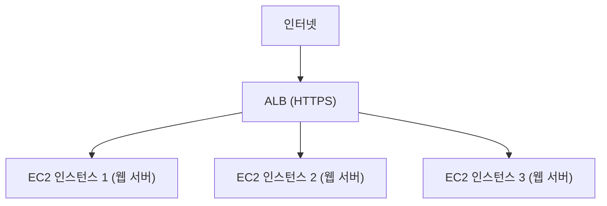
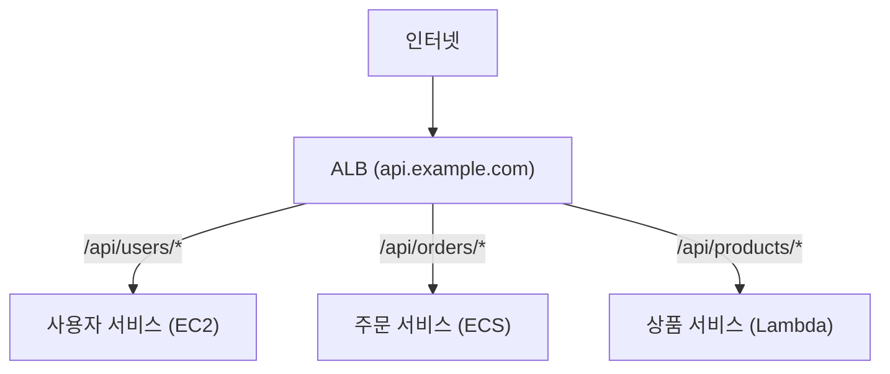
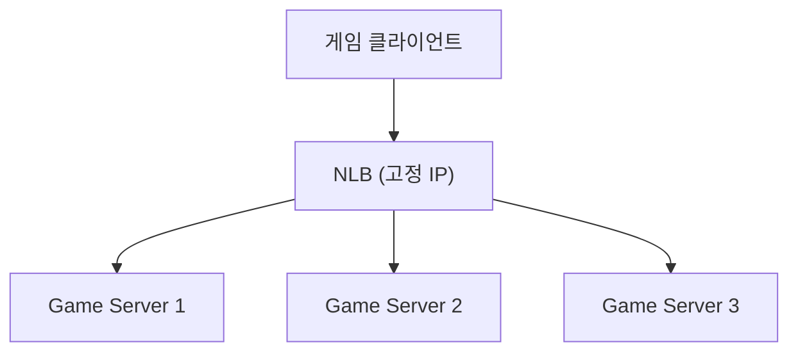

# AWS Elastic Load Balancer (ELB)

## 개요

ELB는 여러 서버에 트래픽을 분산하는 AWS 서비스다. 서버 장애 시 자동으로 다른 서버로 전환하고, 트래픽 증가에 따라 서버를 추가할 수 있다.

로드 밸런서가 필요한 이유는 세 가지다.

- 서버 한 대로는 처리량에 한계가 있음
- 서버 장애 시 전체 서비스 중단
- 트래픽 증가 시 성능 저하

ELB가 맡는 역할은 다음 세 가지다.

- 여러 서버에 트래픽 분산
- 장애 서버 자동 제외
- Auto Scaling과 연동해 자동 확장

## ELB의 주요 기능

### 트래픽 분산

ELB는 요청을 여러 백엔드 서버에 분산한다. 라운드 로빈이나 최소 미해결 요청 수 알고리즘을 사용한다.

라운드 로빈이면 요청이 들어온 순서대로 서버를 돌아가며 받는다.

- 요청 1 → 서버 A
- 요청 2 → 서버 B
- 요청 3 → 서버 C
- 요청 4 → 다시 서버 A

### 고가용성

백엔드 서버가 장애나면 자동으로 트래픽에서 제외한다. 헬스 체크로 서버 상태를 확인한다.

헬스 체크가 실패하면 ELB는 이렇게 처리한다.

- 해당 서버로 트래픽 전송 중단
- 정상 서버로만 트래픽 전달
- 서버 복구 시 자동으로 다시 포함

### Auto Scaling 연동

트래픽 증가 시 새 서버를 자동 추가하고, 감소 시 서버를 제거한다. ELB 대상 그룹에 등록된 서버만 트래픽을 받는다.

## ELB 유형

### Application Load Balancer (ALB)

7계층에서 동작하는 로드 밸런서다. HTTP/HTTPS 요청 내용을 분석해 라우팅한다.

ALB의 특징은 다음과 같다.

- HTTP, HTTPS, gRPC 지원
- 경로, 호스트, 헤더 기반 라우팅
- Lambda 함수 직접 지원

라우팅은 세 가지 기준으로 나눌 수 있다.

- 경로 기반: `/api/users/*` → 사용자 서비스
- 호스트 기반: `api.example.com` → API 서버
- 헤더 기반: `X-User-Type: admin` → 관리자 서비스

ALB를 쓰는 경우는 이렇다.

- HTTP/HTTPS 웹 애플리케이션
- 마이크로서비스 아키텍처
- ECS/EKS 컨테이너 서비스
- Lambda 함수 통합

자세한 내용은 [ALB.md](./ALB.md) 참조.

### Network Load Balancer (NLB)

4계층에서 동작하는 로드 밸런서다. IP와 포트만 보고 라우팅한다.

NLB의 특징은 다음과 같다.

- TCP, UDP, TLS 지원
- 낮은 지연시간, 높은 성능
- 고정 IP 주소 지원

ALB와 비교하면 ALB는 HTTP 헤더와 경로를 분석하고(7계층), NLB는 IP와 포트만 확인한다(4계층).

NLB를 쓰는 경우는 이렇다.

- 게임 서버 (지연시간 중요)
- 실시간 스트리밍
- TCP/UDP 기반 애플리케이션
- 고정 IP 주소 필요 (화이트리스트 등)

HTTP 요청 내용을 분석할 수 없어 경로 기반 라우팅이 안 된다. 웹 애플리케이션은 ALB를 사용하는 게 좋다.

### Gateway Load Balancer (GWLB)

3계층에서 동작하는 로드 밸런서다. 네트워크 보안 장비 전용이다.

GWLB의 특징은 다음과 같다.

- IP 패킷 레벨 처리
- 보안 장비(방화벽, IDS/IPS)와 통합
- 투명한 프록시 (애플리케이션 변경 불필요)

GWLB를 쓰는 경우는 이렇다.

- 방화벽 배포
- 침입 탐지/방지 시스템
- DDoS 보호
- 네트워크 보안 중앙 관리

일반 웹 애플리케이션에는 사용하지 않는다. 보안 장비를 통합할 때만 사용한다.

### Classic Load Balancer (CLB)

레거시 로드 밸런서다. 새 프로젝트에서는 사용하지 않는다.

CLB에는 한계가 있다.

- 기능 제한적
- 성능 낮음
- ALB/NLB로 마이그레이션 권장

CLB를 쓰는 경우는 이렇다.

- EC2-Classic 네트워크 사용 시 (거의 없음)
- 레거시 시스템 호환성 유지

## ELB 구성 요소

### 리스너 (Listener)

클라이언트 요청을 받는 진입점이다. 프로토콜과 포트를 지정한다.

리스너에서 정하는 항목은 세 가지다.

- 프로토콜: HTTP(80), HTTPS(443)
- SSL 인증서: ACM 인증서 사용
- 기본 액션: 라우팅 규칙에 매치되지 않는 요청 처리

### 대상 그룹 (Target Group)

실제 트래픽을 처리할 백엔드 리소스들의 그룹이다.

대상으로 등록할 수 있는 리소스는 이렇다.

- EC2 인스턴스
- IP 주소 (온프레미스 서버 포함)
- Lambda 함수 (ALB만)
- 다른 ALB (중첩 구성)

대상 그룹은 세 가지 기능을 한다.

- 헬스 체크로 대상 상태 확인
- 로드 밸런싱 알고리즘 적용
- 대상 자동 등록/해제 (ECS/EKS 연동 시)

### 라우팅 규칙 (Rule)

요청을 어떤 대상 그룹으로 보낼지 결정하는 규칙이다. ALB에서만 사용한다.

규칙 조건으로 쓸 수 있는 값은 이렇다.

- 경로 패턴: `/api/*`
- 호스트 헤더: `api.example.com`
- HTTP 헤더: `X-User-Type: admin`
- HTTP 메서드: GET, POST 등

여러 규칙이 매치되면 우선순위가 낮은 숫자부터 적용된다.

### 보안 그룹 (Security Group)

ELB의 네트워크 접근을 제어하는 방화벽이다.

보통 이렇게 설정한다.

- ALB 보안 그룹: 클라이언트(0.0.0.0/0)에서 80, 443 포트 허용
- 백엔드 보안 그룹: ALB 보안 그룹에서만 트래픽 허용

이렇게 하면 백엔드 서버를 인터넷에 직접 노출하지 않는다.

## 보안

### SSL/TLS 종료

ELB에서 HTTPS를 처리하고 백엔드는 HTTP로 통신한다. 흐름은 다음과 같다.

```
클라이언트 (HTTPS) → ELB (HTTPS 종료) → 백엔드 (HTTP)
```

이 구성의 장점은 세 가지다.

- 백엔드 서버 SSL 처리 부담 없음
- 인증서를 ELB에서만 관리
- 인증서 자동 갱신 가능

ALB와 백엔드가 다른 VPC나 네트워크에 있으면 HTTPS로 통신해야 한다.

### AWS Certificate Manager (ACM)

ACM에서 인증서를 발급하고 자동 갱신한다. Let's Encrypt 같은 외부 인증서보다 관리가 쉽다.

적용 순서는 이렇다.

- ACM에서 인증서 요청
- DNS 검증 또는 이메일 검증
- ELB 리스너에 인증서 연결
- 자동 갱신 (수동 작업 불필요)

### AWS WAF 통합

ALB 앞에 WAF를 연결해 웹 공격을 차단한다.

차단할 수 있는 공격은 이렇다.

- SQL 인젝션
- XSS (Cross-Site Scripting)
- DDoS 공격
- 특정 IP 차단
- 레이트 리미팅

WAF 규칙을 잘못 설정하면 정상 트래픽도 차단될 수 있다. 테스트 환경에서 먼저 검증해야 한다.

## 모니터링

### CloudWatch 메트릭

ELB는 CloudWatch와 통합되어 메트릭을 제공한다. 주로 보는 메트릭은 이렇다.

- RequestCount: 요청 수
- TargetResponseTime: 백엔드 응답 시간
- HTTPCode_Target_4XX_Count: 4xx 오류 수
- HTTPCode_Target_5XX_Count: 5xx 오류 수
- UnHealthyHostCount: 비정상 대상 수

메트릭은 세 곳에 쓴다.

- 알람 설정: 오류율 증가 시 알림
- Auto Scaling 정책: 요청 수 기반 스케일링
- 대시보드: 실시간 모니터링

### 액세스 로그

모든 요청 로그를 S3에 저장한다. 로그에는 다음 내용이 남는다.

- 요청 시간, IP 주소
- 요청 경로, HTTP 메서드
- 응답 코드, 응답 시간
- 대상 서버 정보

저장한 로그는 이런 도구로 분석한다.

- CloudWatch Logs Insights
- ELK 스택 (Elasticsearch, Logstash, Kibana)
- Athena로 S3 로그 쿼리

### 헬스 체크

백엔드 서버 상태를 주기적으로 확인한다. 설정 항목은 이렇다.

- 프로토콜: HTTP 또는 HTTPS
- 경로: `/health`, `/api/health` 등
- 간격: 30초 (기본값)
- 타임아웃: 5초 (기본값)
- 성공/실패 임계값: 2회 연속

헬스 체크 경로는 실제 애플리케이션 로직과 분리해야 한다. DB 연결 실패해도 헬스 체크는 성공해야 한다.

## 비용

### 시간당 요금

ELB가 활성화된 시간에 따라 기본 요금이 부과된다. 사용하지 않아도 시간당 요금이 발생한다.

비용을 줄이려면 이렇게 한다.

- 개발/테스트 환경은 필요할 때만 생성
- 사용하지 않는 ELB는 삭제
- 프로덕션 환경도 트래픽이 없으면 비용 발생

### 데이터 처리 요금

ELB가 처리한 데이터 양에 따라 추가 요금이 부과된다. 리전별로 요금이 다르다.

크로스 존 로드 밸런싱에서는 가용영역 간 데이터 전송 시 추가 비용이 발생한다. 같은 가용영역 내 통신은 비용이 없다.

### LCU (Load Balancer Capacity Units)

ALB는 LCU 기반으로 과금된다. LCU는 아래 네 가지 요소로 계산한다.

- 요청 수
- 처리된 바이트
- 활성 연결 수
- 새 연결 수

LCU를 줄이는 방법은 이렇다.

- 불필요한 요청 줄이기 (캐싱 등)
- 압축 활성화로 데이터 양 감소
- 사용하지 않는 리스너 제거

## 운영 고려사항

### 고가용성

최소 2개 이상의 가용영역에 ELB를 배포해야 한다. 단일 가용영역 장애 시에도 서비스가 유지된다.

크로스 존 로드 밸런싱을 켜면 가용영역 간 트래픽 분산이 가능하다. 예를 들어 AZ-A에 인스턴스 5개, AZ-B에 인스턴스 2개가 있어도 트래픽을 균등하게 분산한다.

크로스 존 로드 밸런싱 사용 시 가용영역 간 데이터 전송 비용이 발생한다.

### 보안

HTTP 리스너는 HTTPS로 리다이렉션만 하고, 실제 트래픽은 HTTPS 리스너로 받는다.

최신 TLS 버전을 사용한다. 오래된 버전은 보안 취약점이 있을 수 있다.

보안 그룹은 최소 권한 원칙을 적용한다. ALB는 클라이언트에서만, 백엔드는 ALB에서만 트래픽을 허용한다.

웹 공격 차단을 위해 WAF를 사용한다. 규칙을 잘못 설정하면 정상 트래픽도 차단될 수 있으니 주의해야 한다.

### 성능 최적화

서비스별로 타겟 그룹을 분리하면 독립적인 헬스 체크와 스케일링이 가능하다.

헬스 체크 간격을 너무 짧게 하면 대상 서버 부하가 증가한다. 컨테이너 시작 시간을 고려해 간격을 조정해야 한다.

정적 콘텐츠는 CloudFront로 캐싱해 ELB 부하를 줄인다.

### 비용 최적화

- 사용하지 않는 ELB 삭제
- 개발/테스트 환경은 필요할 때만 생성
- 사용 사례에 맞는 유형 선택 (ALB vs NLB)
- 압축 활성화로 데이터 양 감소

## 제한사항

### 서비스 제한

계정과 리전에는 ELB 생성 수 제한이 있다.

- 계정별 ELB 생성 수 제한
- 리전별 ELB 생성 수 제한
- 필요 시 AWS에 한도 증가 요청

ALB 제한은 이렇다.

- 리스너당 규칙 수: 100개
- 타겟 그룹당 타겟 수: 1000개
- 대상 그룹당 ALB 수: 1개

대규모 아키텍처 설계 시 이 제한을 고려해야 한다.

### 성능 고려사항

ALB는 이런 한계가 있다.

- 지연시간이 NLB보다 높음
- 동시 연결 수와 초당 요청 처리 수에 제한
- 초고성능이 필요한 경우 NLB 고려

NLB의 특성은 이렇다.

- 낮은 지연시간
- 높은 처리량
- HTTP 요청 내용 분석 불가

### 비용 고려사항

- 사용하지 않아도 시간당 요금 발생
- 개발/테스트 환경은 필요할 때만 생성
- 가용영역 간 데이터 전송 시 추가 비용
- 액세스 로그 저장 시 S3 비용 발생

## ELB 유형 선택

### ALB를 선택하는 경우

- HTTP/HTTPS 웹 애플리케이션
- 경로별로 다른 서비스로 라우팅
- 마이크로서비스 아키텍처
- ECS/EKS 컨테이너 서비스
- Lambda 함수 직접 호출
- 복잡한 라우팅 규칙 필요

대부분의 웹 애플리케이션은 ALB로 충분하다.

### NLB를 선택하는 경우

- TCP/UDP 트래픽 처리
- 최소 지연시간 필요 (게임, 실시간 스트리밍)
- 정적 IP 주소 필요 (화이트리스트 등)
- 초고성능 필요
- TCP 연결 유지 중요

HTTP 요청 내용을 분석할 수 없어 경로 기반 라우팅이 안 된다.

### GWLB를 선택하는 경우

- 네트워크 보안 장비 배포
- 방화벽, IDS/IPS 통합
- 트래픽 검사 및 필터링
- 중앙화된 보안 관리

일반 웹 애플리케이션에는 사용하지 않는다.

### CLB를 선택하는 경우

- 레거시 시스템 호환성 유지
- EC2-Classic 네트워크 사용 (거의 없음)

새 프로젝트에서는 사용하지 않는다. ALB나 NLB로 마이그레이션을 권장한다.

## 아키텍처 예시

### 웹 애플리케이션

아래 도식은 인터넷 요청이 ALB(HTTPS)를 거쳐 웹 서버 EC2 인스턴스 3대로 나뉘어 들어가는 흐름을 보여준다.



이 구성의 특징은 다음과 같다.

- HTTPS 리다이렉션
- Auto Scaling 연동
- 헬스 체크로 장애 서버 자동 제외

### 마이크로서비스

아래 도식은 `api.example.com` 하나로 들어온 요청을 ALB가 경로별로 EC2, ECS, Lambda 서비스에 나눠 보내는 모습을 보여준다. 화살표 위 문자열이 라우팅 조건이다.



이 구성의 특징은 다음과 같다.

- 경로별 다른 서비스로 라우팅
- 서비스별 독립 배포 및 스케일링
- 단일 도메인으로 여러 서비스 제공

### 게임 서버

아래 도식은 게임 클라이언트가 고정 IP를 가진 NLB를 거쳐 게임 서버 3대에 연결되는 흐름을 보여준다.



이 구성의 특징은 다음과 같다.

- 낮은 지연시간
- 고정 IP 주소
- TCP 연결 유지

## 참조

- AWS Elastic Load Balancing 사용자 가이드: https://docs.aws.amazon.com/elasticloadbalancing/
- AWS Well-Architected Framework: https://docs.aws.amazon.com/wellarchitected/
- ALB 가격: https://aws.amazon.com/elasticloadbalancing/pricing/
