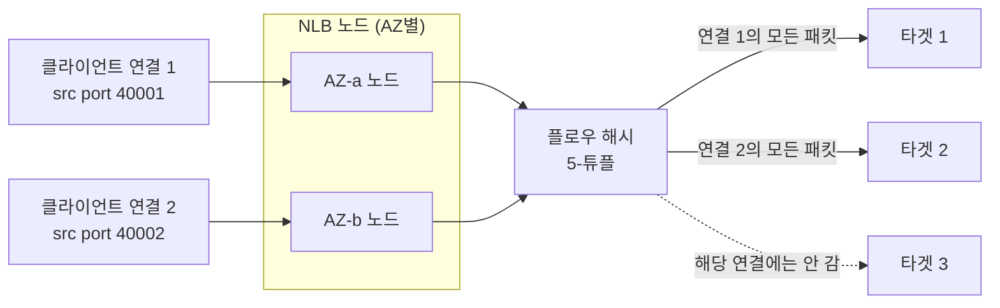
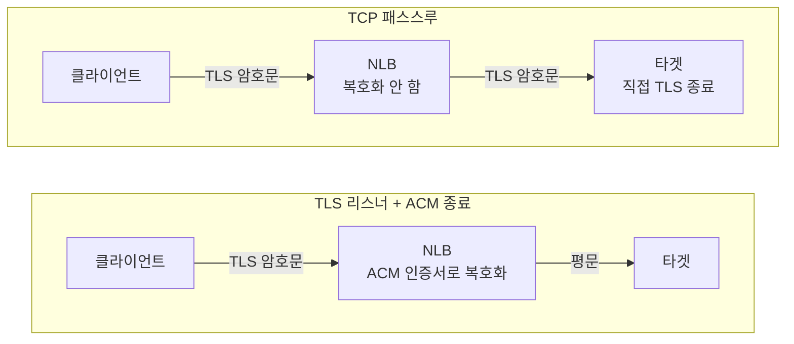
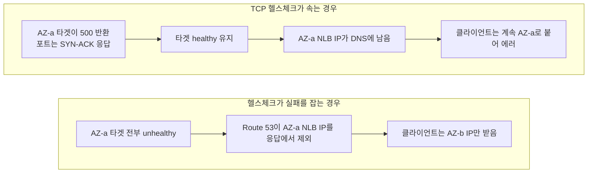
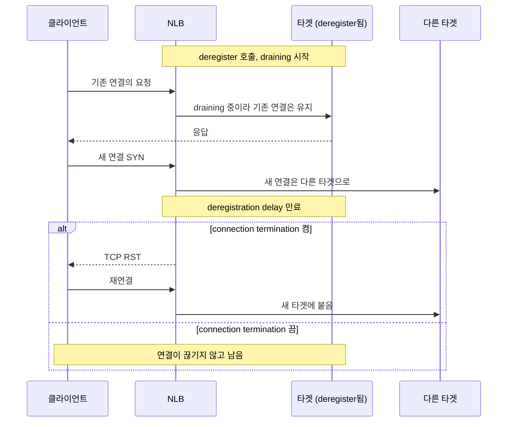

# NLB(Network Load Balancer) 단독 운영

ALB와 NLB를 언제 고르는지, 클라이언트 IP 보존이 ip 타입 타겟에서 깨지는 문제, Proxy Protocol v2, Cross-Zone 기본값, LCU 3차원 과금, 고정 IP 같은 비교·선택 관점은 [LB.md](./LB.md)에 정리돼 있다. 이 문서는 그 위에서 NLB만 단독으로 운영할 때 마주치는 동작을 다룬다. 플로우 해시 분산이 왜 그렇게 동작하는지, 헬스체크가 어떻게 우리를 속이는지, 보안 그룹과 PrivateLink, DNS 페일오버처럼 NLB 고유의 함정 위주다.

NLB는 L4에서 도는 로드 밸런서다. 패킷 헤더의 IP·포트만 보고 분산하고 페이로드는 건드리지 않는다. 그래서 빠르지만, "어디로 보낼지"를 정하는 규칙도 L4 수준에서만 작동한다. 이 제약을 이해하면 NLB가 왜 그렇게 동작하는지 대부분 설명된다.

## 5-튜플 플로우 해시 — 같은 클라이언트가 같은 타겟으로 가는 이유

NLB는 라운드 로빈으로 분산하지 않는다. 연결마다 5-튜플(source IP, source port, destination IP, destination port, protocol)을 해시해서 타겟을 고른다. 같은 클라이언트가 같은 포트에서 같은 NLB 엔드포인트로 붙으면 5-튜플이 같으니까 해시 결과도 같고, 결국 같은 타겟으로 간다.

이게 실무에서 헷갈림을 만든다. 부하 테스트를 한 대의 클라이언트에서 단일 커넥션으로 돌리면 트래픽이 타겟 하나에만 쏠린다. "분산이 안 된다"고 의심하기 전에, 클라이언트가 source port를 바꿔가며 새 연결을 여는지부터 봐야 한다. source port가 매번 달라지면(보통 OS가 ephemeral port를 돌려쓴다) 5-튜플이 달라져서 다른 타겟으로도 흩어진다. `ab`나 `wrk`로 keep-alive를 켜고 커넥션 수를 1로 두면 한 타겟만 두드린다.



연결 하나가 살아 있는 동안은 해시 입력이 같아서 패킷이 전부 같은 타겟으로 간다. 분산이 일어나는 단위는 패킷이 아니라 연결이다. Cross-Zone이 꺼져 있으면 노드는 자기 AZ의 타겟만 후보로 삼는다.

UDP도 같은 방식으로 플로우를 한 타겟에 묶는다. NAT 뒤에 클라이언트가 잔뜩 있고 source IP·port 조합이 적으면 UDP 트래픽이 특정 타겟 한두 개에 몰린다. 쏠림이 보이면 타겟 수를 늘려 해시 충돌 확률을 낮추거나, 애플리케이션 레벨에서 세션을 재배치하는 쪽으로 푼다.

플로우 해시는 타겟이 추가·제거되면 일부 재계산된다. 타겟을 등록/해제하는 순간 기존 연결 중 일부가 다른 타겟으로 다시 매핑될 수 있다는 뜻이다. long-lived TCP 연결을 쓰는 서비스에서 스케일 인/아웃을 자주 하면, 그 타이밍에 연결이 끊기는 사용자가 생긴다.

## 헬스체크 — TCP/HTTP/HTTPS 차이와 TCP가 우리를 속이는 사례

NLB 타겟 그룹의 헬스체크는 TCP, HTTP, HTTPS 세 가지로 잡을 수 있다. 디폴트로 두면 TCP가 잡히는데, 이 TCP 헬스체크가 운영에서 사람을 가장 많이 속인다.

| 종류 | 확인하는 것 | 못 잡는 것 | 주의 |
|---|---|---|---|
| TCP | 타겟 포트로 SYN을 보내 SYN-ACK가 오는지 | 데드락, DB 커넥션 풀 고갈로 모든 요청이 500인 상태 | 디폴트다. 콘솔은 전부 초록인데 사용자는 에러를 받는 상황을 만든다 |
| HTTP | 지정 경로(`/healthz`)에 GET을 보내 응답 코드를 봄 | 핸들러가 의존성(DB 등)을 안 보면 그 장애는 못 잡는다 | 기본 성공 코드가 200-399다(ALB는 200). 301/302도 healthy로 잡히므로 핸들러가 200만 뱉게 못 박고 matcher도 `200`으로 둔다 |
| HTTPS | 타겟까지 TLS를 맺고 GET | HTTP와 같음 | TLS 패스스루라 백엔드가 인증서를 들고 있을 때 쓴다. 핸드셰이크 비용이 커서 interval을 너무 짧게 잡지 않는다 |

TCP 헬스체크는 "포트가 열려 있고 핸드셰이크가 된다"까지만 본다. 한 번 겪으면 신뢰하지 않게 된다. NLB 리스너가 TCP여도 헬스체크 프로토콜은 따로 HTTP로 지정할 수 있으니, 백엔드가 HTTP를 말할 수 있으면 HTTP나 HTTPS로 올린다.

### threshold 동작

healthy threshold와 unhealthy threshold는 "연속 몇 번"을 센다. NLB는 ALB와 달리 둘을 따로 설정하더라도 권장은 같은 값으로 맞추는 것이다 — 과거 NLB는 healthy/unhealthy threshold가 같아야 했고, 지금은 따로 줄 수 있지만 헷갈리면 동일하게 둔다.

- unhealthy threshold 3, interval 30초면, 타겟이 죽고 나서 90초가 지나야 트래픽에서 빠진다. 그동안 죽은 타겟으로도 새 연결이 계속 해시된다. 이 90초가 장애 시 사용자 에러로 그대로 나타난다.
- 빠르게 빼내고 싶으면 interval을 10초, unhealthy threshold를 2로 줄여서 20초 안에 빠지게 한다. 대신 헬스체크 트래픽과 false positive(순간적인 네트워크 흔들림에 멀쩡한 타겟이 빠지는 것)가 늘어난다.

NLB 헬스체크 interval은 HTTP/HTTPS면 6초 또는 10초, 30초 같은 값을 고를 수 있고, TCP면 선택지가 더 제한적이다. ALB만큼 자유롭게 못 준다는 점을 기억해 둔다.

## 스티키니스 — source IP affinity와 ALB 쿠키의 차이

NLB도 스티키니스를 지원하지만 방식이 ALB와 다르다. NLB는 L4라 쿠키를 못 심고 source IP로 묶는다(`stickiness.type = source_ip`). 5-튜플 해시는 source port가 바뀌면 다른 타겟으로 갈 수 있지만, source IP 스티키니스를 켜면 port가 바뀌어도 IP가 같으면 같은 타겟에 고정된다. 세션을 타겟 로컬 메모리에 들고 있는 레거시 TCP 서비스에서 쓴다.

| | NLB | ALB |
|---|---|---|
| 묶는 기준 | 클라이언트 source IP | `AWSALB` 쿠키(브라우저 단위) |
| 계층 | L4 | L7 |
| NAT·프록시 뒤 클라이언트 | 수천 명이 한 IP면 그 IP 전체가 타겟 하나에 묶인다 | 영향 없음 |
| 묶인 타겟이 죽을 때 | 그 IP의 모든 사용자가 한꺼번에 이동하고 세션이 날아간다 | 해당 브라우저만 이동 |

스티키니스가 필요하면서 HTTP라면 ALB를 쓰는 게 맞다. NLB에서 굳이 한다면 NAT 집중으로 부하가 쏠리는 것을 감안한다.

## hairpin / 루프백 — 인스턴스가 자기 자신을 타겟으로 등록했을 때

같은 인스턴스가 NLB의 타겟이면서 그 NLB 주소로 자기 자신을 호출하면, 해시가 자기 자신을 고르는 경우에만 연결이 멈춘다. 그래서 "가끔 멈춘다"로 나타나 재현이 어렵다.

원인은 instance 타입 타겟 그룹의 `preserve_client_ip`(기본 켜짐)다. client IP가 보존되면 NLB가 전달한 SYN의 source와 destination이 둘 다 호출자 자신의 IP가 되어 정상 패킷으로 처리되지 않는다. `preserve_client_ip`를 끄거나, 같은 호스트 호출을 NLB에서 빼는 식으로 푼다. 패킷 단위 메커니즘, 진단 방법, 해결 방법별로 포기하는 것의 비교, 쿠버네티스 케이스는 [NLB_Hairpin.md](./NLB_Hairpin.md)에 정리했다.

## TLS 리스너 + ACM 종료 vs TCP 패스스루

NLB에서 TLS를 다루는 방법은 두 가지다. 복호화가 일어나는 위치가 다르고, 이 차이가 인증서 관리와 종단 간 암호화 여부를 가른다.



위쪽은 클라이언트와 NLB 사이만 암호화된다. 타겟 그룹 프로토콜을 TLS로 두면 NLB에서 백엔드로 다시 암호화할 수 있다. 아래쪽은 NLB가 페이로드를 못 보므로 SNI 기반 라우팅 같은 건 못 한다.

| | TLS 리스너 + ACM 종료 | TCP 패스스루 |
|---|---|---|
| 인증서 관리 | ACM 자동 갱신 | 백엔드마다 설치하고 갱신 |
| 백엔드 TLS 부담 | 없음 | 있음 |
| 종단 간 암호화 | NLB에서 끊김 | 유지 |
| 쓰는 경우 | 일반 TCP 서비스 | 백엔드에서 클라이언트 인증서를 검증해야 할 때, PCI-DSS·의료 데이터처럼 암호화를 끊으면 안 될 때 |

### ALPN

NLB TLS 리스너는 ALPN을 협상할 수 있다. TLS 핸드셰이크 단계에서 클라이언트와 어떤 상위 프로토콜을 쓸지 정하는 절차다. HTTP/2나 gRPC를 NLB TLS 종료로 받을 거면 `alpn_policy`를 `HTTP2Preferred`나 `HTTP2Optional`로 줘야 한다. 안 주면 HTTP/1.1로 협상돼서 gRPC가 안 붙는다. TCP 패스스루로 가면 ALPN은 NLB가 관여하지 않고 백엔드가 알아서 한다.

## 보안 그룹 — 2023년 8월 이후 생성분만, 기존은 소급 불가

오랫동안 NLB는 보안 그룹을 못 붙였다. 2023년 8월부터 직접 붙일 수 있게 됐는데, 함정은 이게 NLB 생성 시점에만 결정된다는 점이다. 그 이전에 만든 NLB는 소급해서 붙일 수 없고, 새로 만들어서 트래픽을 옮기는 수밖에 없다. 콘솔에서 기존 NLB에 보안 그룹을 붙이는 버튼을 찾다가 시간을 버린다.

| | 보안 그룹 없는 NLB | 보안 그룹 있는 NLB |
|---|---|---|
| 백엔드 SG가 보는 source | 원본 클라이언트 IP(instance 타입, IP 보존) | NLB의 보안 그룹 |
| 백엔드 SG 인바운드 | NLB IP를 허용해도 안 통해서 0.0.0.0/0을 열게 된다 | NLB SG만 허용 |
| 결과 | 백엔드가 인터넷에 직접 노출되는 꼴 | ALB와 같은 SG 체이닝 |

새로 만든다면 보안 그룹을 지정해서 만든다. SG를 빡빡하게 잠글 때는 헬스체크 트래픽과 PrivateLink 트래픽에 SG를 적용할지 정하는 별도 속성이 있다는 점을 알아둔다. 기본 동작을 모른 채 잠그면 헬스체크가 막혀 전 타겟이 unhealthy로 떨어지는 일이 있다.

## PrivateLink — VPC Endpoint Service의 프런트엔드

NLB는 PrivateLink로 서비스를 제공할 때 프런트엔드 역할을 한다. 우리 VPC에서 도는 서비스를 다른 계정·다른 VPC에 인터넷을 거치지 않고 노출하고 싶을 때, VPC Endpoint Service를 만들고 그 앞에 NLB를 둔다. 소비자 쪽은 자기 VPC에 인터페이스 엔드포인트(ENI)를 만들어서 우리 NLB로 사설망 경로로 붙는다. 이 구조에서 엔드포인트 서비스의 백엔드로 받을 수 있는 게 NLB(와 GWLB)다. ALB는 직접 못 받는다 — ALB를 PrivateLink로 노출하려면 NLB → ALB 체이닝으로 NLB를 앞에 세워야 한다.

PrivateLink로 들어오는 트래픽은 source IP가 소비자 클라이언트가 아니라 PrivateLink 인프라의 주소로 바뀌어서 도착한다. 즉 클라이언트 IP 보존이 안 된다. 소비자가 누구인지 알아야 한다면 Proxy Protocol v2를 켜야 한다. PrivateLink는 Proxy Protocol v2 헤더에 엔드포인트 ID 같은 메타데이터를 실어 보내서, 백엔드가 어느 소비자 VPC 엔드포인트에서 온 트래픽인지 식별할 수 있게 해준다. 멀티테넌트 서비스를 PrivateLink로 팔 때 이 메타데이터로 테넌트를 구분한다.

## zonal DNS와 DNS 페일오버 — 헬스가 안 죽으면 AZ가 안 빠진다

NLB의 DNS 이름은 AZ별 IP 여러 개로 해석된다. NLB를 2개 AZ에 걸어두면 `my-nlb-xxx.elb.amazonaws.com`을 조회했을 때 각 AZ의 NLB 노드 IP가 A 레코드로 돌아온다. 클라이언트는 그중 하나로 붙는다. AZ별로 따로 붙고 싶으면 zonal DNS 이름(`az-a.my-nlb-xxx.elb.amazonaws.com` 형태)을 직접 조회해서 특정 AZ의 IP만 받을 수 있다. AZ 로컬리티를 강제하거나, AZ별로 디버깅할 때 쓴다.

페일오버 동작에서 자주 데인다. NLB는 어떤 AZ의 타겟이 전부 unhealthy가 되면 그 AZ의 IP를 DNS 응답에서 뺀다. 문제는 "전부 unhealthy"가 돼야 빠진다는 점이다.



위쪽 흐름은 헬스체크가 AZ의 실패를 제대로 보고할 때만 성립한다. 아래쪽처럼 TCP 헬스체크가 살아 있다고 잡으면 AZ가 DNS에서 빠지지 않는다. 헬스체크를 HTTP로 제대로 잡는 게 DNS 페일오버가 동작하기 위한 전제다.

또 하나, DNS 페일오버는 클라이언트의 DNS 캐시에 발목이 잡힌다. NLB DNS의 TTL은 60초지만, JVM처럼 DNS를 무한 캐싱하는 클라이언트는 죽은 AZ IP를 계속 들고 있다. 자바 애플리케이션에서 `networkaddress.cache.ttl`을 안 줄이면 페일오버가 일어나도 클라이언트가 옛 IP로 계속 붙어서 장애가 길어진다. NLB를 호출하는 자바 서비스가 있으면 이 설정부터 확인한다.

Cross-Zone이 꺼진 상태에서 AZ 하나의 타겟이 전부 죽으면, DNS에서 그 AZ IP가 빠지기 전까지(헬스체크 주기만큼) 그 AZ로 붙은 클라이언트는 갈 곳이 없다. Cross-Zone을 켜면 죽은 AZ로 붙어도 다른 AZ 타겟으로 넘어가니까 DNS 페일오버를 기다릴 필요가 없다. 가용성을 우선하면 Cross-Zone을 켜는 이유가 여기에도 있다(비용은 LB.md 참고).

## deregistration — 연결 reset 동작

타겟을 deregister하면 NLB는 deregistration delay(기본 300초) 동안 기존 연결을 유지하면서 새 연결만 다른 타겟으로 보낸다. 시퀀스로 보면 delay가 끝난 뒤 갈리는 지점이 핵심이다.



기본값에서는 delay가 끝나도 long-lived 연결이 끊기지 않고 남는 경우가 있다. 타겟은 이미 빠졌는데 클라이언트는 연결이 살아 있다고 믿는 상태다. `connection_termination_on_deregistration`(타겟 그룹 속성 `deregistration_delay.connection_termination.enabled`)을 켜면 delay 만료 시점에 NLB가 남은 연결에 RST를 보낸다. 게임 서버나 MQTT처럼 연결이 끝없이 유지되는 서비스에서 배포할 때 옛 타겟에 매달린 연결을 정리하려고 켠다.

켜면 배포 시점에 사용자가 끊김을 한 번 겪고 재연결로 새 타겟에 붙는다. 끄면 끊김은 없지만 옛 타겟에 연결이 오래 매달려 배포가 안 끝난다. 클라이언트의 재연결 로직이 없으면 켜도 소용없으니, 재연결을 먼저 확인한다.

## dual-stack / IPv6, jumbo frame

NLB는 IPv4 전용, dual-stack(IPv4+IPv6) 두 가지 IP 주소 타입으로 만들 수 있다. dual-stack으로 만들면 NLB가 IPv6 리스너를 받고, 백엔드로는 IPv4로 보내거나 IPv6로 보낼 수 있다. IPv6 클라이언트를 직접 받아야 하는데 백엔드는 IPv4면, NLB가 dual-stack으로 받아서 IPv4 타겟으로 넘기는 구성을 쓴다. 이것도 NLB 생성 시점에 IP 주소 타입을 정하고, 나중에 IPv4 전용을 dual-stack으로 바꾸는 건 가능하지만 되돌리는 건 제약이 있으니 처음에 정하는 게 낫다.

jumbo frame은 NLB가 MTU 8500까지 받는다. 같은 VPC·같은 리전 안에서 큰 패킷을 보내는 워크로드(대용량 데이터 전송, 스토리지 트래픽)면 jumbo frame으로 패킷당 오버헤드를 줄인다. 단, 경로 어딘가에 MTU 1500인 구간이 있으면 fragmentation이나 패킷 드롭이 생긴다. 인터넷을 거치는 트래픽은 jumbo frame을 기대하면 안 된다. VPC 내부 경로 전체가 jumbo frame을 지원하는지 확인하고 써야 한다.

## 운영 중 자주 보는 CloudWatch 지표

NLB 지표는 ALB와 이름이 다르다. NLB만의 지표 위주로 본다.

| 지표 | 의미 | 볼 때 |
|---|---|---|
| `UnHealthyHostCount` | 타겟 그룹별 unhealthy 타겟 수 | 무조건 알람을 건다. AZ별 타겟 그룹을 따로 본다. 1 이상이 헬스체크 주기 이상 지속되면 알림이 가야 한다. 타겟 그룹 전체 수와 같아지면 그 AZ가 DNS에서 빠지는 순간이다 |
| `TCP_Target_Reset_Count` | 백엔드가 보낸 RST 횟수 | 튀면 백엔드가 연결을 강제로 끊고 있다. keepalive가 NLB idle timeout(350초)과 안 맞거나, 애플리케이션이 연결을 너무 빨리 닫거나, 프로세스가 죽으면서 RST를 뿌리는 경우다. `TCP_Client_Reset_Count`와 같이 보면 어느 쪽이 끊는지 구분된다 |
| `PeakPacketsPerSecond` | 초당 최대 패킷 수 | UDP 게임 서버처럼 작은 패킷이 폭주하는 워크로드는 대역폭보다 먼저 한계에 닿는다. 바이트 처리량은 여유로운데 패킷 수가 천장을 치면 여기서 잡힌다 |
| `ActiveFlowCount`, `NewFlowCount` | 동시·신규 플로우 수 | LCU 과금 차원과 직결된다. 활성 플로우가 폭증하면 LCU가 같이 오른다(차원 설명은 LB.md) |

## Terraform — NLB 고유 속성 위주

LB.md에 NLB 기본 골격(subnet_mapping으로 EIP 붙이기, proxy_protocol_v2, cross-zone, TLS 리스너 + ALPN)이 있으니, 여기서는 헬스체크·스티키니스·보안 그룹·connection termination 같은 NLB 고유 속성에 집중한 예제를 둔다.

### 보안 그룹을 가진 NLB와 HTTP 헬스체크

```hcl
resource "aws_security_group" "nlb" {
  name   = "svc-nlb-sg"
  vpc_id = aws_vpc.main.id

  ingress {
    from_port   = 443
    to_port     = 443
    protocol    = "tcp"
    cidr_blocks = ["0.0.0.0/0"]
  }

  egress {
    from_port   = 0
    to_port     = 0
    protocol    = "-1"
    cidr_blocks = ["0.0.0.0/0"]
  }
}

resource "aws_lb" "svc" {
  name               = "svc-nlb"
  load_balancer_type = "network"
  internal           = false
  subnets            = [aws_subnet.public_a.id, aws_subnet.public_b.id]

  # 2023년 8월 이후 생성분만 보안 그룹 지정 가능. 기존 NLB는 소급 불가.
  security_groups = [aws_security_group.nlb.id]

  enable_cross_zone_load_balancing = true
  ip_address_type                  = "ipv4"

  enable_deletion_protection = true
}

resource "aws_lb_target_group" "svc" {
  name        = "svc-nlb-tg"
  port        = 8080
  protocol    = "TCP"
  target_type = "instance"
  vpc_id      = aws_vpc.main.id

  # TCP 헬스체크는 포트만 열려 있으면 healthy로 속는다. HTTP로 올린다.
  health_check {
    protocol            = "HTTP"
    path                = "/healthz"
    port                = "8080"
    interval            = 10
    healthy_threshold   = 3
    unhealthy_threshold = 3
    # NLB HTTP 헬스체크 기본 성공코드는 200-399. 200만 healthy로 좁힌다.
    matcher = "200"
  }

  # source IP 기반 스티키니스. NAT 뒤 클라이언트 쏠림 주의.
  stickiness {
    type    = "source_ip"
    enabled = false
  }

  # deregister 시 delay 끝나면 남은 연결에 RST를 보내 확실히 끊는다.
  deregistration_delay = 120
  connection_termination = true

  # 백엔드가 클라이언트 IP를 봐야 하면 켠다. 백엔드 파서 필요.
  proxy_protocol_v2 = false
}

# 백엔드 SG: NLB가 보안 그룹을 가지므로 NLB SG만 허용하면 된다.
# 보안 그룹 없던 NLB였다면 여기에 0.0.0.0/0을 열어야 했다.
resource "aws_security_group_rule" "backend_from_nlb" {
  type                     = "ingress"
  from_port                = 8080
  to_port                  = 8080
  protocol                 = "tcp"
  security_group_id        = aws_security_group.backend.id
  source_security_group_id = aws_security_group.nlb.id
}
```

`connection_termination = true`는 deregister 시 RST를 보내는 동작이다. long-lived TCP 서비스의 배포를 깔끔하게 끝내고 싶을 때 켠다.

### TLS 리스너 + ACM 종료 + ALPN

```hcl
resource "aws_lb_listener" "tls" {
  load_balancer_arn = aws_lb.svc.arn
  port              = 443
  protocol          = "TLS"
  ssl_policy        = "ELBSecurityPolicy-TLS13-1-2-2021-06"
  certificate_arn   = aws_acm_certificate.svc.arn

  # gRPC / HTTP2를 NLB TLS 종료로 받을 때 필요. TCP 패스스루면 불필요.
  alpn_policy = "HTTP2Preferred"

  default_action {
    type             = "forward"
    target_group_arn = aws_lb_target_group.svc.arn
  }
}
```

TCP 패스스루로 백엔드까지 암호화를 끌고 갈 거면 리스너 protocol을 `TCP`로 두고 certificate_arn과 alpn_policy를 뺀다. mTLS 검증을 백엔드에서 해야 하면 이 구성을 쓴다.

### PrivateLink VPC Endpoint Service 앞단

```hcl
resource "aws_vpc_endpoint_service" "svc" {
  acceptance_required        = true
  network_load_balancer_arns = [aws_lb.svc.arn]

  # 소비자를 식별하려면 백엔드에서 Proxy Protocol v2 헤더의 endpoint ID를 읽는다.
  # 이 경우 타겟 그룹 proxy_protocol_v2 = true 필요.
}
```

PrivateLink로 들어오는 트래픽은 클라이언트 IP가 보존되지 않는다. 어느 소비자에서 왔는지 알아야 하면 타겟 그룹의 `proxy_protocol_v2`를 켜고 백엔드에서 Proxy Protocol v2 헤더를 파싱한다.

## 정리

NLB의 동작은 대부분 L4 제약에서 나온다. 5-튜플 해시라 같은 연결이 같은 타겟으로 가고, 페이로드를 못 보니까 스티키니스가 source IP 기반이고, 헬스체크가 TCP면 포트 열림만 확인해서 애플리케이션 장애를 못 잡는다. 운영에서 가장 많이 데이는 건 TCP 헬스체크에 속는 것과, 그 때문에 DNS 페일오버가 동작 안 하는 것이다. 헬스체크를 HTTP로 제대로 잡는 것 하나가 이 둘을 같이 해결한다.

새로 NLB를 만든다면 보안 그룹을 꼭 지정해서 만든다(기존 NLB는 소급이 안 된다). 백엔드 SG에 0.0.0.0/0을 여는 사태를 막는다. PrivateLink 프런트엔드, hairpin 함정, connection termination은 구성에 따라 한 번씩 발목을 잡으니 해당하는 경우만 챙기면 된다. 비교·선택과 LCU 과금은 [LB.md](./LB.md)를 본다.
