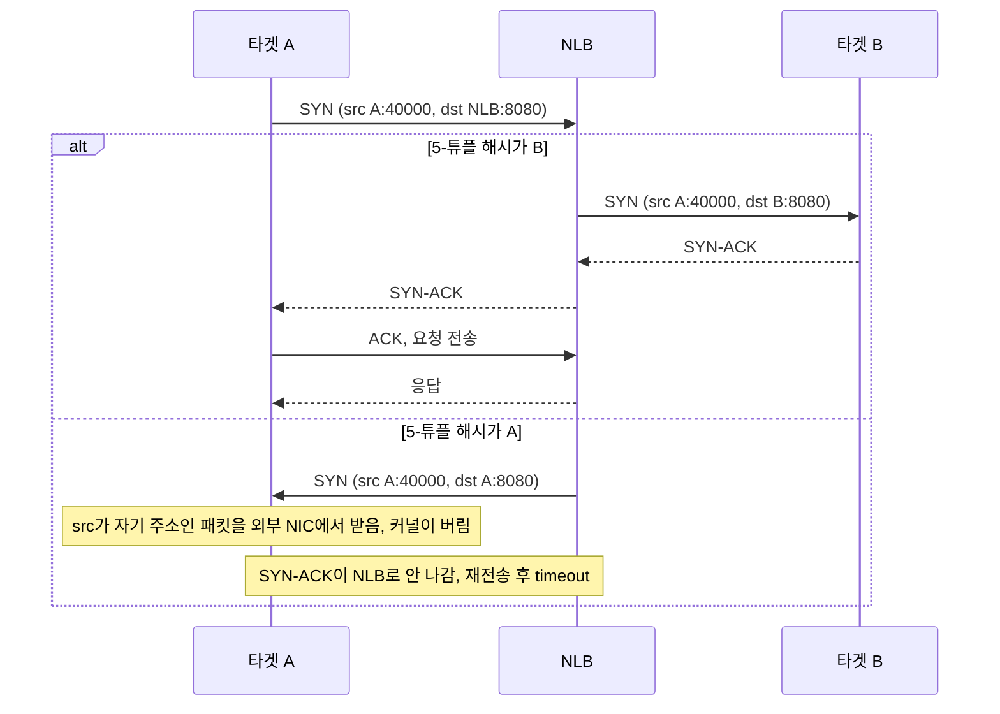
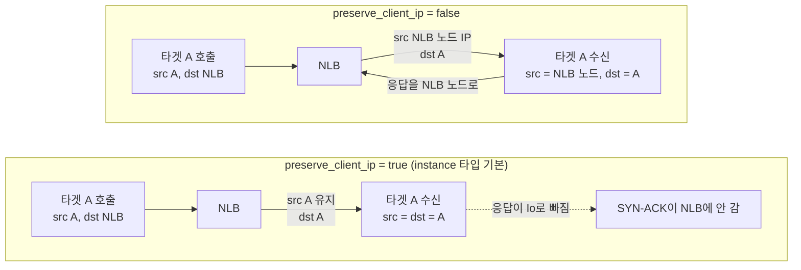
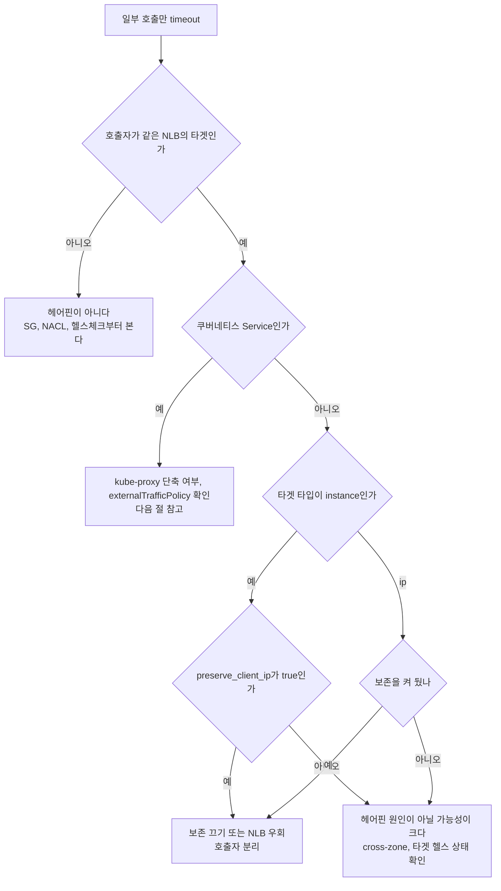

# NLB 헤어핀 - 타겟이 자기 NLB로 접속할 때

NLB 뒤에 있는 서버가 같은 NLB의 DNS 이름으로 호출을 보내는 구성이 있다. 서비스 간 호출 주소를 하나로 통일하려고 모든 호출을 NLB 주소로 쓰다 보면 자연스럽게 생긴다. 대부분의 호출은 멀쩡하게 돌다가 어느 순간 일부만 3초, 30초씩 멈춘다. 이 문서는 그 멈춤이 왜 "가끔"인지, 패킷이 어디서 사라지는지, 어떻게 확인하고 무엇을 포기하면 없앨 수 있는지를 정리한다. NLB의 해시 분산과 client IP 보존 기본 동작은 [NLB.md](./NLB.md)에 있고, 여기서는 그 문서의 hairpin 항목을 패킷 단위로 풀어 쓴다.

## 증상, 가끔 멈추는 curl

타겟 두 대(A, B)가 TCP 8080 리스너 뒤에 있고, 인스턴스 A에서 NLB DNS로 curl을 반복하면 이렇게 나온다.

- 절반쯤은 수 ms에 응답이 온다.
- 나머지는 `curl: (28) Connection timed out after 3001 milliseconds`.
- B에서 같은 명령을 돌려도 절반만 성공한다.
- 타겟이 아닌 제3의 인스턴스 C에서는 100% 성공한다.

NLB는 플로우 해시로 타겟을 고른다. 입력은 프로토콜과 출발지·목적지 IP·포트이고, 한 연결 안에서는 같은 타겟에 고정된다. curl을 새로 실행할 때마다 출발지 포트가 바뀌니 해시가 매번 다시 계산된다. 해시가 상대 타겟을 고르면 정상이고, 호출한 자기 자신을 고르면 멈춘다. 타겟이 2대면 확률이 50%, 4대면 25%, 1대뿐이면 100% 실패한다. 타겟이 1대일 때는 오히려 재현이 쉬워서 바로 발견되는데, 운영에서는 여러 대라 "네트워크가 가끔 불안정하다"는 인상만 남는다.

아래 시퀀스에서 두 갈래를 비교해서 본다. 윗갈래는 해시가 B로 가서 평범한 로드 밸런싱이고, 아랫갈래는 A로 돌아와서 SYN 이후가 끊긴다.



health check는 NLB 노드 IP에서 오기 때문에 이 문제와 무관하다. 그래서 타겟은 계속 healthy로 표시되고 타겟 그룹 쪽에서는 아무 이상 신호가 없다. 남는 단서는 호출하는 쪽의 timeout 로그뿐이다.

## 패킷이 자기 자신에게 돌아오는 과정

instance 타입 타겟 그룹은 client IP 보존이 기본으로 켜져 있다. 이때 NLB는 패킷을 타겟에 전달하면서 source를 바꾸지 않는다. 호출자가 A이므로 NLB가 A에게 보내는 SYN은 source가 A의 사설 IP이고 destination도 A의 사설 IP다. 같은 ENI로 들어온 패킷의 src와 dst가 같은 주소가 된다.

리눅스는 자기 로컬 주소를 source로 단 패킷이 외부 인터페이스로 들어오면 정상 패킷으로 받지 않는다. 라우팅 검증 단계에서 source가 로컬 주소로 분류되면 martian source로 간주한다. 이 부분은 EC2에서 직접 못 재 봤고, 같은 모양의 패킷을 네트워크 네임스페이스에서 만들어 보내 확인했다. 확인한 범위는 아래까지다.

```bash
ip netns add hpA; ip netns add hpN
ip link add a0 type veth peer name n0
ip link set a0 netns hpA; ip link set n0 netns hpN
ip -n hpA addr add 10.0.0.1/24 dev a0; ip -n hpA link set a0 up
ip -n hpN addr add 10.0.0.2/24 dev n0; ip -n hpN link set n0 up

# hpA 안에서 10.0.0.1:8080 리슨, hpN에서 raw socket으로
# src=10.0.0.1, dst=10.0.0.1, dst MAC=a0 인 SYN 한 개를 주입
ip netns exec hpA tcpdump -l -ni any 'tcp port 8080'
```

기본 sysctl(`accept_local=0`)에서 나온 결과다.

```text
a0  In  IP 10.0.0.1.40000 > 10.0.0.1.8080: Flags [S], seq 1000, win 65535, length 0
(SYN-ACK 없음)

dmesg:  IPv4: martian source 10.0.0.1 from 10.0.0.1, on dev a0
```

tcpdump에는 SYN이 찍히지만 커널의 IP 입력 처리에서 버려지고, 리슨 소켓은 SYN을 받은 적이 없다. `rp_filter`를 0으로 내려도 SYN-ACK는 나오지 않았다. 원인은 역경로 필터가 아니라 source가 로컬 주소라는 사실 자체다.

우회해 보려고 `net.ipv4.conf.all.accept_local=1`, `conf.a0.accept_local=1`, `rp_filter=0`을 주면 SYN은 받아들여진다. 대신 SYN-ACK이 `a0`가 아니라 `lo`로 나온다. 목적지가 자기 주소이니 라우팅 테이블이 local로 처리하기 때문이다. 그 SYN-ACK을 받은 로컬 스택에는 포트 40000 소켓이 없어서 RST가 나오고 끝난다.

```text
a0  In  10.0.0.1.40000 > 10.0.0.1.8080: [S]
lo  In  10.0.0.1.8080  > 10.0.0.1.40000: [S.]
lo  In  10.0.0.1.40000 > 10.0.0.1.8080: [R]
```

그러니 sysctl로 풀리는 문제가 아니다. 응답이 NLB로 돌아갈 길이 없다는 점이 본질이다. 기존 문서가 쓴 "비대칭 라우팅"보다 정확히 말하면, 요청은 외부 NIC로 들어왔는데 응답은 로컬 루프백으로 빠져나가 NLB가 영원히 SYN-ACK을 못 받는다. NLB 쪽에는 SYN-ACK이 안 돌아온 플로우만 남는다.

여기서 못 확인한 것은 EC2의 실제 NLB 노드가 보내는 SYN 헤더를 캡처한 결과다. 위 설명은 "client IP 보존이 켜진 instance 타겟이라면 src가 호출자 IP 그대로"라는 NLB의 문서화된 동작에서 도출한 것이고, A 인스턴스에서 tcpdump로 SYN만 오는 것은 다음 절 방법으로 확인한다.

client IP 보존 on/off에서 타겟이 보는 source가 어떻게 달라지는지 비교하면 이렇다.



보존을 끈 쪽은 source가 NLB 노드의 서브넷 IP로 바뀐다. 이때는 src와 dst가 달라서 정상 패킷이고, 응답도 NLB 노드로 돌아간다.

## 재현과 진단

타겟 2대(A, B)와 8080 리스너가 있으면 각 인스턴스에서 NLB DNS를 N번 호출해 실패율을 잰다. 실패 시도에서도 연결을 시도한 NLB 노드 IP가 필요해서 `-w '%{remote_ip}'`로 같이 기록한다. 새 호출마다 curl 프로세스가 새로 떠서 출발지 포트가 달라지고, 해시도 다시 계산된다.

```bash
#!/usr/bin/env bash
NLB="${1:?NLB DNS}"; PORT="${2:-8080}"; N="${3:-100}"
declare -A ok fail
for i in $(seq "$N"); do
  ip=$(curl -s -o /dev/null --connect-timeout 3 -w '%{remote_ip}' "http://${NLB}:${PORT}/health")
  rc=$?
  [ -z "$ip" ] && ip="-"
  if [ "$rc" -eq 0 ]; then ok[$ip]=$(( ${ok[$ip]:-0} + 1 )); else fail[$ip]=$(( ${fail[$ip]:-0} + 1 )); fi
done
for ip in "${!ok[@]}" "${!fail[@]}"; do echo "$ip"; done | sort -u | while read -r ip; do
  echo "$ip ok=${ok[$ip]:-0} fail=${fail[$ip]:-0}"
done
```

이 스크립트는 로컬 서버와 닫힌 포트에서 집계가 맞는지만 돌려봤고, NLB에 직접 쏜 결과는 아니다. 실제 환경에서 기대하는 모양은 다음 두 가지다.

- cross-zone이 켜져 있으면 NLB 노드 IP와 관계없이 실패율이 `1/타겟 수` 근처로 섞여 나온다.
- cross-zone이 꺼져 있으면 NLB 노드(AZ)별로 갈린다. 타겟 A가 있는 AZ의 노드 IP로 간 시도는 그 AZ에 타겟이 A뿐이라 전부 실패하고, 다른 AZ의 노드 IP로 간 시도는 전부 성공한다. 이 경우 실패율이 정확히 `fail=전부` 아니면 `ok=전부`로 IP마다 갈리는 것이 특징이다.

타겟이 아닌 인스턴스에서 같은 스크립트를 돌려 실패가 0이면 호출자가 타겟이라는 조건이 확정된다.

패킷 수준 확인은 타겟 A에서 tcpdump로 한다.

```bash
sudo tcpdump -ni any -c 20 "tcp port 8080 and src host $(hostname -I | awk '{print $1}')"
```

hairpin이면 `src`와 `dst`가 같은 SYN이 들어오는 줄이 보이고, 그 SYN에 대한 SYN-ACK이 외부 NIC로 나가는 줄은 없다. `dmesg`나 `journalctl -k`에는 `log_martians`를 켜 둔 경우에만 `martian source`가 남는다. 기본값에서는 안 남는 배포판이 많으니 이 로그의 부재를 반증으로 쓰면 안 된다(`sysctl net.ipv4.conf.all.log_martians`로 확인).

VPC Flow Logs를 ENI 단위로 켜 둔 경우, 같은 ENI에서 `srcaddr`와 `dstaddr`가 같은 레코드가 보이면 이 패턴이다. CloudWatch Logs Insights 쿼리는 이렇게 쓴다.

```text
fields @timestamp, interfaceId, srcaddr, dstaddr, dstport, action, packets, tcpFlags
| filter srcaddr = dstaddr and dstport = 8080
| sort @timestamp desc
| limit 50
```

`action`이 ACCEPT로 나오는 건 보안 그룹과 NACL이 통과시킨 것이지 커널이 받았다는 뜻이 아니다. 이 절의 Flow Logs 쿼리는 직접 돌려보지 못했다. 필드 구성은 기본 포맷이 아니라 `tcp-flags`를 포함한 커스텀 포맷일 때만 `tcpFlags`가 나온다.

## 해결 선택지와 포기하는 것

원인을 보면 해법은 세 방향이다. 패킷의 source를 바꾸거나, 호출자를 타겟이 아니게 하거나, 호출 자체를 NLB에서 빼는 것이다.

| 선택지 | 방법 | 포기하는 것 | 남는 문제 |
|---|---|---|---|
| client IP 보존 끄기 | 타겟 그룹 `preserve_client_ip.enabled=false` | 타겟이 실제 client IP를 못 본다. 보안 그룹에서 client IP 기준 소스 제어를 못 한다. 앱이 IP를 필요로 하면 Proxy Protocol v2를 켜고 앱이 파싱해야 한다 | 타겟 SG의 소스를 NLB 서브넷 CIDR(NLB에 SG를 붙였다면 그 SG)로 바꿔야 한다 |
| ip 타입 타겟 | 타겟을 인스턴스 ID 대신 IP로 등록 | ip 타입은 기본으로 client IP를 보존하지 않으므로 위와 같은 손실을 그대로 감수한다. 보존을 켜면 같은 문제가 되살아난다 | 타겟 등록·해제를 IP 기준으로 직접 관리해야 한다 |
| NLB 우회 | 같은 호스트·같은 서비스 호출은 `localhost`, 내부 DNS, 서비스 디스커버리 사용 | NLB 주소 하나로 통일된 호출 규칙을 포기한다. 호출이 NLB의 헬스체크·연결 분산을 안 탄다 | 로컬 인스턴스가 죽었을 때 대체 경로가 필요하다 |
| 호출 전용 분리 | 호출하는 쪽을 타겟이 아닌 별도 인스턴스·서브넷으로 옮긴다 | 인스턴스 수와 운영 단위가 늘어난다. 프록시·배치 서버 같은 역할 분리가 필요하다 | 호출자와 타겟이 코드 레벨에서 같은 프로세스면 못 쓴다 |

Terraform에서 보존을 끄는 예다. `preserve_client_ip`는 `"true"`/`"false"` 문자열을 받는다.

```hcl
resource "aws_lb_target_group" "app" {
  name        = "app-nlb-tg"
  port        = 8080
  protocol    = "TCP"
  vpc_id      = var.vpc_id
  target_type = "instance"

  preserve_client_ip = "false"
  proxy_protocol_v2  = true

  health_check {
    protocol = "TCP"
    port     = "traffic-port"
  }
}

resource "aws_security_group_rule" "from_nlb_subnets" {
  type              = "ingress"
  security_group_id = aws_security_group.app.id
  protocol          = "tcp"
  from_port         = 8080
  to_port           = 8080
  cidr_blocks       = var.nlb_subnet_cidrs
}
```

`proxy_protocol_v2 = true`를 켜면 앱이 PROXY 헤더를 파싱해야 한다. 파싱 못 하는 앱 앞에서 켜면 모든 요청이 깨진다. 내부 호출에서 client IP가 필요 없고 외부 호출에서만 필요하다면, 리스너·타겟 그룹을 외부용과 내부용으로 나누는 편이 낫다. 외부 NLB는 보존을 유지하고, 내부 호출용 NLB(또는 같은 NLB의 다른 리스너와 타겟 그룹)는 보존을 끄는 식이다. 같은 인스턴스를 서로 다른 설정의 타겟 그룹 두 개에 등록할 수 있다.

진단 순서는 아래 트리로 정리된다. 타겟 타입, 보존 여부, 쿠버네티스 여부를 차례로 본다.



## 쿠버네티스에서

쿠버네티스에서는 호출자가 노드가 아니라 파드이고, 중간에 kube-proxy가 끼어서 상황이 갈라진다. 이 절은 직접 돌려본 환경이 없어서 단정하지 않고 조건을 붙여 쓴다.

**kube-proxy가 LB 주소를 클러스터 내부로 단축하는 경우.** kube-proxy는 Service의 `status.loadBalancer.ingress`에 IP가 들어 있으면, 그 IP로 가는 클러스터 내부 트래픽을 NLB까지 안 보내고 바로 Service의 엔드포인트로 DNAT한다. 이걸 단축(short-circuit)이라고 부른다. AWS NLB는 보통 `ingress`에 IP가 아니라 호스트네임이 들어가서 이 단축이 기본으로는 안 일어난다고 알고 있다. 호스트네임이 NLB IP로 해석되는 쪽은 kube-proxy가 모르는 주소이기 때문이다. 다만 컨트롤러나 클라우드 프로바이더가 `ingress`에 IP를 채우는 구성이라면 단축이 일어난다. 쿠버네티스 1.30부터는 `status.loadBalancer.ingress[].ipMode`가 있어서 `Proxy`로 두면 단축을 막을 수 있다(버전별 기본 동작은 직접 확인하지 못했다).

**Proxy Protocol과 단축이 겹치는 경우.** 서비스에 `service.beta.kubernetes.io/aws-load-balancer-proxy-protocol: "*"` 같은 어노테이션을 걸면 NLB가 백엔드에 PROXY 헤더를 붙여 보낸다. 백엔드(ingress-nginx 같은)는 모든 연결에 PROXY 헤더가 있다고 가정하고 파싱한다. 파드가 이 Service의 LB 주소로 접속했는데 kube-proxy가 단축해서 NLB를 건너뛰면 헤더 없는 평문이 도착한다. 백엔드는 첫 줄을 PROXY 헤더로 읽으려다 실패하고, 로그에는 `broken header` 같은 파싱 오류가 남는다. 이 사례는 단축이 일어나는 클러스터에서 보고된 증상이고, 내가 직접 재현하지는 못했다. 대응은 두 가지다. 클러스터 내부 호출은 LB 주소 대신 `svc.namespace.svc.cluster.local`을 쓰거나, 단축이 일어나는 환경이면 `ipMode: Proxy`로 단축을 끈다.

**externalTrafficPolicy=Local과 같은 노드 파드.** `Local`이면 NLB는 해당 노드에 로컬 엔드포인트가 있을 때만 그 노드를 healthy로 본다. 호출 파드와 엔드포인트 파드가 같은 노드에 떠 있으면, 이 파드가 LB 주소로 접속한 요청이 NLB를 돌아 같은 노드로 들어온다. 이때 패킷은 `src=호출 파드 IP, dst=노드 IP:NodePort`로 도착한다. EC2 호스트 자체의 IP를 source로 단 것은 아니라서 위 martian 케이스와는 다르다. 그런데 응답은 같은 노드의 conntrack으로 역변환돼서 호출 파드로 직접 가고 NLB를 거치지 않는다. 호출 파드는 NLB 주소가 아닌 노드 주소에서 온 응답을 자기 연결의 응답으로 인정하지 못하고 버릴 것으로 본다. 여기까지는 추론이고 직접 확인하지 못했다. 같은 노드 파드가 호출한 경우에만 실패하고 다른 노드 파드에서는 성공한다는 증상으로 구분할 수 있다. 이 증상은 노드 수와 파드 배치에 따라 확률이 달라서 산발 실패로 보인다.

쿠버네티스에서도 해법은 같은 방향이다. 클러스터 내부 호출은 Service 이름이나 ClusterIP로 보내고, LB 주소는 클러스터 바깥 호출자에게만 준다.

## 비슷해 보이는 다른 현상

**가정용 공유기의 hairpin NAT.** 이름이 같지만 원인이 다르다. 공유기에서는 내부 호스트가 공인 IP로 내부 서버에 접속할 때 NAT가 목적지만 바꾸고 source를 안 바꿔서, 서버가 응답을 클라이언트에게 직접 보내 NAT 상태가 어긋난다. 해법은 공유기가 source도 함께 변환하는 것이다. [NAT.md](../../../Network/NAT.md)의 Hairpin NAT 절에 정리돼 있다. NLB 헤어핀은 변환 장비의 설정이 아니라 호출자와 타겟이 같은 호스트라서 생기는 문제여서, NLB 쪽에서 source를 바꾸는 것(보존 끄기)이 같은 처방이 된다.

**내부 NLB와 cross-zone.** 내부 NLB도 똑같이 발생한다. 인터넷 연결 여부와 무관하고 호출자가 타겟이라는 조건만 본다. cross-zone이 꺼져 있으면 각 NLB 노드가 자기 AZ의 타겟에게만 보내서 위 스크립트의 IP별 집계가 갈리고, cross-zone을 켜면 실패율이 전체 타겟 수에 대한 비율로 평평해진다. 어느 쪽이든 완전히 없어지지는 않는다.

**VPC 피어링과 Transit Gateway 경유.** 다른 VPC의 호출자는 NLB의 타겟이 아니므로 호출자=타겟 조건을 못 채운다. 그래서 헤어핀은 안 생기고, 피어링·TGW 경로에서 timeout이 난다면 라우팅 테이블과 보안 그룹, 다른 AZ의 TGW 어태치먼트 문제를 먼저 의심해야 한다. 같은 인스턴스가 피어링된 VPC의 NLB 타겟이면서 그 NLB를 호출한다면 조건이 다시 성립한다. 호출자와 타겟이 같은 호스트인지가 판단 기준이다.
