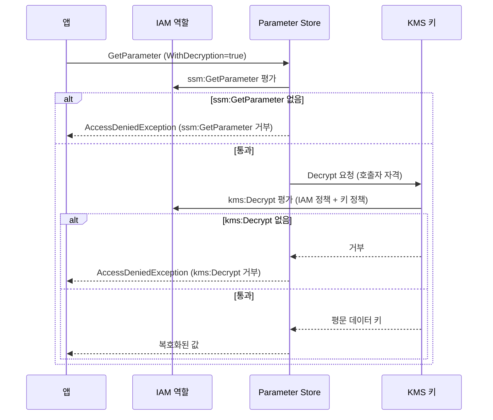
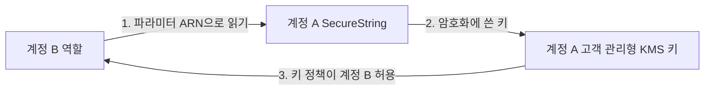
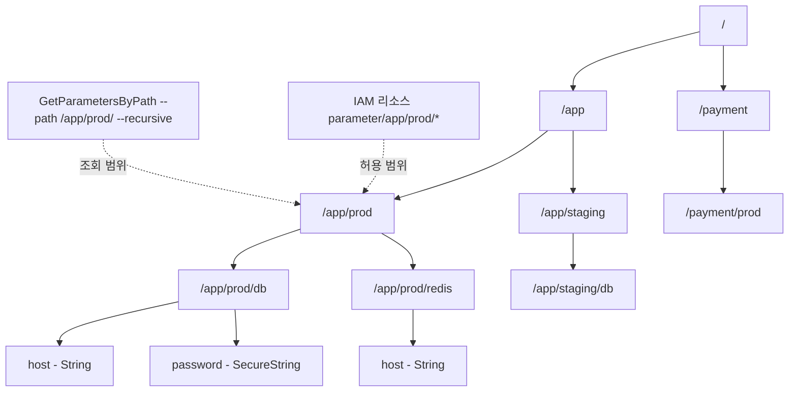
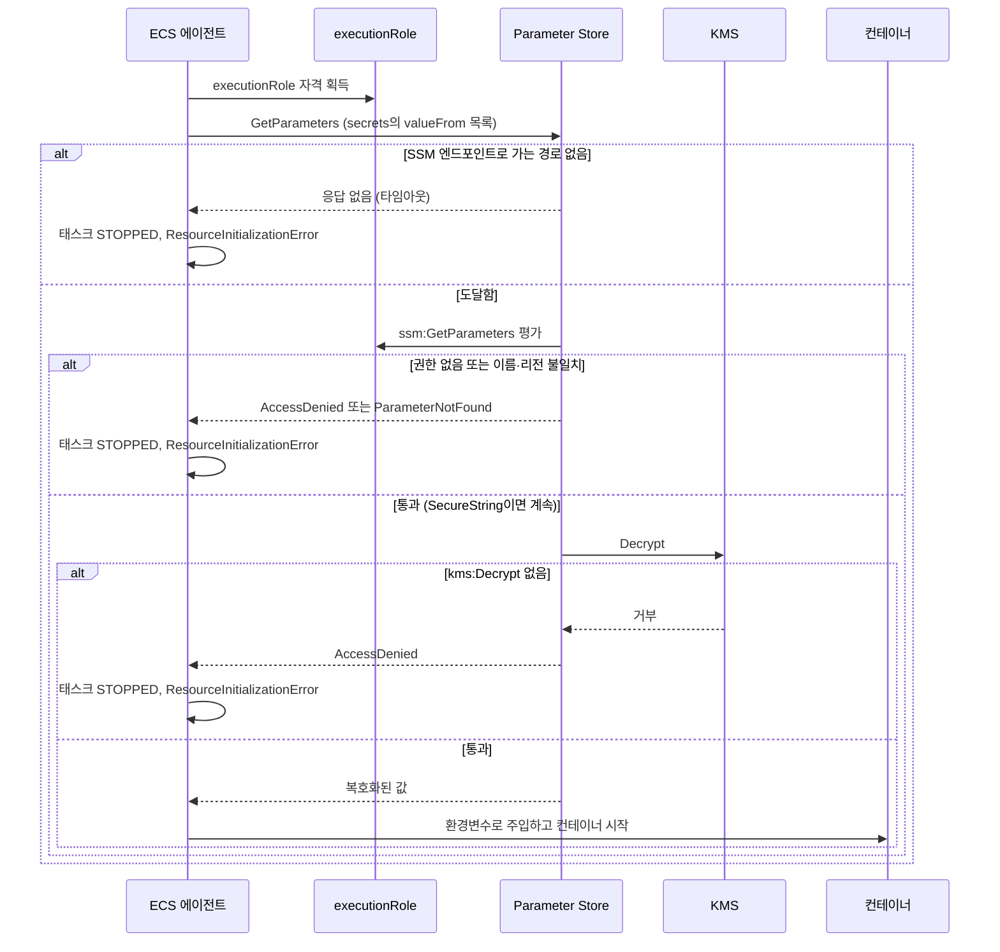
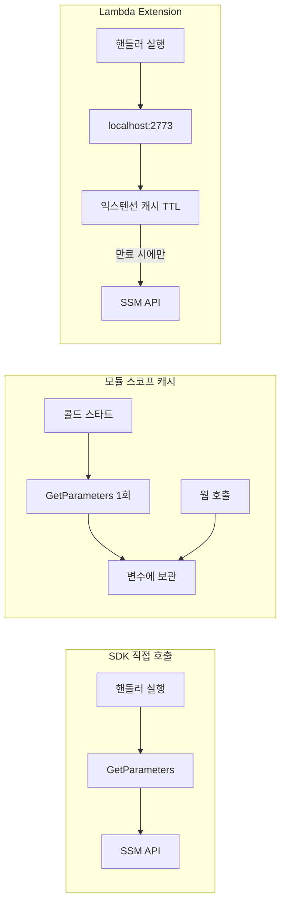
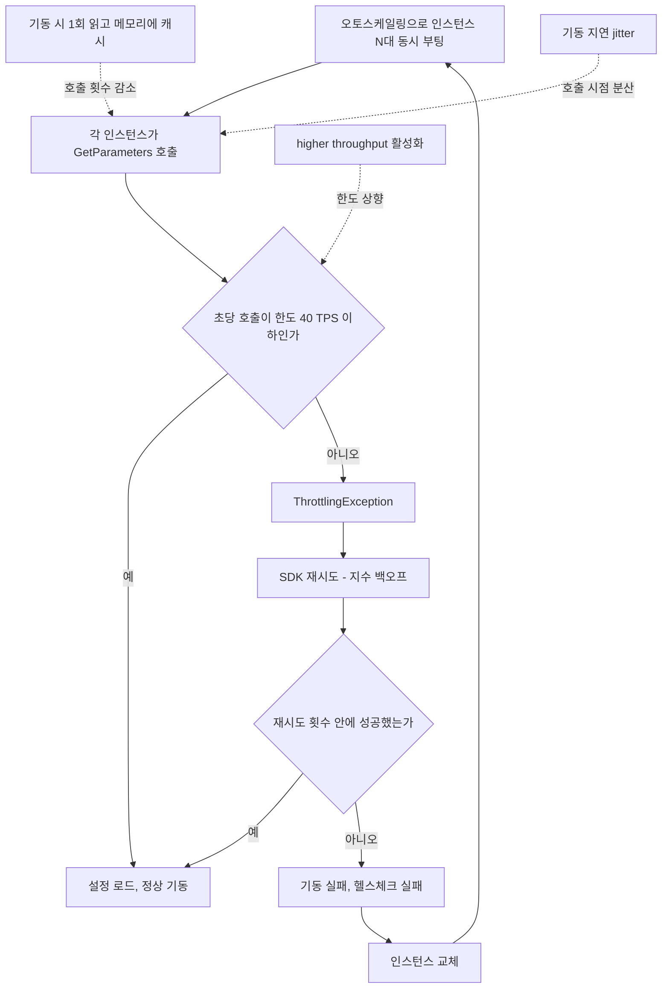

# SSM Parameter Store

설정값과 비밀값을 한 군데 모아두고 애플리케이션이 런타임에 읽어가게 하는 서비스다. RDS 엔드포인트, API 키, 외부 서비스 토큰처럼 환경마다 달라지는 값을 코드나 `.env` 파일에 박지 않고 여기에 넣는다. 이름이 `SSM`(Systems Manager) 하위 기능이라 처음 보면 Run Command나 Session Manager 같은 것들과 묶여 있어 헷갈리는데, Parameter Store는 그 안에서 독립적으로 쓰이는 키-값 저장소다.

비슷한 일을 하는 Secrets Manager가 따로 있어서 둘을 두고 매번 고민하게 된다. 결론부터 말하면 자동 로테이션이 꼭 필요한 게 아니면 Parameter Store로 충분하고, 비용도 0원이다. 선택 기준은 아래에서 따로 정리한다.

---

## Standard와 Advanced 파라미터

파라미터를 만들 때 티어를 고른다. 처음 시작하면 Standard로 충분하지만 한도를 넘기는 순간 Advanced로 올려야 한다.

| 구분 | Standard | Advanced |
|------|----------|----------|
| 값 크기 | 4KB | 8KB |
| 계정·리전당 개수 | 10,000개 | 100,000개 |
| 파라미터 정책(만료, 변경 알림) | 불가 | 가능 |
| 비용 | 무료 | 파라미터당 월 $0.05 + API 호출 과금 |
| 처리량(higher throughput) | 옵션으로 켜야 함 | 기본 포함 |

Standard는 무료지만 한 계정 한 리전에서 10,000개를 넘으면 더 못 만든다. 마이크로서비스가 늘고 환경(dev/staging/prod)이 갈리면서 파라미터가 의외로 빨리 쌓인다. 서비스 30개 × 환경 3개 × 파라미터 20개면 벌써 1,800개다. 10,000개에 닿기 전에 경로 설계를 잘 해두는 게 낫다.

값 크기 4KB는 짧아 보여도 인증서 PEM 전체를 넣으려다 막히는 경우가 있다. 인증서나 큰 JSON 설정은 8KB Advanced로도 모자랄 수 있으니 그런 건 S3에 두고 경로만 파라미터에 넣는 식으로 우회한다.

티어는 한 번 Advanced로 올리면 Standard로 못 내린다(값 크기가 4KB를 넘었을 수 있으니 당연하다). 그래서 처음부터 다 Advanced로 만드는 사람도 있는데, 파라미터당 월 $0.05가 개수 늘면 무시 못 한다. 필요한 것만 올린다.

`Intelligent-Tiering`이라는 설정이 있어서, 값이 4KB를 넘거나 정책을 붙이는 순간 자동으로 Advanced로 승격시켜준다. 어느 게 Advanced여야 하는지 일일이 신경 쓰기 싫으면 이걸 켜둔다.

```bash
# 계정·리전 기본 티어를 Intelligent-Tiering으로
aws ssm update-service-setting \
  --setting-id /ssm/parameter-store/default-parameter-tier \
  --setting-value Intelligent-Tiering
```

---

## 한도에 걸렸을 때 나타나는 증상

Standard의 한도는 값 4KB와 계정·리전당 10,000개다. 한도에 닿으면 서비스가 죽는 게 아니라 **쓰기만 실패한다.** 이미 있는 파라미터는 계속 읽히니 앱은 멀쩡하고, 배포 파이프라인이나 IaC가 먼저 깨진다.

| 걸린 한도 | 나타나는 증상 | 앱 영향 |
|---|---|---|
| 값 4KB 초과 (Standard) | `put-parameter`가 거부된다. 덮어쓰기라면 이전 버전이 그대로 남는다 | 옛 값을 계속 읽는다. 값을 바꿨다고 믿고 배포하면 설정이 안 바뀐 채 나간다 |
| 10,000개 도달 (Standard) | 새 이름 생성이 `ParameterLimitExceeded`로 실패한다 | 신규 서비스·신규 환경 생성만 막힌다 |
| 값 8KB 초과 (Advanced) | 같은 방식으로 거부된다. 티어를 더 올릴 곳이 없다 | S3 경로 참조로 바꿔야 한다 |

값 크기 쪽이 더 늦게 발견된다. 파이프라인이 `put-parameter` 실패를 무시하면(`|| true`) 성공한 줄 알고 넘어가기 때문이다. 인증서 체인을 갱신하다 4KB를 넘겨서 옛 인증서가 계속 나가는 사고가 이 경로로 난다.

개수 한도는 Intelligent-Tiering으로 두면 Standard가 가득 찼을 때 새 파라미터를 Advanced로 만들어 주니 막히지 않는다. 대신 그 시점부터 파라미터당 월 $0.05가 붙는다. 막히는 쪽이 나은지 과금이 나은지는 팀이 정할 일이고, 어느 쪽이든 안 쓰는 파라미터를 주기적으로 지우는 편이 싸다.

### 빈 문자열은 넣을 수 없다

파라미터 값은 비어 있을 수 없다. AWS CLI는 `--value ""`를 로컬에서 막지 않고 서버까지 보낸다(botocore 입력 모델에 `Value`의 최소 길이 제약이 없다). 거부는 서비스가 한다. "값 없음"이 의미 있는 설정, 예를 들어 프록시 주소를 비워서 프록시를 끄는 경우에는 센티널 값을 정해둔다.

```bash
# 비어 있음을 뜻하는 값으로 "-" 를 약속하고 앱에서 빈 문자열로 바꿔 읽는다
aws ssm put-parameter --name "/app/prod/http/proxy" --value "-" --type String
```

```javascript
const proxy = config["/app/prod/http/proxy"];
const effectiveProxy = proxy === "-" ? "" : proxy;
```

값에 `{{ssm:다른이름}}` 처럼 이중 중괄호로 다른 파라미터를 참조하는 것도 안 된다. API 문서에 파라미터 값 안에서 다른 파라미터를 참조하거나 중첩할 수 없다고 적혀 있다.

---

## 파라미터 정책 (Advanced 전용)

만료와 변경 알림은 Advanced에만 붙는다. Standard 파라미터에 `--policies`를 주려면 `--tier Advanced`를 같이 줘야 하고, 기본 티어가 Intelligent-Tiering이면 정책을 붙이는 순간 자동으로 Advanced가 된다. 정책은 세 종류다.

| 정책 | 하는 일 |
|---|---|
| `Expiration` | 지정한 시각이 되면 파라미터를 **삭제한다** |
| `ExpirationNotification` | 만료 N일(또는 N시간) 전에 EventBridge 이벤트를 낸다 |
| `NoChangeNotification` | 지정한 기간 동안 값이 안 바뀌면 이벤트를 낸다 |

```bash
aws ssm put-parameter \
  --name "/app/prod/payment/api-key" \
  --value "sk_live_xxxx" \
  --type SecureString \
  --tier Advanced \
  --overwrite \
  --policies '[
    {"Type":"Expiration","Version":"1.0","Attributes":{"Timestamp":"2027-03-31T00:00:00.000Z"}},
    {"Type":"ExpirationNotification","Version":"1.0","Attributes":{"Before":"14","Unit":"Days"}},
    {"Type":"NoChangeNotification","Version":"1.0","Attributes":{"After":"90","Unit":"Days"}}
  ]'
```

`Expiration`은 알림이 아니라 삭제다. 만료 시각에 파라미터가 사라지고 이후 읽기는 `ParameterNotFound`가 된다. 임시 토큰처럼 진짜 지워져야 하는 값에는 맞지만, 외부 API 키처럼 만료돼도 앱이 읽어야 하는 값에 `Expiration`만 걸어두면 만료일에 장애가 난다. 알림 없이 쓰지 않는다. `ExpirationNotification`을 짝으로 붙이고, 이벤트를 받을 EventBridge 규칙을 먼저 만들어 둔다.

`NoChangeNotification`은 로테이션을 사람이 하는 비밀값에서 쓸모가 있다. Parameter Store에는 자동 로테이션이 없으니 "90일째 안 바뀌었다"는 이벤트를 받아 담당자에게 알리는 식으로 로테이션 누락을 잡는다.

한 파라미터에 정책은 최대 10개고, 같은 종류를 둘 넣으면(`Expiration` 두 개 등) `IncompatiblePolicyException`이 난다. 값을 덮어써도 `Expiration` 시각은 그대로다. 만료를 늦추려면 정책을 다시 넣어야 한다.

---

## 파라미터 타입 — String, StringList, SecureString

타입은 세 가지다.

- `String` — 평문 문자열 하나. 엔드포인트, 포트, 피처 플래그 같은 안 민감한 값.
- `StringList` — 콤마로 구분된 문자열 목록. `a.example.com,b.example.com` 처럼 저장하면 읽을 때 리스트로 다룰 수 있다. 단 값 자체에 콤마가 들어가면 깨지니 주의한다.
- `SecureString` — KMS로 암호화해서 저장하는 값. 비밀번호, API 키, 토큰은 전부 이걸 쓴다.

```bash
# 평문
aws ssm put-parameter \
  --name "/app/prod/db/host" \
  --value "prod-db.cluster-xxxx.ap-northeast-2.rds.amazonaws.com" \
  --type String

# 리스트
aws ssm put-parameter \
  --name "/app/prod/allowed-origins" \
  --value "https://app.example.com,https://admin.example.com" \
  --type StringList

# 암호화 (KMS 기본 키 aws/ssm 사용)
aws ssm put-parameter \
  --name "/app/prod/db/password" \
  --value "S3cr3t-P@ss" \
  --type SecureString
```

SecureString을 만들면 KMS 키로 값을 암호화한다. `--key-id`를 안 주면 계정 기본 키인 `alias/aws/ssm`을 쓴다. 기본 키는 무료지만 키 정책을 내가 못 건드린다. 크로스 계정 접근이나 키 단위 권한 분리가 필요하면 고객 관리형 키(CMK)를 만들어서 지정한다.

```bash
aws ssm put-parameter \
  --name "/app/prod/payment/api-key" \
  --value "sk_live_xxxx" \
  --type SecureString \
  --key-id "alias/app-prod-secrets"
```

읽을 때 SecureString은 기본적으로 암호문 그대로 나온다. 복호화하려면 `--with-decryption`을 붙여야 하고, 그러면 호출자 IAM이 해당 KMS 키에 `kms:Decrypt` 권한을 가지고 있어야 한다. 권한이 없으면 파라미터는 읽히는데 값이 안 풀리는 상황이 생긴다. SecureString을 못 읽겠다고 할 때 십중팔구 KMS 권한 문제다.

```bash
aws ssm get-parameter \
  --name "/app/prod/db/password" \
  --with-decryption \
  --query "Parameter.Value" --output text
```

SecureString 읽기는 호출자 권한이 두 번 평가된다. SSM이 `ssm:GetParameter`를 보고, 통과하면 SSM이 호출자 자격으로 KMS에 `Decrypt`를 요청해 `kms:Decrypt`를 한 번 더 본다. 도식은 고객 관리형 키 기준이고, 어느 단계에서 막히느냐에 따라 에러 문구가 다르다.



어느 쪽에서 막혔는지는 에러 메시지에 들어 있는 거부된 액션(`ssm:GetParameter`인지 `kms:Decrypt`인지)으로 가린다. 에러를 로그에 찍을 때 메시지를 자르지 않아야 바로 보인다. `--with-decryption` 없이 읽으면 KMS 호출 자체가 없으니 암호문이 그대로 나온다. 이 상태로 읽혀서 "읽기는 되는데 값이 이상하다"로 시간을 쓰는 경우가 있다.

### aws/ssm 기본 키와 고객 관리형 키

`--key-id`를 생략하면 AWS 관리형 키 `alias/aws/ssm`을 쓴다. 두 선택은 비용보다 **키 정책을 내가 고칠 수 있느냐**에서 갈린다.

| 항목 | `aws/ssm` (AWS 관리형) | 고객 관리형 키 |
|---|---|---|
| 키 비용 | 없음 | 키당 월 $1 안팎 + KMS 요청 과금 |
| 키 정책 수정 | 불가 | 가능 |
| 다른 계정 principal의 복호화 | 불가 | 키 정책에 상대 계정을 허용하면 가능 |
| 키 단위 권한 분리 | 불가 | 키별 정책·grant로 가능 |
| 삭제·비활성화 | 불가 | 가능. 비활성화하면 그 키로 만든 SecureString이 전부 안 읽힌다 |

교차 계정이 걸리면 사실상 고객 관리형 키만 가능하다. 계정 B의 역할이 계정 A의 SecureString을 읽으려면 세 가지가 맞아야 한다.



1. 파라미터 자체를 공유해야 한다. 공유는 Advanced 티어만 되고(Resource Access Manager 사용), 읽는 쪽은 짧은 이름이 아니라 전체 ARN으로 요청한다.
2. 계정 A의 키 정책이 계정 B 역할(또는 계정)에 `kms:Decrypt`를 허용해야 한다.
3. 계정 B 역할의 IAM 정책에도 그 키 ARN에 대한 `kms:Decrypt`가 있어야 한다.

`aws/ssm`으로 만든 SecureString은 2번을 만들 방법이 없다. 이미 `aws/ssm`으로 수백 개를 만들어 놓고 교차 계정이 필요해진 경우, 값을 읽어서 고객 관리형 키로 새로 만드는 수밖에 없다. 그래서 다계정 구조가 예상되면 처음부터 고객 관리형 키를 지정한다.

### 같은 이름의 타입은 바꿀 수 없다

String으로 만든 파라미터를 SecureString으로, 반대로 SecureString을 String으로 `--overwrite`해서 바꾸는 건 안 된다. API 오류 목록에 `HierarchyTypeMismatchException`이 있고 설명이 "타입 변경은 지원하지 않는다, 새 이름으로 만들라"다. 비밀번호를 처음에 String으로 넣었다가 뒤늦게 SecureString으로 바꾸려는 경우가 흔하다.

같은 이름을 유지해야 하면 삭제 후 재생성이다.

```bash
# 값을 파일이 아니라 셸 변수에만 둔다
PW=$(aws ssm get-parameter --name "/app/prod/db/password" --with-decryption \
  --query "Parameter.Value" --output text)

aws ssm delete-parameter --name "/app/prod/db/password"
aws ssm put-parameter --name "/app/prod/db/password" \
  --value "$PW" --type SecureString --key-id "alias/app-prod-secrets"
unset PW
```

삭제하면 **버전 이력과 라벨이 전부 사라진다.** 1번부터 다시 시작하고, `production` 라벨도 새로 달아야 한다. 삭제와 재생성 사이에는 그 이름이 없어서 읽는 쪽이 `ParameterNotFound`를 받는다. 이 틈을 피하려면 새 이름(`/app/prod/db/password-v2`)으로 SecureString을 만들고, 앱의 참조를 옮긴 뒤 옛 이름을 지운다. 이름이 코드에 박혀 있으면 이 방법도 배포가 한 번 필요하다.

---

## 계층 경로 설계

파라미터 이름은 `/`로 구분하는 경로 형태로 짓는다. 단순히 보기 좋으라고 하는 게 아니라, 경로가 IAM 권한 분리와 일괄 조회의 단위가 되기 때문에 처음부터 신중히 정한다.

자주 쓰는 형태는 `/{app}/{env}/{group}/{key}`다.

```
/app/prod/db/host
/app/prod/db/password
/app/prod/redis/host
/app/staging/db/host
/payment/prod/stripe/secret-key
```

같은 경로가 두 군데에서 경계로 쓰인다. IAM 정책의 리소스 ARN 와일드카드와 `GetParametersByPath`의 `--path`다. 도식에서 `/app/prod` 노드가 두 역할을 동시에 한다.



`/app/prod` 아래만 허용하는 정책이면 `/app/staging`과 `/payment`는 같은 계정에 있어도 읽히지 않는다. 같은 경로를 `--path`로 주면 그 아래 전부가 한 번에 내려온다.

이렇게 두면 `GetParametersByPath`로 prefix 하나를 통째로 읽을 수 있다. 애플리케이션이 부팅할 때 `/app/prod/`만 재귀로 긁어오면 그 환경 설정이 전부 들어온다.

```bash
aws ssm get-parameters-by-path \
  --path "/app/prod/" \
  --recursive \
  --with-decryption
```

경로 설계에서 실수하는 부분이 환경 위치다. `/db/prod/...` 처럼 env를 안쪽에 두면 "prod 환경 전체"를 IAM으로 묶기가 어려워진다. env를 앞쪽 레벨에 두면 `/app/prod/*` 한 줄로 prod 권한을 통제할 수 있다. 환경 격리가 권한의 첫 번째 경계이므로 env를 app 바로 다음에 두는 편이 관리하기 편하다.

이름은 만든 뒤 못 바꾼다. 바꾸려면 새로 만들고 지워야 하는데 그러면 버전 이력이 끊긴다. 경로 규칙은 팀에서 합의하고 시작한다.

---

## Secrets Manager와의 선택 기준

둘 다 비밀값을 암호화해서 저장하고 IAM·KMS로 보호한다. 갈리는 지점은 명확하다.

| 항목 | Parameter Store (SecureString) | Secrets Manager |
|------|-------------------------------|-----------------|
| 비용 | Standard 무료 | 비밀당 월 $0.40 + API 호출 과금 |
| 자동 로테이션 | 없음 (직접 구현) | Lambda 기반 내장 |
| RDS/Redshift 통합 로테이션 | 없음 | 기본 제공 |
| 크로스 리전 복제 | 없음 (직접 복사) | 기본 제공 |
| 값 크기 | 4KB / 8KB | 64KB |

자동 로테이션이 필요 없고 비용을 아끼려면 **Parameter Store**다. RDS 자격증명을 주기적으로 자동 교체해야 한다거나, 로테이션 Lambda를 직접 짜기 싫으면 Secrets Manager를 쓴다.

비밀 100개를 Secrets Manager에 두면 월 $40이지만 Parameter Store SecureString이면 0원이다(KMS 기본 키 사용 시). 스타트업 초기엔 이 차이가 크다. 그래서 로테이션이 강제되는 DB 비밀번호만 Secrets Manager에 두고 나머지 API 키·설정은 Parameter Store에 두는 식으로 섞어 쓰는 경우가 많다.

서비스별 본질적 차이와 KMS와의 관계는 [Secrets Manager vs KMS](../Security/Secrets_Manager_vs_KMS.md)와 [Secrets Manager](../Security/Secrets_Manager.md)에 더 자세히 정리해뒀다.

---

## ECS Task Definition에 주입

ECS에서 컨테이너 환경변수로 파라미터를 넣을 때 `secrets` 필드를 쓴다. `environment`에 값을 직접 박으면 Task Definition JSON에 평문이 남아 콘솔에서 다 보인다. `secrets`로 넣으면 ECS가 태스크 시작 시점에 Parameter Store에서 값을 읽어 컨테이너 환경변수로 꽂아준다. SecureString은 자동으로 복호화된다.

```json
{
  "containerDefinitions": [
    {
      "name": "api",
      "secrets": [
        {
          "name": "DB_PASSWORD",
          "valueFrom": "arn:aws:ssm:ap-northeast-2:123456789012:parameter/app/prod/db/password"
        },
        {
          "name": "DB_HOST",
          "valueFrom": "/app/prod/db/host"
        }
      ]
    }
  ]
}
```

`valueFrom`은 전체 ARN이나 파라미터 이름 둘 다 받는다. 여기서 두 가지 IAM 권한이 필요하다. 태스크 실행 역할(`executionRole`)에 `ssm:GetParameters`가 있어야 하고, SecureString이면 KMS `kms:Decrypt`도 있어야 한다. 둘 중 하나라도 빠지면 태스크가 `ResourceInitializationError`로 죽는다. 컨테이너 로그도 안 남고 태스크가 바로 멈추니 처음엔 원인 찾기가 까다롭다. 이 에러를 보면 실행 역할 권한부터 확인한다.

주입은 컨테이너가 뜨기 전에 ECS 에이전트가 한다. 앱 코드는 아직 실행되지 않은 시점이고, 쓰는 자격은 태스크 역할(`taskRole`)이 아니라 실행 역할이다. 도식에서 실패 지점이 세 군데로 갈린다.



세 가지 중 네트워크가 가장 늦게 의심된다. 프라이빗 서브넷의 Fargate 태스크는 NAT 게이트웨이나 `ssm` 인터페이스 VPC 엔드포인트가 없으면 SSM에 닿지 못하고 같은 에러로 멈춘다. 이 경우 IAM은 완벽하다. 이벤트 메시지에 `i/o timeout`이 보이면 권한이 아니라 경로 문제다. 값은 태스크 시작 시점에 한 번 읽혀 환경변수로 굳기 때문에, 파라미터를 바꿔도 이미 떠 있는 태스크에는 반영되지 않는다. 새 값은 태스크를 다시 띄워야 들어간다.

ECS 비밀 주입의 세부 동작은 [ECS Secrets 관리](../Containers/ECS_Secrets_관리.md)에 더 있다.

---

## Lambda에서 읽기

Lambda는 ECS 같은 `secrets` 주입 필드가 없어서 코드에서 직접 SDK로 읽거나, Lambda Extension(AWS Parameters and Secrets Lambda Extension)을 붙여 로컬 캐시 엔드포인트로 읽는다.

SDK로 직접 읽는 기본 형태:

```javascript
import { SSMClient, GetParametersCommand } from "@aws-sdk/client-ssm";

const ssm = new SSMClient({});

// 핸들러 바깥에서 한 번만 읽어 캐시 (콜드 스타트 1회만 호출)
let cachedConfig;

async function loadConfig() {
  if (cachedConfig) return cachedConfig;

  const res = await ssm.send(new GetParametersCommand({
    Names: [
      "/app/prod/db/host",
      "/app/prod/db/password",
    ],
    WithDecryption: true,
  }));

  cachedConfig = Object.fromEntries(
    res.Parameters.map(p => [p.Name, p.Value])
  );
  return cachedConfig;
}

export const handler = async (event) => {
  const config = await loadConfig();
  // config["/app/prod/db/password"] 사용
};
```

핸들러 안에서 매번 `GetParameters`를 호출하면 호출량이 폭발한다. 트래픽 많은 Lambda면 throttling에 걸린다. 핸들러 바깥(모듈 스코프)에서 한 번 읽어 변수에 담아두면 같은 실행 환경이 살아있는 동안 재사용된다. 다만 이러면 파라미터를 바꿔도 기존 실행 환경은 옛 값을 계속 쓴다. 값이 자주 바뀐다면 TTL을 둬서 일정 시간마다 다시 읽는다.

Lambda Extension을 쓰면 익스텐션이 파라미터를 캐시하고 `http://localhost:2773`로 로컬 HTTP 엔드포인트를 열어준다. 코드에서 SDK 대신 이 로컬 주소로 요청하면 캐시된 값을 받는다. 캐시 TTL은 환경변수로 조절한다.

세 방식을 한 장으로 놓고 보면 SSM API를 치는 횟수가 갈린다. 도식의 오른쪽 끝(`SSM API`)에 닿는 빈도를 보라.



| 방식 | SSM API 호출 | 값이 바뀌었을 때 | 코드 부담 |
|---|---|---|---|
| SDK 직접 호출 | 호출 1회당 1번 | 즉시 반영 | 낮음, 대신 throttling에 가장 약함 |
| 모듈 스코프 캐시 | 실행 환경당 1번 | 그 실행 환경이 죽을 때까지 옛 값 | TTL을 직접 구현해야 한다 |
| Lambda Extension | TTL당 1번 | TTL 만료 후 반영 | 레이어 추가, HTTP 호출 |

Extension은 요청에 세션 토큰 헤더를 요구해서 `fetch`로 부를 때 `AWS_SESSION_TOKEN`을 넣어야 한다.

```javascript
const name = encodeURIComponent("/app/prod/db/password");
const res = await fetch(
  `http://localhost:2773/systemsmanager/parameters/get?name=${name}&withDecryption=true`,
  { headers: { "X-Aws-Parameters-Secrets-Token": process.env.AWS_SESSION_TOKEN } }
);
const { Parameter } = await res.json();
```

모듈 스코프 캐시는 동시성이 높으면 실행 환경 수만큼 읽는다. 동시 실행 500개가 뜨는 순간 콜드 스타트가 500번 SSM을 친다. 이 구간에서 throttling이 가장 잘 난다.

---

## 버전 관리와 라벨

`put-parameter`로 같은 이름에 값을 덮어쓰면(`--overwrite`) 새 버전이 생긴다. 버전은 1부터 정수로 올라가고 이전 값이 남는다. 잘못 바꿨을 때 되돌릴 수 있다.

```bash
# 버전 지정 조회
aws ssm get-parameter --name "/app/prod/db/password:3"

# 버전 이력 보기
aws ssm get-parameter-history --name "/app/prod/db/password"
```

문제는 버전 번호가 배포할 때마다 바뀐다는 거다. "지금 prod가 쓰는 버전"을 코드에서 숫자로 박을 수 없다. 그래서 라벨을 붙인다. 라벨은 특정 버전을 가리키는 별칭이라, 검증 끝난 버전에 `production`이라는 라벨을 달아두고 애플리케이션은 항상 `이름:production`을 읽게 한다.

```bash
# 5번 버전에 production 라벨 달기
aws ssm label-parameter-version \
  --name "/app/prod/db/password" \
  --parameter-version 5 \
  --labels production

# 라벨로 조회
aws ssm get-parameter \
  --name "/app/prod/db/password:production" \
  --with-decryption
```

새 값을 넣고 검증한 뒤 라벨만 옮기면 애플리케이션 코드 변경 없이 전환되고, 문제가 생기면 라벨을 이전 버전으로 다시 옮겨 즉시 롤백한다. 라벨 하나는 동시에 한 버전만 가리키므로 옮기면 자동으로 이전 버전에서 떨어진다.

버전은 최근 100개까지만 남는다. 101번째를 만들면 가장 오래된 버전이 지워지는데, 라벨이 붙은 버전은 지워지지 않는다. 라벨 붙은 버전이 100개를 채운 상태에서 값을 또 바꾸려 하면 `ParameterMaxVersionLimitExceeded`로 실패하니, 안 쓰는 라벨은 `unlabel-parameter-version`으로 떼어 둔다.

---

## Throttling과 캐싱

기본 throughput 한도가 낮다. `GetParameters`는 기본 40 TPS다. 인스턴스 100대가 부팅하면서 동시에 파라미터를 긁으면 `ThrottlingException`이 터진다. 오토스케일링으로 한꺼번에 뜰 때 자주 겪는다.

도식은 동시 부팅이 어떻게 장애를 키우는지 보여준다. 실패한 인스턴스가 교체되면서 부팅이 또 몰리는 되먹임이 핵심이다.



점선이 대응이다. 캐시는 호출 횟수를, higher throughput은 한도를, jitter는 시점을 건드린다. 세 가지는 서로 다른 지점을 막으니 섞어 쓸 수 있다.

대응은 세 가지다.

첫째, 매 요청마다 읽지 말고 애플리케이션 기동 시 한 번 읽어 메모리에 캐시한다. 설정값은 요청마다 바뀌지 않으니 부팅 때 `GetParametersByPath`로 한 번에 받아 들고 있는다. `GetParameters`는 한 번에 최대 10개까지 받으니 개수가 많으면 경로 조회를 쓴다.

둘째, throughput 한도를 올린다. Advanced 파라미터이거나 Standard에서 higher throughput 옵션을 켜면 호출 한도가 올라간다. 다만 이건 호출 건당 과금이 붙으니 캐싱으로 먼저 줄이고 그래도 모자라면 켠다.

```bash
aws ssm update-service-setting \
  --setting-id /ssm/parameter-store/high-throughput-enabled \
  --setting-value true
```

셋째, SDK 호출에 지수 백오프 재시도를 둔다. AWS SDK 기본 재시도가 어느 정도 막아주지만, 동시 부팅이 몰리면 기본값으로 부족할 수 있어 재시도 횟수를 늘리거나 기동 시점을 살짝 흩뿌린다(jitter).

순간 폭주가 아니라 평상시 읽기량 자체가 많다면 설계가 잘못된 거다. Parameter Store는 자주 읽는 캐시가 아니라 가끔 읽는 설정 저장소로 본다.

---

## IAM 경로 기반 권한 분리

경로를 잘 설계하는 진짜 이유가 여기 있다. IAM 정책의 리소스 ARN에 와일드카드를 쓰면 경로 단위로 권한을 끊을 수 있다.

prod 서비스 역할이 prod 파라미터만 읽게 하는 정책:

```json
{
  "Version": "2012-10-17",
  "Statement": [
    {
      "Effect": "Allow",
      "Action": ["ssm:GetParameters", "ssm:GetParametersByPath"],
      "Resource": "arn:aws:ssm:ap-northeast-2:123456789012:parameter/app/prod/*"
    },
    {
      "Effect": "Allow",
      "Action": ["kms:Decrypt"],
      "Resource": "arn:aws:kms:ap-northeast-2:123456789012:key/xxxx-key-id"
    }
  ]
}
```

이러면 prod 역할은 staging 파라미터(`/app/staging/*`)를 못 읽는다. 환경을 경로 앞쪽에 둔 설계가 여기서 값을 한다. env가 경로 안쪽에 있으면 이런 와일드카드 분리가 안 된다.

주의할 점이 ARN 경로 표기다. 파라미터 이름이 `/app/prod/db/host`면 ARN은 `parameter/app/prod/db/host`로 슬래시가 하나로 이어진다. `parameter//app...`처럼 슬래시를 두 개 쓰면 매칭이 안 돼서 권한이 안 먹는다. 권한이 분명히 맞는데 AccessDenied가 나면 이 슬래시부터 확인한다.

SecureString을 읽는 역할이면 KMS `kms:Decrypt`를 빼먹지 않는다. 앞서 말했듯 SSM 권한만 있고 KMS 권한이 없으면 파라미터는 읽히는데 복호화에서 막힌다. 두 권한은 항상 짝으로 본다.

`GetParametersByPath` 권한을 줄 때는 해당 경로뿐 아니라 그 prefix 자체에 대한 권한이 필요하니, `/app/prod/*`처럼 별표를 붙여 하위 전체를 포함시킨다.

---

## 정리

설정과 비밀값은 Parameter Store에 모으고, 안 민감한 값은 String, 비밀값은 SecureString으로 둔다. 경로는 `/{app}/{env}/{group}/{key}` 형태로 env를 앞쪽에 두어 IAM과 일괄 조회의 경계로 삼는다. 자동 로테이션이 필요하면 그 비밀만 Secrets Manager로 보내고 나머지는 Parameter Store에 둬서 비용을 0원으로 유지한다. 읽기는 기동 시 한 번 캐시해서 40 TPS throttling을 피하고, 배포 전환은 라벨로 처리해 롤백을 빠르게 한다. 쓰기 쪽 제약은 미리 알아둔다. Standard의 4KB·10,000개, 빈 값 불가, 타입 변경 불가, `aws/ssm` 키의 교차 계정 불가는 모두 운영 중에 발견하면 값을 지우고 다시 만들어야 하는 종류다.
