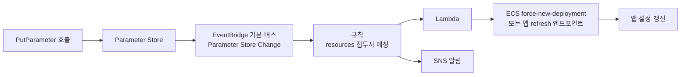
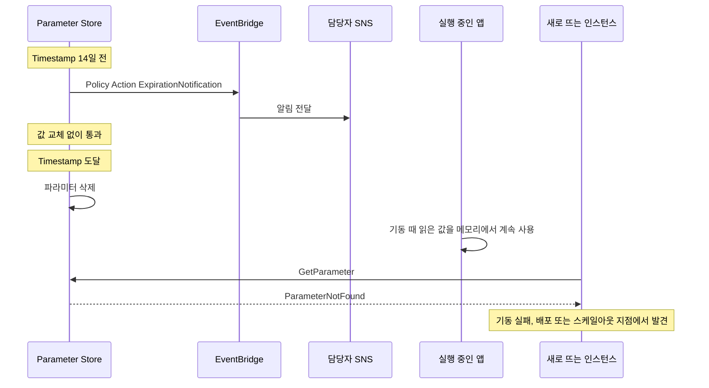
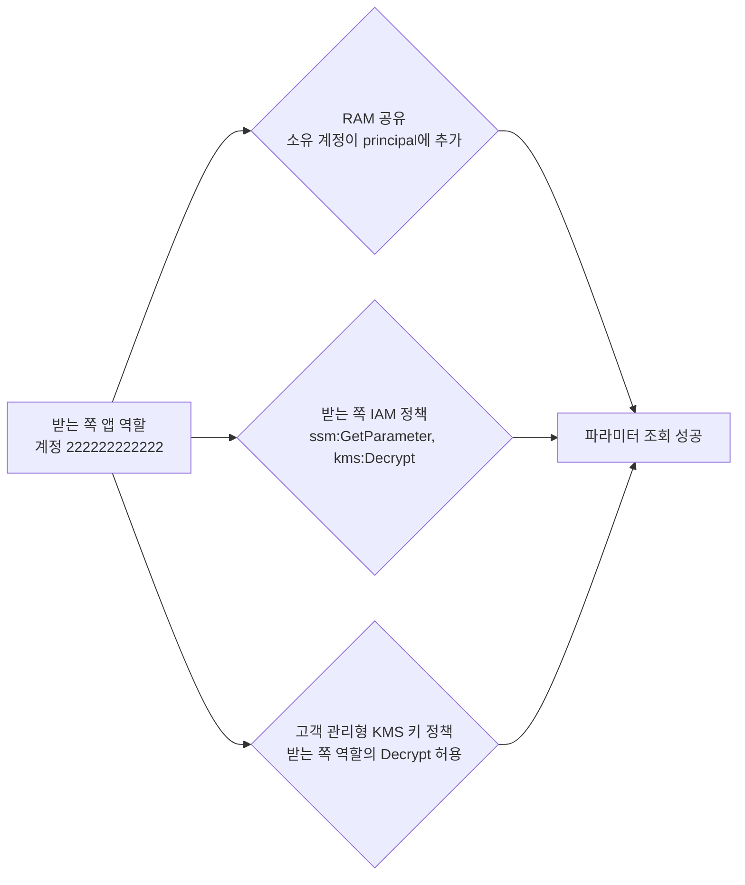

# Parameter Store 변경 감지와 만료 운영

[SSM Parameter Store](SSM_Parameter_Store.md)에 값을 넣는 방법과 티어·정책의 기본은 그 문서에 있다. 여기서는 값이 바뀌거나 사라지는 순간을 다룬다. 누가 바꿨는지, 바뀐 값이 실행 중인 앱에 닿는지, 만료로 지워진 값이 장애를 내지 않는지, 다른 계정에 공유할 때 무엇이 막히는지를 본다.

## 변경 이벤트를 EventBridge로 받기

Parameter Store는 파라미터를 만들거나 바꾸거나 지울 때, 그리고 라벨을 붙일 때 기본 이벤트 버스로 이벤트를 보낸다. 별도 설정은 필요 없고 규칙만 만들면 된다. 흐름은 아래 도식과 같다. PutParameter 한 번이 규칙을 거쳐 Lambda와 SNS 두 갈래로 나간다.



이벤트 패턴은 `/app/prod/` 아래만 좁힌다. 라벨 이동은 `Update`가 아니라 `LabelParameterVersion`으로 오기 때문에 operation에 같이 넣어야 한다. `production` 라벨을 옮겨서 배포하는 구조인데 `Update`만 받고 있으면 승격이 이벤트에 안 잡힌다.

```json
{
  "source": ["aws.ssm"],
  "detail-type": ["Parameter Store Change"],
  "resources": [{"prefix": "arn:aws:ssm:ap-northeast-2:123456789012:parameter/app/prod/"}],
  "detail": {
    "operation": ["Create", "Update", "Delete", "LabelParameterVersion"]
  }
}
```

```bash
aws events put-rule --name ssm-prod-change \
  --event-pattern file://pattern.json

aws events put-targets --rule ssm-prod-change \
  --targets "Id=refresh,Arn=arn:aws:lambda:ap-northeast-2:123456789012:function:config-refresh"

aws lambda add-permission --function-name config-refresh \
  --statement-id events-ssm --action lambda:InvokeFunction \
  --principal events.amazonaws.com \
  --source-arn arn:aws:events:ap-northeast-2:123456789012:rule/ssm-prod-change
```

콘솔과 달리 CLI로 규칙을 만들면 `add-permission`을 직접 해야 한다. 빼먹으면 규칙은 매칭되는데 Lambda가 호출되지 않고 에러도 조용하다. 규칙의 `FailedInvocations` 지표로 확인한다.

패턴의 필드명은 처음 한 번 실제 이벤트로 확인한다. Lambda에서 `print(json.dumps(event))`만 찍는 규칙을 먼저 달아 두고 `detail`의 키를 눈으로 본 뒤 패턴을 좁힌다. 이벤트는 최소 한 번 전달 보장이라 같은 이벤트가 두 번 올 수 있고, 처리 로직은 멱등이어야 한다.

## 만료 정책이 실제로 지우는 시점

`Expiration`, `ExpirationNotification`, `NoChangeNotification`의 문법은 [파라미터 정책](SSM_Parameter_Store.md) 절에 있다. 정책이 내는 이벤트는 `Parameter Store Change`가 아니라 `Parameter Store Policy Action`이라는 별도 detail-type이다. 변경 규칙에 같이 묶으려다 알림이 안 오는 경우가 있으니 규칙을 따로 만든다. 정책 종류는 `detail`의 `policy-type`으로 가른다.

```json
{
  "source": ["aws.ssm"],
  "detail-type": ["Parameter Store Policy Action"]
}
```

시간 순서가 중요하다. 통지는 만료 전에 오고, 삭제는 `Timestamp` 시각에 일어난다. 통지를 놓치면 삭제 이후에야 문제가 드러난다.



도식에서 짚을 곳은 App과 New의 차이다. 기동 시 한 번 읽어 캐시하는 앱은 만료로 값이 지워져도 죽지 않는다. 장애는 다음 배포나 스케일아웃이 일어나는 날로 미뤄지고, 그 시점에는 만료와 아무 관련 없는 배포가 원인처럼 보인다. ECS에서 `secrets`로 주입하는 구조라면 태스크가 PROVISIONING을 못 넘기고 stopped reason에 secrets 조회 실패가 남는다. 롤백해도 옛 이미지가 같은 파라미터를 읽으니 롤백으로 안 풀린다.

삭제 시각은 정각으로 믿지 않는다. 문서는 지정 시각에 삭제한다고만 하고 지연 상한은 보장하지 않으니, 교체 작업은 `Timestamp`보다 최소 하루 앞에 끝낸다. 삭제된 파라미터는 `DeleteParameter`와 같아서 버전 이력도 함께 사라진다고 보고 대응한다. 값은 CloudTrail의 PutParameter 기록에도 없으니 원본을 따로 보관해야 복구된다.

만료를 늦추는 방법은 정책을 다시 넣는 것이다. 정책 배열은 통째로 교체되므로 유지할 정책을 전부 다시 적는다. 정책을 전부 없애려면 `--policies "[]"`를 준다.

```bash
aws ssm put-parameter --name /app/prod/payment/api-key \
  --type SecureString --tier Advanced --overwrite \
  --value "$NEW_KEY" \
  --policies '[
    {"Type":"Expiration","Version":"1.0","Attributes":{"Timestamp":"2027-09-30T00:00:00.000Z"}},
    {"Type":"ExpirationNotification","Version":"1.0","Attributes":{"Before":"14","Unit":"Days"}}
  ]'
```

## 바꿨는데 앱이 옛 값을 쓸 때

값을 바꾸는 것과 앱이 새 값을 쓰는 것은 다른 일이다. 반영 방식은 셋 중 하나를 고른다.

| 방식 | 반영 지연 | Parameter Store 호출량 | 걸리는 곳 |
|---|---|---|---|
| TTL 재조회 | 최대 TTL만큼 | 인스턴스 수 ÷ TTL초 TPS | 조회 실패 시 옛 값을 유지하는 코드가 필요 |
| 이벤트 기반 갱신 | 수 초 | 변경할 때만 | 이벤트가 누락되면 영원히 옛 값 |
| 롤링 재배포 | 배포 시간 | 기동 때 1회 | 배포 중 신구 값 혼재 |

TTL은 가장 단순하다. 인스턴스 200대에 TTL 60초면 약 3.3 TPS라 기본 한도에 여유가 있다. TTL을 같은 값으로 고정하면 호출이 같은 초에 몰리니 jitter를 섞는다. 다만 DB 비밀번호처럼 커넥션 풀을 만들 때만 쓰는 값은 메모리 값만 바꿔서는 풀이 새 값을 안 쓴다.

이벤트 기반은 반영이 빠르지만 단독으로 믿지 않는다. 규칙이 꺼졌거나 Lambda가 실패하면 알아챌 방법이 없어서, TTL을 느슨하게(10분 정도) 안전망으로 같이 둔다. 아래 핸들러는 변경 이벤트를 받아 서비스를 재배포하고 정책 이벤트는 SNS로 넘긴다.

```python
import json, os, boto3

ecs = boto3.client("ecs")
sns = boto3.client("sns")
SERVICES = {"/app/prod/": ("prod-cluster", "app-prod")}

def handler(event, context):
    print(json.dumps(event))
    if event["detail-type"] == "Parameter Store Policy Action":
        sns.publish(TopicArn=os.environ["TOPIC_ARN"],
                    Subject="Parameter Store 정책 이벤트",
                    Message=json.dumps(event["detail"], ensure_ascii=False))
        return
    name = event["detail"]["name"]
    for prefix, (cluster, service) in SERVICES.items():
        if name.startswith(prefix) and event["detail"]["operation"] != "Delete":
            ecs.update_service(cluster=cluster, service=service,
                               forceNewDeployment=True)
```

파라미터를 연달아 여러 개 바꾸면 이벤트도 그만큼 와서 재배포가 겹친다. 배포 파이프라인이 한 번에 10개를 넣는 경우를 생각해, SQS 지연 큐나 Step Functions의 짧은 대기로 합치는 구성을 고려한다. 핸들러가 같은 경로에 다시 쓰기를 하면 이벤트가 이벤트를 부르니 쓰기는 하지 않는다.

롤링 재배포는 값이 시작 시점에 바인딩되는 경우에 맞다. ECS `secrets` 주입이 그렇다. 태스크가 뜰 때 한 번 읽으니 `update-service --force-new-deployment`를 해야 바뀐다.

## CloudTrail과 KMS 로그로 호출자 추적

Parameter Store 호출은 관리 이벤트라 기본으로 CloudTrail 이벤트 기록(90일)에 남는다. `PutParameter`의 `requestParameters.value`는 `HIDDEN_DUE_TO_SECURITY_REASONS`로 가려진다. 값은 못 보고 누가 언제 어디서 호출했는지만 본다. `lookup-events`는 속성을 하나만 받으니 이벤트 이름으로 좁힌 뒤 파라미터 이름은 jq로 거른다.

```bash
aws cloudtrail lookup-events --region ap-northeast-2 \
  --lookup-attributes AttributeKey=EventName,AttributeValue=PutParameter \
  --start-time 2026-11-13T00:00:00Z \
  --query 'Events[].CloudTrailEvent' --output json \
  | jq -r '.[]' \
  | jq -c 'select(.requestParameters.name=="/app/prod/db/password")
           | {t:.eventTime, who:.userIdentity.arn, ip:.sourceIPAddress, ua:.userAgent}'
```

읽기는 이름이 갈린다. `GetParameter`는 `requestParameters.name`, `GetParameters`는 `names` 배열, `GetParametersByPath`는 `path`에 들어간다. 이름 하나로만 거르면 배열·경로 조회가 빠진다. 90일을 넘겨 봐야 하면 S3 트레일을 Athena로 조회한다.

SecureString을 복호화해 읽으면 로그가 두 줄 남는다. SSM의 `GetParameter`와 KMS의 `Decrypt`다. KMS 쪽에는 파라미터 이름이 `requestParameters`가 아니라 암호화 컨텍스트에 들어간다. 필요한 필드만 남기면 이렇게 생겼다.

```json
{
  "eventSource": "kms.amazonaws.com",
  "eventName": "Decrypt",
  "userIdentity": {
    "type": "AssumedRole",
    "arn": "arn:aws:sts::123456789012:assumed-role/app-prod-role/i-0abc",
    "invokedBy": "ssm.amazonaws.com"
  },
  "sourceIPAddress": "ssm.amazonaws.com",
  "requestParameters": {
    "encryptionContext": {
      "PARAMETER_ARN": "arn:aws:ssm:ap-northeast-2:123456789012:parameter/app/prod/db/password"
    }
  }
}
```

호출자는 앱 역할로 찍히고 `invokedBy`가 `ssm.amazonaws.com`이다. 앱이 KMS를 직접 부른 게 아니라 SSM이 대신 부른 기록이다. 따라서 `PARAMETER_ARN`으로 어떤 파라미터가 복호화됐는지 보고, 같은 시각의 SSM `GetParameter`와 맞춰 본다. 고객 관리형 키는 요청 수만큼 KMS 요금이 붙으니 TTL 캐시가 비용도 줄인다.

## 다른 계정에 Advanced 파라미터 공유

공유는 AWS RAM으로 한다. Standard 파라미터는 공유할 수 없어서 Advanced로 올려야 하고, 한 번 Advanced로 올린 파라미터는 되돌릴 수 없다. SecureString은 고객 관리형 키여야 한다. `aws/ssm` 기본 키는 키 정책을 못 고쳐서 다른 계정이 복호화할 수 없다. 공유는 같은 리전 안에서만 되고, 받는 쪽은 읽기만 한다.

```bash
aws ssm put-parameter --name /shared/db/host --overwrite \
  --type SecureString --key-id alias/shared-config \
  --tier Advanced --value "db.internal.example.com"

aws ram create-resource-share --name shared-config \
  --resource-arns arn:aws:ssm:ap-northeast-2:111111111111:parameter/shared/db/host \
  --principals 222222222222
```

RAM 공유가 붙어도 읽히지 않는다. 세 곳이 각각 허용해야 하고 하나라도 비면 AccessDenied다.



세 허용은 AND 관계다. 받는 쪽 IAM 정책의 Resource에는 소유 계정의 파라미터 ARN을 적는다. 자기 계정 번호로 쓴 ARN은 매칭되지 않는다. 소유 계정의 키 정책에는 받는 쪽 역할을 허용하는 문장을 넣는다.

```json
{
  "Sid": "AllowConsumerDecryptViaSSM",
  "Effect": "Allow",
  "Principal": {"AWS": "arn:aws:iam::222222222222:role/app-prod-role"},
  "Action": "kms:Decrypt",
  "Resource": "*",
  "Condition": {
    "StringLike": {
      "kms:EncryptionContext:PARAMETER_ARN": "arn:aws:ssm:ap-northeast-2:111111111111:parameter/shared/*"
    }
  }
}
```

암호화 컨텍스트 조건은 앞 절의 `PARAMETER_ARN`과 같은 키다. 조건을 넣으면 그 역할이 이 경로 밖 파라미터를 복호화하지 못한다.

받는 쪽은 이름이 아니라 ARN 전체로 조회한다. 이름만 쓰면 자기 계정에서 같은 이름을 찾다가 `ParameterNotFound`가 난다.

```bash
aws ssm get-parameter --with-decryption \
  --name arn:aws:ssm:ap-northeast-2:111111111111:parameter/shared/db/host

aws ssm describe-parameters --shared
```

경로 단위 일괄 조회에 기대지 말고 필요한 ARN 목록을 `get-parameters`로 받는다.
