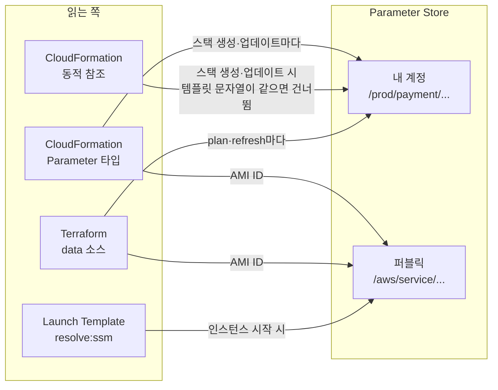
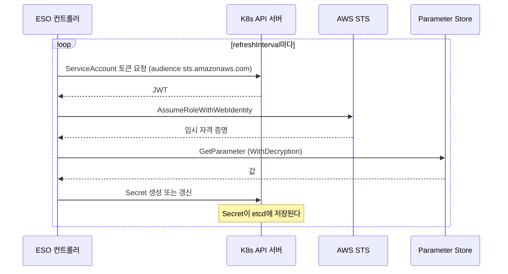
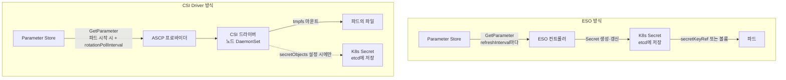

# Parameter Store를 IaC·EKS·빌드 파이프라인에서 읽기

ECS와 Lambda에서 읽는 방법은 [SSM Parameter Store](SSM_Parameter_Store.md)에 있다. 여기서는 CloudFormation, Terraform, 퍼블릭 AMI 파라미터, EKS, CodeBuild를 다룬다. 경로마다 값이 정해지는 시점이 달라서, 모르면 "바꿨는데 안 바뀐다"나 "안 바꿨는데 바뀌었다"가 나온다.

## 경로별로 값이 정해지는 시점

읽는 쪽 네 곳과 Parameter Store 두 갈래(내 계정, `/aws/service/...` 퍼블릭)를 이었다. 화살표 라벨이 값을 읽는 시점이다.




## CloudFormation

### Parameter 타입

`AWS::SSM::Parameter::Value<String>` 타입 파라미터의 Default에는 값이 아니라 파라미터 이름을 넣는다. 스택을 만들거나 업데이트할 때 CloudFormation이 이름으로 값을 조회해 `ResolvedValue`로 기록하며 `describe-stacks`에서 보인다. 템플릿을 안 바꿔도 SSM 값이 달라졌으면 업데이트 때 새 값이 들어간다. SecureString은 못 읽는다.

```yaml
AWSTemplateFormatVersion: "2010-09-09"
Parameters:
  AmiId:
    Type: AWS::SSM::Parameter::Value<AWS::EC2::Image::Id>
    Default: /aws/service/ami-amazon-linux-latest/al2023-ami-kernel-default-x86_64
  DbHost:
    Type: AWS::SSM::Parameter::Value<String>
    Default: /prod/payment/db/host
Resources:
  NodeTemplate:
    Type: AWS::EC2::LaunchTemplate
    Properties:
      LaunchTemplateName: payment-node
      LaunchTemplateData:
        ImageId: !Ref AmiId
        InstanceType: m6i.large
        UserData:
          Fn::Base64: !Sub |
            #!/bin/bash
            echo "DB_HOST=${DbHost}" >> /etc/app.env
  Database:
    Type: AWS::RDS::DBInstance
    Properties:
      Engine: postgres
      DBInstanceClass: db.m6i.large
      AllocatedStorage: "100"
      MasterUsername: app
      MasterUserPassword: "{{resolve:ssm-secure:/prod/payment/db/master-password:3}}"
```

### 동적 참조

`{{resolve:ssm:이름:버전}}`은 속성 값 자리에 직접 쓴다. 이쪽은 CloudFormation이 템플릿 문자열을 이전 템플릿과 비교해 변경 여부를 판단한다. 버전을 생략하면 SSM에서 값이 바뀌어도 템플릿 문자열은 그대로라서 리소스가 갱신되지 않는다. 스택은 `UPDATE_COMPLETE`인데 값은 옛 값이다. 버전을 `:3`처럼 박고 값을 올릴 때 `:4`로 고치면 변경 세트에 diff가 남아 리뷰도 된다.

### ssm-secure를 쓸 수 있는 자리

`ssm-secure`는 SecureString 전용이고, `AWS::RDS::DBInstance`의 `MasterUserPassword`, `AWS::IAM::User`의 `LoginProfile.Password`처럼 문서에 나열된 속성만 받는다. Lambda 환경변수는 목록에 없다. `ssm`(평문)으로 넣으면 콘솔과 `GetFunction` 응답에 그대로 보이므로 비밀값은 Lambda 코드가 직접 읽게 한다. CloudFormation은 SecureString을 만들지도 못한다. `AWS::SSM::Parameter`는 String과 StringList만 된다.

## 최신 AMI ID 가져오기

퍼블릭 파라미터에 AWS가 최신 AMI ID를 넣어 둔다.

```bash
# Amazon Linux 2023
/aws/service/ami-amazon-linux-latest/al2023-ami-kernel-default-x86_64

# EKS 노드용 AMI. 경로에 쿠버네티스 마이너 버전이 들어간다
/aws/service/eks/optimized-ami/1.30/amazon-linux-2023/x86_64/standard/recommended/image_id
```

퍼블릭 파라미터의 IAM 리소스는 `arn:aws:ssm:ap-northeast-2::parameter/aws/service/*`로 계정 ID 자리가 비어 있다. 내 계정 ARN 패턴으로 쓰면 AccessDenied가 난다.

그대로 쓰면 배포 때마다 AMI가 바뀐다. CloudFormation Parameter 타입은 환경변수 하나 바꾸는 업데이트에도 새 AMI ID를 넣어 Launch Template 새 버전이 생기고, ASG에 롤링 정책이 있으면 노드가 전부 교체된다. Launch Template의 `ImageId`에 `resolve:ssm:/aws/service/...`(중괄호 없음, EC2가 직접 해석)를 쓰면 스택은 안 움직이지만 스케일 아웃으로 뜬 노드만 새 AMI가 되어 한 ASG 안에 AMI가 섞인다.

그래서 내 계정 파라미터로 복사해 두고 그것을 참조한다.

```bash
AMI=$(aws ssm get-parameter \
  --name /aws/service/eks/optimized-ami/1.30/amazon-linux-2023/x86_64/standard/recommended/image_id \
  --query Parameter.Value --output text)

aws ssm put-parameter --name /platform/ami/eks-node-1-30 \
  --type String --data-type aws:ec2:image --value "$AMI" --overwrite
```

`--data-type aws:ec2:image`는 값이 실재하는 AMI ID인지 SSM이 검사하게 한다.

## Terraform

`aws_ssm_parameter` 리소스는 파라미터를 만들고 값을 관리한다. `data "aws_ssm_parameter"`는 이미 있는 값을 plan 시점에 읽기만 한다. 아직 없는 파라미터를 data로 읽으면 plan에서 실패하므로, 같은 구성에서 만드는 값은 리소스 참조로 받는다.

```hcl
data "aws_ssm_parameter" "eks_ami" {
  name = "/platform/ami/eks-node-1-30"
}

resource "aws_launch_template" "node" {
  name_prefix   = "eks-node-"
  image_id      = data.aws_ssm_parameter.eks_ami.value
  instance_type = "m6i.large"
}
```

SecureString 값은 리소스든 data든 state에 평문으로 남는다. `sensitive`는 CLI 출력만 가린다. `sensitive = true` 변수를 `terraform_data`에 넣고 apply한 뒤 `terraform.tfstate`를 grep하면 값이 두 군데 그대로 나온다.

| 방법 | 동작 | 제약 |
|---|---|---|
| `ignore_changes = [value]` + 자리표시 값 | Terraform은 껍데기만 만들고 실제 값은 CLI나 파이프라인이 넣는다 | 자리표시 값은 state에 남지만 비밀이 아니다 |
| `value_wo` + `value_wo_version` | 쓰기 전용 인자라서 plan·state에 저장되지 않는다 | Terraform 1.11 이상, provider 5.100.0에서 확인. 값을 바꾸려면 버전 숫자를 올려야 한다 |
| `ephemeral "aws_ssm_parameter"` | 읽은 값이 state에 안 남고 `value_wo`나 provider 설정에만 넘길 수 있다 | 키는 이름이 아니라 `arn` |

```hcl
variable "api_token" {
  type      = string
  ephemeral = true
  sensitive = true
}

resource "aws_ssm_parameter" "api_token" {
  name             = "/prod/payment/api/token"
  type             = "SecureString"
  key_id           = aws_kms_key.ssm.arn
  value_wo         = var.api_token
  value_wo_version = 1
}

resource "aws_ssm_parameter" "db_password" {
  name   = "/prod/payment/db/password"
  type   = "SecureString"
  key_id = aws_kms_key.ssm.arn
  value  = "CHANGE_ME"

  lifecycle {
    ignore_changes = [value]
  }
}
```

state에 이미 들어간 평문은 소급해서 지워지지 않으니 그 값은 로테이션한다. S3 백엔드는 SSE-KMS로 암호화하고 읽기 권한을 plan·apply 역할로 좁힌다.

## EKS에서 읽기

External Secrets Operator(ESO)는 값을 K8s Secret으로 복사하고, Secrets Store CSI Driver의 AWS 프로바이더(ASCP)는 파드 볼륨에 파일로 마운트한다.

### External Secrets Operator

ESO 컨트롤러가 Parameter Store를 읽어 Secret을 만들거나 갱신한다. STS 교환부터 Secret 쓰기까지가 refreshInterval마다 반복된다.



```yaml
apiVersion: v1
kind: ServiceAccount
metadata:
  name: eso-ssm-reader
  namespace: payment
  annotations:
    eks.amazonaws.com/role-arn: arn:aws:iam::111122223333:role/payment-eso-ssm-reader
---
apiVersion: external-secrets.io/v1
kind: SecretStore
metadata:
  name: aws-ssm
  namespace: payment
spec:
  provider:
    aws:
      service: ParameterStore
      region: ap-northeast-2
      auth:
        jwt:
          serviceAccountRef:
            name: eso-ssm-reader
---
apiVersion: external-secrets.io/v1
kind: ExternalSecret
metadata:
  name: payment-db
  namespace: payment
spec:
  refreshInterval: 15m
  secretStoreRef:
    name: aws-ssm
    kind: SecretStore
  target:
    name: payment-db
    creationPolicy: Owner
  data:
    - secretKey: DB_PASSWORD
      remoteRef:
        key: /prod/payment/db/password
```

오래된 ESO는 `v1beta1`이다. `kubectl get crd secretstores.external-secrets.io -o jsonpath='{.spec.versions[*].name}'`로 확인한다.

IRSA 역할은 신뢰 정책의 `sub`를 SA 단위로 좁힌다.

```json
{
  "Version": "2012-10-17",
  "Statement": [{
    "Effect": "Allow",
    "Principal": {"Federated": "arn:aws:iam::111122223333:oidc-provider/oidc.eks.ap-northeast-2.amazonaws.com/id/EXAMPLED539D4633E53DE1B71EXAMPLE"},
    "Action": "sts:AssumeRoleWithWebIdentity",
    "Condition": {"StringEquals": {
      "oidc.eks.ap-northeast-2.amazonaws.com/id/EXAMPLED539D4633E53DE1B71EXAMPLE:sub": "system:serviceaccount:payment:eso-ssm-reader",
      "oidc.eks.ap-northeast-2.amazonaws.com/id/EXAMPLED539D4633E53DE1B71EXAMPLE:aud": "sts.amazonaws.com"
    }}
  }]
}
```

권한 정책에는 `ssm:GetParameter`, `ssm:GetParameters`, `ssm:GetParametersByPath`를 `arn:aws:ssm:ap-northeast-2:111122223333:parameter/prod/payment/*`로 주고, 고객 관리형 키면 `kms:Decrypt`를 더한다.

`refreshInterval` 기본값은 1시간이다. 값을 바꿨는데 Secret이 안 바뀌면 대개 주기가 안 지난 것이다. Secret이 갱신돼도 `secretKeyRef` 환경변수는 파드를 재시작해야 반영되고, 볼륨은 kubelet 동기화만큼 늦게 바뀐다. 주기를 줄이면 키마다 GetParameter가 나가므로 키가 수백 개면 스로틀링을 본다.

`ClusterSecretStore` 역할이 읽는 경로는 ExternalSecret을 만들 수 있는 모든 사용자가 읽는다. 네임스페이스별 SecretStore와 역할로 나눈다.

### Secrets Store CSI Driver (ASCP)

```yaml
apiVersion: secrets-store.csi.x-k8s.io/v1
kind: SecretProviderClass
metadata:
  name: payment-ssm
  namespace: payment
spec:
  provider: aws
  parameters:
    objects: |
      - objectName: "/prod/payment/db/password"
        objectType: "ssmparameter"
        objectAlias: db-password
---
apiVersion: apps/v1
kind: Deployment
metadata:
  name: payment
  namespace: payment
spec:
  replicas: 2
  selector:
    matchLabels: {app: payment}
  template:
    metadata:
      labels: {app: payment}
    spec:
      serviceAccountName: payment-app
      containers:
        - name: app
          image: 111122223333.dkr.ecr.ap-northeast-2.amazonaws.com/payment:1.0.0
          volumeMounts:
            - name: secrets
              mountPath: /mnt/secrets
              readOnly: true
      volumes:
        - name: secrets
          csi:
            driver: secrets-store.csi.k8s.io
            readOnly: true
            volumeAttributes:
              secretProviderClass: payment-ssm
```

```bash
helm repo add secrets-store-csi-driver https://kubernetes-sigs.github.io/secrets-store-csi-driver/charts
helm install csi-secrets-store secrets-store-csi-driver/secrets-store-csi-driver \
  -n kube-system --set enableSecretRotation=true --set rotationPollInterval=2m
kubectl apply -f https://raw.githubusercontent.com/aws/secrets-store-csi-driver-provider-aws/main/deployment/aws-provider-installer.yaml
```

ASCP는 마운트하는 파드 자신의 ServiceAccount 역할로 조회하므로 앱마다 읽을 경로를 나눈다. 로테이션은 기본이 꺼져 있고, 켜면 2분 간격으로 파일이 갱신되지만 `subPath` 마운트는 갱신되지 않는다. 마운트 때 값을 못 읽으면 파드가 `ContainerCreating`에 걸리고 `FailedMount` 이벤트가 남는다.

### 두 방식의 경로와 차이



| 항목 | ESO | CSI Driver (ASCP) |
|---|---|---|
| 파드가 받는 형태 | K8s Secret (환경변수, 볼륨) | 파일 볼륨 |
| etcd에 값이 저장되는가 | 항상 | `secretObjects`를 쓸 때만 |
| SSM 호출 횟수 | 키 수와 refreshInterval로 결정 | 파드 수와 rotationPollInterval로 결정 |
| 값이 없을 때 | Secret이 안 만들어져 `CreateContainerConfigError` | `ContainerCreating`, `FailedMount` |
| 권한 단위 | 스토어의 SA | 파드의 SA |

ESO는 Secret을 etcd에 쓰므로 `get secret` 권한만 있으면 base64로 값이 보인다. 내 KMS 키로 봉투 암호화를 걸려면 클러스터에 `encryptionConfig`를 따로 켜야 하고, 그래도 RBAC로 읽는 사람에게는 평문이다. 파일로만 주면 되는 값은 ASCP, 환경변수나 Ingress TLS처럼 Secret이 꼭 필요한 값은 ESO를 쓴다. ASCP도 `secretObjects`를 켜면 같은 노출이 생긴다.

## CodeBuild와 CodePipeline

buildspec의 `env.parameter-store` 블록은 환경변수 이름과 파라미터 이름을 짝짓는다. 값은 빌드 시작 때 한 번 읽으며, 서비스 역할에 `ssm:GetParameters`와 SecureString이면 `kms:Decrypt`가 필요하다. 이름 오타나 권한 부족이면 첫 단계에서 실패한다.

```yaml
version: 0.2
env:
  parameter-store:
    DB_HOST: /prod/payment/db/host
    NPM_TOKEN: /ci/payment/npm-token
phases:
  install:
    commands:
      - echo "//registry.npmjs.org/:_authToken=${NPM_TOKEN}" > ~/.npmrc
  build:
    commands:
      - npm ci
      - DOCKER_BUILDKIT=1 docker build --secret id=npmrc,src=$HOME/.npmrc -t payment:$CODEBUILD_RESOLVED_SOURCE_VERSION .
```

CodePipeline의 CodeBuild 액션은 `EnvironmentVariables`의 `type`을 `PARAMETER_STORE`로 준다. 빼면 PLAINTEXT라서 파라미터 이름 문자열이 그대로 값이 된다.

```json
{
  "ProjectName": "payment-build",
  "EnvironmentVariables": "[{\"name\":\"NPM_TOKEN\",\"value\":\"/ci/payment/npm-token\",\"type\":\"PARAMETER_STORE\"}]"
}
```

로그 마스킹은 값 전체가 문자열로 일치할 때만 `****`로 바꾼다. `echo $NPM_TOKEN`은 가려지지만 `echo $NPM_TOKEN | base64`, `${NPM_TOKEN:0:8}`, URL 인코딩한 값은 그대로 찍힌다. `--build-arg`로 넘긴 값은 로그에서 가려져도 `docker history`에 남으므로 위 예제처럼 `--secret`으로 넘긴다.

관련 문서: [CodeBuild](../CICD/CodeBuild.md), [CodePipeline](../CICD/CodePipeline.md), [EKS](../Containers/EKS.md), [Secrets Manager vs KMS](../Security/Secrets_Manager_vs_KMS.md)
