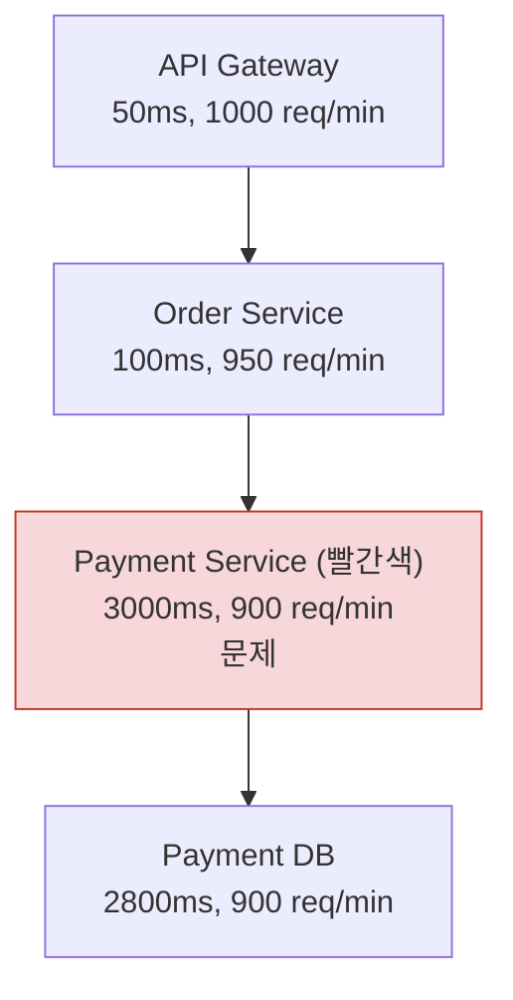

# AWS X-Ray

## 개요

X-Ray는 분산 애플리케이션을 추적하는 서비스다. 요청이 여러 서비스를 거치는 경로를 시각화한다. 각 서비스의 응답 시간과 에러를 추적한다. 병목 구간을 찾는다. 마이크로서비스 환경에서 필수다.

### 왜 필요한가

마이크로서비스는 여러 서비스로 나뉘어 있다. 하나의 요청이 여러 서비스를 거친다.

사용자가 주문 API를 호출한다. 응답 시간이 5초다. 어디가 느린지 모른다.

호출은 API Gateway 뒤에서 세 갈래로 나뉜다.

```
Client → API Gateway → Order Service → Payment Service → DB
                     → Inventory Service → DB
                     → Notification Service → SNS → Email
```

서비스마다 남기는 로그는 이렇다.

- Order Service: "Payment API called"
- Payment Service: "Processing payment"
- Inventory Service: "Checking stock"

이 로그들로는 흐름을 잇기 어렵다.

- 로그가 분산되어 있다
- 전체 흐름을 파악하기 어렵다
- 어느 구간이 느린지 알 수 없다
- 요청 ID로 로그를 연결해야 한다 (번거롭다)

X-Ray는 이 문제를 이렇게 푼다.

- 전체 요청 경로를 시각화
- 각 서비스의 응답 시간 표시
- 병목 구간 자동 탐지
- 에러 발생 위치 확인

Service Map에서는 서비스별 응답 시간이 한눈에 보인다.

```
API Gateway (50ms)
  → Order Service (100ms)
      → Payment Service (3000ms) ← 병목!
      → Inventory Service (200ms)
      → Notification Service (500ms)
```

Payment Service가 느리다는 것을 즉시 파악한다.

## 핵심 개념

### Trace

하나의 요청에 대한 전체 경로다. 요청이 시작부터 끝까지 거치는 모든 서비스를 포함한다.

Trace ID는 요청을 고유하게 식별한다. 모든 서비스가 같은 Trace ID를 사용한다.

Trace ID 예시는 `1-5e9a6c8f-7d8e4c3b2a1f0e9d8c7b6a5f`이다.

### Segment

하나의 서비스 또는 리소스에 대한 작업이다. Trace는 여러 Segment로 구성된다.

한 Trace는 이런 Segment로 이뤄질 수 있다.

- Segment 1: API Gateway
- Segment 2: Lambda Function
- Segment 3: DynamoDB Query

### Subsegment

Segment 내의 세부 작업이다. SQL 쿼리, HTTP 호출, 외부 API 호출 등을 추적한다.

Order Service Segment 내에서:
- Subsegment 1: Parse request
- Subsegment 2: Validate order
- Subsegment 3: Query database
- Subsegment 4: Call Payment API

### Annotations

검색 가능한 키-값 쌍이다. 필터링과 그룹화에 사용한다.

요청에 붙이는 Annotation은 이런 모양이다.

```javascript
{
  "user_id": "user_123",
  "order_type": "express",
  "region": "us-west-2"
}
```

`order_type=express`인 요청만 필터링할 수 있다.

### Metadata

검색할 수 없는 추가 정보다. 디버깅에 유용하다.

Metadata는 이런 모양이다.

```javascript
{
  "order_details": {
    "items": 5,
    "total": 150.00,
    "shipping_address": "..."
  }
}
```

## 설정

### Lambda 함수

#### Node.js

```javascript
const AWSXRay = require('aws-xray-sdk-core');
const AWS = AWSXRay.captureAWS(require('aws-sdk'));

exports.handler = async (event) => {
  // Lambda는 자동으로 X-Ray에 통합됨
  const segment = AWSXRay.getSegment();
  
  // Subsegment 생성
  const subsegment = segment.addNewSubsegment('ProcessOrder');
  
  try {
    // DynamoDB 호출 (자동 추적)
    const dynamodb = new AWS.DynamoDB.DocumentClient();
    await dynamodb.put({
      TableName: 'Orders',
      Item: { orderId: '123', status: 'pending' }
    }).promise();
    
    // Annotation 추가
    subsegment.addAnnotation('order_type', 'express');
    
    // Metadata 추가
    subsegment.addMetadata('order', { id: '123', amount: 100 });
    
    subsegment.close();
    
    return { statusCode: 200, body: 'Success' };
  } catch (error) {
    subsegment.addError(error);
    subsegment.close();
    throw error;
  }
};
```

#### 환경 변수 설정

Lambda 콘솔에서 X-Ray 추적 활성화.

#### Python

```python
from aws_xray_sdk.core import xray_recorder
from aws_xray_sdk.core import patch_all

patch_all()

def lambda_handler(event, context):
    segment = xray_recorder.current_segment()
    
    # Subsegment
    with xray_recorder.capture('process_order'):
        # 작업 수행
        order_id = process_order(event)
        
        # Annotation
        xray_recorder.put_annotation('order_id', order_id)
        
        # Metadata
        xray_recorder.put_metadata('order_details', {'amount': 100})
    
    return {'statusCode': 200}
```

### Express (Node.js)

#### 미들웨어 설치

```bash
npm install aws-xray-sdk
```

#### 설정

```javascript
const AWSXRay = require('aws-xray-sdk-core');
const express = require('express');

// Express 캡처
const app = express();
AWSXRay.captureHTTPsGlobal(require('http'));
AWSXRay.captureHTTPsGlobal(require('https'));

// 미들웨어 추가
app.use(AWSXRay.express.openSegment('OrderService'));

app.get('/orders/:id', async (req, res) => {
  const segment = AWSXRay.getSegment();
  
  // Subsegment: DB 조회
  const subseg1 = segment.addNewSubsegment('QueryDatabase');
  try {
    const order = await db.query('SELECT * FROM orders WHERE id = ?', [req.params.id]);
    subseg1.close();
    
    // Subsegment: 외부 API 호출
    const subseg2 = segment.addNewSubsegment('GetPaymentStatus');
    const payment = await axios.get(`https://payment-api.com/status/${order.payment_id}`);
    subseg2.close();
    
    res.json({ order, payment: payment.data });
  } catch (error) {
    subseg1.addError(error);
    subseg1.close();
    res.status(500).json({ error: error.message });
  }
});

app.use(AWSXRay.express.closeSegment());

app.listen(3000);
```

#### Daemon 실행

X-Ray Daemon을 EC2에 설치한다.

```bash
# Amazon Linux 2
sudo yum install -y aws-xray-daemon
sudo systemctl start xray
sudo systemctl enable xray
```

### ECS/Fargate

X-Ray Daemon 컨테이너를 추가한 Task Definition이다.

```json
{
  "family": "my-app",
  "containerDefinitions": [
    {
      "name": "app",
      "image": "my-app:latest",
      "portMappings": [
        {
          "containerPort": 3000
        }
      ],
      "environment": [
        {
          "name": "AWS_XRAY_DAEMON_ADDRESS",
          "value": "xray-daemon:2000"
        }
      ]
    },
    {
      "name": "xray-daemon",
      "image": "amazon/aws-xray-daemon",
      "cpu": 32,
      "memoryReservation": 256,
      "portMappings": [
        {
          "containerPort": 2000,
          "protocol": "udp"
        }
      ]
    }
  ]
}
```

앱 컨테이너와 X-Ray Daemon이 같은 Task에서 실행된다.

## Service Map

### 시각화

X-Ray 콘솔에서 Service Map을 확인한다.

Service Map에는 이런 정보가 표시된다.

- 각 서비스 (노드)
- 서비스 간 연결 (엣지)
- 평균 응답 시간
- 요청 수
- 에러율

노드 색상은 상태를 나타낸다.

- 초록색: 정상
- 노란색: 경고 (지연)
- 빨간색: 에러

아래 도식은 요청이 API Gateway에서 Payment DB까지 내려가며 노드마다 평균 응답 시간과 분당 요청 수가 어떻게 달라지는지 보여준다. 빨간색으로 표시한 Payment Service가 문제 구간이다.



Payment Service와 DB가 느리다. 병목 구간이다.

### 필터링

시간 범위는 세 가지로 고른다.

- 최근 5분
- 최근 1시간
- 커스텀 범위

Annotation 필터는 이렇게 쓴다.

```
order_type = "express"
region = "us-west-2"
```

특정 조건의 요청만 분석한다.

## Trace 분석

### Trace 목록

특정 시간 범위의 모든 Trace를 확인한다.

Trace 목록은 이런 조건으로 거른다.

- 응답 시간 > 3초
- HTTP 상태 코드 = 500
- Annotation: user_id = "user_123"

느린 요청이나 에러 요청을 찾는다.

### Trace 상세

개별 Trace를 선택하면 타임라인을 볼 수 있다.

3.2초가 걸린 Trace의 타임라인 예시다.

```
Total: 3.2초

API Gateway:        50ms  |=                |
Order Service:     100ms  |==               |
  - Parse:          10ms  |                 |
  - Validate:       20ms  |                 |
  - DB Query:       70ms  |=                |
Payment Service:  2800ms  |=================| ← 병목!
  - Auth:          100ms  |                 |
  - Process:      2500ms  |================|
  - DB Update:     200ms  |==               |
Inventory:         200ms  |==               |
Notification:       50ms  |=                |
```

Payment Service의 Process가 2.5초 걸린다. 최적화가 필요하다.

### 에러 분석

에러가 발생한 Trace를 찾는다.

에러 Trace는 이 조건으로 찾는다.

```
http.status = 500
error = true
fault = true
```

에러 Trace 상세에는 이런 내용이 나온다.

```
Payment Service:
  Exception: TimeoutError
  Message: "Connection timeout to payment gateway"
  Stack trace: ...
```

Payment Gateway 연결이 타임아웃된다. 네트워크 문제나 Gateway 과부하를 의심한다.

## Sampling

모든 요청을 추적하면 비용이 증가한다. Sampling으로 일부만 추적한다.

### 기본 Sampling

기본 규칙은 이렇다.

- 초당 첫 요청은 항상 추적
- 이후 요청의 5% 추적

초당 요청이 100개면 이렇게 계산된다.

- 초당 100개 요청
- 추적: 1 + (99 × 0.05) = 약 6개

### 커스텀 Sampling

규칙 파일 sampling-rules.json은 이렇게 쓴다.

```json
{
  "version": 2,
  "rules": [
    {
      "description": "Trace all errors",
      "host": "*",
      "http_method": "*",
      "url_path": "*",
      "fixed_target": 0,
      "rate": 1.0,
      "attributes": {
        "http.status": "5*"
      }
    },
    {
      "description": "Trace 10% of express orders",
      "host": "*",
      "http_method": "POST",
      "url_path": "/orders",
      "fixed_target": 1,
      "rate": 0.1,
      "attributes": {
        "order_type": "express"
      }
    },
    {
      "description": "Default rule",
      "host": "*",
      "http_method": "*",
      "url_path": "*",
      "fixed_target": 1,
      "rate": 0.05
    }
  ],
  "default": {
    "fixed_target": 1,
    "rate": 0.05
  }
}
```

이 파일은 세 규칙을 정의한다.

1. 에러 (5xx): 100% 추적
2. Express 주문: 10% 추적
3. 나머지: 5% 추적

X-Ray 콘솔에서 Sampling rules를 생성해 적용한다.

## 실무 사용

### 성능 최적화

API 응답이 느리다. p95가 2초다.

분석 순서는 이렇다.

1. X-Ray Service Map 확인
2. 가장 느린 서비스 찾기
3. Trace 상세 확인
4. 병목 Subsegment 찾기

Trace 상세에서 확인한 Subsegment다.

```
DB Query Subsegment: 1.5초
  SELECT * FROM orders WHERE user_id = ? ORDER BY created_at DESC
```

인덱스가 없다. `user_id`에 인덱스를 추가한다.

인덱스를 추가한 결과는 이렇다.

- DB Query: 1.5초 → 50ms
- 전체 응답: 2초 → 500ms

75% 개선이다.

### 에러 추적

간헐적으로 500 에러가 발생한다. 재현이 어렵다.

분석 순서는 이렇다.

1. X-Ray에서 에러 필터 적용
2. 에러 Trace 확인
3. 공통 패턴 찾기

에러 Trace에서 공통으로 보이는 내용이다.

```
Payment Service:
  Annotation: payment_provider = "ProviderA"
  Error: "Connection refused"
```

ProviderA만 실패한다. ProviderA 서버 문제를 확인한다.

대응은 이렇다.

- ProviderA 담당자에게 문의
- 임시로 ProviderB로 전환
- 재시도 로직 추가

### 의존성 파악

Order Service에 새 기능을 추가한다. 어떤 서비스에 영향을 줄지 모른다.

확인 순서는 이렇다.

1. Service Map에서 Order Service 선택
2. Downstream 서비스 확인

Downstream에 이런 서비스가 나온다.

```
Order Service
  → Payment Service
  → Inventory Service
  → Notification Service
  → Recommendation Service (새로 발견!)
```

Recommendation Service도 영향을 받는다. 사전에 테스트한다.

## 비용

### 무료 티어

무료 티어는 매월 이만큼 제공된다.

- 추적: 100,000개
- 검색: 1,000,000개

소규모 서비스를 가정한 계산이다.

- 초당 10개 요청
- Sampling 10%
- 월 추적: 10 × 0.1 × 60 × 60 × 24 × 30 = 259,200개

무료 티어 초과. 하지만 초과분이 적다.

### 유료

추적 기록 요금은 $5.00 per 1 million traces recorded이고, 추적 검색 요금은 $0.50 per 1 million traces retrieved다.

중규모 서비스를 가정한 계산이다.

- 초당 100개 요청
- Sampling 5%
- 월 추적: 100 × 0.05 × 60 × 60 × 24 × 30 = 13M

비용은 이렇게 나온다.

- 기록: (13M - 0.1M) × $5.00 / 1M = $64.50
- 검색 (10만개): 0.1M × $0.50 / 1M = $0.05
- 합계: $64.55/월

### 최적화

환경별 Sampling 비율은 이렇게 둔다.

- 프로덕션: 1-5%
- 개발: 100%

조건부 Sampling은 이렇게 건다.

- 에러: 100%
- 느린 요청 (>1초): 100%
- 정상: 1%

중요한 요청만 추적한다.

## X-Ray vs CloudWatch Logs

CloudWatch Logs의 성격은 이렇다.

- 텍스트 로그
- grep으로 검색
- 단일 서비스 관점

X-Ray의 성격은 이렇다.

- 분산 추적
- 시각화
- 전체 시스템 관점

둘은 역할이 달라 같이 쓴다.

- X-Ray: 병목 구간 파악
- Logs: 상세 디버깅

같이 쓰는 순서는 이렇다.

1. X-Ray에서 Payment Service가 느린 것 확인
2. Payment Service 로그에서 상세 에러 메시지 확인
3. 원인 파악 및 수정

## 참고

- AWS X-Ray 개발자 가이드: https://docs.aws.amazon.com/xray/
- X-Ray 요금: https://aws.amazon.com/xray/pricing/
- X-Ray SDK: https://docs.aws.amazon.com/xray/latest/devguide/xray-instrumenting-your-app.html
- Sampling: https://docs.aws.amazon.com/xray/latest/devguide/xray-console-sampling.html

