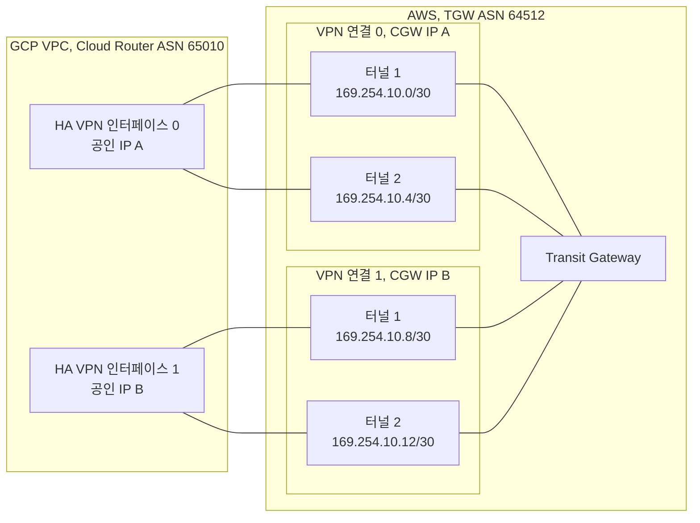
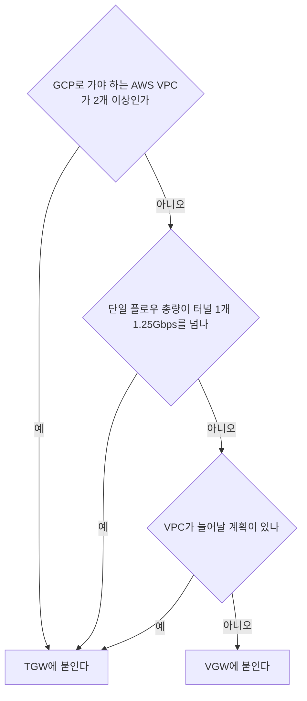
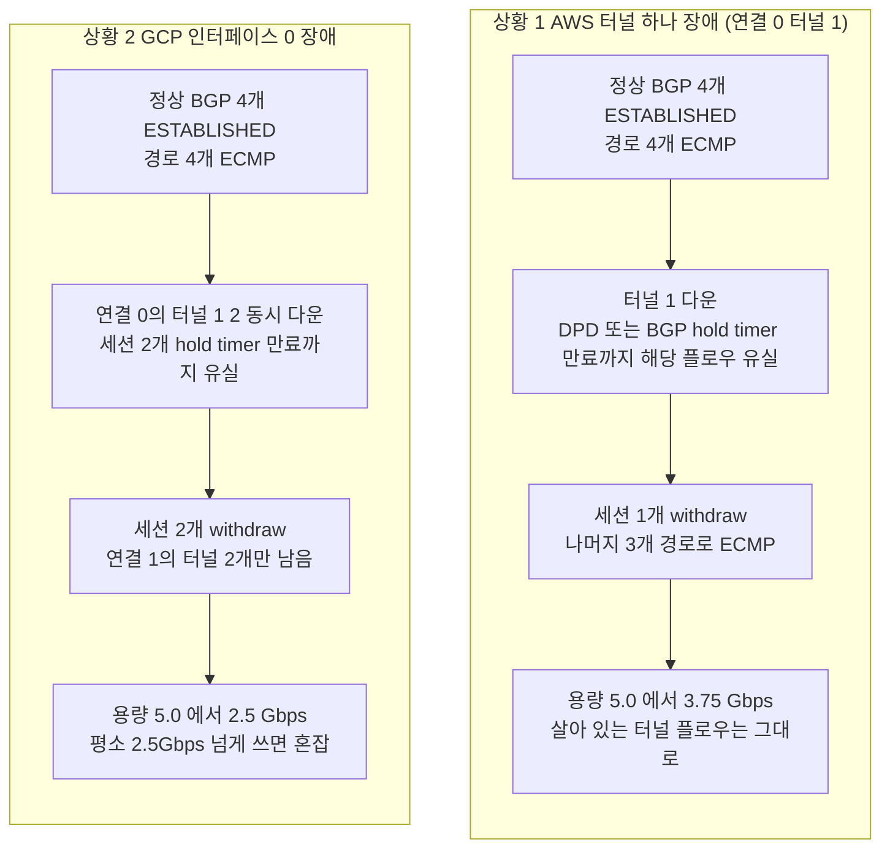

# AWS와 GCP를 VPN으로 직접 잇기

AWS VPC와 GCP VPC를 사설 IP로 붙여야 하는데 전용선이 아직 없으면 인터넷 위 IPsec 터널로 먼저 연결한다. AWS는 연결 하나에 터널이 항상 2개 붙고, GCP는 게이트웨이 인터페이스 2개에 터널을 직접 만든다. 짝짓기를 처음에 틀리면 터널은 올라오는데 이중화가 안 된다.

각 서비스의 단독 설정은 [AWS Site-to-Site VPN](Site_to_Site_VPN.md)과 [GCP Cloud VPN](../../GCP/Network/Cloud_VPN.md), 장비 쪽 운영은 [IPsec 운영](../../../Network/Security/Site_to_Site_VPN_I_Psec_Operations.md)에 있다.

## 터널이 4개가 되는 이유

AWS 쪽 제약부터 본다. VPN 연결 하나는 터널 2개이고 터널마다 AWS 공인 IP가 따로다. 그런데 Customer Gateway(CGW)에는 상대 공인 IP를 하나만 적고, AWS는 그 IP에서 오는 IKE만 받는다. GCP HA VPN 게이트웨이는 인터페이스가 2개이고 공인 IP도 2개다. 연결 하나로 두 인터페이스를 받을 방법이 없다.

그래서 GCP 인터페이스마다 CGW와 VPN 연결을 하나씩 만든다. 연결 2개 × 터널 2개 = 터널 4개, AWS 공인 IP 4개다. GCP에서는 이 IP 4개를 peer external gateway에 인터페이스 4개로 등록하고 `redundancy_type`을 `FOUR_IPS_REDUNDANCY`로 둔다. 인터페이스 0번은 피어 0·1번과, 1번은 2·3번과 터널을 맺는다. 4-in-2는 상대 IP 4개를 내 인터페이스 2개에 나눠 건다는 뜻이다.



구성도에서 볼 곳은 터널이 어느 연결에 묶이고 어느 GCP 인터페이스로 들어가는지다. 연결 0의 터널 둘은 인터페이스 0으로, 연결 1의 둘은 인터페이스 1로 간다. BGP 세션도 터널마다 하나, 모두 4개다.

## ASN과 link-local 대역 배정

양쪽 ASN이 같으면 eBGP가 AS_PATH 루프 방지로 경로를 버린다. TGW와 VGW의 기본 ASN은 64512이고 만든 뒤에는 못 바꾼다. 사내에서 64512를 이미 쓰면 게이트웨이를 만들기 전에 정한다. Cloud Router는 사설 범위에서 겹치지 않게 고르고, CGW의 `bgp_asn`에 그 값을 넣는다. 예제는 AWS 64512, GCP 65010이다.

터널 내부 주소는 터널마다 /30이다.

| 터널 | GCP 인터페이스 | 터널 내부 /30 | AWS BGP IP | Cloud Router BGP IP |
|---|---|---|---|---|
| 연결 0 터널 1 | 0 | 169.254.10.0/30 | 169.254.10.1 | 169.254.10.2 |
| 연결 0 터널 2 | 0 | 169.254.10.4/30 | 169.254.10.5 | 169.254.10.6 |
| 연결 1 터널 1 | 1 | 169.254.10.8/30 | 169.254.10.9 | 169.254.10.10 |
| 연결 1 터널 2 | 1 | 169.254.10.12/30 | 169.254.10.13 | 169.254.10.14 |

AWS는 169.254.0.0/30부터 169.254.5.0/30, 169.254.169.252/30, 169.254.170.252/30을 예약해 두어서 쓸 수 없다.

## Terraform으로 만들기

GCP 게이트웨이를 먼저 만들어 공인 IP 2개를 받고, 그 IP로 CGW와 VPN 연결을 만든다. AWS 터널 IP와 사전 공유 키가 나오면 GCP 쪽 터널과 BGP 피어를 만든다. 한 루트 모듈에 두면 Terraform이 이 순서를 알아서 잡는다.

```hcl
terraform {
  required_providers {
    aws    = { source = "hashicorp/aws", version = "~> 5.0" }
    google = { source = "hashicorp/google", version = "~> 6.0" }
    random = { source = "hashicorp/random", version = "~> 3.6" }
  }
}

variable "gcp_region" { default = "asia-northeast3" }
variable "gcp_network" {}

locals {
  gcp_router_asn = 65010
  aws_side_asn   = 64512

  # 키는 "연결번호-터널번호"
  inside_cidrs = {
    "0-1" = "169.254.10.0/30"
    "0-2" = "169.254.10.4/30"
    "1-1" = "169.254.10.8/30"
    "1-2" = "169.254.10.12/30"
  }

  # AWS 사전 공유 키는 0으로 시작하면 거부된다
  psk = { for k, p in random_password.psk : k => "k${p.result}" }

  tunnels = {
    "0-1" = {
      gcp_if = 0, peer_if = 0
      aws_ip     = aws_vpn_connection.gcp["0"].tunnel1_address
      inside_aws = aws_vpn_connection.gcp["0"].tunnel1_vgw_inside_address
      inside_gcp = aws_vpn_connection.gcp["0"].tunnel1_cgw_inside_address
    }
    "0-2" = {
      gcp_if = 0, peer_if = 1
      aws_ip     = aws_vpn_connection.gcp["0"].tunnel2_address
      inside_aws = aws_vpn_connection.gcp["0"].tunnel2_vgw_inside_address
      inside_gcp = aws_vpn_connection.gcp["0"].tunnel2_cgw_inside_address
    }
    "1-1" = {
      gcp_if = 1, peer_if = 2
      aws_ip     = aws_vpn_connection.gcp["1"].tunnel1_address
      inside_aws = aws_vpn_connection.gcp["1"].tunnel1_vgw_inside_address
      inside_gcp = aws_vpn_connection.gcp["1"].tunnel1_cgw_inside_address
    }
    "1-2" = {
      gcp_if = 1, peer_if = 3
      aws_ip     = aws_vpn_connection.gcp["1"].tunnel2_address
      inside_aws = aws_vpn_connection.gcp["1"].tunnel2_vgw_inside_address
      inside_gcp = aws_vpn_connection.gcp["1"].tunnel2_cgw_inside_address
    }
  }
}

resource "random_password" "psk" {
  for_each = local.inside_cidrs
  length   = 32
  special  = false
}

# ---------- GCP: 게이트웨이와 Cloud Router ----------
resource "google_compute_ha_vpn_gateway" "this" {
  name    = "ha-vpn-aws"
  region  = var.gcp_region
  network = var.gcp_network
}

resource "google_compute_router" "this" {
  name    = "vpn-router-aws"
  region  = var.gcp_region
  network = var.gcp_network
  bgp {
    asn = local.gcp_router_asn
  }
}

# ---------- AWS: TGW, CGW(인터페이스당 1개), VPN 연결 2개 ----------
resource "aws_ec2_transit_gateway" "this" {
  amazon_side_asn  = local.aws_side_asn
  vpn_ecmp_support = "enable"
}

resource "aws_customer_gateway" "gcp" {
  for_each   = { for i in [0, 1] : tostring(i) => google_compute_ha_vpn_gateway.this.vpn_interfaces[i].ip_address }
  bgp_asn    = local.gcp_router_asn
  ip_address = each.value
  type       = "ipsec.1"
  tags       = { Name = "gcp-ha-vpn-if${each.key}" }
}

resource "aws_vpn_connection" "gcp" {
  for_each            = aws_customer_gateway.gcp
  customer_gateway_id = each.value.id
  transit_gateway_id  = aws_ec2_transit_gateway.this.id
  type                = "ipsec.1"
  static_routes_only  = false

  tunnel1_inside_cidr   = local.inside_cidrs["${each.key}-1"]
  tunnel1_preshared_key = local.psk["${each.key}-1"]
  tunnel2_inside_cidr   = local.inside_cidrs["${each.key}-2"]
  tunnel2_preshared_key = local.psk["${each.key}-2"]

  tunnel1_ike_versions                 = ["ikev2"]
  tunnel1_phase1_encryption_algorithms = ["AES256"]
  tunnel1_phase1_integrity_algorithms  = ["SHA2-256"]
  tunnel1_phase1_dh_group_numbers      = [14]
  tunnel1_phase2_encryption_algorithms = ["AES256"]
  tunnel1_phase2_integrity_algorithms  = ["SHA2-256"]
  tunnel1_phase2_dh_group_numbers      = [14]
  tunnel1_startup_action               = "start"

  tunnel2_ike_versions                 = ["ikev2"]
  tunnel2_phase1_encryption_algorithms = ["AES256"]
  tunnel2_phase1_integrity_algorithms  = ["SHA2-256"]
  tunnel2_phase1_dh_group_numbers      = [14]
  tunnel2_phase2_encryption_algorithms = ["AES256"]
  tunnel2_phase2_integrity_algorithms  = ["SHA2-256"]
  tunnel2_phase2_dh_group_numbers      = [14]
  tunnel2_startup_action               = "start"
}

# ---------- GCP: 상대 IP 4개, 터널 4개, BGP 세션 4개 ----------
resource "google_compute_external_vpn_gateway" "aws" {
  name            = "aws-peer"
  redundancy_type = "FOUR_IPS_REDUNDANCY"

  dynamic "interface" {
    for_each = local.tunnels
    content {
      id         = interface.value.peer_if
      ip_address = interface.value.aws_ip
    }
  }
}

resource "google_compute_vpn_tunnel" "aws" {
  for_each                        = local.tunnels
  name                            = "aws-tun-${each.key}"
  region                          = var.gcp_region
  vpn_gateway                     = google_compute_ha_vpn_gateway.this.id
  vpn_gateway_interface           = each.value.gcp_if
  peer_external_gateway           = google_compute_external_vpn_gateway.aws.id
  peer_external_gateway_interface = each.value.peer_if
  shared_secret                   = local.psk[each.key]
  router                          = google_compute_router.this.id
  ike_version                     = 2
}

resource "google_compute_router_interface" "aws" {
  for_each   = local.tunnels
  name       = "if-${each.key}"
  router     = google_compute_router.this.name
  region     = var.gcp_region
  ip_range   = "${each.value.inside_gcp}/30"
  vpn_tunnel = google_compute_vpn_tunnel.aws[each.key].name
}

resource "google_compute_router_peer" "aws" {
  for_each                  = local.tunnels
  name                      = "peer-${each.key}"
  router                    = google_compute_router.this.name
  region                    = var.gcp_region
  interface                 = google_compute_router_interface.aws[each.key].name
  peer_ip_address           = each.value.inside_aws
  peer_asn                  = local.aws_side_asn
  advertised_route_priority = 100
}
```

`tunnelN_vgw_inside_address`는 이름과 달리 TGW 연결에서도 AWS 쪽 BGP IP를 돌려준다. 사전 공유 키는 상태 파일에 평문으로 남는다.

## IKE 파라미터가 어긋나는 지점

GCP의 `google_compute_vpn_tunnel`에는 암호 스위트 필드가 없고 `ike_version`만 있다. GCP는 피어가 제안한 조합 중 지원하는 것을 고른다. 허용 목록을 좁힐 수 있는 쪽은 AWS의 `tunnelN_*` 옵션뿐이다.

| 항목 | AWS 기본값 | GCP | 이 문서의 설정 |
|---|---|---|---|
| IKE 버전 | v1·v2 둘 다 허용 | 터널의 `ike_version` | ikev2 |
| Phase 1 암호·무결성 | AES128·256, GCM, SHA1·SHA2 계열을 모두 허용 | 지원 목록 안에서 선택 | AES256, SHA2-256 |
| DH 그룹 | 2, 14~24 허용 (Phase 2는 5도 허용) | 지원 목록 안에서 선택 | 14 |
| Phase 1 수명 | 28800초 | 36000초 | 그대로 둔다 |
| Phase 2 수명 | 3600초 | 10800초 | 그대로 둔다 |
| 터널 시작 | `add`, 상대가 시작하길 기다림 | 터널이 직접 시작 | `start` |

기본값 그대로 두면 터널은 올라가지만 어떤 조합이 골라졌는지 모른다. 보안 점검에서 SHA1이나 DH 2가 걸려 AWS를 좁힐 때 GCP 지원 목록에 없는 조합을 넣으면 터널이 `NEGOTIATION_FAILURE`로 떨어진다. 허용 목록은 GCP의 IKE 지원 암호 문서로 정하고, 바꾼 뒤 양쪽 상태를 직접 본다. 수명 수치는 각 서비스 문서 기준이다.

수명 차이는 협상 실패 원인이 아니다. IKEv2에서 수명은 협상 항목이 아니라 각자의 재키 타이머라서 짧은 쪽이 먼저 재키를 시작한다.

GCP 터널을 IKEv1으로 만들어 둔 환경도 있다. AWS는 v1도 받아서 올라오지만 양쪽 모두 v2로 고정한다. 둘 다 라우트 기반이라 트래픽 셀렉터는 0.0.0.0/0으로 같아서 `TS_UNACCEPTABLE`은 이 구성에서 나지 않았다.

## TGW와 VGW 중 어디에 붙일지

VGW는 VPC 하나에 붙고 ECMP가 없어서, 터널을 4개 만들어도 AWS에서 GCP로 가는 트래픽은 일부 터널만 쓴다. VPC가 하나이고 대역폭이 터널 1개 한도 안이면 VGW가 단순하고 싸다. TGW는 VPC 여러 개를 한 번에 잇고 BGP 경로가 같으면 ECMP로 터널 전체에 분산한다. 위 Terraform이 TGW를 쓴 이유다.



세 질문 중 하나라도 예이면 TGW다. VGW에서 TGW로 옮길 수는 있지만 대상 게이트웨이를 바꾸는 동안 터널이 끊겨서 야간 작업이 된다. 대신 TGW는 어태치먼트 시간당 요금에 처리 GB당 요금이 붙는다.

## 장애 때 경로가 움직이는 방식

평상시에는 BGP 세션 4개가 ESTABLISHED이고 같은 목적지 경로 4개를 같은 우선순위로 들고 있어서 플로우가 4개 터널에 해시로 흩어진다. 아래 그림은 터널 하나가 죽을 때와 GCP 인터페이스 하나가 죽을 때를 나란히 놓았다.



마지막 칸을 본다. 경로가 사라지는 것은 BGP가 알아서 한다. 볼 것은 남은 터널이 평소 트래픽을 감당하는지다. 평소 4Gbps를 쓰다 인터페이스 하나가 빠지면 2.5Gbps만 남아서, 터널은 살아 있는데 패킷이 드롭된다.

감지는 타이머에 달렸다. AWS는 DPD 타임아웃 기본 30초 뒤 터널을 내리고, BGP는 홀드 타이머가 끝나야 경로를 지운다. AWS VPN은 BFD가 없어서 그 사이 죽은 터널로 해시된 플로우는 유실되고, TCP 재전송이 새 경로로 해시되면 이어진다. AWS는 터널 엔드포인트 점검 때 터널을 한 번에 하나씩 내린다고 안내하므로 상황 1은 정기 이벤트다.

VGW는 ECMP가 없어서 평소에도 터널 하나만 쓰고, 죽으면 다른 터널로 넘어간다. 용량은 처음부터 1.25Gbps다.

트래픽을 한쪽으로 몰려면 GCP의 `advertised_route_priority`를 터널별로 다르게 준다. 값은 MED로 AWS에 광고되고 낮은 쪽이 선호된다. AS_PATH 프리펜드와의 적용 순서는 TGW와 VGW가 다르니 AWS 라우트 평가 순서 문서를 본다.

## 이그레스 비용과 터널당 1.25Gbps 한도

이 VPN은 인터넷 위를 지난다. 인바운드는 양쪽 모두 무료이고 보내는 쪽이 이그레스를 낸다. AWS에서 GCP로 가는 트래픽은 AWS 청구서에, 반대는 GCP 청구서에 붙는다. 단가는 [EC2 데이터 전송 요금](https://aws.amazon.com/ec2/pricing/on-demand/)과 [GCP VPC 네트워크 요금](https://cloud.google.com/vpc/network-pricing)에서 리전별로 본다. 고정비는 AWS의 VPN 연결 2개와 TGW 어태치먼트([AWS VPN 요금](https://aws.amazon.com/vpn/pricing/)), GCP의 터널 4개 시간당 요금이다.

월 수 TB를 넘으면 가변비가 고정비를 압도하므로 전용 연결 단가와 비교한다. TGW는 GB당 처리비가 더 붙으니 청구서의 `TransitGateway-Bytes`를 따로 본다.

AWS 터널 1개는 1.25Gbps다([AWS VPN 쿼터](https://docs.aws.amazon.com/vpn/latest/s2svpn/vpn-limits.html)). GCP 터널은 [쿼터](https://cloud.google.com/network-connectivity/docs/vpn/quotas)상 패킷 수 기준 한도라 병목은 AWS 쪽이다. ECMP로 4개를 묶으면 총량 5Gbps지만 한 플로우는 한 터널에 해시되어 1.25Gbps에서 멈춘다. DB 덤프 하나는 터널 3개가 놀아도 빨라지지 않는다.

## 터널이 올라온 뒤 안 될 때

터널과 BGP가 올라왔는데 통신이 안 되면 라우팅을 본다. GCP VPC의 동적 라우팅 모드가 `REGIONAL`이면 Cloud Router가 같은 리전 서브넷만 다루니 `GLOBAL`로 바꾼다. TGW는 VPC 라우트 테이블에 경로를 넣어 주지 않으므로 GCP 대역을 TGW로 보내는 라우트를 직접 추가한다. VGW는 라우트 전파를 켠다. 양쪽 CIDR이 겹치면 BGP가 올라와도 로컬 라우트에 밀리는데, GCP 자동 모드 VPC의 10.128.0.0/9가 AWS 10.x와 겹치는 경우가 흔하다. GCP 방화벽은 인그레스가 기본 차단이라 AWS 대역 허용 규칙도 필요하다.

터널 상태는 양쪽에서 직접 본다.

```bash
# AWS: 터널별 상태와 수신 경로 수
aws ec2 describe-vpn-connections \
  --query 'VpnConnections[].VgwTelemetry[].[OutsideIpAddress,Status,StatusMessage,AcceptedRouteCount]' \
  --output table

# GCP: 터널 상태와 BGP 세션
gcloud compute vpn-tunnels list --format='table(name,status,detailedStatus)'
gcloud compute routers get-status vpn-router-aws --region=asia-northeast3 \
  --format='table(result.bgpPeerStatus[].name,result.bgpPeerStatus[].status,result.bgpPeerStatus[].numLearnedRoutes)'
```

`AcceptedRouteCount`가 0이면 BGP는 올라왔지만 상대가 경로를 광고하지 않는 상태다. Cloud Router 광고 범위나 TGW 라우트 테이블 전파를 본다. 터널이 `FIRST_HANDSHAKE`에서 멈추면 AWS IP 4개와 터널별 사전 공유 키를 본다. 키가 서로 바뀐 것이 흔한 실수다. MTU와 MSS는 [AWS Site-to-Site VPN](Site_to_Site_VPN.md)의 해당 절을 따른다.
