# Customer Gateway

Site-to-Site VPN을 처음 붙일 때 Customer Gateway(CGW)에서 막히는 경우가 많다. 이름 때문에 AWS가 제공하는 게이트웨이 같은데 실제로는 그렇지 않다. CGW는 AWS 쪽에 만드는 메타데이터 한 줄이고, 진짜 IPsec 협상을 하는 건 회사 방화벽이나 리눅스 박스다. 이 둘을 구분하지 않으면 "CGW를 만들었는데 왜 터널이 안 올라오지"에서 한참 헤맨다.

VPN 전체 구조와 VGW/TGW 선택은 [Site-to-Site VPN](Site_to_Site_VPN.md), TGW 쪽 라우팅은 [Transit Gateway](Transit_Gateway.md), IPsec 장비 운영은 [IPsec 운영](../../../Network/Security/Site_to_Site_VPN_I_Psec_Operations.md)에 있다. 이 문서는 CGW 객체와 그 객체가 가리키는 장비를 맞추는 데 집중한다.

## CGW 객체와 실제 장비

CGW 객체에 들어가는 값은 네 가지뿐이다.

| 항목 | 용도 | 비고 |
|---|---|---|
| 공인 IP | AWS가 IKE를 받아줄 상대 주소이자 IKE 식별자 | 생성 후 수정 불가 |
| BGP ASN | 동적 라우팅 때 상대 ASN | 정적 라우팅이어도 값은 넣어야 함 |
| 인증서 ARN | 인증서 인증을 쓸 때만 | ACM 인증서 |
| 디바이스 이름 | 콘솔·API에서 구분용 | 같은 IP·ASN으로 CGW를 하나 더 만들 때 구분자 역할 |

AWS는 이 객체를 보고 장비에 접속하지 않는다. VPN Connection을 만들 때 AWS 쪽 터널 엔드포인트가 "이 IP에서 오는 IKE는 이 ASN을 쓰는 상대다"라고 외워 두는 것이 전부다. 장비 설정은 전부 사람이 한다.

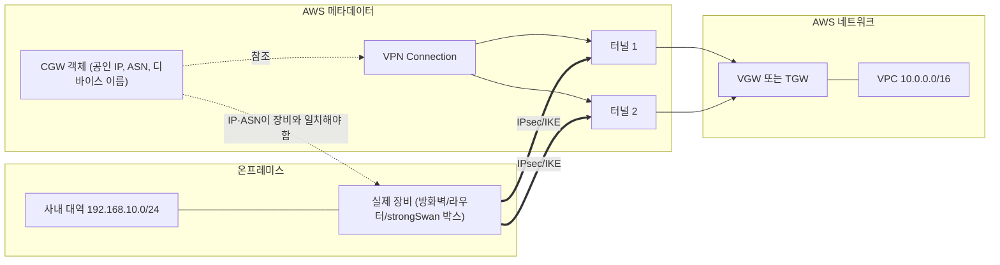

점선은 AWS 쪽 설정이 장비에 대한 약속일 뿐이라는 뜻이다. CGW에 적은 IP와 장비가 실제로 IKE에서 내세우는 IKE ID가 다르면 터널은 안 올라온다. 이 불일치가 뒤에서 나오는 트러블슈팅 사례의 절반이다.

### 한 CGW를 여러 VPN Connection이 쓰는 경우

CGW 하나를 VPN Connection 여러 개가 참조할 수 있다. 본사 방화벽 하나를 prod VPC용 VGW와 공용 TGW 양쪽에 붙이는 경우가 대표적이다. 이 경우 장비에는 터널이 4개 생기고, 터널마다 AWS 쪽 공인 IP가 다르므로 장비 설정에 피어 4개를 적는다. 터널 inside CIDR(169.254.x.x/30)은 같은 VGW를 쓰는 VPN Connection끼리 겹치면 안 된다.

한계는 세 가지다.

- CGW 하나가 장비 하나다. 그 장비가 죽으면 그 CGW를 쓰는 VPN Connection이 전부 같이 죽는다.
- ASN이 CGW에 박혀 있다. 한 장비가 VPN마다 다른 ASN을 써야 하면(VRF 분리 등) CGW를 따로 만들어야 하는데, 같은 IP와 ASN 조합을 또 만들 때는 디바이스 이름을 다르게 줘야 한다. 이름까지 같으면 AWS는 새로 만들지 않고 기존 객체를 돌려준다.
- 쿼터가 있다. 리전당 CGW와 VPN Connection 개수 기본 한도는 둘 다 작은 편이라 지점이 많으면 한도 상향을 먼저 신청한다.

## 등록부터 BGP까지 순서

작업 순서가 곧 장애 지점이다. 순서를 한 번 그려 두면 어디서 멈췄는지 바로 보인다.

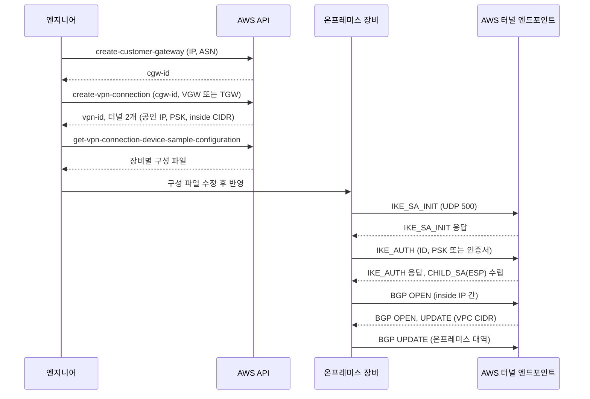

터널 상태는 IKE(Phase 1) → IPsec SA(Phase 2) → BGP 순으로 올라온다. `describe-vpn-connections`의 Status가 UP이 되는 시점은 IPsec SA까지 맺어진 때고, BGP가 붙었는지는 StatusMessage의 수신 라우트 수로 따로 봐야 한다. UP인데 BGP가 안 붙은 경우가 트러블슈팅에서 가장 자주 나온다.

## 공인 IP 선정

CGW IP는 정적이어야 한다. CLI 도움말에도 "The IP address must be static and can be behind a device performing NAT"라고 적혀 있다. NAT 뒤는 허용되는데 동적 IP는 안 된다는 뜻이다.

### NAT 뒤 장비와 NAT-T

장비가 NAT 뒤에 있으면 CGW에는 NAT 장비의 공인 IP를 적는다. AWS는 NAT-T를 지원하므로 IKE가 UDP 500으로 시작해 NAT를 감지하면 UDP 4500으로 옮겨 가고 ESP도 UDP 4500 안에 들어간다. NAT 장비에서 UDP 500과 4500을 장비로 포워딩해야 한다.

여기서 놓치는 게 IKE ID다. 장비는 기본적으로 자기 로컬 주소(사설 IP)를 IKE ID로 보내는데 AWS는 CGW에 등록된 공인 IP를 기대한다. strongSwan이면 `leftid`, Cisco ASA면 `crypto isakmp identity address`나 `ikev2` 쪽 local-identity, Palo Alto면 Local Identification을 공인 IP로 명시한다. AWS EC2 위에 CGW 역할을 하는 리눅스를 세울 때도 같다. EC2는 사설 IP를 가진 채 EIP가 NAT되어 붙는 구조라 `left=사설IP`, `leftid=EIP`로 적는다. 이 구분을 모르고 `left=%defaultroute`만 쓰면 AWS가 IKE_AUTH에서 AUTHENTICATION_FAILED를 돌려준다.

아래 그림은 같은 장비가 `leftid` 지정 여부에 따라 IKE_AUTH에서 갈리는 지점을 보여준다. 사설 IP가 IKE ID로 나가면 CGW에 등록한 공인 IP와 달라서 실패한다.

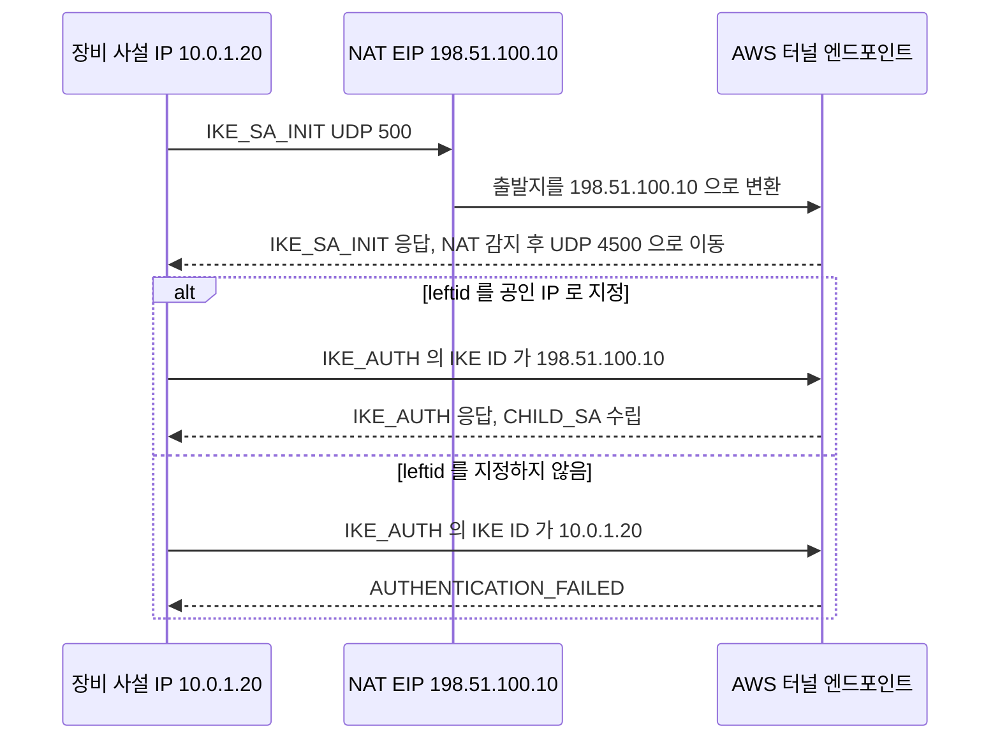

### ISP CGNAT에서 Phase 1이 깨지는 경우

회선이 CGNAT 뒤에 있으면 장비 WAN 인터페이스에 100.64.0.0/10 대역 주소가 붙는다. 이 상태로 CGW에 ISP 공유 풀의 공인 IP를 적으면 두 군데서 깨진다.

1. 장비가 IKE ID로 100.64.x.x를 보낸다. AWS가 기대하는 값과 달라서 Phase 1 인증이 실패한다. `leftid`를 공인 IP로 강제하면 이 단계는 넘어간다.
2. 그 다음이 진짜 문제다. CGNAT 장비는 안쪽에서 먼저 나간 흐름에만 매핑을 만든다. 장비가 먼저 IKE를 시작하면 매핑이 생겨 붙기도 하지만, 매핑이 타임아웃되면 AWS가 보낸 패킷은 들어오지 못한다. 공유 풀이라 공인 IP가 바뀌는 일도 있어서 CGW IP가 한 번 틀어지면 지우고 다시 만들어야 한다.

회선을 계약할 때 정적 공인 IP를 명시적으로 요청하는 게 가장 싸다. 장비의 WAN IP가 100.64.0.0/10이면 회선 쪽을 먼저 의심한다.

### 고객 쪽 IP가 동적일 때

선택지는 많지 않다.

| 선택지 | 내용 | 한계 |
|---|---|---|
| ISP에 정적 IP 요청 | 대부분 월 몇천 원에서 몇만 원 수준 추가 | 가장 단순하고 확실 |
| 고정 IP를 가진 중계 장비 | 클라우드나 코로케이션에 고정 IP 장비를 두고 CGW로 등록, 동적 IP 지점은 그 장비와 WireGuard 등으로 연결 | 장비 한 대와 홉 하나 추가 |
| DDNS와 자동화로 CGW 재생성 | IP가 바뀌면 Lambda가 CGW를 새로 만들고 VPN Connection의 CGW를 교체 | 교체할 때마다 터널 단절, 개발 환경용 |
| 소규모 지점이면 Client VPN | 사이트 단위 연결을 포기 | 라우터 대 라우터 구조가 아님 |

### CGW IP는 수정되지 않는다

CGW에는 modify API가 없다. IP나 ASN을 바꾸려면 새 CGW를 만들어야 한다. 그래서 순서가 중요하다.

```bash
# 새 CGW를 먼저 만든다
aws ec2 create-customer-gateway --type ipsec.1 \
  --ip-address 198.51.100.77 --bgp-asn 65010 --device-name hq-fw-02

# 기존 VPN Connection이 가리키는 CGW를 바꾼다
aws ec2 modify-vpn-connection \
  --vpn-connection-id vpn-0a1b2c3d4e5f67890 \
  --customer-gateway-id cgw-0new1234567890abc

# 터널이 안정화된 뒤 옛 CGW를 지운다
aws ec2 delete-customer-gateway --customer-gateway-id cgw-0old1234567890abc
```

위 세 명령의 순서를 그림으로 보면 아래와 같다. 새 CGW를 먼저 만들고 옛 CGW는 맨 마지막에 지운다.

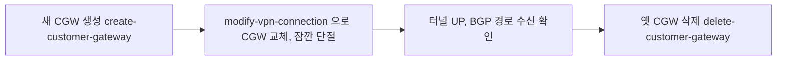

`modify-vpn-connection`의 도움말에 따르면 이 작업 뒤에도 AWS 쪽 터널 IP와 터널 옵션은 그대로 유지되고, 새 엔드포인트를 프로비저닝하는 동안 잠깐 연결이 끊긴다. 점검 창을 잡고 하면 된다. 옛 CGW를 VPN Connection이 참조하는 상태에서 지우려 하면 삭제가 거부된다.

콘솔에서 VPN Connection을 지우고 다시 만드는 방법도 있는데 그러면 AWS 쪽 터널 공인 IP가 바뀌어서 상대 장비와 방화벽 허용 목록을 전부 갱신해야 한다. 가능하면 modify로 간다. Terraform에서는 `aws_customer_gateway`의 `ip_address`를 바꾸면 CGW가 교체(ForceNew)되는데, 그때 `aws_vpn_connection`이 in-place로 갱신될지 교체될지는 프로바이더 버전에 따라 다르다. 반드시 `plan`에서 `forces replacement` 표시를 확인하고 적용한다.

## ASN 선정

BGP를 쓰면 ASN이 한 번 정해지면 바꾸기 번거롭다. 사설 ASN 범위는 표와 같다.

| 구분 | 범위 |
|---|---|
| 16비트 사설 ASN | 64512 ~ 65534 |
| 32비트 사설 ASN | 4200000000 ~ 4294967294 |
| 공인 ASN | 직접 할당받은 것이면 사용 가능 |

CLI에서 `--bgp-asn`은 2,147,483,647까지만 받는다. 4바이트 ASN 중 그 이상 값은 `--bgp-asn-extended`로 넣는다. 장비 쪽은 FRR이든 상용 장비든 4바이트 ASN을 쓰려면 4바이트 AS 지원을 켜야 하는 구형 장비가 있으니 확인한다.

### VGW/TGW 기본 ASN 64512와 겹치는 경우

VGW와 TGW의 Amazon 쪽 ASN 기본값은 64512다. CGW ASN을 이 값과 같게 쓰는 사고는 드물지만, 사내에서 "사설 ASN 하면 64512지"라며 기본값을 그대로 쓰는 경우가 있다. 같은 ASN끼리는 iBGP가 되는데 AWS VPN은 iBGP를 쓰지 않는다. CGW ASN은 반드시 Amazon 쪽과 달라야 한다.

실제로 더 자주 겪는 건 AS_PATH 루프다. 대표적인 경우가 두 가지다.

- 온프레미스 라우터가 VGW A와 VGW B에 각각 VPN으로 붙어 있고 둘 다 기본 ASN 64512다. A에서 받은 경로를 B로 재광고하면 AS_PATH에 64512가 들어 있어서 B가 자기 ASN이 보이는 경로라며 버린다. 두 VPC를 온프레미스 경유로 잇는 구성은 이 때문에 동작하지 않는다.
- 여러 지점이 같은 CGW ASN(예: 전부 65000)을 쓰면서 TGW로 서로 통신하려는 경우. TGW는 지점 A의 경로를 지점 B로 전달하는데 AS_PATH에 65000이 들어 있어서 B의 라우터가 버린다. 지점 간 통신이 안 되고, 각 지점에서 VPC로는 잘 간다.

두 번째 경우를 그림으로 보면, 지점 B 라우터가 AS_PATH에서 자기 ASN을 발견하는 지점이 경로가 버려지는 곳이다.

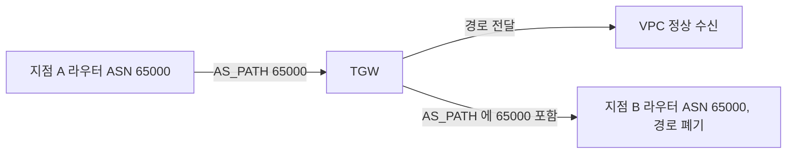

풀이는 ASN 설계로 한다. 지점마다 고유 ASN을 주거나, VGW/TGW마다 Amazon 쪽 ASN을 따로 지정한다. VGW의 Amazon 쪽 ASN은 만들 때만 정할 수 있고, TGW는 VPN·Direct Connect 등 어태치먼트를 모두 지운 뒤에만 바꿀 수 있다. 이미 굴러가는 환경에서는 ASN을 바꾸기 어려우므로 처음부터 정한다. 도저히 못 바꾸면 장비 쪽에 `allowas-in`을 쓰는 우회가 있다.

```
router bgp 65010
 address-family ipv4 unicast
  neighbor 169.254.10.1 allowas-in 1
```

이 옵션은 루프 방지를 풀기 때문에 라우팅 루프가 생길 위험을 감수한다. 임시 우회로만 쓰고 근본 해결은 ASN을 나누는 것이다.

이미 쓰는 ASN과 충돌하는 경우도 있다. 사내 백본이 65000이고 지점 라우터도 65000인데 그 라우터가 CGW 역할을 겸하면, 지점 라우터는 백본의 iBGP 피어이자 AWS의 eBGP 피어가 된다. 이때 백본 쪽에서 AWS 경로를 받으려면 라우터가 iBGP로 전달하는 구조가 필요하고, 반대로 AWS에는 `network` 구문이나 재배포로 사내 대역을 내보내야 한다. 이 설계는 처음에 그려 두고 시작한다.

## 인증서 기반 CGW와 PSK 비교

CGW 생성 때 `--certificate-arn`을 주면 PSK 대신 인증서로 IKE 인증을 한다. ACM Private CA로 발급한 인증서를 쓰는 방식이다. PSK는 VPN Connection 생성 시 자동 생성되거나 직접 지정한다(8~64자, 영문·숫자·`.`·`_`).

| 항목 | PSK | 인증서 |
|---|---|---|
| 준비 | 없음 | ACM Private CA, 장비 인증서 발급·설치 |
| 키 교체 | `modify-vpn-tunnel-options`로 PSK 변경 후 장비 반영 | 만료 전 재발급, `modify-vpn-tunnel-certificate`로 AWS 쪽 교체 |
| 유출 시 | VPN Connection 단위 PSK를 바꾼다 | 해당 장비 인증서를 폐기 |
| 장애 형태 | 불일치하면 즉시 Phase 1 실패 | 만료 시 재협상 시점에 실패 |

인증서 방식에서 만나는 장애는 만료다. 터널이 올라와 있는 동안은 이미 맺어진 SA가 살아 있어서 인증서가 만료돼도 바로 끊기지 않는다. 끊기는 시점은 IKE SA 재협상이나 장비 재시작이고, 보통 한밤중이다. 로그에는 인증서 유효성 오류가 남는다. 원인을 모르면 PSK 문제처럼 보이지만 사실은 인증서 날짜 문제다.

```bash
# 장비 쪽 인증서 만료일
openssl x509 -in /etc/swanctl/x509/cgw.pem -noout -enddate

# ACM 인증서라면 DaysToExpiry 지표를 알람으로 건다
aws cloudwatch put-metric-alarm \
  --alarm-name cgw-cert-expiry \
  --namespace AWS/CertificateManager --metric-name DaysToExpiry \
  --dimensions Name=CertificateArn,Value=arn:aws:acm:ap-northeast-2:111122223333:certificate/xxxx \
  --statistic Minimum --period 86400 --evaluation-periods 1 \
  --threshold 30 --comparison-operator LessThanThreshold
```

장비에 설치된 인증서는 ACM이 알지 못한다. 장비 쪽 만료는 모니터링에서 따로 본다.

PSK는 단순해서 쓰기 쉽다. 지점이 수십 개를 넘어 PSK를 관리하기 힘들거나 감사 요구가 있을 때 인증서로 넘어가는 게 현실적이다.

## 장비 쪽에서 손볼 부분

VPN Connection을 만든 뒤 `get-vpn-connection-device-types`로 장비 목록을 보고, 해당 장비 ID로 샘플 구성을 받는다.

```bash
aws ec2 get-vpn-connection-device-types \
  --query 'VpnConnectionDeviceTypes[?contains(Vendor, `Palo`)].[VpnConnectionDeviceTypeId,Vendor,Platform,Software]' \
  --output table

aws ec2 get-vpn-connection-device-sample-configuration \
  --vpn-connection-id vpn-0a1b2c3d4e5f67890 \
  --vpn-connection-device-type-id 5fb0a8ec \
  --internet-key-exchange-version ikev2 \
  --query VpnConnectionDeviceSampleConfiguration --output text > pa.txt
```

Cisco ASA, Juniper, Palo Alto, strongSwan 등이 있고, 장비 ID(`5fb0a8ec`는 예시다)는 위 목록 명령으로 직접 확인한다. 받은 파일을 그대로 붙이면 되는 경우가 많은데 그대로 붙여선 안 되는 부분이 있다.

| 손볼 곳 | 이유 |
|---|---|
| 로컬 IKE ID | NAT 뒤나 EC2면 공인 IP로 명시 |
| 외부 인터페이스, 소스 IP | 샘플은 장비의 자리 표시값이다 |
| 사내 대역 광고(`network`, 재배포) | 샘플은 기본 라우트만 있는 경우가 있다 |
| BGP 타이머 | 샘플은 장비 기본값이라 장애 감지가 늦다 |
| 라우팅 정책 | FRR 8.x 같은 장비는 정책이 없으면 eBGP 경로를 주고받지 않는다 |
| 인터페이스 MTU와 MSS | 아래 참조 |
| 방화벽 정책 | 터널 인터페이스를 zone에 넣고 허용 규칙을 만들어야 한다 |

### IKE 버전, DPD, 터널 옵션 맞추기

IKEv1과 IKEv2 중에는 IKEv2를 쓴다. 터널 옵션에서 `IKEVersions`에 ikev1, ikev2를 둘 다 허용할 수도 있는데 장비가 어느 쪽으로 협상할지 모호해지면 로그 해석이 어려워진다. 장비가 IKEv1만 되면 ikev1만 허용한다.

AWS 쪽 터널 옵션은 `create-vpn-connection`의 `TunnelOptions`에서 정하는데, 장비와 어긋나면 NO_PROPOSAL_CHOSEN으로 Phase 1이 실패한다. 아래가 AWS가 받는 범위이고 기본값이다.

| 옵션 | 허용 값 | 기본 |
|---|---|---|
| Phase 1 암호화 | AES128, AES256, AES128-GCM-16, AES256-GCM-16 | 여러 개 허용 |
| Phase 1 DH 그룹 | 2, 14~24 | 여러 개 허용 |
| Phase 1/2 수명 | 900~28800 / 900~3600 (Phase 2는 Phase 1보다 작아야 함) | 28800 / 3600 |
| Replay window | 64~2048 | 1024 |
| DPD 타임아웃 | 30초 이상 | 30초 |
| DPD 동작 | clear, none, restart | clear |
| 시작 동작 | add(장비가 시작), start(AWS가 시작) | add |
| 리키 마진 | 60초 ~ Phase 2 수명의 절반 | 270초 |

기본값으로 두면 AWS는 가능한 조합을 전부 허용하므로 장비가 어느 값을 고르든 협상된다. 보안 정책상 조합을 좁혀야 하면 Terraform으로 한 번에 좁히고, 장비 쪽을 같은 값으로 `!`(strongSwan의 strict 표기)나 단일 제안으로 맞춘다. AWS 쪽 허용 목록에 있는 값을 장비가 하나도 안 내밀면 협상이 안 되고, 장비가 낸 값 중 AWS가 허용하지 않는 것만 있으면 NO_PROPOSAL_CHOSEN이다.

DPD는 이중화와 직결된다. AWS 쪽 `DPDTimeoutAction` 기본이 `clear`라 응답이 없으면 AWS가 IKE 세션을 정리하고 기다린다. 장비가 먼저 시작하는 구조(startup action `add`)이므로 장비 쪽에서 `dpdaction=restart`로 재시작해야 터널이 복구된다. AWS가 먼저 시작하는 구조(`start`)를 쓰려면 AWS 쪽 `DPDTimeoutAction`을 `restart`로 맞춘다. 양쪽이 다 `clear`면 한쪽이 죽었다 살아날 때 아무도 먼저 협상을 시작하지 않아 터널이 영영 안 올라오는 일이 생긴다.

DPD 응답이 끊겼을 때 설정 조합별로 복구되는지가 갈리는 모습이다.

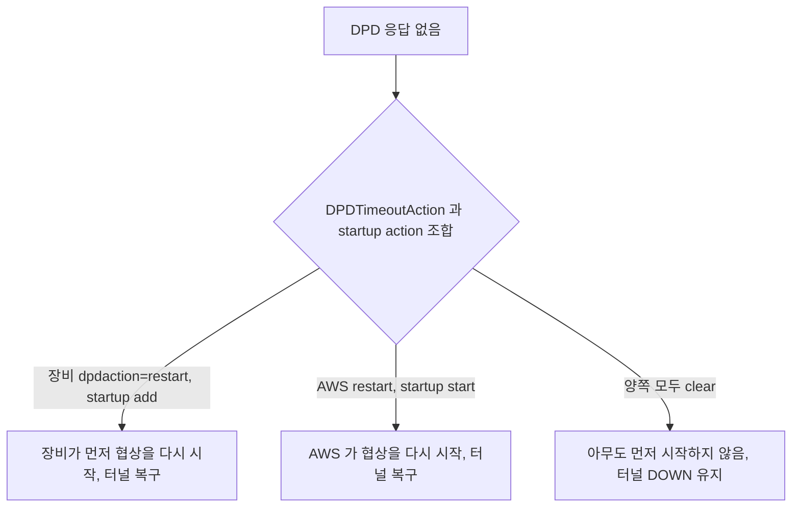

### MSS clamping 1379

AWS가 만들어 주는 장비 샘플 구성(Cisco ASA 등)에는 TCP MSS 1379, 터널 MTU 1399가 들어 있다. IPsec 오버헤드(ESP 헤더, IV, 패딩, ICV)와 NAT-T일 때 UDP 8바이트가 빠지면 1500바이트 링크에서 터널로 보낼 수 있는 페이로드가 1400 안팎으로 줄기 때문이다. MSS를 줄이지 않으면 큰 TCP 세그먼트가 터널에서 단편화되거나, 중간 장비가 ICMP를 막으면 PMTUD가 안 돼서 SSH 로그인은 되는데 `scp`가 멈추는 증상이 나온다.

리눅스 CGW에서는 iptables로 SYN 패킷의 MSS를 고정한다.

```bash
iptables -t mangle -A FORWARD -o vti1 -p tcp --tcp-flags SYN,RST SYN -j TCPMSS --set-mss 1379
iptables -t mangle -A FORWARD -i vti1 -p tcp --tcp-flags SYN,RST SYN -j TCPMSS --set-mss 1379
```

양방향 모두 걸어야 한다. 한쪽만 걸면 반대 방향 SYN-ACK의 MSS가 그대로 나가서 어느 한 방향이 계속 단편화된다. GCM 계열은 오버헤드가 작아 더 큰 값도 가능하지만, 1379로 맞춰 두는 게 샘플과 같아서 문제를 추적할 때 편하다.

## 이중화 토폴로지 세 가지

AWS는 VPN Connection마다 터널 2개를 주지만, 터널이 2개라는 사실이 곧 이중화는 아니다. 장애가 장비 쪽에서 나면 터널 2개가 동시에 죽는다.

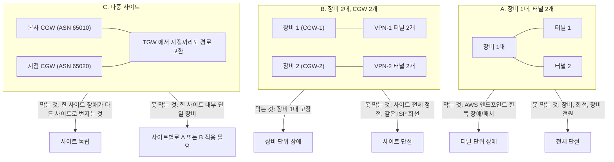

세 토폴로지가 막는 지점과 못 막는 지점을 표로도 정리한다.

| 장애 지점 | A. 장비 1대 터널 2개 | B. 장비 2대 CGW 2개 | C. 다중 사이트 |
|---|---|---|---|
| AWS 터널 엔드포인트 패치 | 막는다 | 막는다 | 막는다 |
| 장비 한 대 고장 | 못 막는다 | 막는다 | 사이트 내부 구성에 달림 |
| 장비 한 대 OS 패치 | 못 막는다 | 순차 작업으로 무중단 | 사이트 내부 구성에 달림 |
| 단일 ISP 회선 장애 | 못 막는다 | 같은 회선이면 못 막는다 | 사이트 간 독립 |
| 사이트 정전 | 못 막는다 | 못 막는다 | 다른 사이트는 영향 없음 |
| 설정 복잡도 | 낮다 | 중간 | 높다 |

A는 가장 싸고 AWS 쪽 패치로 터널이 하나씩 내려가는 걸 흡수한다. B는 장비가 SPOF인 환경에서 필요하다. 장비 두 대가 서로 다른 ISP 회선을 쓰면 회선 장애까지 막는다. C는 지점마다 CGW와 ASN이 달라지고 TGW 라우팅 테이블 설계가 따라온다. 지점 ASN이 고유해야 한다는 앞 절 내용이 여기서 나온다.

### 비대칭 라우팅과 선호 터널 정하기

두 터널로 같은 경로가 동시에 광고되면 방향마다 터널이 갈라진다. AWS에서 온프레미스로 나갈 때는 터널 1, 돌아올 때는 터널 2를 타는 비대칭이 생기고, 장비가 상태 추적 방화벽이면 반대 방향 패킷을 세션 없이 받아서 버린다. 장비 두 대(토폴로지 B)일 때 특히 심하다.

선호 터널은 양쪽에서 모두 정한다. 방향별로 쓰는 속성이 다르다.

| 방향 | 결정하는 쪽 | 쓰는 속성 |
|---|---|---|
| 온프레미스에서 AWS로 | 장비 | Local Preference (높을수록 선호), 수신 경로에 적용 |
| AWS에서 온프레미스로 | AWS | 장비가 광고하는 AS_PATH 길이(짧을수록), 길이가 같으면 MED(낮을수록) |

AWS가 돌아오는 방향을 고를 때는 장비의 Local Preference를 알 수 없으므로, 장비는 AS_PATH prepend나 MED로 AWS의 선택을 유도한다. AWS 문서 기준으로 AS_PATH가 먼저고 길이가 같을 때 MED를 본다. 가장 흔한 조합은 터널 2를 백업으로 쓰는 경우다.

```
route-map FROM-AWS-T1 permit 10
 set local-preference 200
route-map FROM-AWS-T2 permit 10
 set local-preference 100
route-map TO-AWS-T2 permit 10
 set as-path prepend 65010 65010 65010
```

위 route-map이 방향별로 어떤 터널을 고르게 하는지 그림으로 정리했다. 실선이 선호 경로이고 점선이 백업이다.

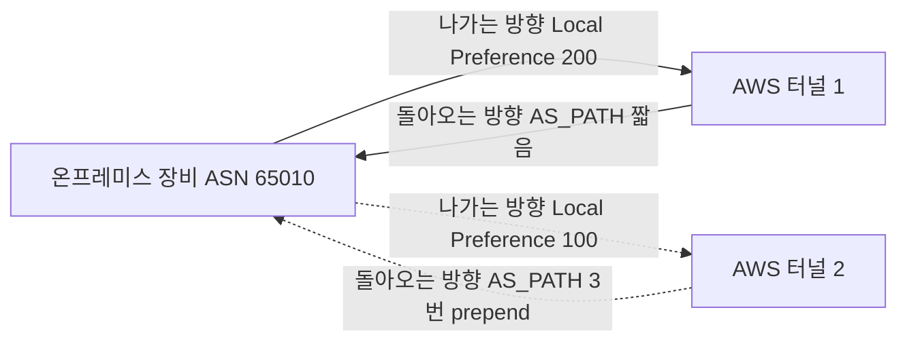

터널 1은 들어오는 경로에 Local Preference 200을 줘서 나가는 방향을 터널 1로 쏠리게 하고, 터널 2로는 AS_PATH를 3번 더 붙여 광고해서 AWS가 돌아올 때도 터널 1을 선택하게 한다. 이렇게 양쪽이 같은 터널을 가리켜야 비대칭이 사라진다. MED로 하려면 `set metric 100`과 `set metric 200`을 터널별 route-map에 둔다. 테스트 때는 선호 터널을 내려서(장비에서 인터페이스 shutdown) 반대편이 이어받는지 `traceroute`와 `describe-vpn-connections`로 같이 확인한다. 이 동작은 VGW와 TGW에서 조금씩 다르므로 운영 환경 그대로 실험해 봐야 한다.

TGW에서는 VPN ECMP를 켜면 터널 둘로 부하를 나눌 수 있다. 이때는 선호 터널을 정하는 위 설정을 하지 않고 두 터널을 같은 조건으로 둔다. 상태 추적 방화벽이 앞에 있으면 ECMP는 비대칭이 상시 발생하는 구조라 피한다.

## CLI와 Terraform으로 만들기

### CLI

```bash
aws ec2 create-customer-gateway \
  --type ipsec.1 \
  --ip-address 198.51.100.10 \
  --bgp-asn 65010 \
  --device-name hq-fw-01 \
  --tag-specifications 'ResourceType=customer-gateway,Tags=[{Key=Name,Value=hq-fw-01}]'

aws ec2 create-vpn-connection \
  --type ipsec.1 \
  --customer-gateway-id cgw-0123456789abcdef0 \
  --transit-gateway-id tgw-0123456789abcdef0 \
  --options '{
    "StaticRoutesOnly": false,
    "TunnelOptions": [
      {"TunnelInsideCidr": "169.254.10.0/30", "PreSharedKey": "Zk3vN8qT1mXw5RbL0pYd7cHs"},
      {"TunnelInsideCidr": "169.254.10.4/30", "PreSharedKey": "u9Fe2JgA6oQh4WtB8nKc1ZrM"}
    ]
  }'
```

`--public-ip` 옵션은 도움말에 deprecated로 표시돼 있다. `--ip-address`를 쓴다. 위 PSK는 실습용이라 실제로 쓰지 않는다.

### Terraform

```hcl
resource "aws_customer_gateway" "hq" {
  device_name = "hq-fw-01"
  ip_address  = "198.51.100.10"
  bgp_asn     = 65010
  type        = "ipsec.1"

  tags = { Name = "hq-fw-01" }

  lifecycle {
    create_before_destroy = true
  }
}

resource "aws_vpn_connection" "hq" {
  customer_gateway_id = aws_customer_gateway.hq.id
  transit_gateway_id  = aws_ec2_transit_gateway.main.id
  type                = "ipsec.1"
  static_routes_only  = false

  tunnel1_inside_cidr   = "169.254.10.0/30"
  tunnel2_inside_cidr   = "169.254.10.4/30"
  tunnel1_preshared_key = var.tunnel1_psk
  tunnel2_preshared_key = var.tunnel2_psk

  tunnel1_ike_versions                 = ["ikev2"]
  tunnel1_phase1_encryption_algorithms = ["AES256"]
  tunnel1_phase1_integrity_algorithms  = ["SHA2-256"]
  tunnel1_phase1_dh_group_numbers      = [14]
  tunnel1_phase2_encryption_algorithms = ["AES256"]
  tunnel1_phase2_integrity_algorithms  = ["SHA2-256"]
  tunnel1_phase2_dh_group_numbers      = [14]
  tunnel1_phase1_lifetime_seconds      = 28800
  tunnel1_phase2_lifetime_seconds      = 3600
  tunnel1_dpd_timeout_seconds          = 30
  tunnel1_dpd_timeout_action           = "restart"
  tunnel1_startup_action               = "add"
  tunnel1_replay_window_size           = 1024

  tunnel2_ike_versions                 = ["ikev2"]
  tunnel2_phase1_encryption_algorithms = ["AES256"]
  tunnel2_phase1_integrity_algorithms  = ["SHA2-256"]
  tunnel2_phase1_dh_group_numbers      = [14]
  tunnel2_phase2_encryption_algorithms = ["AES256"]
  tunnel2_phase2_integrity_algorithms  = ["SHA2-256"]
  tunnel2_phase2_dh_group_numbers      = [14]
  tunnel2_dpd_timeout_action           = "restart"
  tunnel2_startup_action               = "add"

  tags = { Name = "hq-to-tgw" }
}
```

`create_before_destroy`는 CGW를 교체해야 할 때 새 CGW가 먼저 만들어지게 하려는 설정이다. 옛 CGW는 VPN Connection이 참조하는 동안 지울 수 없으므로 이 순서가 아니면 apply가 중간에 멈춘다. PSK는 `variable`에 `sensitive = true`로 받고 state 파일 접근 권한을 제한한다.

## strongSwan과 FRR로 CGW 장비 세우기

EC2나 리눅스 박스로 CGW 역할을 해 보면 AWS 쪽 동작이 가장 잘 이해된다. 아래 값은 `10.0.1.20`이 장비의 사설 IP, `198.51.100.10`이 EIP, `203.0.113.11`/`203.0.113.75`가 AWS 터널 1/2 공인 IP, 사내 대역은 `192.168.10.0/24`, AWS 대역은 `10.0.0.0/16`, inside CIDR은 `169.254.10.0/30`과 `169.254.10.4/30`이라고 가정한다. 이 문서의 설정 파일은 strongSwan 5.9.5에서 `ipsec.conf` 구문을 읽혀서 연결 정의가 로드되는 것까지, FRR 8.1에서 `bgpd -C -f`로 문법 오류가 없는 것까지 확인했다. 실제 AWS 터널과의 협상은 AWS 계정이 없는 환경이라 확인하지 못했으니 아래 값은 자기 환경에 맞게 바꿔서 쓴다.

EC2에서는 소스/대상 확인을 끄고(`modify-instance-attribute --no-source-dest-check`), 보안 그룹에서 AWS 터널 두 IP로부터 UDP 500, 4500을 열어야 한다.

아래 설정 파일들이 어떻게 맞물리는지 먼저 본다. strongSwan의 `mark`와 VTI의 `key`가 같은 숫자로 짝을 이루고, FRR은 VTI의 inside IP로 BGP를 맺는다.

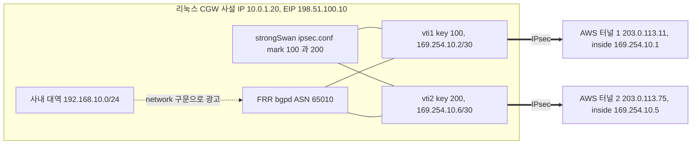

### strongSwan

`/etc/ipsec.conf`

```
config setup
    uniqueids=no
    charondebug="ike 1, knl 1, cfg 0, net 0"

conn %default
    keyexchange=ikev2
    authby=secret
    type=tunnel
    leftsubnet=0.0.0.0/0
    rightsubnet=0.0.0.0/0
    ike=aes256-sha256-modp2048!
    esp=aes256-sha256-modp2048!
    ikelifetime=28800s
    lifetime=3600s
    dpddelay=10s
    dpdaction=restart
    keyingtries=%forever
    auto=start

conn aws-tunnel1
    left=10.0.1.20
    leftid=198.51.100.10
    right=203.0.113.11
    rightid=203.0.113.11
    mark=100

conn aws-tunnel2
    left=10.0.1.20
    leftid=198.51.100.10
    right=203.0.113.75
    rightid=203.0.113.75
    mark=200
```

`/etc/ipsec.secrets`

```
198.51.100.10 203.0.113.11 : PSK "Zk3vN8qT1mXw5RbL0pYd7cHs"
198.51.100.10 203.0.113.75 : PSK "u9Fe2JgA6oQh4WtB8nKc1ZrM"
```

핵심은 세 가지다. `leftsubnet`과 `rightsubnet`을 0.0.0.0/0으로 둬서 AWS의 트래픽 셀렉터와 맞춘다(Phase 2 불일치 방지). `mark`는 터널마다 다르게 주고 아래 VTI의 key와 같은 숫자를 쓴다. `left`와 `leftid`를 분리해서 사설 IP와 공인 IP를 구분한다. strongSwan이 라우트를 직접 깔면 0.0.0.0/0 정책 때문에 기본 라우트가 터널로 가 버리므로 `install_routes = no`를 반드시 둔다. 이 설정은 `/etc/strongswan.conf` 전체를 바꾸지 말고 `/etc/strongswan.d/cgw.conf`로 추가한다. 전체를 `charon { install_routes = no }`로 덮으면 플러그인 로딩 설정이 날아가서 charon이 `abort initialization due to invalid configuration`으로 시작하지 못한다.

`/etc/strongswan.d/cgw.conf`

```
charon {
    install_routes = no
}
```

### VTI 인터페이스와 커널 설정

```bash
sysctl -w net.ipv4.ip_forward=1

ip link add vti1 type vti local 10.0.1.20 remote 203.0.113.11 key 100
ip addr add 169.254.10.2/30 dev vti1
ip link set vti1 up mtu 1436
sysctl -w net.ipv4.conf.vti1.disable_policy=1 net.ipv4.conf.vti1.rp_filter=0

ip link add vti2 type vti local 10.0.1.20 remote 203.0.113.75 key 200
ip addr add 169.254.10.6/30 dev vti2
ip link set vti2 up mtu 1436
sysctl -w net.ipv4.conf.vti2.disable_policy=1 net.ipv4.conf.vti2.rp_filter=0
```

AWS 쪽 inside IP는 `/30`의 첫 번째 주소(`169.254.10.1`, `169.254.10.5`), 장비 쪽은 두 번째 주소(`.2`, `.6`)다. 이 규칙이 틀리면 터널은 UP인데 BGP가 안 붙는다. 위 명령은 네임스페이스 안에서 실제로 실행해서 인터페이스가 만들어지고 `ikey`와 `okey`가 100으로 잡히는 것을 확인했다.

### FRR

`/etc/frr/daemons`에서 `bgpd=yes`로 바꾸고 아래 설정을 `bgpd.conf`(또는 통합 설정 사용 시 `frr.conf`)에 넣는다.

```
frr defaults traditional
hostname cgw-lab
log syslog informational
!
router bgp 65010
 bgp router-id 10.0.1.20
 no bgp ebgp-requires-policy
 neighbor 169.254.10.1 remote-as 64512
 neighbor 169.254.10.1 description aws-tunnel1
 neighbor 169.254.10.1 timers 10 30
 neighbor 169.254.10.5 remote-as 64512
 neighbor 169.254.10.5 description aws-tunnel2
 neighbor 169.254.10.5 timers 10 30
 !
 address-family ipv4 unicast
  network 192.168.10.0/24
  neighbor 169.254.10.1 route-map FROM-AWS-T1 in
  neighbor 169.254.10.5 route-map FROM-AWS-T2 in
  neighbor 169.254.10.5 route-map TO-AWS-T2 out
 exit-address-family
exit
!
route-map FROM-AWS-T1 permit 10
 set local-preference 200
exit
!
route-map FROM-AWS-T2 permit 10
 set local-preference 100
exit
!
route-map TO-AWS-T2 permit 10
 set as-path prepend 65010 65010 65010
exit
```

`no bgp ebgp-requires-policy`가 없으면 FRR 8.x는 정책이 붙지 않은 eBGP 방향의 경로를 주고받지 않는다. 위 설정에서 터널 1 아웃바운드에는 route-map이 없으므로 이 줄이 없으면 사내 대역이 AWS로 나가지 않는다. `network 192.168.10.0/24`는 장비 RIB에 같은 prefix 라우트가 있어야 광고된다. 장비의 LAN 인터페이스에 `192.168.10.1/24`가 붙어 있으면 충분하다.

## 터널 상태 확인과 알람

터널 상태는 `describe-vpn-connections`의 `VgwTelemetry`에 있다.

```bash
aws ec2 describe-vpn-connections --vpn-connection-ids vpn-0a1b2c3d4e5f67890 \
  --query 'VpnConnections[0].VgwTelemetry[].[OutsideIpAddress,Status,StatusMessage,AcceptedRouteCount,LastStatusChange]' \
  --output table
```

```
-----------------------------------------------------------------------------
|                           DescribeVpnConnections                          |
+---------------+------+--------------+---+-----------------------------+
|  203.0.113.11 |  UP  |  2 BGP ROUTES |  2 | 2026-11-24T02:11:05.000Z  |
|  203.0.113.75 |  DOWN|               |  0 | 2026-11-24T01:50:12.000Z  |
+---------------+------+--------------+---+-----------------------------+
```

위 출력은 형식을 보이려고 만든 예시다. 읽는 법은 이렇다. Status UP이고 AcceptedRouteCount가 0보다 크면 IPsec과 BGP가 모두 올라온 상태다. UP인데 수신 라우트가 0이면 IPsec은 붙었고 BGP는 못 붙었거나 장비가 아무것도 광고하지 않은 것이다. LastStatusChange가 최근에 계속 바뀌면 flapping이다.

Status UP이 어느 단계까지 올라온 것인지 상태 전이로 보면 이렇다. UP이 두 갈래로 나뉘는 것을 주목한다.

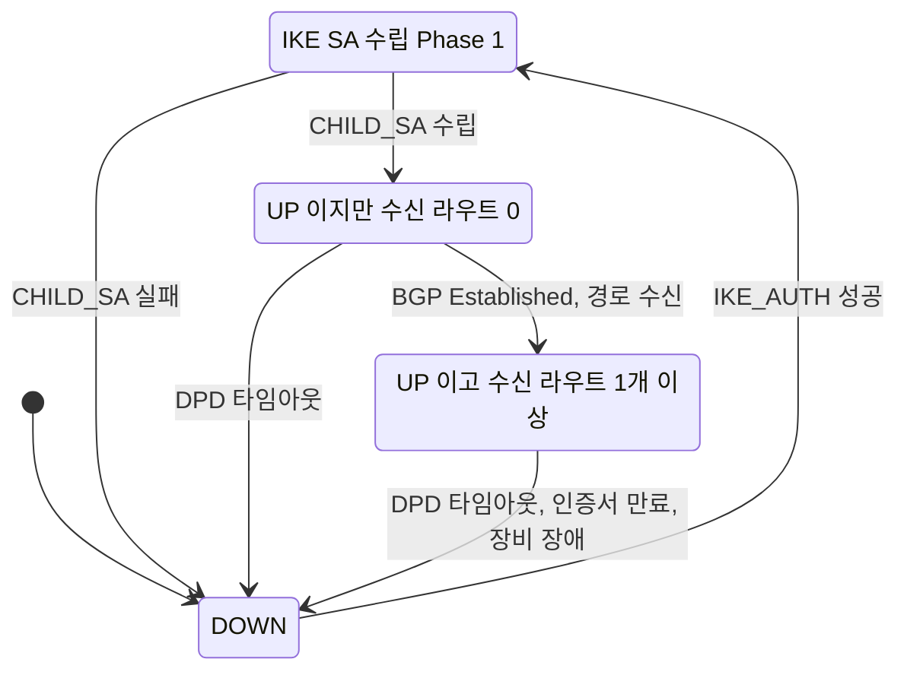

### CloudWatch 알람

AWS/VPN 네임스페이스의 `TunnelState`는 터널이 UP이면 1, DOWN이면 0이다. 차원을 `VpnId`로만 주면 터널 둘을 합친 값이라 한쪽만 내려가면 0.5가 나온다. 차원 구성은 콘솔의 지표 목록에서 확인한다. 한쪽 장애를 놓치지 않으려면 평균이 아니라 최솟값으로 본다.

```hcl
resource "aws_cloudwatch_metric_alarm" "tunnel_down" {
  alarm_name          = "vpn-hq-tunnel-down"
  namespace           = "AWS/VPN"
  metric_name         = "TunnelState"
  dimensions          = { VpnId = aws_vpn_connection.hq.id }
  statistic           = "Minimum"
  period              = 60
  evaluation_periods  = 3
  threshold           = 1
  comparison_operator = "LessThanThreshold"
  treat_missing_data  = "breaching"
  alarm_actions       = [aws_sns_topic.network_alert.arn]
}
```

`evaluation_periods = 3`은 AWS 쪽 엔드포인트 유지보수로 터널이 잠깐 내려갔다 올라오는 경우를 알람에서 거르기 위한 값이다. 이 값을 1로 두면 새벽에 의미 없는 알람이 온다. 터널 하나만 죽어도 알람을 받을지, 둘 다 죽었을 때만 받을지는 운영 정책이다. 둘 다 죽은 경우는 `Maximum < 1`로 따로 둬서 중요도를 나눈다.

로그가 필요하면 터널 옵션의 `LogOptions.CloudWatchLogOptions`로 IKE 로그와 BGP 로그를 CloudWatch Logs로 보낼 수 있다. `LogEnabled`와 `BgpLogEnabled`를 켜면 AWS 쪽에서 본 협상 과정이 남아서 장비 로그와 대조할 수 있다. 협상이 어디서 어긋나는지 모르겠을 때 가장 빠르게 단서를 준다.

## 트러블슈팅

터널이 안 올라올 때는 IKE → IPsec SA → BGP → 라우트 전파 순서로 아래에서 위로 올라가며 본다. 위 단계 증상이 아래 단계 때문에 생기는 경우가 대부분이라, 첫 번째 실패 지점부터 잡는다.

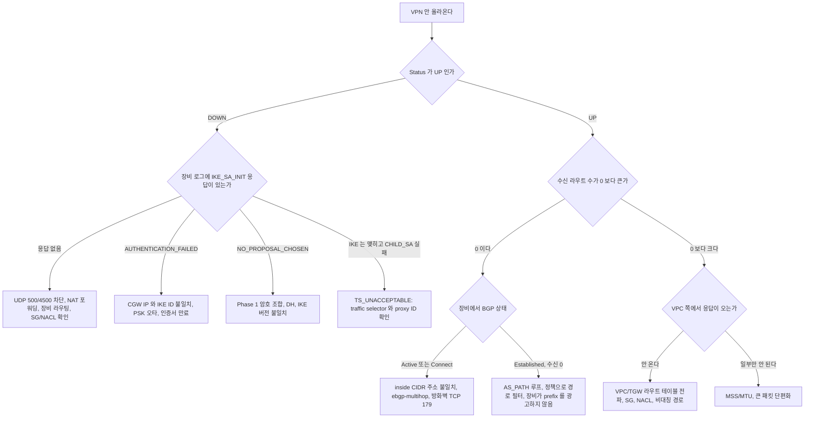

위 그림은 증상에서 원인 후보로 가는 길이다. 단계별로 자세히 본다.

### Phase 1 실패

장비 로그에서 IKE_SA_INIT 요청은 나가는데 응답이 안 오면 UDP 500이 막혀 있다. 장비 앞 방화벽과 NAT 장비의 포워딩, EC2면 보안 그룹과 NACL을 본다. 응답은 오는데 IKE_AUTH에서 `received AUTHENTICATION_FAILED notify error`가 보이면 인증 문제다. 확인 순서는 이렇다.

1. 장비가 보내는 IKE ID가 CGW에 등록한 공인 IP와 같은지. NAT와 CGNAT에서 가장 흔하다.
2. PSK가 해당 터널의 값인지. 터널 1과 2의 PSK는 다르고, 복사하다 따옴표나 줄바꿈이 섞이는 경우가 있다.
3. 인증서 방식이면 만료일과 체인.

`NO_PROPOSAL_CHOSEN`은 암호 조합 불일치다. 장비가 내미는 조합과 AWS가 허용하는 조합을 `describe-vpn-connections`의 `Options.TunnelOptions`와 장비 설정에서 나란히 놓고 본다.

### Phase 2 실패

IKE SA는 맺어졌는데 CHILD_SA가 안 만들어지고 `TS_UNACCEPTABLE`이 보이면 traffic selector 문제다. 정책 기반 장비(구형 방화벽 등)는 `192.168.10.0/24 ↔ 10.0.0.0/16` 같은 구체적 selector를 보내는데, BGP를 쓰는 VPN Connection의 AWS 쪽은 `0.0.0.0/0 ↔ 0.0.0.0/0`을 기대한다. 장비를 라우트 기반(VTI, 터널 인터페이스)으로 바꾸는 게 제일 깔끔하다. 정책 기반만 되는 장비라면 VPN Connection을 정적 라우팅으로 만들고 `LocalIpv4NetworkCidr`, `RemoteIpv4NetworkCidr`을 장비 selector와 맞춘다. Cisco 계열에서는 이 selector를 proxy ID나 crypto ACL이라 부르고 한 줄만 달라도 같은 증상이 나온다.

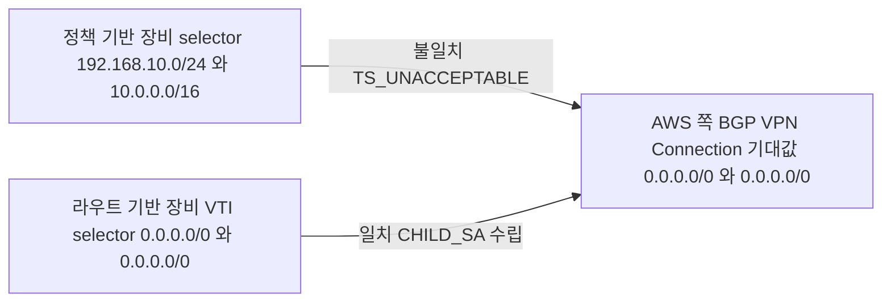

### 터널은 UP인데 BGP가 안 올라오는 경우

가장 많이 하는 실수가 inside IP다. `169.254.10.0/30`에서 AWS는 `.1`, 장비는 `.2`다. 장비 인터페이스에 `.1`을 붙이거나 `/30` 대신 `/24`를 붙이면 BGP 피어에 도달하지 못한다. 장비에서 `ping 169.254.10.1`이 되는지부터 본다. 되는데도 BGP가 Active/Connect에서 안 움직이면 TCP 179가 장비 방화벽에서 막혔거나 BGP 패킷의 출발지 주소가 inside IP가 아닌 경우다. 피어를 루프백 주소로 맺는 구성에서는 `ebgp-multihop`과 `update-source`가 필요하다. 터널 인터페이스에 붙인 inside IP로 맺는 일반 구성에서는 필요 없다.

BGP 세션은 inside CIDR `/30`의 두 주소 사이에서 맺힌다. 확인은 ping이 먼저고 TCP 179가 그다음이다.

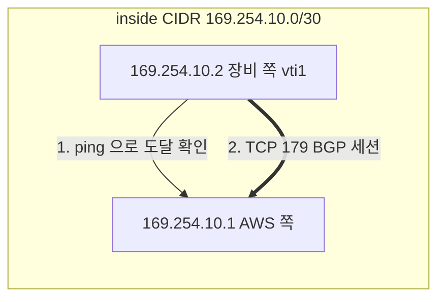

```
 neighbor 169.254.10.1 ebgp-multihop 2
 neighbor 169.254.10.1 update-source 169.254.10.2
```

```bash
vtysh -c 'show bgp summary'
vtysh -c 'show bgp neighbors 169.254.10.1 | include BGP state|Last reset'
vtysh -c 'show bgp ipv4 unicast neighbors 169.254.10.1 advertised-routes'
```

Established인데 수신 라우트가 0이면 AS_PATH 루프가 의심스럽다. `show bgp ipv4 unicast neighbors X received-routes`는 `soft-reconfiguration inbound`가 켜져 있어야 보이고, 버려진 경로를 확인하기 위한 용도로 쓴다. 반대로 장비가 아무것도 광고하지 않아서 AWS 쪽 라우트 테이블에 사내 대역이 안 나타나는 경우도 같은 증상이다.

### 한쪽 터널만 flapping

한쪽 터널만 올라갔다 내려가는 건 대개 세 가지다.

- 양쪽 DPD와 리키 설정이 다르다. 한쪽이 먼저 세션을 정리하고 다시 시작하는 사이 다른 쪽이 옛 SA를 들고 있다.
- 장비에서 두 터널이 같은 selector와 같은 SPI 영역을 놓고 경합한다. strongSwan에서 `uniqueids=no`를 쓰고, 터널마다 `mark`를 분리한다.
- 인터넷 경로가 좋지 않다. 터널 1과 2가 서로 다른 AWS AZ의 엔드포인트라 경로가 달라서 한쪽만 손실이 크다. `mtr`로 두 AWS 공인 IP까지 손실률을 비교한다.

AWS 쪽 유지보수로 터널이 잠깐 내려가는 건 정상이라, 그때 나머지 터널로 BGP가 넘어가는 것만 확인되면 된다. 그렇게 안 넘어가면 토폴로지 A도 안 되는 상태이므로 설정을 다시 본다.

## 다른 클라우드와의 대응

AWS CGW에 대응하는 객체가 다른 클라우드에도 있다. 이름은 다른데 역할이 같고, 설정 시 걸리는 지점이 조금씩 다르다.

| 항목 | AWS Customer Gateway | Azure Local Network Gateway | GCP Peer VPN Gateway (External VPN Gateway) |
|---|---|---|---|
| 담는 정보 | 공인 IP 하나, ASN, 인증서 ARN | 공인 IP 또는 FQDN, 사내 주소 대역, 선택적 BGP 설정 | 인터페이스 1, 2, 4개 공인 IP, 중복성 유형 |
| 동적 IP | 불가 (정적 IP 필요) | FQDN으로 가능 | 불가에 가깝다 (고정 IP 필요) |
| 사내 대역 선언 | 정적 라우팅 때만 | 항상 (BGP 안 쓸 때) | Cloud Router BGP 또는 정적 라우트 |
| 수정 | 불가 (교체) | 가능 | 가능 |
| 연결 단위 | VPN Connection (터널 2개) | Connection | VPN Tunnel (게이트웨이 인터페이스별) |

Azure Local Network Gateway는 FQDN을 받을 수 있어서 동적 IP 지점 처리가 AWS보다 쉽다. GCP는 상대 장비 인터페이스를 최대 4개까지 선언하고, AWS와 맺을 때 인터페이스 수와 터널 수를 맞추는 계산이 필요하다. 그 계산은 [AWS와 GCP를 VPN으로 직접 잇기](AWS_GCP_Multi_Cloud_VPN.md)에 정리돼 있다. 클라우드끼리 이을 때는 한쪽에서 보면 다른 클라우드의 VPN 게이트웨이가 CGW이고, 그쪽 공인 IP와 ASN이 CGW 값이 된다는 점만 기억하면 된다.
