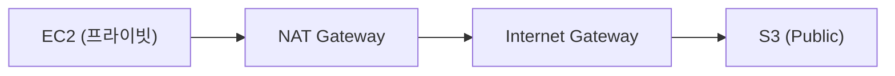
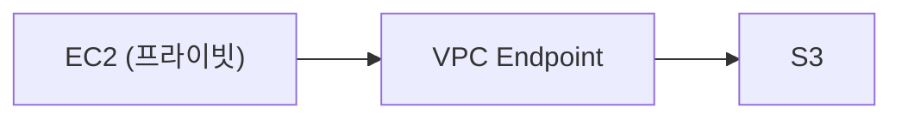

# AWS PrivateLink

## 개요

PrivateLink는 VPC와 AWS 서비스 또는 다른 VPC의 서비스를 프라이빗하게 연결한다. 인터넷을 거치지 않는다. 트래픽이 AWS 네트워크 내부에만 머문다. 보안이 강화되고 성능이 향상된다.

### 왜 필요한가

AWS 서비스나 외부 서비스에 접근할 때 보안 문제가 생긴다.

#### 문제 상황 1. S3 접근

일반적인 구성은 프라이빗 서브넷의 EC2에서 S3에 접근한다. 아래 도식은 이때 트래픽이 NAT Gateway와 Internet Gateway를 거쳐 퍼블릭 S3로 나가는 경로를 보여준다.



이 경로에는 문제가 있다.

- 트래픽이 인터넷을 거친다
- NAT Gateway 비용 발생
- 대역폭 제한
- 보안 리스크 (중간 경로 노출)

VPC Endpoint(PrivateLink)로 해결한다. 아래 도식은 NAT Gateway와 Internet Gateway 없이 EC2가 VPC Endpoint로 S3에 바로 닿는 경로를 보여준다.



- 트래픽이 VPC 내부에만 머문다
- NAT Gateway 불필요
- 빠른 속도
- 안전

#### 문제 상황 2. 서비스 제공

회사가 SaaS를 운영한다. 고객사가 수백 개다. 각 고객사가 우리 API를 호출한다.

일반적인 구성은 고객 VPC가 인터넷을 거쳐 퍼블릭 ALB로 들어온다. 아래 도식은 이 호출 경로를 보여준다.


이 구성에는 문제가 있다.

- API가 인터넷에 노출된다
- DDoS 공격 위험
- 고객사가 보안 정책으로 인터넷 송신을 차단하면 접근 불가
- IP 화이트리스트 관리가 복잡

PrivateLink(VPC Endpoint Service)로 해결한다. 아래 도식은 인터넷과 퍼블릭 ALB를 빼고 고객 VPC의 Endpoint가 서비스에 바로 연결되는 경로를 보여준다.


- 인터넷 노출 없음
- 프라이빗 네트워크로 연결
- IP 화이트리스트 불필요
- 안전하고 빠름

#### 문제 상황 3. 멀티 테넌트 아키텍처

각 고객사마다 VPC를 분리한다. 중앙 서비스 VPC가 있다. 모든 고객사가 중앙 서비스에 접근한다.

일반적인 방법은 VPC Peering이다.

- 고객 VPC 100개
- 각각 중앙 VPC와 Peering
- 100개 Peering 관리
- 라우팅 테이블 복잡

PrivateLink로 풀면 Peering이 필요 없다.

- 중앙 VPC에서 Endpoint Service 생성
- 각 고객 VPC에서 VPC Endpoint 생성
- Peering 불필요
- 라우팅 간단

## 핵심 개념

### VPC Endpoint

VPC에서 AWS 서비스나 다른 VPC의 서비스에 프라이빗하게 접근하는 진입점이다.

Endpoint 타입은 두 가지다.

#### Gateway Endpoint

- S3, DynamoDB만 지원
- 라우팅 테이블에 규칙 추가
- 무료

#### Interface Endpoint (PrivateLink)

- 대부분의 AWS 서비스 지원
- ENI(Elastic Network Interface) 생성
- 프라이빗 IP 할당
- 시간당 비용 발생

### VPC Endpoint Service

자신의 서비스를 다른 VPC에 제공한다. PrivateLink로 연결된다.

구성 요소는 세 가지다.

- Network Load Balancer
- VPC Endpoint Service
- 서비스를 제공하는 VPC

접근 제어는 두 가지로 건다.

- 특정 AWS 계정만 허용
- IAM 권한 설정

### ENI (Elastic Network Interface)

Interface Endpoint는 ENI를 생성한다. 프라이빗 IP 주소를 가진다.

ENI의 특징이다.

- VPC 서브넷에 배치
- 보안 그룹 적용 가능
- DNS 이름 제공

## Interface Endpoint 사용

### S3 접근 (Interface Endpoint)

Interface Endpoint를 만든다.

```bash
aws ec2 create-vpc-endpoint \
  --vpc-id vpc-12345678 \
  --vpc-endpoint-type Interface \
  --service-name com.amazonaws.us-west-2.s3 \
  --subnet-ids subnet-11111111 subnet-22222222 \
  --security-group-ids sg-12345678
```

Endpoint의 보안 그룹을 설정한다.

```bash
# Endpoint의 보안 그룹
aws ec2 authorize-security-group-ingress \
  --group-id sg-12345678 \
  --protocol tcp \
  --port 443 \
  --source-group sg-87654321  # EC2의 보안 그룹
```

EC2에서 Endpoint로 HTTPS 트래픽을 허용한다.

EC2에서 S3에 접근한다. 코드 변경은 필요 없다.

```bash
# S3 목록 조회
aws s3 ls s3://my-bucket/
```

트래픽이 VPC Endpoint를 거쳐 S3로 간다. 인터넷을 거치지 않는다.

DNS가 Endpoint로 풀리는지 확인한다.

```bash
nslookup s3.us-west-2.amazonaws.com
```

Endpoint의 프라이빗 IP가 반환된다.

### Lambda 접근

Lambda 함수를 VPC 밖에서 호출한다. 보통 인터넷을 거친다. PrivateLink로 프라이빗하게 호출한다.

Endpoint를 만든다.

```bash
aws ec2 create-vpc-endpoint \
  --vpc-id vpc-12345678 \
  --vpc-endpoint-type Interface \
  --service-name com.amazonaws.us-west-2.lambda \
  --subnet-ids subnet-11111111 \
  --security-group-ids sg-12345678
```

SDK로 Lambda를 호출한다.

```javascript
const AWS = require('aws-sdk');
const lambda = new AWS.Lambda({
  endpoint: 'https://vpce-12345678-abcd1234.lambda.us-west-2.vpce.amazonaws.com'
});

const result = await lambda.invoke({
  FunctionName: 'my-function',
  Payload: JSON.stringify({ key: 'value' })
}).promise();
```

Endpoint URL을 사용한다. 트래픽이 VPC 내부로만 흐른다.

## Gateway Endpoint 사용

### S3 접근 (Gateway Endpoint)

Gateway Endpoint를 만든다.

```bash
aws ec2 create-vpc-endpoint \
  --vpc-id vpc-12345678 \
  --service-name com.amazonaws.us-west-2.s3 \
  --route-table-ids rtb-11111111 rtb-22222222
```

라우팅 테이블을 확인한다.

```bash
aws ec2 describe-route-tables --route-table-ids rtb-11111111
```

자동으로 규칙이 추가된다:
```
Destination         Target
pl-12345678         vpce-12345678
```

`pl-12345678`는 S3의 IP 범위를 나타내는 Prefix List다.

코드 변경 없이 S3에 접근한다.

```bash
aws s3 cp file.txt s3://my-bucket/
```

트래픽이 Gateway Endpoint를 거쳐 S3로 간다.

Endpoint Policy로 접근할 S3 버킷을 제한한다.

```json
{
  "Statement": [
    {
      "Effect": "Allow",
      "Principal": "*",
      "Action": [
        "s3:GetObject",
        "s3:PutObject"
      ],
      "Resource": [
        "arn:aws:s3:::my-bucket/*",
        "arn:aws:s3:::my-other-bucket/*"
      ]
    }
  ]
}
```

`my-bucket`과 `my-other-bucket`만 접근 가능하다. 다른 버킷은 차단된다.

### DynamoDB 접근

Gateway Endpoint를 만든다.

```bash
aws ec2 create-vpc-endpoint \
  --vpc-id vpc-12345678 \
  --service-name com.amazonaws.us-west-2.dynamodb \
  --route-table-ids rtb-11111111
```

접근 코드는 기존과 같다.

```javascript
const AWS = require('aws-sdk');
const dynamodb = new AWS.DynamoDB.DocumentClient();

const result = await dynamodb.get({
  TableName: 'Users',
  Key: { user_id: 'user_123' }
}).promise();
```

트래픽이 Gateway Endpoint를 거쳐 DynamoDB로 간다.

## VPC Endpoint Service 생성

자신의 서비스를 다른 VPC에 제공한다.

### NLB 생성

Network Load Balancer를 만든다. PrivateLink는 NLB로 트래픽을 전달한다.

```bash
aws elbv2 create-load-balancer \
  --name my-service-nlb \
  --type network \
  --scheme internal \
  --subnets subnet-11111111 subnet-22222222
```

`scheme: internal`은 NLB를 프라이빗으로 만든다. 인터넷에서는 접근할 수 없다.

Target Group을 만든다.

```bash
aws elbv2 create-target-group \
  --name my-service-targets \
  --protocol TCP \
  --port 80 \
  --vpc-id vpc-12345678 \
  --target-type instance
```

Target을 등록한다.

```bash
aws elbv2 register-targets \
  --target-group-arn arn:aws:elasticloadbalancing:us-west-2:123456789012:targetgroup/my-service-targets/1234567890123456 \
  --targets Id=i-12345678 Id=i-87654321
```

Listener를 만든다.

```bash
aws elbv2 create-listener \
  --load-balancer-arn arn:aws:elasticloadbalancing:us-west-2:123456789012:loadbalancer/net/my-service-nlb/1234567890123456 \
  --protocol TCP \
  --port 80 \
  --default-actions Type=forward,TargetGroupArn=arn:aws:elasticloadbalancing:us-west-2:123456789012:targetgroup/my-service-targets/1234567890123456
```

### Endpoint Service 생성

```bash
aws ec2 create-vpc-endpoint-service-configuration \
  --network-load-balancer-arns arn:aws:elasticloadbalancing:us-west-2:123456789012:loadbalancer/net/my-service-nlb/1234567890123456 \
  --acceptance-required
```

`--acceptance-required`를 주면 다른 계정이 연결을 요청할 때 수동으로 승인한다. 보안을 위해 권장한다.

Service Name을 확인한다.

```bash
aws ec2 describe-vpc-endpoint-service-configurations \
  --service-ids vpce-svc-12345678
```

Service Name: `com.amazonaws.vpce.us-west-2.vpce-svc-12345678`

이 이름을 고객에게 제공한다.

### 접근 허용

특정 AWS 계정만 접근하도록 설정한다.

```bash
aws ec2 modify-vpc-endpoint-service-permissions \
  --service-id vpce-svc-12345678 \
  --add-allowed-principals arn:aws:iam::111122223333:root
```

계정 `111122223333`이 Endpoint를 생성할 수 있다.

## 고객이 Endpoint 생성

고객사가 자신의 VPC에서 Endpoint를 만든다.

Endpoint를 만든다.

```bash
aws ec2 create-vpc-endpoint \
  --vpc-id vpc-customer123 \
  --vpc-endpoint-type Interface \
  --service-name com.amazonaws.vpce.us-west-2.vpce-svc-12345678 \
  --subnet-ids subnet-aaaaaaaa subnet-bbbbbbbb \
  --security-group-ids sg-customer123
```

Endpoint가 "pendingAcceptance" 상태가 된다. 서비스 제공자가 승인해야 한다.

서비스 제공자가 승인한다.

```bash
aws ec2 accept-vpc-endpoint-connections \
  --service-id vpce-svc-12345678 \
  --vpc-endpoint-ids vpce-customer-12345678
```

Endpoint가 "available" 상태가 된다.

고객이 서비스를 호출한다.

```bash
curl http://vpce-customer-12345678-abcd1234.vpce-svc-12345678.us-west-2.vpce.amazonaws.com
```

Endpoint DNS로 서비스에 접근한다. 트래픽이 프라이빗 네트워크로만 흐른다.

## Private DNS

Endpoint에 커스텀 DNS 이름을 설정한다.

### 설정

Endpoint Service에서 Private DNS를 활성화한다.

```bash
aws ec2 modify-vpc-endpoint-service-configuration \
  --service-id vpce-svc-12345678 \
  --private-dns-name api.mycompany.com
```

AWS가 TXT 레코드를 제공한다. 자신의 DNS에 추가해서 소유권을 증명한다.

```bash
# Route 53 또는 외부 DNS에 추가
_vpce:12345678.api.mycompany.com TXT "vpce:12345678abcdefg"
```

소유권 검증을 요청한다.

```bash
aws ec2 start-vpc-endpoint-service-private-dns-verification \
  --service-id vpce-svc-12345678
```

### 사용

고객이 Endpoint를 생성할 때 Private DNS를 활성화한다.

```bash
aws ec2 create-vpc-endpoint \
  --vpc-id vpc-customer123 \
  --service-name com.amazonaws.vpce.us-west-2.vpce-svc-12345678 \
  --private-dns-enabled \
  --subnet-ids subnet-aaaaaaaa \
  --security-group-ids sg-customer123
```

고객은 커스텀 이름으로 접근한다.

```bash
curl https://api.mycompany.com
```

`api.mycompany.com`이 Endpoint의 프라이빗 IP로 리졸브된다. 간편하게 사용할 수 있다.

## 실무 패턴

### 중앙 서비스 제공

회사에 여러 팀이 있다. 각 팀이 독립된 VPC를 사용한다. 중앙 DevOps 팀이 공통 서비스를 제공한다.

중앙 팀이 제공하는 서비스다.

- CI/CD API
- 로그 수집기
- 메트릭 수집기
- 시크릿 관리

구성은 두 종류의 VPC로 나뉜다.

- 중앙 VPC: 서비스들이 실행됨
- 팀 VPC: 각 팀의 리소스

PrivateLink는 세 단계로 붙인다.

1. 중앙 VPC에서 Endpoint Service 생성
2. 각 팀 VPC에서 Endpoint 생성
3. 팀들이 서비스에 프라이빗하게 접근

장점은 네 가지다.

- VPC Peering 불필요
- 라우팅 간단
- 팀 VPC끼리 격리됨
- 중앙 팀이 접근 제어

### SaaS 제공

SaaS를 운영한다. 고객사가 100개다. 각 고객사가 자신의 AWS 계정과 VPC를 사용한다.

요구사항은 세 가지다.

- API를 인터넷에 노출하지 않음
- 고객사가 프라이빗하게 접근
- 고객사별 접근 제어

구성은 네 단계다.

1. Endpoint Service 생성
2. Service Name을 고객에게 제공
3. 고객이 자신의 VPC에서 Endpoint 생성
4. 연결 요청을 승인

접근은 이렇게 제어한다.

- 연결 요청 시 고객 AWS 계정 확인
- 승인된 고객만 접근 가능
- NLB에서 추가 인증 (API Key 등)

장점은 세 가지다.

- 인터넷 노출 없음
- 고객이 IP 화이트리스트 관리 불필요
- 안전하고 빠른 연결

### 멀티 리전 서비스

서비스를 여러 리전에서 제공한다. 고객이 가까운 리전에 접근한다.

구성은 리전별 Endpoint Service다.

- us-west-2에 Endpoint Service
- us-east-1에 Endpoint Service
- 고객이 리전별로 Endpoint 생성

Private DNS를 쓴다.

- `api.mycompany.com`
- Route 53 Geolocation 라우팅
- 고객 위치에 따라 가까운 리전으로 연결

고객은 하나의 DNS만 사용한다. 자동으로 가까운 리전에 연결된다.

## 모니터링

### CloudWatch 메트릭

Endpoint Service에서 보는 메트릭이다.

- **ActiveConnections**: 활성 연결 수
- **NewConnections**: 새 연결 수
- **BytesProcessed**: 처리된 바이트 수

NLB에서 보는 메트릭이다.

- **TargetConnectionErrorCount**: Target 연결 실패
- **UnHealthyHostCount**: 비정상 Target 수

### VPC Flow Logs

Endpoint를 지나는 트래픽을 로그로 남긴다.

```bash
aws ec2 create-flow-logs \
  --resource-type VpcEndpoint \
  --resource-ids vpce-12345678 \
  --traffic-type ALL \
  --log-destination-type cloud-watch-logs \
  --log-group-name /aws/vpcendpoint/flowlogs
```

로그로 확인할 수 있는 항목이다.

- 어떤 IP가 접근하는지
- 얼마나 많은 트래픽이 발생하는지
- 거부된 트래픽

## 트러블슈팅

### 엔드포인트를 만들었는데 여전히 NAT 로 나간다

엔드포인트를 만들고 NAT 게이트웨이 비용이 그대로면 트래픽이 아직 엔드포인트를 타지 않는다. **에러가 안 난다는 게 이 문제의 성질이다** — S3 호출은 잘 되고 코드도 안 바뀌었으니, 청구서를 보기 전까지 아무도 모른다.

원인은 거의 항상 아래 넷 중 하나이고, 순서대로 확인하면 빠르다.

#### 1. Gateway — 라우팅 테이블에 연결했는가

Gateway 엔드포인트(S3·DynamoDB)는 **만들기만 해서는 아무 일도 안 한다.** 서브넷이 쓰는 라우팅 테이블에 붙어야 그 테이블에 Prefix List 경로가 생긴다.

프라이빗 서브넷이 여러 개고 라우팅 테이블도 여러 개인 구성에서, 엔드포인트 생성 시 일부만 넣고 나머지를 빠뜨리는 일이 흔하다. **그 테이블을 쓰는 서브넷의 트래픽만 계속 NAT 로 나간다.**

```bash
# 이 엔드포인트가 어느 라우팅 테이블에 붙어 있나
aws ec2 describe-vpc-endpoints --vpc-endpoint-ids vpce-12345678 \
  --query 'VpcEndpoints[0].RouteTableIds'

# 실제로 앱이 뜬 서브넷은 어느 테이블을 쓰나 — 위 목록에 있어야 한다
aws ec2 describe-route-tables \
  --filters Name=association.subnet-id,Values=subnet-aaaa \
  --query 'RouteTables[].RouteTableId'
```

두 결과가 어긋나면 그게 원인이다. 붙이는 건 나중에도 된다.

```bash
aws ec2 modify-vpc-endpoint --vpc-endpoint-id vpce-12345678 \
  --add-route-table-ids rtb-33333333
```

라우팅 테이블에 `pl-` 로 시작하는 Prefix List 경로가 보이면 연결된 상태다.

#### 2. Interface — Private DNS 를 켰는가

Interface 엔드포인트는 반대로 **DNS 가 핵심**이다. `--private-dns-enabled` 없이 만들면 엔드포인트 전용 DNS 이름만 생기고, 원래 쓰던 퍼블릭 엔드포인트 이름은 **그대로 퍼블릭 IP 로 해석된다.** 코드가 `secretsmanager.us-west-2.amazonaws.com` 을 그대로 쓰고 있으면 트래픽은 여전히 NAT 로 나간다.

```bash
aws ec2 describe-vpc-endpoints --vpc-endpoint-ids vpce-12345678 \
  --query 'VpcEndpoints[0].PrivateDnsEnabled'
```

`false` 면 켠다.

```bash
aws ec2 modify-vpc-endpoint --vpc-endpoint-id vpce-12345678 --private-dns-enabled
```

VPC 의 `enableDnsSupport` 와 `enableDnsHostnames` 가 둘 다 켜져 있어야 한다는 조건도 붙는다(위 "Private DNS" 절 참고).

#### 3. 확인 — 어디로 해석되는지 직접 본다

설정을 봐도 확신이 안 서면 **인스턴스 안에서 이름이 무엇으로 풀리는지** 보는 게 결정적이다.

```bash
# 프라이빗 서브넷의 인스턴스/태스크 안에서
$ nslookup secretsmanager.us-west-2.amazonaws.com
```

- **VPC 대역의 사설 IP**(10.x, 172.16~31.x, 192.168.x)가 나오면 → 엔드포인트를 타고 있다
- **퍼블릭 IP** 가 나오면 → 아직 인터넷으로 나간다. 1·2번을 다시 본다

Gateway(S3)는 DNS 가 아니라 라우팅으로 갈리므로 이름은 퍼블릭으로 풀린다. 이쪽은 라우팅 테이블에서 Prefix List 경로를 확인하는 게 맞는 방법이다.

#### 4. 엔드포인트 정책과 보안 그룹 — 여기서 막히면 조용하지 않다

앞의 셋과 달리 이 둘은 **에러를 낸다.** 그래서 진단 순서에서 뒤에 둔다.

- **엔드포인트 정책** — 기본은 전체 허용이지만 좁혀 놨다면 `AccessDenied` 가 난다. 버킷 이름이나 리소스 ARN 을 정책에 빠뜨린 경우
- **보안 그룹** — Interface 엔드포인트는 ENI 라 SG 가 붙는다. 인바운드 443 이 앱 SG 로부터 열려 있어야 한다. 막히면 연결 타임아웃

정리하면 이렇다.

| 증상 | 의심할 곳 |
|---|---|
| 잘 되는데 NAT 비용 그대로 | 1·2번 (조용히 안 먹는 경우) |
| `AccessDenied` | 엔드포인트 정책 |
| 연결 타임아웃 | 보안 그룹 |

**"조용히 안 먹는" 앞의 둘이 이 문제의 대부분**이다. 비용 절감을 기대하고 엔드포인트를 만들었다면, 만든 직후 3번의 `nslookup` 이나 라우팅 테이블 확인으로 실제로 타는지 한 번 보는 게 낫다. 다음 달 청구서로 알게 되는 것보다 낫다.

### Endpoint에 연결이 안 된다

#### 1. Endpoint 상태 확인

```bash
aws ec2 describe-vpc-endpoints --vpc-endpoint-ids vpce-12345678
```

"available" 상태여야 한다. "pending" 또는 "failed"면 문제가 있다.

#### 2. 보안 그룹

Endpoint의 보안 그룹이 인바운드 트래픽을 허용하는지 확인.

```bash
aws ec2 describe-security-groups --group-ids sg-12345678
```

필요한 포트가 열려있는지 확인 (예: 443, 80).

#### 3. NLB 상태 (Endpoint Service)

NLB의 Target이 정상인지 확인.

```bash
aws elbv2 describe-target-health \
  --target-group-arn arn:aws:elasticloadbalancing:...:targetgroup/...
```

모든 Target이 "healthy" 상태여야 한다.

#### 4. DNS 리졸브

```bash
nslookup vpce-12345678-abcd1234.vpce-svc-12345678.us-west-2.vpce.amazonaws.com
```

Endpoint의 프라이빗 IP가 반환되어야 한다.

### Private DNS가 작동하지 않는다

#### 1. DNS 검증

Endpoint Service의 Private DNS가 검증되었는지 확인.

```bash
aws ec2 describe-vpc-endpoint-service-configurations \
  --service-ids vpce-svc-12345678
```

`PrivateDnsNameVerificationState`가 "verified"여야 한다.

#### 2. Endpoint 설정

Endpoint 생성 시 `--private-dns-enabled` 옵션을 사용했는지 확인.

#### 3. VPC DNS 설정

VPC에서 DNS 해석이 활성화되어 있는지 확인.

```bash
aws ec2 describe-vpc-attribute \
  --vpc-id vpc-12345678 \
  --attribute enableDnsSupport

aws ec2 describe-vpc-attribute \
  --vpc-id vpc-12345678 \
  --attribute enableDnsHostnames
```

둘 다 true여야 한다.

## 비용

### Interface Endpoint 비용

시간당 요금은 Endpoint당 AZ당 $0.01이다.

계산 예시다.

- Endpoint 1개
- 2개 AZ
- 시간당: $0.01 × 2 = $0.02
- 월간: $0.02 × 730시간 = $14.60

데이터 전송은 $0.01/GB다. 100GB를 전송하면 $1.00이다.

### Gateway Endpoint 비용

Gateway Endpoint는 비용이 없다. S3와 DynamoDB는 Gateway Endpoint를 사용하는 것이 좋다.

### Endpoint Service 비용

Endpoint Service 자체는 무료다. NLB 비용만 발생한다.

NLB 요금 항목이다.

- 시간당: $0.0225
- LCU: $0.006 per LCU-hour

계산 예시다.

- NLB 1개
- 100 LCU/시간
- 시간당: $0.0225 + ($0.006 × 100) = $0.6225
- 월간: $0.6225 × 730 = $454

### NAT Gateway와 비교

NAT Gateway 기준이다.

- 시간당: $0.045
- 데이터: $0.045/GB
- 100GB: $0.045 × 730 + $0.045 × 100 = $37.35

Interface Endpoint(2 AZ) 기준이다.

- 시간당: $0.02
- 데이터: $0.01/GB
- 100GB: $0.02 × 730 + $0.01 × 100 = $15.60

Endpoint가 더 저렴하다. AWS 서비스 접근 시 NAT Gateway 대신 Endpoint를 사용하는 것이 좋다.

## 참고

- AWS PrivateLink 개발자 가이드: https://docs.aws.amazon.com/vpc/latest/privatelink/
- PrivateLink 요금: https://aws.amazon.com/privatelink/pricing/
- VPC Endpoint Services: https://docs.aws.amazon.com/vpc/latest/privatelink/endpoint-service.html
- Gateway vs Interface Endpoint: https://docs.aws.amazon.com/vpc/latest/privatelink/vpce-gateway.html

