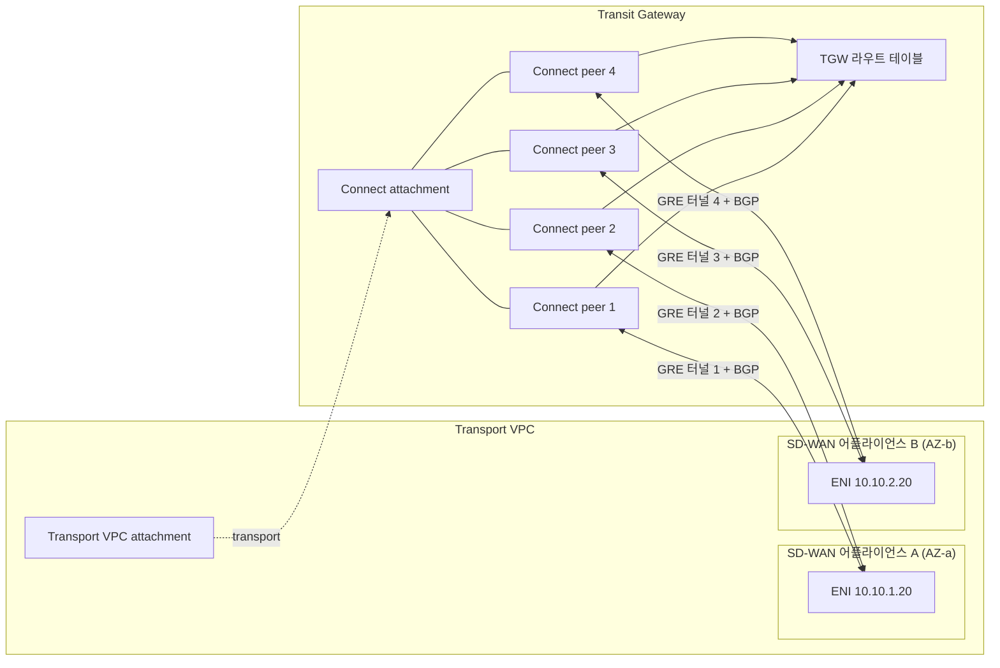
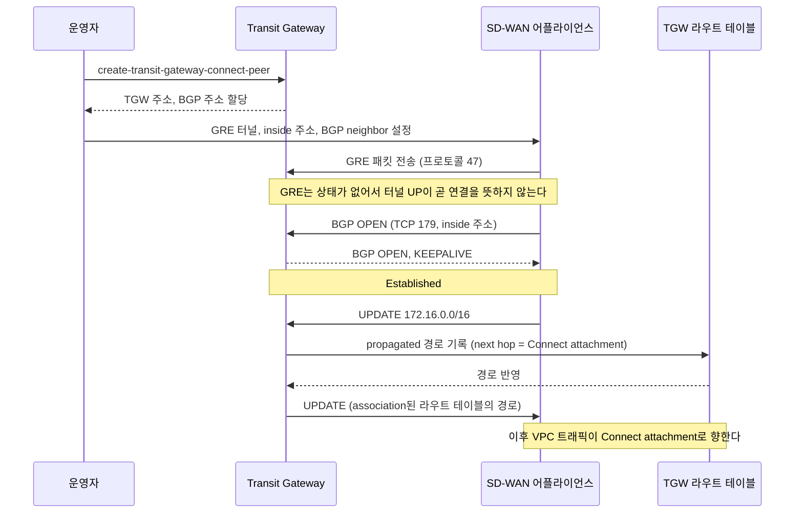
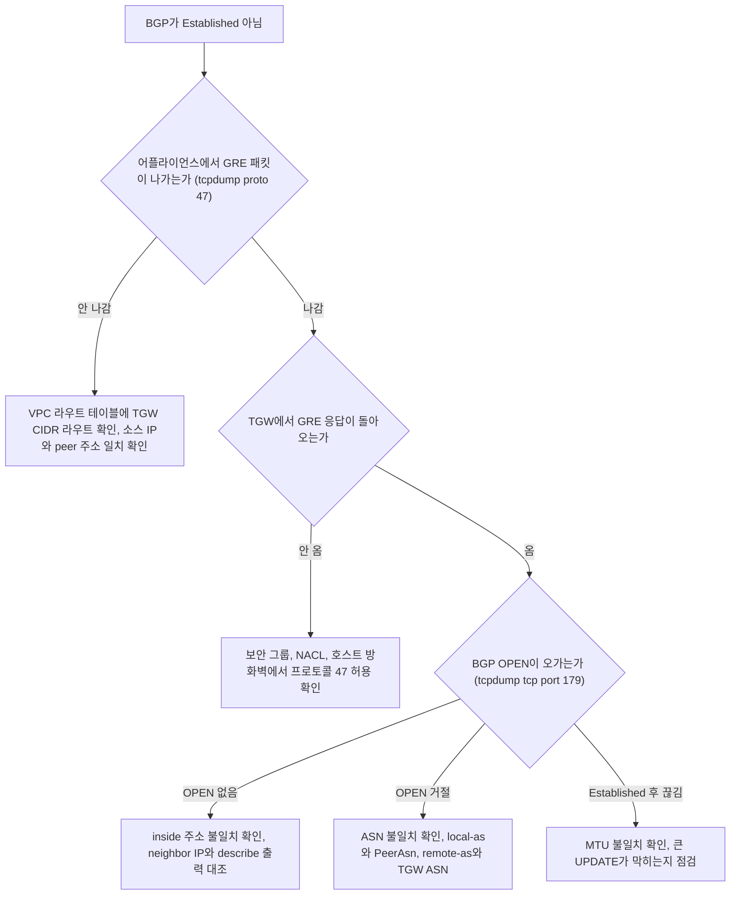
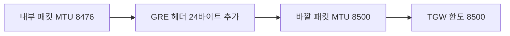

# TGW Connect Attachment와 SD-WAN GRE

[Transit Gateway](Transit_Gateway.md) 문서는 Connect attachment를 "SD-WAN 연결" 한 줄로 넘긴다. 실제로 SD-WAN 어플라이언스(Cisco, Fortinet, Aruba, Palo Alto 같은 가상 장비)를 TGW 뒤에 붙여 보면 이 한 줄 밑에 GRE 터널, BGP 세션, inside CIDR, MTU, Source/Dest check가 전부 걸려 있다. 하나라도 어긋나면 증상은 대부분 "BGP가 Established 안 된다" 하나로 나온다. 원인이 어디인지 가르는 데 시간이 가장 많이 든다.

이 문서는 Connect attachment의 구조, 생성 순서, 라우트가 TGW 라우트 테이블에 들어오는 과정, VPN과 고르는 기준, 안 붙을 때 보는 순서를 다룬다. VPC attachment와 라우트 테이블의 기본 동작은 알고 있다고 본다.

## Connect attachment가 하는 일

Connect attachment는 혼자 존재하지 못한다. 먼저 **transport attachment**가 있어야 한다. transport는 VPC attachment이거나 Direct Connect gateway attachment다. Connect attachment는 이 transport 위에서 GRE 패킷을 주고받는 논리 연결이다.

그 위에 얹히는 것이 **Connect peer**다. Connect peer 하나가 GRE 터널 하나이고, 터널 안에서 BGP 세션이 돈다. TGW가 GRE 터널의 한쪽 끝(TGW 주소)이고, 반대쪽 끝(peer 주소)이 SD-WAN 어플라이언스다.



도식에서 볼 것은 두 가지다. 실선 GRE 터널은 전부 transport VPC attachment를 타고 지나간다. 그리고 Connect attachment 하나에 peer가 최대 4개 붙고, 어플라이언스 몇 대에 어떻게 나눠 붙일지는 설계 몫이다. 위 그림은 AZ당 한 대, 대당 터널 두 개로 나눈 한 가지 예다.

### 숫자를 정확히 읽는 법

"터널 4개, 터널당 5Gbps"는 단위를 혼동하기 쉽다. 정리하면 이렇다.

| 단위 | 값 | 비고 |
|---|---|---|
| Connect attachment 하나당 Connect peer | 최대 4개 | peer 1개 = GRE 터널 1개 |
| 터널(peer) 하나당 대역폭 | 최대 5Gbps | 플로우 하나가 아니라 터널 전체 |
| Connect attachment 하나의 합계 | 최대 20Gbps | 4 × 5Gbps, ECMP로 나뉠 때 |
| Site-to-Site VPN 터널 하나 | 최대 1.25Gbps | IPsec 처리 한도 |

출처는 [AWS 문서의 Transit Gateway Connect 절](https://docs.aws.amazon.com/vpc/latest/tgw/tgw-connect.html)이다. 한도는 바뀌므로 설계 전에 Service Quotas와 문서를 다시 본다.

5Gbps는 터널 전체 한도이고, 플로우 하나가 5Gbps를 다 쓴다는 보장은 아니다. TGW는 플로우 해시로 경로를 고르기 때문에 같은 5-tuple은 같은 터널을 탄다. 큰 파일 전송 하나가 터널 하나에 몰리면 20Gbps가 아니라 그 터널의 한도에 걸린다. 이 동작은 VPN ECMP와 같다. [Site-to-Site VPN](Site_to_Site_VPN.md) 문서의 단일 플로우 한도 얘기가 그대로 적용된다.

20Gbps는 어플라이언스가 그걸 소화한다는 전제다. 가상 어플라이언스 인스턴스 한 대의 네트워크 성능과 라이선스 처리량이 먼저 한계가 되는 경우가 흔하다. 인스턴스 타입이 10Gbps 대역이면 터널을 4개 만들어도 그 대역을 넘지 못한다.

## 만들기 전에 준비할 것

### TGW CIDR block

GRE 터널의 TGW 쪽 끝 주소는 TGW 자체에 할당한 CIDR block에서 나온다. Connect를 쓸 TGW에는 이 블록을 미리 붙여 둔다. VPC에서 쓰는 주소 공간과 겹치지 않는 사설 대역으로 잡는다.

```bash
aws ec2 modify-transit-gateway \
  --transit-gateway-id tgw-0abc1234def567890 \
  --options AddTransitGatewayCidrBlocks=10.255.255.0/24
```

이 블록은 나중에 어플라이언스가 GRE 패킷을 보내는 목적지가 된다. 그래서 어플라이언스가 있는 서브넷의 VPC 라우트 테이블에 이 대역을 TGW로 보내는 라우트가 필요하다. 이걸 빼먹으면 터널 인터페이스는 올라와 있는데 GRE 패킷이 VPC 안에서 나가지 못한다. [Route Table](Route_Table.md)에서 본 대로 VPC 라우트 테이블은 "TGW로 가는 라우트"를 직접 넣어 줘야 한다.

```bash
aws ec2 create-route \
  --route-table-id rtb-0aaa1111bbb22222c \
  --destination-cidr-block 10.255.255.0/24 \
  --transit-gateway-id tgw-0abc1234def567890
```

### transport VPC attachment

transport로 쓸 VPC attachment는 어플라이언스가 놓이는 AZ마다 서브넷이 하나씩 들어가 있어야 한다. AZ-b에 어플라이언스를 두는데 attachment에 AZ-b 서브넷이 없으면, GRE 패킷이 다른 AZ의 TGW ENI로 넘어가거나 아예 닿지 않는다. VPC attachment가 AZ별 ENI로 동작하는 방식은 [TGW Inspection VPC와 Appliance Mode](TGW_Inspection_VPC_Appliance_Mode.md)에서 자세히 다룬다.

## Inside CIDR와 BGP 주소, ASN

Connect peer를 만들 때 가장 자주 틀리는 부분이 inside CIDR다. 이 블록이 **터널 안쪽에서 BGP가 쓰는 주소**를 정한다. GRE 바깥 주소(peer 주소, TGW 주소)와는 완전히 별개다.

- IPv4 inside CIDR은 `169.254.0.0/16` 안의 `/29` 블록이다.
- `169.254.0.0/29`부터 `169.254.5.0/29`까지와 `169.254.169.248/29`는 예약돼 있어 못 쓴다. 그래서 첫 사용 가능 블록이 `169.254.6.0/29`가 되는 경우가 많다. 예제에 `169.254.6.0`이 자주 나오는 이유다.
- Connect peer마다 겹치지 않는 블록을 쓴다. peer 4개면 `169.254.6.0/29`, `169.254.6.8/29`, `169.254.6.16/29`, `169.254.6.24/29`처럼 8씩 올려 가면 된다.
- IPv6를 쓴다면 `fd00::/8` 안의 `/125`다.

`/29`는 주소 8개인데, 이 안에서 어플라이언스 쪽 BGP 주소 하나와 TGW 쪽 BGP 주소 두 개를 쓴다. TGW 쪽이 둘인 것은 BGP 세션이 peer 하나당 두 개 만들어지기 때문이다. 생성한 뒤 `describe`로 실제 할당된 주소를 읽어서 어플라이언스 설정에 옮긴다. 주소를 규칙으로 추측해서 넣지 않는다.

```bash
aws ec2 describe-transit-gateway-connect-peers \
  --transit-gateway-connect-peer-ids tgw-connect-peer-0123456789abcdef0 \
  --query 'TransitGatewayConnectPeers[].ConnectPeerConfiguration.{tgw:TransitGatewayAddress,peer:PeerAddress,cidr:InsideCidrBlocks,bgp:BgpConfigurations[].[TransitGatewayAddress,PeerAddress,PeerAsn,TransitGatewayAsn,BgpStatus]}'
```

ASN은 두 쪽이 따로 정해진다. TGW의 ASN은 TGW를 만들 때 정한 Amazon side ASN이고, 어플라이언스의 ASN은 Connect peer 생성 때 `PeerAsn`으로 준다. 어플라이언스 설정의 `local-as`가 `PeerAsn`과, `remote-as`가 TGW ASN과 일치해야 한다. 한 글자라도 다르면 BGP OPEN 단계에서 거절된다. 두 쪽을 서로 다른 ASN으로 잡아 eBGP로 쓰는 것이 일반적이다. 온프레미스 SD-WAN이 이미 쓰는 ASN이 있으면 그 값을 `PeerAsn`으로 쓴다.

## 어플라이언스 EC2 설정

어플라이언스는 EC2 인스턴스이므로 VPC 규칙을 그대로 받는다. 세 가지가 반드시 걸린다.

### Source/Dest check 해제

어플라이언스는 자기 주소가 아닌 패킷을 받아서 다른 곳으로 넘긴다. EC2는 기본으로 Source/Dest check를 켜 두고, 자기가 출발지도 목적지도 아닌 패킷을 버린다. 터널로 들어온 온프레미스 패킷을 VPC 쪽으로 넘기는 순간 이 검사에 걸린다. 해제하지 않으면 BGP는 올라오고 라우트도 들어오는데, 실제 데이터 패킷만 사라지는 증상이 나온다.

```bash
aws ec2 modify-network-interface-attribute \
  --network-interface-id eni-0aaa1111bbb22222c \
  --no-source-dest-check
```

인스턴스 단위가 아니라 **ENI 단위**로 해제한다. 인스턴스에 ENI가 여럿이면 패킷이 지나는 ENI마다 확인한다. 어플라이언스 이미지가 자동으로 해제해 주는지 가정하지 말고 직접 본다.

### ENI 배치

SD-WAN 어플라이언스는 보통 ENI를 둘로 나눈다. GRE로 TGW와 통신하는 쪽(언더레이)과, SD-WAN 오버레이나 인터넷을 향하는 쪽이다. TGW와 통신하는 ENI의 서브넷은 transport VPC attachment가 AZ별로 걸린 서브넷이어야 하고, 이 서브넷의 라우트 테이블에 앞서 만든 TGW CIDR 라우트가 있어야 한다. 한 ENI에 전부 몰아도 동작은 하지만, 인터넷 쪽 보안 그룹과 TGW 쪽 보안 그룹을 분리해 두는 편이 규칙 관리가 편하다.

### 보안 그룹과 NACL

GRE는 IP 프로토콜 번호 47이다. TCP도 UDP도 아니라서 보안 그룹의 포트 항목으로 표현되지 않는다. **Custom protocol 47**을 직접 지정해야 한다.

```bash
aws ec2 authorize-security-group-ingress \
  --group-id sg-0aaa1111bbb22222c \
  --ip-permissions 'IpProtocol=47,IpRanges=[{CidrIp=10.255.255.0/24,Description=TGW GRE}]'
```

보안 그룹은 outer 헤더만 본다. 터널 안쪽의 BGP(TCP 179)는 GRE에 캡슐화돼 있으므로 보안 그룹에 179를 열 필요가 없다. 반대로 179만 열고 47을 안 열면 터널 자체가 막힌다. NACL도 인바운드·아웃바운드 양쪽에 프로토콜 47을 허용해야 한다. 어플라이언스 OS에 방화벽(iptables, 벤더 ACL)이 있으면 거기서도 47이 걸린다.

## 생성 순서

transport VPC attachment가 있다고 가정하고, 순서는 이렇다.

1. TGW에 CIDR block을 붙인다.
2. Connect attachment를 만든다.
3. 어플라이언스 쪽 주소를 정하고 Connect peer를 만든다.
4. 어플라이언스에서 터널과 BGP를 설정한다.
5. Connect attachment를 TGW 라우트 테이블에 연결(association)하고 전파(propagation)를 켠다.

### CLI

```bash
# transport는 기존 VPC attachment다
aws ec2 create-transit-gateway-connect \
  --transport-transit-gateway-attachment-id tgw-attach-0aaa1111bbb22222c \
  --options Protocol=gre \
  --tag-specifications 'ResourceType=transit-gateway-attachment,Tags=[{Key=Name,Value=sdwan-connect}]'
```

반환된 `tgw-attach-...`가 Connect attachment ID다. 이 ID로 peer를 만든다.

```bash
aws ec2 create-transit-gateway-connect-peer \
  --transit-gateway-attachment-id tgw-attach-0ccc3333ddd44444e \
  --peer-address 10.10.1.20 \
  --bgp-options PeerAsn=65010 \
  --inside-cidr-blocks 169.254.6.0/29 \
  --transit-gateway-address 10.255.255.4
```

`--peer-address`는 어플라이언스 ENI의 사설 IP다. 어플라이언스가 GRE를 이 주소에서 출발시켜야 하므로 ENI에 보조 IP가 여럿 있을 때는 어떤 주소가 소스로 나가는지 확인한다. `--transit-gateway-address`는 생략하면 TGW CIDR에서 자동 할당된다. 어플라이언스 설정에 넣을 값이 정해져 있어야 하는 환경이면 명시한다.

association과 propagation은 따로다. Connect attachment를 만들었다고 라우트 테이블에 자동으로 붙지 않는다.

```bash
aws ec2 associate-transit-gateway-route-table \
  --transit-gateway-route-table-id tgw-rtb-0aaa1111bbb22222c \
  --transit-gateway-attachment-id tgw-attach-0ccc3333ddd44444e

aws ec2 enable-transit-gateway-route-table-propagation \
  --transit-gateway-route-table-id tgw-rtb-0ddd4444eee55555f \
  --transit-gateway-attachment-id tgw-attach-0ccc3333ddd44444e
```

두 명령에 넣은 라우트 테이블 ID가 다른 것은 의도다. association은 "이 attachment에서 들어온 트래픽이 어느 라우트 테이블로 조회되는가"이고, propagation은 "이 attachment가 알려 주는 경로를 어느 라우트 테이블에 써 넣는가"다. 허브 앤 스포크 구성에서는 둘을 일부러 갈라 쓴다.

### Terraform

```hcl
resource "aws_ec2_transit_gateway" "main" {
  amazon_side_asn                 = 64512
  default_route_table_association = "disable"
  default_route_table_propagation = "disable"
  transit_gateway_cidr_blocks     = ["10.255.255.0/24"]
}

resource "aws_ec2_transit_gateway_vpc_attachment" "transport" {
  transit_gateway_id = aws_ec2_transit_gateway.main.id
  vpc_id             = aws_vpc.transport.id
  subnet_ids         = [aws_subnet.tgw_a.id, aws_subnet.tgw_b.id]
}

resource "aws_ec2_transit_gateway_connect" "sdwan" {
  transport_attachment_id = aws_ec2_transit_gateway_vpc_attachment.transport.id
  transit_gateway_id      = aws_ec2_transit_gateway.main.id
  protocol                = "gre"

  tags = { Name = "sdwan-connect" }
}

resource "aws_ec2_transit_gateway_connect_peer" "peer" {
  for_each = {
    p1 = { addr = "10.10.1.20", cidr = "169.254.6.0/29",  tgw = "10.255.255.4" }
    p2 = { addr = "10.10.1.20", cidr = "169.254.6.8/29",  tgw = "10.255.255.5" }
    p3 = { addr = "10.10.2.20", cidr = "169.254.6.16/29", tgw = "10.255.255.6" }
    p4 = { addr = "10.10.2.20", cidr = "169.254.6.24/29", tgw = "10.255.255.7" }
  }

  transit_gateway_attachment_id = aws_ec2_transit_gateway_connect.sdwan.id
  peer_address                  = each.value.addr
  inside_cidr_blocks            = [each.value.cidr]
  transit_gateway_address       = each.value.tgw
  bgp_asn                       = "65010"
}

resource "aws_ec2_transit_gateway_route_table_association" "connect" {
  transit_gateway_attachment_id  = aws_ec2_transit_gateway_connect.sdwan.id
  transit_gateway_route_table_id = aws_ec2_transit_gateway_route_table.sdwan.id
}

resource "aws_ec2_transit_gateway_route_table_propagation" "connect" {
  transit_gateway_attachment_id  = aws_ec2_transit_gateway_connect.sdwan.id
  transit_gateway_route_table_id = aws_ec2_transit_gateway_route_table.spokes.id
}
```

`bgp_asn`이 문자열인 것은 프로바이더 스키마가 그렇기 때문이다. 숫자로 쓰면 plan에서 타입 오류가 난다. peer를 `for_each`로 만들 때 `inside_cidr_blocks`가 peer끼리 겹치지 않도록 맵에 직접 적어 두는 쪽이 `cidrsubnet`으로 계산하는 쪽보다 나중에 눈으로 대조하기 쉽다.

### 어플라이언스 쪽 설정 예

벤더 장비는 문법이 제각각이라 Linux로 만든 테스트 어플라이언스 기준으로 보인다. 실제 SD-WAN 이미지는 같은 값을 GUI나 자기 CLI에 넣는 것이다.

```bash
# peer 1: peer 주소 10.10.1.20, TGW 주소 10.255.255.4, inside 169.254.6.0/29
ip tunnel add gre-p1 mode gre local 10.10.1.20 remote 10.255.255.4 ttl 255
ip addr add 169.254.6.1/29 dev gre-p1
ip link set gre-p1 mtu 8476 up
sysctl -w net.ipv4.ip_forward=1
```

```text
router bgp 65010
 neighbor 169.254.6.2 remote-as 64512
 neighbor 169.254.6.3 remote-as 64512
 address-family ipv4 unicast
  network 172.16.0.0/16
 exit-address-family
```

이 설정에서 `169.254.6.1`이 어플라이언스의 BGP 주소이고 `.2`, `.3`이 TGW 쪽이다. 주소 할당은 앞서 말한 `describe` 출력과 대조해서 확인한다.

## BGP 수립부터 경로 전파까지

Connect peer를 만든 뒤 라우트가 TGW 라우트 테이블에 나타나기까지의 순서를 한 번 훑어 두면 어디서 막혔는지 판단하기 쉽다.



핵심은 마지막 두 단계다. 어플라이언스가 광고한 경로는 `propagation`이 켜진 라우트 테이블에만 쓰인다. 반대로 TGW가 어플라이언스에 광고하는 경로는 Connect attachment가 **association된** 라우트 테이블의 내용이다. 이 둘이 다른 라우트 테이블일 수 있다는 것을 놓치면 한 방향만 통하는 증상이 나온다.

예를 들어 spoke VPC의 라우트 테이블에 `172.16.0.0/16`이 propagated로 들어와야 VPC에서 온프레미스로 나가는 트래픽이 생긴다. 반대로 어플라이언스가 spoke VPC의 CIDR을 학습하려면, spoke VPC attachment가 propagation하는 대상이 Connect attachment에 association된 라우트 테이블이어야 한다.

확인은 이렇게 한다.

```bash
aws ec2 search-transit-gateway-routes \
  --transit-gateway-route-table-id tgw-rtb-0ddd4444eee55555f \
  --filters Name=type,Values=propagated Name=attachment.resource-type,Values=connect
```

결과가 비어 있으면 BGP가 안 붙었거나, 붙었는데 propagation이 꺼져 있거나, 어플라이언스가 광고할 `network`를 아무것도 선언하지 않은 경우다. BGP 상태는 앞의 `BgpStatus`로 본다.

## VPN과 Connect 중 무엇을 쓰는가

둘 다 TGW에 온프레미스를 붙이는 방법이다. 갈리는 지점은 대역폭, 암호화, 운영 부담이다.

| 항목 | Site-to-Site VPN | TGW Connect |
|---|---|---|
| 캡슐화 | IPsec (ESP) | GRE (프로토콜 47) |
| 암호화 | 있음 | 없음 |
| 터널당 대역폭 | 1.25Gbps | 5Gbps |
| attachment당 터널 수 | 연결당 2개 | peer 최대 4개 |
| transport | 인터넷 또는 Direct Connect | VPC attachment 또는 Direct Connect gateway attachment |
| 상대 장비 | 물리·가상 라우터, 방화벽 | 주로 SD-WAN 가상 어플라이언스 |
| MTU | 1500 이하(IPsec 오버헤드 포함) | 8500 (GRE 헤더 24 제외) |
| 추가 비용 | VPN 연결 시간당 | 어플라이언스 EC2, 라이선스, transport attachment |
| 설정 난이도 | 설정 파일 내려받아 입력 | GRE, inside CIDR, TGW CIDR를 직접 맞춤 |

암호화 열이 가장 중요하다. **GRE는 암호화하지 않는다.** Connect attachment 자체는 평문 터널이다. 구간이 VPC 안이거나 Direct Connect 전용선이어서 같은 사업자가 통제하는 구간이면 허용되는 경우가 많다. 컴플라이언스가 전송 구간 암호화를 요구하면 선택지는 세 가지다. SD-WAN 어플라이언스가 오버레이 쪽에서 이미 IPsec이나 자체 암호화를 쓰면 그걸 근거로 삼는다. Direct Connect 위에 MACsec이나 별도 IPsec을 쓴다. 아니면 Connect를 쓰지 않고 VPN을 쓴다.

비용은 구성 요소가 다르다. VPN은 연결당 시간 요금이 붙고, Connect는 Connect attachment와 transport VPC attachment에 attachment 요금이 붙고 어플라이언스 EC2와 벤더 라이선스가 별도다. 금액은 리전과 시점에 따라 달라서 문서에 못 박지 않는다. [TGW 요금 페이지](https://aws.amazon.com/transit-gateway/pricing/)에서 확인한다. 대역폭이 크지 않으면 어플라이언스 비용이 총액을 지배하는 경우가 많다.

고르는 기준을 정리하면 이렇다.

- SD-WAN 어플라이언스를 이미 쓰고 있고 그 장비가 TGW Connect를 지원하면 Connect를 쓴다. 장비가 VPN과 Connect를 둘 다 지원할 때, 단일 사이트 트래픽이 1.25Gbps를 넘으면 Connect가 맞다.
- 사이트 대역이 작고 암호화가 필수이며 장비를 늘리기 싫으면 VPN이다.
- VPN으로 ECMP를 4개 묶어 5Gbps를 만드는 방법도 있지만, 설정할 터널이 많아지고 단일 플로우 한도는 그대로 1.25Gbps다.

## GRE는 UP인데 BGP가 안 올라온다

여기서부터가 운영에서 시간을 가장 많이 쓰는 부분이다. 먼저 알아야 할 것은 **GRE에는 연결 상태가 없다**는 점이다. 로컬에서 아래처럼 상대가 없는 주소로 터널을 만들어도 인터페이스는 곧바로 UP이다.

```text
$ ip tunnel add gretest mode gre local 10.10.1.20 remote 10.255.255.4 ttl 255
$ ip link set gretest mtu 8476 up
$ ip link show gretest
gretest@NONE: <POINTOPOINT,NOARP,UP,LOWER_UP> mtu 8476 ... state UNKNOWN
```

`UP,LOWER_UP`은 인터페이스가 켜졌다는 뜻일 뿐, TGW까지 패킷이 닿는다는 뜻이 아니다. 벤더 장비 화면에 "tunnel up"이라고 떠도 keepalive를 켜지 않았다면 같은 이야기다. 그래서 진단은 GRE가 아니라 BGP 상태(`BgpStatus`, 어플라이언스의 `show bgp summary`)에서 시작한다.



도식의 순서가 중요하다. 위에서 아래로 갈수록 패킷이 더 멀리 간 경우다. `tcpdump -ni eth0 proto 47`로 GRE가 나가는지부터 보고, 그다음에 터널 인터페이스에서 `tcp port 179`를 본다.

### GRE 프로토콜 47 차단

가장 흔한 원인이다. 보안 그룹에 TCP·UDP 규칙은 잘 만들면서 프로토콜 47은 빠뜨린다. TGW가 먼저 GRE 패킷을 보내는 경우도 있으므로 어플라이언스 SG의 **인바운드**에 47이 있어야 한다. NACL은 상태 비저장이어서 인바운드·아웃바운드를 따로 열어야 한다. Direct Connect를 transport로 쓰는 경우 중간의 온프레미스 방화벽도 47을 막는 경우가 있다.

어플라이언스에서 `tcpdump -ni any proto 47`을 걸고 나가는 패킷은 보이는데 들어오는 패킷이 없으면 이 경우다.

### inside CIDR 불일치

GRE는 오가는데 BGP OPEN이 오가지 않는 경우다. 원인은 대개 세 가지다.

- 어플라이언스의 터널 인터페이스 주소가 inside CIDR 안에 있지 않다. `/29` 마스크가 아니라 `/30`이나 `/32`로 넣어서 TGW 주소가 같은 서브넷으로 인식되지 않는 경우도 포함된다.
- BGP neighbor를 TGW의 GRE 바깥 주소(`10.255.255.4` 같은 값)로 지정했다. neighbor는 inside 주소(`169.254.6.2`)여야 한다.
- 콘솔이나 Terraform에서 입력한 inside CIDR과 어플라이언스에 입력한 값이 오타로 다르다. 위에서 말한 대로 `describe-transit-gateway-connect-peers` 출력을 기준으로 어플라이언스 설정을 맞춘다.

### MTU

TGW는 VPC, Direct Connect, Peering, Connect attachment에서 최대 8500바이트까지 받는다. VPN은 1500 근처다. GRE로 감싸면 헤더가 24바이트(바깥 IP 20 + GRE 4) 붙는다. 터널 인터페이스의 MTU는 8500에서 24를 뺀 **8476**이다.



어플라이언스의 터널 MTU가 8500으로 남아 있으면 큰 패킷이 GRE를 씌우는 순간 8524바이트가 되어 TGW 한도를 넘는다. 이 패킷은 버려지고, 문제는 BGP 상태에서 따로 보인다. BGP 세션 수립 때 오가는 OPEN·KEEPALIVE는 작아서 문제없이 Established가 된다. 그러다 라우트가 늘어서 UPDATE가 커지면 그 패킷만 사라져서 세션이 몇 분 뒤 끊겼다 다시 붙고 같은 일이 반복된다. "처음엔 붙는데 라우트를 많이 광고하면 떨어진다"는 증상이 이 경우다.

크기는 `ping`으로 직접 잰다. ICMP 헤더와 IP 헤더가 합쳐 28바이트이므로 페이로드는 MTU에서 28을 뺀다.

```bash
# 터널 MTU 8476 검증: 8476 - 28 = 8448
ping -M do -s 8448 169.254.6.2

# 8449로 올리면 실패해야 정상
ping -M do -s 8449 169.254.6.2
```

앞의 것이 통하고 뒤의 것이 실패하면 터널 MTU가 정확히 8476으로 잡혀 있다는 뜻이다. 앞의 것도 실패하면 경로 어딘가가 더 작다. 이때는 8476 대신 1476으로 내려서 재 본다. VPN과 같이 1500 계열 구간을 지나는 경로가 끼어 있을 수 있다.

터널 MTU가 8476이어도 어플라이언스 반대편(SD-WAN 오버레이, 인터넷)은 대개 1500 이하다. 이쪽으로 나가는 TCP 플로우는 경로 전체의 MTU 최솟값에 맞춰 어플라이언스에서 MSS를 줄여 주는 편이 안전하다.

### 그 밖에 보게 되는 것

BGP는 Established인데 데이터가 안 가는 경우는 앞의 두 가지가 대부분이다. Source/Dest check가 켜져 있거나, transport VPC 서브넷의 라우트 테이블에 spoke VPC 방향 경로가 없다. 반대로 한쪽 방향만 통하면 association된 라우트 테이블과 propagation 대상이 어긋난 것이다.

Connect peer를 지우고 다시 만들면 TGW 주소가 바뀔 수 있다. 어플라이언스의 터널 `remote`가 옛 주소로 남아 있으면 GRE는 UP인데 BGP는 영원히 안 붙는다. 재생성한 뒤에는 `describe`로 새 주소를 읽어 어플라이언스를 갱신한다. `--transit-gateway-address`를 명시해 두면 이 문제가 줄어든다.

## 운영에서 남는 것

Connect attachment는 TGW와 SD-WAN 어플라이언스 사이에 GRE 터널을 놓고 그 위로 BGP를 돌리는 구조다. 터널은 peer 하나에 하나, attachment 하나에 최대 4개이고, 터널당 5Gbps라서 VPN 터널의 1.25Gbps보다 한 단계 위의 처리량이 필요할 때 쓴다. 대신 암호화가 없고, 어플라이언스를 EC2로 직접 운영해야 하며, 설정 값(TGW CIDR, inside CIDR, ASN, MTU)을 직접 맞춰야 한다.

장애가 났을 때는 GRE 인터페이스 상태를 보지 말고 BGP 상태부터 본다. 그다음 패킷 캡처로 프로토콜 47이 오가는지, 179 포트로 OPEN이 오가는지 순서대로 내려가면 원인이 어느 층에 있는지 좁혀진다.
