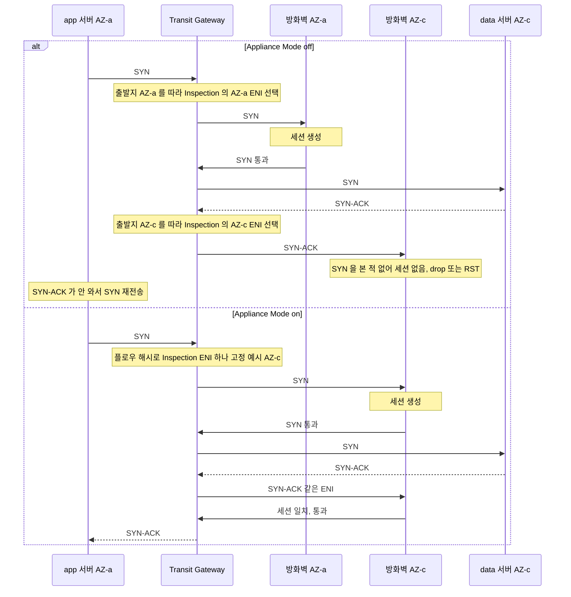
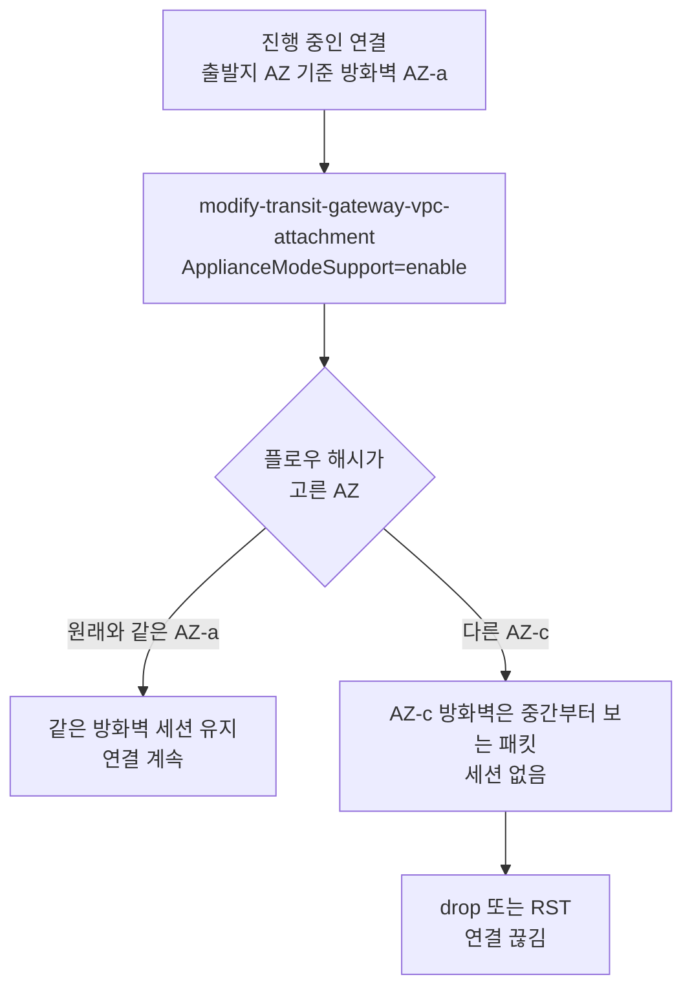
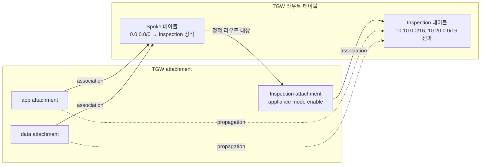
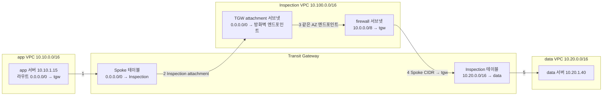
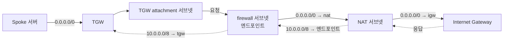
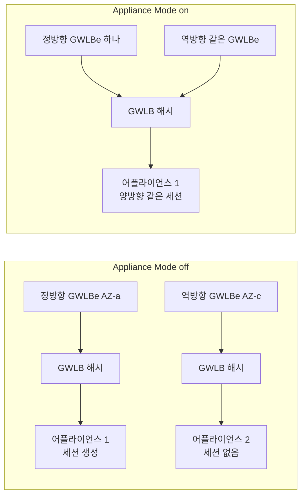
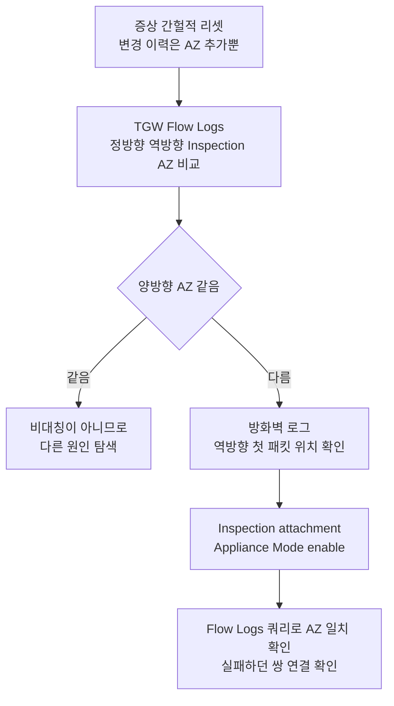
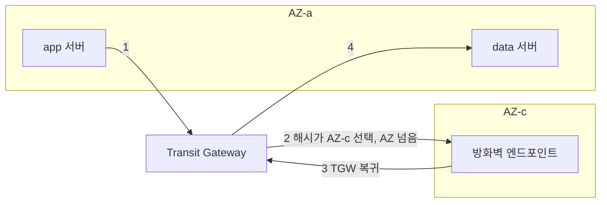

# TGW Inspection VPC와 Appliance Mode

Transit Gateway 허브에 Inspection VPC를 하나 끼워 두면 VPC 사이 트래픽(east-west)과 인터넷으로 나가는 트래픽(north-south)이 전부 방화벽을 지난다. 방화벽 정책을 한 곳에서 관리하는 장점이 있고, 대신 TGW가 패킷을 어느 AZ의 어느 ENI로 넘기는지를 알고 있어야 한다. 이걸 모르고 AZ를 두 개로 늘렸다가 간헐적 연결 리셋을 며칠 쫓는 일이 실제로 생긴다.

[Transit Gateway](Transit_Gateway.md)의 기본 개념과 [GWLB](../Load_Balancer/GWLB.md)의 GWLB 동작은 알고 있다고 보고, 이 문서는 Appliance Mode가 필요한 이유와 켰을 때의 동작, 라우팅 설계, 터졌을 때 확인하는 순서를 다룬다.

## 장애 장면

구성은 이렇다. 서울 리전(ap-northeast-2)에 Spoke VPC 둘과 Inspection VPC 하나가 TGW에 붙어 있다.

| VPC | CIDR | 역할 |
|---|---|---|
| app | 10.10.0.0/16 | 애플리케이션 서버 |
| data | 10.20.0.0/16 | RDS, 캐시 |
| inspection | 10.100.0.0/16 | AWS Network Firewall |

처음에는 Inspection VPC가 AZ 하나(2a)에만 있었다. AZ 장애 대응 점검에서 방화벽이 단일 AZ라는 지적이 나왔고, 2c에 서브넷과 방화벽 엔드포인트를 추가했다. 라우트는 건드리지 않았다. 다음 날 오전부터 알림이 오기 시작했다.

- app에서 data로 가는 일부 연결이 `Connection reset by peer`로 끊긴다
- 같은 서버가 같은 DB 엔드포인트로 다시 붙으면 될 때도 있고 안 될 때도 있다
- 배치 서버 몇 대는 DB 접속이 계속 실패하고, 나머지는 멀쩡하다
- 보안 그룹, NACL, TGW 라우트 테이블에는 변경이 없고 전부 정상이다
- Reachability Analyzer는 두 VPC 사이가 reachable로 나온다

Reachability Analyzer가 통과하는 건 당연하다. 이 도구는 출발지에서 목적지로 가는 경로 하나만 따라간다. 정방향과 역방향이 서로 다른 방화벽 엔드포인트를 지나는지는 보지 못한다.

실패하는 쌍에 공통점이 있었다. 실패한 서버는 전부 2a의 app 인스턴스가 2c의 data 인스턴스(또는 그 반대)로 붙는 경우였고, 같은 AZ끼리는 한 건도 안 실패했다. RDS reader 엔드포인트처럼 DNS가 AZ를 가리지 않고 응답하는 대상은 접속할 때마다 AZ가 바뀌어서 같은 클라이언트가 됐다 안 됐다 했다. 서비스 전체로는 간헐적이지만 AZ 조합별로는 결정적으로 실패한다.

## 비대칭이 생기는 과정

Appliance Mode가 꺼져 있을 때 TGW는 패킷이 들어온 AZ를 기억해서, 목적지 attachment 쪽에서도 같은 AZ의 ENI를 쓰려고 한다. 크로스 AZ 전송을 피하려는 동작이고, 일반 Spoke끼리의 통신에서는 이게 맞다. 문제는 Inspection VPC가 끼면 이 동작이 정방향과 역방향의 경로를 갈라놓는다는 점이다.

TGW는 VPC attachment마다 AZ별로 ENI를 하나씩 만든다. app VPC의 2a 인스턴스가 data VPC의 2c 인스턴스로 SYN을 보내면 이런 일이 벌어진다.

도식에서 Appliance Mode off 쪽을 보면 SYN은 2a의 방화벽을, SYN-ACK는 2c의 방화벽을 지난다. 방화벽 두 대가 각자 한쪽 방향만 본다.



방화벽 장비가 세션에 없는 패킷을 어떻게 처리하느냐에 따라 증상이 달라진다. 세션에 없는 TCP 패킷에 RST를 돌려주도록 설정된 장비(상용 방화벽에서 흔한 설정이다)는 클라이언트 쪽에 `reset by peer`로 보인다. Network Firewall에서 stateful 기본 동작이 drop이면 조용히 버려서 타임아웃으로 보이는 경우가 많다. 규칙에 reject 액션이 걸려 있으면 RST가 나간다. 같은 원인인데 장비마다 증상이 다르니 "리셋이니까 앱 문제"나 "타임아웃이니까 네트워크 문제"로 가르면 틀린다.

AZ를 하나로 운영할 때는 이 문제가 생길 수 없었다. 정방향과 역방향이 같은 AZ ENI, 같은 방화벽을 지나니까 비대칭 자체가 없었다. AZ를 늘리는 순간 잠복해 있던 설정 누락이 드러난 셈이다.

## Appliance Mode가 하는 일

Appliance Mode는 TGW VPC attachment의 옵션이고, Inspection VPC attachment에 켠다. 켜면 TGW가 출발지 AZ를 따라가지 않고 플로우 해시로 Inspection VPC의 ENI를 하나 골라, 그 플로우가 끝날 때까지 양방향 모두 같은 ENI로 보낸다. 앞 도식의 on 쪽이 이 동작이다.

몇 가지 알아둘 것이 있다.

- 선택된 AZ는 출발지나 목적지의 AZ와 상관이 없다. 2a에서 2a로 가는 트래픽도 해시가 2c를 고르면 2c 방화벽을 지난다. 이 때문에 비용 문제가 생긴다(뒤에서 다룬다).
- 해시 입력은 플로우 단위(IP, 포트, 프로토콜)다. 새 연결은 해시가 달라져서 다른 AZ로 갈 수 있다. 연결 하나는 고정이고, 서버 쌍은 고정이 아니다.
- Inspection VPC attachment에 서브넷이 없는 AZ로는 보내지 못한다. attachment 서브넷은 방화벽이 있는 AZ마다 만들어야 한다.
- 방화벽 장애 때 어느 AZ로 우회하는지는 TGW 설정으로 정해지지 않는다. 방화벽 쪽(엔드포인트 상태, GWLB 헬스 체크)의 동작을 따로 확인해 두어야 한다.

### 켜고 끄는 순간

옵션 변경 자체는 CLI 한 줄이고 attachment를 새로 만들지 않는다. 문제는 변경 시점에 이미 흐르던 연결이다. 켜기 전에는 출발지 AZ 기준으로 방화벽이 정해져 있었고, 켠 뒤에는 해시 기준으로 다시 정해진다. 새 해시가 원래와 다른 AZ를 고른 연결은 방화벽 입장에서 중간부터 시작하는 패킷이라 세션이 없다. 이 연결들이 끊긴다. 어느 연결이 끊길지는 해시에 달려 있어서 예측하지 못하고, 끄는 경우도 같다.

도식에서 해시가 고른 AZ가 원래와 같은지 다른지에 따라 연결이 살거나 끊기는 갈림길을 보면 된다.



연결이 오래 유지되는 풀(DB 커넥션 풀, gRPC 채널, 메시지 브로커 커넥션)은 끊긴 줄 모르고 있다가 다음 쿼리에서 에러를 낸다. 켜는 쪽이 옳은 방향이지만 트래픽이 적은 시간대에 하고, 켠 뒤에 커넥션 풀을 재시작하거나 최소한 에러율 알림을 잠시 완화해 두는 편이 낫다.

## 라우팅 테이블 두 개

Inspection 구성의 핵심은 TGW 라우트 테이블을 둘로 나누는 것이다. TGW는 패킷이 들어온 attachment에 association된 테이블로 목적지를 찾는다. 패킷이 어느 attachment에서 왔느냐가 어느 테이블을 보느냐를 결정한다는 점이 설계의 출발이다.

- Spoke에서 온 패킷은 Spoke 테이블을 본다. 여기에는 `0.0.0.0/0 → Inspection attachment` 정적 라우트만 둔다. 어디로 가든 일단 방화벽으로 보낸다.
- 방화벽을 나와 TGW로 돌아온 패킷은 Inspection attachment로 들어왔으니 Inspection 테이블을 본다. 여기에는 Spoke CIDR이 전파되어 있어서 목적지 Spoke로 간다.

테이블을 하나로 쓰면 둘 중 하나가 깨진다. Spoke CIDR이 전파된 테이블 하나에 `0.0.0.0/0 → Inspection`을 같이 두면, 가장 긴 접두사 규칙 때문에 Spoke A가 Spoke B로 가는 패킷은 방화벽을 건너뛰고 B로 바로 간다. Spoke CIDR 전파를 빼면 방화벽에서 돌아온 패킷이 다시 `0.0.0.0/0`에 걸려 방화벽으로 되돌아가는 루프가 생긴다.

도식에서 실선은 association, 점선은 propagation이다. Spoke attachment가 Spoke 테이블에 association되고 Inspection 테이블로 전파한다는 부분을 보면 된다.



Spoke attachment는 Spoke 테이블로는 propagation하지 않는다. 하면 Spoke끼리 서로의 CIDR을 알게 되어 방화벽을 우회하는 경로가 생긴다. Spoke VPC 안의 라우트는 `0.0.0.0/0 → tgw` 하나면 된다. 다른 Spoke 대역도 이 기본 경로를 타고 TGW에 들어가서 Spoke 테이블의 `0.0.0.0/0`에 걸린다.

### 패킷 하나의 경로

Spoke A에서 Spoke B로 가는 east-west 패킷은 TGW를 두 번 지난다. 한 번은 Spoke에서 Inspection으로 가는 길이고, 한 번은 Inspection에서 Spoke로 가는 길이다. 번호 순서를 따라가면 어느 시점에 어느 라우트 테이블이 쓰이는지 보인다.



## Inspection VPC 안의 서브넷

Inspection VPC는 AZ마다 서브넷이 두 종류(north-south까지 하면 세 종류)이고 라우트 테이블이 서로 다르다. 한 테이블로 뭉치면 방화벽을 건너뛰거나 돌아오는 길이 없어진다.

| 서브넷 | 목적지 | 대상 |
|---|---|---|
| TGW attachment | 10.100.0.0/16 | local |
| TGW attachment | 0.0.0.0/0 | 같은 AZ의 방화벽 엔드포인트 |
| firewall | 10.100.0.0/16 | local |
| firewall | 10.0.0.0/8 | tgw (방화벽을 나와 Spoke로) |
| firewall | 0.0.0.0/0 | 같은 AZ의 NAT Gateway (north-south만) |
| NAT 퍼블릭 | 10.100.0.0/16 | local |
| NAT 퍼블릭 | 10.0.0.0/8 | 같은 AZ의 방화벽 엔드포인트 (응답이 방화벽을 거치게) |
| NAT 퍼블릭 | 0.0.0.0/0 | igw |

TGW attachment 서브넷과 방화벽 엔드포인트가 있는 서브넷은 분리한다. 엔드포인트 서브넷은 전용으로 두는 것이 권장되고, TGW ENI와 섞으면 서브넷 라우트 테이블 하나로 두 역할을 처리해야 해서 위 표의 라우트를 나눠 쓸 수 없다. TGW attachment 서브넷은 /28로 충분하다.

north-south는 east-west와 같은 길을 가다가 firewall 서브넷에서 갈라진다. 방화벽을 나온 패킷의 목적지가 Spoke CIDR이면 `10.0.0.0/8 → tgw`로, 인터넷이면 `0.0.0.0/0 → nat`으로 간다. 서버가 Spoke에 있고 VPC CIDR이 모두 10.0.0.0/8 안에 있다는 전제인데, 10.100.0.0/16(local)이 더 긴 접두사라 Inspection VPC 내부 통신은 영향을 받지 않는다.



NAT 서브넷의 `10.0.0.0/8 → 방화벽 엔드포인트` 줄이 빠지면 응답이 NAT에서 TGW attachment 서브넷으로 직행하거나 라우트를 못 찾아 사라진다. 나가는 방향은 방화벽을 지났는데 들어오는 방향은 안 지나므로 stateful 방화벽이 세션을 완성하지 못하고, 증상은 비대칭 문제와 똑같이 나온다. [NAT Gateway](Nat_Gateway.md)와 Egress VPC를 따로 두는 구성도 있는데, 그 경우 Inspection 테이블에 `0.0.0.0/0 → Egress`를 두고 응답이 방화벽을 거쳐 오도록 테이블을 하나 더 만들어야 해서 복잡도가 한 단계 오른다.

## Network Firewall 엔드포인트와 GWLB 엔드포인트

두 방식 모두 라우트 테이블 대상은 `vpce-...`로 같은 모양이다. 달라지는 것은 엔드포인트 뒤에 무엇이 있느냐다.

| 항목 | Network Firewall | GWLB 엔드포인트 |
|---|---|---|
| 엔진 | AWS가 운영하는 Suricata 호환 엔진 | 직접 띄운 어플라이언스(Palo Alto, Fortinet 등) 또는 오픈소스 |
| 엔드포인트 | 방화벽 서브넷마다 생성되고 방화벽이 관리 | Endpoint Service에 대한 GWLBe를 서브넷마다 직접 생성 |
| 세션 상태 | 엔드포인트(AZ) 단위로 따로 가진다 | 어플라이언스 단위. GWLB가 5튜플로 어플라이언스를 고정 |
| 확장 | 관리형이라 신경 쓸 것이 적다 | 어플라이언스 Auto Scaling, 스케일 인 때 세션 처리를 직접 설계 |
| 규칙 | AWS 규칙 그룹, Suricata 규칙 | 장비 고유 정책 |
| 비대칭 시 | 세션 없는 패킷을 정책에 따라 drop 또는 reject | 장비 설정에 따라 RST, drop |

둘 다 Appliance Mode가 필요하다. GWLB는 같은 플로우를 같은 어플라이언스로 붙여주지만, 이건 정방향과 역방향이 같은 GWLB 엔드포인트(같은 AZ)로 들어와야 성립한다. 두 방향이 다른 AZ의 엔드포인트로 들어오면 GWLB가 각자 해시해서 서로 다른 어플라이언스로 보낼 수 있다. GWLB 쪽 Cross-Zone Load Balancing을 켠 구성도 같은 위험을 더한다([GWLB](../Load_Balancer/GWLB.md)).

도식의 off 쪽은 역방향이 다른 GWLBe로 들어와 GWLB가 다른 어플라이언스를 고르는 모습이고, on 쪽은 양방향이 같은 GWLBe로 들어와 같은 어플라이언스에 닿는 모습이다.



엔드포인트가 다른 만큼 방화벽 로그 위치도 다르다. Network Firewall은 CloudWatch Logs나 S3로 alert/flow 로그를 내보내고, GWLB는 어플라이언스 자체의 로그를 본다. 장애 대응에서 로그를 먼저 어디에 켜 두었는지가 결과를 가른다.

## 설정

### Terraform

Inspection VPC와 attachment, 라우트 테이블 구성이다. TGW의 기본 association과 propagation을 끄고 모든 연결을 명시한다. 기본값이 켜져 있으면 attachment가 default 테이블에 자동으로 붙어서 설계한 분리가 깨진다.

```hcl
locals {
  azs = ["ap-northeast-2a", "ap-northeast-2c"]
  azs_idx = { for i, az in local.azs : az => i }
}

variable "spokes" {
  type = map(object({
    vpc_id     = string
    subnet_ids = list(string)
  }))
}

resource "aws_ec2_transit_gateway" "main" {
  description                     = "hub"
  default_route_table_association = "disable"
  default_route_table_propagation = "disable"
}

resource "aws_ec2_transit_gateway_route_table" "spoke" {
  transit_gateway_id = aws_ec2_transit_gateway.main.id
  tags               = { Name = "tgw-rt-spoke" }
}

resource "aws_ec2_transit_gateway_route_table" "inspection" {
  transit_gateway_id = aws_ec2_transit_gateway.main.id
  tags               = { Name = "tgw-rt-inspection" }
}

resource "aws_vpc" "inspection" {
  cidr_block = "10.100.0.0/16"
  tags       = { Name = "inspection" }
}

resource "aws_subnet" "tgw" {
  for_each          = local.azs_idx
  vpc_id            = aws_vpc.inspection.id
  availability_zone = each.key
  cidr_block        = cidrsubnet("10.100.0.0/16", 12, each.value)
}

resource "aws_subnet" "firewall" {
  for_each          = local.azs_idx
  vpc_id            = aws_vpc.inspection.id
  availability_zone = each.key
  cidr_block        = cidrsubnet("10.100.0.0/16", 8, 10 + each.value)
}

resource "aws_subnet" "nat" {
  for_each          = local.azs_idx
  vpc_id            = aws_vpc.inspection.id
  availability_zone = each.key
  cidr_block        = cidrsubnet("10.100.0.0/16", 8, 20 + each.value)
}

resource "aws_ec2_transit_gateway_vpc_attachment" "inspection" {
  transit_gateway_id = aws_ec2_transit_gateway.main.id
  vpc_id             = aws_vpc.inspection.id
  subnet_ids         = [for s in aws_subnet.tgw : s.id]

  appliance_mode_support                          = "enable"
  transit_gateway_default_route_table_association = false
  transit_gateway_default_route_table_propagation = false
}

resource "aws_ec2_transit_gateway_vpc_attachment" "spoke" {
  for_each           = var.spokes
  transit_gateway_id = aws_ec2_transit_gateway.main.id
  vpc_id             = each.value.vpc_id
  subnet_ids         = each.value.subnet_ids

  transit_gateway_default_route_table_association = false
  transit_gateway_default_route_table_propagation = false
}

resource "aws_ec2_transit_gateway_route_table_association" "spoke" {
  for_each                       = var.spokes
  transit_gateway_attachment_id  = aws_ec2_transit_gateway_vpc_attachment.spoke[each.key].id
  transit_gateway_route_table_id = aws_ec2_transit_gateway_route_table.spoke.id
}

resource "aws_ec2_transit_gateway_route_table_association" "inspection" {
  transit_gateway_attachment_id  = aws_ec2_transit_gateway_vpc_attachment.inspection.id
  transit_gateway_route_table_id = aws_ec2_transit_gateway_route_table.inspection.id
}

resource "aws_ec2_transit_gateway_route_table_propagation" "spoke_to_inspection" {
  for_each                       = var.spokes
  transit_gateway_attachment_id  = aws_ec2_transit_gateway_vpc_attachment.spoke[each.key].id
  transit_gateway_route_table_id = aws_ec2_transit_gateway_route_table.inspection.id
}

resource "aws_ec2_transit_gateway_route" "spoke_default" {
  destination_cidr_block         = "0.0.0.0/0"
  transit_gateway_attachment_id  = aws_ec2_transit_gateway_vpc_attachment.inspection.id
  transit_gateway_route_table_id = aws_ec2_transit_gateway_route_table.spoke.id
}
```

방화벽 엔드포인트는 두 방식 중 하나를 만들고, AZ를 키로 하는 맵으로 정리해 둔다. 그 뒤의 라우트 테이블은 어느 방식이든 같은 코드다.

```hcl
resource "aws_networkfirewall_firewall_policy" "main" {
  name = "inspection"
  firewall_policy {
    stateless_default_actions          = ["aws:forward_to_sfe"]
    stateless_fragment_default_actions = ["aws:forward_to_sfe"]
  }
}

resource "aws_networkfirewall_firewall" "main" {
  name                = "inspection"
  vpc_id              = aws_vpc.inspection.id
  firewall_policy_arn = aws_networkfirewall_firewall_policy.main.arn

  dynamic "subnet_mapping" {
    for_each = aws_subnet.firewall
    content {
      subnet_id = subnet_mapping.value.id
    }
  }
}

locals {
  fw_endpoint = {
    for s in aws_networkfirewall_firewall.main.firewall_status[0].sync_states :
    s.availability_zone => s.attachment[0].endpoint_id
  }
}
```

GWLB 엔드포인트를 쓴다면 `local.fw_endpoint`만 바꾼다.

```hcl
resource "aws_vpc_endpoint" "gwlbe" {
  for_each          = aws_subnet.firewall
  vpc_id            = aws_vpc.inspection.id
  service_name      = var.gwlb_endpoint_service_name
  vpc_endpoint_type = "GatewayLoadBalancer"
  subnet_ids        = [each.value.id]
}

locals {
  fw_endpoint = { for az, e in aws_vpc_endpoint.gwlbe : az => e.id }
}
```

서브넷별 라우트 테이블이다. 엔드포인트와 NAT는 모두 같은 AZ 것을 가리킨다. TGW로 가는 라우트는 attachment가 만들어진 뒤에야 생성되어서 `depends_on`을 건다.

```hcl
resource "aws_route_table" "tgw" {
  for_each = aws_subnet.tgw
  vpc_id   = aws_vpc.inspection.id
}

resource "aws_route_table_association" "tgw" {
  for_each       = aws_subnet.tgw
  subnet_id      = each.value.id
  route_table_id = aws_route_table.tgw[each.key].id
}

resource "aws_route" "tgw_to_firewall" {
  for_each               = aws_route_table.tgw
  route_table_id         = each.value.id
  destination_cidr_block = "0.0.0.0/0"
  vpc_endpoint_id        = local.fw_endpoint[each.key]
}

resource "aws_route_table" "firewall" {
  for_each = aws_subnet.firewall
  vpc_id   = aws_vpc.inspection.id
}

resource "aws_route_table_association" "firewall" {
  for_each       = aws_subnet.firewall
  subnet_id      = each.value.id
  route_table_id = aws_route_table.firewall[each.key].id
}

resource "aws_route" "firewall_to_tgw" {
  for_each               = aws_route_table.firewall
  route_table_id         = each.value.id
  destination_cidr_block = "10.0.0.0/8"
  transit_gateway_id     = aws_ec2_transit_gateway.main.id
  depends_on             = [aws_ec2_transit_gateway_vpc_attachment.inspection]
}

resource "aws_route" "firewall_to_nat" {
  for_each               = aws_route_table.firewall
  route_table_id         = each.value.id
  destination_cidr_block = "0.0.0.0/0"
  nat_gateway_id         = aws_nat_gateway.main[each.key].id
}

resource "aws_route_table" "nat" {
  for_each = aws_subnet.nat
  vpc_id   = aws_vpc.inspection.id
}

resource "aws_route_table_association" "nat" {
  for_each       = aws_subnet.nat
  subnet_id      = each.value.id
  route_table_id = aws_route_table.nat[each.key].id
}

resource "aws_route" "nat_to_igw" {
  for_each               = aws_route_table.nat
  route_table_id         = each.value.id
  destination_cidr_block = "0.0.0.0/0"
  gateway_id             = aws_internet_gateway.main.id
}

resource "aws_route" "nat_return_to_firewall" {
  for_each               = aws_route_table.nat
  route_table_id         = each.value.id
  destination_cidr_block = "10.0.0.0/8"
  vpc_endpoint_id        = local.fw_endpoint[each.key]
}
```

`aws_nat_gateway.main`과 `aws_internet_gateway.main`은 생략했다. NAT는 `aws_subnet.nat`을 키로 AZ마다 하나씩 만든다. 이 코드는 terraform 바이너리가 없는 환경에서 작성해서 `terraform validate`를 돌려보지 못했다. 적용 전에 plan으로 확인해야 한다.

### CLI

이미 운영 중인 attachment에 옵션을 켜고 확인하는 명령이다.

```bash
# 현재 상태 확인. 어느 attachment에 켜져 있는지 본다
aws ec2 describe-transit-gateway-vpc-attachments \
  --query 'TransitGatewayVpcAttachments[].[TransitGatewayAttachmentId,VpcId,Options.ApplianceModeSupport]' \
  --output table

# Inspection attachment에 켠다
aws ec2 modify-transit-gateway-vpc-attachment \
  --transit-gateway-attachment-id tgw-attach-0inspection \
  --options ApplianceModeSupport=enable
```

라우트 테이블을 CLI로 만든다면 순서는 테이블 생성, association, propagation, 정적 라우트다.

```bash
SPOKE_RT=$(aws ec2 create-transit-gateway-route-table \
  --transit-gateway-id tgw-0abc --query 'TransitGatewayRouteTable.TransitGatewayRouteTableId' --output text)
INSP_RT=$(aws ec2 create-transit-gateway-route-table \
  --transit-gateway-id tgw-0abc --query 'TransitGatewayRouteTable.TransitGatewayRouteTableId' --output text)

aws ec2 associate-transit-gateway-route-table \
  --transit-gateway-route-table-id "$SPOKE_RT" --transit-gateway-attachment-id tgw-attach-0app
aws ec2 associate-transit-gateway-route-table \
  --transit-gateway-route-table-id "$SPOKE_RT" --transit-gateway-attachment-id tgw-attach-0data
aws ec2 associate-transit-gateway-route-table \
  --transit-gateway-route-table-id "$INSP_RT" --transit-gateway-attachment-id tgw-attach-0inspection

aws ec2 enable-transit-gateway-route-table-propagation \
  --transit-gateway-route-table-id "$INSP_RT" --transit-gateway-attachment-id tgw-attach-0app
aws ec2 enable-transit-gateway-route-table-propagation \
  --transit-gateway-route-table-id "$INSP_RT" --transit-gateway-attachment-id tgw-attach-0data

aws ec2 create-transit-gateway-route \
  --transit-gateway-route-table-id "$SPOKE_RT" \
  --destination-cidr-block 0.0.0.0/0 \
  --transit-gateway-attachment-id tgw-attach-0inspection

# 두 테이블의 active 라우트를 확인한다
aws ec2 search-transit-gateway-routes --transit-gateway-route-table-id "$INSP_RT" \
  --filters Name=state,Values=active --query 'Routes[].[DestinationCidrBlock,TransitGatewayAttachments[0].TransitGatewayAttachmentId]'
```

## 원인을 확인한 과정

증상이 간헐적 리셋이고 설정 변경 이력이 AZ 추가뿐이었다. 의심 순서는 이렇게 잡았다. 먼저 TGW Flow Logs로 정방향과 역방향이 같은 Inspection ENI를 지나는지 보고, 다르면 방화벽 로그에서 역방향 첫 패킷이 어디서 막히는지 본다.

도식은 이 확인 순서와 분기를 한 번에 보여준다.



### TGW Flow Logs

TGW Flow Logs는 기본으로 꺼져 있다. 사고가 난 뒤에 켜면 이미 지나간 트래픽은 복원할 수 없어서 이 시점에는 새로 재현되는 연결만 본다. AZ 정보가 필요하므로 필드를 직접 지정한다.

```bash
aws ec2 create-flow-logs \
  --resource-type TransitGateway \
  --resource-ids tgw-0abc \
  --traffic-type ALL \
  --log-destination-type cloud-watch-logs \
  --log-group-name /aws/tgw/flowlogs \
  --deliver-logs-permission-arn arn:aws:iam::111122223333:role/tgw-flowlogs \
  --max-aggregation-interval 60 \
  --log-format '${tgw-attachment-id} ${tgw-src-az-id} ${tgw-dst-az-id} ${srcaddr} ${srcport} ${dstaddr} ${dstport} ${protocol} ${tcp-flags} ${packets} ${log-status}'
```

집계 구간은 60초로 줄여야 재현 후 바로 본다. 기본은 10분이다. CloudWatch Logs Insights에서 실패하는 쌍(app 10.10.1.15, data 10.20.1.40)의 양방향 레코드를 묶어서 본다.

```
parse @message "* * * * * * * * * * *" as att, src_az, dst_az, src, sport, dst, dport, proto, flags, pkts, status
| filter att = "tgw-attach-0inspection"
| filter (src = "10.10.1.15" and dst = "10.20.1.40") or (src = "10.20.1.40" and dst = "10.10.1.15")
| stats count(*) as records, sum(pkts) as packets by src, dst, src_az, dst_az, flags
| sort src
```

출력은 이런 모양이다(예시다).

```
src          dst          src_az      dst_az      flags  records  packets
10.10.1.15   10.20.1.40   apne2-az1   apne2-az1   2      3        3
10.20.1.40   10.10.1.15   apne2-az3   apne2-az3   18     3        3
```

정방향 레코드는 Inspection 쪽 AZ가 apne2-az1(2a)인데 역방향은 apne2-az3(2c)다. 플래그 값 2는 SYN만 있는 패킷, 18은 SYN과 ACK의 합이다. 같은 플로우의 양방향이 다른 AZ를 쓴다는 증거가 이 두 줄이다. 어느 필드에 Inspection 쪽 AZ가 찍히는지는 방향에 따라 달라서, 처음에는 필드 정의를 문서([TGW Flow Logs](https://docs.aws.amazon.com/vpc/latest/tgw/tgw-flow-logs.html))와 대조해야 한다. Appliance Mode를 켠 뒤 같은 쿼리를 돌리면 두 줄의 AZ가 같아진다.

TGW Flow Logs는 TGW가 패킷을 어디로 넘겼는지를 보여줄 뿐, 방화벽이 버렸는지는 알려주지 않는다. TGW 입장에서는 SYN-ACK를 정상적으로 Inspection VPC에 넘겼기 때문이다. 이 로그로 비대칭을 확정하고 방화벽 로그로 확인을 마무리하는 두 단계다. 레코드 형식과 VPC 쪽 로그는 [VPC Flow Logs](VPC_Flow_Logs.md)와 겹치는 부분이 많다.

### 방화벽 로그

Network Firewall은 로그 설정을 하지 않으면 아무것도 남기지 않는다. stateful 규칙이 strict order이고 기본 동작이 drop이면, alert를 같이 켜 두지 않은 drop은 기록되지 않는다. 이 장애에서도 처음 열어본 alert 로그에는 아무것도 없었다. 기본 동작에 `Drop established`와 `Alert established`를 함께 켜고, alert 로그를 CloudWatch Logs로 내보낸다.

로그에는 방화벽이 처리한 AZ가 같이 찍힌다. 같은 플로우의 SYN과 SYN-ACK가 다른 AZ에서 처리된 흔적을 본다.

```
fields @timestamp, availability_zone, event.src_ip, event.dest_ip, event.dest_port, event.tcp.tcp_flags, event.alert.action
| filter (event.src_ip = "10.20.1.40" and event.dest_ip = "10.10.1.15")
    or (event.src_ip = "10.10.1.15" and event.dest_ip = "10.20.1.40")
| sort @timestamp desc
| limit 30
```

이 장애에서는(아래는 재구성한 예시다) `availability_zone`이 `ap-northeast-2c`인 방화벽에서 `10.20.1.40 → 10.10.1.15`, SYN-ACK 플래그(`12`)의 `blocked`가 반복됐다. 2a 방화벽 로그에는 같은 플로우의 SYN만 있고 SYN-ACK는 없다. 필드 이름은 Suricata EVE 형식을 따르지만 로그 한 건을 먼저 열어서 실제 키를 확인하고 쿼리를 쓰는 게 안전하다. 어플라이언스를 쓰는 경우는 세션 테이블 조회 명령으로 해당 5튜플의 세션이 어느 장비에 있는지 직접 본다.

### 조치와 확인

Inspection attachment에 Appliance Mode를 켠다. 위 CLI 한 줄이다. 끊기는 순간이 있어서 새벽 시간대에 하고, 커넥션 풀을 재시작했다.

켠 뒤에 세 가지를 본다. `describe-transit-gateway-vpc-attachments`에서 Inspection attachment만 `enable`인지, 앞의 Logs Insights 쿼리에서 양방향 AZ가 같아졌는지, 실패하던 쌍에서 연결이 성공하는지다. 이 순서를 지키지 않고 클라이언트 에러율만 보면 풀이 재시작되면서 일시적으로 좋아진 것과 구분이 안 된다.

## Appliance Mode를 켜도 Cross-AZ 비용이 나오는 이유

Appliance Mode의 대가가 크로스 AZ다. AZ 선택이 출발지와 무관해지므로 켜기 전에 같은 AZ 안에서 끝나던 트래픽이 AZ를 가로지른다. Inspection VPC가 두 AZ이고 해시가 고르게 퍼지면 평균적으로 트래픽의 절반 가까이가 출발지와 다른 AZ의 방화벽을 지난다. 방화벽 처리 비용과 TGW 데이터 처리 비용은 원래 붙던 요금이고, 여기에 AZ 사이를 넘는 구간이 더해진다.

같은 AZ의 두 서버끼리 통신해도 해시가 AZ-c를 고르면 2번 구간에서 AZ를 한 번 넘는다.



켰는데도 예상보다 크로스 AZ가 많이 나온다면 아래 지점을 순서대로 본다.

- Inspection VPC 안에서 AZ를 넘는 라우트. TGW attachment 서브넷의 `0.0.0.0/0`이 다른 AZ 엔드포인트를 가리키면(엔드포인트를 하나만 두고 모든 AZ 테이블이 그것을 가리키는 경우) VPC 안에서 크로스 AZ 전송이 붙는다. 앞의 Terraform처럼 AZ별 테이블이 같은 AZ 엔드포인트를 가리키게 한다. NAT 서브넷도 같다.
- GWLB Cross-Zone 활성화. 켜져 있으면 엔드포인트가 있는 AZ와 다른 AZ의 어플라이언스로 트래픽이 간다.
- 어플라이언스가 AZ 한쪽에 몰린 경우. GWLB가 AZ 안에서만 분산한다면 한 AZ의 어플라이언스가 부족할 때 다른 AZ를 쓰도록 Cross-Zone을 켜게 되고, 그러면 위 문제가 따라온다. AZ마다 어플라이언스를 같은 수로 둔다.
- Spoke 쪽. attachment 서브넷이 없는 AZ에 워크로드가 있으면 그 서브넷에서 TGW로 가는 구간부터 AZ를 넘는다. [Transit Gateway](Transit_Gateway.md)의 "attachment 서브넷이 없는 AZ"를 참고한다.
- NAT Gateway를 한 AZ에만 둔 경우. 다른 AZ에서 나오는 모든 north-south 트래픽이 AZ를 넘는다.

TGW 내부에서 AZ를 넘는 구간이 AZ 간 전송으로 별도 과금되는지는 요금표와 실제 청구서로 확인해야 한다([TGW 요금](https://aws.amazon.com/transit-gateway/pricing/)). 확인 방법은 Cost Explorer에서 usage type으로 그룹을 나누는 것이다. `DataTransfer-Regional-Bytes`(AZ 간 전송)와 `TransitGateway-Bytes`(TGW 처리량)가 어느 리소스에 붙는지를 AZ 추가 전후로 비교한다. 비용이 문제가 되면 Appliance Mode를 끄는 것이 답이 아니다. 끄면 비용이 줄어도 세션이 깨진다. 줄일 수 있는 부분은 Inspection VPC 안의 AZ 교차뿐이고, TGW가 고르는 AZ 자체는 해시에 맡겨야 한다.

설계 배경은 [MSA VPC 네트워크 설계](../../../Architecture/MSA/MSA_VPC_Network_Design.md)와 [Route Table](Route_Table.md)을 함께 본다. Reachability Analyzer 통과는 비대칭이 없다는 증거가 못 되므로 방향별 경로는 TGW Flow Logs로 확인하고, 방화벽 로그는 사고 전에 켜 둔다.

## 참고

- [Transit Gateway appliance 시나리오](https://docs.aws.amazon.com/vpc/latest/tgw/transit-gateway-appliance-scenario.html)
- [Transit Gateway Flow Logs](https://docs.aws.amazon.com/vpc/latest/tgw/tgw-flow-logs.html)
- [Transit Gateway 요금](https://aws.amazon.com/transit-gateway/pricing/)
