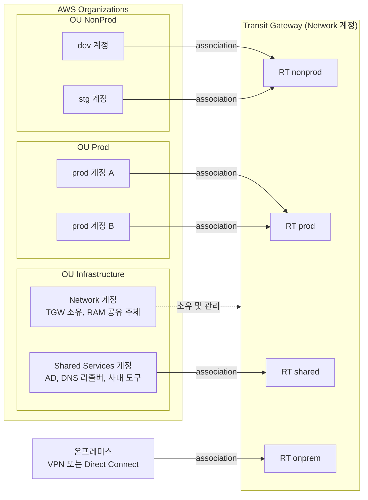
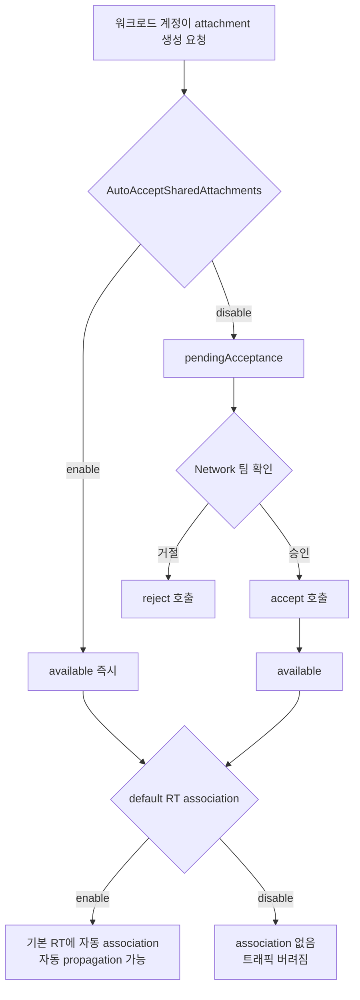
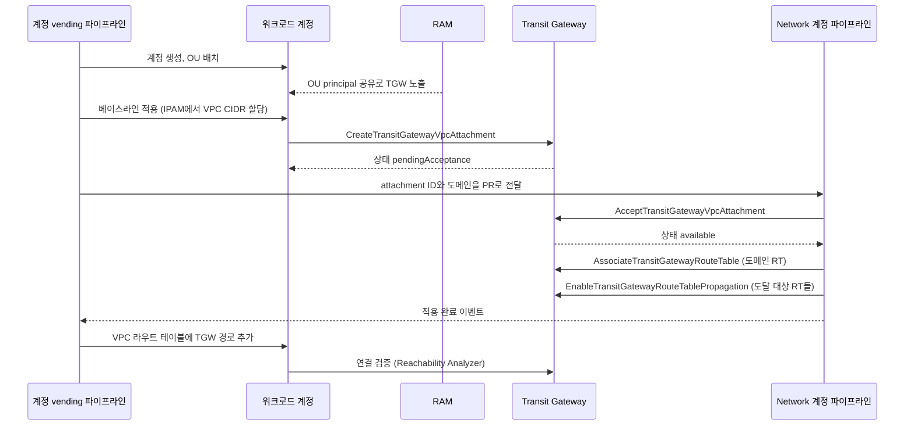
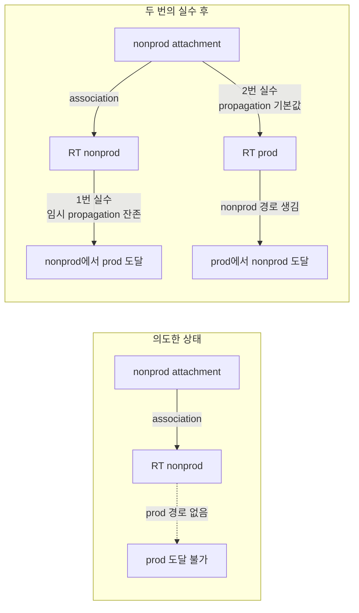
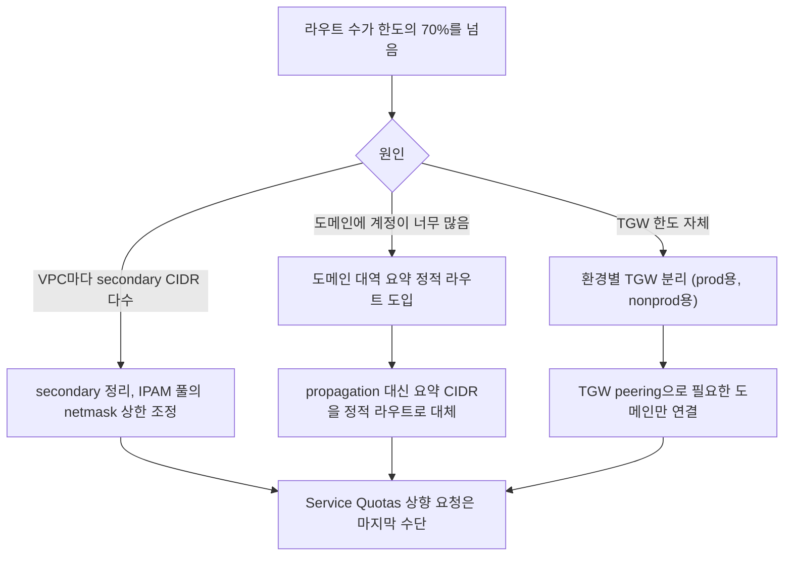

# TGW 멀티 계정 운영과 RAM 공유

[Transit Gateway](Transit_Gateway.md) 문서는 TGW와 VPC가 한 계정에 있다는 전제로 쓰여 있다. 계정이 수십 개로 늘면 같은 기능을 쓰는데도 질문이 바뀐다. 누가 attachment를 만들 수 있는가, 누가 라우트 테이블을 바꾸는가, 새 계정이 생기면 사람이 몇 단계를 거쳐야 하는가, 청구서는 어디로 가는가. 기술 자체는 같고 권한과 순서가 문제가 된다.

이 문서는 Network 계정 하나가 TGW를 소유하고 워크로드 계정들이 RAM으로 공유받아 붙는 구성을 기준으로 한다. [MSA VPC 네트워크 설계](../../../Architecture/MSA/MSA_VPC_Network_Design.md)에 RAM 공유가 몇 줄 나오는데, 여기서는 그 몇 줄 뒤에 있는 운영 문제를 푼다.

## 계정과 라우트 테이블 도메인

계정 구조와 TGW 라우트 테이블을 1:1로 맞추는 것이 출발점이다. OU는 조직 관점의 분류이고 TGW 라우트 테이블은 네트워크 관점의 분류인데, 이 둘을 같은 이름으로 묶어 두면 계정이 어느 도메인에 속하는지 OU만 봐도 알 수 있다.



각 attachment는 자기 도메인의 라우트 테이블 하나에만 association된다. 이 라우트 테이블은 그 attachment에서 출발한 패킷이 어디로 갈 수 있는지를 정한다. 반대로 어느 라우트 테이블에 자기 CIDR을 올릴지는 propagation이 정한다. 두 개념의 차이는 [Transit Gateway](Transit_Gateway.md)의 association/propagation 비대칭 절에 정리돼 있으니 여기서는 결과만 쓴다.

도메인 네 개의 도달 가능 여부는 아래 표로 고정한다. 행이 출발지, 열이 목적지다.

| 출발 \ 도착 | prod | nonprod | shared-services | on-prem |
|---|---|---|---|---|
| prod | 가능 | 불가 | 가능 | 가능 |
| nonprod | 불가 | 가능 | 가능 | 불가 |
| shared-services | 가능 | 가능 | 가능 | 가능 |
| on-prem | 가능 | 불가 | 가능 | 해당 없음 |

이 표가 라우트 테이블 내용을 그대로 결정한다. 출발 도메인의 라우트 테이블에 도착 도메인 attachment가 propagation돼 있어야 "가능"이고, 돌아오는 길도 같은 방식으로 열려 있어야 TCP가 성립한다.

| 라우트 테이블 | propagation으로 들어오는 도메인 |
|---|---|
| prod | prod, shared-services, on-prem |
| nonprod | nonprod, shared-services |
| shared-services | prod, nonprod, shared-services, on-prem |
| on-prem | prod, shared-services |

prod 안에서 계정끼리도 통신해야 하므로 prod RT에 prod attachment가 들어간다. 계정 간 격리를 더 걸고 싶으면 이 줄을 빼고 필요한 계정 쌍만 정적 라우트로 연다. 대신 계정이 늘 때마다 라우트를 손으로 관리해야 한다.

nonprod에서 on-prem으로 나가는 길을 막은 것은 선택이다. 사내망 방화벽에서 nonprod 대역을 따로 구분하기 어려운 조직이라면 TGW 단계에서 먼저 끊어 두는 편이 편하다. 필요하면 on-prem RT와 nonprod RT에 줄을 추가한다.

## RAM으로 TGW 공유

TGW는 리전 리소스이고 RAM 공유도 리전 단위다. 서울과 도쿄에 TGW가 있으면 resource share가 두 개 필요하다. 공유가 끝나면 워크로드 계정의 `describe-transit-gateways`에 TGW가 `OwnerId` = Network 계정으로 보인다. 공유받은 계정은 이 TGW를 대상으로 attachment 생성을 요청할 수 있고, 그 이상은 할 수 없다.

### Organizations 공유 활성화와 계정 ID 지정의 차이

Organizations 관리 계정에서 `enable-sharing-with-aws-organization`을 한 번 실행하면 RAM이 조직 구조를 읽을 수 있게 된다. 이게 켜져 있는지에 따라 같은 조직 안에서도 공유 동작이 갈린다.

| 구분 | 조직 공유 활성화 + Org/OU ARN 지정 | 계정 ID 지정 (조직 공유 활성화됨) | 계정 ID 지정 (조직 공유 비활성) |
|---|---|---|---|
| 수신 계정의 수락 | 필요 없음 | 필요 없음 | 초대를 받아 수락해야 함 |
| 새 계정이 OU에 들어오면 | 즉시 TGW가 보임 | 공유 principal에 따로 추가해야 함 | 따로 추가하고 수락도 해야 함 |
| 계정을 OU 밖으로 옮기면 | 접근이 사라짐 | 계속 유지됨 | 계속 유지됨 |
| 조직 밖 계정 | 불가 | 불가 (`allow_external_principals = false`일 때) | 불가 (같은 이유) |

CLI 도움말에도 나오는 내용이다. 조직 공유를 켜기 전에는 개별 계정만 지정할 수 있고, 켜고 나면 조직 ID나 OU ID를 principal로 쓸 수 있다.

OU ARN을 principal로 쓰면 온보딩이 단순해진다. 계정 vending이 새 계정을 OU 안에 만드는 순간 TGW가 보이니 RAM 쪽에서 할 일이 없다. 대신 그 OU에 계정이 들어오기만 하면 누구든 TGW를 대상으로 attachment 요청을 낼 수 있다는 뜻이기도 하다. 수락 단계를 수동으로 두는 이유가 여기서 나온다.

계정 ID 지정은 반대다. 계정마다 principal association을 추가해야 하니 vending 파이프라인에 단계가 하나 늘지만, "이 계정은 TGW를 쓸 수 있다"는 사실이 Terraform 코드에 남는다. 감사 대응에서 이 기록이 필요한 조직이라면 계정 ID 방식을 쓴다. 나는 OU ARN으로 공유하고 수락 단계에서 통제하는 쪽을 택했다. 공유 목록과 수락 목록이 둘 다 코드에 있으면 한쪽이 비어 있어도 어느 쪽에서 막혔는지 찾는 시간이 늘기 때문이다.

### 권한 경계

공유받은 계정이 할 수 있는 일과 못 하는 일은 엄격하게 갈린다.

| 작업 | 워크로드 계정 | Network 계정 (TGW 소유) |
|---|---|---|
| 자기 VPC attachment 생성·삭제 | 가능 | 해당 없음 |
| attachment 서브넷 변경 | 가능 (자기 attachment) | 불가 |
| attachment 수락·거절 | 불가 | 가능 |
| TGW 라우트 테이블 association | 불가 | 가능 |
| TGW 라우트 테이블 propagation | 불가 | 가능 |
| TGW 라우트 테이블에 정적 라우트·블랙홀 추가 | 불가 | 가능 |
| TGW 옵션 변경 (auto accept, default RT 등) | 불가 | 가능 |
| 자기 VPC 라우트 테이블에서 TGW를 대상으로 하는 라우트 | 가능 | 해당 없음 |

이 경계 때문에 한 가지 비대칭이 생긴다. 워크로드 계정은 자기 attachment를 만들고 지울 수 있지만 그 attachment가 어느 도메인에 들어가는지는 정하지 못한다. 반대로 Network 계정은 남의 attachment를 만들 수 없고 association·propagation만 건다. 그래서 신규 계정의 도메인 배정은 Network 계정 쪽 코드(PR)에 남고, 워크로드 팀은 거기에 손을 댈 수 없다.

연결을 끊어야 하는 계정이 생기면 Network 계정에서 그 attachment의 association을 해제한다. association이 없는 attachment에서 나온 패킷은 조회할 라우트 테이블이 없어 버려진다. attachment를 지우는 건 소유자만 할 수 있으니 이 방법이 가장 빠른 차단 수단이다.

## 수락을 수동으로 두는 이유

TGW 옵션 `AutoAcceptSharedAttachments`를 `disable`로 두면 다른 계정이 만든 attachment는 `pendingAcceptance`에서 멈추고, Network 계정이 수락해야 `available`이 된다. `enable`이면 요청이 곧바로 `available`이 된다.



그림에서 볼 것은 오른쪽 아래의 두 갈래다. auto accept를 켜고 default association도 켜 두면 attachment가 만들어진 즉시 기본 라우트 테이블에 붙는다. 수락 단계의 통제와 라우트 테이블 배정의 통제를 둘 다 포기하는 조합이다.

수락 단계에서 실제로 확인하는 것은 세 가지다. 요청 계정이 vending 대장에 있는 계정인지, attachment가 가리키는 VPC CIDR이 IPAM에 등록된 값인지, 요청한 도메인이 그 계정의 OU와 맞는지. 다른 계정의 VPC에는 `describe-vpcs`가 닿지 않으니 CIDR은 IPAM 쪽 조회로 확인한다.

```bash
aws ec2 describe-transit-gateway-attachments \
  --filters Name=state,Values=pendingAcceptance \
  --query 'TransitGatewayAttachments[].[TransitGatewayAttachmentId,ResourceOwnerId,ResourceId,CreationTime]' \
  --output table
```

`resource-owner-id` 필터로 계정별로 좁힐 수 있다. 수동 수락을 오래 쓰다 보면 요청이 큐에 쌓이는 문제가 생기는데, 이 문서의 자동화 방식은 사람이 수락 버튼을 누르는 것이 아니라 PR 병합이 수락이 되도록 만든다.

수락을 자동으로 두는 선택도 틀린 것은 아니다. 계정이 열 개 미만이고 전부 같은 팀이 관리하면 auto accept를 켜고 default RT를 끄는 조합만으로도 안전하다. 새 attachment가 라우트 테이블에 붙지 못하니 연결만 되고 통신은 안 된다. 사람이 수락하는 지점을 없애는 대신 association이 통제점 역할을 한다.

## 기본 라우트 테이블 자동 설정을 끄는 이유

TGW를 만들 때 `DefaultRouteTableAssociation`과 `DefaultRouteTablePropagation`은 기본이 `enable`이다. 이 상태에서 새 attachment가 available이 되면 TGW가 기본 라우트 테이블에 association하고 같은 테이블로 propagation한다. 단일 계정 실험에서는 편한데 멀티 계정에서는 세 가지가 문제가 된다.

첫째, 기본 라우트 테이블은 모두가 모두에게 도달하는 테이블이 된다. 도메인별 RT를 아무리 만들어도 기본 RT에 붙은 attachment는 그 테이블에 propagation된 모든 attachment와 통신한다. 둘째, 공유받은 계정이 attachment를 만들 때 Terraform의 `transit_gateway_default_route_table_association` 인자는 RAM으로 공유받은 TGW에서는 설정도, 드리프트 감지도 되지 않는다. provider 문서에 그렇게 적혀 있다. 즉 워크로드 계정 쪽에서는 이 동작을 제어할 방법이 없고 TGW 옵션 하나가 유일한 스위치다. 셋째, 옵션을 끄면 새 attachment가 association 없이 만들어져 처음 상태에서 통신이 되지 않는다. 열리지 않는 상태가 기본값이 된다.

```bash
aws ec2 modify-transit-gateway \
  --transit-gateway-id tgw-0abc1234567890def \
  --options AutoAcceptSharedAttachments=disable,DefaultRouteTableAssociation=disable,DefaultRouteTablePropagation=disable
```

옵션에는 `AssociationDefaultRouteTableId`도 있어서 기본 association 대상을 빈 격리용 라우트 테이블로 바꿀 수 있다. 옵션이 존재한다는 것은 CLI 도움말에서 확인했고, 실제 계정에서 돌려 보지는 못했다. 쓰려면 먼저 테스트 TGW로 확인한다. 나는 그냥 끄는 쪽이 단순해서 이쪽을 택했다.

기존 TGW에서 옵션을 끌 때 주의할 점이 있다. 옵션은 이후에 만들어지는 attachment에만 적용된다. 이미 기본 RT에 붙어 있는 attachment는 그대로 남아 있어서 도메인 RT로 직접 옮겨야 한다. association을 해제하고 새로 거는 동안 짧은 시간 그 attachment의 트래픽이 버려진다. 점검 시간대를 잡고 한다.

## 신규 계정 온보딩 자동화

계정 vending이 만든 계정에 TGW 연결까지 붙이는 과정은 두 계정의 Terraform이 번갈아 실행되는 형태가 된다. 순서가 중요해서 시퀀스로 먼저 본다.



순서에서 눈여겨볼 것은 두 가지다. attachment 생성은 워크로드 계정이, 수락·association·propagation은 Network 계정이 한다는 점. 그리고 VPC 라우트 테이블에 TGW 경로를 넣는 단계가 맨 뒤라는 점이다. 같은 apply에서 경로까지 넣으면 수락이 끝나기 전에 라우트가 먼저 생겨 원인을 찾기 어려운 상태가 만들어진다. 나는 이 단계를 분리해 두었다.

attachment ID를 Network 계정으로 넘기는 방법은 파이프라인 구성에 따라 여러 가지다. 워크로드 계정 stack의 output을 PR 봇이 읽어 Network 저장소의 변수 파일에 쓰는 방식이 가장 단순했다. 사람이 PR을 승인하는 순간이 곧 수락 결정이 된다. 사람 없이 돌리고 싶으면 Network 쪽에서 `resource-owner-id` 필터로 `pendingAcceptance` 목록을 읽어 vending 대장과 대조한 뒤 자동 수락하는 방식도 쓴다.

### Terraform 구성

먼저 Network 계정의 TGW와 공유 설정이다. `aws_ram_sharing_with_organization`은 Organizations 관리 계정에서 한 번만 만들면 된다.

```hcl
# 관리 계정 (한 번만)
resource "aws_ram_sharing_with_organization" "this" {}

# Network 계정
resource "aws_ec2_transit_gateway" "this" {
  description                     = "org-tgw"
  amazon_side_asn                 = 64512
  auto_accept_shared_attachments  = "disable"
  default_route_table_association = "disable"
  default_route_table_propagation = "disable"
  dns_support                     = "enable"
  vpn_ecmp_support                = "enable"

  tags = { Name = "org-tgw" }
}

resource "aws_ram_resource_share" "tgw" {
  name                      = "org-tgw"
  allow_external_principals = false

  tags = { Name = "org-tgw" }
}

resource "aws_ram_resource_association" "tgw" {
  resource_arn       = aws_ec2_transit_gateway.this.arn
  resource_share_arn = aws_ram_resource_share.tgw.arn
}

variable "shared_ou_arns" {
  type = list(string)
}

resource "aws_ram_principal_association" "ou" {
  for_each           = toset(var.shared_ou_arns)
  principal          = each.value
  resource_share_arn = aws_ram_resource_share.tgw.arn
}
```

도메인별 라우트 테이블과 도달 가능 관계는 한 곳에 모아 둔다. 위 표와 같은 정보를 코드로 옮긴 것이다.

```hcl
locals {
  domains = ["prod", "nonprod", "shared", "onprem"]

  # 키 도메인의 라우트 테이블에 어떤 도메인 attachment를 propagation할지
  domain_reach = {
    prod    = ["prod", "shared", "onprem"]
    nonprod = ["nonprod", "shared"]
    shared  = ["prod", "nonprod", "shared", "onprem"]
    onprem  = ["prod", "shared"]
  }
}

resource "aws_ec2_transit_gateway_route_table" "domain" {
  for_each           = toset(local.domains)
  transit_gateway_id = aws_ec2_transit_gateway.this.id

  tags = { Name = "rt-${each.key}" }
}
```

워크로드 계정에서 쓰는 모듈은 attachment 생성만 한다. 위에서 말한 대로 default route table 관련 인자는 넣지 않는다.

```hcl
# modules/tgw_spoke (워크로드 계정에서 실행)
variable "tgw_id"          { type = string }
variable "vpc_id"          { type = string }
variable "subnet_ids"      { type = list(string) }
variable "domain"          { type = string }
variable "account_name"    { type = string }

resource "aws_ec2_transit_gateway_vpc_attachment" "this" {
  transit_gateway_id = var.tgw_id
  vpc_id             = var.vpc_id
  subnet_ids         = var.subnet_ids
  dns_support        = "enable"

  tags = {
    Name   = "${var.account_name}-tgw-attach"
    Domain = var.domain
  }
}

output "attachment_id" {
  value = aws_ec2_transit_gateway_vpc_attachment.this.id
}
```

`subnet_ids`는 AZ 이름이 아니라 AZ ID(`apne2-az1` 형태)로 맞춘다. 계정마다 `ap-northeast-2a`가 가리키는 물리 AZ가 다를 수 있어서, 이름으로 맞추면 계정마다 TGW와 다른 AZ에 서브넷이 잡힌다. 태그는 워크로드 계정에 붙은 것이라 Network 계정에서는 보이지 않는다. 그래서 Network 쪽 accepter에 태그를 한 번 더 붙인다.

Network 계정의 온보딩 모듈이 이 문서에서 가장 중요한 부분이다. 수락, association, propagation을 attachment마다 한 번에 처리한다.

```hcl
# modules/tgw_onboard (Network 계정에서 실행)
variable "attachments" {
  type = map(object({
    attachment_id = string
    domain        = string
    cost_center   = string
  }))
}

locals {
  propagations = merge([
    for name, a in var.attachments : {
      for rt, sources in local.domain_reach :
      "${name}/${rt}" => {
        attachment = name
        rt         = rt
      }
      if contains(sources, a.domain)
    }
  ]...)
}

resource "aws_ec2_transit_gateway_vpc_attachment_accepter" "this" {
  for_each                      = var.attachments
  transit_gateway_attachment_id = each.value.attachment_id

  transit_gateway_default_route_table_association = false
  transit_gateway_default_route_table_propagation = false

  tags = {
    Name       = "${each.key}-tgw-attach"
    Domain     = each.value.domain
    CostCenter = each.value.cost_center
  }
}

resource "aws_ec2_transit_gateway_route_table_association" "this" {
  for_each = var.attachments

  transit_gateway_attachment_id  = aws_ec2_transit_gateway_vpc_attachment_accepter.this[each.key].id
  transit_gateway_route_table_id = aws_ec2_transit_gateway_route_table.domain[each.value.domain].id
}

resource "aws_ec2_transit_gateway_route_table_propagation" "this" {
  for_each = local.propagations

  transit_gateway_attachment_id  = aws_ec2_transit_gateway_vpc_attachment_accepter.this[each.value.attachment].id
  transit_gateway_route_table_id = aws_ec2_transit_gateway_route_table.domain[each.value.rt].id
}
```

호출 쪽은 이렇다. 이 파일을 바꾸는 PR이 곧 계정 하나를 도메인에 편입하는 결정이다.

```hcl
module "onboard" {
  source = "./modules/tgw_onboard"

  attachments = {
    "prod-payments" = { attachment_id = "tgw-attach-0a1b2c3d4e5f60001", domain = "prod",    cost_center = "pay" }
    "dev-payments"  = { attachment_id = "tgw-attach-0a1b2c3d4e5f60002", domain = "nonprod", cost_center = "pay" }
    "shared-dns"    = { attachment_id = "tgw-attach-0a1b2c3d4e5f60003", domain = "shared",  cost_center = "infra" }
  }
}
```

이 코드는 작성 환경에 terraform 바이너리가 없어서 `fmt`와 `validate`를 돌리지 못했다. 인자 이름은 provider 문서를 보고 맞췄으니 반영 전에 직접 돌려 본다.

여기서 알아 둘 동작이 있다. provider 문서에 따르면 accepter 리소스를 지워도 attachment는 삭제되지 않고 Terraform state에서만 빠진다. attachment 삭제는 워크로드 계정만 할 수 있다. 계정 반환 절차에서는 워크로드 쪽 attachment 삭제와 Network 쪽 PR 제거 순서를 맞춰야 한다. 워크로드 쪽이 먼저 지워지면 Network 쪽 state에 없는 attachment가 남아 다음 plan에서 읽기 오류가 날 수 있다. 먼저 association과 propagation을 코드에서 빼서 apply하고, 워크로드 쪽 삭제는 그다음에 한다.

SCP로 attachment 생성 권한도 좁혀 둔다. OU 전체에 TGW가 노출되므로 개발자 IAM 역할이 직접 attachment를 만들지 못하게 막고, 파이프라인 역할만 허용한다.

```json
{
  "Version": "2012-10-17",
  "Statement": [
    {
      "Sid": "DenyTgwAttachmentExceptPipeline",
      "Effect": "Deny",
      "Action": [
        "ec2:CreateTransitGatewayVpcAttachment",
        "ec2:ModifyTransitGatewayVpcAttachment"
      ],
      "Resource": "*",
      "Condition": {
        "ArnNotLike": {
          "aws:PrincipalArn": "arn:aws:iam::*:role/NetworkPipelineRole"
        }
      }
    }
  ]
}
```

## propagation 실수로 격리가 깨지는 경우

도메인 라우트 테이블 설계에서 가장 흔한 사고는 propagation 한 줄이다. 구체적인 시나리오는 이렇다. nonprod 환경에서 prod DB의 읽기 복제본을 검증하려고 누군가 prod attachment를 nonprod RT에 일시적으로 propagation했다. 검증은 끝났는데 되돌리지 않았다. 몇 주 뒤 온보딩 모듈이 `propagate_to` 기본값으로 모든 RT를 받게 짜여 있어서 신규 nonprod attachment가 prod RT까지 propagation됐다. 이 두 줄이 합쳐지면 nonprod와 prod가 양방향으로 통한다.



한 번의 실수는 사고로 드러나지 않는다는 점이 이 시나리오의 핵심이다. prod RT에만 nonprod 경로가 들어가면 prod에서 nonprod로 나가는 패킷은 도착하지만, 돌아오는 응답은 nonprod RT에 prod 경로가 없어 버려진다. TCP 연결이 성립하지 않으니 앱에서는 아무 일도 안 일어난 것처럼 보인다. UDP나 ICMP 같은 한 방향 트래픽은 통할 수 있다. 두 번째 실수가 겹친 순간에야 연결이 된다.

탐지는 라우트 테이블 내용을 기대값과 대조한다. 라우트 테이블마다 어떤 resource-type과 어떤 attachment가 들어와 있는지 읽어서, 위 표에서 허용하지 않은 도메인의 attachment가 있으면 알람을 낸다.

```bash
aws ec2 search-transit-gateway-routes \
  --transit-gateway-route-table-id tgw-rtb-0prod00000000000 \
  --filters Name=type,Values=propagated Name=state,Values=active \
  --query 'Routes[].[DestinationCidrBlock,TransitGatewayAttachments[0].TransitGatewayAttachmentId,TransitGatewayAttachments[0].ResourceId]' \
  --output text
```

여기서 나온 attachment ID를 `describe-transit-gateway-attachments`로 도메인 태그와 연결해 prod RT에 nonprod 태그가 섞여 있으면 걸린다. 이 점검을 EventBridge 일정 규칙과 Lambda로 하루에 몇 번 돌린다. 태그는 Network 계정 accepter에 붙인 값을 쓴다.

블랙홀 라우트로 막겠다는 생각은 이 문제에서 기대만큼 안 먹힌다. prod RT에 nonprod 상위 대역(예를 들어 `10.32.0.0/11`)을 블랙홀로 넣어도 propagation으로 들어온 `/16`이 더 구체적이라 longest prefix 규칙에서 이긴다. 블랙홀이 이기는 경우는 정확히 같은 CIDR일 때뿐이다. 상위 대역 블랙홀은 "이 범위에 없는 것이 들어와도 막는다"는 보험이 되지 못한다. 라우트 테이블 내용 점검과 코드 리뷰로 막는 수밖에 없다.

## VPC CIDR 중복을 IPAM으로 막기

TGW는 attachment를 붙일 때 CIDR이 겹치는지 검사하지 않는다. 겹치는 VPC 두 개가 같은 RT에 들어가면 어느 쪽 경로가 쓰일지에 기대면 안 된다. 겹친 CIDR의 동작은 [Transit Gateway](Transit_Gateway.md)의 CIDR이 겹치는 VPC 절에 있다. 운영에서는 그 상황이 아예 생기지 않도록 입구에서 막는다.

[VPC IPAM](VPC_IPAM.md)의 풀을 도메인에 맞춰 나눈다.

| 풀 | 대역 | 도메인 |
|---|---|---|
| prod 풀 | 10.0.0.0/11 | prod |
| nonprod 풀 | 10.32.0.0/11 | nonprod |
| shared 풀 | 10.64.0.0/12 | shared-services |
| on-prem | 172.16.0.0/12 | on-prem (IPAM 외부 대역으로 등록) |

도메인별로 연속 대역을 쓰면 두 가지 이득이 있다. 사내망 방화벽이나 on-prem 라우터에서 `10.0.0.0/11` 하나로 prod 전체를 가리킬 수 있고, 뒤의 쿼터 절에서 다루는 요약 라우트도 쓸 수 있다.

VPC 생성 시점의 강제는 SCP로 한다. `ec2:CreateVpc`가 IPAM 풀 없이 호출되면 거절하는 조건이다. 조건 키 이름은 Service Authorization Reference에서 `ec2:Ipv4IpamPoolId`로 확인했다. 반영 전에 테스트 OU에서 거절 동작을 확인한다. SCP에 걸리면 콘솔의 VPC 마법사도 막히니 팀에 공지한다.

```json
{
  "Sid": "RequireIpamPool",
  "Effect": "Deny",
  "Action": "ec2:CreateVpc",
  "Resource": "*",
  "Condition": {
    "Null": { "ec2:Ipv4IpamPoolId": "true" }
  }
}
```

IPAM 풀은 [VPC IPAM](VPC_IPAM.md) 문서에 나온 대로 RAM으로 워크로드 계정에 공유한다. 이 공유와 TGW 공유는 resource share가 별개다. 한쪽만 나가면 VPC는 만들어지는데 attachment를 못 만들거나, 반대로 attachment는 만들 수 있는데 CIDR을 못 받는 어정쩡한 계정이 생기니 vending 단계에서 둘을 같이 확인한다.

## 쿼터와 한계에 닿았을 때

공식 문서에 적힌 기본 한도는 이렇다. 값은 바뀔 수 있어서 반영 전에 Service Quotas에서 본인 계정 값을 읽는다. 이 문서를 쓴 환경에는 자격 증명이 없어 직접 조회하지 못했다.

| 항목 | 문서상 값 |
|---|---|
| TGW 라우트 테이블당 라우트 수 | 10,000 |
| TGW당 attachment 수 | 5,000 |
| 계정·리전당 TGW 수 | 5 |
| TGW당 라우트 테이블 수 | 20 |

```bash
aws service-quotas list-service-quotas --service-code ec2 \
  --query "Quotas[?contains(QuotaName, 'Transit gateway') || contains(QuotaName, 'transit gateway')].[QuotaName,Value,Adjustable]" \
  --output table
```

attachment 5,000개는 계정 수백 개 규모에서는 먼저 닿지 않는다. 먼저 보이는 병목은 라우트 테이블당 라우트 수다. VPC attachment는 VPC의 모든 CIDR(primary와 secondary 모두)을 propagation하기 때문에, 계정당 VPC가 여러 개이고 각각 secondary CIDR을 달고 있으면 attachment 수보다 라우트 수가 빨리 늘어난다.



대응 순서는 이렇다. 먼저 secondary CIDR 사용을 정리한다. 다음으로 요약 라우트를 쓴다. 도메인마다 연속 대역을 쓰도록 IPAM을 설계해 두었으면 prod RT에 `10.32.0.0/11`을 정적 라우트 한 줄로 두고 개별 `/16` propagation을 끌 수 있다. 다만 요약 라우트는 새 VPC가 그 범위 안에 생겼을 때 도착하는 attachment를 일일이 바꿔야 하므로, 도메인 RT의 구성이 단순해지는 대신 라우팅이 "대역 기반"이 되고 attachment 기반 점검이 어려워진다.

그래도 부족하면 TGW를 나눈다. prod와 nonprod를 TGW 두 개로 분리하면 한 TGW의 쿼터가 반으로 줄어들고, 사고 영향도 갈린다. 대신 둘 사이에 shared-services와 on-prem을 공유해야 해서 TGW peering과 정적 라우트가 늘어난다. TGW peering attachment는 propagation을 지원하지 않고 정적 라우트로만 연결한다. 이 비용을 감수할 만큼 계정이 늘었을 때만 분리한다.

계정당 TGW 수는 별 문제가 안 된다. 리전당 TGW가 하나여도 충분한 구조라서 이 한도에 닿으면 설계가 이미 과하게 갈라진 상태인지 먼저 의심한다.

## 비용과 chargeback

TGW 요금은 attachment 시간당과 처리 데이터 GB당 두 가지다. [Transit Gateway](Transit_Gateway.md) 문서의 예시와 같이 us-east-1 기준 attachment 시간당 $0.05, 처리 $0.02/GB를 쓴다. 리전마다 단가가 다르니 [AWS 요금 페이지](https://aws.amazon.com/transit-gateway/pricing/)에서 쓰는 리전의 값을 확인한다.

계정 30개가 attachment 하나씩, 월 20TB를 처리한다고 가정하면 이렇다.

| 항목 | 계산 | 월 비용 |
|---|---|---|
| attachment | 30 × $0.05 × 730시간 | $1,095 |
| 데이터 처리 | 20 × 1024GB × $0.02 | $409.60 |
| 합계 | | $1,504.60 |

문제는 이 금액이 어느 계정 청구서에 올라가느냐인데, 이 문서는 청구 주체를 단정하지 않는다. TGW와 attachment 요금이 Network 계정에 모이는 구성이라면 중앙에서 흡수하거나 각 계정에 나눠 청구해야 하고, attachment 소유 계정으로 청구되는 구성이라면 attachment 요금은 이미 나뉘어 있다. 첫 attachment가 생긴 달의 Cost and Usage Report에서 `line_item_usage_account_id`와 리소스 ID를 직접 확인해 본인 환경이 어느 쪽인지 정한다. 아래 분배 방법은 어느 쪽이든 attachment별 사용량으로 나누므로 청구 주체와 관계없이 쓸 수 있다.

고정비인 attachment 시간 요금은 attachment 수로 균등 분배하는 것이 가장 단순하다. 데이터 처리 요금은 attachment가 TGW로 보낸 바이트로 나눈다. CloudWatch의 `AWS/TransitGateway` 네임스페이스에서 attachment별 `BytesIn`을 읽는다.

```bash
aws cloudwatch get-metric-statistics \
  --namespace AWS/TransitGateway \
  --metric-name BytesIn \
  --dimensions Name=TransitGateway,Value=tgw-0abc1234567890def \
               Name=TransitGatewayAttachment,Value=tgw-attach-0a1b2c3d4e5f60001 \
  --start-time 2026-11-01T00:00:00Z --end-time 2026-12-01T00:00:00Z \
  --period 86400 --statistics Sum
```

`BytesIn`은 attachment 쪽에서 TGW로 들어온 바이트라서, 이 값에 GB 단가를 곱하면 그 attachment가 보낸 트래픽의 처리 요금이 된다. 누가 누구에게 보냈는지는 이 값으로 알 수 없다. 도착 계정까지 나눠야 하는 팀이 있으면 TGW Flow Logs(`create-flow-logs --resource-type TransitGateway`)를 켜서 출발·도착 계정과 바이트를 직접 집계한다. Flow Logs는 저장 비용이 따로 들고 로그가 크므로 chargeback 목적이라면 CloudWatch 메트릭으로 시작해서 필요한 팀이 있을 때만 켠다.

리전 간 TGW peering은 두 TGW에 각각 attachment 요금이 붙고, 데이터는 리전 간 전송 요금이 따로 붙는다. peering attachment는 Network 계정이 소유하고 워크로드 계정에는 태그 정보가 없으니, peering 비용은 누가 쓰든 중앙 비용으로 잡는 편이 계산이 단순하다. 쓰는 팀을 가르고 싶으면 TGW Flow Logs로 peering 경로를 탄 바이트를 계정별로 집계한다. 단가와 청구 항목은 요금 페이지와 CUR에서 확인한다.

attachment 요금은 쓰지 않는 계정에서도 계속 나간다. 연결만 해 두고 트래픽이 없는 개발 계정이 쌓이면 데이터 요금보다 시간 요금이 대부분을 차지한다. 월말 점검에서 `BytesIn`이 0에 가까운 attachment를 목록으로 뽑아 계정 소유자에게 확인한다.

## 운영하면서 자주 걸리는 곳

워크로드 계정의 `terraform apply`에서 `InvalidTransitGatewayID.NotFound`가 나는 경우가 있다. RAM 공유가 방금 만들어져 아직 전파되지 않았거나, 공유가 다른 리전에 있거나, OU principal에 계정이 아직 포함되지 않은 경우다. `aws ram get-resource-shares --resource-owner OTHER-ACCOUNTS`로 워크로드 계정에서 공유가 보이는지부터 확인한다. 보이면 몇 분 뒤 재시도한다.

계정 ID로 공유했는데 `PENDING` 초대가 보이는 경우는 Organizations 공유가 켜져 있지 않거나, 대상 계정이 조직 밖인 경우다. 위 표의 세 번째 열에 해당한다. `aws ram get-resource-share-invitations`로 확인하고, 조직 안 계정이면 관리 계정에서 공유 활성화를 먼저 한다.

attachment가 `pendingAcceptance`에서 오래 남아 있으면 PR이 안 병합된 것일 가능성이 가장 높다. Network 쪽에서 `describe-transit-gateway-attachments`로 해당 ID를 직접 찾고, 안 보이면 다른 리전 TGW를 가리켰을 가능성을 의심한다.

attachment가 `available`인데 통신이 안 되면 association이 비어 있는 것이다. 기본 RT 자동 설정을 꺼 두었으므로 이 상태가 정상적인 중간 단계이고, 온보딩 모듈이 끝나지 않은 것이다. 모듈이 끝났는데도 안 되면 [Reachability Analyzer](VPC_Reachability_Analyzer.md)로 경로를 확인한다. Reachability Analyzer는 라우팅 경로를 정적으로 분석하기 때문에 SG나 NACL 문제는 따로 찾아야 하는 점은 기억해 둔다.

검사 VPC를 거치는 구성이 필요하면 [TGW Inspection VPC와 Appliance Mode](TGW_Inspection_VPC_Appliance_Mode.md)를 참고한다. 도메인 RT에 inspection 용 RT를 하나 더 추가하는 형태가 되고, 이 문서의 `domain_reach` 표에도 한 줄이 늘어난다.

## 처음 TGW를 올릴 때 같이 정해 둘 것

한 계정에서 TGW를 쓸 때는 선택지가 많지 않았는데, 멀티 계정에서는 결정할 것이 늘어난다. 공유는 OU ARN으로 열고 수락은 수동으로 둔다. 기본 라우트 테이블 자동 설정은 끈다. 도메인 RT와 propagation 관계는 표 하나로 정의하고 코드 한 곳에서만 만든다. IPAM 풀은 도메인 단위 연속 대역으로 나눈다. 이 다섯 가지를 처음 TGW를 올릴 때 같이 정해 두면 이후에 계정이 몇십 개로 늘어도 같은 파이프라인이 돌아간다. 하나라도 비어 있는 채로 시작하면 계정이 늘고 나서 고치는 비용이 훨씬 커진다.
