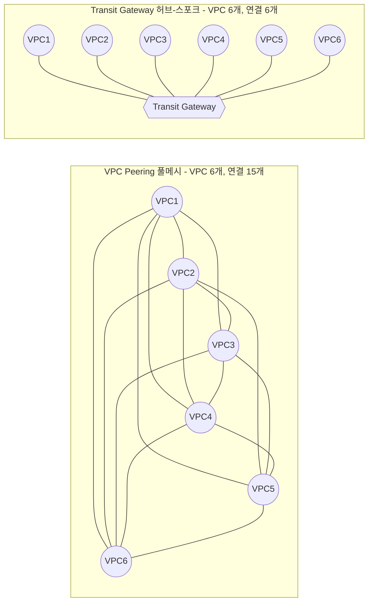
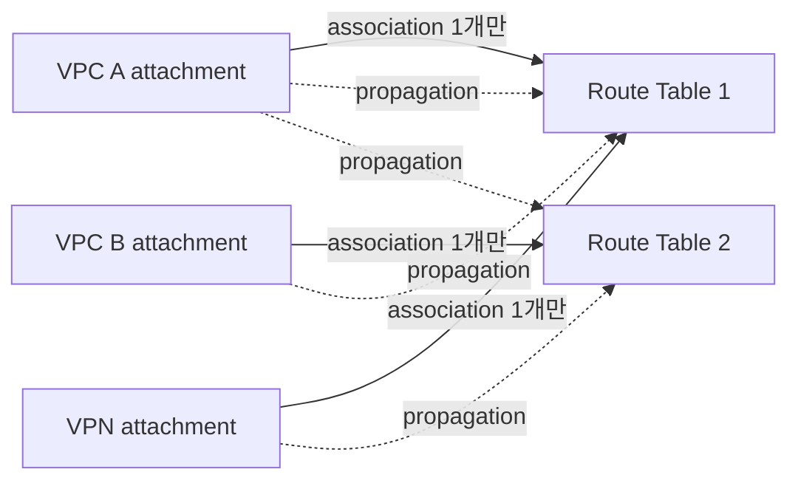
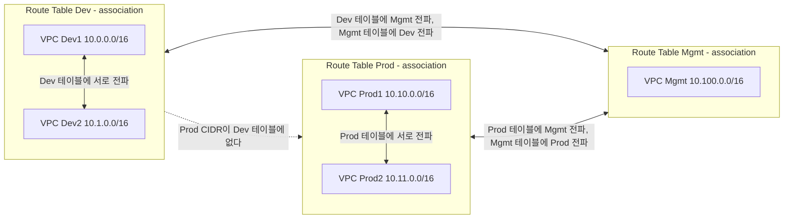
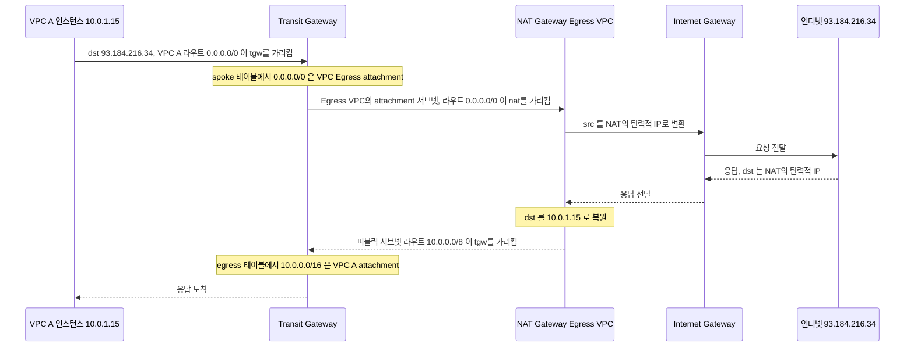
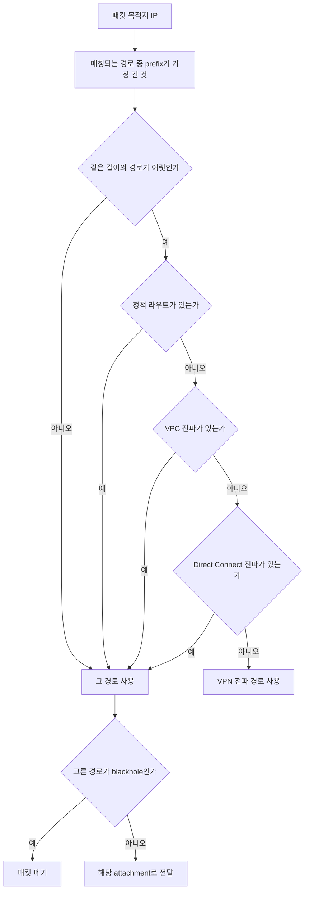
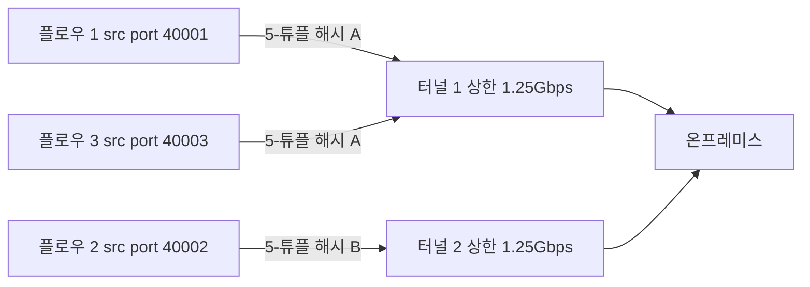
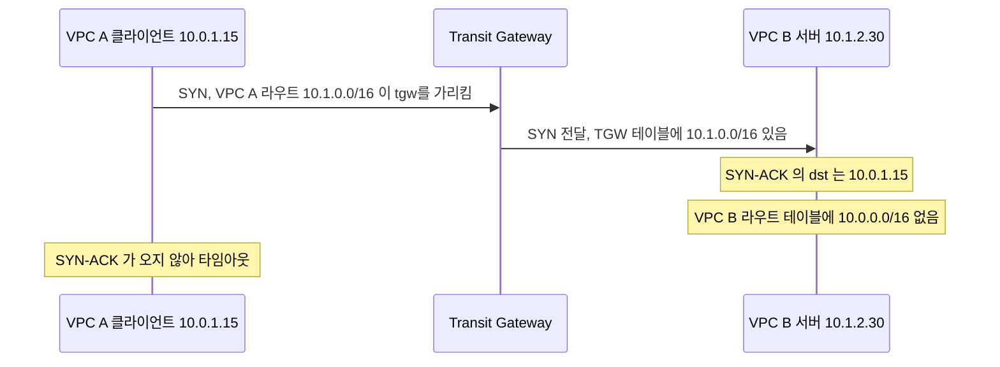

# AWS Transit Gateway

## 개요

Transit Gateway는 여러 VPC와 온프레미스 네트워크를 연결하는 중앙 허브다. VPC Peering의 복잡성을 해결한다. 수십 개의 VPC를 하나의 Transit Gateway에 연결한다. 라우팅 테이블을 중앙에서 관리한다.

### 왜 필요한가

VPC가 많아지면 관리가 복잡해진다. VPC Peering은 VPC가 늘어날수록 한계가 드러난다.

3개 VPC를 연결하는 경우를 보자.

- VPC A (개발)
- VPC B (스테이징)
- VPC C (프로덕션)

Peering은 VPC 쌍마다 하나씩 필요하다.

- A ↔ B
- A ↔ C
- B ↔ C

3개 Peering이 필요하다. 관리 가능하다.

VPC가 10개면 필요한 Peering 수는 10 × 9 ÷ 2 = 45개다.

VPC가 100개면 필요한 Peering 수는 100 × 99 ÷ 2 = 4,950개다.

불가능하다. VPC Peering은 확장성이 없다.

Peering에는 문제가 더 있다.

#### 전이적 라우팅 불가

- VPC A ↔ VPC B Peering
- VPC B ↔ VPC C Peering
- VPC A는 VPC C에 접근 불가능

A → B → C 경로가 자동으로 만들어지지 않는다. A ↔ C Peering을 별도로 생성해야 한다.

#### 온프레미스 연결

온프레미스 데이터센터와 10개 VPC를 연결한다.

VPN 방식으로 연결하면 작업이 이만큼 늘어난다.

- 각 VPC에 VPN Gateway 생성
- 온프레미스에서 10개 VPN 연결
- 각 VPN 설정 및 관리
- BGP 라우팅 10개 설정

복잡하고 에러 발생 가능성이 높다.

#### 라우팅 테이블 관리

각 VPC마다 라우팅 테이블을 관리한다. 새 VPC를 추가하면 모든 VPC의 라우팅 테이블을 수정해야 한다.

### Transit Gateway의 해결

Transit Gateway 1개를 중앙 허브로 둔다.

- 모든 VPC를 Transit Gateway에 연결
- 온프레미스도 Transit Gateway에 연결

연결 수는 이렇게 줄어든다.

- VPC 100개 + 온프레미스 1개 = 101개 연결
- VPC Peering 4,950개 → Transit Gateway 연결 101개

VPC 6개로 줄여 두 구성을 나란히 놓으면 차이가 바로 보인다. 왼쪽은 [VPC Peering](VPC_Peering.md)으로 모든 쌍을 이은 풀메시이고 선이 15개다. 오른쪽은 Transit Gateway 하나에 6개를 붙인 허브-스포크이고 선이 6개다. VPC가 하나 늘면 왼쪽은 선이 6개 늘고 오른쪽은 1개 는다.



풀메시는 연결 수보다 라우트 테이블 수정이 더 큰 문제다. VPC7을 추가하면 기존 6개 VPC의 라우트 테이블을 전부 열어 VPC7 CIDR을 넣어야 한다. 허브-스포크에서는 각 VPC 라우트 테이블에 `10.0.0.0/8` 같은 요약 경로를 TGW 앞으로 하나 걸어 두면 된다. 그러면 VPC7의 attachment를 만들고 TGW 라우트 테이블에 전파시키는 것으로 끝나고, 기존 VPC는 건드리지 않는다. 요약 경로의 범위가 VPC CIDR 설계에 묶이므로 CIDR을 처음부터 대역별로 나눠 두는 편이 낫다.

관리가 훨씬 간단하다.

전이적 라우팅은 Transit Gateway가 처리한다.

- VPC A → Transit Gateway → VPC C
- 자동으로 라우팅된다
- 추가 설정 불필요

Transit Gateway의 라우팅 테이블 하나만 관리한다. 새 VPC를 추가해도 Transit Gateway에 연결만 하면 된다.

## 핵심 개념

### Transit Gateway

중앙 라우터 역할을 한다. 리전당 하나 또는 여러 개를 만들 수 있다.

- Attachment는 TGW 하나에 최대 5,000개
- VPC attachment는 AZ당 최대 100Gbps(버스트). 플로우 하나가 쓸 수 있는 대역폭은 이보다 훨씬 작다 (대역폭 절 참고)
- attachment를 만든 AZ마다 ENI가 생기고, TGW는 그 ENI들로 분산한다

### Attachment (연결)

Transit Gateway에 리소스를 연결하는 방법이다.

Attachment 종류는 다섯 가지다.

- **VPC Attachment**: VPC 연결
- **VPN Attachment**: Site-to-Site VPN 연결
- **Direct Connect Gateway Attachment**: Direct Connect 연결
- **Peering Attachment**: 다른 Transit Gateway 연결
- **Connect Attachment**: SD-WAN 연결

### Route Table (라우팅 테이블)

트래픽을 어디로 보낼지 결정한다.

트래픽은 이 순서로 처리된다.

1. 트래픽이 Transit Gateway로 들어온다
2. 목적지 IP 확인
3. 라우팅 테이블에서 매칭되는 규칙 찾기
4. 해당 Attachment로 트래픽 전송

Transit Gateway는 여러 라우팅 테이블을 가질 수 있다. Attachment마다 다른 라우팅 테이블을 사용한다.

라우팅 테이블을 나눠 쓰는 사례는 이렇다.

- 개발 VPC는 개발 환경만 접근
- 프로덕션 VPC는 프로덕션 환경만 접근
- 관리 VPC는 모든 환경 접근

### Association (연결)

Attachment를 라우팅 테이블에 연결한다.

연결 예시다.

- VPC A Attachment를 Route Table 1에 연결
- VPC A에서 나가는 트래픽은 Route Table 1 사용

### Propagation (전파)

Attachment의 CIDR을 라우팅 테이블에 자동으로 추가한다.

전파 예시다.

- VPC B (10.1.0.0/16)를 Route Table 1에 Propagate
- Route Table 1에 자동으로 추가: 10.1.0.0/16 → VPC B Attachment

수동으로 라우팅 규칙을 추가하지 않아도 된다.

### Association과 Propagation의 비대칭

두 개념은 이름이 비슷하지만 방향이 반대고, 개수 제한도 다르다.

- Association은 "이 attachment에서 들어온 패킷이 어느 라우트 테이블을 조회하는가"를 정한다. attachment 하나에 테이블 하나만 걸 수 있다.
- Propagation은 "이 attachment로 가는 경로를 어느 라우트 테이블에 써 넣는가"를 정한다. 여러 테이블에 동시에 전파할 수 있다.

실선이 association이고 점선이 propagation이다. VPC A attachment는 Route Table 1에만 association이 걸려 있지만, 자기 CIDR은 Route Table 1과 2 양쪽에 전파한다.



이 구조에서 VPC A에서 출발한 패킷은 Route Table 1만 본다. Route Table 1에는 VPC A, VPC B의 경로가 있으니 VPC B로 갈 수 있고, VPN 경로는 전파되지 않았으므로 온프레미스로는 못 간다. VPC B에서 출발한 패킷은 Route Table 2를 보며, 여기에는 VPC A와 VPN 경로가 있다. 트래픽 방향마다 어느 테이블을 보는지가 달라서, 한쪽 방향만 열리는 구성도 가능하다. 반대로 말하면 왕복 경로가 둘 다 열려 있는지 따로 확인해야 한다.

테이블을 만들고 attachment를 거는 명령이다.

```bash
aws ec2 create-transit-gateway-route-table \
  --transit-gateway-id tgw-12345678

aws ec2 associate-transit-gateway-route-table \
  --transit-gateway-route-table-id tgw-rtb-aaaa1111 \
  --transit-gateway-attachment-id tgw-attach-1111aaaa

aws ec2 enable-transit-gateway-route-table-propagation \
  --transit-gateway-route-table-id tgw-rtb-aaaa1111 \
  --transit-gateway-attachment-id tgw-attach-2222bbbb
```

이미 association이 걸린 attachment를 다른 테이블로 옮기려면 `disassociate-transit-gateway-route-table`로 먼저 떼야 한다. 떼고 다시 거는 사이에 그 attachment에서 나가는 트래픽은 라우트를 못 찾아 버려진다. 운영 중인 VPC라면 점검 시간대에 한다.

## 기본 설정

### Transit Gateway 생성

콘솔에서 만드는 순서다.

1. VPC 콘솔 → Transit Gateways
2. "Create Transit Gateway" 클릭
3. 이름 입력
4. ASN 입력 (기본: 64512)
5. DNS 지원 활성화
6. VPN ECMP 지원 활성화
7. 기본 라우팅 테이블 연결 활성화
8. 생성

CLI 명령이다.

```bash
aws ec2 create-transit-gateway \
  --description "Main Transit Gateway" \
  --options \
    AmazonSideAsn=64512,\
    AutoAcceptSharedAttachments=disable,\
    DefaultRouteTableAssociation=enable,\
    DefaultRouteTablePropagation=enable,\
    DnsSupport=enable,\
    VpnEcmpSupport=enable
```

주요 옵션은 세 가지다.

AmazonSideAsn은 BGP ASN 번호다. 온프레미스와 BGP를 사용하면 필요하다. 기본값 64512.

DefaultRouteTableAssociation은 새 Attachment를 자동으로 기본 라우팅 테이블에 연결한다. 간단한 구성에서는 enable.

DnsSupport는 DNS 쿼리가 Transit Gateway를 통과할 수 있게 한다. 대부분 enable.

### VPC 연결

콘솔에서 연결하는 순서다.

1. Transit Gateway Attachments 메뉴
2. "Create Transit Gateway Attachment" 클릭
3. Transit Gateway 선택
4. Attachment type: VPC
5. VPC 선택
6. 서브넷 선택 (각 AZ에서 하나씩)
7. 생성

CLI 명령이다.

```bash
aws ec2 create-transit-gateway-vpc-attachment \
  --transit-gateway-id tgw-12345678 \
  --vpc-id vpc-abcd1234 \
  --subnet-ids subnet-11111111 subnet-22222222 subnet-33333333
```

VPC가 쓰는 가용 영역마다 서브넷을 하나씩 넣는다. 이 서브넷에 TGW의 ENI가 생긴다.

### Attachment 전용 서브넷

워크로드 서브넷을 그대로 고르면 동작은 한다. 그래도 attachment용 서브넷을 AZ마다 따로 만들고 /28로 잡는 관행이 있다.

- NACL이 분리된다. TGW 방향 트래픽에는 ENI가 있는 서브넷의 NACL이 적용된다. NACL은 상태가 없어 왕복 규칙을 둘 다 열어야 하는데, 워크로드 서브넷과 같이 쓰면 앱 쪽 NACL을 조이다가 TGW 트래픽이 끊긴다.
- 라우트 테이블이 단순해진다. TGW에서 들어온 패킷이 VPC 안에서 어디로 가는지는 ENI가 있는 서브넷의 라우트 테이블이 정한다. 전용 서브넷이면 이 테이블을 목적에 맞게 따로 둘 수 있다. Egress VPC에서 `0.0.0.0/0 → nat`을 거는 곳이 여기다.
- 주소를 거의 안 쓴다. ENI는 AZ당 하나다. /28은 16개 중 AWS 예약 5개를 빼고 11개가 남아서 충분하고, VPC 서브넷의 최소 크기도 /28이다.

```bash
aws ec2 create-subnet \
  --vpc-id vpc-abcd1234 \
  --availability-zone ap-northeast-2a \
  --cidr-block 10.0.255.0/28 \
  --tag-specifications 'ResourceType=subnet,Tags=[{Key=Name,Value=tgw-attach-2a}]'
```

2b, 2c도 `10.0.255.16/28`, `10.0.255.32/28` 식으로 만든 뒤 세 서브넷을 `create-transit-gateway-vpc-attachment`의 `--subnet-ids`에 넣는다.

### attachment 서브넷이 없는 AZ

TGW는 attachment 서브넷을 넣은 AZ와만 트래픽을 주고받는다. VPC가 2a, 2b, 2c를 쓰는데 attachment에는 2a, 2b만 넣었다면 2c의 인스턴스는 TGW 경유 통신이 안 된다. 라우트 테이블에 `10.1.0.0/16 → tgw`가 있고 attachment 상태가 `available`이어도 마찬가지다. 같은 VPC에서 "2a 인스턴스는 되는데 2c만 타임아웃"이면 이 경우를 먼저 본다.

```bash
aws ec2 modify-transit-gateway-vpc-attachment \
  --transit-gateway-attachment-id tgw-attach-1111aaaa \
  --add-subnet-ids subnet-33333333
```

서브넷을 추가하면 attachment가 `modifying`을 거쳐 `available`로 돌아온다. 이 동안 기존 AZ의 통신이 끊기는지는 확인하지 않았으니 운영 VPC에서는 점검 시간대에 한다.

TGW는 출발지와 같은 AZ에 도착 VPC의 ENI가 있으면 그쪽으로 내보내고, 없으면 다른 AZ를 고른다. 모든 AZ에 attachment 서브넷을 두면 AZ 사이 전송이 줄어드는 효과도 있다.

### VPC 라우팅 테이블 수정

VPC에서 Transit Gateway로 트래픽을 보내려면 라우팅 규칙을 추가한다.

VPC A (10.0.0.0/16)에서 VPC B (10.1.0.0/16)로 트래픽을 보낸다.

VPC A의 라우팅 테이블에는 이 규칙이 들어간다.

```
Destination         Target
10.0.0.0/16        local
10.1.0.0/16        tgw-12345678
```

CLI 명령이다.

```bash
aws ec2 create-route \
  --route-table-id rtb-abcd1234 \
  --destination-cidr-block 10.1.0.0/16 \
  --transit-gateway-id tgw-12345678
```

VPC 외부로 가는 모든 트래픽을 Transit Gateway로 보낸다.

```bash
aws ec2 create-route \
  --route-table-id rtb-abcd1234 \
  --destination-cidr-block 0.0.0.0/0 \
  --transit-gateway-id tgw-12345678
```

인터넷 게이트웨이가 없는 프라이빗 서브넷에서 유용하다. 트래픽을 Transit Gateway로 보내 NAT Gateway가 있는 VPC로 넘긴다.

## 라우팅 시나리오

### 단순 연결

모든 VPC가 서로 통신한다.

구성 요소다.

- VPC A (10.0.0.0/16)
- VPC B (10.1.0.0/16)
- VPC C (10.2.0.0/16)
- Transit Gateway 1개
- 라우팅 테이블 1개

Transit Gateway 라우팅 테이블은 이렇다.

```
Destination         Attachment
10.0.0.0/16        VPC A
10.1.0.0/16        VPC B
10.2.0.0/16        VPC C
```

각 VPC Attachment를 라우팅 테이블에 Propagate한다. 자동으로 규칙이 추가된다.

통신 가능 여부다.

- VPC A → VPC B: 가능
- VPC A → VPC C: 가능
- VPC B → VPC C: 가능

모든 VPC가 서로 통신한다.

### 격리된 환경

개발과 프로덕션을 분리한다.

요구사항은 네 가지다.

- 개발 VPC끼리만 통신
- 프로덕션 VPC끼리만 통신
- 개발과 프로덕션은 통신 불가
- 관리 VPC는 모든 VPC와 통신

구성 요소다.

- VPC Dev1 (10.0.0.0/16)
- VPC Dev2 (10.1.0.0/16)
- VPC Prod1 (10.10.0.0/16)
- VPC Prod2 (10.11.0.0/16)
- VPC Mgmt (10.100.0.0/16)
- Transit Gateway 1개
- 라우팅 테이블 3개

Dev 라우팅 테이블은 이렇게 구성한다.

```
Destination         Attachment
10.0.0.0/16        VPC Dev1
10.1.0.0/16        VPC Dev2
10.100.0.0/16      VPC Mgmt
```

Prod 라우팅 테이블은 이렇게 구성한다.

```
Destination         Attachment
10.10.0.0/16       VPC Prod1
10.11.0.0/16       VPC Prod2
10.100.0.0/16      VPC Mgmt
```

Mgmt 라우팅 테이블은 이렇게 구성한다.

```
Destination         Attachment
10.0.0.0/16        VPC Dev1
10.1.0.0/16        VPC Dev2
10.10.0.0/16       VPC Prod1
10.11.0.0/16       VPC Prod2
```

Association은 이렇게 건다.

- VPC Dev1, Dev2 → Route Table Dev
- VPC Prod1, Prod2 → Route Table Prod
- VPC Mgmt → Route Table Mgmt

테이블이 셋이라 출발지에 따라 보이는 범위가 세 가지로 갈린다. 박스 하나가 association으로 같은 테이블을 쓰는 그룹이고, 화살표는 그 테이블에 전파된 경로가 가리키는 도달 범위다. Dev와 Prod 사이에는 화살표가 없다.



왕복이 모두 열려야 통신이 된다는 점에 주의한다. Dev1에서 Mgmt로 요청이 가려면 Dev 테이블에 Mgmt 경로가 있어야 하고, 응답이 돌아오려면 Mgmt 테이블에 Dev 경로가 있어야 한다. 위 구성에서는 둘 다 있다. Mgmt 테이블에서 Dev 경로를 빼면 Dev1이 Mgmt로 보낸 요청은 도착하지만 응답이 버려진다.

Mgmt VPC는 Dev와 Prod를 이어 주는 라우터가 아니다. Dev1 → Mgmt → Prod1 경로는 Mgmt 안의 인스턴스가 직접 포워딩하도록 만들지 않는 한 생기지 않는다.

통신 가능 여부다.

- Dev1 → Dev2: 가능 (같은 라우팅 테이블)
- Prod1 → Prod2: 가능 (같은 라우팅 테이블)
- Dev1 → Prod1: 불가능 (Route Table Dev에 Prod1 규칙 없음)
- Mgmt → Dev1, Prod1: 모두 가능 (Route Table Mgmt에 모든 규칙 있음)

### 온프레미스 연결

데이터센터와 VPC를 연결한다.

구성 요소다.

- 온프레미스 (192.168.0.0/16)
- VPC A (10.0.0.0/16)
- VPC B (10.1.0.0/16)
- Transit Gateway
- Site-to-Site VPN

VPN 연결 명령이다.

```bash
# Customer Gateway 생성 (온프레미스 라우터 IP)
aws ec2 create-customer-gateway \
  --type ipsec.1 \
  --public-ip 203.0.113.1 \
  --bgp-asn 65000

# VPN Connection 생성
aws ec2 create-vpn-connection \
  --type ipsec.1 \
  --customer-gateway-id cgw-12345678 \
  --transit-gateway-id tgw-12345678
```

Transit Gateway 라우팅 테이블은 이렇다.

```
Destination         Attachment
10.0.0.0/16        VPC A
10.1.0.0/16        VPC B
192.168.0.0/16     VPN
```

각 VPC의 라우팅 테이블에 온프레미스로 가는 경로를 추가한다.

```
Destination         Target
10.0.0.0/16        local
192.168.0.0/16     tgw-12345678
```

통신 가능 여부다.

- VPC A → 온프레미스: 가능
- VPC B → 온프레미스: 가능
- 온프레미스 → VPC A, B: 가능

### 인터넷 접근 (Egress VPC)

프라이빗 VPC에서 인터넷에 접근한다.

프라이빗 VPC는 NAT Gateway가 없다. 인터넷에 접근할 수 없다. 모든 VPC에 NAT Gateway를 만들면 비용이 증가한다.

하나의 VPC에만 NAT Gateway를 만든다. 다른 VPC는 Transit Gateway로 NAT Gateway VPC에 트래픽을 보낸다.

구성 요소다.

- VPC Egress (10.100.0.0/16): NAT Gateway 있음
- VPC A (10.0.0.0/16): NAT Gateway 없음
- VPC B (10.1.0.0/16): NAT Gateway 없음
- Transit Gateway, 라우트 테이블 2개 (spoke, egress)

TGW 라우트 테이블을 둘로 나눈다. spoke 테이블은 VPC A, B가 association으로 쓰고 기본 경로 하나만 둔다. egress 테이블은 Egress VPC가 쓰고, 되돌아오는 응답이 갈 spoke 경로를 담는다.

```
spoke 테이블 (VPC A, B가 association)
Destination         Attachment
0.0.0.0/0          VPC Egress     (static)

egress 테이블 (VPC Egress가 association)
Destination         Attachment
10.0.0.0/16        VPC A          (propagated)
10.1.0.0/16        VPC B          (propagated)
```

spoke 테이블에 다른 spoke의 경로가 없으므로 VPC A와 VPC B는 서로 통신하지 못하고, 인터넷으로만 나간다. spoke끼리도 통신해야 하면 spoke 테이블에 A, B 전파를 추가한다.

VPC A, B의 라우트 테이블은 이렇다.

```
Destination         Target
10.0.0.0/16        local
0.0.0.0/0          tgw-12345678
```

Egress VPC는 서브넷 종류별로 라우트 테이블이 다르다. 여기를 하나로 뭉뚱그리면 응답이 돌아오지 않는다.

```
attachment 서브넷 (TGW의 ENI가 있는 곳)
Destination         Target
10.100.0.0/16      local
0.0.0.0/0          nat-12345678

NAT Gateway가 있는 퍼블릭 서브넷
Destination         Target
10.100.0.0/16      local
10.0.0.0/8         tgw-12345678     ← 응답이 돌아갈 경로
0.0.0.0/0          igw-12345678
```

퍼블릭 서브넷의 `10.0.0.0/8 → tgw` 줄이 빠진 설정이 가장 흔한 실수다. 나가는 요청은 NAT와 IGW를 지나 인터넷에 도착하고 응답도 NAT까지는 온다. NAT가 목적지를 10.0.x.x로 복원한 뒤 퍼블릭 서브넷 라우트 테이블에서 갈 곳을 못 찾아 `0.0.0.0/0 → igw`로 보낸다. IGW는 사설 주소 목적지를 버린다. 증상은 단순한 타임아웃이고 NAT Gateway의 `ErrorPortAllocation` 같은 지표에도 안 잡힌다. [NAT Gateway](Nat_Gateway.md)의 `PacketsDropCount`가 올라가거나 VPC Flow Logs에서 NAT ENI의 REJECT를 찾아야 보인다.

패킷 하나가 오가는 순서다. 가는 길은 VPC A 라우트 테이블, spoke 테이블, attachment 서브넷 라우트 테이블 순으로 세 번 라우팅되고, 돌아오는 길은 퍼블릭 서브넷 라우트 테이블, egress 테이블, VPC A 순이다.



NAT Gateway 1개만 사용하므로 비용이 줄어든다. 대신 NAT Gateway는 AZ 단위 리소스라서 NAT가 있는 AZ가 장애를 만나면 모든 VPC의 인터넷 접근이 같이 끊긴다. 운영 환경이면 AZ마다 NAT를 두고 TGW의 같은 AZ ENI로 나가게 하는 편이 낫다. 트래픽에는 NAT Gateway 처리 요금($/GB)에 TGW 데이터 처리 요금이 겹쳐 붙는다는 점도 계산에 넣어야 한다.

## 라우트가 겹칠 때

같은 TGW 라우트 테이블 안에서 한 목적지에 맞는 경로가 여러 개일 수 있다. 정적 라우트와 전파 라우트가 같은 CIDR을 가리키거나, `10.0.0.0/16`과 `10.0.1.0/24`가 함께 있는 경우다. 결정은 두 단계로 나뉜다.

1. prefix가 가장 긴 경로가 이긴다 (longest prefix match). 유형은 보지 않는다.
2. prefix 길이가 같으면 유형 순서로 정한다. 정적 라우트 > VPC 전파 > Direct Connect 전파 > VPN 전파 순이다.



Connect attachment와 Peering attachment 경로가 끼는 위치는 AWS 라우팅 문서의 표를 본다. 이 문서는 VPC, Direct Connect, VPN 세 가지만 다룬다.

예를 들어 온프레미스(VPN)가 `10.0.0.0/8`을 광고하고 VPC A(10.0.0.0/16)가 전파돼 있으면, `10.0.5.9`로 가는 패킷은 prefix가 더 긴 VPC A로 간다. 온프레미스에 `10.0.5.0/24` 서버가 따로 있어도 VPC A CIDR에 포함되므로 VPN으로 갈 수 없다. 반대로 온프레미스가 `10.0.5.0/24`를 광고하면 VPC 전파 `/16`보다 `/24`가 길어서 VPN으로 간다. 전파 유형과 상관없이 길이가 먼저다.

겹친 경로를 확인하는 방법이다. `route-search.longest-prefix-match`에 IP를 주면 그 IP가 실제로 매칭되는 경로를 뽑는다.

```bash
aws ec2 search-transit-gateway-routes \
  --transit-gateway-route-table-id tgw-rtb-aaaa1111 \
  --filters "Name=route-search.longest-prefix-match,Values=10.0.5.9/32"
```

응답의 `Type`이 `static`인지 `propagated`인지, `State`가 `active`인지 `blackhole`인지를 본다. 의도한 경로가 안 보이면 같은 CIDR로 더 우선하는 정적 라우트나 더 긴 prefix가 어디 있는지 `Name=type,Values=static`으로 걸러 찾는다.

## 블랙홀 라우트로 CIDR 차단하기

`--blackhole`을 붙인 정적 라우트는 매칭된 패킷을 버린다. 정적 라우트이므로 같은 CIDR의 전파 경로를 이기고, 더 긴 prefix의 경로도 가리지 않는다.

```bash
aws ec2 create-transit-gateway-route \
  --transit-gateway-route-table-id tgw-rtb-aaaa1111 \
  --destination-cidr-block 10.10.0.0/16 \
  --blackhole
```

쓰는 곳은 세 가지다.

- 격리 환경에서 실수로 경로가 전파돼도 막히게 한다. Dev 테이블에 `10.10.0.0/16`(Prod) blackhole을 박아 두면, 누가 Prod attachment 전파를 Dev 테이블에 켜도 정적 라우트가 이기므로 Dev에서 Prod로 가지 못한다.
- 넓은 경로 안의 특정 대역만 뺀다. `10.0.0.0/8 → Egress`를 두고 `10.200.0.0/16`만 blackhole로 막는 식이다. longest prefix match가 `/16`을 먼저 고른다.
- attachment를 지우기 전에 해당 CIDR을 먼저 막아 트래픽 영향 범위를 확인한다.

blackhole로 버려진 패킷은 CloudWatch의 `PacketDropCountBlackhole`로 센다. 이 값이 늘었다면 의도한 차단이거나 누군가 막아 놓은 CIDR로 보내고 있다는 뜻이다. 반면 `PacketDropCountNoRoute`는 라우트 자체가 없는 경우다. 둘은 원인이 다르니 구분해서 본다.

attachment를 삭제하거나 VPC가 없어지면 그 attachment를 가리키던 정적 라우트의 상태가 `blackhole`로 바뀐다. 정적 라우트는 자동으로 지워지지 않고, 조용히 패킷을 버리는 상태로 남는다.

```bash
aws ec2 search-transit-gateway-routes \
  --transit-gateway-route-table-id tgw-rtb-aaaa1111 \
  --filters "Name=state,Values=blackhole"
```

의도하지 않은 blackhole은 이 명령으로 찾는다.

## CIDR이 겹치는 VPC

TGW에는 CIDR 변환 기능이 없다. 두 VPC가 `10.0.0.0/16`을 같이 쓰면 한쪽만 붙는다.

- attachment 생성은 성공한다. 상태도 `available`이다.
- 전파는 먼저 들어온 쪽만 라우트 테이블에 올라간다. 겹치는 두 번째 VPC의 CIDR은 전파되지 않는다.
- 두 번째 VPC로 가는 경로가 TGW에 없으니 라우트 테이블을 아무리 봐도 "연결은 됐는데 경로가 없다"는 상태가 된다.

"attachment가 available인데 라우트 테이블에 그 VPC CIDR이 안 보인다"면 겹침부터 의심한다. `Name=route-search.exact-match`로 해당 CIDR을 조회해서 어떤 attachment가 가져갔는지 확인한다.

VPC 안에서도 문제가 있다. VPC 라우트 테이블의 `local` 경로는 자기 CIDR 전체를 먼저 차지하므로, 자기 CIDR과 같은 대역을 TGW로 보내는 라우트를 걸 수 없다. 상대 VPC가 `10.0.0.0/16`이고 나도 `10.0.0.0/16`이면 `10.0.5.9`는 어떤 경우에도 내 VPC 안에서 해석된다.

선택지는 몇 가지 있다.

- 한쪽 CIDR을 바꾼다. VPC CIDR은 못 바꾸지만 보조 CIDR을 붙이고 서브넷을 옮기는 방법이 있다. 가장 확실하고 작업량이 가장 크다.
- 겹치는 VPC를 서로 다른 TGW 라우트 테이블에 association하고 정적 라우트로 따로 취급한다. 같은 CIDR 하나는 여전히 한 방향밖에 못 쓰므로 두 겹치는 VPC끼리의 통신은 해결되지 않는다. 겹치는 VPC가 공용 서비스 VPC와만 통신하면 되는 경우에 맞다.
- [PrivateLink](PrivateLink.md)로 필요한 서비스 하나만 노출한다. CIDR과 무관하게 동작한다.
- 라우팅 가능한 보조 CIDR을 붙인 VPC에 private NAT Gateway를 두고 겹치는 쪽 트래픽을 그 주소로 변환한다.

M&A나 파트너 연동으로 CIDR이 겹치는 VPC가 들어오는 일은 실제로 있다. VPC를 만들 때 [VPC IPAM](VPC_IPAM.md)으로 CIDR을 중앙에서 받아 가면 이 문제가 미리 막힌다.

## 리전 간 연결

다른 리전의 Transit Gateway를 연결한다.

사용 사례는 세 가지다.

- 글로벌 네트워크
- 재해 복구
- 데이터 복제

설정 명령이다.

```bash
# us-west-2의 Transit Gateway
TGW_WEST=tgw-12345678

# us-east-1의 Transit Gateway
TGW_EAST=tgw-87654321

# Peering Attachment 생성 (us-west-2에서)
aws ec2 create-transit-gateway-peering-attachment \
  --transit-gateway-id $TGW_WEST \
  --peer-transit-gateway-id $TGW_EAST \
  --peer-region us-east-1 \
  --region us-west-2

# Peering Attachment 수락 (us-east-1에서)
aws ec2 accept-transit-gateway-peering-attachment \
  --transit-gateway-attachment-id tgw-attach-12345678 \
  --region us-east-1
```

라우팅은 두 리전의 Transit Gateway에 각각 설정한다.

us-west-2 Transit Gateway의 라우팅 테이블이다.

```
Destination         Attachment
10.0.0.0/16        VPC West
172.16.0.0/16      Peering (to us-east-1)
```

us-east-1 Transit Gateway의 라우팅 테이블이다.

```
Destination         Attachment
172.16.0.0/16      VPC East
10.0.0.0/16        Peering (to us-west-2)
```

연결 결과다.

- us-west-2 VPC → us-east-1 VPC: 가능
- 리전 간 프라이빗 네트워크

리전 간 데이터 전송 비용이 발생한다. $0.02/GB (리전에 따라 다름).

## 대역폭과 MTU

### VPN 터널과 ECMP

Site-to-Site VPN 터널 하나의 상한은 1.25Gbps다. 연결 하나에 터널이 두 개 있지만 이중화용이라 1.25Gbps가 2.5Gbps가 되지는 않는다. [Virtual Private Gateway](Site_to_Site_VPN.md)에 붙인 VPN은 터널을 몇 개로 늘려도 합산이 안 된다. 대역폭을 합치는 기능은 TGW에만 있다. TGW는 같은 prefix를 BGP로 받은 여러 VPN 터널에 ECMP로 트래픽을 나눈다.

ECMP가 동작하려면 조건이 맞아야 한다.

- TGW 옵션 `VpnEcmpSupport`가 `enable`이어야 한다. 이미 만든 TGW는 `modify-transit-gateway`로 바꾼다.
- VPN이 BGP 동적 라우팅이어야 한다. 정적 라우팅 VPN은 ECMP 대상이 아니다.
- 온프레미스 장비가 같은 prefix를 같은 AS_PATH 길이로 모든 터널에 광고해야 한다. 한쪽만 길게 광고하면 그 터널은 ECMP 후보에서 빠진다.
- 온프레미스에서 AWS로 가는 방향은 장비가 나눈다. 장비 쪽 ECMP 설정이 없으면 한 방향만 늘어난다.

```bash
aws ec2 modify-transit-gateway \
  --transit-gateway-id tgw-12345678 \
  --options VpnEcmpSupport=enable
```

분산 단위는 패킷이 아니라 플로우다. TGW는 5-튜플(출발지 IP, 목적지 IP, 출발지 포트, 목적지 포트, 프로토콜)로 해시를 계산해 터널을 고른다. 같은 5-튜플은 항상 같은 터널로 간다. 그래서 TCP 연결 하나는 터널 수와 상관없이 1.25Gbps를 넘지 못한다.



플로우 1과 플로우 3은 해시가 같아 터널 1을 같이 쓴다. 플로우 하나가 터널을 전부 쓰고 있으면 터널 2가 비어 있어도 플로우 1은 터널 2로 못 넘어간다. 플로우가 두세 개뿐이면 둘이 한 터널에 몰려 합계가 1.25Gbps에 머무는 일도 생긴다.

온프레미스 DB 덤프를 TCP 연결 하나로 복사하면서 "VPN 4개 붙였는데 왜 안 빨라지냐"는 질문이 나오는 이유가 이것이다. 측정은 연결 수를 바꿔 가며 한다.

```bash
iperf3 -c 10.1.2.30 -P 1 -t 30
iperf3 -c 10.1.2.30 -P 8 -t 30
```

`-P 8`은 출발지 포트가 다른 연결 8개를 만들어 해시가 흩어진다. `-P 1`이 1.25Gbps 부근에서 멈추고 `-P 8`이 그보다 높으면 ECMP는 정상이고 플로우 하나의 한계에 걸린 것이다. 옵션은 iperf3 공식 매뉴얼 기준이고, VPN 환경에서 직접 잰 수치는 아니다.

해결 방향은 전송 쪽에서 연결을 나누는 것이다. `aws s3 cp`의 멀티파트 업로드, `rclone --transfers`, DB 복제의 병렬 덤프 같은 방법이 있다. 단일 연결로 더 필요하면 VPN이 아니라 [Direct Connect](Direct_Connect.md)를 쓴다. 터널별 사용량은 CloudWatch `AWS/VPN`의 `TunnelDataOut`을 터널 IP로 쪼개 보면 쏠림이 보인다.

### VPC attachment 대역폭

VPC attachment는 AZ당 최대 100Gbps까지 버스트가 가능하다. 실제로 이 숫자에 닿는 일은 거의 없고 그 전에 다른 한계가 먼저 걸린다.

- 플로우 하나가 쓸 수 있는 대역폭에는 별도 한도가 있다. 정확한 값은 TGW 쿼터 문서에서 확인한다.
- EC2 인스턴스의 단일 플로우는 클러스터 플레이스먼트 그룹 밖에서 5Gbps로 제한된다. TGW에 닿기 전에 인스턴스가 먼저 막는 경우가 많다.
- NAT Gateway를 거치면 NAT 쪽 한도가 따로 있다.

"TGW 때문에 느리다"고 의심하기 전에 인스턴스 유형의 네트워크 성능과 플로우 개수부터 확인한다. 같은 AZ 안에서 attachment를 거치지 않고 같은 측정을 해 본 결과와 비교하면 TGW 구간의 영향을 분리할 수 있다.

### MTU 차이와 단편화

경로에 따라 MTU가 다르다.

| 구간 | MTU |
|---|---|
| VPC attachment | 8500 |
| VPN attachment | 1500 |
| EC2 인스턴스 기본값 (대부분의 유형) | 9001 |

인스턴스가 9001까지 보낼 수 있어도 TGW는 8500을 넘는 패킷을 받지 않는다. VPC에서 VPC로 가는 대용량 전송에서 8501~9001 크기 패킷이 막히면 연결은 되는데 큰 응답에서만 멈춘다. VPN으로 나가는 경로는 1500이라 차이가 더 크다. 8500 크기로 쓰던 패킷이 VPN 구간에서는 단편화되거나 버려진다.

DF 비트가 켜진 패킷이 MTU보다 크면 중간 장비가 ICMP "fragmentation needed"(type 3, code 4)를 돌려주고, 송신자는 MSS를 줄여 다시 보낸다. 이 ICMP를 어디선가 막으면 송신자가 크기를 못 줄이고 같은 큰 패킷만 재전송하다 멈춘다. 흔한 곳이 NACL이고, 온프레미스 방화벽에서도 자주 막는다.

증상은 구분이 쉽다.

- ping은 된다.
- TCP 3-way 핸드셰이크는 끝난다.
- 작은 요청과 응답은 된다.
- 큰 응답(TLS 인증서 교환, 큰 SELECT 결과, 파일 다운로드)에서 멈춘다.

타깃에 맞는 MTU를 DF를 켠 ping으로 확인한다. ICMP 페이로드는 MTU에서 28(IP 20 + ICMP 8)을 뺀 값이다.

```bash
# 다른 VPC 대상 (8500)
ping -M do -s 8472 -c 3 10.1.2.30

# VPN 너머 온프레미스 대상 (1500)
ping -M do -s 1472 -c 3 192.168.1.10

# 어느 크기부터 막히는지 경로 MTU를 탐색
tracepath -n 192.168.1.10
```

`ping -M do -s 1472`는 실패하고 `-s 1372` 정도에서 성공하면 경로 어딘가에 IPsec 오버헤드나 중간 MTU가 있다. 온프레미스 장비의 터널 인터페이스 MTU는 IPsec 오버헤드 때문에 1500보다 작게 잡는 경우가 많다. AWS가 권장하는 값은 Site-to-Site VPN 문서에서 확인한다.

임시 처방은 온프레미스 대역으로 가는 경로에만 MTU와 MSS를 낮추는 것이다. 인스턴스 전체 MTU를 바꾸면 VPC 안 통신의 점보 프레임 이점이 사라지므로 라우트 단위로 건다.

```bash
sudo ip route replace 192.168.0.0/16 via 10.0.1.1 dev eth0 mtu 1400 advmss 1360
```

`via` 주소는 서브넷 게이트웨이(VPC 서브넷 CIDR의 첫 주소 + 1)다. 이 명령의 문법은 네트워크 네임스페이스에서 실행해 확인했다. 재부팅하면 사라지므로 영구 적용은 네트워크 설정 파일이나 user-data에 넣는다. 근본 해결은 온프레미스 장비에서 TCP MSS를 클램핑하고 ICMP type 3을 허용하는 것이다.

## 모니터링

### CloudWatch 메트릭

주요 메트릭이다.

- **BytesIn**: Transit Gateway로 들어오는 바이트
- **BytesOut**: Transit Gateway에서 나가는 바이트
- **PacketsIn**: 들어오는 패킷 수
- **PacketsOut**: 나가는 패킷 수
- **PacketDropCountBlackhole**: Blackhole 라우팅으로 삭제된 패킷
- **PacketDropCountNoRoute**: 라우팅 규칙이 없어서 삭제된 패킷

PacketDropCountNoRoute가 0이 아니면 라우팅 설정을 확인한다. 목적지로 가는 경로가 없다.

### Flow Logs

Transit Gateway를 통과하는 트래픽을 로그로 남긴다.

활성화 명령이다.

```bash
aws ec2 create-flow-logs \
  --resource-type TransitGateway \
  --resource-ids tgw-12345678 \
  --traffic-type ALL \
  --log-destination-type cloud-watch-logs \
  --log-group-name /aws/transitgateway/flowlogs
```

로그에는 이 항목이 남는다.

- 소스 IP
- 목적지 IP
- 소스 포트
- 목적지 포트
- 프로토콜
- 패킷 수
- 바이트 수
- Action (ACCEPT/REJECT)

주로 이런 용도로 쓴다.

- 트래픽 패턴 분석
- 보안 이슈 파악
- 트러블슈팅

## 트러블슈팅

### 연결이 안 된다

#### 라우팅 테이블 확인

VPC 라우팅 테이블에서 목적지로 가는 경로가 Transit Gateway로 설정되어 있는지 확인한다.

```bash
aws ec2 describe-route-tables --route-table-ids rtb-12345678
```

Transit Gateway 라우팅 테이블에서는 목적지 VPC로 가는 경로가 있는지 확인한다.

```bash
aws ec2 search-transit-gateway-routes \
  --transit-gateway-route-table-id tgw-rtb-12345678 \
  --filters "Name=type,Values=static,propagated"
```

#### 보안 그룹 / NACL

보안 그룹과 NACL이 트래픽을 허용하는지 확인한다.

소스 VPC의 보안 그룹은 아웃바운드 규칙이 목적지 IP를 허용하는지 확인한다.

목적지 VPC의 보안 그룹은 인바운드 규칙이 소스 IP를 허용하는지 확인한다.

#### Attachment 상태

Attachment가 "available" 상태인지 확인한다.

```bash
aws ec2 describe-transit-gateway-attachments \
  --transit-gateway-attachment-ids tgw-attach-12345678
```

"pending" 또는 "failed" 상태면 문제가 있다.

#### Association / Propagation

Attachment가 올바른 라우팅 테이블에 연결되어 있는지 확인한다.

```bash
aws ec2 get-transit-gateway-attachment-propagations \
  --transit-gateway-attachment-id tgw-attach-12345678
```

### 요청은 가는데 응답이 안 돌아온다

가장 흔한 형태다. VPC A(10.0.0.0/16)의 클라이언트가 VPC B(10.1.0.0/16)의 서버 `10.1.2.30:5432`에 접속하는데 타임아웃이 난다. A의 라우트 테이블에는 `10.1.0.0/16 → tgw`가 있고 TGW 라우트 테이블에도 양쪽 경로가 전파돼 있다. 그런데 B의 라우트 테이블에는 `10.0.0.0/16 → tgw`가 없다.



요청은 도착하고 응답만 사라진다. 서버에서 `tcpdump -ni any port 5432`를 보면 SYN을 받고 SYN-ACK을 내보낸 것까지 찍힌다. 그래서 "서버는 정상이고 SG도 열려 있는데 왜 안 되지"로 시간을 쓰게 된다. B에 `0.0.0.0/0 → NAT Gateway`가 있으면 응답이 NAT로 가서 버려지고, 흔적도 안 남는다. 서버 쪽 VPC Flow Logs에서 인바운드는 ACCEPT인데 대응하는 정상 응답 흐름이 안 보이면 이 경우다.

확인은 양쪽 VPC의 라우트 테이블을 다 본다.

```bash
aws ec2 describe-route-tables \
  --route-table-ids rtb-b-private \
  --query 'RouteTables[].Routes[?DestinationCidrBlock==`10.0.0.0/16`]'
```

결과가 비어 있으면 응답 경로가 없는 것이다. 라우트를 추가한다.

```bash
aws ec2 create-route \
  --route-table-id rtb-b-private \
  --destination-cidr-block 10.0.0.0/16 \
  --transit-gateway-id tgw-12345678
```

[VPC Reachability Analyzer](VPC_Reachability_Analyzer.md)는 한 방향 경로만 분석한다. 출발지와 도착지를 바꿔 한 번씩 돌려야 비대칭을 찾는다. TGW 라우트 테이블 쪽 비대칭도 같은 모양이다. 위 격리 환경에서 Mgmt 테이블에 Dev 경로가 빠진 경우다.

### 보안 그룹 참조가 TGW를 넘지 못한다

같은 VPC 안에서는 DB 보안 그룹의 인바운드에 "앱 서버 SG"를 소스로 지정한다. 이렇게 하면 앱 서버가 늘어도 규칙을 안 건드린다. VPC가 갈라져 앱이 VPC A, DB가 VPC B에 있게 되면 이 방식이 안 된다. 다른 VPC의 SG ID는 기본적으로 참조할 수 없다. [VPC Peering](VPC_Peering.md)에서는 같은 리전이면 참조가 되지만, TGW를 낀 구성에서 같은 규칙을 그대로 옮기려다 막히는 경우가 많다.

CIDR로 다시 쓴다.

```bash
aws ec2 authorize-security-group-ingress \
  --group-id sg-0db0000000000001 \
  --ip-permissions 'IpProtocol=tcp,FromPort=5432,ToPort=5432,IpRanges=[{CidrIp=10.0.0.0/16,Description=app vpc via tgw}]'
```

CIDR 규칙으로 바꾸면 달라지는 점이 있다.

- 소스 범위가 "앱 서버 SG를 단 인스턴스"에서 "VPC A 전체"로 넓어진다. 앱 서브넷이 따로 있으면 VPC 전체가 아니라 앱 서브넷 CIDR(`10.0.16.0/20` 등)로 좁힌다.
- 서브넷 CIDR을 바꾸면 규칙도 같이 고쳐야 한다. 규칙 설명에 어떤 서비스를 위한 것인지 적어 두지 않으면 나중에 못 지운다.
- NACL은 SG와 별개로 TGW attachment 서브넷과 DB 서브넷 양쪽에서 막을 수 있으니 같이 본다.

최근 TGW에는 SG 참조 지원 옵션이 있다. TGW와 각 VPC attachment 양쪽에서 켜야 하고, 같은 리전의 VPC attachment 사이에서만 동작한다.

```bash
aws ec2 modify-transit-gateway \
  --transit-gateway-id tgw-12345678 \
  --options SecurityGroupReferencingSupport=enable

aws ec2 modify-transit-gateway-vpc-attachment \
  --transit-gateway-attachment-id tgw-attach-1111aaaa \
  --options SecurityGroupReferencingSupport=enable
```

이 옵션을 켜 두지 않은 TGW라면 CIDR로 쓰는 수밖에 없다. 옵션 이름은 AWS CLI의 API 모델에서 확인했고, 실제 계정에서 켜서 동작을 검증하지는 못했다. 적용 전에 AWS 문서의 제약(피어링 attachment 미지원 등)을 확인한다.

### 성능이 느리다

대역폭과 MTU는 위의 대역폭과 MTU 절에서 다룬다. 확인 순서는 이렇다.

1. CloudWatch의 `BytesIn`/`BytesOut`으로 attachment 사용량을 본다. AZ당 100Gbps에 닿은 경우는 드물다.
2. 느린 것이 연결 하나인지 전체인지 본다. 하나만 느리면 플로우 한도(VPN 1.25Gbps, 인스턴스 5Gbps)다.
3. 큰 응답에서만 멈추면 MTU다. `ping -M do -s`로 확인한다.

### 비용이 많이 나온다

Transit Gateway는 데이터 전송량에 따라 비용이 발생한다.

요금은 이렇다.

- Attachment: $0.05/시간
- 데이터 처리: $0.02/GB

예시 조건이다.

- VPC 10개
- 각 VPC당 10TB/월 전송

이 조건의 비용이다.

- Attachment: 10 × $0.05 × 730시간 = $365/월
- 데이터: 10 × 10TB × 1024GB × $0.02 = $2,048/월
- 합계: $2,413/월

비용을 줄이는 방법이다.

사용하지 않는 VPC는 연결을 해제한다.

데이터 전송량은 이렇게 줄인다.

- 같은 VPC 내에서 통신
- S3 Gateway Endpoint 사용 (Transit Gateway 우회)
- 캐싱으로 반복 전송 줄이기

## 비용

### Attachment 비용

Attachment당 시간당 $0.05다.

월 비용은 $0.05 × 730시간 = $36.50/Attachment다.

VPC 5개 연결 = $36.50 × 5 = $182.50/월

### 데이터 전송 비용

AZ 내 전송은 $0.02/GB다.

리전 간 전송 요금이다.

- $0.02/GB (같은 리전의 다른 AZ)
- $0.02/GB ~ $0.09/GB (다른 리전)

100TB/월 전송 = 100 × 1024GB × $0.02 = $2,048/월

### VPC Peering과 비교

VPC Peering 요금이다.

- 연결 비용: 무료
- 데이터 전송: 같은 AZ 무료, 다른 AZ $0.01/GB

Transit Gateway 요금이다.

- Attachment: $36.50/월
- 데이터 전송: $0.02/GB

VPC 2개, 월 10GB를 전송하면 이렇다.

- Peering: $0.10/월
- Transit Gateway: $73 + $0.20 = $73.20/월

Peering이 저렴하다.

VPC 10개, 월 100GB를 전송하면 이렇다.

- Peering: 45개 연결, $45/월 (데이터 전송)
- Transit Gateway: $365 + $200 = $565/월

Peering이 여전히 저렴하다. 하지만 관리가 복잡하다.

선택 기준이다.

- VPC 3개 이하: VPC Peering
- VPC 4개 이상: Transit Gateway
- 온프레미스 연결: Transit Gateway
- 복잡한 라우팅: Transit Gateway

## 참고

- AWS Transit Gateway 사용 설명서: https://docs.aws.amazon.com/vpc/latest/tgw/
- Transit Gateway 요금: https://aws.amazon.com/transit-gateway/pricing/
- Transit Gateway vs VPC Peering: https://docs.aws.amazon.com/vpc/latest/tgw/tgw-peering.html
- Transit Gateway 설계 문서: https://docs.aws.amazon.com/vpc/latest/tgw/tgw-best-design-practices.html

