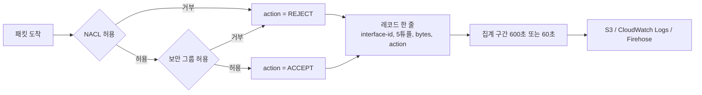
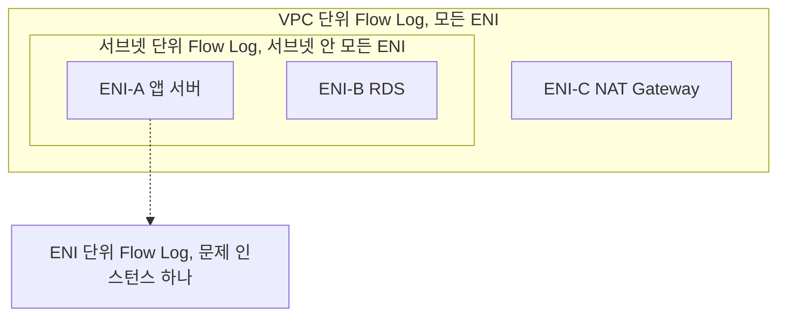
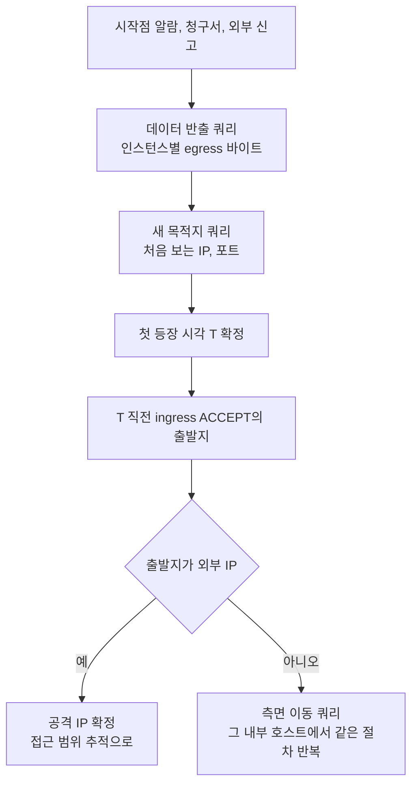
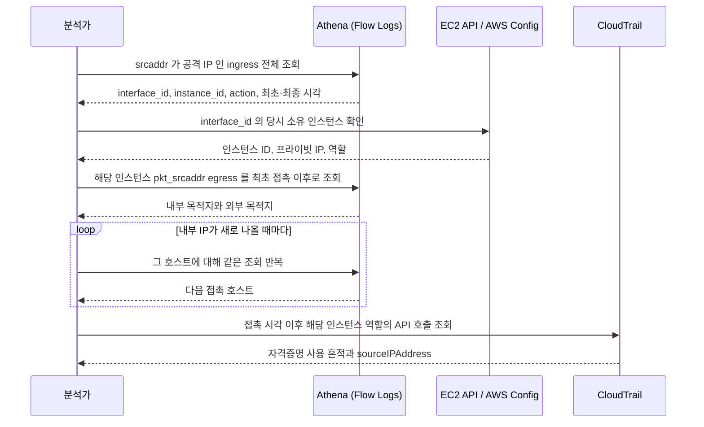

# VPC Flow Logs

VPC Flow Logs는 ENI를 드나드는 IP 트래픽의 메타데이터를 기록한다. 출발지·목적지 IP, 포트, 프로토콜, 패킷·바이트 수, ACCEPT/REJECT, 집계 구간의 시작·끝 시각이 한 줄이다. 페이로드는 없다. 내용이 필요하면 Traffic Mirroring을 따로 켠다.

"NAT Gateway 바이트가 왜 뛰었나", "침입자가 어느 서버까지 들어왔나" 같은 질문은 일이 터진 뒤에 온다. 켜기 전의 트래픽은 복원할 방법이 없어서 운영 VPC는 만들 때 같이 켠다. 샘플링이 없는 100% 캡처라 전송 대상을 잘못 고르면 비용이 빠르게 불어난다.

## 레코드가 만들어지는 지점

도식은 인바운드 패킷 하나가 레코드가 되기까지의 순서다. ACCEPT/REJECT는 NACL과 보안 그룹이 내린 판정이고 Flow Log는 판정에 관여하지 않는다. 아웃바운드는 보안 그룹, NACL 순으로 평가 순서만 뒤집힌다.



레코드에는 NACL이 막았는지 보안 그룹이 막았는지가 없다. 어느 쪽인지는 두 규칙을 직접 대조하거나 [Reachability Analyzer](VPC_Reachability_Analyzer.md)로 가려낸다. NACL은 stateless라서 인바운드가 ACCEPT인데 응답이 NACL에 막히면 같은 흐름의 egress 레코드가 REJECT로 남는다. 보안 그룹은 stateful이라 허용된 인바운드의 응답이 보안 그룹 때문에 REJECT되는 일은 없다.

## 켜는 단위

레코드 형식은 같고 구독하는 ENI의 범위만 다르다.



운영은 VPC 단위로 켠다. ENI 단위는 디버깅 때만 켠다. 겹쳐 켜면 같은 패킷이 두 번 기록되고 저장 비용도 두 배인데, 디버깅이 끝나고 끄는 것을 잊는 경우가 잦다.

## 전송 대상

| 대상 | 지연 | 쿼리 | 쓰는 경우 |
|---|---|---|---|
| S3 | 약 5분 간격 객체 | Athena | 장기 보관, 사후 분석, 감사. 대부분 여기 |
| CloudWatch Logs | 수십 초~분 | Logs Insights, 메트릭 필터 알람 | 알람이 필요한 핵심 VPC. 한시적으로 |
| Firehose | 버퍼 설정에 따라 60초~몇 분 | OpenSearch, Splunk, Datadog | SIEM에 실시간으로 보낼 때 |

S3는 처음부터 Parquet과 Hive 호환 파티셔닝으로 보낸다. 텍스트로 쌓다 변환하면 이중 저장이고, 파티션이 없으면 쿼리마다 풀스캔이다. CloudWatch Logs는 인입 단가가 높아서 트래픽 많은 VPC 전체에 켜면 청구서가 EC2 비용을 넘는 일이 실제로 있다.

## 필드 선택

기본 포맷은 14개 필드다.

```
version account-id interface-id srcaddr dstaddr srcport dstport protocol
packets bytes start end action log-status
```

사고 조사에는 부족해서 처음부터 아래 필드를 넣는다.

| 필드 | 없을 때 생기는 문제 |
|---|---|
| `pkt-srcaddr`, `pkt-dstaddr` | NAT Gateway ENI에서는 `srcaddr`가 NAT의 IP로 찍혀 어느 인스턴스가 보냈는지 모른다 |
| `flow-direction` | 같은 VPC 내부나 PrivateLink 트래픽에서 ingress/egress를 추정하다 틀린다 |
| `instance-id` | ENI가 아니라 인스턴스 기준으로 조회할 수 없다. NAT 같은 요청자 관리형 ENI는 `-`로 나온다 |
| `traffic-path` | 어느 경로로 VPC를 나갔는지 모른다 |
| `tcp-flags` | SYN만 폭주하는 스캔과 정상 세션을 구분하지 못한다 |
| `vpc-id`, `subnet-id`, `region`, `az-id` | 여러 VPC와 리전의 로그를 한 테이블로 합칠 수 없다 |

`traffic-path` 코드는 1이 같은 VPC 안의 다른 리소스, 2가 IGW 또는 Gateway Endpoint, 3이 VGW, 4가 리전 내 Peering, 5가 리전 간 Peering, 6이 Local Gateway, 7이 Gateway Endpoint(Nitro), 8이 IGW(Nitro)다. 세대에 따라 IGW 트래픽이 2와 8로 갈리므로 쿼리에서는 `IN (2, 8)`로 묶는다. 코드표는 AWS 문서의 필드 표로 한 번 더 대조한다.

custom format은 나중에 필드를 추가하려면 정의와 Athena 스키마를 다시 만들어야 한다.

## ACCEPT, REJECT, log-status

Traffic type은 ALL로 둔다. REJECT만 켜면 ALB에서 백엔드로 가는 트래픽이 끊긴 문제를 추적할 수 없고, ACCEPT만 켜면 막힌 시도를 모른다. 응답이 없는 EC2는 ingress ACCEPT 뒤에 egress가 비었는지 egress REJECT가 있는지를 봐야 NACL 문제인지 앱 문제인지 갈린다.

`log-status`의 `SKIPDATA`는 일부 레코드가 빠졌다는 뜻이다. 자주 보이면 그 구간의 결과를 그대로 믿지 않는다.

## Athena 테이블

S3에 Parquet과 Hive 파티셔닝으로 저장한다고 가정한다.

```sql
CREATE EXTERNAL TABLE vpc_flow_logs (
  version int,
  account_id string,
  interface_id string,
  srcaddr string,
  dstaddr string,
  srcport int,
  dstport int,
  protocol bigint,
  packets bigint,
  bytes bigint,
  `start` bigint,
  `end` bigint,
  action string,
  log_status string,
  vpc_id string,
  subnet_id string,
  instance_id string,
  pkt_srcaddr string,
  pkt_dstaddr string,
  traffic_path int,
  flow_direction string,
  tcp_flags int
)
PARTITIONED BY (year string, month string, day string, hour string)
STORED AS PARQUET
LOCATION 's3://my-flow-logs-bucket/AWSLogs/aws-account-id=111122223333/aws-service=vpcflowlogs/aws-region=ap-northeast-2/'
TBLPROPERTIES (
  'projection.enabled' = 'true',
  'projection.year.type' = 'integer',
  'projection.year.range' = '2024,2030',
  'projection.month.type' = 'integer',
  'projection.month.range' = '1,12',
  'projection.month.digits' = '2',
  'projection.day.type' = 'integer',
  'projection.day.range' = '1,31',
  'projection.day.digits' = '2',
  'projection.hour.type' = 'integer',
  'projection.hour.range' = '0,23',
  'projection.hour.digits' = '2',
  'storage.location.template' = 's3://my-flow-logs-bucket/AWSLogs/aws-account-id=111122223333/aws-service=vpcflowlogs/aws-region=ap-northeast-2/year=${year}/month=${month}/day=${day}/hour=${hour}'
);
```

Parquet은 컬럼을 이름으로 읽는다. 시각 컬럼 이름은 `start`, `end`이고 `start_time` 같은 이름을 붙이면 전부 NULL이다. `end`는 예약어라 DDL에서는 백틱, 쿼리에서는 큰따옴표로 감싼다. `storage.location.template`은 실제 키 경로와 글자 단위로 맞아야 하므로 `aws s3 ls`로 먼저 확인한다. Partition projection을 쓰면 `MSCK REPAIR TABLE`이 필요 없다.

## 일상 운영 쿼리

RDS ENI에 최근 이틀간 거부된 접속이 어디서 왔는지 본다.

```sql
SELECT srcaddr, dstport, protocol, COUNT(*) AS attempts, SUM(packets) AS total_packets
FROM vpc_flow_logs
WHERE year='2026' AND month='05' AND day BETWEEN '19' AND '20'
  AND interface_id = 'eni-0abcd1234ef567890'
  AND action = 'REJECT'
  AND flow_direction = 'ingress'
GROUP BY srcaddr, dstport, protocol
ORDER BY attempts DESC
LIMIT 50;
```

한 IP가 여러 포트를 건드리면 포트 스캔이고, 여러 IP가 같은 포트로 오면 보안 그룹에서 빠진 정상 트래픽이다.

NAT Gateway 비용은 NAT ENI를 지나간 트래픽을 `pkt_srcaddr`로 집계해 잡는다.

```sql
SELECT pkt_srcaddr, pkt_dstaddr, dstport,
       SUM(bytes) / 1024 / 1024 / 1024 AS gb_transferred
FROM vpc_flow_logs
WHERE year='2026' AND month='05' AND day='20'
  AND interface_id = 'eni-natgw-0abc...'
  AND flow_direction = 'egress'
  AND action = 'ACCEPT'
GROUP BY pkt_srcaddr, pkt_dstaddr, dstport
ORDER BY gb_transferred DESC
LIMIT 30;
```

상위에 S3, ECR, Secrets Manager 대역이 몰려 있으면 VPC Endpoint로 돌린다.

## 침해 후 추적 쿼리

침해 조사의 시작점은 공격 IP가 아니라 수상해진 서버 한 대인 경우가 많다. 그 서버의 나가는 트래픽에서 첫 이상 시각을 잡고, 그 직전에 들어온 트래픽으로 공격자를 찾는다.



### 데이터 반출

외부로 나간 바이트를 인스턴스별 일 단위로 모아 직전 7일 평균과 비교한다. `instance_id` 조건이 NAT ENI의 중복 집계를 걸러낸다.

```sql
WITH daily AS (
  SELECT pkt_srcaddr, day, SUM(bytes) AS b
  FROM vpc_flow_logs
  WHERE year='2026' AND month='05' AND day BETWEEN '13' AND '20'
    AND flow_direction = 'egress'
    AND action = 'ACCEPT'
    AND instance_id IS NOT NULL AND instance_id <> '-'
    AND NOT regexp_like(pkt_dstaddr, '^(10\.|172\.(1[6-9]|2[0-9]|3[01])\.|192\.168\.)')
  GROUP BY pkt_srcaddr, day
),
scored AS (
  SELECT pkt_srcaddr, day, b,
         AVG(b) OVER (PARTITION BY pkt_srcaddr ORDER BY day
                      ROWS BETWEEN 7 PRECEDING AND 1 PRECEDING) AS prev_avg
  FROM daily
)
SELECT pkt_srcaddr, day, b / 1024 / 1024 AS mb, prev_avg / 1024 / 1024 AS prev_avg_mb
FROM scored
WHERE day = '20' AND b > 1073741824 AND b > 5 * prev_avg
ORDER BY b DESC;
```

1GB와 5배는 예시 임계값이고 서비스별 평소 편차를 일주일쯤 본 뒤 정한다. 백업이나 아티팩트 업로드가 같은 시간대에 걸리면 오탐이 나므로 상위 목적지를 `dstport`와 함께 다시 확인한다.

### 평소 없던 목적지와 포트

이전에 쓴 적 없는 포트로 나가는 흐름을 찾는다. IP로 비교하면 CDN 주소가 매일 바뀌어 전부 걸리므로 `(인스턴스, 목적지 포트)` 조합으로 비교한다.

```sql
WITH recent AS (
  SELECT pkt_srcaddr, dstport, pkt_dstaddr, SUM(bytes) AS b, MIN("start") AS first_start
  FROM vpc_flow_logs
  WHERE year='2026' AND month='05' AND day='20'
    AND flow_direction = 'egress' AND action = 'ACCEPT'
    AND instance_id IS NOT NULL AND instance_id <> '-'
  GROUP BY pkt_srcaddr, dstport, pkt_dstaddr
),
baseline AS (
  SELECT DISTINCT pkt_srcaddr, dstport
  FROM vpc_flow_logs
  WHERE year='2026' AND month='05' AND day BETWEEN '01' AND '19'
    AND flow_direction = 'egress' AND action = 'ACCEPT'
    AND instance_id IS NOT NULL AND instance_id <> '-'
)
SELECT r.pkt_srcaddr, r.dstport, r.pkt_dstaddr, r.b,
       from_unixtime(r.first_start) AS first_seen
FROM recent r
LEFT JOIN baseline b
  ON r.pkt_srcaddr = b.pkt_srcaddr AND r.dstport = b.dstport
WHERE b.pkt_srcaddr IS NULL
ORDER BY r.first_start;
```

웹 서버가 갑자기 4444로 나가거나 DB 서버가 처음 외부 443에 붙으면 맨 위에 올라온다. 기준 기간이 월 경계를 넘으면 `month` 조건을 풀어야 하고, 새로 배포한 서버는 기준선이 없어 전부 걸리니 배포 이력과 같이 본다.

### 내부 서버 간 측면 이동

한 호스트가 내부 여러 호스트의 관리 포트에 접속하면 측면 이동이나 내부 스캔이다. 대상 ENI의 ingress 기준으로 출발지 하나가 건드린 호스트 수를 센다. REJECT를 같이 봐야 막힌 시도가 드러난다.

```sql
SELECT pkt_srcaddr, action,
       COUNT(DISTINCT pkt_dstaddr) AS dst_hosts,
       array_agg(DISTINCT dstport) AS ports,
       from_unixtime(MIN("start")) AS first_seen,
       from_unixtime(MAX("end")) AS last_seen
FROM vpc_flow_logs
WHERE year='2026' AND month='05' AND day='20'
  AND flow_direction = 'ingress'
  AND dstport IN (22, 135, 445, 3389, 5985, 5986)
  AND regexp_like(pkt_srcaddr, '^(10\.|172\.(1[6-9]|2[0-9]|3[01])\.|192\.168\.)')
GROUP BY pkt_srcaddr, action
HAVING COUNT(DISTINCT pkt_dstaddr) >= 5
ORDER BY dst_hosts DESC;
```

bastion과 배포 서버는 평소에도 걸리니 허용 목록을 `NOT IN`으로 제외한다. 호스트 수 기준은 하나씩 느리게 옮겨 다니는 공격을 놓치므로 새 목적지 쿼리를 내부 IP 대상으로 한 번 더 돌린다.

## 공격 IP에서 인스턴스까지 되짚기

공격 IP가 확정되면 ENI, 인스턴스, 다음 호스트 순으로 따라가며 닿은 범위를 넓힌다.



첫 조회는 이렇게 쓴다.

```sql
SELECT interface_id, instance_id, dstaddr, dstport, action,
       from_unixtime(MIN("start")) AS first_seen,
       from_unixtime(MAX("end")) AS last_seen,
       SUM(packets) AS packets, SUM(bytes) AS bytes
FROM vpc_flow_logs
WHERE year='2026' AND month='05' AND day BETWEEN '18' AND '20'
  AND srcaddr = '203.0.113.45'
  AND flow_direction = 'ingress'
GROUP BY interface_id, instance_id, dstaddr, dstport, action
ORDER BY first_seen;
```

ACCEPT가 찍힌 `dstport`가 실제로 열려 있던 서비스고, REJECT만 있는 호스트는 두드렸지만 못 들어간 곳이다. 프라이빗 IP는 인스턴스 종료 후 재사용될 수 있어서 접촉 시점의 소유자는 AWS Config 설정 이력으로 확인한다.

## Flow Logs가 못 보는 것

| 보고 싶은 것 | Flow Logs | 대신 볼 곳 |
|---|---|---|
| 요청·응답 내용, SQL, URL | 5튜플 요약만 있다 | Traffic Mirroring, ALB 액세스 로그, WAF 로그, 앱 로그 |
| DNS 질의 이름 | Amazon DNS로 가는 트래픽은 기록되지 않는다. 자체 DNS 서버로 가는 트래픽은 기록된다 | Route 53 Resolver 쿼리 로깅 |
| 169.254.169.254 메타데이터 호출 | 기록되지 않는다 | IMDSv2 강제, CloudTrail에서 인스턴스 역할 자격증명의 외부 IP 사용 확인 |
| ALB 뒤 원 클라이언트 IP | 타깃 쪽 ENI에는 ALB의 IP가 `srcaddr`로 찍힌다 | ALB 액세스 로그, `X-Forwarded-For` |
| 어떤 프로세스가 연결했는가 | 알 수 없다 | EDR, auditd, 호스트의 `ss` 기록 |
| 암호화 세션 안의 행위 | 알 수 없다 | 앱 로그, 종단 로그 |
| Time Sync(169.254.169.123), DHCP, Windows 라이선스 활성화 | 기록되지 않는다 | 해당 없음 |

SSRF 조사에서 가장 아픈 곳이 메타데이터 호출이다. 임시 자격증명을 빼가도 Flow Logs에는 흔적이 없고, 그 자격증명을 외부 IP에서 쓰는 순간이 CloudTrail의 `sourceIPAddress`에 남는다. 거기서 시작해 Flow Logs로 넘어온다.

## Transit Gateway Flow Logs

VPC Flow Logs로는 어느 attachment를 탔는지 안 보여서 TGW 전용 Flow Logs가 따로 있다.

| 항목 | VPC Flow Logs | TGW Flow Logs |
|---|---|---|
| 캡처 대상 | ENI 트래픽 | Transit Gateway를 거치는 트래픽 |
| 고유 필드 | 없음 | `tgw-id`, `tgw-attachment-id`, `tgw-src-vpc-id`, `tgw-dst-vpc-id`, `tgw-src-subnet-id`, `tgw-dst-subnet-id`, `packets-lost-no-route` 등 |
| 드롭 표시 | `action = REJECT` (보안 그룹, NACL) | `packets-lost-no-route` 같은 별도 카운트. 보안 그룹과 무관 |
| 쓰임 | ENI 단위 디버깅, 침해 추적 | VPC A 서브넷에서 VPC B로 얼마나 갔는지 같은 VPC 간 분석 |

여러 VPC가 TGW로 묶인 환경에서는 둘 다 켠다.

## 데이터 양과 보관

| 항목 | 내용 |
|---|---|
| 집계 간격 | 기본 600초, 옵션으로 60초. 60초는 레코드 수가 늘어나므로 정밀 분석이 필요한 짧은 구간에만 쓴다 |
| 켜기 전 추산 | 일 단위 로그 양을 먼저 가늠한다. 1Gbps 급 VPC에 ALL을 켜면 하루 수십~수백 GB 단위로 쌓인다 |
| 리전 | 로그 버킷은 같은 리전에 둔다. 리전 간 전송은 데이터 전송 요금이 붙는다 |
| S3 보관 | Lifecycle로 30일 후 IA, 90일 후 Glacier로 보낸다. 침해 조사는 몇 달 전 접촉이 문제될 수 있어서 규정이 허락하는 만큼 길게 둔다 |
| CloudWatch Logs 보관 | retention을 걸지 않으면 영구 보관이라 비용이 누적된다. 14~30일로 자른다 |
| 정의 점검 | 분기마다 아래 명령으로 중복·방치된 정의를 정리한다 |

```bash
aws ec2 describe-flow-logs \
  --query 'FlowLogs[].[FlowLogId,ResourceId,LogDestination,TrafficType,LogFormat]' \
  --output table
```

S3에 쌓인 로그는 VPC를 지워도 남는다.

## 운영에서 자주 틀리는 것

Athena에서 `year/month/day` 조건을 빼면 한 쿼리에 수십 GB를 스캔한다. 멀티 계정 조직은 계정별로 따로 보면 계정 간 트래픽이 끊기니 중앙 S3 버킷으로 모은다. IP와 포트도 식별정보가 될 수 있어서 외부 공유나 장기 보관 전에 검토가 필요한 경우가 있다.

## 관련 문서

- [보안 로깅과 감사](../../../Security/Security_Logging_and_Auditing.md)
- [Security Groups vs NACLs](Security_Groups_vs_NACLs.md)
- [Elastic Network Interface](Elastic_Network_Interface.md)
- [NAT Gateway](Nat_Gateway.md)
- [Transit Gateway](Transit_Gateway.md)
- [VPC Reachability Analyzer](VPC_Reachability_Analyzer.md)
- [CloudTrail](../Monitoring/CloudTrail.md)
