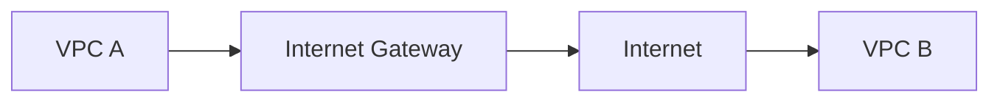
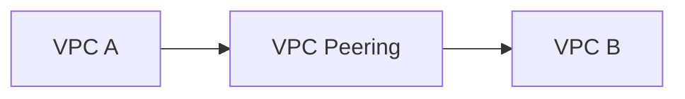

# AWS VPC Peering

## 개요

VPC Peering은 두 VPC를 프라이빗 네트워크로 연결한다. 인터넷을 거치지 않는다. AWS 내부 네트워크를 사용한다. 같은 계정, 다른 계정, 같은 리전, 다른 리전 모두 가능하다. 간단하고 저렴하다.

### 왜 필요한가

VPC는 격리된 네트워크다. 기본적으로 다른 VPC와 통신할 수 없다.

개발과 프로덕션을 VPC로 나눈 경우를 보자.
- VPC A: 개발 환경 (10.0.0.0/16)
- VPC B: 프로덕션 환경 (10.1.0.0/16)

개발 환경에서 프로덕션 DB를 테스트하고 싶다. 하지만 VPC가 다르다.

Peering이 없으면 인터넷을 거쳐야 한다. 아래 도식은 이 경로에서 VPC A의 트래픽이 어떤 순서로 VPC B에 닿는지 보여준다.



이 경로의 문제는 네 가지다.
- 트래픽이 인터넷을 거친다
- 보안 리스크
- 느리다
- NAT Gateway 비용

VPC Peering을 쓰면 인터넷 구간이 사라진다. 아래 도식은 VPC A와 VPC B가 Peering Connection 하나로 직접 이어지는 모습을 보여준다.



- 프라이빗 네트워크
- 빠르다
- 안전하다
- 저렴하다

## 기본 설정

### Peering Connection 생성

콘솔에서는 번호 순서대로 진행한다.
1. VPC 콘솔 → Peering Connections
2. "Create Peering Connection" 클릭
3. 이름 입력
4. Requester VPC 선택 (내 VPC)
5. Accepter VPC 선택
   - 같은 계정: VPC ID
   - 다른 계정: Account ID + VPC ID
   - 다른 리전: Region 선택
6. 생성

같은 계정, 같은 리전이면 이 명령으로 만든다.
```bash
aws ec2 create-vpc-peering-connection \
  --vpc-id vpc-11111111 \
  --peer-vpc-id vpc-22222222 \
  --region us-west-2
```

다른 계정이면 `--peer-owner-id`를 붙인다.
```bash
aws ec2 create-vpc-peering-connection \
  --vpc-id vpc-11111111 \
  --peer-vpc-id vpc-22222222 \
  --peer-owner-id 123456789012 \
  --region us-west-2
```

다른 리전이면 `--peer-region`을 붙인다.
```bash
aws ec2 create-vpc-peering-connection \
  --vpc-id vpc-11111111 \
  --peer-vpc-id vpc-22222222 \
  --peer-region us-east-1 \
  --region us-west-2
```

### Peering 수락

Peering Connection이 생성되면 "pending-acceptance" 상태가 된다. Accepter가 수락해야 한다.

같은 계정이면 자동으로 수락된다. 다른 계정이면 Accepter 계정에서 수동으로 수락한다.

```bash
aws ec2 accept-vpc-peering-connection \
  --vpc-peering-connection-id pcx-12345678 \
  --region us-west-2
```

수락하면 "active" 상태가 된다. 이제 사용할 수 있다.

### 라우팅 테이블 설정

Peering Connection을 만들었다고 트래픽이 흐르지 않는다. 라우팅 테이블에 규칙을 추가해야 한다.

VPC A (10.0.0.0/16) 라우팅 테이블은 이렇게 둔다.
```
Destination         Target
10.0.0.0/16        local
10.1.0.0/16        pcx-12345678
```

VPC B (10.1.0.0/16)로 가는 트래픽을 Peering Connection으로 보낸다.

VPC B (10.1.0.0/16) 라우팅 테이블도 대칭으로 둔다.
```
Destination         Target
10.1.0.0/16        local
10.0.0.0/16        pcx-12345678
```

VPC A (10.0.0.0/16)로 가는 트래픽을 Peering Connection으로 보낸다.

Peering은 양방향이라서 양쪽 VPC 모두 라우팅 규칙을 추가해야 한다.

CLI로는 이렇게 추가한다.
```bash
# VPC A 라우팅 테이블
aws ec2 create-route \
  --route-table-id rtb-11111111 \
  --destination-cidr-block 10.1.0.0/16 \
  --vpc-peering-connection-id pcx-12345678

# VPC B 라우팅 테이블
aws ec2 create-route \
  --route-table-id rtb-22222222 \
  --destination-cidr-block 10.0.0.0/16 \
  --vpc-peering-connection-id pcx-12345678
```

### Security Groups 설정

라우팅만으로는 부족하다. Security Groups이 트래픽을 허용해야 한다.

VPC A의 Security Group 인바운드 규칙이다.
```
Inbound:
- Type: All Traffic
- Source: 10.1.0.0/16  (VPC B의 CIDR)
```

또는 VPC B의 Security Group을 참조한다 (같은 리전에만 가능).

```
Inbound:
- Type: All Traffic
- Source: sg-22222222  (VPC B의 Security Group)
```

VPC B의 Security Group은 VPC A의 CIDR을 허용한다.
```
Inbound:
- Type: All Traffic
- Source: 10.0.0.0/16  (VPC A의 CIDR)
```

## 제약사항

### CIDR 중복 불가

두 VPC의 CIDR 블록이 겹치면 Peering을 만들 수 없다.

겹쳐서 불가능한 조합이다.
- VPC A: 10.0.0.0/16
- VPC B: 10.0.0.0/24

10.0.0.0/24는 10.0.0.0/16에 포함된다. 겹친다.

겹치지 않아서 가능한 조합이다.
- VPC A: 10.0.0.0/16
- VPC B: 10.1.0.0/16

겹치지 않는다.

VPC를 만들 때 CIDR을 신중하게 선택한다. 나중에 Peering할 VPC와 겹치지 않도록 한다.

VPC마다 /16 블록을 하나씩 할당한다.
- VPC 1: 10.0.0.0/16
- VPC 2: 10.1.0.0/16
- VPC 3: 10.2.0.0/16
- VPC 4: 10.3.0.0/16

16.16.0.0/12 범위 안에서 /16 단위로 나눈다.

### 전이적 라우팅 불가

VPC Peering은 전이적 라우팅을 지원하지 않는다.

VPC A ↔ VPC B, VPC B ↔ VPC C로 Peering을 맺은 상황이다.
- VPC A ↔ VPC B Peering
- VPC B ↔ VPC C Peering

VPC A → VPC B → VPC C 경로는 자동으로 만들어지지 않는다.

VPC A에서 VPC C로 트래픽을 보낼 수 없다. VPC B가 중간에서 라우팅하지 않는다.

VPC A ↔ VPC C Peering을 직접 만들면 해결된다.

또는 Transit Gateway를 사용한다. Transit Gateway는 전이적 라우팅을 지원한다.

### Edge-to-Edge 라우팅 불가

VPC Peering으로 상대 VPC의 Gateway를 경유해 다른 곳에 접근할 수 없다. 경유할 수 없는 경우는 세 가지다.

Internet Gateway는 VPC A에 없고 VPC B에는 있다. VPC A가 VPC B의 Internet Gateway를 사용할 수 없다.

VPN Gateway는 VPC B에 있다. VPC A가 VPC B의 VPN으로 온프레미스에 접근할 수 없다.

Direct Connect도 VPC B에 있다. VPC A가 사용할 수 없다.

각 VPC마다 필요한 Gateway를 만든다. 또는 Transit Gateway를 사용한다.

## 리전 간 Peering

다른 리전의 VPC를 연결한다.

### 설정

Peering Connection은 이렇게 생성한다.
```bash
aws ec2 create-vpc-peering-connection \
  --vpc-id vpc-11111111 \
  --peer-vpc-id vpc-22222222 \
  --peer-region us-east-1 \
  --region us-west-2
```

us-east-1에서 수락한다.
```bash
aws ec2 accept-vpc-peering-connection \
  --vpc-peering-connection-id pcx-12345678 \
  --region us-east-1
```

라우팅 설정은 같은 리전 Peering과 동일하다. 양쪽에 라우팅 규칙을 추가한다.

### 특징

다른 리전이면 Security Group을 참조할 수 없다. CIDR을 사용한다.

us-west-2의 VPC A Security Group은 CIDR로 허용한다.
```
Inbound:
- Type: All Traffic
- Source: 10.1.0.0/16  (CIDR만 가능)
```

- 같은 리전: 1-2ms
- 다른 리전 (같은 대륙): 20-50ms
- 다른 리전 (다른 대륙): 100-300ms

리전 간 트래픽이라서 지연이 있다. 같은 리전보다 느리다.

리전 간 데이터 전송 비용이 발생한다. 같은 리전은 무료다.

## 비용

### 같은 리전

Peering Connection은 무료다.

데이터 전송 비용은 AZ에 따라 갈린다.
- 같은 가용 영역 (AZ): 무료
- 다른 가용 영역 (AZ): $0.01/GB

월 100GB 전송 (다른 AZ) = $1.00

저렴하다.

### 다른 리전

Peering Connection은 무료다.

데이터 전송은 리전마다 다르다. 보통 $0.02/GB.

리전 쌍별 단가는 이렇다.
- us-west-2 → us-east-1: $0.02/GB
- us-west-2 → ap-northeast-1: $0.09/GB

월 100GB 전송 (us-west-2 → us-east-1) = $2.00

### NAT Gateway vs Peering

NAT Gateway 비용은 시간당 요금과 데이터 요금으로 나온다.
- 시간당: $0.045
- 데이터: $0.045/GB
- 월 100GB: $0.045 × 730 + $0.045 × 100 = $37.35

같은 리전 Peering 비용은 이렇다.
- 연결: 무료
- 데이터 (다른 AZ): $0.01/GB
- 월 100GB: $1.00

Peering이 훨씬 저렴하다.

## 실무 사용

### 개발/스테이징/프로덕션 분리

VPC는 세 개로 나눈다.
- VPC Dev (10.0.0.0/16)
- VPC Staging (10.1.0.0/16)
- VPC Prod (10.2.0.0/16)

Peering은 두 쌍만 맺는다.
- Dev ↔ Staging
- Staging ↔ Prod

Dev ↔ Prod Peering은 만들지 않는다. 개발 환경에서 프로덕션에 직접 접근하면 위험하다.

접근은 Security Groups으로 세밀하게 제어한다.

Staging Security Group은 이렇게 둔다.
```
Inbound from Dev:
- Type: PostgreSQL (5432)
- Source: 10.0.0.0/16

Outbound to Prod:
- Type: PostgreSQL (5432)
- Destination: 10.2.0.0/16
```

개발 환경에서 스테이징 DB에 접근할 수 있다. 스테이징에서 프로덕션 DB를 읽을 수 있다 (쓰기는 차단).

### 공유 서비스 VPC

중앙 서비스 VPC를 만든다. 다른 VPC들이 Peering으로 연결한다.

공유 VPC 하나와 App VPC 세 개로 구성한다.
- VPC Shared (10.100.0.0/16)
  - Active Directory
  - DNS 서버
  - 로그 수집기
  - 모니터링 서버
- VPC App1 (10.0.0.0/16)
- VPC App2 (10.1.0.0/16)
- VPC App3 (10.2.0.0/16)

Peering은 Shared와 각 App 사이에만 맺는다.
- Shared ↔ App1
- Shared ↔ App2
- Shared ↔ App3

**App VPC끼리는 연결하지 않는다.** 격리된다.

장점은 세 가지다.
- 중앙 관리
- 중복 제거 (AD, DNS 서버 하나만)
- 보안 강화 (App 간 격리)

### 계정 간 Peering

회사 계정과 파트너 계정을 연결한다.

계정 구성은 이렇다.
- 우리 계정: 111111111111
- 파트너 계정: 222222222222

우리 서비스가 파트너 API를 호출한다. 프라이빗 네트워크로 연결하고 싶다.

우리 계정에서 Peering을 생성한다.
```bash
aws ec2 create-vpc-peering-connection \
  --vpc-id vpc-our-vpc \
  --peer-vpc-id vpc-partner-vpc \
  --peer-owner-id 222222222222 \
  --region us-west-2
```

파트너 계정에서 수락한다.
```bash
aws ec2 accept-vpc-peering-connection \
  --vpc-peering-connection-id pcx-12345678 \
  --region us-west-2
```

양쪽 계정에서 라우팅을 설정한다.

보안 설정은 두 가지다.
- Security Groups으로 필요한 포트만 열기
- 최소 권한 원칙

## 모니터링

### VPC Flow Logs

Peering을 통과하는 트래픽을 로그로 남긴다.

Flow Logs는 이렇게 활성화한다.
```bash
aws ec2 create-flow-logs \
  --resource-type VPC \
  --resource-ids vpc-11111111 \
  --traffic-type ALL \
  --log-destination-type cloud-watch-logs \
  --log-group-name /aws/vpc/flowlogs
```

어떤 IP가 Peering으로 통신하는지 확인한다. 예상치 못한 트래픽을 탐지한다.

### CloudWatch 메트릭

VPC Peering 자체의 메트릭은 없다. 하지만 ENI 메트릭으로 트래픽을 확인할 수 있다.

NetworkIn/NetworkOut은 인스턴스의 네트워크 트래픽이다. Peering으로 오가는 트래픽도 포함된다.

## 트러블슈팅

### 연결이 안 된다

Peering 상태가 "active"인지 확인한다.

```bash
aws ec2 describe-vpc-peering-connections \
  --vpc-peering-connection-ids pcx-12345678
```

"pending-acceptance"면 아직 수락하지 않았다. "failed"면 실패했다 (CIDR 중복 등).

라우팅 테이블은 양쪽 VPC 모두 라우팅 규칙이 있는지 확인한다.

```bash
aws ec2 describe-route-tables --route-table-ids rtb-11111111
```

목적지 CIDR과 Target이 올바른지 확인한다.

Security Groups은 인바운드 규칙이 상대방 CIDR을 허용하는지 확인한다.

NACL이 트래픽을 차단하지 않는지 확인한다. 기본 NACL은 모두 허용하지만 커스텀 NACL은 명시적으로 허용해야 한다.

DNS는 프라이빗 IP를 사용하는지 확인한다. 퍼블릭 IP를 사용하면 Peering을 거치지 않고 인터넷을 거친다.

### 일부 서브넷만 통신된다

VPC는 여러 라우팅 테이블을 가질 수 있다. 각 서브넷이 다른 라우팅 테이블을 사용한다.

라우팅 테이블은 이렇게 확인한다.
```bash
aws ec2 describe-route-tables --filters "Name=vpc-id,Values=vpc-11111111"
```

각 라우팅 테이블에 Peering 규칙이 있는지 확인한다.

통신이 필요한 서브넷의 라우팅 테이블에 Peering 규칙을 추가한다.

### 성능이 느리다

다른 리전이면 지연이 있다. 물리적 거리 때문이다. 해결 방법이 없다.

같은 리전이면 아래 세 가지를 본다.
- 가용 영역 확인: 같은 AZ면 빠르다
- MTU 크기: 9001 바이트 (Jumbo Frame) 사용 가능
- 네트워크 대역폭: 인스턴스 타입에 따라 다름

Enhanced Networking을 지원하는 최신 인스턴스 타입을 사용한다. 25Gbps 이상 지원.

## 참고

- VPC Peering 가이드: https://docs.aws.amazon.com/vpc/latest/peering/
- VPC Peering 요금: https://aws.amazon.com/vpc/pricing/
- Transit Gateway vs VPC Peering: https://docs.aws.amazon.com/vpc/latest/tgw/tgw-peering.html
- VPC Peering 제약사항: https://docs.aws.amazon.com/vpc/latest/peering/vpc-peering-basics.html#vpc-peering-limitations

