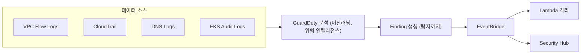
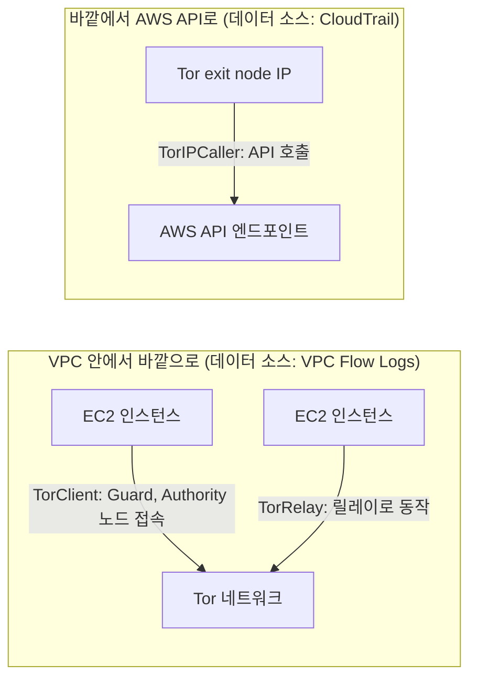
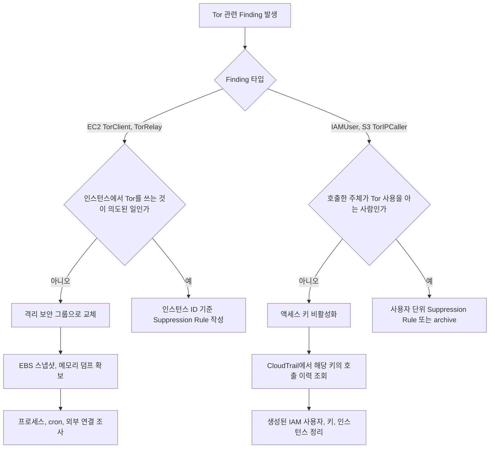
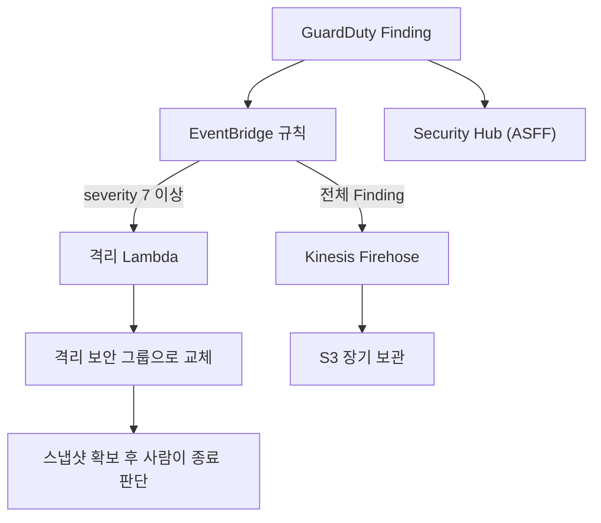
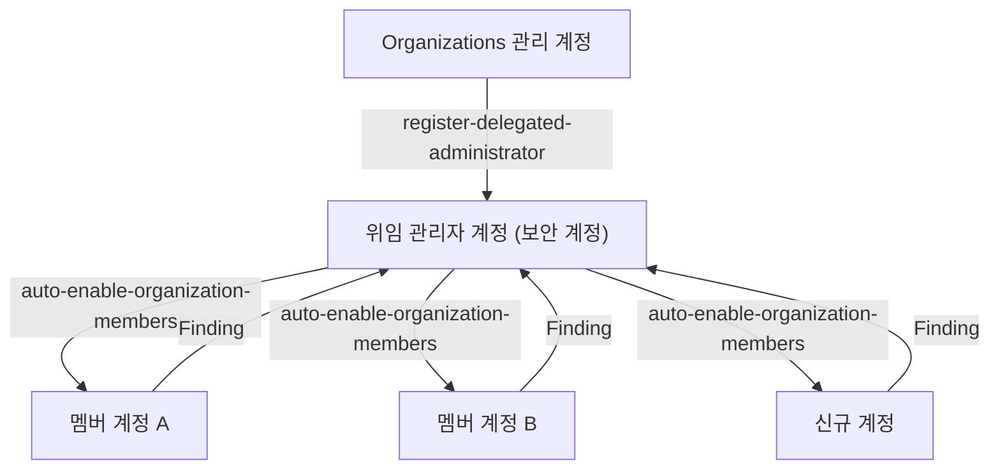
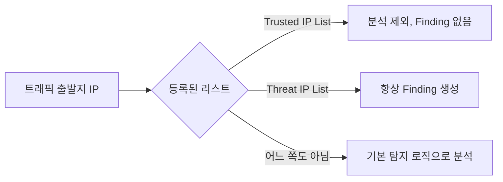

# AWS GuardDuty

## 개요

GuardDuty는 AWS 환경의 위협을 탐지하는 관리형 서비스다. VPC Flow Logs, CloudTrail, DNS 로그 같은 기존 로그 소스를 GuardDuty가 직접 가져가서 머신러닝과 위협 인텔리전스로 분석한다. 사용자가 로그를 별도로 수집하거나 S3에 적재할 필요가 없다.

처음 운영하면 헷갈리는 게, GuardDuty는 "탐지" 서비스지 "차단" 서비스가 아니다. 이상 행위를 발견하면 Finding을 만들어주지만, 자동으로 막아주지는 않는다. 차단하려면 EventBridge로 Finding을 받아서 Lambda나 Security Hub로 흘려야 한다.

아래 도식은 GuardDuty가 로그를 직접 가져가 Finding을 만들고, 차단은 그 뒤 EventBridge 이후 구간이 맡는다는 경계를 보여준다.



## 데이터 소스

GuardDuty는 6개 데이터 소스를 분석한다. 각 소스마다 탐지 패턴과 비용이 다르다.

### VPC Flow Logs

EC2 인스턴스의 네트워크 트래픽을 본다. GuardDuty가 자체적으로 로그를 가져가기 때문에, 따로 VPC Flow Logs를 켜둘 필요는 없다. 이미 켜둔 게 있어도 GuardDuty가 그걸 쓰는 게 아니라 별도 채널로 가져간다.

탐지하는 패턴:

- 알려진 악성 IP와 통신하는 인스턴스
- 비정상적인 포트 스캔
- 갑자기 대량의 데이터를 외부로 전송 (데이터 유출 의심)
- Tor Guard·Authority 노드 접속, Tor 릴레이로 동작 (`TorClient`, `TorRelay`. 아래 "Tor 관련 Finding" 참조)
- 비트코인 채굴 풀과의 통신

운영하다 보면 `Backdoor:EC2/C&CActivity.B!DNS` 같은 Finding이 자주 뜬다. 대부분 오래된 라이브러리가 정상 도메인을 호출하는데, 그 도메인 IP가 위협 인텔리전스 목록에 들어가 있는 경우다. 진짜 침해인지 확인하려면 인스턴스에 들어가서 프로세스를 봐야 한다.

### CloudTrail Management Events

API 호출 이력을 본다. 기본 데이터 소스라 켜자마자 분석된다.

탐지 패턴:

- 루트 계정 사용
- 새로운 리전에서 처음 보는 API 호출
- IAM 사용자가 갑자기 권한을 대량으로 추가
- API 호출이 Tor exit node IP에서 발생 (`TorIPCaller` 계열. 아래 "Tor 관련 Finding" 참조)
- 자격증명 도용 의심 (서로 다른 위치에서 동시 사용)

`UnauthorizedAccess:IAMUser/InstanceCredentialExfiltration` Finding은 EC2 인스턴스 역할의 임시 자격증명이 EC2 외부에서 사용된 경우 뜬다. 인스턴스 메타데이터를 통해 자격증명이 빠져나갔다는 강한 신호다. 거의 무조건 진짜 침해라고 봐도 된다.

### CloudTrail S3 Data Events

S3 객체 수준 API를 본다. 추가 비용이 든다. 데이터를 다루는 계정에서는 켜두는 게 좋다.

```bash
aws guardduty update-detector \
  --detector-id <detector-id> \
  --data-sources '{"S3Logs":{"Enable":true}}'
```

S3 데이터 이벤트를 GuardDuty에서 켜도, CloudTrail S3 Data Events 자체를 별도로 켤 필요는 없다. GuardDuty가 자체적으로 가져간다.

### DNS Logs

VPC 내부 인스턴스의 Route 53 Resolver 쿼리를 본다. VPC가 AWS 기본 DNS를 쓰고 있어야 데이터가 들어온다. 직접 운영하는 DNS 서버를 쓰면 GuardDuty가 분석할 데이터가 없다.

탐지 패턴:

- DGA(Domain Generation Algorithm) 도메인 쿼리
- 알려진 C&C 서버 도메인
- DNS 터널링 시도
- 비트코인 풀 도메인

DNS는 가장 시그널이 좋은 소스다. 침해된 인스턴스가 외부와 통신하려면 거의 무조건 DNS를 쓰기 때문이다.

### EKS Audit Logs

EKS 클러스터의 Kubernetes audit log를 본다. EKS 콘솔에서 audit log를 켜둘 필요 없이 GuardDuty가 직접 가져간다.

탐지 패턴:

- 익명 사용자가 클러스터에 접근
- 권한 상승 시도 (clusterrolebinding 추가)
- 의심스러운 컨테이너 실행 (privileged, host network 등)
- kube-system 네임스페이스 변경
- 외부에서 노출된 API 서버에 비정상 접근

EKS Protection을 켜면 매 audit event마다 비용이 붙는다. 트래픽이 많은 클러스터에서는 비용이 꽤 나간다.

### Malware Protection

EBS 볼륨 스냅샷을 떠서 파일 시스템을 스캔한다. 다른 데이터 소스에서 의심스러운 행위가 탐지된 인스턴스만 스캔하는 모드와, 정기적으로 모든 인스턴스를 스캔하는 모드가 있다.

```bash
aws guardduty update-malware-scan-settings \
  --detector-id <detector-id> \
  --scan-resource-criteria '{"Include":{"EC2_INSTANCE_TAG":{"MapEquals":[{"Key":"MalwareScan","Value":"enabled"}]}}}'
```

태그 기반으로 스캔 대상을 좁힐 수 있다. 전체 스캔은 비용이 폭발하니까, 운영 중요 인스턴스만 골라서 켜두는 게 현실적이다.

스냅샷은 GuardDuty 서비스 계정 쪽에 만들어졌다가 스캔 후 삭제된다. 사용자 계정의 EBS 비용에는 잡히지 않지만, 스냅샷 생성/복원 IO는 KMS 사용량으로 잡힌다. 고객 관리형 KMS 키를 쓰는 EBS면 KMS 비용이 같이 뛴다.

### RDS Protection

RDS 로그인 활동을 본다. Aurora MySQL/PostgreSQL만 지원한다. 비정상 로그인, 무작위 대입 시도를 탐지한다.

### Lambda Protection

Lambda 함수의 네트워크 활동을 본다. 함수 안에서 외부 악성 IP로 통신하는 경우를 탐지한다. 의존성에 악성 코드가 섞인 supply chain 공격을 잡을 때 유용하다.

## Finding 심각도

GuardDuty Finding은 1.0~8.9 사이의 숫자로 점수가 매겨지고, 세 단계로 분류된다.

- High (7.0~8.9): 진짜 침해 가능성이 높다. 즉시 대응
- Medium (4.0~6.9): 의심스럽지만 정상일 수도 있다. 확인 필요
- Low (1.0~3.9): 참고용. 보통은 무시해도 된다

운영하다 보면 Low Finding이 압도적으로 많다. `Recon:EC2/PortProbeUnprotectedPort`처럼 외부에서 SSH 포트로 들어오는 스캔 시도 같은 게 계속 뜬다. 보안 그룹으로 막혀 있다면 신경 쓸 필요 없다.

High Finding은 거의 다 봐야 한다. 특히 다음 패턴은 무조건 확인:

- `UnauthorizedAccess:IAMUser/InstanceCredentialExfiltration` — IAM 자격증명 도용
- `CryptoCurrency:EC2/BitcoinTool.B!DNS` — 채굴 멀웨어 감염
- `Backdoor:EC2/C&CActivity.B` — C&C 서버 통신
- `Trojan:EC2/DropPoint` — 멀웨어 다운로드 서버 접근

## Tor 관련 Finding

Tor 관련 Finding은 방향이 둘로 갈린다. 내 인스턴스가 Tor 네트워크로 나가는 경우는 VPC Flow Logs에서 잡히고, 외부 사람이 Tor를 거쳐 내 계정의 API를 부르는 경우는 CloudTrail에서 잡힌다. 어느 쪽인지에 따라 의심 대상이 인스턴스이거나 자격증명이다.

아래 도식에서 왼쪽 묶음은 인스턴스가 주체인 Finding이고, 오른쪽은 API 호출자가 Tor exit node IP인 Finding이다.



### 존재 여부와 의미

AWS 문서(EC2, IAM, S3 Finding 타입 페이지)에서 확인한 내용이다.

| Finding 타입 | 기본 심각도 | 데이터 소스 | 의미 |
|---|---|---|---|
| `UnauthorizedAccess:EC2/TorClient` | High | VPC Flow Logs | 인스턴스가 Tor Guard 또는 Authority 노드에 접속한다. 인스턴스가 Tor 클라이언트로 동작 중이라는 뜻이다 |
| `UnauthorizedAccess:EC2/TorRelay` | High | VPC Flow Logs | 인스턴스가 Tor 릴레이로 동작하는 패턴으로 Tor 네트워크와 통신한다. 남의 트래픽을 중계하고 있을 가능성이 있다 |
| `UnauthorizedAccess:IAMUser/TorIPCaller` | Medium | CloudTrail management events | EC2 실행, IAM 사용자 생성, 권한 변경 같은 API가 Tor exit node IP에서 호출됐다 |
| `Recon:IAMUser/TorIPCaller` | Medium | CloudTrail management events | 같은 조건에서 호출된 API가 list, describe 계열일 때 뜬다. 정찰 단계로 본다 |
| `UnauthorizedAccess:S3/TorIPCaller` | High | CloudTrail data events for S3 | `PutObject`, `PutObjectAcl` 같은 쓰기 계열 S3 API가 Tor exit node에서 왔다. S3 Protection이 켜져 있어야 한다 |
| `Discovery:S3/TorIPCaller` | Medium | CloudTrail data events for S3 | `GetObjectAcl`, `ListObjects` 같은 탐색 계열 S3 API가 Tor exit node에서 왔다 |

작업 지시에 같이 들어 있던 두 타입은 따로 짚어야 한다.

- `Behavior:EC2/NetworkPortUnusual`은 실제로 있는 Finding이지만 Tor와 무관하다. 인스턴스가 지금까지 쓴 적 없는 원격 포트로 통신하면 뜨는 이상 행위 탐지이고 기본 심각도는 Medium이다. 포트가 389나 1389면 심각도가 High로 올라가고 `service.additionalInfo.context`에 `Possible log4j callback`이 찍힌다. Tor 트래픽이 비표준 포트로 나가면 이게 같이 뜨는 경우는 있겠지만, Tor를 판정하는 Finding은 아니다.
- `UnauthorizedAccess:EC2/TorIPCaller`는 현재 EC2 Finding 타입 목록에 없다. EventBridge 패턴이나 Suppression Rule에 이 이름을 써도 매칭되는 Finding이 없으니 쓰지 않는다. 외부에서 Tor로 들어오는 방향은 EC2가 아니라 IAM·S3 쪽 `TorIPCaller`가 맡는다.

`TorIPCaller`의 대상은 "API 호출"이다. 콘솔 로그인도 CloudTrail에 `ConsoleLogin` 이벤트로 남지만, 문서는 이 Finding이 콘솔 로그인을 따로 다룬다고 적지 않았다. 콘솔 로그인 이상은 `UnauthorizedAccess:IAMUser/ConsoleLoginSuccess.B`(여러 지역에서 동시에 성공한 로그인) 쪽이 맡는다고 보는 편이 맞다.

TorClient와 TorRelay는 둘 다 High라서 `severity >= 7` 조건을 거는 자동 격리 Lambda가 그대로 받는다. IAM 계열 TorIPCaller는 Medium이고 `instanceDetails`도 없다. 위 Lambda 예시는 `severity < 7`이면 건너뛰고, 통과해도 `instance_id`가 없어서 건너뛴다. 키 도용은 인스턴스 격리로 막을 수 없으니 액세스 키 비활성화는 별도 경로로 만들어야 한다.

### Finding이 뜬 뒤 흐름

도식은 Finding 타입에 따라 조사 대상이 갈리고, 의도된 사용이면 Suppression으로, 아니면 격리와 키 비활성화로 가는 분기를 보여준다.



인스턴스 쪽 조사는 접속 가능한 경로가 SSM뿐이라는 전제로 한다. Tor 프로세스가 떠 있는지, 어디서 시작됐는지부터 본다.

```bash
# SSM Session Manager로 접속한 뒤
ps aux | grep -i '[t]or'
sudo ss -tnp | grep -i tor
systemctl list-units --type=service | grep -i tor
crontab -l; sudo ls /etc/cron.d /var/spool/cron
```

TorRelay는 관례적으로 ORPort 9001, DirPort 9030을 많이 쓴다. 이 포트가 인바운드로 열려 있거나 Flow Logs에 해당 포트 트래픽이 크게 보이면 릴레이 가능성이 높다. 다만 포트는 설정으로 바뀌므로 이 숫자만으로 판단하지 않는다.

IAM 쪽은 Finding에 찍힌 액세스 키를 먼저 끄고, 그 키로 무슨 짓을 했는지 CloudTrail로 확인한다.

```bash
aws iam update-access-key \
  --user-name <user> --access-key-id <AKIA...> --status Inactive

aws cloudtrail lookup-events \
  --lookup-attributes AttributeKey=AccessKeyId,AttributeValue=<AKIA...> \
  --max-results 50
```

`lookup-events`는 management event를 90일치만 보여준다. 키 도용이 오래됐다면 S3에 쌓아둔 CloudTrail 로그를 Athena로 봐야 한다. 임시 자격증명(역할 세션)이 Tor에서 쓰인 경우에는 키 비활성화가 안 먹고, 역할의 기존 세션을 무효화하는 정책(`aws:TokenIssueTime` 조건)을 걸어야 한다.

### 오탐으로 판명되는 경우

Tor는 합법적으로 쓰는 사람도 있어서 High라고 해서 곧바로 침해는 아니다. 지금까지 정상으로 확인되는 경우는 이런 것들이다.

- 보안팀이나 개발자가 Tor Browser로 콘솔이나 CLI에 접근할 때. `TorIPCaller`는 호출자가 사람인지 공격자인지 구분하지 못한다. 사용자 이름이 Finding에 찍히니, 본인에게 확인하면 바로 끝난다.
- 크롤러나 수집 배치가 IP 차단을 피하려고 Tor 프록시(로컬 SOCKS 포트)를 거쳐 외부 사이트를 부르는 인스턴스. `TorClient`로 뜬다. 코드에 Tor 의존성이 들어 있는지 보면 나온다.
- 연구나 프라이버시 목적으로 Tor 릴레이를 일부러 운영하는 인스턴스. `TorRelay`로 뜬다. 운영 주체가 명확하고 승인된 인스턴스라면 정상이지만, 릴레이 트래픽은 과금되는 아웃바운드 전송량으로 잡히고 abuse 신고가 들어올 수도 있으니 의도된 것이 맞는지 조직 안에서 먼저 확인해야 한다.
- 위 중 어느 것도 아닌데 `NetworkPortUnusual`만 뜬 경우. 새로 배포한 서비스가 처음 쓰는 포트로 나가거나, 정기 백업이 처음 도는 날 뜬다. 앞의 Suppression Rule 절에서 다룬 패턴과 같다.

의도된 사용이 확인되면 Finding 타입과 대상을 같이 묶어 Suppression Rule을 만든다. 타입만 걸면 다른 인스턴스의 진짜 Tor 접속까지 가려진다.

```bash
aws guardduty create-filter \
  --detector-id <detector-id> \
  --name SuppressCrawlerTorClient \
  --description "크롤러 인스턴스는 Tor 프록시를 의도적으로 사용. 담당 확인 완료" \
  --action ARCHIVE \
  --finding-criteria '{
    "Criterion": {
      "type": {"Eq": ["UnauthorizedAccess:EC2/TorClient"]},
      "resource.instanceDetails.instanceId": {"Eq": ["i-0123456789abcdef0"]}
    }
  }'
```

`TorIPCaller`를 가릴 때는 `resource.accessKeyDetails.userName`을 조건으로 쓴다. 사용자 이름이 아니라 IP 대역으로 가리려 해도 Tor exit node IP는 계속 바뀌어서 목록이 의미가 없다.

반대로 정상으로 보이는 사용자의 `TorIPCaller`도 한 번은 의심해야 하는 경우가 있다. Tor exit node IP는 여러 사람이 공유하는 주소라서, 본인이 Tor를 쓴 적이 없다고 답하면 키가 유출된 것이다.

## EventBridge로 자동 대응

GuardDuty는 Finding이 만들어지면 EventBridge에 이벤트를 보낸다. 이걸 Lambda나 Step Functions, Security Hub로 라우팅해서 자동 대응을 만든다.

도식은 severity 조건에 걸린 Finding만 Lambda로 가서 격리되고, 전체 Finding은 장기 보관 경로로 따로 흐른다는 점을 보여준다.



이벤트 패턴 예시:

```json
{
  "source": ["aws.guardduty"],
  "detail-type": ["GuardDuty Finding"],
  "detail": {
    "severity": [{"numeric": [">=", 7]}],
    "type": ["UnauthorizedAccess:IAMUser/InstanceCredentialExfiltration"]
  }
}
```

severity 필드가 숫자라 `numeric` 매칭을 써야 한다. 처음에 `[7, 8, 8.5]` 같은 배열로 매칭하려다가 안 잡혀서 시간 날린 적이 있다.

### 자동 격리 Lambda 예시

침해 의심 인스턴스를 격리 보안 그룹으로 옮기는 Lambda:

```python
import boto3

ec2 = boto3.client('ec2')
QUARANTINE_SG = 'sg-0123456789abcdef0'

def lambda_handler(event, context):
    detail = event['detail']
    finding_type = detail['type']
    severity = detail['severity']

    if severity < 7:
        return {'status': 'skipped', 'reason': 'low severity'}

    instance_id = (
        detail.get('resource', {})
        .get('instanceDetails', {})
        .get('instanceId')
    )
    if not instance_id:
        return {'status': 'skipped', 'reason': 'no instance'}

    ec2.modify_instance_attribute(
        InstanceId=instance_id,
        Groups=[QUARANTINE_SG]
    )

    return {
        'status': 'quarantined',
        'instance': instance_id,
        'finding': finding_type
    }
```

격리 보안 그룹은 인바운드/아웃바운드 모두 막아둔다. 그러면 인스턴스가 외부와 통신을 못 한다. 단, SSM Session Manager로 들어가서 조사할 수 있게 SSM 엔드포인트만 허용해두는 게 좋다. SSH는 막혀도 SSM으로는 들어갈 수 있다.

자동 종료까지 하면 증거가 사라진다. 메모리 덤프, 디스크 스냅샷을 먼저 떠야 한다. 자동화는 격리까지만 하고, 종료는 사람이 판단하는 게 안전하다.

### Security Hub 통합

Security Hub를 켜두면 GuardDuty Finding이 자동으로 Security Hub로 흘러간다. 별도 설정 불필요. Security Hub에서 ASFF(AWS Security Finding Format)로 통일된 형태로 본다.

```bash
aws securityhub enable-security-hub
aws securityhub enable-import-findings-for-product \
  --product-arn arn:aws:securityhub:<region>::product/aws/guardduty
```

GuardDuty + Inspector + Macie + IAM Access Analyzer를 모두 쓰면 Finding이 폭발적으로 늘어난다. Security Hub의 Insights 기능이나 사용자 정의 필터로 정말 봐야 할 것만 추리는 게 중요하다.

## Organizations 다계정 활성화

계정이 여러 개면 계정마다 GuardDuty를 켜는 건 비현실적이다. Organizations와 통합하면 위임된 관리자 계정에서 모든 멤버 계정의 GuardDuty를 한 번에 관리한다.

도식은 관리 계정이 위임 관리자를 지정하고, 위임 관리자가 멤버 계정을 자동 활성화하며 Finding이 다시 위임 관리자로 모이는 방향을 보여준다.



위임 관리자 지정:

```bash
aws organizations register-delegated-administrator \
  --account-id <security-account-id> \
  --service-principal guardduty.amazonaws.com
```

위임 관리자 계정에서:

```bash
aws guardduty enable-organization-admin-account \
  --admin-account-id <security-account-id>

aws guardduty update-organization-configuration \
  --detector-id <detector-id> \
  --auto-enable-organization-members ALL
```

`auto-enable-organization-members`를 `ALL`로 하면, 새로 추가되는 계정도 자동으로 GuardDuty가 켜진다. `NEW`로 하면 신규 계정만, `NONE`으로 하면 자동 활성화 안 함.

기존 계정 중 일부에서 이미 GuardDuty를 쓰고 있으면, Organizations로 통합할 때 그 계정의 detector ID를 그대로 인수받는다. 기존 Finding 이력은 유지된다. 단, 멤버 계정 측에서 `aws guardduty disassociate-from-master-account`를 실행하면 풀린다. 멤버가 임의로 풀어버리는 걸 막으려면 SCP로 막아야 한다.

리전마다 GuardDuty가 별개라는 점도 주의. 서울 리전에서 켜도 도쿄 리전에서는 따로 켜야 한다. CloudFormation StackSets나 Terraform으로 모든 리전에 한 번에 배포하는 게 표준이다.

## 신뢰 IP / 위협 IP 리스트

GuardDuty가 자체 위협 인텔리전스를 가지고 있지만, 사용자가 추가로 IP 리스트를 등록할 수 있다.

두 리스트는 정반대로 동작한다. 도식에서 Trusted IP List는 분석 전에 걸러내고, Threat IP List는 무조건 Finding으로 보낸다.



### Trusted IP List

신뢰 IP는 분석에서 제외된다. 사무실 IP, VPN 게이트웨이 IP를 등록해두면 그 IP에서 들어온 트래픽은 Finding이 안 만들어진다.

S3에 IP 목록 파일을 올리고 GuardDuty에 등록한다.

```
192.0.2.0/24
198.51.100.0/24
203.0.113.42
```

```bash
aws guardduty create-ip-set \
  --detector-id <detector-id> \
  --name OfficeIPs \
  --format TXT \
  --location s3://my-bucket/trusted-ips.txt \
  --activate
```

리전당, detector당 1개만 등록 가능하다. 여러 그룹의 IP를 관리하려면 한 파일에 다 모아야 한다.

### Threat IP List

알려진 악성 IP 목록이다. 여기 등록된 IP에서 들어오는 트래픽은 무조건 Finding이 만들어진다. 외부 위협 인텔리전스 피드(예: Emerging Threats, AbuseIPDB)를 정기적으로 받아서 등록해두면 GuardDuty 자체 인텔리전스보다 빠르게 차단할 수 있다.

```bash
aws guardduty create-threat-intel-set \
  --detector-id <detector-id> \
  --name CustomThreatIPs \
  --format TXT \
  --location s3://my-bucket/threat-ips.txt \
  --activate
```

리전당 6개까지 등록 가능. 보통 외부 피드별로 하나씩 만든다.

리스트를 업데이트하려면 S3 파일을 갱신하고 `update-threat-intel-set`을 호출해야 한다. S3 파일만 바꿔도 자동 반영되지 않는다. 이걸 모르고 S3만 갈아끼우다가, 일주일 동안 옛날 IP로 분석된 적이 있다.

```bash
aws guardduty update-threat-intel-set \
  --detector-id <detector-id> \
  --threat-intel-set-id <set-id> \
  --location s3://my-bucket/threat-ips.txt \
  --activate
```

## Suppression Rule

False positive Finding이 반복적으로 만들어지면 Suppression Rule로 자동 보관 처리한다. Finding이 만들어지긴 하지만 콘솔의 활성 목록에서 사라지고 EventBridge 이벤트도 안 발생한다.

예를 들어 정기적으로 외부에 데이터를 백업하는 인스턴스가 있으면 `Behavior:EC2/NetworkPortUnusual` Finding이 계속 뜬다. 이걸 무시하려면:

```bash
aws guardduty create-filter \
  --detector-id <detector-id> \
  --name SuppressBackupTraffic \
  --action ARCHIVE \
  --finding-criteria '{
    "Criterion": {
      "type": {"Eq": ["Behavior:EC2/NetworkPortUnusual"]},
      "resource.instanceDetails.tags.value": {"Eq": ["backup-server"]}
    }
  }'
```

`action`을 `ARCHIVE`로 하면 자동 보관, `NOOP`으로 하면 저장만 된다(보통은 ARCHIVE).

Suppression을 너무 많이 걸면 진짜 침해를 놓친다. 매분기마다 Suppression Rule을 재검토하는 프로세스를 만들어두는 게 좋다. "왜 이 룰을 만들었는지" 설명을 description에 적어두지 않으면 6개월 뒤에 본인이 봐도 모른다.

Finding 자체를 보관(archive)만 해도 된다. Suppression Rule은 "앞으로도 계속 같은 게 뜬다"는 게 명확할 때만 만든다. 일회성이면 그냥 archive 처리.

## 비용 폭증 사례

GuardDuty 비용은 데이터 소스의 처리량에 비례한다. 가격 구조를 모르면 어느 날 갑자기 청구서가 몇 배로 뛴다.

### 사례 1: VPC Flow Logs 폭주

내부 마이크로서비스 간 통신이 급증하는 경우. 로드 테스트를 돌리거나, 새 서비스가 배포되어 트래픽 패턴이 바뀌면 VPC Flow Logs가 같이 폭증한다. GuardDuty는 분석한 GB당 과금이라 비용이 그대로 따라간다.

대응:

- VPC 엔드포인트로 AWS 서비스 트래픽을 빼서 인터넷 게이트웨이를 안 거치게 한다 (탐지 의미가 없는 내부 트래픽)
- 개발/스테이징 계정의 GuardDuty를 별도 detector로 분리하고, 필요시 끈다
- Trusted IP 리스트로 내부 통신은 분석 제외

### 사례 2: CloudTrail S3 Data Events

S3에 작은 객체를 초당 수만 건씩 쓰는 워크로드가 있으면 데이터 이벤트가 폭발한다. 이미지 썸네일 생성기, 로그 적재 파이프라인 같은 게 대표적. GuardDuty S3 Protection 비용이 다른 데이터 소스 합친 것보다 더 나오는 경우도 있다.

대응:

- S3 Protection을 끈다 (필요 시점에만 켜기)
- 해당 버킷을 CloudTrail Data Events 대상에서 제외 (그러면 GuardDuty도 데이터를 못 가져감)
- 트래픽이 많은 버킷은 별도 계정으로 분리

### 사례 3: EKS Audit Logs

운영 EKS 클러스터의 audit log는 초당 수천 건이 나온다. EKS Protection을 켜면 그게 다 GuardDuty 비용으로 잡힌다.

대응:

- audit log verbosity를 낮춘다 (필수 이벤트만 기록)
- 개발 클러스터에서는 EKS Protection을 끈다
- Service Mesh 사이드카가 audit log를 부풀리는 경우가 있어, 사이드카 패턴을 점검한다

### 사례 4: Malware Protection 전체 스캔

`SCAN_ALL` 모드를 켜두면 매주 모든 EBS 볼륨이 스캔된다. 볼륨 크기와 개수에 비례해 비용이 붙는다. 1TB 볼륨 100개를 가진 계정이라면 매주 100TB 스캔 비용이 나간다.

대응:

- 태그 기반 필터로 운영 인스턴스만 스캔
- 다른 데이터 소스에서 의심 신호가 있을 때만 스캔하도록 변경
- Malware Protection 자체를 끄고, 별도 EDR 솔루션 사용

### 비용 모니터링

Cost Explorer에서 서비스를 GuardDuty로 필터링하고, 사용 유형(Usage Type)별로 쪼개서 본다. 어느 데이터 소스가 비용을 많이 쓰는지 바로 보인다.

CloudWatch 알람으로 GuardDuty 비용이 임계값을 넘으면 알림을 받게 해둔다. AWS Budgets에서 서비스 단위로 설정하면 된다.

```bash
aws budgets create-budget \
  --account-id <account> \
  --budget '{
    "BudgetName": "GuardDuty-Monthly",
    "BudgetLimit": {"Amount": "500", "Unit": "USD"},
    "TimeUnit": "MONTHLY",
    "BudgetType": "COST",
    "CostFilters": {"Service": ["Amazon GuardDuty"]}
  }'
```

GuardDuty Free Trial이 30일 제공된다. 처음 켤 때는 마음 놓고 데이터 소스를 다 켜고, 30일 후 사용량 보고서를 본 뒤에 어떤 소스를 끌지 결정하는 게 합리적이다.

## GuardDuty 운영 시 주의사항
새 계정에 GuardDuty를 처음 켜면 처음 며칠은 학습 기간이라 정상 행위까지 Finding으로 잡힌다. 일주일 정도는 지켜본 뒤에 Suppression Rule을 만든다.

Finding 보관(archive) 정책을 정해둔다. 90일 이상 된 archive Finding은 GuardDuty가 자동 삭제한다. 장기 보관이 필요하면 EventBridge로 받아서 S3에 저장해야 한다.

리전을 옮기거나 신규 리전을 쓸 일이 생기면, 사용 안 하는 리전에도 GuardDuty를 켜두는 게 좋다. 공격자는 사용자가 모니터링 안 하는 리전에서 활동을 시작하는 경우가 있다. CloudTrail은 글로벌 이벤트를 모든 리전에 복제하므로, 전 리전 활성화로 IAM 관련 위협을 폭넓게 잡는다.

GuardDuty Findings는 90일 후 사라진다는 걸 잊지 말아야 한다. 컴플라이언스나 사후 조사를 위해서는 별도 저장소가 필요하다. EventBridge → Kinesis Firehose → S3 패턴이 표준이다.
