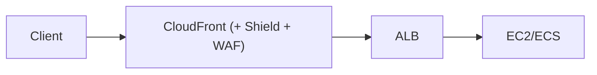

# AWS Shield

## 개요

Shield는 DDoS 공격을 방어하는 서비스다. 두 가지 티어가 있다. Standard는 모든 AWS 고객에게 자동으로 제공된다. Advanced는 고급 보호와 24/7 지원을 제공한다.

### DDoS란

DDoS (Distributed Denial of Service)는 여러 곳에서 동시에 대량의 트래픽을 보내서 서비스를 마비시키는 공격이다.

공격 방식은 세 가지로 나뉜다.

#### Volume-based (대역폭 소진)

초당 수백 Gbps 트래픽을 보낸다. 네트워크 대역폭이 소진된다. 정상 트래픽이 들어올 수 없다.

대표적인 유형은 UDP Flood, ICMP Flood, DNS Amplification이다.

#### Protocol attacks (리소스 소진)

서버의 연결 테이블을 채운다. CPU나 메모리를 소진한다.

대표 유형은 두 가지다.
- SYN Flood: TCP 3-way handshake를 완료하지 않는다. 연결 테이블이 가득 찬다.
- Ping of Death: 비정상적으로 큰 패킷을 보낸다.

#### Application layer (애플리케이션 공격)

HTTP 요청을 대량으로 보낸다. 웹 서버가 과부하된다.

대표 유형은 두 가지다.
- HTTP Flood: 초당 10만 개 GET 요청
- Slowloris: 연결을 맺고 느리게 데이터를 보낸다. 연결을 오래 유지한다.

### 왜 Shield가 필요한가

DDoS 공격은 막기 어렵다.

막기 어려운 이유는 네 가지다.
- 공격 트래픽이 엄청나다 (수십 Gbps)
- 정상 트래픽과 구별이 어렵다
- 공격 소스가 분산되어 있다 (수천 개 IP)
- 방어 장비 비용이 비싸다

Shield가 해결하는 방식은 이렇다.
- AWS 네트워크 엣지에서 차단한다
- 자동으로 공격을 탐지한다
- 무제한 대역폭을 제공한다
- 추가 비용 없다 (Standard)

## Shield Standard

모든 AWS 고객에게 자동으로 제공된다. 별도 설정 불필요.

### 기능

자동으로 보호되는 서비스는 네 가지다.
- CloudFront
- Route 53
- Elastic Load Balancing (ALB, CLB, NLB)
- AWS Global Accelerator

이 서비스들을 사용하면 자동으로 DDoS 보호를 받는다.

방어하는 공격 종류는 이렇다.
- SYN/ACK Flood
- UDP Reflection
- DNS Query Flood

탐지와 완화 동작은 이렇다.
- 실시간 트래픽 분석
- 자동으로 공격 탐지
- 밀리초 내 완화
- 수동 개입 불필요

### 한계

HTTP Flood 같은 애플리케이션 계층 공격은 Shield Standard만으로 부족하다. WAF와 함께 사용해야 한다.

Standard에는 비용 보호가 없다. 대규모 공격 시 스케일링 비용이 발생할 수 있다. Shield Advanced는 비용을 보상한다.

24/7 지원이 없어서 공격 시 AWS 지원팀의 도움을 받을 수 없다.

## Shield Advanced

고급 DDoS 보호와 24/7 지원을 제공한다.

### 주요 기능

#### 고급 보호

- Layer 3/4 공격: Shield Standard와 동일
- Layer 7 공격: WAF와 통합해서 HTTP Flood 방어
- 실시간 공격 알림

#### DDoS Response Team (DRT)

- 24/7 전담 팀
- 공격 분석 및 완화 지원
- WAF 규칙 작성 지원
- 긴급 상황 대응

#### 비용 보호

공격으로 인한 스케일링 비용을 AWS가 부담한다.

수치로 보면 이렇다.
- 평소 트래픽: 100GB/월
- DDoS 공격으로 트래픽: 10TB/월
- 증가한 데이터 전송 비용: AWS가 환불

#### Health-based Detection

애플리케이션 헬스 체크를 기반으로 공격을 탐지한다.

ALB를 기준으로 하면 순서는 이렇다.
- ALB의 Target 그룹이 Unhealthy가 된다
- Shield가 자동으로 공격을 탐지한다
- WAF 규칙을 적용해서 완화한다

#### 고급 메트릭 및 보고서

- 실시간 공격 메트릭
- 역사적 공격 보고서
- CloudWatch 통합

### 보호 대상

Shield Advanced를 활성화할 리소스를 선택한다.

지원하는 리소스는 이렇다.
- CloudFront Distribution
- Route 53 Hosted Zone
- ELB (ALB, CLB, NLB)
- Elastic IP (EC2)
- Global Accelerator

리소스당 월 비용이 발생한다.

### 활성화

콘솔에서는 이 순서로 진행한다.
1. Shield 콘솔
2. "Subscribe to Shield Advanced" 클릭
3. 약관 동의
4. 구독 시작
5. 보호할 리소스 추가

CLI는 이렇다.
```bash
# Shield Advanced 구독 (계정 레벨)
aws shield subscribe --auto-renew

# 리소스 보호 추가
aws shield create-protection \
  --name my-alb-protection \
  --resource-arn arn:aws:elasticloadbalancing:us-west-2:123456789012:loadbalancer/app/my-alb/1234567890abcdef
```

1년 계약이다. `--auto-renew`를 설정하면 자동으로 갱신된다.

### Health-based Detection 설정

헬스 체크를 보호 대상에 연결한다.
```bash
aws shield associate-health-check \
  --protection-id a1b2c3d4-5678-90ab-cdef-1234567890ab \
  --health-check-arn arn:aws:route53:::healthcheck/abc123
```

Route 53 헬스 체크는 이렇게 만든다.
```bash
aws route53 create-health-check \
  --caller-reference $(date +%s) \
  --type HTTPS \
  --resource-path /health \
  --fully-qualified-domain-name api.example.com \
  --port 443 \
  --request-interval 30 \
  --failure-threshold 3
```

헬스 체크가 실패하면 Shield가 공격으로 간주하고 완화를 시작한다.

## WAF 통합

Shield Advanced는 WAF와 함께 사용해야 효과적이다.

### 자동 완화

공격 발생 시 DRT가 WAF 규칙을 자동으로 추가한다.

동작 순서는 이렇다.
- HTTP Flood 공격 탐지
- 공격 패턴 분석 (User-Agent, 출발지 국가 등)
- WAF 규칙 생성 및 적용
- 공격 트래픽 차단

DRT가 WAF를 수정할 수 있도록 IAM 권한을 사전에 부여한다.

```bash
aws shield associate-drt-role \
  --role-arn arn:aws:iam::123456789012:role/DRTRole
```

DRTRole 정책은 이렇다.
```json
{
  "Version": "2012-10-17",
  "Statement": [
    {
      "Effect": "Allow",
      "Action": [
        "wafv2:*",
        "cloudwatch:GetMetricStatistics",
        "cloudwatch:DescribeAlarms",
        "sns:Publish"
      ],
      "Resource": "*"
    }
  ]
}
```

### Rate-based 규칙

Shield와 WAF를 함께 사용해서 HTTP Flood를 방어한다.

WAF Rate Limiting 규칙은 이렇다.
```json
{
  "Name": "HTTPFloodProtection",
  "Priority": 0,
  "Statement": {
    "RateBasedStatement": {
      "Limit": 2000,
      "AggregateKeyType": "IP"
    }
  },
  "Action": {
    "Block": {}
  }
}
```

5분 동안 같은 IP에서 2,000개 이상 요청하면 차단한다.

## 공격 대응

### 실시간 알림

Shield Advanced는 공격을 탐지하면 알림을 보낸다.

SNS 설정은 이렇다.
```bash
aws shield-protection-group create-protection-group \
  --protection-group-id my-protection-group \
  --aggregation MEAN \
  --pattern ALL \
  --members arn:aws:elasticloadbalancing:...:loadbalancer/app/my-alb/...
```

CloudWatch 알람은 이렇게 만든다.
```bash
aws cloudwatch put-metric-alarm \
  --alarm-name shield-ddos-detected \
  --alarm-description "DDoS attack detected" \
  --metric-name DDoSDetected \
  --namespace AWS/DDoSProtection \
  --statistic Maximum \
  --period 60 \
  --evaluation-periods 1 \
  --threshold 1 \
  --comparison-operator GreaterThanOrEqualToThreshold \
  --alarm-actions arn:aws:sns:us-west-2:123456789012:ddos-alerts
```

공격이 탐지되면 SNS로 알림을 받는다.

### DRT 지원 요청

공격이 심각하면 DRT에 도움을 요청한다.

지원 케이스는 이 순서로 만든다.
1. AWS Support 콘솔
2. "Create case" 클릭
3. Type: Technical
4. Category: DDoS Protection
5. Severity: Urgent (공격 진행 중)
6. 상황 설명

DRT가 하는 일은 이렇다.
- 트래픽 분석
- 공격 패턴 파악
- WAF 규칙 추가
- 실시간 완화

긴급 상황 시 전화로 연락한다. Shield Advanced 구독 시 전화번호를 제공한다.

## 모니터링

### CloudWatch 메트릭

주요 메트릭은 이렇다.
- **DDoSDetected**: 공격 탐지 여부 (0 또는 1)
- **DDoSAttackBitsPerSecond**: 공격 트래픽 대역폭
- **DDoSAttackPacketsPerSecond**: 공격 패킷 수
- **DDoSAttackRequestsPerSecond**: 공격 요청 수 (Layer 7)

대시보드는 이렇게 만든다.
```bash
aws cloudwatch put-dashboard \
  --dashboard-name shield-monitoring \
  --dashboard-body file://dashboard.json
```

dashboard.json 내용이다.
```json
{
  "widgets": [
    {
      "type": "metric",
      "properties": {
        "metrics": [
          ["AWS/DDoSProtection", "DDoSDetected"]
        ],
        "period": 60,
        "stat": "Maximum",
        "region": "us-west-2",
        "title": "DDoS Detection Status"
      }
    },
    {
      "type": "metric",
      "properties": {
        "metrics": [
          ["AWS/DDoSProtection", "DDoSAttackBitsPerSecond"]
        ],
        "period": 60,
        "stat": "Average",
        "region": "us-west-2",
        "title": "Attack Bandwidth"
      }
    }
  ]
}
```

### 공격 보고서

Shield Advanced는 공격 후 상세 보고서를 제공한다.

보고서에 들어가는 내용은 이렇다.
- 공격 시작 및 종료 시간
- 공격 유형
- 공격 규모 (트래픽, 패킷 수)
- 완화 조치
- 영향받은 리소스

콘솔에서는 Shield 콘솔 → Events → 공격 이벤트 선택 순서로 확인한다.

## 비용

### Shield Standard

무료다. 모든 AWS 고객에게 자동 제공.

### Shield Advanced

월 구독료는 $3,000/월이다.

처음 보호하는 리소스들의 리소스당 비용이다.
- CloudFront: 무료
- Route 53: 무료
- ALB/NLB: 무료

추가 리소스 (예: Elastic IP):
- 리소스당 $100/월 (처음 10개)
- 11개부터: $50/월

DDoS로 인한 데이터 전송 비용은 환불.

WAF 비용은 별도. Shield Advanced와 함께 사용하면 WAF 비용을 일부 할인받는다.

최소 1년 계약이 필수다.

### 비용 예시

소규모 (CloudFront + Route 53) 구성의 월 비용이다.
- Shield Advanced: $3,000/월
- WAF: $50/월
- 합계: $3,050/월

중규모 (+ ALB 3개) 구성의 월 비용이다.
- Shield Advanced: $3,000/월
- WAF: $100/월
- 합계: $3,100/월

대규모 (+ Elastic IP 20개) 구성의 월 비용이다.
- Shield Advanced: $3,000/월
- Elastic IP 보호: 10 × $100 + 10 × $50 = $1,500/월
- WAF: $200/월
- 합계: $4,700/월

### 선택 기준

Shield Standard를 쓰는 경우는 이렇다.
- 소규모 서비스
- DDoS 위험이 낮음
- 예산이 제한적

Shield Advanced를 쓰는 경우는 이렇다.
- 미션 크리티컬 서비스
- 고가용성 필수
- 공격 시 손실이 큼
- 24/7 지원 필요
- 비용 보호 필요

DDoS 공격으로 인한 예상 손실이 연 $36,000 (월 $3,000 × 12개월) 이상이면 Shield Advanced를 고려한다.

## 실무 팁

### WAF와 함께 사용

Shield만으로는 Layer 7 공격 방어가 부족하다. WAF를 반드시 함께 사용한다.

기본 구성은 이렇다.
- Shield Advanced
- WAF Core Rule Set
- Rate Limiting 규칙
- Geo Blocking (필요 시)

### CloudFront 사용

CloudFront를 사용하면 DDoS 방어가 강화된다.

이유는 이렇다.
- AWS 엣지 로케이션에서 공격 차단
- 오리진 서버에 트래픽 도달 전 차단
- 글로벌 분산으로 대역폭 증가

아래 도식은 클라이언트 요청이 CloudFront(Shield, WAF 적용)를 먼저 거치고 ALB를 지나 EC2/ECS에 도달하는 권장 경로를 보여준다.



오리진(ALB)은 CloudFront에서만 접근 가능하도록 설정한다.

### Auto Scaling 활성화

공격 시 자동으로 확장되도록 설정한다.

Target Tracking 설정은 이렇다.
- CPU 사용률 70% 유지
- 요청 수 기반

공격 트래픽이 증가하면 인스턴스가 자동으로 추가된다. Shield Advanced는 비용을 환불한다.

### 정기 테스트

정기적으로 DDoS 시뮬레이션을 한다. AWS 승인이 필요하다.

AWS Support에 DDoS 테스트 요청. 승인 받은 후 테스트한다.

확인할 사항은 이렇다.
- Shield가 공격을 탐지하는지
- WAF 규칙이 작동하는지
- Auto Scaling이 동작하는지
- 알람이 발송되는지

## 참고

- AWS Shield 개발자 가이드: https://docs.aws.amazon.com/shield/
- Shield 요금: https://aws.amazon.com/shield/pricing/
- DDoS 모범 사례: https://docs.aws.amazon.com/whitepapers/latest/aws-best-practices-ddos-resiliency/
- Shield Advanced 기능: https://docs.aws.amazon.com/waf/latest/developerguide/shield-chapter.html

