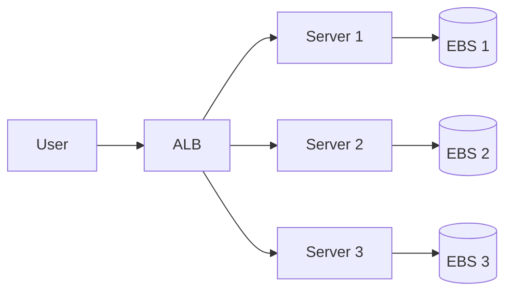
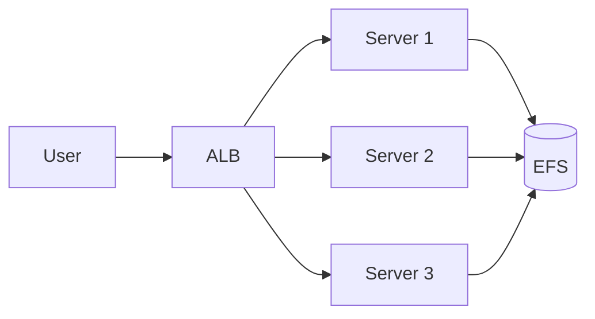

# AWS EFS (Elastic File System)

## 개요

EFS는 여러 EC2가 동시에 접근할 수 있는 공유 파일 시스템이다. NFS 프로토콜을 사용한다. 리전 내 모든 가용 영역에서 접근한다. 용량이 자동으로 확장되고 축소된다. 사용한 만큼만 비용을 낸다.

### EBS vs EFS

EBS 볼륨은 이렇게 동작한다.

- 하나의 EC2에만 연결 (Multi-Attach 예외)
- 가용 영역 단위
- 용량을 미리 할당
- 블록 스토리지

EFS는 이렇게 동작한다.

- 여러 EC2가 동시 접근
- 리전 단위 (모든 AZ)
- 용량 자동 확장
- 파일 시스템

### 왜 필요한가

여러 서버가 같은 파일을 공유해야 하는 경우가 있다.

#### 파일 공유가 필요한 경우

웹 서버가 3대다. 사용자가 이미지를 업로드한다. 모든 서버에서 이미지에 접근해야 한다.

아래 도식은 EBS를 쓸 때 서버마다 볼륨이 따로 붙는 구조를 보여준다. 각 서버는 자기 EBS만 읽고 쓴다.



Server 1에 업로드한 이미지는 EBS 1에만 저장된다. Server 2, 3에서 접근할 수 없다.

해결 방법은 세 가지가 있다.

- S3 사용: 가능하지만 파일 시스템이 아니다
- rsync로 동기화: 복잡하고 지연 발생
- NFS 서버 직접 구축: 관리 부담

EFS를 쓰면 구조가 달라진다. 아래 도식은 세 서버가 EFS 하나를 함께 마운트하는 모습을 보여준다.



모든 서버가 EFS를 마운트한다. 파일이 자동으로 공유된다.

#### Auto Scaling으로 서버가 늘어나는 경우

Auto Scaling으로 서버가 추가된다. 새 서버도 기존 파일에 접근해야 한다.

EBS는 스냅샷에서 볼륨을 만들어서 연결한다. 시간이 걸린다. 최신 데이터가 아닐 수 있다.

EFS는 마운트만 하면 된다. 즉시 모든 파일에 접근한다.

## 기본 설정

### 파일 시스템 생성

콘솔에서는 이 순서로 만든다.

1. EFS 콘솔
2. "Create file system" 클릭
3. 이름 입력
4. VPC 선택
5. 스토리지 클래스 선택 (Standard)
6. 처리량 모드 선택 (Bursting)
7. 생성

CLI로도 만들 수 있다.

```bash
aws efs create-file-system \
  --performance-mode generalPurpose \
  --throughput-mode bursting \
  --encrypted \
  --tags Key=Name,Value=my-efs \
  --region us-west-2
```

각 가용 영역에 Mount Target이 자동으로 생성된다.

### 마운트 타겟

EFS에 접근하는 네트워크 인터페이스다. 각 AZ마다 하나씩 생성한다.

수동으로 만들 때는 이 명령을 쓴다.

```bash
aws efs create-mount-target \
  --file-system-id fs-12345678 \
  --subnet-id subnet-11111111 \
  --security-groups sg-12345678
```

각 AZ의 서브넷에 마운트 타겟을 만든다.

마운트 타겟의 보안 그룹은 EC2 쪽 보안 그룹에서 오는 NFS 포트를 열어야 한다.

```
Inbound:
- Type: NFS
- Protocol: TCP
- Port: 2049
- Source: sg-ec2 (EC2의 보안 그룹)
```

EC2에서 NFS 포트로 접근을 허용한다.

### EC2에서 마운트

Amazon Linux 2에서는 패키지부터 설치한다.

```bash
sudo yum install -y amazon-efs-utils
```

설치한 뒤 디렉터리를 만들고 마운트한다.

```bash
sudo mkdir /mnt/efs
sudo mount -t efs -o tls fs-12345678:/ /mnt/efs
```

`-o tls`: 전송 중 암호화

df로 마운트 결과를 확인한다.

```bash
df -h
```

출력:
```
Filesystem      Size  Used Avail Use% Mounted on
fs-12345678:/   8.0E     0  8.0E   0% /mnt/efs
```

8 EiB (Exbibyte)로 표시된다. 실제로는 무제한에 가깝다.

재부팅 후에도 마운트하려면 /etc/fstab에 항목을 추가한다.

```bash
sudo vi /etc/fstab

# 추가
fs-12345678:/ /mnt/efs efs _netdev,tls,iam 0 0
```

재부팅해도 자동으로 마운트된다.

DNS 이름은 이 형식이다.

```
fs-12345678.efs.us-west-2.amazonaws.com
```

파일 시스템 ID 대신 DNS 이름을 사용할 수 있다.

## 성능 모드

### General Purpose (범용)

**기본 모드다.** 대부분의 경우 사용한다.

General Purpose의 특징은 이렇다.

- 낮은 지연 시간 (1ms 미만)
- 최대 7,000 IOPS
- 초당 작업 수 제한

주로 쓰는 곳은 이렇다.

- 웹 서버
- CMS (WordPress, Drupal)
- 홈 디렉토리
- 개발 환경

### Max I/O

매우 높은 IOPS가 필요할 때 사용한다.

Max I/O의 특징은 이렇다.

- 높은 처리량
- 무제한 IOPS
- 약간 높은 지연 시간 (수 ms)

주로 쓰는 곳은 이렇다.

- 빅데이터 분석
- 미디어 처리
- 게놈 분석

파일 시스템 생성 후에는 성능 모드를 변경할 수 없다. 신중하게 선택한다.

## 처리량 모드

### Bursting (버스팅)

**기본 모드다.** 파일 시스템 크기에 따라 처리량이 결정된다.

동작 방식은 이렇다.

- 기본 처리량: 50 MiB/s per TiB
- 버스트 처리량: 100 MiB/s per TiB
- 버스트 크레딧: 사용하지 않을 때 축적

1 TiB 파일 시스템을 예로 들면 이렇다.

- 파일 시스템 크기: 1 TiB
- 기본 처리량: 50 MiB/s
- 버스트 처리량: 100 MiB/s

평소에는 50 MiB/s. 크레딧이 있으면 100 MiB/s까지 버스트.

크기가 작아도 최소 100 MiB/s를 보장한다.

- 1 GiB: 100 MiB/s (기본)
- 100 GiB: 100 MiB/s (기본)
- 2 TiB: 100 MiB/s (50 × 2)
- 10 TiB: 500 MiB/s (50 × 10)

### Provisioned (프로비저닝)

파일 시스템 크기와 무관하게 처리량을 설정한다.

설정은 이렇게 한다.

```bash
aws efs put-file-system-policy \
  --file-system-id fs-12345678 \
  --policy file://policy.json

aws efs update-file-system \
  --file-system-id fs-12345678 \
  --throughput-mode provisioned \
  --provisioned-throughput-in-mibps 1024
```

1,024 MiB/s (1 GiB/s) 처리량을 프로비저닝한다.

프로비저닝한 처리량만큼 비용이 발생한다.

이 모드를 쓰는 경우는 이렇다.

- 파일 시스템 크기가 작지만 높은 처리량 필요
- 일정한 성능 보장 필요

### Elastic (탄력적)

**권장 모드다.** 워크로드에 맞춰 자동으로 확장된다.

Elastic의 특징은 이렇다.

- 자동 확장/축소
- 처리량 제한 없음
- 사용한 만큼 비용

Elastic의 가격은 이렇다.

- 읽기/쓰기당 과금
- Bursting/Provisioned보다 약간 비쌈

대부분의 경우 Elastic이 편하고 비용도 적절하다.

## 스토리지 클래스

### Standard

**기본 스토리지 클래스다.** 자주 접근하는 파일에 사용한다.

가격은 $0.30/GB-월이다.

Standard의 특징은 이렇다.

- 낮은 지연 시간
- 높은 처리량
- 모든 AZ에 복제

### Infrequent Access (IA)

자주 접근하지 않는 파일에 사용한다.

IA의 가격은 이렇다.

- 스토리지: $0.025/GB-월 (Standard의 1/12)
- 접근: $0.01/GB

IA의 특징은 이렇다.

- 스토리지 비용 저렴
- 접근 시 비용 발생
- 약간 높은 지연 시간

주로 쓰는 곳은 이렇다.

- 백업
- 오래된 로그
- 아카이브

### Lifecycle Management

파일을 자동으로 IA로 이동한다.

설정은 이렇게 한다.

```bash
aws efs put-lifecycle-configuration \
  --file-system-id fs-12345678 \
  --lifecycle-policies \
    TransitionToIA=AFTER_30_DAYS,\
    TransitionToPrimaryStorageClass=AFTER_1_ACCESS
```

이 설정의 동작은 이렇다.

- 30일 동안 접근하지 않으면 IA로 이동
- 접근하면 Standard로 다시 이동

데이터가 1 TB이고 접근 빈도가 아래 같다고 하자.

- 총 데이터: 1 TB
- 자주 접근: 100 GB (Standard)
- 가끔 접근: 900 GB (IA)

월 비용은 이렇게 나온다.

- Standard: 100 × $0.30 = $30
- IA: 900 × $0.025 = $22.50
- 합계: $52.50/월

Lifecycle 없이 모두 Standard: $300/월

절감률은 83%다.

## One Zone vs Regional

### Standard (Regional)

**기본 설정이다.** 모든 AZ에 복제된다.

Regional의 특징은 이렇다.

- 고가용성
- AZ 장애에도 안전
- 더 비쌈

가격은 $0.30/GB-월이다.

### One Zone

하나의 AZ에만 저장된다.

One Zone의 특징은 이렇다.

- 저렴
- AZ 장애 시 접근 불가
- 백업/개발 환경에 적합

가격은 $0.16/GB-월이다 (Regional의 약 53%). One Zone IA는 $0.0133/GB-월이다 (Regional의 4.4%).

주로 쓰는 곳은 이렇다.

- 개발/테스트
- 백업 (S3에도 백업)
- 임시 데이터

## 실무 사용

### WordPress 공유 스토리지

구성 요소는 이렇다.

- ALB
- EC2 Auto Scaling Group (2-10개)
- EFS (WordPress 파일)
- RDS (데이터베이스)

모든 EC2에서 EFS를 마운트하고, WordPress는 한 번만 설치한다.

```bash
# 모든 EC2에서
sudo mount -t efs fs-12345678:/ /var/www/html

# WordPress 설치 (한 번만)
cd /var/www/html
wget https://wordpress.org/latest.tar.gz
tar -xzf latest.tar.gz
mv wordpress/* .
```

동작 흐름은 이렇다.

- 사용자가 이미지 업로드
- EFS에 저장
- 모든 EC2에서 이미지 접근 가능
- Auto Scaling으로 EC2 추가되어도 자동으로 파일 공유

### 컨테이너 공유 볼륨

ECS와 EKS에서도 EFS를 볼륨으로 쓴다. ECS Task Definition은 이렇게 쓴다.

```json
{
  "containerDefinitions": [
    {
      "name": "app",
      "mountPoints": [
        {
          "sourceVolume": "efs-volume",
          "containerPath": "/data"
        }
      ]
    }
  ],
  "volumes": [
    {
      "name": "efs-volume",
      "efsVolumeConfiguration": {
        "fileSystemId": "fs-12345678",
        "transitEncryption": "ENABLED"
      }
    }
  ]
}
```

Kubernetes에서는 PersistentVolume으로 선언한다.

```yaml
apiVersion: v1
kind: PersistentVolume
metadata:
  name: efs-pv
spec:
  capacity:
    storage: 5Gi
  accessModes:
    - ReadWriteMany
  csi:
    driver: efs.csi.aws.com
    volumeHandle: fs-12345678
```

여러 컨테이너가 같은 EFS를 마운트한다.

### 머신 러닝 데이터셋

여러 GPU 인스턴스가 대용량 데이터셋을 읽는다.

구성은 이렇다.

- EFS Max I/O 모드
- Elastic 처리량
- 데이터셋: 10 TB

동작은 이렇다.

- 10개 인스턴스가 동시에 읽기
- 각 인스턴스 100 MiB/s
- 총 처리량: 1 GiB/s

EFS가 자동으로 확장한다.

## 모니터링

### CloudWatch 메트릭

확인할 메트릭은 이렇다.

- **TotalIOBytes**: 총 I/O 바이트
- **ClientConnections**: 연결된 클라이언트 수
- **DataReadIOBytes**: 읽기 바이트
- **DataWriteIOBytes**: 쓰기 바이트
- **PercentIOLimit**: I/O 제한 사용률 (Bursting 모드)

PercentIOLimit이 100%에 가까우면 I/O 제한에 도달한 것이다. Max I/O 모드나 Provisioned 처리량을 고려한다.

### 알람 설정

```bash
aws cloudwatch put-metric-alarm \
  --alarm-name efs-high-io \
  --alarm-description "EFS I/O limit reached" \
  --metric-name PercentIOLimit \
  --namespace AWS/EFS \
  --statistic Average \
  --period 300 \
  --evaluation-periods 2 \
  --threshold 90 \
  --comparison-operator GreaterThanThreshold \
  --dimensions Name=FileSystemId,Value=fs-12345678
```

I/O 사용률이 90%를 넘으면 알림을 받는다.

## 비용

### Standard

스토리지는 $0.30/GB-월이다. 1 TB를 쓰면 1,024 × $0.30 = $307.20/월이다.

### IA

스토리지는 $0.025/GB-월이고 접근은 $0.01/GB다.

1 TB를 저장하고 월 100 GB를 접근하면 비용은 이렇다.

- 스토리지: 1,024 × $0.025 = $25.60
- 접근: 100 × $0.01 = $1.00
- 합계: $26.60/월

절감률은 91%다.

### One Zone

One Zone Standard는 $0.16/GB-월이고 One Zone IA는 $0.0133/GB-월이다. 1 TB를 One Zone IA에 두면 1,024 × $0.0133 = $13.62/월이다.

Regional Standard 대비 절감률은 96%다.

### EBS vs EFS

100 GB 기준으로 EBS gp3는 $8/월, EFS Standard는 $30/월이다.

EBS가 저렴하다. 하지만 공유 불가.

서버 3대에서 쓰면 이렇다.

- EBS: 3 × $8 = $24/월 (데이터 중복, 동기화 문제)
- EFS: $30/월 (자동 공유)

상황에 따라 선택한다.

## 참고

- AWS EFS 개발자 가이드: https://docs.aws.amazon.com/efs/
- EFS 요금: https://aws.amazon.com/efs/pricing/
- EFS 성능: https://docs.aws.amazon.com/efs/latest/ug/performance.html
- EFS Lifecycle Management: https://docs.aws.amazon.com/efs/latest/ug/lifecycle-management-efs.html

