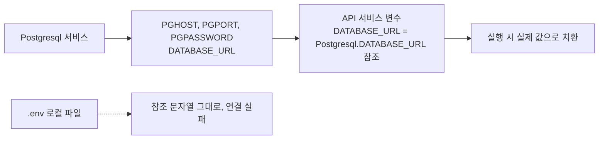
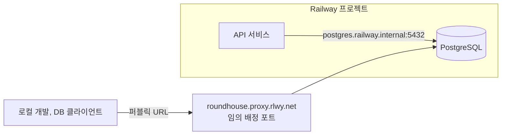
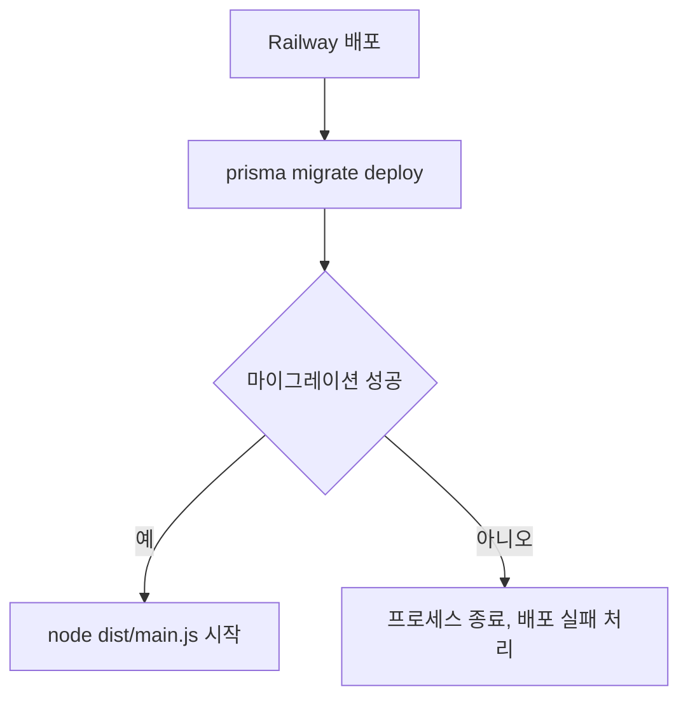
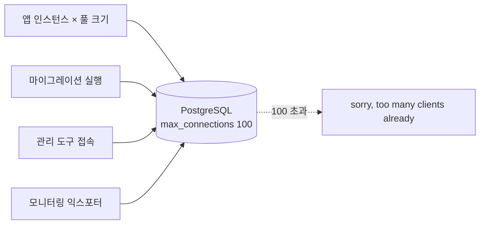
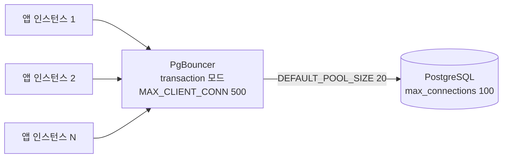
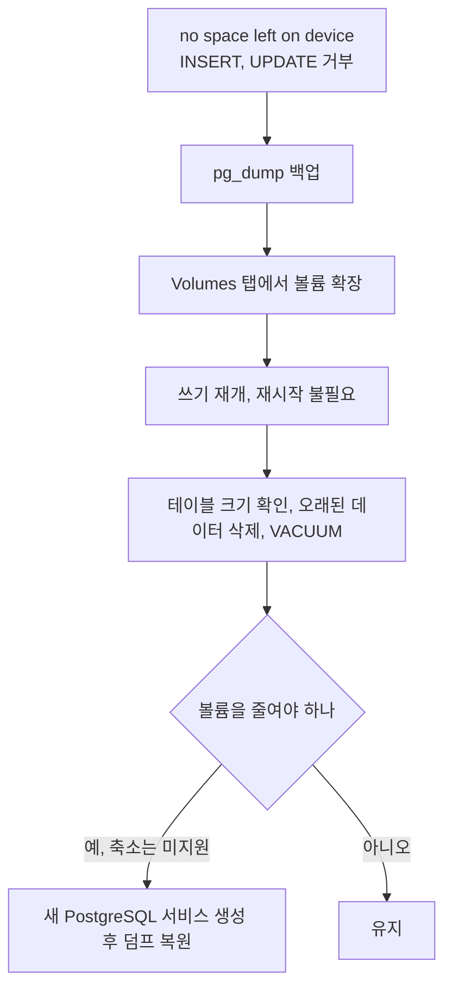
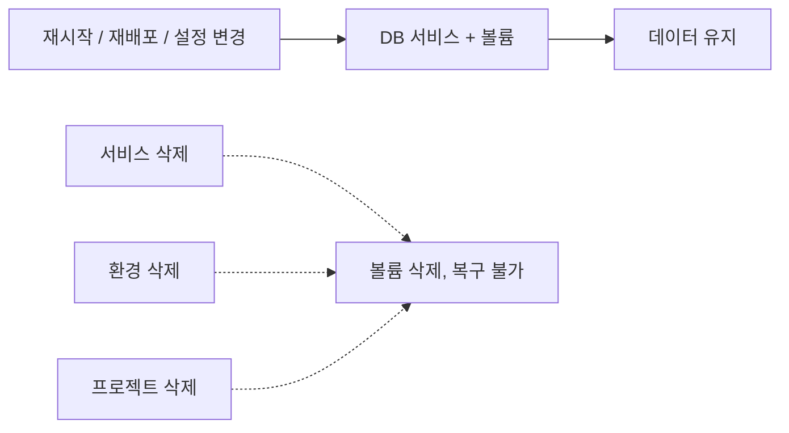
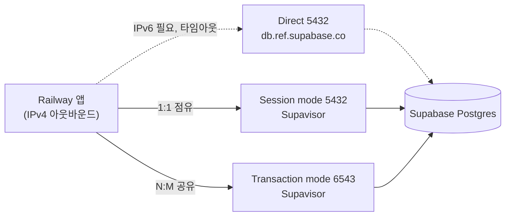

# Railway 데이터베이스 서비스

Railway에서 데이터베이스는 별도 서버 없이 프로젝트 안에 서비스 형태로 추가한다. PostgreSQL, MySQL, Redis, MongoDB 네 종류를 제공한다. 서비스를 추가하는 순간 컨테이너가 뜨고, 접속 정보가 담긴 환경변수가 같은 프로젝트의 다른 서비스에 자동으로 주입된다.

## 데이터베이스 서비스 추가

대시보드에서 프로젝트를 열고 `+ New Service` → `Database`를 선택하면 된다. CLI로도 추가할 수 있다.

```bash
# PostgreSQL 추가
railway add --database postgresql

# MySQL 추가
railway add --database mysql

# Redis 추가
railway add --database redis

# MongoDB 추가
railway add --database mongodb
```

CLI로 추가하면 프로젝트에 데이터베이스 서비스가 생기고 잠시 후 실행 상태가 된다. 서비스 이름은 `postgresql-<random>` 형태로 자동 부여된다. 이름을 바꾸려면 대시보드에서 서비스 설정으로 들어가 수동으로 변경한다.

Railway가 제공하는 데이터베이스는 Docker 이미지 기반이다. PostgreSQL은 `postgres:16`, MySQL은 `mysql:8`처럼 Railway가 고정한 버전을 쓴다. 버전을 직접 지정하려면 커스텀 서비스로 Docker 이미지를 직접 등록해야 한다. Railway 제공 DB 서비스는 버전 선택 UI가 없다.

## DATABASE_URL 환경변수 자동 주입

데이터베이스 서비스를 추가하면 Railway가 접속 정보를 환경변수로 생성한다. 이 환경변수들은 같은 프로젝트 안의 다른 서비스에서 `${{Postgresql.DATABASE_URL}}` 형태로 참조할 수 있다. 변수 참조 문법은 Railway가 빌드·실행 시에 실제 값으로 치환한다.

PostgreSQL을 추가하면 다음 변수들이 생긴다.

```
PGHOST        = postgres.railway.internal   (내부 네트워크 주소)
PGPORT        = 5432
PGDATABASE    = railway
PGUSER        = postgres
PGPASSWORD    = <자동 생성된 패스워드>
DATABASE_URL  = postgresql://postgres:<password>@postgres.railway.internal:5432/railway
```

다른 서비스의 환경변수 설정 화면에서 `${{Postgresql.DATABASE_URL}}`을 입력하면 데이터베이스 서비스가 생성한 값을 그대로 가져다 쓴다. 값을 복사해서 하드코딩하지 않아도 된다.

```bash
# API 서비스의 환경변수 설정 예시
DATABASE_URL=${{Postgresql.DATABASE_URL}}
REDIS_URL=${{Redis.REDIS_URL}}
```

MongoDB는 변수 이름이 조금 다르다.

```
MONGO_URL       = mongodb://mongo:<password>@mongodb.railway.internal:27017/railway
MONGOHOST       = mongodb.railway.internal
MONGOPASSWORD   = <패스워드>
MONGOPORT       = 27017
MONGOUSER       = mongo
```

Redis는 `REDIS_URL`이 핵심 변수다. `redis://default:<password>@redis.railway.internal:6379` 형태다.

아래 도식은 변수가 만들어져 다른 서비스로 들어가는 흐름이다. 참조 문법은 Railway 안에서만 실제 값으로 치환된다.



자동 주입 구조의 주의점이 있다. 참조 문법 `${{서비스명.변수명}}`은 Railway 대시보드에서만 동작한다. 로컬 `.env` 파일에 저 문자열을 그대로 쓰면 연결이 안 된다. 로컬에서 Railway DB에 붙어야 할 때는 퍼블릭 접속 URL을 따로 복사해서 써야 한다.

## 프라이빗 네트워크와 퍼블릭 접속

Railway 프로젝트 안의 서비스들은 `.railway.internal` 도메인으로 서로 연결된다. 이 주소는 같은 프로젝트 내부에서만 라우팅되고 외부에서는 접근할 수 없다.

```
# 내부 접속 (같은 프로젝트 서비스끼리)
postgresql://postgres:<password>@postgres.railway.internal:5432/railway

# 퍼블릭 접속 (외부 도구, 로컬 개발)
postgresql://postgres:<password>@roundhouse.proxy.rlwy.net:<port>/railway
```

퍼블릭 접속 URL은 기본적으로 비활성화다. 대시보드에서 데이터베이스 서비스를 선택하고 `Connect` 탭에서 Public Network를 켜야 외부에서 접속할 수 있는 주소와 포트가 생긴다.

퍼블릭 접속을 열면 포트 번호가 5432가 아니라 Railway가 임의로 배정한 번호가 된다. 예를 들면 `roundhouse.proxy.rlwy.net:12345` 같은 식이다. 이 포트는 변경될 수 있으므로 외부 서비스나 CI에서 퍼블릭 URL을 박아두면 어느 시점에 연결이 끊기는 경우가 생긴다. 퍼블릭 URL은 로컬 개발과 DB 클라이언트 접속 용도로만 쓰는 것이 낫다.

퍼블릭 접속을 열어두면 보안 면에서 주의가 필요하다. Railway는 자동 생성된 강한 패스워드를 쓰지만, DB 포트가 인터넷에 노출된다. 운영 환경에서는 퍼블릭 접속을 꺼두고 내부 네트워크만 쓰는 편이 낫다. 로컬에서 테스트할 일이 생기면 그때만 켜고 끄는 방식이 현실적이다.

아래 도식은 두 접속 경로의 차이다. 앱은 내부 주소로 바로 닿고, 로컬 도구는 Public Network를 켠 뒤 프록시를 거친다.



내부 네트워크 지연은 외부 접속보다 눈에 띄게 낮다. 같은 Railway 리전 안에서 `.railway.internal`로 연결하면 왕복 1ms 이내인 경우가 대부분이다. 같은 프로젝트 안에서 DB에 연결할 때는 항상 내부 주소를 써야 한다.

```javascript
// 환경별로 URL을 나누는 패턴
const dbUrl = process.env.DATABASE_URL;
// Railway에서 실행 중이면 내부 URL이 주입됨
// 로컬에서는 .env에 퍼블릭 URL을 넣어서 씀
```

## 마이그레이션 배포 파이프라인

Railway는 배포 시 앱 서버 시작 전에 마이그레이션을 먼저 실행하는 패턴을 `railway.toml`의 `startCommand`로 처리한다. 별도 마이그레이션 단계가 없으니 시작 명령에 직접 끼워 넣는 방식이다.

### Prisma

```toml
# railway.toml
[deploy]
startCommand = "npx prisma migrate deploy && node dist/main.js"
```

`prisma migrate deploy`는 `prisma migrate dev`와 다르다. `deploy`는 이미 생성된 마이그레이션 파일만 실행하고 새 마이그레이션을 만들지 않는다. 프로덕션 배포에서는 `deploy`를 써야 한다.

주의할 점은 Prisma가 마이그레이션 실행 전에 `_prisma_migrations` 테이블의 상태를 확인한다는 것이다. 마이그레이션 파일을 수동으로 편집했거나 DB와 마이그레이션 히스토리가 어긋나 있으면 `migrate deploy`가 에러와 함께 종료된다. 이 경우 앱 서버도 뜨지 않아서 배포 자체가 실패 처리된다. 잘못된 마이그레이션이 적용되는 것보다 배포가 실패하는 편이 낫다.

아래 도식은 `startCommand`가 `&&`로 이은 두 단계의 흐름이다. 마이그레이션이 실패하면 앱 서버 단계로 넘어가지 않는다.



connection_limit는 마이그레이션 실행 시에도 적용된다. `DATABASE_URL`에 `?connection_limit=1`을 붙이거나 별도로 `MIGRATE_DATABASE_URL`을 만들어 쓰는 방식이 있다.

```bash
# 마이그레이션 전용 URL (연결 수 1로 제한)
MIGRATE_DATABASE_URL=postgresql://postgres:<pw>@postgres.railway.internal:5432/railway?connection_limit=1
```

```toml
[deploy]
startCommand = "DATABASE_URL=$MIGRATE_DATABASE_URL npx prisma migrate deploy && node dist/main.js"
```

### TypeORM

TypeORM은 `data-source.ts`에서 `synchronize: false`로 설정하고 마이그레이션으로만 스키마를 관리해야 한다. `synchronize: true`를 프로덕션에 쓰면 Railway 배포마다 스키마 비교 후 자동 수정이 일어나 데이터 손실 위험이 있다.

```toml
# railway.toml
[deploy]
startCommand = "node -r ts-node/register ./node_modules/.bin/typeorm migration:run -d ./src/data-source.ts && node dist/main.js"
```

TypeScript 컴파일 없이 `ts-node`로 직접 실행하는 구조라 빌드 산출물에 `data-source.ts`의 컴파일된 버전이 있으면 더 빠르다.

```toml
[deploy]
startCommand = "node dist/data-source.js migration:run && node dist/main.js"
```

### 마이그레이션을 별도 서비스로 분리하는 방법

앱 인스턴스 여러 개가 동시에 뜰 때 마이그레이션이 중복 실행되는 문제가 있다. Railway는 기본적으로 단일 인스턴스라 이 문제가 잘 안 생기지만, 인스턴스를 늘리거나 blue-green 배포 방식일 때는 중복 실행이 된다.

이 경우 마이그레이션을 Cron 서비스로 분리한다. 배포 직후 한 번만 실행되도록 트리거하는 방식이다.

```toml
# migration 서비스의 railway.toml
[deploy]
cronSchedule = ""  # 빈 값, 수동 트리거로만 실행
startCommand = "npx prisma migrate deploy"
```

Railway CLI로 해당 서비스를 배포 순서에서 앱 서버보다 먼저 실행하거나, GitHub Actions에서 마이그레이션 서비스 배포 후 앱 서버 배포 순서를 맞추는 방법을 쓴다.

## PostgreSQL 연결 수 상한과 커넥션 풀링

Railway PostgreSQL의 `max_connections` 기본값은 100이다. 이 값을 직접 조정하는 설정 UI는 없다. Railway가 Docker 컨테이너로 PostgreSQL을 띄우기 때문에 파라미터를 커스텀하려면 커스텀 서비스로 이미지를 직접 등록해야 한다.

연결 100개는 생각보다 빨리 소진된다.

Node.js 앱 인스턴스 하나가 pg 라이브러리를 쓰면 기본 풀 크기가 10이다. Prisma는 `connection_limit` 기본값이 `num_physical_cpus * 2 + 1`인데 Railway 컨테이너에서 CPU를 여러 개로 잡으면 기본값이 의외로 크게 잡힌다. 인스턴스가 5개면 이미 50개 이상을 쓰게 된다. 여기에 마이그레이션 실행, 관리 도구 접속, 모니터링 익스포터가 붙으면 100을 넘는다.

아래 도식은 연결이 어디서 소진되는지를 보여준다. 앱 풀만이 아니라 마이그레이션·관리 도구·모니터링도 같은 100개를 나눠 쓴다.



연결을 100개 넘으면 PostgreSQL이 `sorry, too many clients already` 에러를 돌려준다. 앱 로그에서 이 문자열이 보이면 풀링 설정을 먼저 확인한다.

### DATABASE_URL에 connection_limit 파라미터로 앱 측 제한

가장 빠른 대응이다.

```bash
# Prisma
DATABASE_URL=postgresql://postgres:<pw>@postgres.railway.internal:5432/railway?connection_limit=5&pool_timeout=20

# pg (node-postgres)
# 코드에서 Pool 생성 시 max 파라미터로 설정
```

```javascript
// node-postgres
const pool = new Pool({
  connectionString: process.env.DATABASE_URL,
  max: 5,
  idleTimeoutMillis: 30000,
  connectionTimeoutMillis: 2000,
});
```

인스턴스 수 × connection_limit이 100 미만이 되도록 맞춰야 한다. 마이그레이션, 관리 도구 몫까지 남겨야 하니 80 정도를 실제 상한으로 잡는 편이 낫다.

### PgBouncer를 Railway에 추가하는 방법

앱 인스턴스를 늘려야 하거나 인스턴스별 연결 제한이 너무 빡빡할 때는 PgBouncer를 중간에 끼운다.

Railway에서 커스텀 서비스로 PgBouncer를 추가한다.

```dockerfile
# PgBouncer 서비스용 Dockerfile
FROM bitnami/pgbouncer:latest
```

환경변수로 설정한다.

```bash
POSTGRESQL_HOST=postgres.railway.internal
POSTGRESQL_PORT=5432
POSTGRESQL_DATABASE=railway
POSTGRESQL_USERNAME=postgres
POSTGRESQL_PASSWORD=<패스워드>
PGBOUNCER_POOL_MODE=transaction
PGBOUNCER_MAX_CLIENT_CONN=500
PGBOUNCER_DEFAULT_POOL_SIZE=20
```

`transaction` 모드는 트랜잭션이 끝나면 연결을 풀로 반납한다. PostgreSQL에 실제로 맺어지는 연결은 `DEFAULT_POOL_SIZE`로 제한되고, 앱 측에서는 500개까지 PgBouncer에 연결할 수 있다.

아래 도식은 앱 인스턴스가 PgBouncer를 거쳐 PostgreSQL에 닿는 구조다. 앞단은 500개까지 받고, 뒷단 실제 연결은 20개로 묶인다.



앱의 `DATABASE_URL`을 PostgreSQL 직접 접속 대신 PgBouncer 서비스 주소로 바꾼다.

```bash
DATABASE_URL=postgresql://postgres:<pw>@pgbouncer.railway.internal:5432/railway
```

Prisma를 쓸 때 PgBouncer transaction 모드와 함께 쓰면 prepared statement 충돌이 난다. `pgbouncer=true` 파라미터를 URL에 붙여야 한다.

```bash
DATABASE_URL=postgresql://postgres:<pw>@pgbouncer.railway.internal:5432/railway?pgbouncer=true
```

`pgbouncer=true`를 붙이면 Prisma가 prepared statement 대신 simple query 프로토콜을 쓴다.

## 데이터 볼륨과 퍼시스턴스

Railway 데이터베이스 서비스는 기본적으로 퍼시스턴트 볼륨을 자동으로 마운트한다. PostgreSQL이나 MySQL을 추가하면 Railway가 내부적으로 볼륨을 생성하고 데이터 디렉토리에 마운트한다. 재배포가 일어나도 데이터가 유지된다.

문제는 이 볼륨이 눈에 잘 안 보인다는 점이다. 대시보드에서 해당 DB 서비스를 클릭하면 `Volumes` 탭에서 마운트된 볼륨을 확인할 수 있다. 용량 사용량도 여기서 본다.

볼륨 용량 상한에 부딪히면 DB가 쓰기를 거부한다. Railway Starter·Hobby 플랜에서 기본 볼륨 크기는 1GB다. 대시보드에서 볼륨 크기를 늘릴 수 있지만, 늘린 용량만큼 비용이 추가된다. 볼륨 크기를 줄이는 건 지원하지 않는다. 한 번 늘리면 줄일 수 없다.

### 1GB 상한에 부딪혔을 때 대응 절차

PostgreSQL은 볼륨이 꽉 차면 `no space left on device` 에러와 함께 INSERT·UPDATE를 거부한다. SELECT는 계속 된다. 앱 로그에서 이 에러가 보이면 볼륨 상한을 먼저 의심한다.

**즉시 대응**

먼저 백업을 뜬다. 볼륨을 늘리기 전에 데이터를 확보해야 한다.

```bash
# 퍼블릭 URL로 덤프 (퍼블릭 접속이 꺼져 있으면 먼저 켜야 함)
pg_dump "postgresql://postgres:<pw>@roundhouse.proxy.rlwy.net:<port>/railway" \
  > backup_$(date +%Y%m%d_%H%M).sql
```

백업 후 대시보드 Volumes 탭에서 볼륨 크기를 늘린다. 2GB, 5GB 등으로 조정한다. 적용 즉시 PostgreSQL이 쓰기를 다시 받는다. 재시작 없이 확장이 된다.

아래 도식은 위 절차를 순서대로 그린 것이다. 볼륨 확장은 백업 뒤에 오고, 공간 정리는 확장 뒤에 한다.



**쓰기 가능 상태로 복구 후 공간 확보**

볼륨을 늘렸다면 일단 위기는 넘긴 것이다. 하지만 근본 원인을 해결하지 않으면 또 찬다.

```sql
-- 테이블별 크기 확인
SELECT
  schemaname,
  tablename,
  pg_size_pretty(pg_total_relation_size(schemaname || '.' || tablename)) AS total_size,
  pg_size_pretty(pg_relation_size(schemaname || '.' || tablename)) AS table_size,
  pg_size_pretty(pg_total_relation_size(schemaname || '.' || tablename) - pg_relation_size(schemaname || '.' || tablename)) AS index_size
FROM pg_tables
WHERE schemaname NOT IN ('pg_catalog', 'information_schema')
ORDER BY pg_total_relation_size(schemaname || '.' || tablename) DESC
LIMIT 20;
```

```sql
-- dead tuple이 많은 테이블 확인 (VACUUM 대상)
SELECT relname, n_dead_tup, n_live_tup, last_vacuum, last_autovacuum
FROM pg_stat_user_tables
ORDER BY n_dead_tup DESC
LIMIT 10;
```

```sql
-- 오래된 데이터 삭제 (예: 90일 이상 된 로그)
DELETE FROM event_logs WHERE created_at < NOW() - INTERVAL '90 days';

-- VACUUM으로 dead tuple 정리
VACUUM ANALYZE event_logs;
```

VACUUM은 실제 디스크 공간을 돌려주지 않는다. `VACUUM FULL`이 디스크 공간을 OS에 반납하지만, 테이블 전체 락이 걸려 운영 중에는 쓸 수 없다. 대신 `pg_repack`을 쓰거나, 데이터를 새 테이블로 복사하고 원본을 교체하는 방식을 써야 한다.

**볼륨 줄이기가 불가능한 문제**

볼륨을 5GB로 늘렸다가 데이터를 정리해서 500MB가 됐어도 볼륨을 줄일 수 없다. 이 경우 새 PostgreSQL 서비스를 만들고 덤프를 복원하는 방법이 유일하다.

```bash
# 기존 DB 덤프
pg_dump "postgresql://..." > dump.sql

# 새 DB 서비스 생성 후 복원
psql "postgresql://<새서비스퍼블릭URL>" < dump.sql
```

새 서비스로 전환하는 동안 앱의 `DATABASE_URL`을 바꿔야 한다. 무중단으로 하려면 앱을 읽기 전용 모드로 잠깐 운영하면서 복원 후 전환하는 순서가 필요하다.

Redis는 기본 설정이 인메모리다. 별도 볼륨을 지정하지 않으면 서비스가 재시작될 때 데이터가 날아간다. 세션이나 캐시 용도라면 이 기본 동작이 문제없지만, 큐나 Pub/Sub처럼 재시작 후에도 남아 있어야 하는 데이터는 RDB 또는 AOF 퍼시스턴스를 활성화해야 한다.

Railway에서 Redis 퍼시스턴스를 켜려면 해당 서비스의 Variables 탭에서 설정을 추가한다.

```
# RDB 스냅샷 방식 (900초 안에 변경 1건 이상이면 저장)
REDIS_ARGS=--save 900 1 --appendonly no

# AOF 방식 (모든 쓰기 로그 보존, 재시작 시 재생)
REDIS_ARGS=--appendonly yes --appendfsync everysec
```

공식 Railway Redis 서비스 이미지가 `REDIS_ARGS` 환경변수를 `redis-server`에 넘긴다. 이 방법으로 퍼시스턴스를 활성화하면 볼륨이 없으면 의미가 없다. Volumes 탭에서 볼륨을 먼저 마운트해야 한다.

MongoDB는 별도 볼륨 설정 없이도 Railway가 자동으로 데이터를 퍼시스턴트 스토리지에 저장한다.

## 서비스 삭제 시 데이터 삭제

여기서 가장 많이 데는 부분이다.

Railway에서 데이터베이스 서비스를 삭제하면 그 서비스에 연결된 볼륨도 함께 삭제된다. 백업 없이 서비스를 지우면 데이터는 복구 불가능하다. 대시보드에서 서비스 삭제 버튼을 누를 때 경고창이 뜨지만, 빠르게 클릭하다 보면 지나치기 쉽다.

환경(Environment)을 삭제할 때도 같은 문제가 생긴다. production 환경을 잘못 지우면 그 안의 DB 서비스와 볼륨이 통째로 날아간다.

프로젝트를 삭제하는 것도 마찬가지다. 프로젝트 삭제는 모든 서비스와 볼륨을 포함해서 지운다.

Railway 자체에는 자동 스냅샷 기능이 없다. 데이터 보호는 직접 해야 한다.

PostgreSQL 백업은 `pg_dump`로 한다.

```bash
# railway run으로 Railway의 DB에 연결된 상태에서 덤프
railway run pg_dump $DATABASE_URL > backup_$(date +%Y%m%d).sql

# 또는 퍼블릭 URL을 직접 넣어서
pg_dump "postgresql://postgres:<password>@roundhouse.proxy.rlwy.net:<port>/railway" \
  > backup_$(date +%Y%m%d).sql
```

MySQL은 `mysqldump`를 쓴다.

```bash
mysqldump -h <퍼블릭호스트> -P <포트> -u root -p<password> railway \
  > backup_$(date +%Y%m%d).sql
```

MongoDB는 `mongodump`다.

```bash
mongodump --uri="mongodb://mongo:<password>@<퍼블릭호스트>:<포트>/railway" \
  --out=./backup_$(date +%Y%m%d)
```

정기 백업이 필요하면 GitHub Actions를 써서 크론으로 돌리거나, Railway 안에 별도 워커 서비스를 만들어 스케줄로 실행하는 방식을 쓴다. Railway 자체의 크론 지원은 서비스 설정의 `Cron Schedule` 필드로 처리한다.

아래 도식은 어떤 작업이 볼륨까지 지우는지를 가른 것이다. 점선 쪽 세 가지만 데이터가 사라진다.



볼륨 삭제 없이 DB 서비스를 재배포하거나 설정을 바꾸는 작업은 데이터에 영향을 주지 않는다. 서비스 재시작이나 재배포 자체는 볼륨을 건드리지 않는다. 데이터가 날아가는 경우는 서비스 삭제, 환경 삭제, 프로젝트 삭제 세 가지다.

## Railway 내장 DB vs 외부 관리형 DB

Railway가 제공하는 PostgreSQL을 쓸지, RDS나 Supabase 같은 외부 관리형 DB를 쓸지는 데이터 중요도와 운영 부담으로 결정한다.

### Railway 내장 DB를 쓰기 적합한 경우

같은 Railway 프로젝트 안에서 앱과 DB를 묶으면 설정이 가장 단순하다. `${{Postgresql.DATABASE_URL}}`만 연결하면 끝이다. 내부 네트워크를 쓰기 때문에 레이턴시도 낮다.

사이드 프로젝트, 스테이징 환경, 사용자 수가 적고 데이터 손실이 허용되는 MVP 단계에서는 Railway 내장 DB로 충분하다.

볼륨 1GB 안에 데이터가 다 들어가고, 연결 수가 30~40개 안쪽이고, DB 자체가 죽어도 재배포로 해결되면 내장 DB가 맞다.

### 외부 관리형 DB가 필요한 경우

Railway 내장 DB에는 없는 것들이 있다. 자동 스냅샷·PITR(특정 시점 복구)·Multi-AZ 고가용성이다. 데이터가 날아가면 안 되는 서비스라면 Railway 내장 DB는 선택지가 아니다.

**RDS(AWS)**는 스냅샷 자동 백업(일별, 35일 보관), 자동 failover(Multi-AZ), 파라미터 그룹으로 `max_connections` 직접 조정, Enhanced Monitoring 등을 제공한다. 비용이 높다. `db.t4g.micro`가 월 $15 정도고, 스토리지·I/O 비용이 별도다.

Railway 앱에서 RDS에 연결할 때 주의점이 있다. RDS는 VPC 안에 있어서 기본적으로 퍼블릭 접속이 막혀 있다. Railway 앱이 외부 네트워크에서 RDS에 붙으려면 RDS에 퍼블릭 서브넷 + 보안 그룹 오픈이 필요하다. 이 구성은 보안 면에서 좋지 않다. Railway Static IP 기능을 써서 아웃바운드 IP를 고정하고, RDS 보안 그룹에서 그 IP만 허용하는 방식이 현실적이다.

**Supabase**는 PostgreSQL 기반이고 공유 커넥션 풀러로 Supavisor를 제공한다. 예전 자료에는 PgBouncer라고 나오지만 지금 `pooler.supabase.com` 주소 뒤에 있는 건 Supavisor다. 무료 티어에서 500MB 스토리지를 쓸 수 있고, 대시보드에서 쿼리 성능 분석, Table Editor, Auth, Storage를 같이 쓴다.

단점은 무료 프로젝트가 7일 비활성이면 일시 중지된다는 것이다. 사이드 프로젝트에서 방문이 뜸하면 DB가 잠들어버린다. Pro 플랜($25/월)은 이 제한이 없다. 무료 플랜에는 백업도 없어서, 일시 중지보다 `DELETE`를 where 없이 날렸을 때가 더 위험하다.

Supabase 자체의 구조, 키 관리, 무료 티어 제약은 [Supabase 구조와 도입 판단](../Supabase/Supabase_Overview.md)에 따로 정리했다.

### Railway 앱에서 Supabase로 붙는 길

Supabase 연결 주소는 세 가지다.

| 방식 | 주소 | 포트 | 특징 |
|---|---|---|---|
| Direct | `db.<ref>.supabase.co` | 5432 | IPv6 전용. 연결 수 절약 없음 |
| Session mode | `<region>.pooler.supabase.com` | 5432 | IPv4 가능. 클라이언트 연결 1개가 서버 연결 1개를 계속 점유 |
| Transaction mode | `<region>.pooler.supabase.com` | 6543 | IPv4 가능. 트랜잭션 동안만 서버 연결 점유. prepared statement 주의 |

Railway에서 Direct 주소로 붙으면 DNS 조회는 되는데 접속이 타임아웃으로 끝나는 경우가 있다. Railway 환경에서 외부 IPv6 송신이 안 되기 때문이다. 포트나 비밀번호를 의심하기 전에 이걸 먼저 본다. 풀러 주소는 IPv4로도 열려 있어서 Railway에서는 풀러 URL을 쓰는 게 기본이다. 연결 수를 줄여 주는 건 Transaction mode뿐이고, Session mode는 Direct의 IPv4 대체재에 가깝다.

아래 도식은 Railway 앱이 Supabase Postgres에 닿는 경로다. Direct는 IPv6 송신이 막히면 중간에 끊기고, 풀러를 거치는 두 경로는 IPv4로 통과한다.



앱 런타임은 Transaction mode, 마이그레이션은 Session mode 주소를 쓰는 조합이 흔하다. Prisma는 `directUrl`에 5432 주소를 따로 넣는다.

```bash
# 앱 런타임: Transaction mode (Supavisor)
DATABASE_URL=postgresql://postgres.<project-ref>:<password>@<region>.pooler.supabase.com:6543/postgres?pgbouncer=true&connection_limit=1

# 마이그레이션: Session mode (Supavisor)
DIRECT_URL=postgresql://postgres.<project-ref>:<password>@<region>.pooler.supabase.com:5432/postgres
```

`<region>` 자리에는 대시보드 Connect 화면에 나오는 풀러 호스트가 들어간다. `?pgbouncer=true`는 PgBouncer를 쓴다는 표시가 아니라 Prisma가 prepared statement를 끄게 하는 옵션이고, 풀러가 Supavisor여도 똑같이 필요하다. Transaction mode에서 깨지는 기능(세션 advisory lock, `LISTEN/NOTIFY` 등), 풀 크기 산정, 드라이버별 설정은 [Supabase Edge Functions와 DB 연결](../Supabase/Supabase_Edge_Functions_And_Connection.md)에서 다룬다.

### 선택 기준 요약

| 항목 | Railway 내장 DB | Supabase | RDS |
|---|---|---|---|
| 설정 복잡도 | 낮음 | 중간 | 높음 |
| 자동 백업 | 없음 | 무료 없음, Pro 일별(7일 보관), PITR은 유료 애드온 | 일별, PITR |
| 연결 풀링 | 직접 구성 | Supavisor 기본 제공 | 직접 구성(RDS Proxy 별도) |
| max_connections | 100 (고정) | 컴퓨트 크기에 따라 결정, 소형은 60 안팎. 이 중 일부는 PostgREST·Auth 등이 사용 | 파라미터 그룹으로 설정 |
| 서버리스·다수 인스턴스 대응 | 풀러를 직접 세워야 함 | Transaction mode 6543 | RDS Proxy 또는 앱 풀 |
| 외부 접속 | 퍼블릭 프록시 URL | 풀러 IPv4, Direct는 IPv6 | 보안 그룹과 고정 IP 필요 |
| 일시 중지 | 없음 | 무료는 7일 비활성 시 중지 | 인스턴스를 중지해도 7일 후 자동 재시작 |
| 무료 범위 | $5 크레딧 안 | 500MB | 없음 |
| HA / failover | 없음 | 없음 | Multi-AZ |

연결 수 항목은 숫자만 보면 안 된다. Supabase는 `max_connections`가 작아도 Transaction mode로 많은 클라이언트를 받을 수 있고, Railway 내장 DB는 100개가 그대로 상한이다. 일시 중지 항목은 반대로 Supabase 무료에서만 문제가 된다. 방문이 뜸한 프로젝트라면 첫 요청이 깨어나는 동안 실패하는 걸 감안해야 한다.

데이터가 날아가면 안 되면 RDS. 연결 풀링이 필요하고 비용을 줄이고 싶으면 Supabase. 설정 없이 빠르게 붙이고 데이터 손실이 허용되면 Railway 내장 DB다.
