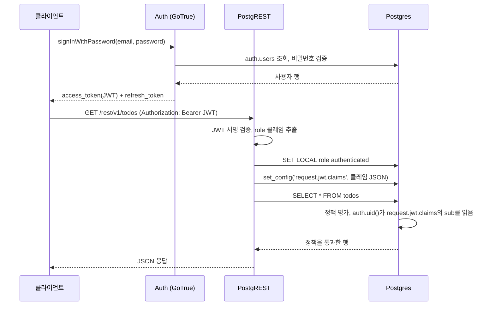
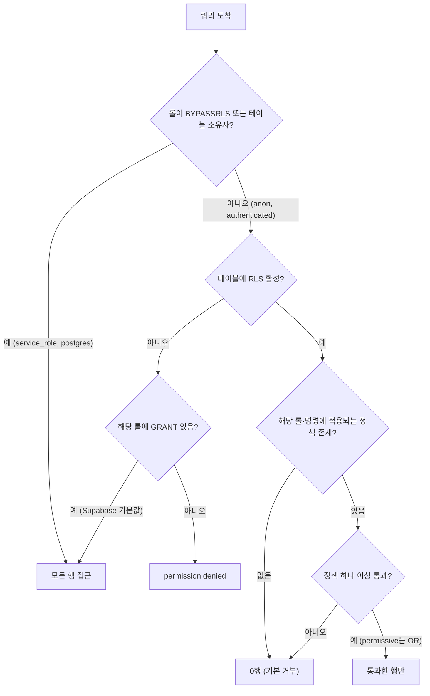
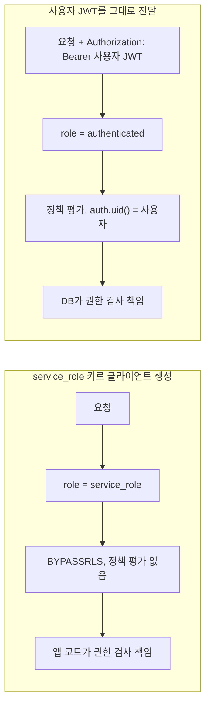
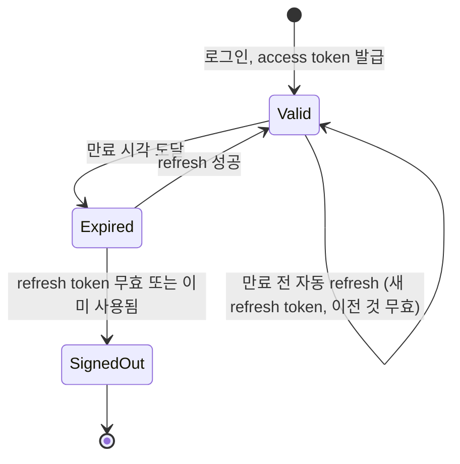

# Supabase Auth와 RLS 결합

Supabase에서 권한 검사는 대부분 Postgres의 Row Level Security가 맡는다. 클라이언트가 PostgREST로 직접 쿼리를 보내는 구조라 서버 코드에 `if (user.id !== row.userId)` 같은 검사를 둘 자리가 없고, 그 검사가 정책으로 내려간다. 정책이 틀리면 데이터가 새거나 반대로 전부 막힌다. 둘 다 빌드와 테스트가 통과한 뒤에 드러나는 종류의 문제다.

순수 PostgreSQL의 `CREATE POLICY` 문법, `USING`과 `WITH CHECK`의 차이, `FORCE ROW LEVEL SECURITY` 같은 기본기는 [Row Level Security](../../DataBase/RDBMS/Row_Level_Security.md)에 정리돼 있다. 이 문서는 거기서 다루지 않는 부분, 즉 Supabase Auth가 JWT를 발급하고 그 JWT가 정책 안에서 어떻게 읽히는지, 그리고 그 연결 지점에서 실제로 사고가 나는 곳을 다룬다. 전체 구조와 키 종류는 [Supabase 구조와 도입 판단](Supabase_Overview.md)을 먼저 보면 된다.

## 로그인에서 auth.uid() 평가까지

정책에 쓰는 `auth.uid()`는 마법 함수가 아니다. 요청마다 PostgREST가 JWT를 검증하고, 그 클레임을 트랜잭션 로컬 설정값으로 밀어 넣으면, `auth.uid()`가 그 설정값을 읽는 것뿐이다.



도식에서 볼 부분은 PostgREST 아래쪽 세 줄이다. 롤을 `authenticated`로 바꾸고, 클레임을 세션 설정으로 넣고, 그 다음에야 쿼리가 나간다. 정책은 `authenticated` 롤에 걸려 있고, `auth.uid()`는 `sub` 클레임을 uuid로 꺼낸다. JWT의 `role` 클레임이 `anon`이면 `anon` 롤로 붙고, `service_role`이면 `BYPASSRLS` 속성을 가진 롤로 붙어 정책 평가 자체가 일어나지 않는다.

`auth.jwt()`는 같은 클레임 JSON 전체를 jsonb로 돌려준다. 정책에서 `auth.jwt() ->> 'email'`이나 `auth.jwt() -> 'app_metadata' ->> 'tenant_id'`처럼 쓴다.

## auth.users와 public.profiles 분리

`auth.users`는 Auth 서비스가 소유한 테이블이다. 앱이 이 테이블에 컬럼을 추가하거나 직접 쿼리하는 구조로 가면 Auth 업그레이드 때 깨지고, PostgREST에도 노출되지 않는다(`auth` 스키마는 기본적으로 API에 열려 있지 않다). 그래서 앱 데이터는 `public.profiles` 같은 별도 테이블에 두고 `id`를 `auth.users.id`와 같게 맞춘다.

```sql
create table public.profiles (
  id uuid primary key references auth.users (id) on delete cascade,
  display_name text,
  avatar_url text,
  created_at timestamptz not null default now()
);

alter table public.profiles enable row level security;
```

행 생성은 가입 시점에 `auth.users`에 INSERT가 일어나는 것을 트리거로 잡아서 한다. 클라이언트가 가입 직후 `profiles`에 INSERT하게 두면, 이메일 확인이 켜진 프로젝트에서는 세션이 없어 정책에 막히고, 세션이 있어도 가입과 프로필 생성이 두 요청으로 갈라져 한쪽만 성공하는 상태가 생긴다.

```sql
create or replace function public.handle_new_user()
returns trigger
language plpgsql
security definer
set search_path = ''
as $$
begin
  insert into public.profiles (id, display_name, avatar_url)
  values (
    new.id,
    coalesce(new.raw_user_meta_data ->> 'full_name', split_part(new.email, '@', 1)),
    new.raw_user_meta_data ->> 'avatar_url'
  );
  return new;
end;
$$;

create trigger on_auth_user_created
  after insert on auth.users
  for each row execute function public.handle_new_user();
```

`security definer`가 필요한 이유는 트리거가 도는 롤이 `supabase_auth_admin`이라 `public.profiles`에 대한 권한이 없기 때문이다. `set search_path = ''`를 빼면 `security definer` 함수가 호출자의 search_path를 따라가서, 같은 이름의 객체를 앞선 스키마에 만들어 두는 방식으로 함수 동작을 바꿔치기할 수 있다. 빈 search_path를 쓰면 함수 안의 모든 객체를 `public.profiles`처럼 스키마까지 써야 한다. 하나라도 빠뜨리면 `relation "profiles" does not exist`가 난다.

### 트리거가 실패하면 가입이 500이다

이 트리거는 `auth.users` INSERT와 같은 트랜잭션 안에서 돈다. 함수가 예외를 던지면 사용자 INSERT까지 롤백되고, 클라이언트는 이유를 알 수 없는 응답을 받는다.

```text
AuthApiError: Database error saving new user
status: 500
```

메시지에 원인이 없다. 실제로 겪는 원인은 대개 이 정도다.

- `profiles`에 `not null` 컬럼을 나중에 추가했는데 트리거 INSERT에는 그 컬럼이 없다.
- OAuth 가입에서 `raw_user_meta_data`에 `full_name`이 없고 `name`만 온다. `not null` 컬럼에 null이 들어간다.
- 유니크 제약이 있는 `username` 컬럼에 같은 값이 들어간다.
- `search_path = ''`를 넣고 함수 안에서 스키마 없이 테이블을 참조했다.
- 마이그레이션으로 `profiles`를 리네임하거나 삭제했는데 트리거가 남아 있다.

원인은 Dashboard의 Logs에서 Postgres 로그를 봐야 나온다. 가입 흐름을 건드리는 마이그레이션을 배포할 때는 스테이징에서 새 이메일로 가입을 한 번 해보는 수밖에 없다. 가입 실패가 프로필 생성 실패 때문이라면 가입 자체를 포기시키는 것이 맞는지도 따져 볼 만하다. 프로필이 없어도 가입은 성공시키고 싶으면 트리거 안에서 예외를 삼키는 방법이 있다.

```sql
begin
  insert into public.profiles (id, display_name)
  values (new.id, new.raw_user_meta_data ->> 'full_name');
exception when others then
  raise warning 'handle_new_user failed for %: %', new.id, sqlerrm;
end;
return new;
```

이렇게 하면 가입은 되지만 프로필 없는 사용자가 생기고, 앱의 모든 화면이 프로필 존재를 전제하고 있으면 그쪽에서 깨진다. 어느 쪽 장애를 택할지는 서비스마다 다르다. 결제나 권한과 얽힌 프로필이면 가입을 막는 쪽이 낫고, 단순 표시용이면 삼키고 나중에 보정하는 쪽이 낫다.

## 정책에서 auth.uid()를 쓰는 방법

기본 형태는 이렇다.

```sql
create policy "profiles_select_own"
  on public.profiles for select
  to authenticated
  using ( id = auth.uid() );
```

동작은 맞지만, `auth.uid()`는 `stable`이 아니라 일반 함수 호출로 취급돼 행마다 호출될 수 있다. 행이 많은 테이블에서 이 호출이 스캔 비용에 얹힌다. `select`로 감싸면 플래너가 이를 uncorrelated 스칼라 서브쿼리로 보고 InitPlan으로 빼서, 쿼리당 한 번만 평가한다.

```sql
create policy "profiles_select_own"
  on public.profiles for select
  to authenticated
  using ( id = (select auth.uid()) );
```

`auth.jwt()`도 마찬가지로 `(select auth.jwt())`로 감싼다. 차이는 `EXPLAIN ANALYZE`에서 확인된다. 로컬에서 `request.jwt.claims`를 직접 세팅하고 돌려 보면 된다.

```sql
begin;
set local role authenticated;
select set_config('request.jwt.claims',
  '{"sub":"11111111-1111-1111-1111-111111111111","role":"authenticated"}', true);

explain (analyze, buffers)
select * from public.todos;
rollback;
```

감싸지 않은 쪽은 Filter 노드에 `auth.uid()` 호출이 그대로 보이고, 감싼 쪽은 `InitPlan 1 (returns $0)`가 따로 나온다. 얼마나 차이 나는지는 테이블 크기와 정책 구조에 따라 달라서 숫자를 일반화할 수 없다. 자기 테이블에서 재야 한다.

두 번째로 `to authenticated`를 빼먹지 않는다. 롤을 지정하지 않으면 정책은 `anon`에도 걸리고, `anon`으로 붙은 요청에서도 `auth.uid()`를 평가하게 된다(결과는 null이라 보통 매칭이 안 되지만 평가는 일어난다). 정책이 어느 롤용인지 드러나는 효과도 있다.

## 정책 평가 분기

요청이 들어왔을 때 어떤 행이 보이는지는 세 가지로 갈린다. 테이블의 RLS 활성 여부, 접속 롤, 정책 매칭이다.



분기에서 놓치기 쉬운 곳은 두 군데다. RLS가 꺼진 테이블에서는 정책 검사 단계가 아예 없고 GRANT만 본다. Supabase는 `public` 스키마의 새 테이블에 `anon`과 `authenticated`에게 기본 권한을 주도록 설정돼 있어서, RLS만 꺼져 있으면 그대로 열린다. 그리고 RLS가 켜졌는데 정책이 없는 경우는 에러가 아니라 빈 결과다. `permission denied`가 나지 않기 때문에 "데이터가 안 보인다"는 증상으로만 나타난다.

## 정책 예제

### 본인 행만

```sql
create table public.todos (
  id bigint generated always as identity primary key,
  user_id uuid not null default auth.uid() references auth.users (id) on delete cascade,
  title text not null,
  done boolean not null default false
);
alter table public.todos enable row level security;

create policy "todos_select_own" on public.todos for select to authenticated
  using ( user_id = (select auth.uid()) );

create policy "todos_insert_own" on public.todos for insert to authenticated
  with check ( user_id = (select auth.uid()) );

create policy "todos_update_own" on public.todos for update to authenticated
  using ( user_id = (select auth.uid()) )
  with check ( user_id = (select auth.uid()) );

create policy "todos_delete_own" on public.todos for delete to authenticated
  using ( user_id = (select auth.uid()) );
```

`user_id`의 기본값을 `auth.uid()`로 두면 클라이언트가 `user_id`를 보내지 않아도 되고, 보내더라도 `with check`가 다른 사람 id를 거른다. UPDATE에서 `with check`를 빼면 자기 행의 `user_id`를 남의 id로 바꿔 버릴 수 있다. 바뀐 행은 그 순간 본인 눈에서 사라지지만 남의 목록에는 나타난다.

### 팀 멤버십 기반

```sql
create table public.team_members (
  team_id uuid not null,
  user_id uuid not null references auth.users (id) on delete cascade,
  role text not null default 'member',
  primary key (team_id, user_id)
);
alter table public.team_members enable row level security;

create table public.projects (
  id uuid primary key default gen_random_uuid(),
  team_id uuid not null,
  name text not null
);
alter table public.projects enable row level security;
```

`projects` 정책에서 `team_members`를 서브쿼리로 보면 되는데, 그 서브쿼리 자체가 `team_members`의 RLS를 다시 탄다. `team_members` 정책이 같은 테이블을 참조하면 `infinite recursion detected in policy for relation` 에러가 난다. 멤버십 조회를 `security definer` 함수로 빼면 해결된다. 함수는 API에 노출되지 않는 스키마에 둔다.

```sql
create schema if not exists private;

create or replace function private.is_team_member(_team_id uuid)
returns boolean
language sql
security definer
stable
set search_path = ''
as $$
  select exists (
    select 1 from public.team_members
    where team_id = _team_id and user_id = (select auth.uid())
  );
$$;

revoke all on function private.is_team_member(uuid) from public, anon;
grant execute on function private.is_team_member(uuid) to authenticated;
grant usage on schema private to authenticated;

create policy "projects_select_team" on public.projects for select to authenticated
  using ( (select private.is_team_member(team_id)) );

create policy "team_members_select_same_team" on public.team_members for select to authenticated
  using ( (select private.is_team_member(team_id)) );
```

함수를 `public`에 두면 PostgREST가 `/rpc/is_team_member`로 노출한다. 호출자가 임의의 `team_id`로 멤버십 여부를 물어볼 수 있게 되므로 별도 스키마가 낫다. `private` 스키마는 Dashboard의 Exposed schemas 설정에 넣지 않는 한 API로 나가지 않는다.

### 멀티테넌트와 app_metadata

테넌트가 JWT에 박혀 있으면 정책은 조인 없이 클레임만 비교한다.

```sql
create policy "invoices_tenant_isolation" on public.invoices
  for all to authenticated
  using ( tenant_id = ((select auth.jwt()) -> 'app_metadata' ->> 'tenant_id')::uuid )
  with check ( tenant_id = ((select auth.jwt()) -> 'app_metadata' ->> 'tenant_id')::uuid );
```

`tenant_id`는 서버에서 `service_role`로 설정한다.

```typescript
import { createClient } from '@supabase/supabase-js'

const admin = createClient(process.env.SUPABASE_URL!, process.env.SUPABASE_SERVICE_ROLE_KEY!, {
  auth: { autoRefreshToken: false, persistSession: false },
})

await admin.auth.admin.updateUserById(userId, {
  app_metadata: { tenant_id: tenantId },
})
```

JWT 클레임은 발급 시점에 굳는다. `app_metadata`를 바꿔도 이미 발급된 access token에는 이전 값이 남아 있고, 다음 refresh에서야 새 값이 들어간다. 테넌트를 옮기거나 권한을 회수하는 동작이 즉시 반영돼야 하면 클레임 방식은 맞지 않고, 정책에서 테이블을 조회하는 방식(위의 멤버십 함수)을 써야 한다. 클레임 방식이 빠른 이유가 곧 이 지연이다.

### user_metadata를 정책에 쓰면 안 되는 이유

`user_metadata`는 로그인한 사용자가 클라이언트에서 스스로 수정할 수 있다.

```typescript
await supabase.auth.updateUser({ data: { role: 'admin' } })
```

이 호출은 `user_metadata`를 바꾼다. 그래서 이런 정책은 권한 상승 경로가 된다.

```sql
-- 쓰면 안 된다. 사용자가 자기 user_metadata.role 을 'admin' 으로 바꿀 수 있다
create policy "admin_all" on public.invoices for all to authenticated
  using ( (auth.jwt() -> 'user_metadata' ->> 'role') = 'admin' );
```

새 토큰을 받는 즉시 효력이 생긴다. 권한·테넌트·플랜처럼 사용자가 바꾸면 안 되는 값은 `app_metadata`나 별도 테이블에만 둔다. `app_metadata`는 `service_role`로만 수정된다. 코드 리뷰에서 `user_metadata`가 `using` 절에 들어 있는 정책을 grep으로 찾아 보는 것이 가장 빠른 점검이다.

## 정책 유형별 비교

| 유형 | 판단 근거 | 장점 | 한계 | 반영 시점 |
|---|---|---|---|---|
| 본인 행 (`user_id = auth.uid()`) | JWT의 `sub` | 가장 단순하고 인덱스 한 개로 충분 | 공유·협업 불가 | 즉시 |
| 멤버십 조회 (함수 또는 `exists` 서브쿼리) | 별도 테이블 | 권한 회수가 바로 반영됨 | 행마다 조인 비용, 재귀 주의 | 즉시 |
| 클레임 (`app_metadata.tenant_id`) | JWT 클레임 | 조인 없음, 빠름 | 토큰 재발급 전까지 이전 값 유지 | 다음 refresh |
| 롤 기반 (`to authenticated` / `to anon`) | Postgres 롤 | 로그인 여부만 구분 | 행 단위 구분 안 됨 | 즉시 |
| restrictive 정책 (`as restrictive`) | 다른 정책과 AND | MFA(`aal2`) 같은 공통 조건을 덧씌움 | 단독으로는 아무 행도 열지 못함 | 즉시 |

permissive 정책끼리는 OR로 합쳐지고 restrictive 정책은 AND로 붙는다. 멤버십 정책과 클레임 정책을 같은 테이블에 permissive로 둘 다 걸면 둘 중 하나만 통과해도 열리므로, 의도한 것이 교집합이면 restrictive를 써야 한다.

## RLS를 켜지 않은 테이블이 노출되는 사고

`anon` key는 클라이언트 번들에 들어가는 공개 값이다. 이 키로 `https://<ref>.supabase.co/rest/v1/<table>`에 GET을 보내는 일은 누구나 할 수 있고, RLS가 꺼진 테이블은 `anon` 롤의 GRANT만으로 전체가 읽힌다.

```bash
curl 'https://<ref>.supabase.co/rest/v1/users?select=*' \
  -H "apikey: <anon key>" \
  -H "Authorization: Bearer <anon key>"
```

SQL Editor나 마이그레이션으로 만든 테이블은 RLS가 기본 꺼져 있다. Table Editor로 만들 때는 켜진 채로 생성되는 쪽이 기본이라, 두 경로를 섞어 쓰면 일부 테이블만 열려 있는 상태가 만들어진다. 전수 점검은 카탈로그에서 한다.

```sql
select schemaname, tablename
from pg_tables
where schemaname = 'public' and not rowsecurity;
```

결과가 비어 있어야 한다. Dashboard의 Security Advisor도 같은 항목을 `RLS Disabled in Public`으로 경고한다. 마이그레이션 CI에서 이 쿼리 결과가 비어 있지 않으면 실패시키는 것이 사고를 막는 가장 확실한 방법이다.

반대 방향의 증상도 흔하다. RLS를 켰는데 정책을 만들지 않으면 `select`가 에러 없이 `[]`를 돌려준다. `insert`는 `new row violates row-level security policy for table "..."` 에러가 난다. 개발 중에 "분명 데이터가 있는데 빈 배열이 온다"면 정책부터 확인한다. SQL Editor에서는 `postgres` 롤로 실행돼 RLS를 우회하므로 데이터가 보이는데 앱에서는 안 보이는 상태가 되고, 이 차이 때문에 디버깅이 길어진다. 롤을 바꿔 재현하려면 위의 `set local role authenticated`와 `set_config`를 쓴다.

### 뷰는 RLS를 우회한다

뷰는 기본이 `security definer` 동작이다. 뷰 소유자(대개 `postgres`)의 권한으로 베이스 테이블을 읽기 때문에, 베이스 테이블에 RLS가 있어도 뷰를 통하면 모든 행이 보인다.

```sql
create view public.todo_summary as
  select user_id, count(*) as total from public.todos group by user_id;
-- anon 도 GRANT 가 있으므로 RLS 를 거치지 않고 전체 사용자의 집계가 나간다
```

Postgres 15부터 `security_invoker` 옵션이 있다. 켜면 호출자의 권한으로 베이스 테이블을 읽어 RLS가 적용된다.

```sql
create view public.todo_summary
  with (security_invoker = true) as
  select user_id, count(*) as total from public.todos group by user_id;

-- 이미 있는 뷰는
alter view public.todo_summary set (security_invoker = true);
```

`security_invoker`를 켜면 `authenticated`가 호출했을 때 본인 행만 집계된다. 전체 집계를 일부러 공개해야 하는 뷰라면 `security_invoker`를 쓰지 않고, 뷰를 `private` 스키마에 두고 필요한 열만 노출하는 함수를 따로 만든다. Security Advisor가 `Security Definer View`로 경고하는 항목이 이것이다.

## service_role과 사용자 JWT

서버에서 Supabase에 붙을 때 키를 무엇으로 쓰느냐에 따라 같은 코드가 전혀 다르게 동작한다.



왼쪽은 서버가 모든 책임을 진다. 쿼리에서 `eq('user_id', user.id)` 한 줄을 빠뜨리면 전 사용자의 데이터가 나간다. 오른쪽은 정책이 실패해도 안전한 방향으로 동작한다. 배치 작업, 웹훅 처리, 관리자 도구처럼 사용자 맥락이 없는 곳에서만 `service_role`을 쓰고, 사용자 요청을 처리하는 API 라우트는 사용자 JWT로 클라이언트를 만든다.

```typescript
import { createClient } from '@supabase/supabase-js'

export function supabaseForRequest(req: Request) {
  const token = req.headers.get('authorization')?.replace('Bearer ', '')
  return createClient(process.env.SUPABASE_URL!, process.env.SUPABASE_ANON_KEY!, {
    global: { headers: { Authorization: `Bearer ${token}` } },
    auth: { autoRefreshToken: false, persistSession: false },
  })
}

export async function listMyTodos(req: Request) {
  const supabase = supabaseForRequest(req)
  const { data, error } = await supabase.from('todos').select('id, title, done')
  if (error) throw error
  return data
}
```

키는 `anon`을 쓰고 헤더에 사용자 토큰을 얹는다. 이렇게 하면 `todos`에는 `where`가 없는데도 본인 행만 오고, 이게 정상이다. 반대로 같은 함수에서 `SUPABASE_SERVICE_ROLE_KEY`로 클라이언트를 만들면 전체 행이 온다. 환경변수 이름만 바꿨는데 동작이 달라지고 에러도 없다.

토큰이 유효한지는 서버에서 `getUser`로 확인한다. `getSession`은 쿠키나 스토리지에 저장된 값을 서명 검증 없이 그대로 읽는 경우가 있어, 서버에서 신원 판단에 쓰면 안 된다.

```typescript
const { data: { user }, error } = await supabase.auth.getUser(token)
if (error || !user) return new Response('unauthorized', { status: 401 })
```

`getUser`는 Auth 서버에 요청을 보내므로 호출마다 네트워크 왕복이 생긴다. JWT 서명 키를 비대칭으로 쓰는 프로젝트라면 `getClaims`로 로컬 검증을 할 수 있다. 어느 쪽이든 정책이 최종 방어선이라는 전제는 변하지 않는다.

`service_role` 키가 `NEXT_PUBLIC_` 접두사가 붙은 환경변수에 들어가 번들에 포함되는 사고는 [Supabase 구조와 도입 판단](Supabase_Overview.md)에서 다뤘다.

## OAuth, 이메일 확인, JWT 만료

### 리다이렉트 URL 설정 오류

OAuth 로그인은 URL 세 곳이 서로 맞아야 한다.

| 위치 | 넣을 값 |
|---|---|
| Google/GitHub 콘솔의 Authorized redirect URI | `https://<ref>.supabase.co/auth/v1/callback` |
| Supabase Authentication > URL Configuration > Site URL | 서비스의 기본 URL |
| 같은 화면의 Redirect URLs 허용 목록 | 로그인 후 돌아올 앱 URL들 |

콘솔에 앱 URL을 넣는 실수가 가장 흔하다. 콘솔에는 앱이 아니라 Supabase의 callback URL을 넣는다. 에러는 `redirect_uri_mismatch`로 나온다.

```typescript
await supabase.auth.signInWithOAuth({
  provider: 'github',
  options: { redirectTo: `${location.origin}/auth/callback` },
})
```

`redirectTo`가 허용 목록에 없으면 Supabase는 에러를 내지 않고 조용히 Site URL로 돌려보낸다. 로컬에서 `http://localhost:3000/auth/callback`으로 돌아오길 기대했는데 운영 도메인 루트로 가 있다면 이 경우다. 허용 목록은 와일드카드를 지원하므로 프리뷰 배포가 있다면 `https://*-myteam.vercel.app/**` 같은 패턴을 넣는다. 와일드카드를 너무 넓게 열면 오픈 리다이렉트가 된다.

PKCE 흐름에서는 콜백으로 `?code=...`가 오고, 서버에서 교환해야 세션이 생긴다.

```typescript
const code = url.searchParams.get('code')
if (code) {
  const { error } = await supabase.auth.exchangeCodeForSession(code)
  if (error) return redirect('/login?error=exchange')
}
```

이 코드는 발급 후 짧은 시간 안에, 코드를 요청한 브라우저의 code verifier와 함께 써야 한다. 로그인을 시작한 브라우저와 다른 곳(이메일 앱 내장 브라우저 등)에서 콜백을 열면 `invalid request: both auth code and code verifier should be non-empty`가 난다.

### 이메일 확인 토큰 만료

확인 메일의 링크는 기본 1시간 안에 쓰지 않으면 만료된다(Authentication 설정에서 조정). 기업 메일 보안 게이트웨이가 링크를 미리 열어 보며 검사하는 환경에서는 사용자가 클릭하기 전에 토큰이 소모돼, 사용자 쪽에서는 `Email link is invalid or has expired`만 보인다. 이 증상이 특정 고객사 도메인에서만 반복되면 링크 사전 검사를 의심한다. 링크 대신 6자리 OTP로 확인하는 템플릿으로 바꾸면 우회된다.

```typescript
const { error } = await supabase.auth.verifyOtp({ email, token: code, type: 'signup' })
```

토큰이 만료되면 확인 메일을 다시 보내게 한다.

```typescript
await supabase.auth.resend({ type: 'signup', email })
```

### JWT 만료와 refresh

access token은 기본 3600초 뒤 만료된다. 만료된 토큰으로 PostgREST를 부르면 `JWT expired` 에러(`PGRST301`)가 난다. 브라우저 클라이언트는 `autoRefreshToken`이 켜져 있어 만료 전에 refresh token으로 교체하지만, 아래 경우에는 직접 챙겨야 한다.

- 서버 컴포넌트나 API 라우트에서 쿠키의 토큰을 읽어 쓰는 경우. 쿠키 안의 access token이 이미 만료됐을 수 있고, 서버에서는 갱신 결과를 응답 쿠키에 다시 써 줘야 한다. 미들웨어에서 매 요청마다 세션을 갱신하는 것이 `@supabase/ssr`가 권하는 방식이다.
- 탭을 오래 백그라운드에 두면 타이머가 멈춰 만료 후에 깨어난다. 복귀 시 `onAuthStateChange`로 `TOKEN_REFRESHED`나 `SIGNED_OUT`을 받는다.
- refresh token 재사용. Supabase는 refresh token rotation이 기본이라 토큰을 한 번 쓰면 새 토큰이 나오고 이전 것은 무효가 된다. 같은 refresh token을 두 탭이나 두 요청이 동시에 쓰면 한쪽이 `Invalid Refresh Token: Already Used`로 실패한다. 설정에 재사용 허용 간격이 있지만, 서버에서 동시 요청이 갱신을 나눠 하는 구조라면 갱신 지점을 한 곳으로 모으는 것이 근본 해결이다.



정책에서 읽는 `app_metadata`는 이 `Valid --> Valid` 전이에서 새 토큰에 반영된다. 앞서 말한 클레임 반영 지연의 정체다. 즉시 반영이 필요하면 `supabase.auth.refreshSession()`을 호출해 새 토큰을 받게 한다.

## 정리해 둘 점검 순서

RLS 관련 장애는 증상이 비슷해서 순서를 정해 두면 빨리 좁혀진다. 먼저 SQL Editor가 아닌 앱과 같은 롤로 재현한다. 그다음 `pg_tables.rowsecurity`로 RLS 활성 여부를, `pg_policies`로 해당 롤·명령에 정책이 있는지를 본다. 정책이 있는데 안 보이면 `request.jwt.claims`를 직접 세팅하고 `explain`으로 필터 조건을 확인한다. 가입이 500이면 정책이 아니라 `auth.users` 트리거부터 의심한다.

```sql
select policyname, cmd, roles, permissive, qual, with_check
from pg_policies
where schemaname = 'public' and tablename = 'todos';
```
