# Supabase Edge Functions와 DB 연결, 마이그레이션 운영

Supabase를 운영 환경에 올리면 처음 만나는 장애는 대체로 세 곳에서 난다. Stripe 웹훅이 401로 막히는 Edge Function, 배포한 지 하루 만에 `too many connections`를 뱉는 서버리스 앱, 로컬에서는 되는데 운영에서만 컬럼이 없다는 마이그레이션이다. 셋 다 기능이 틀린 게 아니라 기본값과 연결 경로를 모르고 쓸 때 생긴다.

이 문서는 Edge Functions의 실행 환경과 웹훅 처리, 연결 방식 세 가지의 차이와 환경별 선택, Supabase CLI로 스키마를 관리하는 흐름, 백업과 확장 활성화를 다룬다. 수치와 제한값은 2026년 10월 기준이며 플랜·컴퓨트 크기에 따라 달라지므로, 숫자를 코드에 박기 전에 콘솔과 공식 문서에서 다시 확인한다. 프로젝트 구조와 키 종류는 [Supabase 구조와 도입 판단](Supabase_Overview.md), 인증과 RLS는 [Supabase Auth와 RLS 결합](Supabase_Auth_And_RLS.md)에 있다.

## Edge Functions의 실행 환경

Edge Functions는 Deno 런타임에서 돈다. Node가 아니라서 `require`가 없고, 패키지는 `npm:` 접두사나 `jsr:` 또는 URL import로 가져온다. 파일 하나가 함수 하나이고 경로는 `supabase/functions/<이름>/index.ts`다. 요청마다 새 프로세스가 뜨는 게 아니라 격리된 인스턴스(isolate)가 요청을 받고, 한동안 유지되다가 내려간다.

```bash
supabase functions new stripe-webhook          # supabase/functions/stripe-webhook/index.ts 생성
supabase functions serve --env-file ./supabase/.env.local   # 로컬 실행
supabase functions deploy stripe-webhook --project-ref abcdefghij
supabase functions deploy                      # 디렉터리 안의 함수 전부 배포
```

`supabase functions deploy`는 로컬에 Docker가 없어도 동작하는 버전이 있지만, 번들링을 Docker로 하는 구버전 CLI에서는 Docker가 떠 있어야 한다. CI에서 "Cannot connect to the Docker daemon"이 나면 CLI 버전부터 올린다.

### 시크릿

함수에서 쓰는 환경 변수는 `supabase secrets`로 넣는다. 배포 시점이 아니라 프로젝트에 저장되고, 함수 코드에서 `Deno.env.get()`으로 읽는다.

```bash
supabase secrets set STRIPE_API_KEY=sk_live_xxx STRIPE_WEBHOOK_SECRET=whsec_xxx
supabase secrets set --env-file ./supabase/.env.production
supabase secrets list        # 이름과 해시만 나오고 값은 안 나온다
```

`SUPABASE_URL`, `SUPABASE_ANON_KEY`, `SUPABASE_SERVICE_ROLE_KEY`, `SUPABASE_DB_URL`은 플랫폼이 자동으로 넣어 주므로 직접 설정하지 않는다. `SUPABASE_`로 시작하는 이름은 `secrets set`이 거부한다. 로컬 `.env.local` 파일은 `.gitignore`에 넣는다. Stripe 키가 든 파일이 저장소에 올라간 사고는 이 파일 이름만 잘못 지어도 생긴다.

시크릿을 바꾼 뒤 이미 떠 있는 인스턴스가 옛 값을 쥐고 있는 경우가 있다. 값을 바꿨는데 함수가 계속 옛 키로 동작하면 함수를 한 번 재배포하는 게 가장 빠르다.

### 콜드 스타트와 실행 제한

콜드 스타트는 새 인스턴스가 번들을 올리고 최상위 코드를 실행하는 시간이다. 보통 수백 밀리초 안쪽이지만, 최상위에서 무거운 패키지를 import하거나 초기화하면 그만큼 늘어난다. 한 번은 PDF 라이브러리를 최상위 import로 두었더니 그 함수만 첫 요청이 2초 가까이 걸렸다. 무거운 모듈은 필요한 분기 안에서 `await import()`로 불러오고, Supabase 클라이언트처럼 가벼운 것은 핸들러 밖에서 한 번만 만들어 인스턴스가 살아 있는 동안 재사용한다. 사용자 JWT를 실어 만드는 클라이언트는 요청마다 만들어야 한다. 핸들러 밖에 두면 다른 사용자의 토큰이 섞인다.

아래 상태도는 인스턴스 하나의 수명이다. 콜드 스타트는 맨 처음 한 번만 겪고, 이후 요청은 `Warm` 상태에서 핸들러 밖에 만들어 둔 객체를 재사용한다.

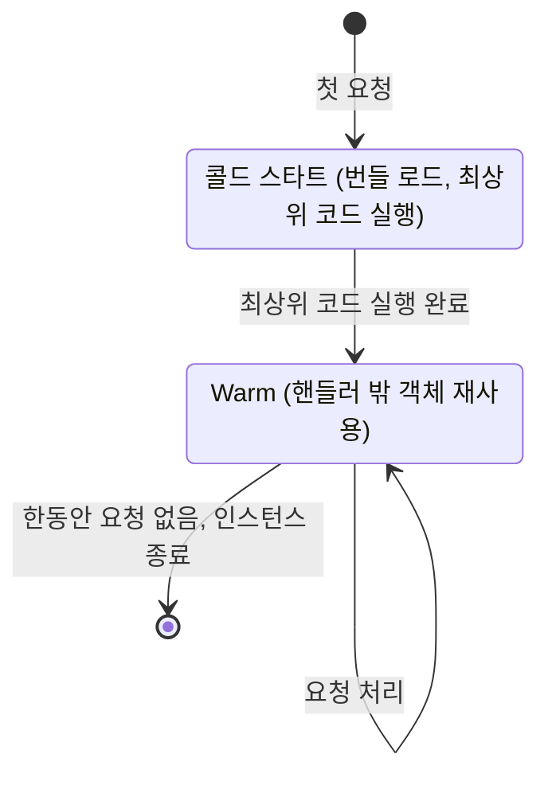

| 항목 | 값(문서 기준) | 걸리면 보이는 증상 |
|---|---|---|
| CPU 시간 | 요청당 약 2초 (I/O 대기는 제외) | 546 에러, 연산이 긴 함수가 중간에 끊김 |
| 메모리 | 약 256MB | 큰 파일을 통째로 읽다가 인스턴스 종료 |
| 벽시계 시간 | 무료 약 150초, 유료 약 400초 | 응답 없이 504 |
| 번들 크기 | 약 20MB | 배포 단계에서 거부 |

CPU 시간과 벽시계 시간은 별개다. 외부 API 응답을 10초 기다리는 건 CPU를 거의 쓰지 않으니 문제가 안 된다. 이미지 리사이즈나 큰 JSON 파싱처럼 CPU를 붙잡는 작업이 2초를 넘길 때 막힌다. 그런 작업은 Edge Function에서 하지 않고 큐에 넣어 워커에서 처리한다.

Edge Function에서 DB에 직접 SQL을 날려야 한다면 `supabase-js`를 쓰는 게 낫다. Postgres 드라이버를 쓸 경우 인스턴스가 요청량에 따라 계속 늘어나므로 연결도 인스턴스 수만큼 늘어난다. 직접 접속 대신 아래에서 다루는 트랜잭션 풀러(6543)를 쓰고, postgres.js라면 `prepare: false`를 준다.

## 웹훅과 verify_jwt

Edge Function은 기본적으로 `verify_jwt`가 켜져 있다. 게이트웨이가 요청의 `Authorization: Bearer <JWT>`를 먼저 검증하고, 없거나 틀리면 함수 코드가 실행되기 전에 401을 돌려준다. 프런트에서 `supabase.functions.invoke()`로 부르면 SDK가 JWT를 알아서 실어 보내니 이 기본값이 문제가 되지 않는다.

Stripe, GitHub, Slack 같은 외부 서비스의 웹훅은 Supabase JWT를 보내지 않는다. 서명 헤더만 붙여 보낸다. 그대로 배포하면 Stripe 대시보드에는 401만 쌓이고 함수 로그는 비어 있다. 함수가 한 번도 실행되지 않았기 때문이다. 로그가 비어 있는데 요청은 들어왔다는 상황이 이 문제의 특징이다.

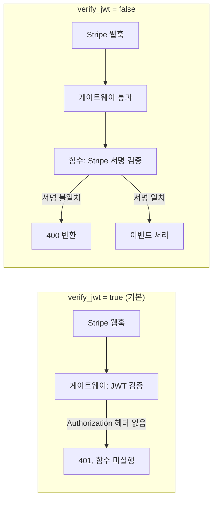

왼쪽은 게이트웨이에서 끝나고, 오른쪽은 인증 책임이 함수 안의 서명 검증으로 넘어간다. 웹훅 함수는 `verify_jwt`를 끄는 대신 서명 검증이 유일한 문이 된다. 서명 검증을 빼먹으면 누구나 URL만 알면 결제 완료 이벤트를 위조할 수 있다.

`verify_jwt`는 함수별로 `supabase/config.toml`에 적는다. 배포 명령에 `--no-verify-jwt`를 붙이는 방법도 있지만, 한 번 빠뜨리고 재배포하면 다시 켜져서 웹훅이 조용히 죽는다. 설정 파일에 남겨 두는 쪽이 안전하다.

```toml
[functions.stripe-webhook]
verify_jwt = false
```

프로젝트가 새 형식의 API 키(`sb_publishable_...`)로 넘어갔다면 게이트웨이의 JWT 검증이 기존과 다르게 동작할 수 있다. 이 경우 `verify_jwt`를 끄고 함수 안에서 직접 검증하는 구성이 문서에서 권장되는지 확인한다.

### raw body로 서명을 검증한다

Stripe 서명은 요청 본문의 원본 바이트로 계산된다. `await req.json()`으로 파싱한 뒤 `JSON.stringify`로 되돌리면 공백, 키 순서, 유니코드 이스케이프가 달라져 서명이 맞지 않는다. 로컬에서 간단한 이벤트로 테스트하면 우연히 통과하다가, 한글이 든 고객 이름이 포함된 운영 이벤트에서부터 실패하는 경우가 있다. 본문은 반드시 `req.text()`로 한 번만 읽는다.

Deno에서는 Node용 동기 `constructEvent`가 동작하지 않는다. 서명 계산에 WebCrypto가 쓰여 비동기이므로 `constructEventAsync`와 SubtleCrypto 프로바이더를 넘긴다.

```ts
// supabase/functions/stripe-webhook/index.ts
import Stripe from "npm:stripe@17";
import { createClient } from "npm:@supabase/supabase-js@2";

const stripe = new Stripe(Deno.env.get("STRIPE_API_KEY")!, {
  httpClient: Stripe.createFetchHttpClient(),
});
const cryptoProvider = Stripe.createSubtleCryptoProvider();
const admin = createClient(
  Deno.env.get("SUPABASE_URL")!,
  Deno.env.get("SUPABASE_SERVICE_ROLE_KEY")!,
);

Deno.serve(async (req) => {
  const signature = req.headers.get("stripe-signature");
  if (!signature) return new Response("missing signature", { status: 400 });

  const body = await req.text(); // json()으로 읽으면 서명이 깨진다

  let event: Stripe.Event;
  try {
    event = await stripe.webhooks.constructEventAsync(
      body,
      signature,
      Deno.env.get("STRIPE_WEBHOOK_SECRET")!,
      undefined,
      cryptoProvider,
    );
  } catch (_e) {
    return new Response("invalid signature", { status: 400 });
  }

  // 같은 이벤트는 재전송될 수 있으므로 event.id를 유니크 키로 막는다
  const { error } = await admin
    .from("stripe_events")
    .insert({ id: event.id, type: event.type });
  if (error?.code === "23505") return new Response("duplicate", { status: 200 });
  if (error) return new Response("db error", { status: 500 });

  if (event.type === "checkout.session.completed") {
    const session = event.data.object as Stripe.Checkout.Session;
    await admin.from("orders").update({ status: "paid" }).eq("stripe_session_id", session.id);
  }
  return new Response("ok", { status: 200 });
});
```

로컬에서는 `supabase functions serve --no-verify-jwt --env-file ./supabase/.env.local`로 띄우고 `stripe listen --forward-to http://localhost:54321/functions/v1/stripe-webhook`로 이벤트를 흘려 보낸다. 여기서 헷갈리는 게 시크릿이다. `stripe listen`이 출력하는 `whsec_...`와 대시보드 엔드포인트에 표시되는 `whsec_...`는 서로 다른 값이다. 로컬 `.env`에는 CLI가 준 값을, `supabase secrets set`에는 대시보드 값을 넣어야 한다. 바꿔 넣으면 서명 검증이 항상 실패하고, 코드 문제로 착각해 한참 들여다보게 된다.

Stripe는 2xx를 못 받으면 재전송한다. 처리에 시간이 걸리는 작업은 이벤트를 테이블에 저장하고 바로 200을 돌려준 뒤 별도로 처리한다. 위 코드의 `stripe_events` 삽입이 그 역할의 최소형이다.

아래 시퀀스는 위 코드가 한 요청을 처리하는 순서다. 서명이 틀리면 DB에 닿기 전에 400으로 끝나고, 같은 `event.id`가 다시 오면 유니크 키 충돌(23505)로 중복을 걸러 200을 돌려준다.

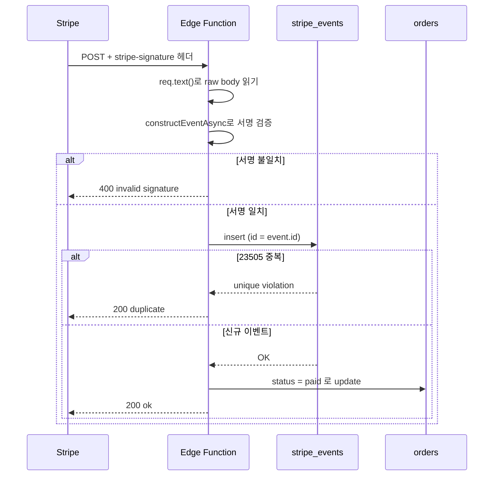

## 연결 방식 세 가지

Supabase DB에는 접속 경로가 세 개 있다. 같은 Postgres로 가지만 중간에 거치는 것과 지원하는 기능이 다르다.

| 항목 | Direct connection | Supavisor Session mode | Supavisor Transaction mode |
|---|---|---|---|
| 주소 | `db.<ref>.supabase.co` | `<region>.pooler.supabase.com` | `<region>.pooler.supabase.com` |
| 포트 | 5432 | 5432 | 6543 |
| 사용자 이름 | `postgres` | `postgres.<ref>` | `postgres.<ref>` |
| IPv4 / IPv6 | IPv6 전용 (IPv4는 유료 애드온) | 둘 다 | 둘 다 |
| 서버 연결 점유 | 클라이언트당 1개 | 클라이언트가 붙어 있는 동안 1개 | 트랜잭션이 도는 동안만 |
| prepared statement | 사용 가능 | 사용 가능 | 쓰지 않는 쪽으로 맞춘다 |
| 세션 상태(SET, advisory lock, LISTEN) | 사용 가능 | 사용 가능 | 유지되지 않음 |
| 적합한 환경 | 상시 서버, 마이그레이션, pg_dump | IPv4만 되는 환경의 상시 서버·마이그레이션 | 서버리스, 인스턴스가 많이 늘어나는 앱 |

Direct는 Postgres에 바로 붙는 길이라 기능 제약이 없다. 대신 IPv6 전용이어서 IPv6가 안 되는 네트워크에서는 DNS 조회는 되는데 접속이 타임아웃으로 끝난다. 연결 수도 Postgres의 `max_connections`에 직접 부딪힌다.

Session mode는 Direct의 IPv4 대체재에 가깝다. 클라이언트 연결 하나가 서버 연결 하나를 그대로 쥔다. 연결 수를 줄여 주는 모드가 아니라는 점을 놓치기 쉽다. 풀 크기를 넘겨 붙으면 `max clients reached in session mode` 에러가 난다.

Transaction mode는 트랜잭션이 끝나면 서버 연결을 풀로 돌려보낸다. 클라이언트 연결이 수백 개여도 서버 연결은 풀 크기만큼만 쓴다. 대신 연결이 트랜잭션마다 다른 서버 연결로 바뀔 수 있어서, 연결에 남겨 둔 상태가 다음 쿼리에서 사라진다.

세 경로가 서버 연결을 쥐는 방식을 그리면 차이가 분명하다. Direct와 Session mode는 클라이언트 하나가 서버 연결 하나를 그대로 쥐고, Transaction mode만 여러 클라이언트가 적은 서버 연결을 나눠 쓴다.

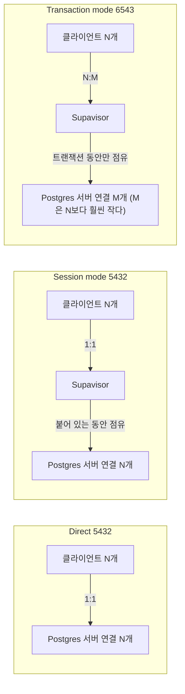

공유 풀러의 구현체는 현재 Supavisor다. 예전 자료와 블로그에는 Supabase가 PgBouncer를 쓴다고 나오는데, 지금의 `pooler.supabase.com` 주소 뒤에 있는 건 Supavisor다. 유료 플랜에는 DB 서버 옆에 붙는 전용 풀러(PgBouncer)가 따로 있는 구성도 있어서, 어떤 풀러에 붙고 있는지는 콘솔의 Connect 화면에서 확인해야 한다.

### 환경별로 어느 쪽을 쓰나

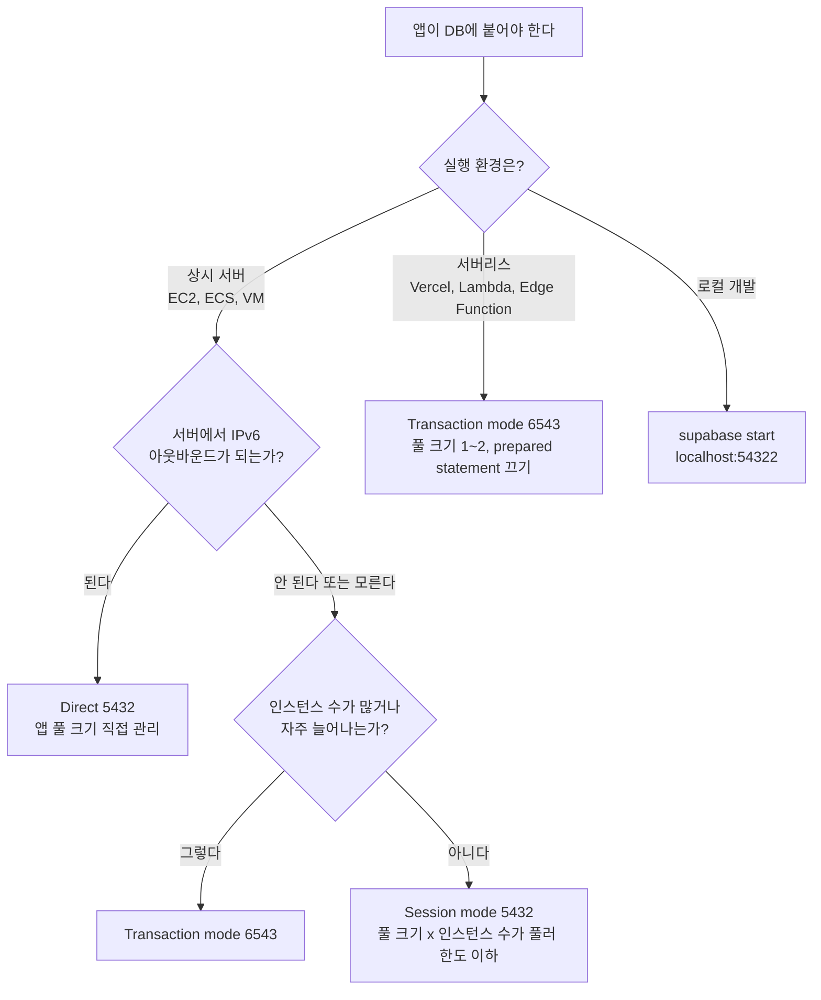

가장 먼저 가르는 기준은 실행 환경이다. 서버리스는 요청이 몰릴 때 인스턴스가 늘어나고, 각 인스턴스가 자기 풀을 만든다. 인스턴스 50개가 풀 크기 5로 붙으면 250개가 Postgres에 직접 붙는 셈이다. 이런 환경은 Direct로 붙이는 순간 한계에 닿는다.

Vercel 함수는 외부로 나갈 때 IPv4만 쓴다. Direct 주소로 붙으면 `ENETUNREACH`나 `getaddrinfo ENOTFOUND`가 나서 DNS 문제로 오해하기 쉽다. Railway도 환경에 따라 외부 IPv6 송신이 안 되는 경우가 있었고, 한동안은 GitHub Actions 러너도 마찬가지였다. 처음 연결 테스트가 Direct로 안 된다면 포트나 비밀번호를 의심하기 전에 IPv6부터 확인한다.

```bash
# IPv6 경로가 되는지 먼저 본다
getent ahostsv6 db.abcdefghij.supabase.co
curl -6 -sS -m 5 https://ifconfig.co   # 실패하면 이 환경은 IPv6 아웃바운드가 안 된다
```

상시 서버라고 해서 Direct가 항상 맞는 것도 아니다. 인스턴스를 오토스케일링하는 ECS나 Kubernetes는 서버리스처럼 연결 수가 출렁인다. 이 경우 Transaction mode가 낫다. 반대로 고정 인스턴스 2~3대에 풀 크기가 정해져 있다면 Direct나 Session mode가 prepared statement와 세션 기능을 그대로 쓸 수 있어서 편하다.

## Transaction mode에서 깨지는 것들

Transaction mode의 문제는 연결과 서버 세션이 1:1이 아니라는 데서 나온다. 가장 흔하게 깨지는 건 prepared statement다. 드라이버가 `PREPARE`로 서버 세션에 문장을 등록해 두고 다음 쿼리에서 이름으로 부르는데, 그 사이 풀러가 연결을 다른 서버 세션으로 바꾸면 `prepared statement "s0" does not exist`나 `already exists`가 난다.

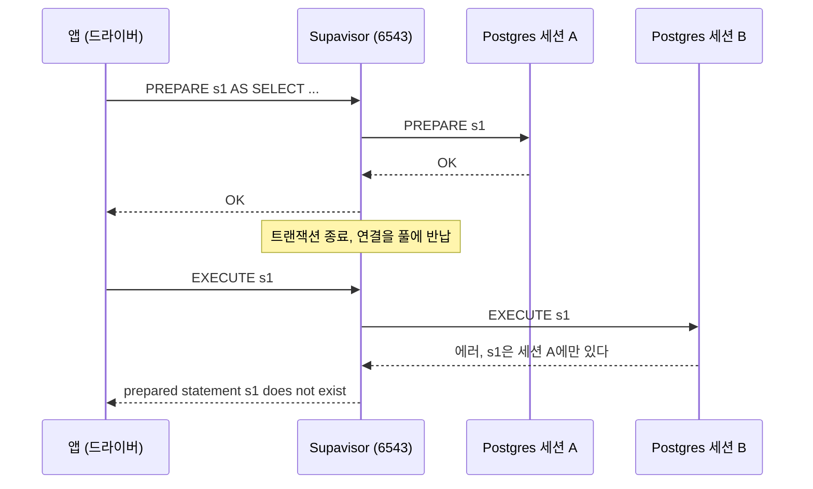

`s1`은 세션 A에만 등록됐는데, 다음 요청이 세션 B로 갔다. 부하가 낮을 때는 풀이 같은 세션을 다시 내주는 일이 많아 멀쩡해 보이고, 동시 요청이 늘면 세션이 바뀌어 에러가 튀어나온다. 그래서 개발 환경에서는 재현이 안 되고 운영에서만 간헐적으로 난다.

Supavisor 쪽에서 prepared statement를 지원하는 범위는 버전에 따라 달랐다. 지원 여부를 확인해서 쓰는 것보다 클라이언트에서 끄는 쪽이 어느 버전에서나 안전하다.

Prisma는 연결 문자열에 `pgbouncer=true`를 붙인다. 파라미터 이름이 `pgbouncer`일 뿐이고, 풀러가 Supavisor여도 같은 효과다. prepared statement를 끄는 스위치로 이해하면 된다. 서버리스에서는 인스턴스당 연결을 1개로 줄이는 `connection_limit=1`도 같이 준다. `prisma migrate`는 세션 상태와 advisory lock을 쓰므로 풀러를 거치면 안 되고, `directUrl`로 Direct나 Session mode 주소를 따로 지정한다.

```prisma
datasource db {
  provider  = "postgresql"
  url       = env("DATABASE_URL")   // 6543, ?pgbouncer=true&connection_limit=1
  directUrl = env("DIRECT_URL")     // 5432, 마이그레이션 전용
}
```

JDBC(pgjdbc)는 같은 쿼리가 `prepareThreshold`(기본 5)번 반복되면 서버 측 prepared statement로 전환한다. 그래서 처음 4번은 멀쩡하다가 5번째부터 에러가 난다. `prepareThreshold=0`을 주면 서버 측 준비를 아예 쓰지 않는다. Node의 postgres.js는 `prepare: false`, node-postgres(`pg`)는 이름 있는 쿼리(`name` 옵션)를 쓰지 않으면 된다.

```text
# Spring / JDBC
jdbc:postgresql://aws-0-ap-northeast-1.pooler.supabase.com:6543/postgres?prepareThreshold=0

# Prisma
postgresql://postgres.abcdefghij:<pw>@aws-0-ap-northeast-1.pooler.supabase.com:6543/postgres?pgbouncer=true&connection_limit=1
```

prepared statement 말고도 연결에 남는 상태에 기대는 기능은 Transaction mode에서 깨진다. `SET search_path`를 세션 수준으로 걸어 두는 코드, 세션 advisory lock, `LISTEN/NOTIFY`, 임시 테이블이 그렇다. `SET LOCAL`은 트랜잭션 안에서만 유효하므로 쓸 수 있다. Flyway나 Liquibase 같은 마이그레이션 도구는 잠금을 쓰므로 6543이 아니라 5432로 돌린다.

### 풀 크기 산정

풀러는 두 군데의 크기를 따로 가진다. 앱이 풀러에 여는 클라이언트 연결 수와, 풀러가 Postgres에 여는 서버 연결 수(pool size)다. Transaction mode에서는 앞쪽이 훨씬 커도 된다. 병목은 뒤쪽이다.

Postgres의 `max_connections`는 컴퓨트 크기에 따라 정해진다. 작은 컴퓨트는 60 안팎이다. 이 중 PostgREST, Auth, Storage, Realtime, 대시보드가 쓰는 몫을 빼고 풀러에 줄 수 있는 양이 정해진다. 문서에는 PostgREST(Data API)를 많이 쓰면 풀러 pool size를 `max_connections`의 40% 안쪽으로, 거의 안 쓰면 80%까지 잡는 기준이 있다. 작은 컴퓨트라면 pool size가 15~20 정도로 잡힌다.

예를 들어 Spring 서버 3대에 Hikari `maximum-pool-size: 10`이면 클라이언트 연결은 30개다. Transaction mode에서는 풀러가 이 30개를 서버 연결 15개로 돌려 쓰니 문제가 없다. 같은 구성을 Session mode로 붙이면 30개가 서버 연결 30개를 쥐려 하고, pool size 15를 넘어서 `max clients reached in session mode`가 난다. Session mode에서는 `인스턴스 수 × 앱 풀 크기 ≤ pool size`를 직접 맞춰야 한다.

위 Spring 예시를 그림으로 옮기면 같은 클라이언트 30개가 모드에 따라 정반대 결과를 낸다.

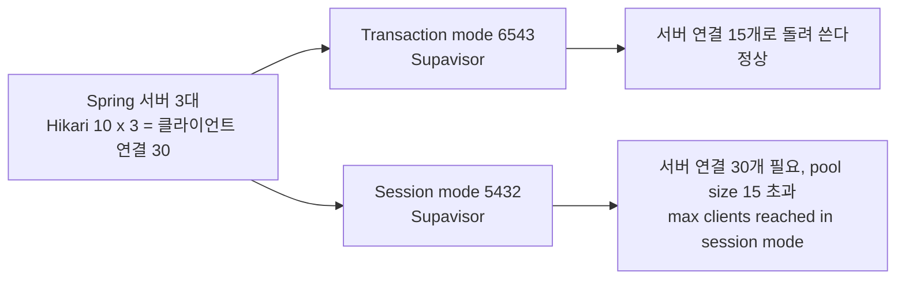

Transaction mode에서도 앱 풀을 무작정 키우면 풀러 앞에서 대기가 생긴다. 서버 연결 15개로 처리 가능한 처리량을 넘기면, 연결 수가 아니라 쿼리 지연이 늘어난다. 앱 풀 크기는 `max-lifetime`을 600초 안팎으로 두고, 인스턴스당 3~5개에서 시작해서 대기 시간을 보며 올린다. 서버리스 인스턴스는 1~2개면 충분하다.

### 기존 Railway 문서에서 바로잡을 부분

[Railway 데이터베이스 서비스](../Railway/Railway_Database.md)의 Supabase 항목은 쓰던 시점의 용어를 그대로 두고 있어서 현재 구조와 어긋나는 곳이 있다. 해당 문서는 이번 작업에서 수정하지 않았고, 수정할 때 고칠 지점은 다섯 곳이다.

첫째, "PgBouncer를 기본 제공한다"는 문장이다. 공유 풀러는 Supavisor로 바뀌었다. PgBouncer라고 적힌 곳은 Supavisor로 바꾸고, 유료 플랜의 전용 풀러가 PgBouncer라는 설명을 덧붙인다.

둘째, "Session mode 또는 Transaction mode를 쓰는 것이 연결 수 절약에 낫다"는 문장이다. Session mode는 연결 수를 줄이지 않는다. 연결 수 절약은 Transaction mode(6543)에서만 일어나고, Session mode(5432)는 IPv6가 안 되는 환경에서 Direct 대신 쓰는 경로다. Railway에서 풀러 URL을 쓰는 첫 번째 이유는 IPv4 호환이고 두 번째가 연결 수다.

셋째, 예제 URL의 호스트 `aws-0-ap-northeast-1`을 그대로 복사하는 문제다. 풀러 호스트는 프로젝트가 만들어진 시점과 리전에 따라 `aws-0`, `aws-1` 등으로 달라진다. 잘못 쓰면 `Tenant or user not found`가 난다. 콘솔의 Connect 화면에서 복사하도록 바꾼다.

넷째, `?pgbouncer=true`의 의미다. Supavisor를 쓸 때도 Prisma에는 필요하다. PgBouncer를 쓴다는 표시가 아니라 prepared statement를 끄는 옵션이라고 적고, `connection_limit`과 마이그레이션용 `directUrl`을 같이 설명한다.

표의 "자동 백업: 일별 (Pro)"는 맞는데 PITR이 유료 애드온이라는 점과 무료 플랜에는 백업이 없다는 점이 빠져 있다. 아래 백업 절의 내용으로 보완한다.

## Supabase CLI로 스키마를 관리한다

Supabase CLI는 로컬에 Docker로 Postgres, Auth, Storage, Studio 등을 띄우고, 스키마 변경을 SQL 파일로 쌓는다. 환경 간 스키마가 어긋나는 문제를 막으려면 모든 변경이 `supabase/migrations/`의 파일로 남아야 한다.

```bash
supabase init                          # supabase/ 디렉터리와 config.toml 생성
supabase start                         # 로컬 스택 실행 (Studio 54323, DB 54322)
supabase migration new add_orders      # 빈 마이그레이션 파일 생성 (타임스탬프_이름.sql)
supabase db diff -f add_orders         # 로컬 DB 변경을 SQL 파일로 뽑는다
supabase db reset                      # 로컬 DB를 migrations + seed.sql로 처음부터 재구성

supabase link --project-ref abcdefghij # 원격 프로젝트 연결
supabase db push --dry-run             # 적용될 마이그레이션 목록만 확인
supabase db push                       # 원격에 적용

supabase gen types typescript --local > src/types/database.types.ts
```

작업 순서는 로컬 Studio나 psql에서 스키마를 고치고, `db diff -f`로 파일을 만들고, `db reset`으로 처음부터 재구성해서 파일만으로 같은 스키마가 만들어지는지 확인한 뒤 커밋하는 것이다. `db diff`는 마이그레이션 도구가 아니라 비교 도구라서 데이터 변경(INSERT, UPDATE)과 일부 권한·객체 변경은 잡지 못하는 경우가 있다. 생성된 파일을 열어 읽고, 빠진 부분은 손으로 채운다. `migration new`로 빈 파일을 만들어 직접 SQL을 쓰는 방식이 diff 결과를 고쳐 쓰는 것보다 안전할 때도 많다.

`gen types typescript`는 `--local`이면 로컬 DB, `--project-id <ref>`면 원격 DB를 기준으로 타입을 만든다. CI에서 생성 결과를 커밋된 파일과 비교해 다르면 실패시키면, 마이그레이션만 추가하고 타입을 갱신하지 않은 PR을 잡을 수 있다.

### 대시보드에서 직접 바꾼 스키마

문제는 대부분 대시보드의 Table Editor나 SQL Editor에서 운영 DB를 직접 고치는 데서 시작한다. 급한 장애에 컬럼을 하나 추가하면 그 순간 운영 DB는 migrations 디렉터리에 없는 스키마를 갖게 된다. 로컬과 staging에는 그 컬럼이 없으니, 다음 배포에서 그 컬럼을 쓰는 코드가 staging 테스트를 통과하고 운영에서만 도는 상황이 생긴다. 반대로 다음 `db push`가 같은 컬럼을 `ADD COLUMN`으로 추가하려다 "already exists"로 실패하는 경우도 있다.

아래 그림은 직접 수정이 만드는 두 갈래 문제와, `db pull`로 다시 파일 쪽에 맞추는 경로다.

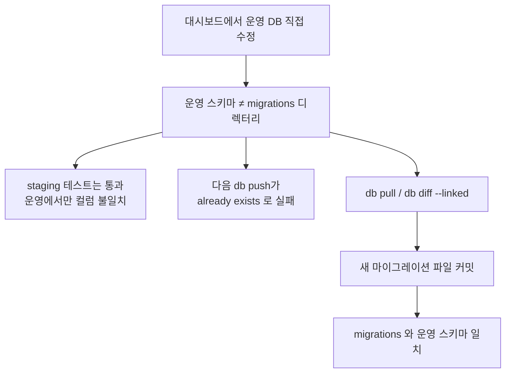

어긋남을 찾는 방법은 두 가지다. 원격 스키마를 마이그레이션 파일로 가져오거나, 원격과 로컬의 차이를 본다.

```bash
supabase db pull                  # 원격 스키마를 새 마이그레이션 파일로 가져온다
supabase db diff --linked         # 원격과 마이그레이션 결과의 차이를 SQL로 본다
```

`db pull`이 만든 파일은 그대로 커밋하되, 이후에는 대시보드에서 스키마를 고치지 않는 규칙을 둔다. 팀에서 지키기 어려우면 운영 프로젝트의 대시보드 접근 권한을 읽기 전용에 가깝게 줄이는 방법도 있다.

`db push`가 `Remote migration versions not found in local migrations directory`로 실패하는 경우는 원격 `supabase_migrations.schema_migrations`에 로컬에 없는 버전이 기록돼 있을 때다. 다른 브랜치에서 적용한 마이그레이션이나 대시보드에서 만든 이력이 원인이다. `supabase migration repair --status reverted <버전>`으로 이력을 맞출 수 있지만, 이력만 고치는 명령이라 실제 스키마가 일치하는지는 따로 확인해야 한다.

### 로컬에서 운영까지 배포 흐름

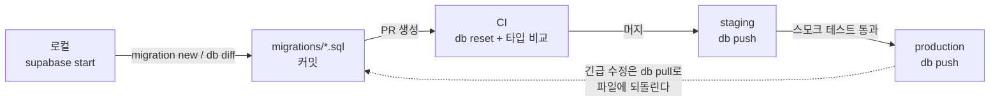

로컬에서 만든 마이그레이션 파일이 PR을 거쳐 staging에 먼저 적용되고, 거기서 확인된 뒤 운영에 같은 파일이 적용된다. 점선은 장애 때 대시보드로 직접 고친 변경을 `db pull`로 다시 파일에 담아 흐름 안으로 되돌리는 경로다. staging과 production은 별도 프로젝트로 두는 게 일반적이고, 무료 플랜은 조직당 활성 프로젝트가 2개라서 이 구성부터 Pro가 필요해진다.

CI에서는 `SUPABASE_ACCESS_TOKEN`과 `SUPABASE_DB_PASSWORD`를 시크릿으로 두고 같은 명령을 환경만 바꿔 돌린다.

```yaml
- uses: supabase/setup-cli@v1
- run: supabase link --project-ref ${{ secrets.STAGING_PROJECT_REF }}
  env:
    SUPABASE_ACCESS_TOKEN: ${{ secrets.SUPABASE_ACCESS_TOKEN }}
    SUPABASE_DB_PASSWORD: ${{ secrets.STAGING_DB_PASSWORD }}
- run: supabase db push
  env:
    SUPABASE_DB_PASSWORD: ${{ secrets.STAGING_DB_PASSWORD }}
```

러너가 IPv6로 Direct에 못 붙어 `db push`가 연결 실패로 끝나면 `--db-url`에 Session mode 풀러 주소를 직접 넘긴다. 이 단계에서 Transaction mode(6543)를 쓰면 안 된다.

### 브랜치 DB

Pro 플랜의 Branching은 GitHub PR마다 임시 Supabase 프로젝트(preview branch)를 만든다. PR의 `supabase/migrations`를 적용하고 `seed.sql`로 시드를 채우므로, 스키마 변경이 들어간 PR을 운영과 분리된 DB에서 확인할 수 있다. PR이 머지되면 마이그레이션이 운영 브랜치에 적용된다. 브랜치마다 컴퓨트 사용 시간이 과금되므로 PR이 오래 열려 있으면 비용이 쌓인다. 지속적으로 유지하는 staging 브랜치를 따로 두는 방식도 지원한다.

브랜치 DB는 스키마를 복제할 뿐 운영 데이터를 복사하지 않는다. 운영 데이터가 있어야 재현되는 문제(인덱스를 안 타는 쿼리, 대량 데이터의 마이그레이션 시간)는 브랜치에서 안 보인다. 테이블을 대량 변경하는 마이그레이션은 운영과 비슷한 규모의 데이터가 있는 staging에서 한 번 돌려 보고 락 시간을 확인한다.

## 백업, PITR, 일시 중지

백업은 플랜에 따라 갈린다. 무료 플랜에는 백업이 없다. Pro는 일 단위 백업을 7일 보관하고, Team과 Enterprise는 보관 기간이 더 길다. 일 단위 백업은 복원 시점이 하루 단위여서, 오후 3시에 잘못 지운 데이터를 전날 새벽 백업으로만 되돌릴 수 있다.

일 단위 백업과 PITR의 차이는 복원할 수 있는 시점의 촘촘함이다.

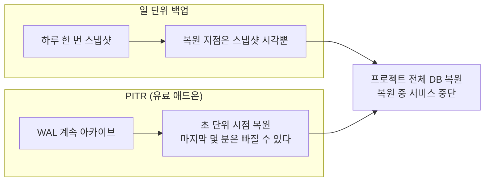

PITR(Point-in-Time Recovery)은 유료 애드온이고 WAL을 계속 아카이브해서 초 단위 시점으로 복원한다. 켜면 일 단위 백업은 PITR로 대체된다. 아카이브 간격 때문에 마지막 몇 분은 복원 범위에서 빠질 수 있다. 복원은 프로젝트 전체 DB를 되돌리는 작업이라 복원하는 동안 서비스가 중단된다. 테이블 하나만 복구하려면 PITR 복원은 맞지 않는다. 복원 시점으로 별도 프로젝트를 만들 수 있는 구성이라면 거기서 필요한 행만 `INSERT ... SELECT`로 옮기는 게 낫다.

백업에 들어가지 않는 것도 있다. Storage 버킷의 파일 본체는 백업 대상이 아니고 `storage.objects`의 메타데이터만 들어간다. DB를 복원해도 이미 지운 파일은 돌아오지 않는다. 파일이 중요하면 S3 호환 API로 다른 저장소에 복제해 둔다.

무료 프로젝트는 7일간 활동이 없으면 일시 중지된다. 중지 후 보존 기간이 지나면 복원이 안 되고 백업 파일을 내려받는 것으로 끝난다. 사이드 프로젝트가 중지된 걸 모르고 지내다가 복원 기간을 넘기는 경우가 가장 아깝다. 중지 직전 알림 메일이 오지만 스팸함으로 가기 쉽다. 데이터가 의미 있는 프로젝트라면 `pg_dump`를 정기적으로 돌리거나 Pro로 옮긴다. 자세한 기준은 [Supabase 구조와 도입 판단](Supabase_Overview.md)의 무료 티어 절에 있다.

## 확장 활성화

확장은 대시보드의 Database > Extensions에서 켜거나 SQL로 켠다. 대시보드에서 켜면 로컬과 staging에 반영되지 않아 앞 절의 스키마 어긋남과 같은 문제가 생긴다. 확장도 마이그레이션 파일에 넣는다.

```sql
-- supabase/migrations/20261029000000_enable_extensions.sql
create extension if not exists vector with schema extensions;
create extension if not exists pg_cron;
create extension if not exists pg_net;
```

pgvector(`vector`)는 임베딩 컬럼과 유사도 검색에 쓴다. 컬럼 타입이 `extensions.vector(1536)`로 보이는 건 `extensions` 스키마에 설치했기 때문이고, 기본 `search_path`에 이 스키마가 들어 있어서 `vector(1536)`으로 써도 된다. 직접 접속한 서버 쪽 롤의 `search_path`가 다르면 타입을 못 찾는다는 에러가 난다.

pg_cron은 Postgres 안에서 스케줄 작업을 돌린다. 시간대는 UTC다. 한국 시간 새벽 3시에 돌리려면 `0 18 * * *`로 적는다. 서버 시간대를 KST로 착각하고 `0 3 * * *`을 쓰면 낮 12시에 돈다.

pg_net은 SQL 안에서 비동기 HTTP 요청을 보낸다. pg_cron과 묶어 Edge Function을 주기적으로 호출하는 구성이 흔하다.

```sql
select cron.schedule(
  'sync-every-5min',
  '*/5 * * * *',
  $$
  select net.http_post(
    url := 'https://abcdefghij.supabase.co/functions/v1/sync',
    headers := jsonb_build_object(
      'Content-Type', 'application/json',
      'Authorization', 'Bearer ' || (
        select decrypted_secret from vault.decrypted_secrets where name = 'service_role_key'
      )
    ),
    body := '{}'::jsonb,
    timeout_milliseconds := 10000
  );
  $$
);
```

위 스케줄이 돌 때의 호출 순서는 아래와 같다. `net.http_post`는 요청을 큐에 넣고 바로 돌아오므로 cron 쪽에서는 함수의 성공 여부를 알 수 없다.

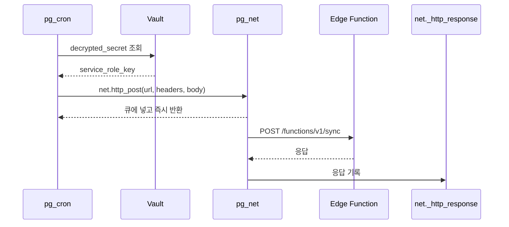

`cron.job` 테이블에는 스케줄한 SQL 문자열이 그대로 저장된다. 서비스 롤 키를 문자열에 직접 박으면 이 테이블을 읽을 수 있는 모든 롤에 키가 노출되므로, 위처럼 Vault에서 꺼내 쓴다. `net.http_post`는 요청을 큐에 넣고 바로 돌아오며 응답은 `net._http_response`에 쌓인다. 호출이 성공했는지 보려면 이 테이블을 조회하는데, 쌓인 기록은 일정 시간 뒤 지워진다. 함수가 실패해도 cron 쪽에서는 성공으로 보이는 구조라서 알림이 필요한 작업은 함수 쪽에서 실패를 기록한다.
