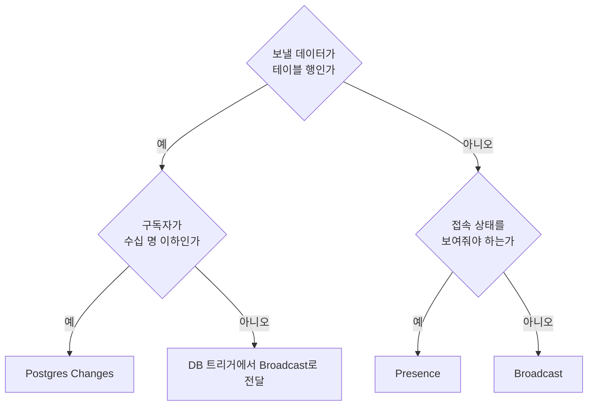
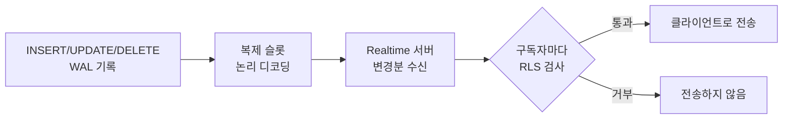
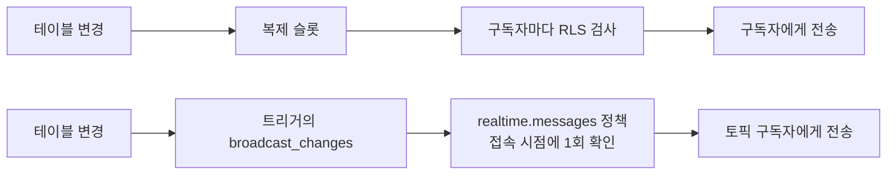
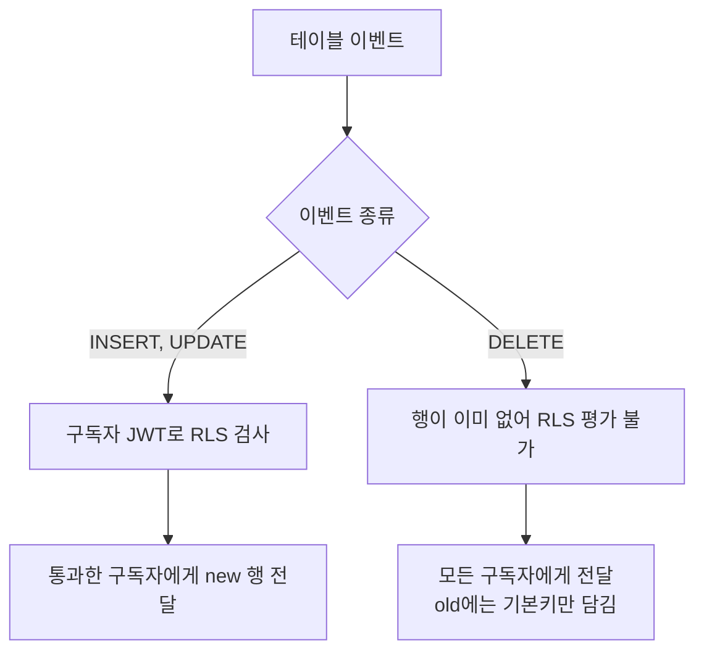
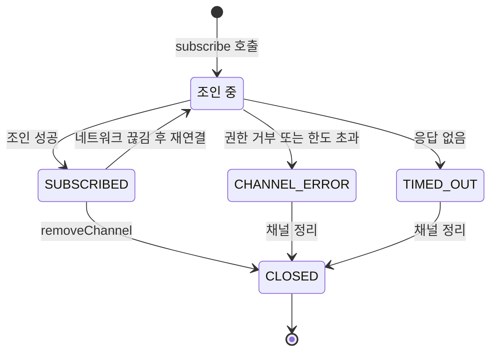
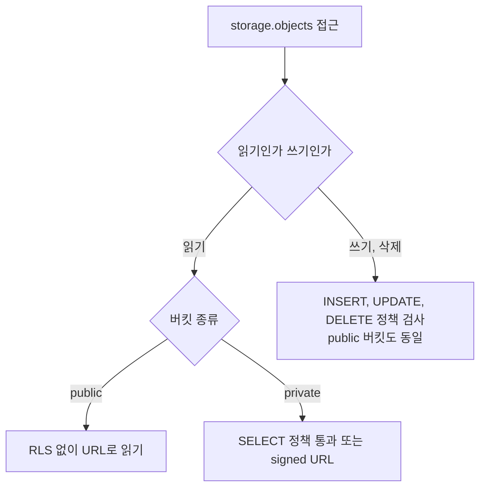
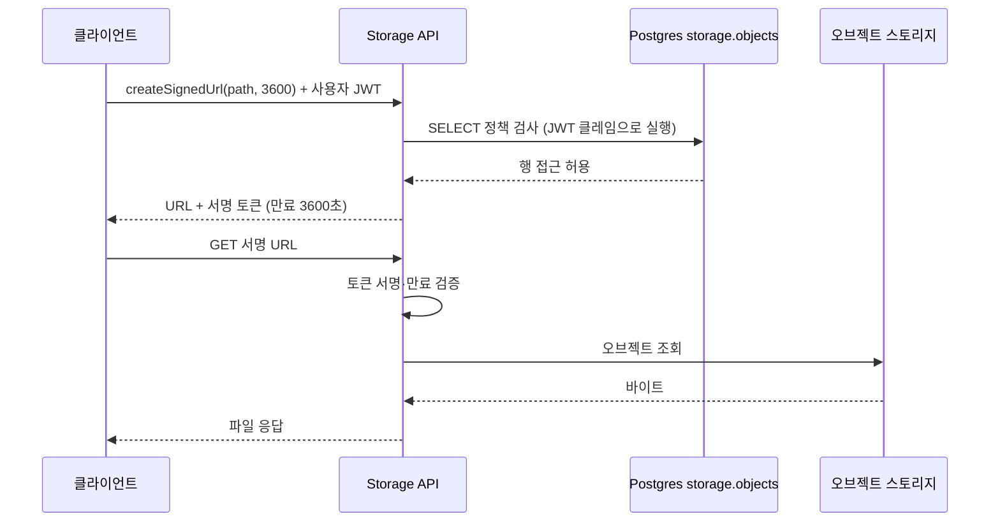
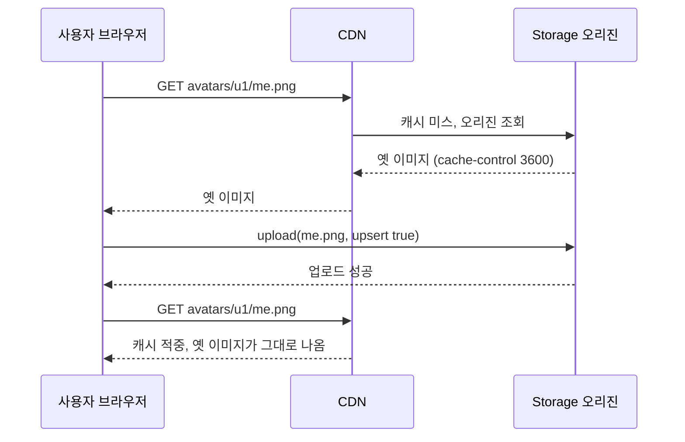

# Supabase Realtime과 Storage 운영

Realtime과 Storage는 둘 다 처음 붙일 때는 코드 열 줄이면 동작한다. 문제는 사용자가 늘거나 파일을 덮어쓰기 시작한 뒤에 나온다. 채팅 목록은 구독자가 수백 명이 되는 순간부터 메시지가 늦게 도착하고, 프로필 이미지는 사용자가 사진을 바꿨는데 옛날 사진이 계속 보인다. 둘 다 기능은 정상 동작하고 있고, 내부 구조 때문에 생기는 현상이다.

이 문서는 두 기능이 내부에서 어떻게 움직이는지를 먼저 보고, 그 구조에서 나오는 한계를 따라간다. 전체 구성과 키 종류는 [Supabase 구조와 도입 판단](Supabase_Overview.md), 정책 안에서 `auth.uid()`가 평가되는 방식은 [Supabase Auth와 RLS 결합](Supabase_Auth_And_RLS.md)에 있다. 이 문서의 RLS 이야기는 그쪽을 읽었다는 전제로 진행한다.

## Realtime 3가지 모드

Realtime 서버는 하나의 WebSocket 연결 위에 채널을 여러 개 올리고, 채널마다 세 종류의 데이터를 흘릴 수 있다. 이름은 비슷하지만 데이터가 나오는 곳이 완전히 다르다.

- Postgres Changes: DB의 INSERT/UPDATE/DELETE를 WAL에서 읽어 구독자에게 전달한다. 데이터 출처가 테이블이다.
- Broadcast: 클라이언트가 채널로 보낸 임의의 메시지를 같은 채널의 다른 클라이언트에게 전달한다. DB를 거치지 않는다.
- Presence: 채널에 누가 접속해 있는지, 각자 어떤 상태인지를 서버가 CRDT로 동기화한다. 접속·이탈 이벤트가 따라온다.

| 항목 | Postgres Changes | Broadcast | Presence |
|---|---|---|---|
| 데이터 출처 | 테이블 변경분(WAL) | 클라이언트 또는 DB 트리거 | 클라이언트가 track한 상태 |
| DB 저장 | 이미 저장된 변경을 전달 | 저장하지 않음 | 저장하지 않음 |
| 권한 검사 | 테이블 RLS | private 채널이면 `realtime.messages` RLS | private 채널이면 `realtime.messages` RLS |
| 확장성 | 구독자 수에 비례해 느려짐 | 높음 | 채널당 인원이 늘면 동기화 비용 증가 |
| 순서·유실 | 순서 보장, 끊긴 동안 유실 | 순서·유실 보장 없음 | 재접속 시 상태 재동기화 |
| 맞는 용도 | 대시보드 갱신, 알림 목록 | 채팅 타이핑 표시, 커서 위치, 게임 입력 | 온라인 사용자 목록, 문서 공동 편집 참여자 |

선택 기준은 단순하다. 지금 보낼 데이터가 이미 테이블에 들어가는 행이고 구독자가 적으면 Postgres Changes가 가장 짧은 코드로 끝난다. 구독자가 많거나 DB에 남길 필요가 없는 휘발성 데이터면 Broadcast를 쓴다. "누가 접속해 있나"는 Presence 말고는 마땅한 방법이 없다.



도식의 갈림길을 보면, 같은 "테이블 행"이라도 구독자가 많으면 Postgres Changes가 아니라 Broadcast로 빠진다. 다음 절이 그 이유다.

## Postgres Changes 내부 흐름

Postgres Changes는 PostgreSQL의 논리 복제를 그대로 쓴다. 테이블 변경은 WAL에 기록되고, 복제 슬롯이 그 WAL을 논리 디코딩해서 Realtime 서버에 넘긴다. Realtime 서버는 `supabase_realtime` publication에 들어 있는 테이블의 변경만 받는다. 테이블을 publication에 넣지 않으면 구독 코드가 에러 없이 성공하는데 이벤트가 영원히 안 온다. 처음 붙일 때 가장 많이 막히는 곳이다.

```sql
alter publication supabase_realtime add table public.messages;

-- 확인
select schemaname, tablename from pg_publication_tables
where pubname = 'supabase_realtime';
```

변경분이 구독자에게 도착하기까지의 경로는 이렇다.



여기서 봐야 할 곳은 "구독자마다 RLS 검사"다. 변경 하나가 들어오면 Realtime 서버는 그 테이블을 구독 중인 각 사용자의 JWT로 "이 사용자가 이 행을 SELECT할 수 있는가"를 DB에 물어본다. 구독자가 100명이면 변경 1건에 검사가 100번 나간다. Supabase 문서에 따르면 이 처리는 변경 순서를 지키기 위해 단일 스레드에서 돌아간다. 그래서 구독자가 늘어도 처리량이 같이 늘지 않는다.

### 구독자가 늘 때 나타나는 증상

실제로 겪는 순서는 대체로 정해져 있다.

1. 구독자 몇십 명일 때는 문제가 없다. 이 단계에서 "Realtime은 빠르다"고 판단하고 넘어간다.
2. 구독자가 수백 명이 되면 변경이 발생한 시점과 클라이언트가 받는 시점 사이가 초 단위로 벌어진다. 대시보드의 Realtime 지표에서 지연이 올라간다.
3. 배치 작업으로 한꺼번에 수천 행을 갱신하면 그 변경분이 줄줄이 RLS 검사 대기열에 들어가서, 정작 사용자가 방금 보낸 메시지가 몇십 초 뒤에 도착한다.
4. 한계를 넘으면 메시지가 지연되다 못해 버려지거나, 채널 접속 자체가 거부된다.

채널당 동시 구독자 수, 초당 메시지 수, 프로젝트당 동시 접속 수에는 플랜별 상한이 있고 값이 바뀌어 왔다. 숫자를 외우지 말고 프로젝트 대시보드의 Realtime 설정과 공식 Limits 문서를 직접 확인해야 한다. 한도를 넘으면 구독 상태 콜백에 `CHANNEL_ERROR`나 `TIMED_OUT`이 온다는 점은 아래 코드에서 다룬다.

대량 갱신은 특히 조심해야 한다. `update orders set status = 'done' where ...` 한 번이 5만 행을 건드리면 Realtime에는 5만 건의 변경이 들어간다. 이 갱신을 Realtime이 걸려 있는 테이블에서 낮 시간에 돌리다가 채팅이 멈춘 적이 있다. 배치성 갱신이 필요한 테이블은 publication에서 빼거나, 갱신을 작은 단위로 쪼개서 사이사이 쉬게 해야 한다.

### 구독자가 많을 때의 대안

수백 명이 같은 방을 보는 구조라면 Postgres Changes를 포기하고 DB 트리거에서 Broadcast로 보내는 방식을 쓴다. `realtime.broadcast_changes()`가 트리거 안에서 변경분을 지정한 토픽으로 Broadcast한다. 권한은 테이블 RLS가 아니라 `realtime.messages` 테이블의 정책으로 걸린다. 구독자마다 원본 테이블을 조회하는 검사가 사라지고, 채널 접속 시점에 한 번 권한을 확인하는 구조로 바뀐다.

두 경로에서 권한 검사가 어디에 놓이는지 비교하면 차이가 보인다.



위쪽은 변경 1건마다 구독자 수만큼 검사가 반복되고, 아래쪽은 검사가 채널 접속 시점으로 옮겨가 변경 처리 경로에서 빠진다.

```sql
create or replace function public.messages_broadcast()
returns trigger language plpgsql security definer as $$
begin
  perform realtime.broadcast_changes(
    'room:' || coalesce(new.room_id, old.room_id)::text,
    tg_op, tg_op, tg_table_name, tg_table_schema, new, old
  );
  return null;
end $$;

create trigger messages_broadcast_trg
after insert or update or delete on public.messages
for each row execute function public.messages_broadcast();

-- private 채널 접속 권한: 방 멤버만 해당 토픽을 받는다
create policy "room members can receive"
on realtime.messages for select to authenticated
using (
  exists (
    select 1 from public.room_members m
    where m.user_id = (select auth.uid())
      and 'room:' || m.room_id::text = (select realtime.topic())
  )
);
```

`broadcast_changes`의 인자 순서와 `realtime.topic()` 사용은 Realtime 버전에 따라 달라진 적이 있으니, 적용 전에 사용 중인 프로젝트에서 한 번 호출해 보는 편이 안전하다. 클라이언트는 채널을 만들 때 `config: { private: true }`를 줘야 이 정책이 적용된다.

## DELETE 이벤트와 REPLICA IDENTITY

Postgres Changes에서 가장 헷갈리는 동작이 DELETE다. 삭제된 행은 이미 테이블에 없으니 RLS로 "이 사용자가 볼 수 있는 행인가"를 평가할 방법이 없다. 그래서 DELETE 이벤트에는 RLS 필터가 적용되지 않는다. 테이블을 구독 중인 모든 사용자에게 삭제 사실이 전달된다. 이때 `payload.old`에는 기본키만 담긴다.

```ts
channel.on(
  'postgres_changes',
  { event: 'DELETE', schema: 'public', table: 'messages' },
  (payload) => {
    // payload.old 는 { id: 42 } 처럼 PK만 들어 있다
    // payload.old.room_id 는 undefined
    removeMessage(payload.old.id)
  },
)
```

여기서 두 가지 문제가 나온다. 하나는 정보 노출이다. 남의 방에서 메시지가 지워졌다는 사실과 그 PK가 구독만 하면 보인다. PK가 UUID면 무해하지만, 순차 정수면 삭제 빈도 같은 정보가 샌다. 다른 하나는 필터다. `filter: 'room_id=eq.1'`을 걸어도 DELETE에서는 `room_id`가 old에 없어서 필터가 동작하지 않는다. PK 컬럼으로만 필터할 수 있다. 그래서 "방 1의 삭제만 받겠다"는 구독이 다른 방의 삭제까지 받고, 클라이언트가 PK로 직접 걸러내야 하는 경우가 생긴다.

이벤트 종류에 따라 RLS 검사 여부가 갈리는 지점을 도식으로 정리했다.



old에 다른 컬럼을 담고 싶으면 REPLICA IDENTITY를 바꾼다. 기본값은 기본키만 WAL에 기록한다. `FULL`로 바꾸면 UPDATE와 DELETE 때 이전 행 전체가 WAL에 기록된다.

```sql
alter table public.messages replica identity full;
```

비용은 WAL 크기로 돌아온다. UPDATE 한 번마다 이전 행 전체가 WAL에 추가로 쓰이므로 행이 큰 테이블, 특히 TOAST되는 큰 text/jsonb 컬럼이 있는 테이블에서는 WAL 증가량이 눈에 띈다. 복제 슬롯이 WAL을 붙잡고 있는 구조라 Realtime 서버가 멈추거나 느려지면 그 WAL이 디스크에 쌓인다. 슬롯 지연은 아래 쿼리로 본다.

```sql
select slot_name, active,
       pg_size_pretty(pg_wal_lsn_diff(pg_current_wal_lsn(), restart_lsn)) as retained_wal
from pg_replication_slots;
```

또 하나 알아둘 점이 있다. Supabase 문서에 따르면 RLS가 켜진 테이블에서는 REPLICA IDENTITY를 FULL로 바꿔도 DELETE의 old에는 여전히 기본키만 담긴다. 같은 이유로 RLS 평가가 불가능해서다. 삭제 이벤트에서 `room_id`가 꼭 필요하다면 FULL에 기대지 말고 다음 중 하나로 가야 한다.

- 행을 지우지 않고 `deleted_at`을 채우는 soft delete로 바꾼다. UPDATE 이벤트는 RLS를 타고, 새 행 전체가 온다.
- 위에서 본 `broadcast_changes` 트리거 방식으로 간다. 트리거 안에서 old 전체를 쓸 수 있다.

## supabase-js 구독 코드

구독 코드는 짧지만, 상태 콜백과 정리를 빼먹은 코드가 대부분이다.

```ts
import { createClient, type RealtimeChannel } from '@supabase/supabase-js'

const supabase = createClient(URL, ANON_KEY)

function subscribeRoom(roomId: number, onInsert: (row: Message) => void) {
  const channel = supabase
    .channel(`room:${roomId}`)
    .on(
      'postgres_changes',
      { event: 'INSERT', schema: 'public', table: 'messages', filter: `room_id=eq.${roomId}` },
      (payload) => onInsert(payload.new as Message),
    )
    .subscribe((status, err) => {
      if (status === 'SUBSCRIBED') {
        // 재연결로 다시 SUBSCRIBED 가 오는 경우에도 여기를 탄다
        void refetchMessages(roomId)
      } else if (status === 'CHANNEL_ERROR') {
        console.error('realtime channel error', err)
      } else if (status === 'TIMED_OUT') {
        console.warn('realtime join timed out')
      } else if (status === 'CLOSED') {
        console.info('realtime channel closed')
      }
    })

  return channel
}
```

`subscribe` 콜백으로 오는 상태는 `SUBSCRIBED`, `CHANNEL_ERROR`, `TIMED_OUT`, `CLOSED` 네 가지다. 세 가지를 짚는다.

첫째, 네트워크가 끊겼다 돌아오면 클라이언트가 알아서 재연결하고 채널에 다시 조인한다. 이때 `SUBSCRIBED`가 다시 한번 온다. 끊겨 있던 동안의 이벤트는 재전송되지 않는다. 그래서 `SUBSCRIBED` 콜백에서 현재 상태를 다시 조회해야 한다. 이걸 빼면 모바일에서 지하철을 지나고 나면 메시지 몇 개가 비는 버그가 된다. 재현하기 어려워서 제보로만 들어온다.

둘째, `CHANNEL_ERROR`는 권한 문제인 경우가 있다. 테이블이 publication에 없거나, 한도에 걸렸거나, private 채널의 `realtime.messages` 정책이 거부한 경우다. 에러 객체의 메시지를 찍어두지 않으면 원인을 짐작할 수 없다.

셋째, 같은 이름으로 `channel()`을 두 번 호출하면 새 채널이 생기는 게 아니라 이미 있는 인스턴스가 돌아온다. supabase-js 2.109.0에서 직접 확인했다. 이미 구독 중인 그 인스턴스에 `postgres_changes`나 `presence`용 `.on()`을 다시 붙이면 `cannot add postgres_changes callbacks for realtime:room:1 after subscribe()` 예외가 난다. React 개발 모드의 StrictMode는 effect를 두 번 실행하기 때문에, 정리 코드가 없으면 첫 화면에서 바로 이 에러를 만난다.

네 가지 상태가 어떤 순서로 오가는지, 특히 재연결 때 `SUBSCRIBED`로 되돌아오는 경로를 보면 된다.



### removeChannel을 빼먹었을 때

채널은 컴포넌트가 사라져도 저절로 닫히지 않는다. 클라이언트 객체가 들고 있는 목록에 남는다. 화면을 이동할 때마다 구독을 만들고 정리하지 않으면 채널이 쌓이고, 쌓인 채널마다 서버 쪽 구독도 살아 있다. 같은 이벤트에 콜백이 여러 번 불리는 증상으로 먼저 드러나고, 나중에는 동시 구독 수 한도에 걸린다.

```tsx
useEffect(() => {
  const channel = subscribeRoom(roomId, (row) => setMessages((prev) => [...prev, row]))

  return () => {
    void supabase.removeChannel(channel)
  }
}, [roomId])
```

`channel.unsubscribe()`와 `supabase.removeChannel(channel)`은 다르다. `unsubscribe`는 구독만 끊고 채널 객체는 클라이언트 목록에 남긴다. `removeChannel`은 구독을 끊고 목록에서도 뺀다. 같은 테스트에서 `removeChannel` 뒤 `supabase.getChannels().length`가 0으로 돌아오는 것을 확인했다. 방을 오가는 SPA라면 `removeChannel`을 쓰고, 구독이 남아 있는지 의심스러우면 `getChannels()`를 찍어 본다.

접속 상태를 보여주는 Presence는 같은 채널 객체에 붙인다. 기억할 점은 `track`이 서버에 보관되는 상태가 아니라는 것이다. 클라이언트가 끊기면 상태가 사라지고, 재접속하면 다시 `track`을 불러야 한다.

```ts
const channel = supabase.channel('doc:7', { config: { presence: { key: userId } } })

channel
  .on('presence', { event: 'sync' }, () => {
    const online = Object.keys(channel.presenceState())
    renderOnlineUsers(online)
  })
  .subscribe(async (status) => {
    if (status === 'SUBSCRIBED') {
      await channel.track({ name: userName, at: Date.now() })
    }
  })
```

## Storage 버킷과 RLS

Storage의 파일 메타데이터는 `storage.objects` 테이블에 행으로 들어간다. 실제 바이트는 오브젝트 스토리지에 있고, 이 테이블이 "어느 버킷의 어느 경로에 누가 올렸나"를 가진다. 권한은 이 테이블에 거는 RLS 정책이다. 컬럼 중 정책에서 쓰는 것은 `bucket_id`, `name`(경로 전체), `owner_id`다.

버킷은 public과 private 두 종류다.

| 구분 | public 버킷 | private 버킷 |
|---|---|---|
| 읽기 | URL만 알면 누구나, RLS 검사 없음 | SELECT 정책 통과 또는 signed URL |
| 쓰기·삭제 | INSERT/UPDATE/DELETE 정책 필요 | INSERT/UPDATE/DELETE 정책 필요 |
| 캐시 | CDN 캐시가 잘 먹는다 | signed URL마다 토큰이 달라 캐시 효율이 낮다 |
| 맞는 용도 | 상품 이미지, 공개 아바타 | 계약서, 영수증, 개인 업로드 |

public이라고 아무나 올릴 수 있는 것은 아니다. public은 읽기에만 RLS를 건너뛴다. 업로드와 삭제는 여전히 정책이 필요하고, 정책이 하나도 없으면 `authenticated` 사용자도 업로드가 거부된다. 처음 업로드를 시도하면 `new row violates row-level security policy` 에러가 나는데, 파일이 아니라 `storage.objects`에 행을 넣는 것이 막혔다는 뜻이다.

읽기와 쓰기에서 RLS가 적용되는 범위가 다르다는 점을 도식으로 확인한다.



### 경로 규칙으로 소유자를 가른다

정책은 파일 경로를 파싱해서 소유자를 판단하는 쪽이 가장 단순하다. 경로를 `{user_id}/{파일명}`으로 정하고, `storage.foldername(name)`이 경로를 폴더 배열로 쪼개 주는 것을 쓴다. `foldername('a/b/c.png')`는 `{a,b}`를 돌려준다. 파일명은 빠지고 폴더만 남는다.

```sql
insert into storage.buckets (id, name, public, file_size_limit, allowed_mime_types)
values ('receipts', 'receipts', false, 10485760, array['image/png', 'image/jpeg', 'application/pdf']);

create policy "own folder upload"
on storage.objects for insert to authenticated
with check (
  bucket_id = 'receipts'
  and (storage.foldername(name))[1] = (select auth.uid())::text
);

create policy "own folder read"
on storage.objects for select to authenticated
using (
  bucket_id = 'receipts'
  and (storage.foldername(name))[1] = (select auth.uid())::text
);

create policy "own folder delete"
on storage.objects for delete to authenticated
using (
  bucket_id = 'receipts'
  and (storage.foldername(name))[1] = (select auth.uid())::text
);
```

배열 첫 원소는 인덱스 `[1]`이다. PostgreSQL 배열은 1부터 시작하는데, `[0]`을 쓰면 에러 없이 NULL이 되어 정책이 항상 거부로 평가된다. 처음 쓴 정책이 안 먹을 때 가장 먼저 의심할 곳이다. `auth.uid()`를 `(select auth.uid())`로 감싸는 이유는 [Supabase Auth와 RLS 결합](Supabase_Auth_And_RLS.md)에서 다룬 것과 같다. 행마다 함수가 재평가되지 않게 한다.

클라이언트는 정책이 기대하는 경로 그대로 올린다.

```ts
const path = `${user.id}/${crypto.randomUUID()}.pdf`

const { error } = await supabase.storage
  .from('receipts')
  .upload(path, file, { contentType: 'application/pdf', upsert: false })
```

원본 파일명을 경로에 그대로 쓰면 한글 파일명, 공백, 특수문자 때문에 업로드가 실패하거나 URL 인코딩이 어긋나는 일이 생긴다. 서버에는 UUID로 저장하고 원본 이름은 별도 테이블 컬럼에 두는 쪽이 편하다.

## private 버킷의 signed URL

private 버킷의 파일은 공개 URL로 받을 수 없다. 그렇다고 매번 클라이언트가 파일 바이트를 API로 받아 화면에 그리는 것도 부담이다. 그래서 만료 시간이 있는 signed URL을 발급받는다. 중요한 점은 signed URL을 발급하는 순간에 SELECT 정책이 검사된다는 것이다. 발급받은 뒤에는 URL 안의 토큰만으로 접근이 된다.



도식에서 정책 검사는 발급 단계(2~3번)에만 있고, 실제 다운로드(5번 이후)에는 DB 조회가 없다. 이 구조에서 나오는 결과가 몇 가지 있다.

- URL이 새면 만료 전까지는 누구든 받을 수 있다. 만료 전에 권한을 회수해도 이미 발급된 URL은 막지 못한다.
- 만료를 길게 잡으면 편하지만 위 문제가 커진다. 화면에 한 번 보여주는 용도면 60초에서 5분 정도면 충분하다.
- 목록 화면에서 파일 100개를 보여주려고 `createSignedUrl`을 100번 부르면 요청이 100번 나간다. `createSignedUrls(paths, expiresIn)`로 한 번에 받는다.

```ts
const { data, error } = await supabase.storage
  .from('receipts')
  .createSignedUrls(paths, 300)   // 300초

// data: [{ path, signedUrl, error }]
```

업로드 쪽에도 서명 URL이 있다. `createSignedUploadUrl(path)`로 받은 토큰을 가진 쪽은 INSERT 정책 없이 그 경로 하나에만 올릴 수 있다. 서버가 경로를 정해 주고 클라이언트가 직접 올리게 하고 싶을 때 쓴다.

## 업로드 크기 제한과 resumable 업로드

크기 제한은 두 겹이다. 프로젝트 전체 상한이 있고, 버킷마다 `file_size_limit`을 더 낮게 걸 수 있다. 위 SQL의 `10485760`은 10MB다. 버킷 제한이 프로젝트 상한보다 낮으면 버킷 값이 적용된다. 프로젝트 상한은 플랜에 따라 다르고 대시보드의 Storage 설정에서 바꾼다. 상한을 넘으면 업로드가 413으로 거부되는데, 브라우저에서는 CORS 에러처럼 보이는 경우가 있어서 네트워크 탭의 상태 코드를 직접 봐야 한다.

표준 `upload()`는 파일 전체를 요청 한 번으로 보낸다. 몇 MB 이내의 이미지에는 충분하다. 파일이 크면 중간에 연결이 끊겼을 때 처음부터 다시 올려야 한다. Supabase는 큰 파일용으로 TUS 프로토콜 기반의 resumable 업로드 엔드포인트를 제공한다. 문서에서 안내하는 기준은 대략 6MB 이상이고, 이 엔드포인트의 청크 크기는 6MB로 고정해야 한다. 다른 값을 주면 업로드가 실패한다.

```ts
import * as tus from 'tus-js-client'

function uploadLarge(file: File, bucket: string, path: string, accessToken: string) {
  return new Promise<void>((resolve, reject) => {
    const upload = new tus.Upload(file, {
      endpoint: `https://${PROJECT_REF}.supabase.co/storage/v1/upload/resumable`,
      retryDelays: [0, 3000, 5000, 10000, 20000],
      headers: {
        authorization: `Bearer ${accessToken}`,
        'x-upsert': 'false',
      },
      uploadDataDuringCreation: true,
      removeFingerprintOnSuccess: true,
      metadata: {
        bucketName: bucket,
        objectName: path,
        contentType: file.type,
        cacheControl: '3600',
      },
      chunkSize: 6 * 1024 * 1024,
      onError: reject,
      onSuccess: () => resolve(),
    })

    upload.findPreviousUploads().then((prev) => {
      if (prev.length) upload.resumeFromPreviousUpload(prev[0])
      upload.start()
    })
  })
}
```

`findPreviousUploads`가 이어 올리기의 핵심이다. 브라우저 저장소에 남은 업로드 지문을 찾아 끊긴 지점부터 재개한다. 이 코드를 빼면 TUS를 써도 매번 처음부터 올린다. 업로드 URL 유효 시간은 24시간이라서 하루 뒤에는 이어 올릴 수 없다. 액세스 토큰은 업로드 시작 시점에 한 번만 헤더로 넣으므로, 몇 시간 걸리는 업로드에서 토큰이 만료되면 청크 요청이 401로 막힌다. 토큰을 헤더 콜백으로 매번 새로 읽어오게 바꾸면 해결된다.

## 덮어쓴 파일이 옛날 모습으로 보이는 문제

프로필 사진을 바꿨는데 새로고침해도 이전 사진이 나오는 문제다. Storage는 CDN 앞에 있고, 같은 경로의 응답을 `cacheControl` 기간(기본값 3600초) 동안 캐시한다. `upsert: true`로 같은 경로에 덮어쓰면 오리진은 새 파일이지만 CDN은 옛 응답을 계속 내보낸다. 브라우저 캐시까지 겹치면 사용자 본인 화면에서도 안 바뀐다.



마지막 두 줄이 문제의 전부다. 업로드는 성공했는데 읽기는 캐시에서 나간다. 해결 방법은 세 가지가 있다.

1. 덮어쓰지 않고 새 경로에 올린다. `u1/me-{timestamp}.png`처럼 매번 다른 이름으로 올리고, 새 경로를 프로필 테이블에 저장한다. 옛 파일은 따로 지운다. 캐시 문제가 구조적으로 없어지므로 가장 확실하다.
2. 덮어쓰는 파일은 `cacheControl`을 짧게 준다. `upload(path, file, { upsert: true, cacheControl: '60' })`. 이미 캐시에 들어간 응답은 그 시점의 값을 따르므로, 설정을 바꾼 뒤 처음 올리는 파일부터 효과가 있다.
3. URL에 버전 쿼리를 붙인다(`?v=updated_at`). 쿼리스트링이 캐시 키에 포함되는지는 CDN 설정에 달려 있다. 이 방식을 쓸 때는 실제로 새 쿼리가 새 응답을 받는지 확인해야 한다.

signed URL은 이 문제를 덜 겪는다. 발급마다 토큰이 달라 URL 자체가 달라지기 때문이다. 대신 같은 이유로 캐시 적중이 거의 없어서, 트래픽이 많은 이미지를 private 버킷에서 서빙하면 오리진 부하가 그대로 올라간다. 공개해도 되는 이미지는 public 버킷에 UUID 경로로 두는 쪽이 비용과 속도에서 낫다.

## 운영하면서 보게 되는 것들

Realtime은 대시보드의 Realtime 보고서에서 접속 수, 메시지 처리량, 지연을 본다. 지연이 오르기 시작하면 가장 먼저 Postgres Changes를 쓰는 테이블 중 구독자가 많은 것과 대량 UPDATE가 도는 테이블을 찾는다. 위의 `pg_replication_slots` 쿼리로 슬롯이 붙잡고 있는 WAL이 계속 커지고 있는지도 같이 본다. 슬롯 지연이 줄지 않으면 Realtime 서버가 변경분을 못 따라가고 있다는 신호다.

Storage는 `storage.objects`에 행이 남았는데 실제 바이트가 없거나 그 반대인 경우가 가끔 생긴다. 파일을 SQL로 `delete from storage.objects`해서 지우면 행만 지워지고 오리진 오브젝트는 남아 비용이 계속 나간다. 파일 삭제는 반드시 Storage API(`remove`)로 해야 한다.

두 기능에 공통으로 해당하는 점은 정책이 하나도 없는 상태가 기본값이라는 것이다. Postgres Changes는 RLS가 꺼진 테이블이면 구독자 모두가 모든 행을 받는다. Storage는 정책이 없으면 전부 막힌다. 한쪽은 열려 있고 다른 쪽은 닫혀 있는 기본값이라, 두 기능을 같은 기준으로 점검하면 한쪽을 놓친다. Realtime을 붙일 테이블은 RLS가 켜져 있는지부터 확인한다.
