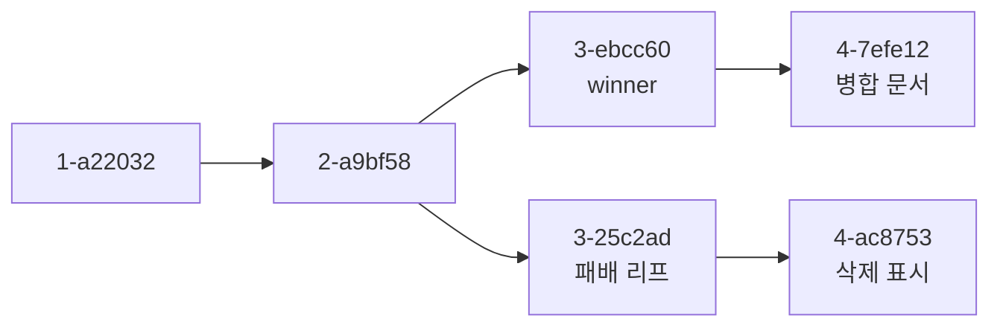

# CouchDB 리비전 트리

CouchDB 문서 하나는 값 하나가 아니라 리비전의 트리다. `_rev` 가 가리키는 건 그 트리에서 지금 GET 이 돌려주는 리프 하나일 뿐이고, 트리 전체는 복제와 충돌 탐지에 쓰인다. 이 문서는 3.3.3 컨테이너를 띄워 `curl` 로 확인한 동작만 적는다. 충돌을 푸는 순서는 [CouchDB 데이터 모델과 복제](Couch_DB.md)에 있다.

## 리비전 ID

`_rev` 는 `깊이-해시` 다. 깊이는 루트에서 몇 번째 리비전인지, 해시는 본문에서 계산한 값이다. 해시에 `_id` 는 들어가지 않는다. 서로 다른 문서 ID 에 같은 본문 `{"v":1}` 을 넣었더니 같은 리비전이 나왔다.

```bash
curl -X PUT http://admin:pw@localhost:5984/orders/q-1 -d '{"v":1}'
# {"ok":true,"id":"q-1","rev":"1-7a7e4b29f3af401e69b6f86e4c26b727"}

curl -X PUT http://admin:pw@localhost:5984/src/d2 -d '{"v":1}'
# {"ok":true,"id":"d2","rev":"1-7a7e4b29f3af401e69b6f86e4c26b727"}
```

이 성질이 복제에서 드러난다. 두 DB 에 같은 `_id` 로 같은 본문을 따로 만들고 복제하면 충돌이 아니라 같은 리비전으로 합쳐진다. 본문이 `{"k":"v"}` 로 같을 때 `docs_written` 은 0 이었고 `?conflicts=true` 에도 아무것도 없었다. 본문이 `{"k":"a"}` 와 `{"k":"b"}` 로 다르면 1- 리비전 두 개가 서로 충돌했다. 오프라인 단말이 같은 `_id` 규칙(`order-날짜-순번` 같은)으로 문서를 만들면 이 경우가 생각보다 자주 나온다.

## 리프와 가지

수정은 리프 아래에 자식을 붙이는 일이다. 서로 모르는 두 노드가 같은 부모에서 각자 자식을 붙이면 리프가 둘이 된다. 삭제되지 않은 리프가 둘 이상이면 그게 충돌이다.



위 트리는 병합까지 끝난 뒤의 모습이다. 2- 에서 가지가 갈라졌고, 앱이 winner 인 `3-ebcc60` 에 병합본 `4-7efe12` 를 쓰고 패배 쪽 `3-25c2ad` 를 DELETE 했다. DELETE 는 가지를 지우는 게 아니라 그 리프 밑에 `_deleted` 리비전(`4-ac8753`)을 하나 더 붙인다. 그래서 `_conflicts` 에서는 빠지고 `_deleted_conflicts` 로 옮겨간다.

```bash
curl "http://admin:pw@localhost:5984/na/ord-1001?conflicts=true&deleted_conflicts=true"
# {"_id":"ord-1001","_rev":"4-7efe12c2...","status":"shipped","note":"merged",
#  "_deleted_conflicts":["4-ac8753a0..."]}
```

## 삭제와 재생성

삭제된 문서도 트리에 남고, 같은 `_id` 로 다시 만들면 번호가 이어진다. 11번 수정한 문서를 지우고 `_rev` 없이 다시 PUT 했더니 12- 가 삭제, 13- 이 재생성이었다. 삭제와 재생성을 반복하는 패턴이 트리를 키우는 이유가 이것이다.

```bash
curl -X DELETE "http://admin:pw@localhost:5984/rl/d?rev=11-8726377..."
# {"ok":true,"id":"d","rev":"12-599c15d4..."}   200

curl -X PUT http://admin:pw@localhost:5984/rl/d -d '{"n":"again"}'
# {"ok":true,"id":"d","rev":"13-0b002c3e..."}   201
```

## 스템과 _revs_limit

트리는 무한히 커지지 않는다. DB 별 `_revs_limit` (기본 1000, `GET /db/_revs_limit` 으로 확인)를 넘는 오래된 리비전은 루트 쪽부터 잘려나간다. 이걸 스템이라고 부른다.

```bash
curl -X PUT http://admin:pw@localhost:5984/rl/_revs_limit -d 5
# {"ok":true}
# 같은 문서를 11번까지 수정한 뒤
curl "http://admin:pw@localhost:5984/rl/d?revs=true"
# "_revisions":{"start":11,"ids":[...5개...]}
```

`start` 는 11 인데 `ids` 는 5개만 남았다. 6- 이전은 트리에서 사라졌고, 잘린 리비전을 `?rev=` 로 읽으면 `404 {"error":"not_found","reason":"missing"}` 이다.


점선 왼쪽이 잘려나간 구간이다. 복제는 두 쪽이 공통 조상을 찾아서 가지를 합치는데, 스템으로 조상이 사라진 쪽은 그 기준점을 잃는다. `_revs_limit` 을 줄일 때는 오프라인 단말이 연결 없이 쌓는 수정 횟수보다 작게 잡지 않는다. 이 위험은 직접 재현하지 않았고 CouchDB 문서에 적힌 경고를 옮긴 것이다.

## compaction 뒤의 트리

compaction 은 리프가 아닌 리비전의 본문을 지우지만 트리의 뼈대(ID)는 남긴다. 51번 수정한 문서에 compaction 을 돌린 뒤 `revs_info` 를 보면 이렇다.

```bash
curl "http://admin:pw@localhost:5984/ap/d?revs_info=true"
# 51-05d18...  available
# 50-5996a...  missing
# 49-9ac6d...  missing
#  ...
#  1-6a1add... missing
```

본문은 현재 리프 하나만 `available` 이고 나머지는 `missing` 이다. 이전 리비전을 읽어 되돌리기(undo) 기능을 만들면 안 되는 이유다. compaction 이 한 번이라도 돌았으면 이전 본문은 없다. 이력이 필요하면 수정 때마다 새 문서로 남긴다.

## 트리를 읽는 방법

| 보고 싶은 것 | 요청 | 확인한 내용 |
|---|---|---|
| 충돌 중인 리프 | `GET /db/doc?conflicts=true` | winner 의 본문과 `_conflicts` 배열 |
| 삭제된 가지 | `?deleted_conflicts=true` | 병합 뒤 삭제 표시된 리프 |
| 리프 전체의 본문 | `?open_revs=all` (`Accept: application/json`) | 충돌 리프 본문을 모두 배열로 반환 |
| 조상 ID 목록 | `?revs=true` | `_revisions.start` 와 `ids` |
| 리비전 상태 | `?revs_info=true` | `available` / `missing` |
| 변경 피드에서 리프 | `_changes?style=all_docs` | `changes` 배열에 리프 rev 가 모두 들어 있다 |

`_changes` 기본값은 winner 하나만 보여준다. 충돌 감시 도구가 `style=all_docs` 없이 피드를 읽으면 패배 리프가 있다는 사실을 놓친다.
