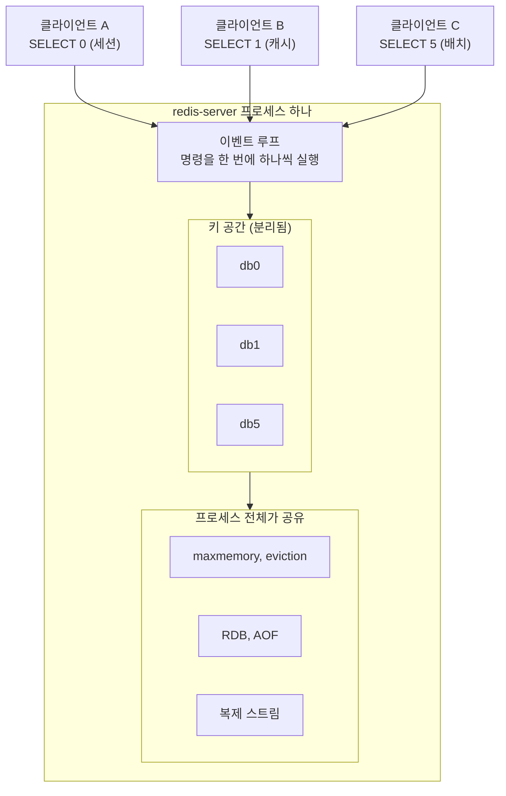
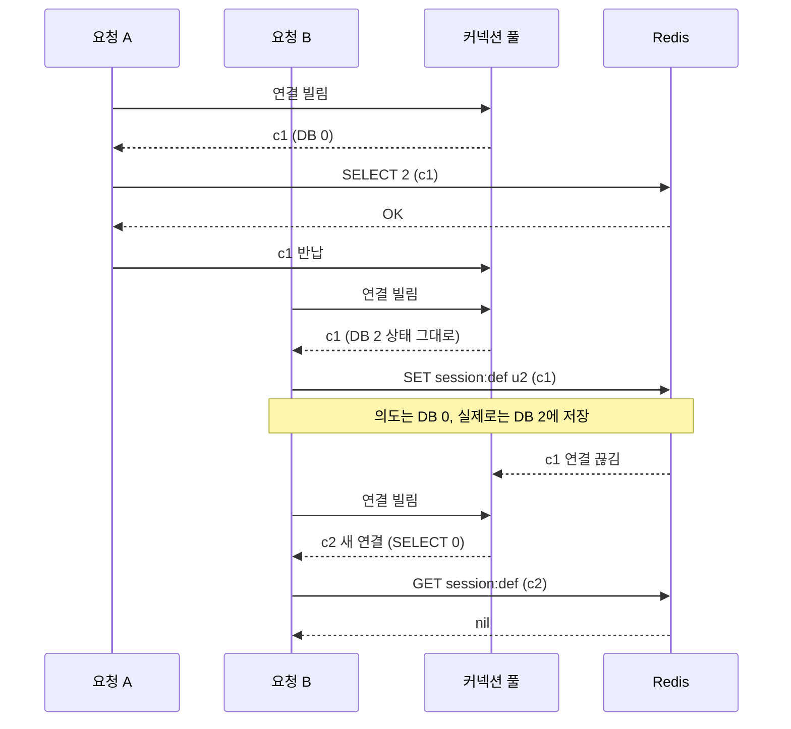
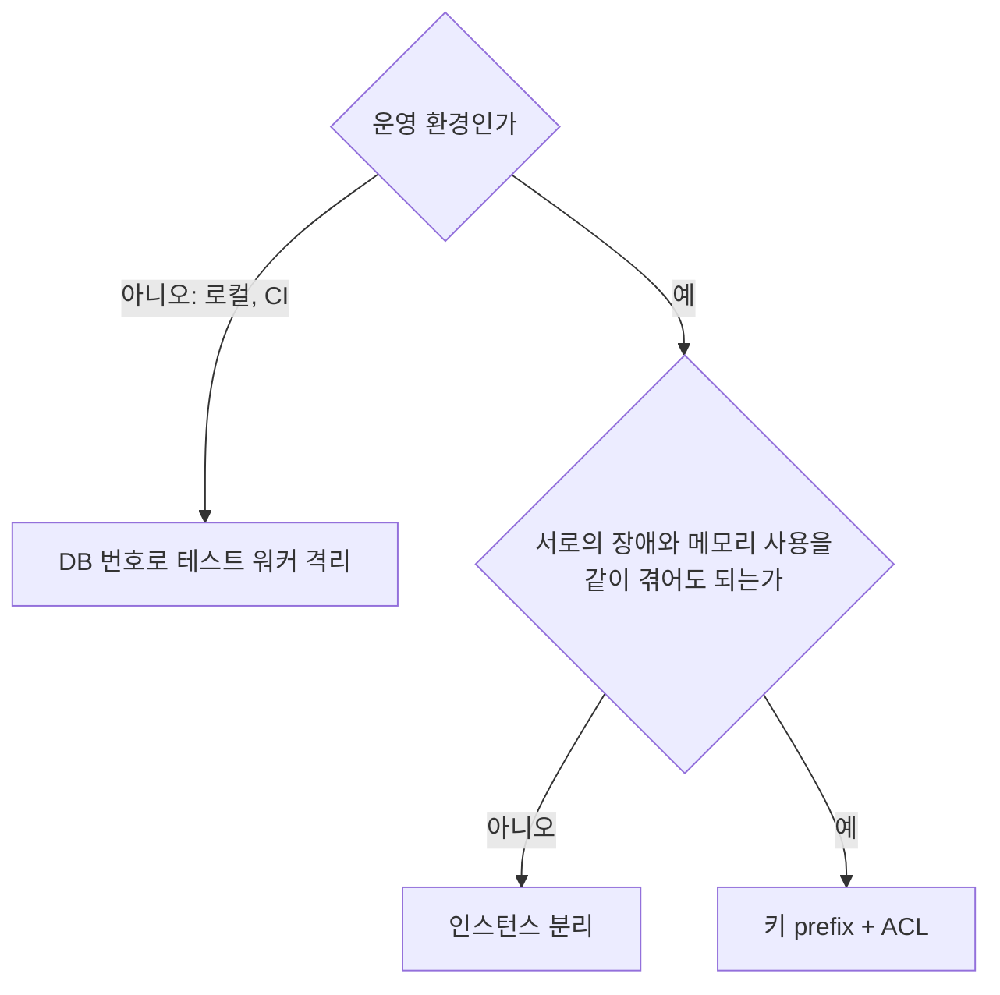

# Redis 논리 DB 번호

Redis 에는 `SELECT 0` 부터 `SELECT 15` 까지 번호가 붙은 키 공간이 16개 있다. MySQL 의 database 나 PostgreSQL 의 schema 같은 걸 떠올리기 쉬운데, 실제로 나뉘는 건 키 이름이 놓이는 테이블 하나뿐이다. 메모리 한도, 이벤트 루프, 영속화 파일, 복제 스트림은 전부 프로세스 하나가 같이 쓴다.

"세션은 0번, 캐시는 1번" 식으로 나눠 쓰는 설정은 처음엔 깔끔해 보이고 대부분 별 탈 없이 굴러간다. 탈이 나는 건 캐시 쪽에서 메모리가 차거나, 누가 `FLUSHALL` 을 치거나, 클러스터로 옮기려 할 때다. 이 문서는 그 지점들을 로컬에서 재현한 결과를 중심으로 정리한다.

실험 환경은 로컬 Redis 6.0.16, Docker `redis:8`(`redis_version` 8.10.3), Docker `valkey/valkey:9`(`valkey_version` 9.1.3)이다. 버전 차이가 나는 부분은 따로 표시했다. 클라이언트는 redis-py 8.1.0, ioredis 6.0.0, Jedis 5.2.0, Lettuce 6.4.0, Spring Data Redis 3.4.0 으로 돌렸다.

## 한 프로세스 안의 번호 붙은 키 공간

### databases 설정과 db0~db15

`redis.conf` 의 `databases` 기본값이 16이고, 서버가 뜬 뒤에는 바꿀 수 없다.

```
$ redis-cli CONFIG GET databases
databases
16
$ redis-cli CONFIG SET databases 32
ERR Unsupported CONFIG parameter: databases
```

번호를 늘리려면 설정 파일을 고치고 재시작해야 한다. 새 연결은 항상 0번에서 시작하고, 범위를 벗어나면 에러가 난다.

```
$ redis-cli SELECT 16
ERR DB index is out of range
$ redis-cli SELECT abc
ERR invalid DB index
```

### SELECT 는 연결에 붙는 상태다

`SELECT` 는 서버 전체를 바꾸는 명령이 아니고 그 연결의 현재 DB 만 바꾼다. 한 연결에서 쓰는 동안 계속 유지되고, 다른 연결에는 아무 영향이 없다.

```
$ redis-cli SET session:abc u1
$ redis-cli -n 1 SET cache:x 1
$ redis-cli -n 1 SET cache:y 2

# 한 연결(파이프) 안에서 번호를 바꾸며 읽는다
$ printf 'SELECT 1\nDBSIZE\nGET cache:x\nSELECT 0\nGET cache:x\nGET session:abc\n' | redis-cli
OK
2
1
OK

u1
```

두 번째 `GET cache:x` 는 `SELECT 0` 이후라서 비어 나온다(비대화형이라 nil 이 빈 줄로 찍힌다). `redis-cli -n 1` 은 접속 직후 `SELECT 1` 을 보내는 것과 같다. 대화형 셸에서는 프롬프트 끝에 `[1]` 처럼 현재 번호가 붙는데, 0번에서는 붙지 않는다. 그래서 `redis-cli` 로 운영 서버에 붙었을 때 지금 어느 DB 인지 놓치기 쉽다.

### INFO keyspace 읽는 법

```
$ redis-cli INFO keyspace
# Keyspace
db0:keys=1,expires=0,avg_ttl=0
db1:keys=2,expires=0,avg_ttl=0
db5:keys=1,expires=0,avg_ttl=0
```

키가 하나라도 있는 DB 만 한 줄씩 나온다. `db2` 가 없다는 건 비어 있다는 뜻이다. `keys` 는 전체 키 수, `expires` 는 그중 TTL 이 걸린 키 수, `avg_ttl` 은 TTL 이 걸린 키의 평균 잔여 시간(밀리초)이다. `EXPIRE` 를 건 직후에 보면 `expires=1,avg_ttl=0` 으로 나왔다. `avg_ttl` 은 서버가 만료 키를 훑으면서 갱신하는 값이라 방금 건 TTL 은 반영이 늦다.

버전에 따라 줄 끝에 필드가 늘어난다. Redis 8 은 `subexpiry=0`(필드 단위 만료를 가진 키 수), Valkey 9 는 `keys_with_volatile_items=0` 이 붙는다. 모니터링에서 이 줄을 정규식으로 파싱한다면 뒤에 필드가 더 붙어도 깨지지 않게 짜야 한다.

`DBSIZE` 는 현재 연결의 DB 키 수만 돌려준다. 서버 전체 키 수가 필요하면 `INFO keyspace` 의 `keys` 를 합산해야 한다.

## 나뉘는 것과 나뉘지 않는 것

키 공간 말고는 전부 공유한다. 아래 그림에서 db0, db1, db5 는 같은 이벤트 루프가 처리하고, 같은 메모리 한도와 같은 영속화 경로를 지난다.



### DB 1 에 쓴 캐시가 DB 0 의 세션을 밀어낸다

`maxmemory` 는 DB 별 한도가 아니라 서버 전체 한도다. eviction 후보도 모든 DB 의 키에서 고른다. 로컬에서 재현했다.

```
$ redis-cli CONFIG SET maxmemory 3mb
$ redis-cli CONFIG SET maxmemory-policy allkeys-lru

# DB 0 에 세션 50개
$ for i in $(seq 1 50); do echo "SET session:$i v$i"; done | redis-cli
$ redis-cli DBSIZE
50

# DB 1 에 1KB 짜리 캐시 5000개를 쓴다
$ python3 fill.py        # SET cache:{i} <1KB> x 5000, -n 1

$ redis-cli DBSIZE       # DB 0
0
$ redis-cli -n 1 DBSIZE
1679
$ redis-cli INFO stats | grep evicted_keys
evicted_keys:3371
$ redis-cli GET session:1
(nil)
```

`evicted_keys` 3371 은 캐시 3321개와 세션 50개의 합이다. DB 0 에는 한 번도 쓰지 않았는데 세션이 전부 사라졌다. 캐시 DB 는 가득 차는 게 정상 상태인 경우가 많아서, 같은 인스턴스에 세션을 두면 세션이 캐시의 LRU 후보로 들어간다. 정책을 `volatile-lru` 로 바꾸면 TTL 이 없는 키는 후보에서 빠지지만, TTL 이 걸린 세션은 이 정책에서도 그대로 후보다.

### DB 1 의 KEYS 한 번이 DB 0 의 GET 을 4초 막는다

Redis 는 명령을 한 스레드에서 하나씩 실행한다. DB 가 달라도 줄은 하나다. DB 1 에 키를 200만 개 채우고, 다른 연결로 DB 0 의 `GET session:abc` 를 5ms 간격으로 날리면서 DB 1 에서 `KEYS *` 를 실행했다.

```
KEYS * on db1: 2000000 keys
db0 GET session:abc  samples=339 max=4407ms

$ redis-cli SLOWLOG GET 1
1) 1) (integer) 41
   2) (integer) 1793867832
   3) (integer) 4314317        # 마이크로초, 약 4.3초
   4) 1) "KEYS"
      2) "*"
```

`KEYS` 가 서버에서 4.3초를 쓰는 동안 DB 0 의 `GET` 한 건이 최대 4.4초 걸렸다. 평소엔 서브밀리초인 세션 조회가 이 시간 동안 줄을 서 있는 것이다. 이건 `KEYS` 만의 문제가 아니다. 큰 해시에 `HGETALL`, 큰 집합에 `SMEMBERS`, 수십만 건 `DEL` 도 같은 식으로 뒤 요청을 막는다. "캐시는 DB 1 이니까 거기서 뭘 해도 세션은 안전하다"는 믿음이 이 사고의 출발점이다.

### 영속화와 복제도 DB 단위가 아니다

`SAVE` 로 만든 `dump.rdb` 에는 모든 DB 가 한 파일로 들어간다. 재시작 뒤에 `INFO keyspace` 는 저장 전과 같은 `db0`, `db1`, `db5` 를 보여줬다. DB 하나만 복원하는 방법은 없다. AOF 도 파일 하나이고, 복제도 마찬가지다. 마스터에 `db0`, `db1`, `db5` 를 만들어 두고 replica 를 붙이면 replica 의 `INFO keyspace` 에 같은 세 줄이 나온다.

`databases` 값이 서로 다른 서버끼리 복제하거나 RDB 를 옮길 때는 주의가 필요하다. `databases 4` 로 띄운 replica 를 `db5` 데이터가 있는 마스터에 붙였더니 동기화된 RDB 를 읽다가 프로세스가 죽었다.

```
# FATAL: Data file was created with a Redis server configured to handle more than 4 databases. Exiting
```

replica 만 죽는 게 아니라 같은 RDB 로 복원하려는 서버는 전부 같은 식으로 기동에 실패한다. 이 로그는 Redis 6.0.16 에서 확인했다.

### pub/sub 은 DB 와 무관하고 keyspace 알림은 번호가 들어간다

`PUBLISH` 는 DB 를 따지지 않는다. DB 9 에서 `SUBSCRIBE chat` 한 연결이 DB 0 에서 보낸 `PUBLISH chat hello` 를 그대로 받았다. 채널 이름을 DB 로 나눈 줄 알았다면 오해다.

keyspace 알림(`notify-keyspace-events`)은 반대로 채널 이름에 DB 번호가 박힌다. DB 2 에서 `SET cache:a` 를 하면 `__keyspace@2__:cache:a` 채널로 `set` 이벤트가 나온다. 구독자가 `__keyspace@0__:*` 만 구독하고 있으면 다른 DB 의 이벤트는 오지 않는다. 자세한 내용은 [Redis 키스페이스 알림](Redis_Keyspace_Notifications.md) 문서에 있다.

## 비우는 명령과 권한의 범위

### FLUSHDB, FLUSHALL, SWAPDB

| 명령 | 영향 범위 |
|---|---|
| `FLUSHDB` | 현재 연결이 선택한 DB 하나 |
| `FLUSHALL` | 모든 DB |
| `SWAPDB a b` | 두 DB 의 내용을 맞바꿈. 이미 접속한 연결도 번호는 그대로 두고 데이터만 바뀐 걸 본다 |
| `MOVE key db` | 키 하나를 다른 DB 로 이동 |
| `COPY src dst DB n` | 키 하나를 다른 DB 로 복사 |

`FLUSHDB` 는 `-n` 없이 붙으면 0번을 지운다. 대부분의 설정에서 0번이 운영 데이터가 놓인 DB 다. 개발 DB 를 비우려고 `redis-cli -h <host>` 로 붙어서 `FLUSHDB` 를 쳤는데 `<host>` 가 운영이었다면 세션이 전부 날아간다. `FLUSHALL` 은 DB 를 가리지 않아서 더 심하다. 번호로 용도를 나눠 쓰는 인스턴스에서 "내 DB 만 비운다"는 감각으로 `FLUSHALL` 을 치는 사고가 가장 흔하다.

`SWAPDB` 는 쓸모가 있는 편이다. DB 1 에 새 캐시를 미리 채워 두고 `SWAPDB 0 1` 로 한 번에 교체하면 무중단 전환이 된다. 실험에서 `SWAPDB 0 1` 직후 DB 0 에서 `GET session:abc` 는 비었고 DB 1 에서 `u1` 이 나왔다. 단, 번호로 접근하는 모든 클라이언트가 같은 순간에 다른 데이터를 보게 된다. 세션이 든 DB 와 교체하면 전원 로그아웃이다.

### ACL 은 DB 단위로 막지 못한다

Redis 6 의 ACL 은 명령, 키 패턴, 채널로 권한을 나눈다. DB 번호는 대상이 아니다. `cache:*` 키만 허용한 사용자를 만들어 보면 이렇다.

```
$ redis-cli ACL SETUSER cacheuser on '>pw' '~cache:*' '+@all'

$ redis-cli --user cacheuser --pass pw SELECT 0
OK
$ redis-cli --user cacheuser --pass pw -n 0 GET session:abc
NOPERM this user has no permissions to access one of the keys used as arguments
$ redis-cli --user cacheuser --pass pw -n 0 FLUSHDB
OK
```

`session:abc` 를 읽는 건 키 패턴에 걸려 막혔지만 `SELECT 0` 은 통과했고, `FLUSHDB` 는 키 인자가 없어서 DB 0 을 통째로 비웠다. 키 패턴이 DB 를 가리지 않기 때문에 "캐시 서비스 계정은 1번만 쓰게 한다"는 설정은 만들 수 없다. `SELECT` 자체를 `-select` 로 막을 수는 있지만(막으면 `NOPERM ... 'select' command` 가 나온다) 그러면 0번 말고는 못 쓰는 계정이 될 뿐이다.

권한을 나누려면 키 prefix 로 가는 쪽이 낫다. `~order:prod:*` 만 허용하고 `-flushall -flushdb -keys` 를 뺀 계정으로 시험했다.

```
$ redis-cli ACL SETUSER orderapp on '>pw' '~order:prod:*' '+@all' '-flushall' '-flushdb' '-keys'

$ redis-cli --user orderapp --pass pw GET order:prod:session:u1
x
$ redis-cli --user orderapp --pass pw GET pay:prod:cache:p1
NOPERM No permissions to access a key
$ redis-cli --user orderapp --pass pw FLUSHALL
NOPERM User orderapp has no permissions to run the 'flushall' command
```

### SCAN 은 현재 DB 만 돈다

`SCAN`, `KEYS`, `RANDOMKEY`, `DBSIZE` 는 전부 현재 DB 를 대상으로 한다. 점검 스크립트가 0번에서만 `SCAN` 을 돌면 다른 DB 에 쌓인 키는 영영 못 본다.

```
$ redis-cli SCAN 0 MATCH 'cache:*'
0

$ redis-cli -n 1 SCAN 0 MATCH 'cache:*'
0
cache:b
cache:a
```

첫 줄의 `0` 은 커서이고, 이어지는 줄이 결과다. DB 0 에서는 결과가 비었다. 전체를 훑어야 하면 `INFO keyspace` 에서 키가 있는 DB 번호를 읽어 DB 마다 `-n` 을 바꿔 가며 돌려야 한다.

## 클라이언트가 DB 번호를 다루는 방식

### 설정 위치

| 클라이언트 | 설정 |
|---|---|
| redis-cli | `-n 1` |
| ioredis | `new Redis({ host, port, db: 1 })` |
| redis-py | `redis.Redis(host=..., port=..., db=1)` |
| Jedis | `new JedisPool(config, host, port, timeout, password, 1)` |
| Lettuce | `RedisURI.Builder.redis(host, port).withDatabase(1)` 또는 `redis://host:6379/1` |
| Spring Boot 3 | `spring.data.redis.database: 1` (2.x 는 `spring.redis.database`) |
| Spring Data Redis | `RedisStandaloneConfiguration#setDatabase(1)` |

Spring Boot 프로퍼티는 결국 `RedisStandaloneConfiguration` 의 database 로 들어간다. 이 값은 연결을 만들 때 한 번 `SELECT` 로 보내진다.

### 연결이 끊겼다 다시 붙으면 어느 DB 가 되는가

설정으로 준 DB 는 모든 클라이언트가 재연결 때도 다시 보낸다. 갈리는 건 애플리케이션 코드가 중간에 직접 `SELECT` 를 불렀을 때다. 풀에서 빌린 연결에 `SELECT 5` 를 한 뒤 (a) 풀에 반납하고 다시 빌렸을 때, (b) 서버가 연결을 끊어서 재연결됐을 때 어느 DB 에 있는지 각각 재 봤다. 생성자 설정 DB 는 2번(redis-py 는 0번)이었고 서버는 `redis:8` 이다.

| 클라이언트 | 수동 SELECT 후 반납했다 다시 빌림 | 수동 SELECT 후 재연결 |
|---|---|---|
| redis-py 8.1.0 (`execute_command("SELECT", 2)`) | 선택한 DB 2 그대로 유지 | 설정 DB 0 으로 돌아감 |
| ioredis 6.0.0 `select(5)` | 해당 없음(연결 하나) | 5 유지 |
| ioredis 6.0.0 `call('SELECT', 7)` | 해당 없음 | 설정 DB 3 으로 돌아감 |
| Jedis 5.2.0 `JedisPool` | 설정 DB 2 로 복귀 | 측정 안 함 |
| Lettuce 6.4.0 | 해당 없음(연결 하나) | 5 유지 |
| Spring Data Redis 3.4.0 풀링 | 설정 DB 2 로 복귀 | 측정 안 함 |
| Spring Data Redis 3.4.0 공유 커넥션(기본) | `select` 호출 시 `InvalidDataAccessApiUsageException` | 해당 없음 |

같은 "클라이언트가 알아서 해 준다"여도 방식이 다 다르다. Jedis 와 Spring 풀은 반납 후 빌릴 때 설정 DB 로 되돌려 놓고, redis-py 는 아무것도 안 해서 `SELECT` 가 풀에 그대로 남는다. ioredis 와 Lettuce 는 `select` 를 상태로 기억했다가 재연결 때 다시 보내고, redis-py 는 생성자 값으로만 돌아간다. 라이브러리를 바꾸거나 업그레이드할 때 이 동작이 같다고 가정하면 안 된다.

Spring 의 기본 설정(공유 커넥션)에서는 `RedisConnection#select` 가 아예 막혀 있다. 예외 메시지는 `Selecting a new database not supported due to shared connection; Use separate ConnectionFactory instances to work with multiple databases` 였다. 여러 DB 를 쓰려면 DB 별로 `LettuceConnectionFactory` 와 `RedisTemplate` 을 따로 만드는 게 맞는 방식이다.

### 풀에서 SELECT 가 새는 흐름

redis-py 처럼 반납 시 DB 를 되돌리지 않는 풀에서 어떻게 엉뚱한 DB 에 쓰게 되는지 시간 순서로 그렸다. 아래 코드를 그대로 돌린 결과다.



`SELECT` 가 있는 줄에서 DB 2 가 시작되고, 연결이 끊기는 줄에서 DB 0 으로 돌아온다. 데이터가 사라진 것처럼 보이지만 DB 2 에 그대로 있다. 증상은 "세션이 가끔 풀린다", "캐시 미스가 간헐적으로 난다" 같은 식이라 원인을 찾기 어렵다.

```python
import redis

pool = redis.ConnectionPool(port=6391, db=0, max_connections=1)
r = redis.Redis(connection_pool=pool)
r.set("session:abc", "u1")                 # DB 0

r.execute_command("SELECT", 2)             # 코드 어딘가가 풀 연결에 직접 SELECT
r.set("session:def", "u2")                 # 의도는 DB 0
print("현재 연결의 DB:", r.client_info()["db"])

admin = redis.Redis(port=6391)
admin.execute_command("CLIENT", "KILL", "ID", r.client_id())
try:
    r.ping()
except redis.ConnectionError:
    pass
r.set("session:ghi", "u3")                 # 새 연결은 생성자의 db=0
print("재연결 뒤 DB:", r.client_info()["db"])
print(admin.info("keyspace"))
```

```
현재 연결의 DB: 2
재연결 뒤 DB: 0
{'db0': {'keys': 2, ...}, 'db2': {'keys': 1, ...}}
```

`session:abc` 와 `session:ghi` 는 DB 0, `session:def` 는 DB 2 에 들어갔다. `CLIENT INFO` 는 Redis 6.2 이상에서 쓸 수 있다. 6.0 로컬에서는 `Unknown subcommand` 가 나서 이 예제는 `redis:8` 로 돌렸다.

### 풀링과 SELECT 비용

`SELECT` 는 연결을 만들 때 한 번 나간다. 풀 크기가 50이면 워밍업 때 `SELECT` 가 50번 나가는 정도고, 부하로 느껴질 비용은 아니다. 문제는 비용이 아니라 상태다. 풀에 든 연결의 DB 가 모두 같다는 가정이 깨지는 순간이 위의 사고다. 코드베이스에서 `SELECT` 를 직접 부르는 곳을 `grep` 으로 찾아서 없애거나, 쓰더라도 `try/finally` 로 원래 번호를 복원해야 한다. ioredis 에서 `db` 옵션을 쓰는 연결 하나에 `select()` 를 섞어 쓰는 코드도 같은 이유로 피한다.

## Cluster, 관리형 서비스, Valkey

### Redis Cluster 는 DB 0 하나

클러스터 모드로 띄운 서버에서 `SELECT` 를 쳐 봤다. 노드 하나에 슬롯 16384개를 전부 할당한 단일 노드 클러스터다.

| 서버 (cluster 모드) | `SELECT 0` | `SELECT 1` | `CONFIG GET databases` |
|---|---|---|---|
| Redis 6.0.16 | OK | `ERR SELECT is not allowed in cluster mode` | 확인 안 함 |
| Redis 8 (`redis_version` 8.10.3) | OK | `ERR SELECT is not allowed in cluster mode` | 1 |
| Valkey 9.1.3 (기본) | OK | `ERR DB index is out of range` | 16, `cluster-databases` 1 |
| Valkey 9.1.3 (`--cluster-databases 16`) | OK | OK | 16, `cluster-databases` 16 |

Redis 는 6.0 에서 8 까지 클러스터에서 DB 0 만 쓴다. 로컬에서 DB 번호를 쓰던 코드를 클러스터 환경에 올리면 `SELECT 1` 이 에러를 내거나, 클라이언트가 접속 단계에서 `SELECT` 를 보내다 연결에 실패한다. 이 에러는 DB 번호를 쓰는 코드가 있다는 걸 클러스터 이전 때서야 알려 준다.

Valkey 9 는 다르다. `cluster-databases` 설정이 있고 기본값은 1이라 기본으로는 Redis 와 같이 동작한다. `--cluster-databases 16` 으로 띄운 클러스터에서는 `SELECT 1`, `SELECT 15` 가 통과했고 `SELECT 16` 만 범위 에러였다.

```
$ valkey-cli -p 7004 SET k0 a
$ valkey-cli -p 7004 -n 1 SET k1 b
$ valkey-cli -p 7004 -n 15 SET k15 c
$ valkey-cli -p 7004 SELECT 16
ERR DB index is out of range
$ valkey-cli -p 7004 INFO keyspace
db0:keys=1,expires=0,avg_ttl=0,keys_with_volatile_items=0
db1:keys=1,expires=0,avg_ttl=0,keys_with_volatile_items=0
db15:keys=1,expires=0,avg_ttl=0,keys_with_volatile_items=0
$ valkey-cli -p 7004 -n 1 GET k1
"b"
$ valkey-cli -p 7004 GET k1
(nil)
```

단일 노드로 확인한 동작이다. 여러 노드에 걸친 슬롯 이전 중에 DB 번호가 어떻게 따라가는지, `redis-cli --cluster` 같은 도구가 다중 DB 를 지원하는지는 확인하지 않았다. 그리고 Valkey 9 가 되더라도 DB 를 나눠 쓰면 메모리·이벤트 루프 공유는 그대로다. 클러스터에서 DB 를 열어 주는 건 이전 부담을 줄이는 기능이지 격리 기능이 아니다.

### ElastiCache, MemoryDB

AWS 쪽은 이 환경에서 돌려 보지 못했다. 알려진 바로는 ElastiCache 의 클러스터 모드 비활성 구성은 파라미터 그룹의 `databases`(기본 16)를 따르고, 클러스터 모드 활성 구성과 MemoryDB 는 DB 0 만 쓴다고 한다. ElastiCache for Valkey 가 `cluster-databases` 를 열어 주는지는 모른다. 관리형 서비스에 올릴 계획이 있다면 문서를 믿기 전에 실제 엔드포인트에 붙어서 `SELECT 1` 한 번 쳐 보는 게 가장 빠른 확인이다.

### 복제와 Sentinel

복제는 DB 번호를 그대로 옮긴다. 위에서 본 대로 replica 의 `INFO keyspace` 가 마스터와 같은 DB 번호를 보여줬다. Sentinel 의 failover 는 이 복제 위에서 replica 를 승격하는 것이라 DB 구조는 그대로 따라간다. 이 환경에서 Sentinel 을 직접 띄워 확인하지는 않았다.

문제가 되는 건 failover 중에 연결이 전부 끊기는 부분이다. 클라이언트는 새 마스터에 다시 붙고 `SELECT` 를 다시 보낸다. 앞 절의 표처럼 라이브러리에 따라 코드가 직접 부른 `SELECT` 는 이때 사라진다. Spring 의 Sentinel 구성(`RedisSentinelConfiguration`)에도 `setDatabase` 가 있고, 설정으로 준 DB 는 재연결 때 유지되니 문제는 코드에서 `SELECT` 를 직접 부르는 경우에 한정된다.

## 대안과 비교

### 세 가지 방식

| | DB 번호 | 키 prefix | 인스턴스 분리 |
|---|---|---|---|
| 메모리 한도 격리 | 안 됨 | 안 됨 | 됨 |
| 느린 명령 영향 격리 | 안 됨 | 안 됨 | 됨 |
| 장애 범위 격리 | 안 됨 | 안 됨 | 됨 |
| 권한 분리 | 불가 | ACL 키 패턴으로 가능 | 인스턴스 단위로 가능 |
| 서비스 단위 일괄 삭제 | `FLUSHDB` 한 줄 | `SCAN` + `UNLINK` | 인스턴스 삭제 |
| 실수로 지울 위험 | `FLUSHDB`, `FLUSHALL` | `FLUSHALL` 만 위험, ACL 로 차단 가능 | 해당 인스턴스만 |
| Redis Cluster | 불가(Valkey 9 설정 시 가능) | 가능 | 가능 |
| 운영 비용 | 없음 | 없음 | 인스턴스 수만큼 증가 |

DB 번호가 이기는 건 일괄 삭제가 쉽다는 한 줄뿐이다. 나머지 격리 항목은 prefix 와 같거나 못 하다. 격리가 필요하면 인스턴스를 나누는 수밖에 없다.

### 키 prefix 네임스페이스

`서비스:환경:도메인:식별자` 순서로 쓴다. 예를 들면 `order:prod:session:u42` 이다. 큰 단위가 앞에 와야 `SCAN MATCH order:prod:*` 가 쓸모 있고 ACL 키 패턴도 `~order:prod:*` 한 줄로 끝난다.

DB 번호의 장점이던 일괄 삭제는 `SCAN` 과 `UNLINK` 으로 대신한다.

```
$ redis-cli --scan --pattern 'order:prod:cache:*' | xargs -L 100 redis-cli UNLINK
3
$ redis-cli --scan | sort
order:prod:session:u1
order:prod:session:u2
order:prod:session:u3
pay:prod:cache:p1
pay:prod:cache:p2
pay:prod:cache:p3
```

`order:prod:cache:*` 3개만 지워지고 같은 `cache` 라도 `pay` 서비스 것은 남았다. `KEYS` 대신 `--scan` 을 쓰는 이유는 앞에서 본 4초 정지 때문이다. `UNLINK` 은 값 해제를 백그라운드로 넘겨서 큰 키를 지울 때 이벤트 루프를 덜 붙잡는다. 키가 수천만 개면 `SCAN` 으로 훑는 시간도 만만찮으니, 자주 통째로 지울 데이터는 처음부터 인스턴스를 나누는 게 맞다.

### Redis Cluster 의 hash tag 는 격리 수단이 아니다

prefix 와 헷갈리기 쉬운 게 hash tag(`{...}`)다. 이름은 비슷하지만 하는 일이 반대다. 중괄호 안의 문자열만 해시해서 서로 다른 키를 같은 슬롯에 모은다.

```
$ redis-cli -p 7001 CLUSTER KEYSLOT '{user:42}:session'
15880
$ redis-cli -p 7001 CLUSTER KEYSLOT '{user:42}:cart'
15880
$ redis-cli -p 7001 CLUSTER KEYSLOT 'user:42:session'
9537
$ redis-cli -p 7001 CLUSTER KEYSLOT 'user:42:cart'
12984

$ redis-cli -p 7001 MSET user:42:session a user:42:cart b
CROSSSLOT Keys in request don't hash to the same slot
$ redis-cli -p 7001 MSET '{user:42}:session' a '{user:42}:cart' b
OK
```

tag 가 없으면 `MSET` 이 슬롯이 달라서 거부되고, tag 를 붙이면 같은 슬롯이라 통과한다. 쓸 곳은 한 사용자의 키를 묶어 `MULTI`, Lua, `MSET` 으로 같이 다룰 때다. 단점은 tag 하나에 키가 몰리면 슬롯 하나, 곧 노드 하나에 부하가 몰린다는 점이다. 서비스 이름 전체를 tag 로 감싸면(`{order}:...`) 그 서비스 키가 전부 한 슬롯에 들어가 클러스터를 쓰는 의미가 사라진다. 서비스를 나누는 용도는 앞에 붙이는 prefix 이고, hash tag 는 키의 일부에만 쓴다.

## DB 번호를 써도 되는 자리



로컬 개발과 테스트 병렬 실행에는 DB 번호가 잘 맞는다. 테스트 워커가 8개면 워커마다 `db: workerId` 를 주고 시작할 때 `FLUSHDB` 를 친다. 인스턴스 하나로 끝나고 서로 키가 섞이지 않는다. 몇 가지 조건이 있다. 워커 수가 `databases` 를 넘으면 안 되고, 그 인스턴스를 다른 사람이 같이 쓰지 않는 전용이어야 한다. 테스트 코드가 전역 `FLUSHALL` 을 부르면 다른 워커의 데이터가 날아가니 `FLUSHDB` 로만 비운다.

운영에서는 쓰지 않는다. 앞의 실험에서 본 이유가 그대로 적용된다. 캐시가 차면 세션이 밀려나고, 한 DB 의 느린 명령이 다른 DB 를 막고, `FLUSHALL` 은 번호를 가리지 않고, ACL 로는 번호를 못 막고, 클러스터로 가는 순간 에러가 난다. 이미 번호로 나눠 쓰고 있다면 한 번에 옮기지 말고 서비스 하나씩 prefix 로 바꾼다. 키를 다른 인스턴스로 옮길 때는 `MIGRATE` 에 목적지 DB 번호를 줄 수 있다.

```
$ redis-cli -p 6390 -n 1 MIGRATE 127.0.0.1 6391 "" 0 5000 KEYS cache:a cache:b
OK
$ redis-cli -p 6391 -n 0 KEYS '*'
cache:a
cache:b
$ redis-cli -p 6390 -n 1 DBSIZE
0
```

6390 의 DB 1 에 있던 키 두 개가 6391 의 DB 0 으로 넘어가고 원본은 지워졌다. 키 이름을 바꾸면서 옮길 수는 없어서 prefix 를 새로 붙이려면 `DUMP` 와 `RESTORE` 를 스크립트로 돌려야 한다. 이전 전에 쓰기 트래픽을 멈출 수 있는지 먼저 확인한다. 이전 중에 쓰기가 계속되면 옛 DB 와 새 prefix 두 군데에 값이 갈라진다.

Spring 에서 기능별로 연결을 나누고 싶을 때도 DB 번호 대신 `RedisTemplate` 마다 키 prefix 를 주는 편이 낫다. 세션과 캐시 계층의 구분은 [세션 캐시와 데이터 캐시](../../../Backend/Caching/Session_vs_Data_Cache.md) 문서에서 다룬다.
