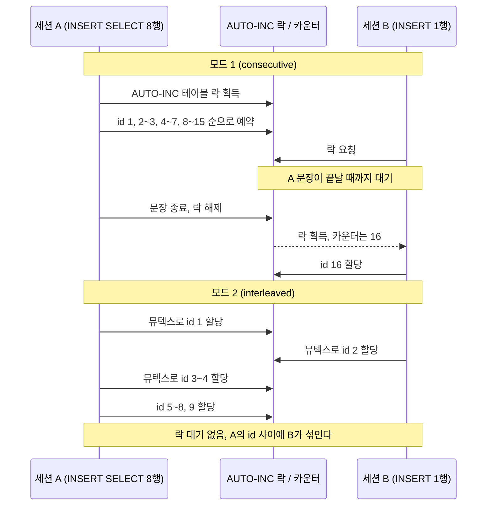
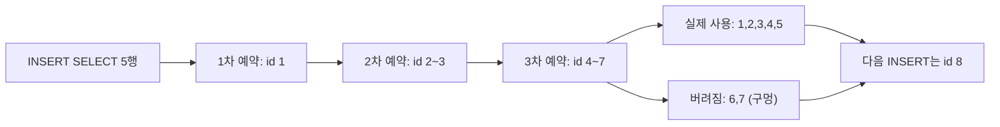
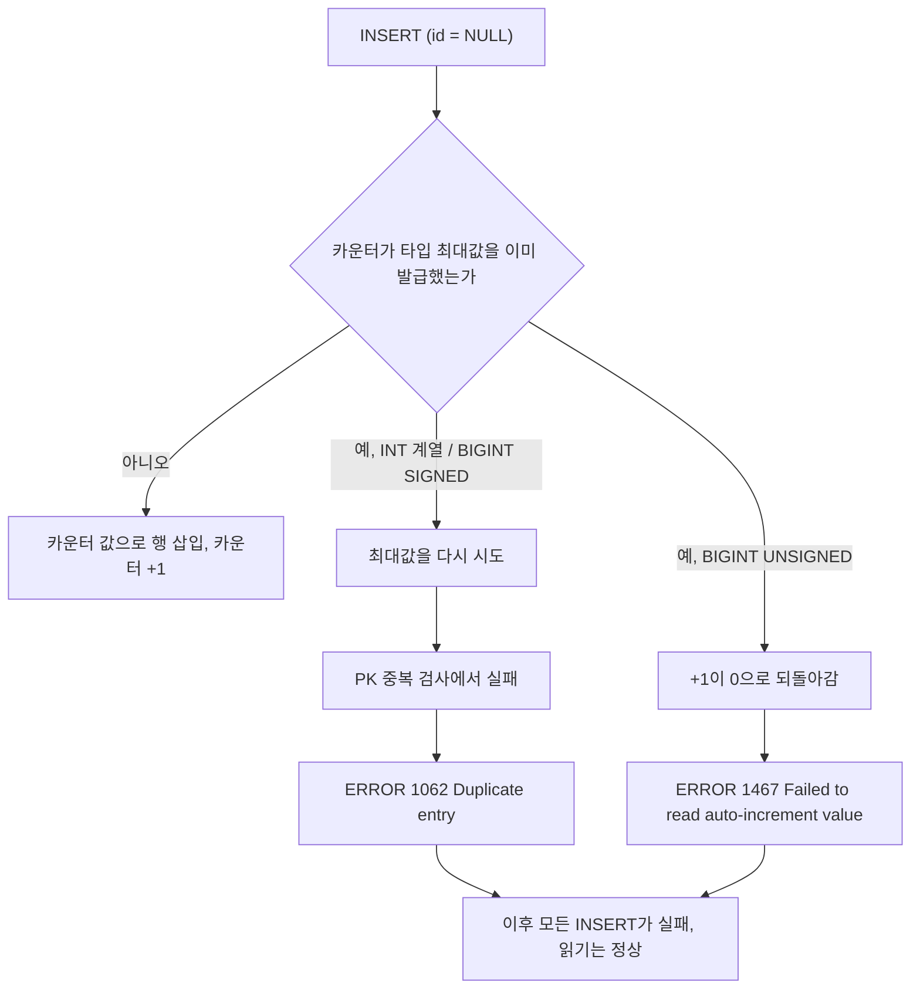
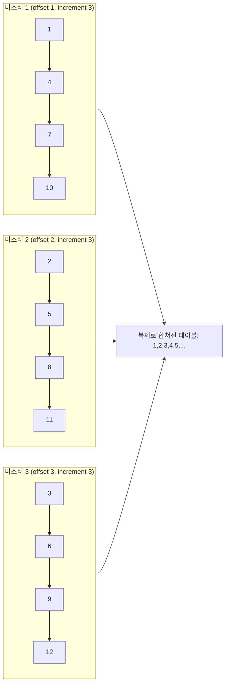
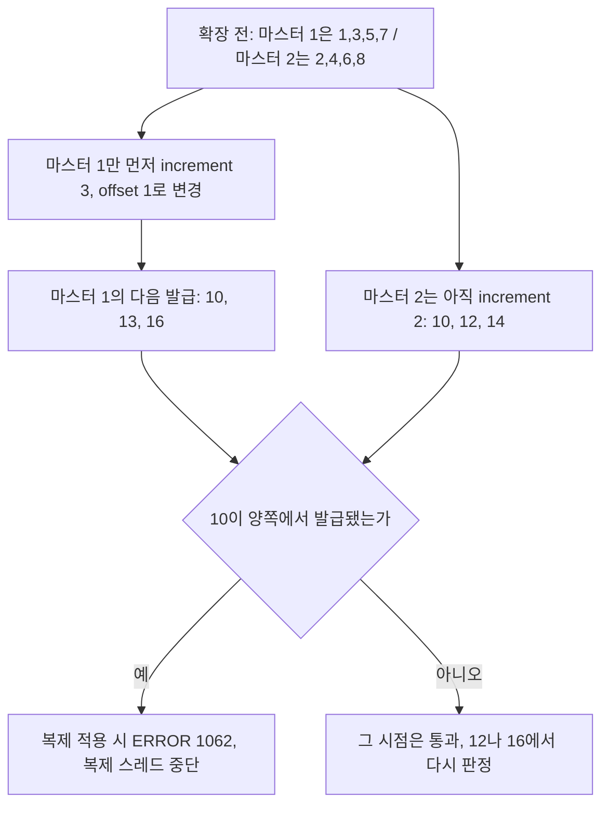

# AUTO_INCREMENT

AUTO_INCREMENT는 단일 서버에서 쓰기 가장 쉬운 식별자지만 서버가 여러 대가 되거나 테이블이 수십억 건에 가까워지면 한계가 드러난다. 어떤 식별자를 고를지는 [식별자 설계](Identifier_Design.md)에서 비교하고, 샤딩이나 다중 노드에서 대안으로 쓰는 시간 기반 방식은 [Snowflake ID](Snowflake_ID.md)에 정리했다. 이 문서는 AUTO_INCREMENT가 어떻게 값을 내주고 어디서 구멍이 나며 어느 시점에 막히는지를 MySQL 8.0.46에서 직접 돌려본 결과로 다룬다.

MySQL InnoDB에서 AUTO_INCREMENT 카운터는 테이블 메타데이터에 영구 저장되지 않는다. MySQL 8.0 이전에는 서버가 시작될 때 `SELECT MAX(id) + 1`을 실행해서 메모리에 올렸다. 서버 재시작 전에 id 1000을 할당받은 행이 롤백됐다면, 재시작 후 카운터는 현재 테이블 최대값 기준으로 재계산되어 1000이 재사용될 수 있었다.

8.0부터는 카운터 변경을 redo log에 기록하기 때문에 재시작 후에도 카운터가 유지된다. 롤백된 값이 재사용되는 문제도 사라졌다.

## innodb_autoinc_lock_mode

INSERT 시 AUTO_INCREMENT 값을 할당하는 방식을 제어한다. 0, 1, 2 세 가지 모드가 있다.

### 모드 0 (traditional)

INSERT마다 테이블 수준의 `AUTO-INC` 락을 획득한다. 트랜잭션 A가 INSERT를 실행하는 동안 트랜잭션 B의 INSERT가 대기한다. INSERT가 완료되면 락이 해제된다.

동시성이 가장 낮다. statement-based replication에서 마스터와 슬레이브가 같은 순서로 값을 받기 때문에 복제 일관성은 보장된다.

### 모드 1 (consecutive, MySQL 5.x 기본값)

행 수가 미리 알려진 simple INSERT(`INSERT INTO t VALUES (...)`, `INSERT INTO t VALUES (...), (...)`)는 뮤텍스만 사용해서 빠르게 값을 할당한다. 락이 불필요할 만큼 짧다.

행 수를 실행 전에 알 수 없는 bulk INSERT(`INSERT ... SELECT`, `LOAD DATA`)는 모드 0처럼 `AUTO-INC` 테이블 락을 사용한다. 이 경우 bulk INSERT가 끝날 때까지 다른 INSERT가 대기한다.

"consecutive"라는 이름대로 한 문장에서 INSERT된 행들이 연속된 id를 받는 것이 보장된다. statement-based replication에서 안전하게 동작한다.

### 모드 2 (interleaved, MySQL 8.0 기본값)

모든 INSERT에서 뮤텍스만 사용한다. `AUTO-INC` 테이블 락을 사용하지 않아 동시 처리량이 가장 높다.

bulk INSERT 실행 중 다른 INSERT가 끼어들면 값이 섞인다. 예를 들어 트랜잭션 A의 `INSERT ... SELECT`가 1000~1050을 예약했더라도, 트랜잭션 B가 중간에 끼어들어 1025를 가져갈 수 있다. statement-based replication에서는 마스터와 슬레이브의 값이 달라지므로 row-based replication과 같이 써야 한다.

MySQL 8.0에서 기본값이 1에서 2로 바뀐 배경이 여기 있다. 바이너리 로그 포맷 기본값이 STATEMENT에서 ROW로 넘어간 건 그보다 앞선 5.7.7 이고, 순서가 그랬기에 8.0 에서 2로 올릴 수 있었다.

```sql
-- 현재 모드 확인
SELECT @@innodb_autoinc_lock_mode;

-- 설정 변경 (my.cnf)
-- innodb_autoinc_lock_mode = 2
```

statement-based replication을 유지해야 하는 환경에서 8.0으로 마이그레이션하면 이 조합을 확인해야 한다. row-based replication 없이 모드 2를 쓰면 복제가 깨진다.

### 세 모드를 같은 시나리오로 돌려본 결과

세션 A가 `INSERT ... SELECT`로 8행을 넣는 중(행마다 `sleep(1)`을 걸어 8초 걸리게 했다)에 세션 B가 `INSERT ... VALUES ('B')` 한 건을 실행했다. 모드만 바꿔서 세 번 돌린 결과다.

| 모드 | B의 대기 | 최종 id 배치 | 비고 |
|---|---|---|---|
| 0 | A가 끝날 때까지 약 6.5초 대기 | A1~A8, B9 | 구멍 없음 |
| 1 | A가 끝날 때까지 약 6.5초 대기 | A1~A8, B16 | A가 15까지 예약해서 8~15가 비었다 |
| 2 | 대기 없음(약 3ms) | A1, B2, A3~A9 | A의 행 사이에 B가 끼어들었다 |

모드 1과 2의 차이는 B가 기다리느냐에 있다. 모드 1에서 simple INSERT끼리는 뮤텍스만 잠깐 잡고 지나가지만, bulk INSERT가 `AUTO-INC` 테이블 락을 문장 끝까지 쥐고 있으면 그동안 들어오는 INSERT는 simple이어도 막힌다. 모드 2는 이 락이 없어서 B가 바로 통과한다. 대신 한 문장이 만든 행의 id가 연속이라는 보장이 사라진다.

아래는 모드 1과 모드 2에서 같은 두 문장이 부딪힐 때의 순서다. 모드 1은 B가 A의 종료까지 줄을 서고, 모드 2는 A의 중간에 B가 끼어든다.



`INSERT ... SELECT`처럼 행 수를 모르는 문장은 id를 한 번에 하나씩 받지 않고 1개, 2개, 4개 식으로 배치를 두 배씩 늘려가며 예약한다. 마지막 배치를 다 쓰지 못하면 남은 id가 버려진다. 5행을 넣으면 1, 2~3, 4~7을 예약해서 7까지 소비하고 다음 INSERT가 8을 받는다. 실제로 모드 1과 2 모두 이렇게 나왔다.



모드 0은 배치 예약을 하지 않아서 이 구멍이 생기지 않는다(같은 5행 테스트에서 다음 id가 6이었다). 구멍이 없어야 한다는 이유로 모드 0을 고르는 일은 드물다. 롤백이나 `INSERT IGNORE`가 어차피 구멍을 만들고, 모드 0의 대가인 동시 INSERT 직렬화가 훨씬 크다.

## 갭이 생기는 이유

AUTO_INCREMENT 값은 트랜잭션 결과와 무관하게 소비된다. 트랜잭션 A가 INSERT를 실행해서 id 1000을 할당받은 뒤 롤백해도 카운터는 1001로 남는다.

**롤백**

가장 흔한 갭 원인이다.

```sql
BEGIN;
INSERT INTO orders (user_id, total) VALUES (1, 5000); -- id 1000 할당
ROLLBACK;
-- 다음 INSERT는 id 1001을 받는다
INSERT INTO orders (user_id, total) VALUES (2, 3000); -- id 1001
```

**INSERT IGNORE와 REPLACE INTO**

`INSERT IGNORE`는 중복 키 충돌 시 행을 삽입하지 않지만 카운터는 올라간다.

```sql
-- id가 unique인 테이블에서
INSERT IGNORE INTO tags (id, name) VALUES (5, 'mysql'); -- id 5가 이미 있으면 스킵
-- 카운터는 이미 증가
INSERT INTO tags (name) VALUES ('redis'); -- 기대와 다른 id를 받을 수 있다
```

`REPLACE INTO`는 내부적으로 충돌 시 DELETE + INSERT를 실행한다. 새 INSERT에서 새 id를 할당한다.

**Bulk INSERT에서의 예약**

모드 1과 2에서 `INSERT ... SELECT`는 결과 행 수를 미리 알 수 없어 id를 1, 2, 4개씩 늘려가며 예약하고, 쓰지 못한 나머지는 버린다. 위에서 본 대로 5행을 넣으면 id 6, 7이 구멍으로 남는다. 100만 행을 `INSERT ... SELECT`로 불린 테이블은 행이 1,048,577건인데 `MAX(id)`가 1,376,221이었다.

갭이 없어야 한다는 요구사항은 AUTO_INCREMENT로 충족하기 어렵다. 주문번호처럼 비즈니스적으로 연속 번호가 필요하면 별도 채번 테이블로 관리해야 한다.

## DELETE vs TRUNCATE 후 카운터 차이

`DELETE FROM t`는 행만 지운다. AUTO_INCREMENT 카운터는 그대로다. 테이블을 비운 뒤 다시 INSERT하면 삭제 전 마지막 값의 다음부터 이어진다.

```sql
INSERT INTO t (name) VALUES ('a'), ('b'), ('c'); -- id 1, 2, 3
DELETE FROM t;
INSERT INTO t (name) VALUES ('d'); -- id 4, not 1
```

`TRUNCATE TABLE t`는 테이블 자체를 재생성하기 때문에 카운터가 1로 리셋된다. DDL이라 트랜잭션으로 롤백할 수 없다.

```sql
INSERT INTO t (name) VALUES ('a'), ('b'), ('c'); -- id 1, 2, 3
TRUNCATE TABLE t;
INSERT INTO t (name) VALUES ('d'); -- id 1
```

외래 키 제약이 있으면 TRUNCATE가 실패한다. 자식 테이블이 부모 테이블의 행을 참조하고 있기 때문이다.

```sql
-- 외래 키가 있을 때 TRUNCATE 순서
SET FOREIGN_KEY_CHECKS = 0;
TRUNCATE TABLE order_items;
TRUNCATE TABLE orders;
SET FOREIGN_KEY_CHECKS = 1;
```

카운터만 조정하고 싶을 때는 `ALTER TABLE`을 쓴다.

```sql
ALTER TABLE t AUTO_INCREMENT = 1;
```

현재 MAX(id)보다 낮은 값을 지정하면 MySQL이 무시하고 MAX(id) + 1로 맞춘다. 데이터를 지우지 않는 한 카운터를 내릴 수 없다.

## INT / BIGINT 오버플로우

INT SIGNED 최대값은 약 21억(2,147,483,647), INT UNSIGNED는 약 43억(4,294,967,295)이다.

### 한계에 닿으면 어떻게 실패하는가

카운터는 컬럼 타입의 최대값까지 정상 발급되고, 그 값이 한 번 쓰이면 다음 INSERT부터 같은 값을 다시 발급하려다 실패한다. INT UNSIGNED를 4294967294에서 시작시켜 확인했다.

```sql
CREATE TABLE ev (id INT UNSIGNED NOT NULL AUTO_INCREMENT PRIMARY KEY, name VARCHAR(20))
    AUTO_INCREMENT = 4294967294;
INSERT INTO ev(name) VALUES ('a');   -- id 4294967294
INSERT INTO ev(name) VALUES ('b');   -- id 4294967295 (최대값, 성공)
INSERT INTO ev(name) VALUES ('c');
-- ERROR 1062 (23000): Duplicate entry '4294967295' for key 'ev.PRIMARY'
```

마지막 INSERT가 실패한 뒤에도 `SHOW CREATE TABLE`의 `AUTO_INCREMENT`는 4294967295에 머문다. 여러 행을 한 문장에 넣으면 첫 행부터 같은 이유로 실패하고, 신호는 항상 1062다. 에러 이름이 중복 키라서 처음 보면 코드 버그나 재시도 중복으로 오해해 한참 엉뚱한 곳을 본다.

타입별로 같은 실험을 돌린 결과는 이렇다.

| 컬럼 타입 | 마지막으로 성공한 id | 이후 `INSERT ... VALUES (NULL)` |
|---|---|---|
| INT SIGNED | 2147483647 | 1062 Duplicate entry '2147483647' |
| INT UNSIGNED | 4294967295 | 1062 Duplicate entry '4294967295' |
| BIGINT SIGNED | 9223372036854775807 | 1062 Duplicate entry '9223372036854775807' |
| BIGINT UNSIGNED | 18446744073709551615 | 1467 Failed to read auto-increment value from storage engine |

1467은 INT에서는 나오지 않고 BIGINT UNSIGNED가 끝까지 찼을 때만 나왔다. InnoDB가 다음 값을 읽지 못한다는 뜻이라 사실상 볼 일이 없는 에러다. `INSERT ... VALUES (4294967296)`처럼 id를 직접 넣어 범위를 넘기면 엄격 모드에서는 1264(Out of range)다. `sql_mode`를 비우면 값이 최대값으로 잘리고, 그 값이 이미 있으면 1062가 된다.



장애 양상은 쓰기만 전부 실패하고 읽기는 멀쩡한 상태다. 헬스체크가 SELECT 위주면 통과하고, 주문이나 결제 같은 쓰기 경로만 5xx를 낸다. 에러가 난 뒤에 ALTER를 걸면 변환이 끝날 때까지 쓰기 중단이 더 길어진다. 아래에서 보듯 ALTER 자체가 그 테이블의 쓰기를 막는다.

### 사전에 여유를 확인하는 쿼리

`information_schema.TABLES.AUTO_INCREMENT`는 8.0에서 캐시되어 있다. `information_schema_stats_expiry` 기본값이 86400초(24시간)라서 INSERT 직후에 조회하면 옛 값이 나온다. 행 2개를 넣고 조회하면 3, 이어서 3개를 더 넣고 조회해도 3이 나왔고, 세션에서 `information_schema_stats_expiry=0`을 주자 6이 나왔다. 모니터링에서 이 값을 쓴다면 이 설정을 고려해야 한다.

```sql
SET SESSION information_schema_stats_expiry = 0;

SELECT
    TABLE_NAME,
    AUTO_INCREMENT AS current_counter,
    ROUND((POW(2, 32) - 1 - AUTO_INCREMENT) / (POW(2, 32) - 1) * 100, 2) AS remaining_pct_unsigned
FROM information_schema.TABLES
WHERE TABLE_SCHEMA = 'your_db'
  AND TABLE_NAME = 'your_table';
```

분모를 현재 카운터로 두면 카운터가 작을수록 비율이 터무니없이 커진다. 최대값으로 나눠야 남은 비율이 된다. INT SIGNED면 `POW(2, 31) - 1`을, INT UNSIGNED면 `POW(2, 32) - 1`을 쓴다.

### BIGINT로 바꾸는 비용

가장 흔한 대응은 `MODIFY`로 컬럼 타입을 바꾸는 것이다.

```sql
ALTER TABLE t MODIFY id BIGINT UNSIGNED NOT NULL AUTO_INCREMENT;
```

컬럼 타입 변경은 [Online DDL](My_SQL_Online_DDL.md)의 INPLACE로 처리되지 않는다. 직접 확인한 결과는 이렇다.

```sql
ALTER TABLE big MODIFY id BIGINT UNSIGNED NOT NULL AUTO_INCREMENT, ALGORITHM=INPLACE;
-- ERROR 1846 (0A000): ALGORITHM=INPLACE is not supported. Reason: Cannot change column type INPLACE. Try ALGORITHM=COPY.

ALTER TABLE big MODIFY id BIGINT UNSIGNED NOT NULL AUTO_INCREMENT, ALGORITHM=COPY, LOCK=NONE;
-- ERROR 1846 (0A000): LOCK=NONE is not supported. Reason: COPY algorithm requires a lock. Try LOCK=SHARED.
```

옵션 없이 실행하면 COPY로 돌아가고 그동안 쓰기가 막힌다. 행 약 104만 건(INT, INT, CHAR(50) 세 컬럼)짜리 테이블에서, 도커 컨테이너 기준으로 ALTER가 14.2초 걸렸고, 시작 0.5초 뒤에 다른 세션이 날린 `INSERT` 한 건이 ALTER가 끝날 때까지 13.6초 대기했다. 테이블이 수억 건이면 시간은 선형으로 늘어난다. 서비스 중이면 [pt-online-schema-change](pt_online_schema_change.md)나 [gh-ost](gh_ost.md) 같은 섀도 테이블 방식으로 진행한다.

외래 키가 걸려 있으면 더 번거롭다. 부모 `id`(INT UNSIGNED)와 자식 `parent_id`(INT UNSIGNED)에 FK가 있을 때 한쪽만 바꾸면 이렇게 거부된다.

```sql
ALTER TABLE parent MODIFY id BIGINT UNSIGNED NOT NULL AUTO_INCREMENT;
-- ERROR 3780 (HY000): Referencing column 'parent_id' and referenced column 'id'
--                     in foreign key constraint 'fk_p' are incompatible.

ALTER TABLE child MODIFY parent_id BIGINT UNSIGNED NOT NULL;
-- 같은 3780
```

`SET foreign_key_checks = 0`을 줘도 8.0.46에서는 두 ALTER 모두 3780으로 막혔다. 검사를 끄고 한쪽씩 바꾸는 방식은 통하지 않는다. 결국 FK를 지우고 양쪽을 바꾼 다음 FK를 다시 만들어야 한다.


이 순서 중간에는 FK가 없는 구간이 생긴다. 그동안 부모 없는 자식 행이 들어와도 DB가 막지 못하므로 쓰기를 멈추거나 애플리케이션에서 막아야 한다. 자식 테이블이 여러 개면 자식마다 같은 작업이 늘어난다. 부모와 자식 모두 전체 재작성이 한 번씩 들어가므로 일정에 같이 잡아야 한다.

BIGINT UNSIGNED 최대값은 약 1844경(18,446,744,073,709,551,615)이라 사실상 한계에 부딪힐 일은 없다. 초당 100만 건씩 INSERT해도 약 58만 년이 걸린다.

INT를 쓸 때는 처음부터 UNSIGNED로 선언하는 습관이 낫다. 음수 id는 의미가 없고 UNSIGNED로 하면 한계가 두 배로 늘어난다.

```sql
CREATE TABLE events (
    id   INT UNSIGNED NOT NULL AUTO_INCREMENT PRIMARY KEY,
    name VARCHAR(200) NOT NULL
);
```

## 마스터-마스터 복제에서의 충돌 방지

마스터 두 대가 동시에 쓰기를 받으면 양쪽에서 같은 id를 생성할 수 있다. 이를 막기 위해 두 파라미터를 사용한다.

`auto_increment_increment`는 증가 단위, `auto_increment_offset`은 시작 오프셋이다.

```ini
# 마스터 1 (my.cnf)
auto_increment_increment = 2
auto_increment_offset    = 1
# 생성되는 id: 1, 3, 5, 7, ...

# 마스터 2 (my.cnf)
auto_increment_increment = 2
auto_increment_offset    = 2
# 생성되는 id: 2, 4, 6, 8, ...
```

마스터가 3대면 increment를 3으로, offset을 각각 1, 2, 3으로 설정한다.

```ini
# 마스터 1
auto_increment_increment = 3
auto_increment_offset    = 1

# 마스터 2
auto_increment_increment = 3
auto_increment_offset    = 2

# 마스터 3
auto_increment_increment = 3
auto_increment_offset    = 3
```

서버별로 발급되는 id가 겹치지 않는 이유는 각 서버가 `offset + n * increment` 꼴의 값만 만들기 때문이다. 아래는 3대 구성에서 서버별 id 계열이다.



복제로 다른 서버의 행이 들어오면 id가 명시된 상태로 적용되고, 로컬 카운터는 자기 계열에서 그 값보다 큰 첫 값으로 올라간다. increment 3, offset 2인 서버에서 2, 5를 발급한 뒤 id 10이 복제로 들어오면 다음 로컬 발급은 11이었다. 서버가 자기 계열 밖의 값을 쓰지 않는다는 점은 유지된다.

이 설정의 단점이 있다. 마스터를 추가하거나 제거할 때 increment 값을 바꾸면 기존 id 범위와 충돌할 수 있다. 마스터 2대에서 increment=2로 운영하다 3대로 늘릴 때 increment를 3으로 바꾸면, 기존에 생성된 홀수/짝수 id와 새 오프셋이 겹치는 경우가 생긴다.

마스터 1의 로컬 카운터가 7까지 갔을 때 increment를 3으로 바꾸는 상황을 그대로 돌려봤다. 다음 발급값이 8도 9도 아닌 10이었고, 그다음은 13이었다. 마스터 2는 아직 increment 2로 돌고 있으므로 10을 이미 발급했거나 곧 발급한다. 같은 id 10이 두 서버에서 만들어져서 복제 적용 시점에 PK 중복으로 복제가 멈춘다.



확장하려면 모든 서버의 설정을 같은 순간에 바꾸거나, 새 increment 구간이 기존 최대 id보다 충분히 위에서 시작하도록 카운터를 먼저 올려야 한다. 둘 다 운영 중에 하기 번거로워서 서버 수가 바뀔 수 있는 구조에는 처음부터 쓰지 않는 쪽을 택한다. 서버가 늘어도 발급 규칙이 그대로인 [Snowflake ID](Snowflake_ID.md)는 서버마다 노드 번호만 따로 받으면 된다.

실무에서는 마스터 대수가 고정된 경우에 잘 맞는다. 동적으로 확장해야 한다면 UUID나 Snowflake 같은 분산 id 생성기를 쓰는 것이 낫다.

```sql
-- 현재 설정 확인
SELECT @@auto_increment_increment, @@auto_increment_offset;

-- 세션 레벨 변경도 가능 (테스트용)
SET auto_increment_increment = 2;
SET auto_increment_offset = 1;
```

## PostgreSQL SERIAL / SEQUENCE

PostgreSQL에는 AUTO_INCREMENT가 없다. SEQUENCE 객체를 사용한다.

```sql
-- SERIAL은 아래와 동일하다
CREATE TABLE orders (
    id SERIAL PRIMARY KEY,
    -- ...
);

-- 내부적으로 이렇게 처리된다
CREATE SEQUENCE orders_id_seq;
CREATE TABLE orders (
    id INTEGER NOT NULL DEFAULT nextval('orders_id_seq') PRIMARY KEY
);
ALTER SEQUENCE orders_id_seq OWNED BY orders.id;
```

PostgreSQL 10부터는 `IDENTITY`가 표준 문법으로 추가됐다.

```sql
CREATE TABLE orders (
    id BIGINT GENERATED ALWAYS AS IDENTITY PRIMARY KEY,
    user_id BIGINT NOT NULL,
    total NUMERIC(12, 2) NOT NULL
);

-- GENERATED BY DEFAULT는 직접 값을 INSERT할 수 있다
CREATE TABLE orders (
    id BIGINT GENERATED BY DEFAULT AS IDENTITY PRIMARY KEY
);
```

MySQL AUTO_INCREMENT와 다른 점이 몇 가지 있다.

**트랜잭션 밖에서 동작한다**

SEQUENCE는 트랜잭션 범위를 벗어난다. `nextval()`을 호출하면 트랜잭션이 롤백되더라도 그 값은 소비된 것으로 처리된다. 갭이 생기는 것은 MySQL과 같다.

**CACHE 설정으로 성능 조절이 가능하다**

```sql
-- CACHE를 크게 잡으면 nextval 호출 횟수를 줄일 수 있다
ALTER SEQUENCE orders_id_seq CACHE 100;
```

캐시 크기를 키우면 성능이 올라가지만, 서버 재시작 시 캐시에 남은 값이 사라지면서 갭이 커진다. 캐시 100이면 재시작마다 최대 100개의 id가 날아갈 수 있다.

**여러 테이블에서 공유할 수 있다**

MySQL AUTO_INCREMENT는 테이블에 종속되지만 PostgreSQL SEQUENCE는 독립 객체다. 여러 테이블에서 같은 SEQUENCE를 공유해서 전역 유일 id를 만들 수 있다.

```sql
CREATE SEQUENCE global_id_seq;

CREATE TABLE events (
    id BIGINT DEFAULT nextval('global_id_seq') PRIMARY KEY
);

CREATE TABLE logs (
    id BIGINT DEFAULT nextval('global_id_seq') PRIMARY KEY
);
```

**시퀀스 값 직접 조작**

```sql
-- 다음 값 조회 (소비됨)
SELECT nextval('orders_id_seq');

-- 현재 값 조회 (이 세션에서 nextval 호출 후에만 유효)
SELECT currval('orders_id_seq');

-- 이 세션에서 마지막으로 생성된 시퀀스 값
SELECT lastval();

-- 강제 설정
SELECT setval('orders_id_seq', 10000);
SELECT setval('orders_id_seq', 10000, false); -- 다음 nextval이 10000을 반환
```

MySQL의 `LAST_INSERT_ID()`와 대응하는 것이 `lastval()`이다.

## JPA IDENTITY 전략이 배치 INSERT를 막는 이유

`@GeneratedValue(strategy = GenerationType.IDENTITY)`는 데이터베이스의 AUTO_INCREMENT에 id 생성을 맡긴다.

```typescript
// TypeORM — IDENTITY 전략 (AUTO_INCREMENT)
@Entity()
export class Order {
    @PrimaryGeneratedColumn()  // IDENTITY 전략 (AUTO_INCREMENT)
    id: number;
}
```

TypeORM은 `persist()` 후 INSERT 결과에서 생성된 id를 반환한다. 배치 INSERT 전에 id를 알 수 없으므로, 개별 INSERT가 순차적으로 실행된다.

```typescript
// TypeORM에서 배치 INSERT가 동작하지 않는 경우
// 엔티티마다 즉시 INSERT가 실행된다
for (const order of orders) {
    await manager.save(Order, order); // 즉시 INSERT 실행, 배치 아님
}
```

SEQUENCE 전략(PostgreSQL)은 INSERT 전에 `nextval()`로 id를 미리 받아올 수 있다.

```typescript
// TypeORM — SEQUENCE 전략 (PostgreSQL)
@Entity()
export class Order {
    @PrimaryGeneratedColumn('increment')
    id: number;
}

// 배치로 묶으려면 TypeORM의 insert() 사용
await manager.insert(Order, orders);
// 내부적으로 단일 INSERT ... VALUES (...), (...) 로 실행
```

MySQL에서 대량 INSERT 성능이 중요한 경우 TypeORM의 배치 insert나 pg/mysql2 드라이버의 직접 배치 처리를 쓰는 것이 실용적이다.

```typescript
import { Pool } from 'pg';

export class OrderBatchRepository {
    constructor(private readonly pool: Pool) {}

    async batchInsert(orders: Order[]): Promise<void> {
        const client = await this.pool.connect();
        try {
            await client.query('BEGIN');

            // 배치 INSERT: VALUES 절을 동적으로 조합
            const values: unknown[] = [];
            const placeholders = orders.map((order, i) => {
                const base = i * 3;
                values.push(order.userId, order.total, order.createdAt);
                return `($${base + 1}, $${base + 2}, $${base + 3})`;
            });

            await client.query(
                `INSERT INTO orders (user_id, total, created_at) VALUES ${placeholders.join(', ')}`,
                values
            );

            await client.query('COMMIT');
        } catch (err) {
            await client.query('ROLLBACK');
            throw err;
        } finally {
            client.release();
        }
    }
}
```

INSERT 후 생성된 id가 필요하면 `RETURNING` 절을 사용한다(PostgreSQL) 또는 `insertId`를 활용한다(MySQL).

```typescript
// PostgreSQL — RETURNING으로 생성된 id 조회
const result = await pool.query(
    'INSERT INTO orders (user_id, total) VALUES ($1, $2) RETURNING id',
    [userId, total]
);
const generatedId = result.rows[0].id;

// MySQL (mysql2) — insertId로 AUTO_INCREMENT 값 조회
const [result] = await pool.execute(
    'INSERT INTO orders (user_id, total) VALUES (?, ?)',
    [userId, total]
) as [mysql.ResultSetHeader, unknown];
const generatedId = result.insertId;
```

대량 INSERT가 필요한 경우 TypeORM의 `createQueryBuilder().insert()` 또는 raw 쿼리를 직접 쓰면 배치 처리가 가능하다.
