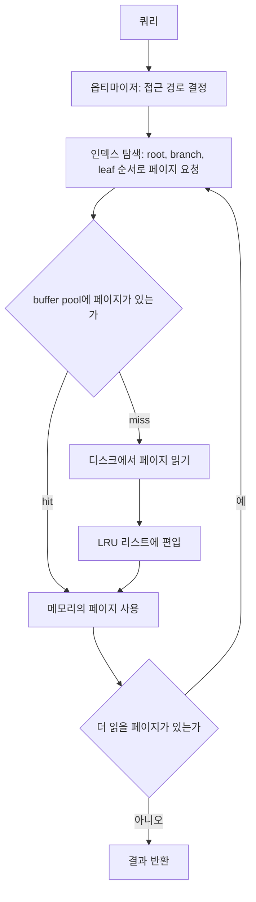
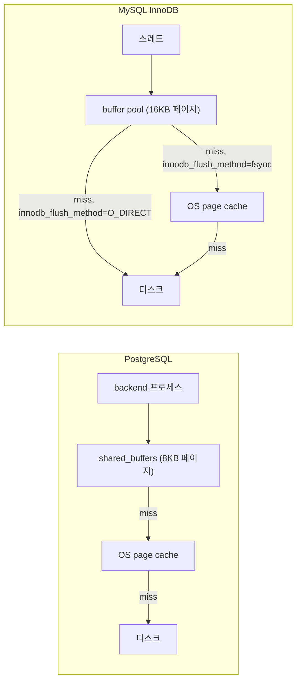
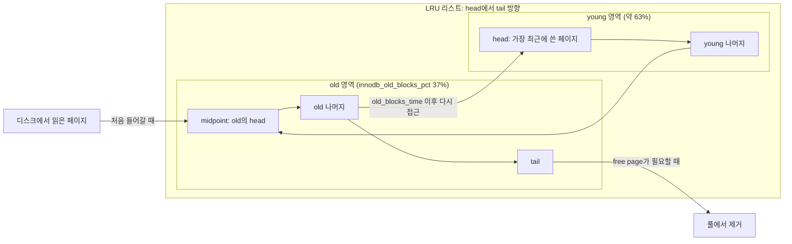
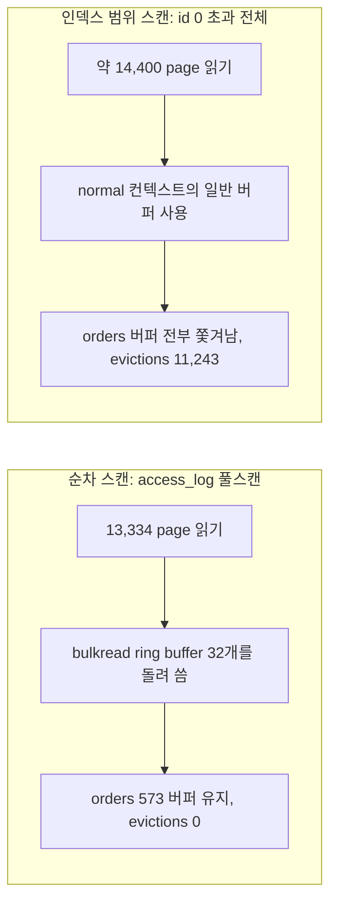
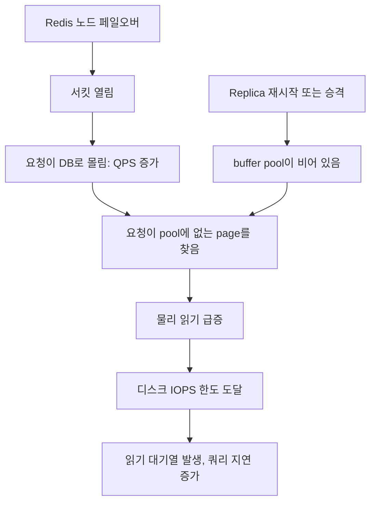
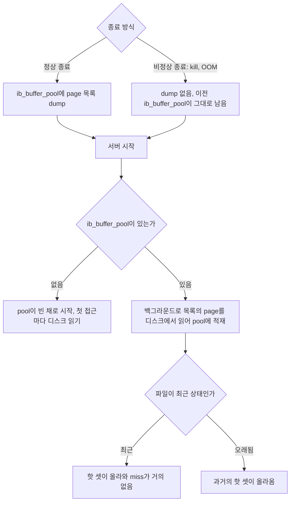
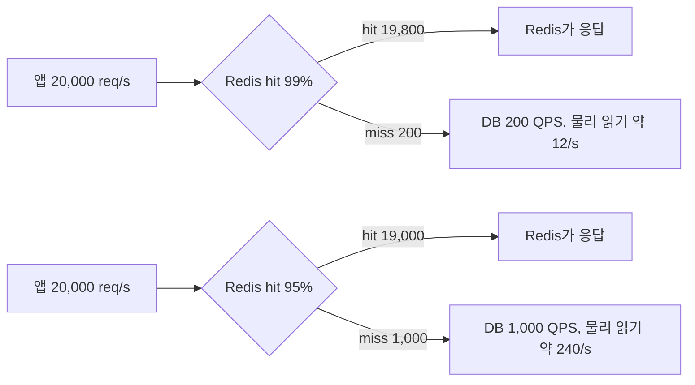

# Buffer Pool과 읽기 I/O

[읽기 경로](../../Architecture/읽기_경로.md) 문서는 "Redis까지 miss면 DB다"에서 끝난다. DB 안에도 캐시가 한 겹 더 있다. InnoDB는 buffer pool, PostgreSQL은 shared_buffers다. 쿼리가 DB에 도착했다고 해서 디스크를 읽는 게 아니라, 필요한 페이지가 이 메모리 영역에 있으면 거기서 읽고 없을 때만 디스크로 간다.

Redis 히트율이 떨어졌을 때 DB가 가장 먼저 느려지는 이유가 여기에 있다. 늘어난 요청이 단순히 QPS만 올리는 게 아니라, buffer pool에 없는 페이지를 찾는 요청이라서 디스크 IOPS를 먼저 소진한다. 이 문서는 그 구간을 InnoDB와 PostgreSQL 양쪽에서 실제로 돌려 본 결과로 정리한다. 인덱스 설계 자체는 [데이터베이스 성능 튜닝](데이터베이스_성능_튜닝.md)과 [인덱스 지역성](인덱스_지역성.md)에서 다루므로 여기서는 반복하지 않는다.

## 실험 환경

수치는 전부 아래 환경에서 직접 돌려서 얻은 값이다.

| 항목 | MySQL | PostgreSQL |
|---|---|---|
| 버전 | 8.0.46 | 16.15 |
| 캐시 크기 | `innodb_buffer_pool_size` 64MB (16KB 페이지 4,096개) | `shared_buffers` 32MB (8KB 페이지 4,096개) |
| 핫 테이블 | `orders` 4만 행, 데이터 4.5MB | 같은 스키마, heap 4.5MB (572 페이지) |
| 큰 테이블 | `access_log` 40만 행, 약 105MB | 같은 스키마, heap 104MB (13,334 페이지) |

캐시보다 큰 테이블을 일부러 만들었다. 풀에 다 들어가는 데이터로는 밀려나는 현상을 볼 수 없다.

데이터 디렉터리를 메모리 tmpfs에 두고 돌렸다. 그래서 카운터(읽은 페이지 수, hit/miss)는 믿을 수 있지만 지연 시간 숫자는 디스크 값이 아니다. 지연은 아래에서 가정치로 계산하고, 그렇게 표시한다.

## 쿼리 하나가 페이지를 읽기까지

옵티마이저가 인덱스 탐색을 고르면, 실행기는 root에서 leaf까지 페이지를 하나씩 요청한다. 요청받은 쪽은 먼저 buffer pool을 본다. 있으면 메모리 주소를 돌려주고, 없으면 디스크에서 읽어 pool에 넣은 뒤 돌려준다.



루프가 중요하다. PK 한 건 조회도 페이지 접근이 여러 번이고, miss가 한 번 나면 그 한 번이 디스크 읽기 한 번이 된다. 세컨더리 인덱스를 타면 인덱스 leaf를 읽고 다시 클러스터드 인덱스(PostgreSQL이면 heap)로 돌아가므로 루프가 한 바퀴 더 돈다.

### EXPLAIN (ANALYZE, BUFFERS)로 읽은 페이지 수 보기

PostgreSQL은 실행 계획에 페이지 접근 수가 그대로 나온다. 재시작 직후 같은 쿼리를 두 번 돌린 결과다.

```sql
explain (analyze, buffers, costs off, timing off) select * from orders where id = 12345;
```

```text
 Index Scan using orders_pkey on orders (actual rows=1 loops=1)
   Index Cond: (id = 12345)
   Buffers: shared hit=3 read=3
   I/O Timings: shared read=0.010
 Planning Time: 0.403 ms
 Execution Time: 0.096 ms

-- 두 번째 실행
 Index Scan using orders_pkey on orders (actual rows=1 loops=1)
   Index Cond: (id = 12345)
   Buffers: shared hit=3
 Planning Time: 0.030 ms
 Execution Time: 0.034 ms
```

한 행을 읽는 데 페이지 3개를 만졌다. 첫 실행에서는 3개가 pool에 없어서 `read=3`이 붙었고, 두 번째에서는 전부 `hit`이다. `shared hit`은 shared_buffers에서 찾았다는 뜻이고 `shared read`는 shared_buffers에 없어서 운영체제에 읽기를 요청했다는 뜻이다. `read`가 곧 디스크 접근이라는 보장은 없다. 이 얘기는 다음 절에서 한다.

세컨더리 인덱스 조회는 페이지 수가 다르게 찍힌다.

```sql
explain (analyze, buffers, costs off, timing off) select * from orders where user_id = 77;
```

```text
 Bitmap Heap Scan on orders (actual rows=8 loops=1)
   Recheck Cond: (user_id = 77)
   Heap Blocks: exact=8
   Buffers: shared read=10
   ->  Bitmap Index Scan on idx_orders_user (actual rows=8 loops=1)
         Index Cond: (user_id = 77)
         Buffers: shared read=2
```

8행을 읽는데 페이지가 10개다. 인덱스 2개에 heap 8개이고, `user_id = n % 5000`으로 만든 데이터라 같은 `user_id`의 행이 서로 다른 heap 페이지에 흩어져 있다. 행 수가 아니라 행이 몇 개 페이지에 퍼져 있는지가 읽기 비용을 정한다는 얘기고, 이 부분은 [인덱스 지역성](인덱스_지역성.md)에서 자세히 다룬다.

MySQL에는 `EXPLAIN ANALYZE`에 페이지 수가 없다. 쿼리 단위로 읽은 페이지를 보려면 뒤에 나오는 performance_schema 방법을 써야 한다.

## InnoDB와 PostgreSQL의 캐시 구조

두 DB는 캐시가 한 겹이냐 두 겹이냐가 다르다.



PostgreSQL은 shared_buffers 뒤에 항상 OS page cache가 있다. 데이터 파일을 일반 버퍼 I/O로 읽기 때문이다. 그래서 shared_buffers를 메모리의 25% 안팎으로 잡고 나머지를 OS 캐시에 맡기는 구성이 흔하다. 같은 페이지가 두 군데에 올라가 있을 수 있다는 걸 감안한 크기다.

InnoDB는 `innodb_flush_method`에 따라 갈린다. `O_DIRECT`면 OS 캐시를 거치지 않으므로 buffer pool이 사실상 유일한 캐시다. 이 실험의 8.0.46은 기본값이 `fsync`로 나왔고, 이 경우 InnoDB도 OS 캐시와 이중이 된다. `fsync` 상태에서 buffer pool만 크게 키우면 OS 캐시와 buffer pool이 같은 페이지를 들고 있게 되고, 메모리가 모자라면 swap으로 간다. pool 크기를 정할 때 `innodb_flush_method`를 같이 확인한다.

이 차이가 모니터링에서 오독을 만든다. PostgreSQL의 풀스캔 실행 계획이다.

```text
 Aggregate (actual rows=1 loops=1)
   Buffers: shared read=13334
   I/O Timings: shared read=27.934
```

13,334 페이지를 `read`로 읽었는데 읽기 시간 합이 27.9ms다. 페이지당 2마이크로초다. 디스크가 낼 수 있는 속도가 아니고, OS 캐시(여기서는 tmpfs)에서 가져온 것이다. `shared read`가 보인다고 디스크를 읽은 게 아니다. `track_io_timing = on`을 켜 두고 읽기 시간을 같이 봐야 구분된다. 읽기당 시간이 0.1ms 아래로 떨어지면 OS 캐시 히트이고, 수백 마이크로초에서 밀리초 단위면 실제 디스크다.

PostgreSQL 프로세스만 재시작하면 OS 캐시는 남는다. 서버를 새로 띄우거나 failover로 다른 인스턴스가 올라오면 OS 캐시도 같이 비어서 두 겹이 전부 cold가 된다. 이 부분이 뒤에서 재시작 사고와 이어진다.

## 히트율을 계산하는 방법

### MySQL

`Innodb_buffer_pool_read_requests`는 buffer pool에 대한 논리적 읽기 요청 수이고, `Innodb_buffer_pool_reads`는 그중 pool에 없어서 디스크에서 동기로 읽은 횟수다.

```sql
SELECT
  (SELECT variable_value FROM performance_schema.global_status WHERE variable_name = 'Innodb_buffer_pool_reads')         AS disk_reads,
  (SELECT variable_value FROM performance_schema.global_status WHERE variable_name = 'Innodb_buffer_pool_read_requests') AS requests;

-- hit ratio = 1 - disk_reads / requests
```

이 두 값은 서버 시작부터의 누적이다. 시작 후 몇 주 동안 쌓인 값으로 계산하면 지금 상태와 상관없이 99.9%가 나온다. 장애 직후의 히트율을 알고 싶으면 두 시점의 차이로 계산해야 한다. 1분 간격으로 값을 찍어 두고 뺀다.

`SHOW ENGINE INNODB STATUS`의 `BUFFER POOL AND MEMORY` 구간에는 직전 출력 이후 구간의 값이 나온다.

```text
Buffer pool size   4096
Free buffers       0
Database pages     4033
Old database pages 1468
Pages made young 24597, not young 44322
1746.81 youngs/s, 5141.96 non-youngs/s
Buffer pool hit rate 704 / 1000, young-making rate 156 / 1000 not 460 / 1000
Pages read ahead 3231.53/s, evicted without access 15.15/s, Random read ahead 0.00/s
```

`hit rate 704 / 1000`은 풀 접근 1,000번 중 704번이 hit였다는 뜻이다. 이 출력은 풀스캔 구간에서 찍었다. 같은 구간을 누적 카운터 공식으로 계산하면 99%대가 나온다. 계산 방식이 달라서 생기는 차이이고, 스캔 구간에서는 이쪽 숫자가 실제 상황에 가깝다. 다음 절에서 그 이유를 본다.

### PostgreSQL

```sql
SELECT datname, blks_read, blks_hit,
       round(blks_hit * 100.0 / nullif(blks_hit + blks_read, 0), 2) AS hit_pct
FROM pg_stat_database WHERE datname = 'postgres';

SELECT relname, heap_blks_read, heap_blks_hit,
       round(heap_blks_hit * 100.0 / nullif(heap_blks_hit + heap_blks_read, 0), 2) AS hit_pct
FROM pg_statio_user_tables ORDER BY relname;
```

```text
 datname  | blks_read | blks_hit | hit_pct
----------+-----------+----------+---------
 postgres |     79332 |  1616872 |   95.32

  relname   | heap_blks_read | heap_blks_hit | hit_pct
------------+----------------+---------------+---------
 access_log |          73433 |        450274 |   85.98
 orders     |           2329 |         41742 |   94.72
```

이쪽도 통계를 마지막으로 초기화한 이후의 누적이다. 데이터 적재와 실험 쿼리가 전부 섞여 있어서 95.32%라는 숫자는 아무것도 말해 주지 못한다. 테이블 단위로 쪼개 보면 `access_log` 85.98%와 `orders` 94.72%로 갈리는데, 이것도 누적이라 지금의 상태는 아니다. 마찬가지로 두 시점의 차이를 써야 한다. PostgreSQL의 `blks_read`는 앞에서 말한 대로 OS 캐시 히트를 포함한다.

### 부하 생성기를 만들 때 걸린 것

핫 셋 조회를 반복하는 저장 프로시저를 처음 이렇게 썼다.

```sql
SELECT amount INTO a FROM orders WHERE id = 1 + FLOOR(RAND() * 40000);
```

`Result consisted of more than one row` 에러가 났다. `RAND()`는 행마다 다시 평가되기 때문에 옵티마이저가 인덱스 조회로 못 보고 풀스캔을 한다. 변수에 먼저 뽑아서 `WHERE id = k`로 써야 PK 조회가 된다. 부하 테스트에서 히트율이 이상하게 나오면 쿼리가 의도한 계획을 타고 있는지부터 확인한다.

## 히트율 99%인데 문제가 되는 경우

히트율은 페이지 접근 전체에 대한 비율이라서, 핫 셋이 쫓겨난 상황을 잘 못 잡는다. 두 가지를 직접 만들어 봤다.

### 풀스캔이 핫 셋을 밀어낼 때

`orders`의 PK 조회 20,000번(핫 셋, 258 페이지)을 돌려 풀에 올려 두고, 풀보다 큰 `access_log`를 한 번 풀스캔한 뒤, 같은 핫 셋 조회를 다시 돌렸다. 변수는 `innodb_old_blocks_time` 하나다.

| 설정 | 구간 | 동기 읽기 (`reads`) | read-ahead | 읽은 페이지 합 | 요청 수 | 계산한 히트율 |
|---|---|---|---|---|---|---|
| `old_blocks_time=1000` | 핫 셋만 | 0 | 0 | 0 | 40,131 | 100.000% |
| | 풀스캔 | 98 | 4,920 | 5,018 | 15,391 | 99.363% |
| | 스캔 뒤 핫 셋 | 0 | 0 | 0 | 40,117 | 100.000% |
| `old_blocks_time=0` | 핫 셋만 | 0 | 0 | 0 | 40,122 | 100.000% |
| | 풀스캔 | 516 | 5,568 | 6,084 | 16,437 | 96.861% |
| | 스캔 뒤 핫 셋 | 258 | 0 | 258 | 40,408 | 99.362% |

읽을 곳이 두 군데 있다.

첫째, 풀스캔 구간의 히트율이 99.363%다. 실제로는 풀스캔이 5,018 페이지를 디스크에서 읽었다. `Innodb_buffer_pool_reads`는 동기 읽기만 세고 read-ahead가 미리 읽은 페이지(`Innodb_buffer_pool_read_ahead`)를 miss로 세지 않는다. 순차 스캔은 대부분을 read-ahead가 읽어 가므로 이 공식으로는 스캔이 전혀 문제로 안 보인다. 디스크 읽기의 실제 총량은 `Innodb_pages_read`로 봐야 한다. 앞 절의 `INNODB STATUS`에서 비슷한 스캔 구간이 `hit rate 704 / 1000`으로 낮게 찍힌 것과 대비된다.

둘째, `old_blocks_time=0`의 마지막 줄이다. 스캔 뒤 핫 셋 조회가 258번 miss했고 히트율은 99.362%다. 258은 핫 셋 페이지 수와 같다. 핫 셋 전체가 쫓겨났다가 첫 접근에서 한 번씩 다시 읽힌 것이다. 40,408번의 요청 중 258번이라 히트율 숫자는 멀쩡하다. 서비스에서 이 258번은 스캔이 끝난 직후 핫 셋을 처음 건드리는 요청들이 한꺼번에 디스크 지연을 맞는다는 뜻이다. `old_blocks_time=1000`에서는 같은 구간이 0번이다.

### young/old 서브리스트

InnoDB의 LRU 리스트는 하나지만 midpoint를 기준으로 young과 old 두 영역으로 나뉜다.



새로 읽은 페이지는 head가 아니라 midpoint, 즉 old 영역의 head에 들어간다. old 영역에서 첫 접근 후 `innodb_old_blocks_time`(기본 1000ms)이 지난 뒤 다시 접근되면 그때 young의 head로 올라간다. 그 전에 접근이 반복되어도 올라가지 않는다. free page가 필요하면 old의 tail에서 쫓아낸다.

풀스캔은 각 페이지를 읽고 그 페이지의 행들을 수 밀리초 안에 훑고 지나간다. 첫 접근 후 1초 안에 다시 접근이 일어나도 승격되지 않으니 스캔이 읽은 페이지는 old에서 돌다 tail로 빠진다. 핫 셋은 young에 있어서 건드려지지 않는다. `old_blocks_time=0`이면 두 번째 접근부터 바로 young으로 올라가고, 스캔 페이지가 young을 채우며 핫 셋을 밀어낸다. 위 표의 258번 miss가 그 결과다.

`old_blocks_time=1000`으로 스캔을 돌린 직후의 카운터는 이렇다.

```text
Pages made young 22291, not young 37534    -- 스캔 직전
Pages made young 24597, not young 44322    -- 스캔 직후
```

스캔 동안 2,306 페이지는 young으로 올라갔고 6,788 페이지는 올라가지 못했다. 기본값에서도 승격이 0은 아니다. 이번 스캔은 핫 셋을 못 밀어냈지만, 올라간 페이지가 어떤 경로로 조건을 채웠는지는 확인하지 않았다. 스캔이 길어질수록 young에 섞이는 스캔 페이지가 늘어날 수 있으니 `Pages made young` 증가량은 스캔 전후로 재 둔다.

반대 방향의 함정도 있다. 새 핫 페이지가 young이 되려면 첫 로드 후 1초가 지난 뒤 한 번 더 접근되어야 한다. 핫 셋을 준비하면서 `sleep(1.2)`를 끼워 두 번 돌렸는데도, 이어서 본 `sys.innodb_buffer_stats_by_table`에서 `orders` 257 페이지 중 96 페이지가 아직 old였다. 한 번 읽히고 다시 안 읽히는 페이지는 요청 패턴상 승격될 기회가 없다. 승격 안 된 핫 페이지는 대용량 스캔 한 번에 같이 쓸려 나간다.

배치 스캔이 서비스 DB와 같은 서버에서 돌고 있다면 `old_blocks_time`을 기본값 아래로 내리지 않는다. 내려도 얻는 건 거의 없고, 위 표의 `old_blocks_time=0` 행이 치르는 비용이다.

### PostgreSQL은 방어하는 경로가 다르다

PostgreSQL에는 young/old 구분이 없고 clock-sweep으로 버퍼를 교체한다. 대신 큰 테이블의 순차 스캔은 전용 ring buffer(256KB, 버퍼 32개)를 써서 shared_buffers 전체를 밀지 않는다. 테이블이 shared_buffers의 4분의 1보다 클 때 적용된다. 앞 환경의 `access_log`(13,334 페이지)는 4,096의 4분의 1(1,024)보다 크다.

```text
-- 핫 셋 적재 직후
 idx_orders_user |      57 |  0.4
 orders          |     573 |  4.5
 orders_pkey     |       4 |  0.0

-- access_log 풀스캔 (Buffers: shared read=13334) 직후
 access_log      |      32 |  0.3
 access_log_pkey |       1 |  0.0
 idx_orders_user |      57 |  0.4
 orders          |     573 |  4.5
 orders_pkey     |       4 |  0.0
```

`pg_buffercache`로 본 결과, 104MB를 스캔했는데 `access_log`가 차지한 버퍼는 32개뿐이고 `orders`는 573개 그대로다. `pg_stat_io`에도 같은 모습이 나온다.

```text
  object  | context  | reads | hits | evictions | reuses
----------+----------+-------+------+-----------+--------
 relation | bulkread | 13334 |    0 |         0 |  13302
 relation | normal   |   778 |  992 |         0 |
```

`bulkread` 컨텍스트의 `reuses`가 13,302다. ring 안에서 버퍼를 돌려 쓴 횟수이고, 일반 버퍼를 쫓아낸 `evictions`는 0이다.

순차 스캔이 일반 버퍼를 어떻게 다르게 쓰는지 비교하면 이렇다. 왼쪽은 ring buffer 안에서 돌려 쓰고, 오른쪽은 일반 버퍼를 쫓아내며 쓴다.



하지만 이 보호는 순차 스캔 경로에만 걸려 있다. 같은 테이블을 인덱스로 끝까지 훑으면 일반 버퍼를 쓴다.

```sql
set enable_seqscan = off; set enable_bitmapscan = off;
explain (analyze, buffers, costs off, timing off)
  select sum(length(payload)) from access_log where id > 0;
```

```text
 Index Scan using access_log_pkey on access_log (actual rows=400000 loops=1)
   Buffers: shared hit=6 read=14426 written=6

-- 직후 pg_buffercache
 access_log      |    3785 | 29.6
 access_log_pkey |     310 |  2.4
-- orders, orders_pkey, idx_orders_user 는 목록에서 사라졌다

-- pg_stat_io
 relation | normal   | 15229 | 1134 |     11243 |
```

`orders` 573 버퍼가 전부 쫓겨났다. `normal` 컨텍스트에서 11,243개를 evict했다. 실서비스에서 풀스캔은 의심하기 쉽지만, 인덱스 범위 조회가 넓게 걸린 쿼리는 계획이 "인덱스를 탄다"로 나와서 방치되기 쉽다. 리포트성 쿼리가 `WHERE created_at > ...`로 테이블의 절반을 인덱스로 훑으면 같은 일이 벌어진다. 실행 계획의 `Buffers:` 합계가 shared_buffers 크기에 가까우면 이 쿼리는 서비스 DB에서 돌리지 않는다.

## performance_schema로 읽기 상태 확인하기

MySQL에서 누가 풀을 쓰고 있고 어디서 디스크를 읽는지 보는 쿼리들이다. 위 실험의 풀스캔 직후 상태다.

```sql
-- 테이블별로 풀에 올라와 있는 페이지
SELECT object_name AS tbl, allocated, data, pages, pages_old, rows_cached
FROM sys.innodb_buffer_stats_by_table WHERE object_schema = 'lab';
```

```text
tbl         allocated   data       pages  pages_old  rows_cached
access_log  58.77 MiB   53.98 MiB  3761   1455       225610
orders      4.02 MiB    3.67 MiB   257    1          40256
```

풀 64MB 중 58.77MB를 `access_log`가 쥐고 있고, 그중 1,455 페이지가 old다. 스캔이 만든 페이지는 old 쪽에 쌓이고, `orders`는 257 페이지 중 old가 1개뿐이라 young에 자리를 잡고 있다는 걸 이 한 쿼리로 확인한다. 이 뷰는 `information_schema.INNODB_BUFFER_PAGE`를 읽는데, 풀 전체 페이지를 훑는 구조라서 풀이 수십 GB인 운영 서버에서 자주 돌리면 안 된다. 장애 상황에서 한 번 보는 용도다. 재시작 직후에는 아직 열리지 않은 테이블의 `TABLE_NAME`이 NULL로 나와서 목록에 안 보인다. 실제로 재시작 후 이 뷰에 `lab` 테이블이 하나도 안 나왔는데, 페이지는 `information_schema.innodb_buffer_page`에서 `space=2`로 세면 258개가 있었다.

```sql
-- 테이블 파일별 누적 읽기 횟수와 바이트
SELECT file_name, count_read, ROUND(sum_number_of_bytes_read/1024/1024, 1) AS read_mb
FROM performance_schema.file_summary_by_instance
WHERE file_name LIKE '%/lab/%.ibd';
```

```text
file_name                          count_read  read_mb
/var/lib/mysql/lab/orders.ibd      1120        17.5
/var/lib/mysql/lab/access_log.ibd  42318       661.2
```

누적이라 어느 테이블이 디스크 읽기를 가장 많이 만드는지 보는 데 쓴다. 풀이 작아서 두 테이블이 계속 경쟁하고 있는 서버라면 읽기 횟수가 큰 쪽이 상대방을 밀어내는 쪽이다. `sys.schema_table_statistics_with_buffer`는 같은 수치를 `io_read_requests`, `io_read`로 보여 준다.

쿼리 하나가 몇 페이지를 디스크에서 읽었는지는 performance_schema의 wait 이벤트로 볼 수 있다. 기본 설정에서는 꺼져 있다.

```sql
UPDATE performance_schema.setup_consumers
SET enabled = 'YES'
WHERE name IN ('events_waits_current', 'events_waits_history', 'events_waits_history_long');
```

`setup_instruments`의 `wait/io/file/innodb/innodb_data_file`은 기본으로 켜져 있었다. 처음에는 `events_waits_history_long`만 켰다가 결과가 비어 있었다. history 계열 소비자는 `events_waits_current`가 꺼져 있으면 아무것도 채우지 못한다. 세 개를 같이 켜야 한다.

```sql
SET @tid = (SELECT thread_id FROM performance_schema.threads WHERE processlist_id = CONNECTION_ID());

SELECT id, path FROM access_log WHERE id IN (150000, 170000, 190000, 210000, 230000);

SELECT operation, COUNT(*) AS n, ROUND(SUM(number_of_bytes)/1024) AS kb
FROM performance_schema.events_waits_history_long
WHERE thread_id = @tid AND event_name = 'wait/io/file/innodb/innodb_data_file'
GROUP BY operation;
```

```text
operation  n  kb
read       7  112
```

풀에 없던 페이지에 PK 조회 5건을 던졌더니 읽기가 7번, 112KB(16KB × 7)였다. 같은 쿼리를 한 번 더 돌렸을 때는 `Innodb_buffer_pool_reads`가 늘지 않았다. 슬로우 쿼리 한 건을 잡아서 "이 쿼리는 cold일 때 7페이지를 읽는다"는 식으로 비용을 잴 수 있다. 이 방식은 해당 세션의 쿼리만 집계하므로 대상 쿼리를 따로 실행해 보는 용도로 쓴다.

## 재시작 직후의 cold buffer pool

DB를 재시작하면 buffer pool이 비어서 모든 읽기가 miss로 시작한다. 평소에는 pool이 데워질 시간이 있으니 문제가 안 되는데, 다른 장애와 겹치면 얘기가 달라진다.

겪기 쉬운 순서는 이렇다. Redis 노드가 페일오버되면서 서킷이 열려 요청이 DB로 몰린다. 이때 Replica가 재시작되었거나 방금 승격된 서버라서 pool이 비어 있다. 요청 수가 늘어난 상태에서 그 요청들이 전부 pool에 없는 페이지를 찾는다. 캐시 두 층이 동시에 cold가 되면 DB에는 미스 비용을 낮춰 줄 층이 없다. 서로 다른 원인의 장애가 같은 시각에 겹치는 일은 드물지 않다. 패치 작업이나 Replica 교체 같은 계획된 작업이 Redis 장애와 우연히 같은 시간대에 걸리는 경우가 있다. 읽기 전용 복제본을 쓰는 구성이라면 [읽기 전용 복제본](읽기_전용_복제본.md)의 승격 절차에서 새 Primary의 pool 상태도 같이 본다. 읽기 트래픽을 받지 않던 standby는 복제 적용이 건드린 페이지만 올라와 있다.

아래 도식은 이 겹침이 어떻게 이어지는지 보여 준다. 두 원인이 각각 따로 오지만 합쳐지는 지점이 DB의 디스크 읽기라는 점을 보면 된다.



### innodb_buffer_pool_dump_at_shutdown과 load_at_startup

InnoDB는 종료할 때 풀에 있던 페이지 목록을 파일(`ib_buffer_pool`)에 저장하고 시작할 때 그 목록대로 다시 읽어 올린다. 이 8.0.46에서 기본값을 확인했다.

```text
innodb-buffer-pool-dump-at-shutdown   TRUE
innodb-buffer-pool-load-at-startup    TRUE
innodb-buffer-pool-dump-pct           25
```

dump는 페이지 내용이 아니라 `(space id, page no)` 목록만 저장한다. 파일은 작다. 기본 `dump_pct`가 25라서 LRU에서 가장 최근에 쓴 25%만 저장한다. 위 실험에서는 pool이 작아 100으로 바꿨다. 로드는 백그라운드로 디스크에서 그 페이지들을 읽는 작업이라서, 로드가 끝나기 전에는 cold와 같다. 진행은 이렇게 본다.

```sql
SHOW STATUS LIKE 'Innodb_buffer_pool_load_status';
-- Buffer pool(s) load completed at 261024 16:01:13
```

필요하면 서버를 내리지 않고 수동으로 돌릴 수 있다.

```sql
SET GLOBAL innodb_buffer_pool_dump_now = ON;
SET GLOBAL innodb_buffer_pool_load_now = ON;
```

세 가지 경우로 재시작 직후의 상태를 비교했다. 재시작 직전에 핫 셋을 데운 뒤, 재시작하고 곧바로 핫 셋 PK 조회 20,000번을 돌린 결과다.

| 경우 | 재시작 직후 `orders` 페이지 | 20,000번 조회 중 풀 miss |
|---|---|---|
| A. 정상 종료, dump/load 기본값 | 258 | 0 |
| B. 정상 종료 후 `ib_buffer_pool` 삭제 | 0 | 274 |
| C. `docker kill`(비정상 종료) | 258 | 3 |

A는 pool이 로드된 상태로 시작해서 miss가 없다. B는 파일이 없어서 `Cannot open '/var/lib/mysql/ib_buffer_pool' for reading`이 상태에 찍히고, 핫 셋의 258 페이지 전부를 첫 접근에서 읽었다. 이 서버는 메모리 tmpfs라 274번이 눈에 안 띄게 끝나지만, EBS 같은 네트워크 디스크에서 읽기 하나가 1ms쯤이라면 첫 요청들이 합쳐서 수백 ms를 디스크에서 보낸다. 데이터가 커지면 핫 셋 페이지 수도 비례해서 커진다.

C는 주의할 점이 있다. kill 전후로 `ib_buffer_pool`의 수정 시각과 크기(17,054바이트)가 그대로였다. 비정상 종료에서는 dump가 일어나지 않고, 이전 정상 종료나 `dump_now`가 남긴 파일이 그대로 쓰인다. 이번에는 직전 정상 종료의 파일이 있어서 miss가 3번뿐이었지만, 그 파일이 몇 주 전 것이라면 그때의 핫 셋을 올릴 뿐이다. OOM kill이나 인스턴스 장애는 정상 종료가 아니므로, 운영하는 서버에서 `dump_now`를 주기적으로 실행해 파일을 최근 상태로 유지하는 방법이 있다.

종료 방식에 따라 시작 시 읽는 목록이 어디서 오는지가 갈린다. 아래 도식에서 비정상 종료 경로가 새 dump를 만들지 않는다는 점을 보면 된다.



### PostgreSQL의 pg_prewarm

PostgreSQL은 기본으로는 이 기능이 없고 `pg_prewarm` 확장을 쓴다. 수동 적재는 관계 단위다.

```sql
SELECT pg_prewarm('orders') AS orders_blocks,
       pg_prewarm('orders_pkey') AS pkey_blocks,
       pg_prewarm('idx_orders_user') AS user_idx_blocks;
```

```text
 orders_blocks | pkey_blocks | user_idx_blocks
---------------+-------------+-----------------
           572 |         112 |              57
Time: 5.761 ms
```

인덱스 두 개와 heap까지 741 블록을 5.8ms에 올렸다. 호출 전에는 앞서 본 인덱스 스캔 때문에 `orders` 버퍼가 0이었고, 호출 후에는 572 + 112 + 57이 pool에 있었다. 테이블과 인덱스를 각각 지정해야 해서 어떤 관계가 핫인지 알고 있어야 한다.

자동으로 하려면 `shared_preload_libraries`에 `pg_prewarm`을 넣는다. autoprewarm 워커가 종료 시와 `pg_prewarm.autoprewarm_interval`(기본 300초)마다 pool의 블록 목록을 `autoprewarm.blocks`에 저장하고, 시작할 때 읽어 온다.

```text
-- 정상 종료 직후: autoprewarm.blocks 83,121바이트, 첫 줄 <<4096>> (버퍼 수)
-- 재시작 직후, 워밍 쿼리를 한 번도 안 돌린 상태의 pg_buffercache
 access_log      |    3003 | 23.5
 access_log_pkey |     243 |  1.9
 idx_orders_user |      57 |  0.4
 orders          |     549 |  4.3
 orders_pkey     |       4 |  0.0
```

쿼리를 하나도 안 돌렸는데 `orders` 549 버퍼가 올라와 있었다. 이 기능은 핫과 콜드를 구분하지 못한다. `access_log` 3,003 버퍼도 같이 복원됐고 그만큼 pool을 차지한다. 사고가 났을 때 필요한 건 서비스의 핫 셋인데, 마지막 dump 시점에 풀에 있던 것이 무엇이든 그대로 올라온다. 직후에 PK 조회 한 건에서 `shared hit=5 read=1`이 나온 것처럼 목록에서 빠진 블록은 첫 접근에서 읽는다. 복원 직후에도 완전히 warm은 아니다.

PostgreSQL은 프로세스를 재시작해도 OS page cache가 남는다는 점이 InnoDB(`O_DIRECT`)와 다르다. 호스트가 바뀌는 failover에서는 이 이점이 없다. 그러니 새 인스턴스를 서비스에 넣기 전에 `pg_prewarm`을 실행하는 단계를 절차에 넣는 편이 안전하다.

## Redis 히트율이 떨어질 때 DB가 먼저 느려지는 이유

[읽기 경로](../../Architecture/읽기_경로.md)의 miss 비용 절에서 "hit였던 트래픽이 전부 miss가 되면 DB가 몇 배의 동시성을 받는가"를 계산하라고 썼다. buffer pool까지 넣어서 그 계산을 다시 해 본다. 앱이 초당 20,000건의 캐시 가능한 읽기를 받는다고 하자.



히트율은 4%p 내려갔는데 DB가 받는 요청은 200에서 1,000으로 5배가 된다. DB 입장에서는 miss 비율이 1%에서 5%로 올랐다고 보는 게 정확하다. 서킷이 열려 Redis가 0%가 되면 20,000 QPS 전부가 DB로 온다.

DB 쪽 부하는 QPS에 buffer pool의 상태까지 곱해서 봐야 한다. 아래는 계산이다. 쿼리 하나가 12 페이지를 접근하고(3개 테이블 조인), 기본 쿼리 시간이 2ms, 물리 읽기 한 번이 0.8ms라고 가정했다. 풀 히트율 열은 이 계산을 위해 넣은 가정이고, Redis 히트율이 낮아질수록 풀 히트율도 같이 낮아진다는 방향만 의미 있다.

| Redis 히트율 | DB QPS | 풀 히트율 (가정) | 물리 읽기/초 | 평균 쿼리 시간 | 동시 실행 쿼리 (QPS × 시간) |
|---|---|---|---|---|---|
| 99% | 200 | 99.5% | 12 | 2.05ms | 0.4 |
| 95% | 1,000 | 98% | 240 | 2.19ms | 2.2 |
| 90% | 2,000 | 95% | 1,200 | 2.48ms | 5.0 |
| 0% (Redis 장애) | 20,000 | 90% | 24,000 | 2.96ms | 59.2 |

물리 읽기/초는 `QPS × 12 × (1 − 풀 히트율)`이다. 쿼리 시간은 `2ms + 12 × (1 − 풀 히트율) × 0.8ms`다.

표에서 볼 것은 두 가지다. 평균 쿼리 시간은 2.05ms에서 2.96ms로 완만하게 늘어난다. 이 평균만 보면 DB가 버틸 것 같다. 반면 물리 읽기는 12/s에서 24,000/s로 2,000배 늘어난다. 디스크에는 초당 처리할 수 있는 읽기 수의 상한이 있고, 그 상한을 넘기는 순간 읽기 하나하나가 대기열에 들어가 쿼리 시간이 표의 값을 벗어난다. 예를 들어 볼륨 한도가 3,000 IOPS인 환경이라면 90% 행의 1,200은 버티고 0% 행의 24,000은 8배를 넘는다. 자기 볼륨의 IOPS 한도에 이 열을 대 보면 Redis 히트율이 어디까지 떨어져도 되는지 나온다.

풀 히트율이 같이 떨어지는 데는 이유가 있다. Redis가 99%를 받아 주는 동안 DB는 TTL이 만료될 때마다 키당 한 번만 읽힌다. 핫 키의 페이지는 몇 분에 한 번씩만 풀에 불려 오고, 그 사이 LRU 안에서 다른 페이지에 밀려난다. buffer pool은 Redis가 걸러 낸 나머지(롱테일)의 요청에 맞춰 채워져 있다. Redis가 갑자기 핫 키 요청을 DB로 흘리면, 그 키들의 페이지는 풀에 없으니 처음 몇 번은 디스크 읽기가 따라온다. Redis 히트율이 떨어질 때 DB가 먼저 느려지고, 그중에서도 IOPS부터 차는 이유다. 표의 가정 열은 실제로는 이렇게 움직이는 값이다.

자기 서비스에 적용하려면 가정 열을 측정값으로 바꾼다. 쿼리당 페이지 수는 PostgreSQL이면 `EXPLAIN (ANALYZE, BUFFERS)`의 합계, MySQL이면 위 wait 이벤트로 센다. 풀 히트율은 장애를 재현한 시간대의 카운터 차이로 구한다. 그 결과와 볼륨 IOPS 한도를 비교해 DB 앞의 벌크헤드와 서킷 브레이커 임계값을 정한다. 벌크헤드를 커넥션 수만으로 정하면 위 표의 59.2처럼 동시 실행 수는 한도 안에 들어오는데 IOPS가 먼저 넘치는 상황을 놓친다.
