# 분산 트랜잭션

## 문제의 시작

단일 DB에서는 `BEGIN → COMMIT/ROLLBACK`으로 트랜잭션을 처리한다. 그런데 서비스가 쪼개지면서 주문 DB, 결제 DB, 재고 DB가 각각 다른 서버에 있는 상황이 된다. 이때 "주문 생성 → 결제 처리 → 재고 차감"을 하나의 트랜잭션처럼 묶는 건 단일 DB의 트랜잭션으로는 불가능하다.

```
단일 DB:
  BEGIN
    INSERT INTO orders ...
    UPDATE payments ...
    UPDATE inventory ...
  COMMIT  ← 하나의 DB 커넥션에서 처리

분산 환경:
  주문 서비스 (DB-A) → INSERT INTO orders ...
  결제 서비스 (DB-B) → INSERT INTO payments ...
  재고 서비스 (DB-C) → UPDATE inventory ...
  → 각각 다른 DB. 하나가 실패하면 나머지는 어떻게 되돌리나?
```

분산 트랜잭션의 핵심 문제는 **부분 실패(Partial Failure)**다. 3개 서비스 중 2개는 성공하고 1개만 실패했을 때, 성공한 2개를 어떻게 되돌릴 것인가. 이걸 해결하는 패턴들을 하나씩 본다.


## 2PC (Two-Phase Commit)

분산 트랜잭션의 가장 고전적인 방법이다. 코디네이터(Coordinator)가 참여 노드들에게 "커밋할 준비 됐나?"를 물어보고, 전부 OK면 커밋, 하나라도 NO면 전체 롤백한다. DB 표준으로는 XA 프로토콜이라고 부른다.

### 동작 방식

Phase 1에서 참여자는 커밋 직전 상태까지 만들어 두고 lock을 쥔 채 기다린다. Phase 2에서는 코디네이터가 내린 결정을 그대로 따른다. 순서도에서 봐야 할 곳은 로그가 디스크에 남는 두 군데다. 참여자의 prepare 기록과 코디네이터의 결정 기록이다. 뒤에서 다루는 장애 복구는 전부 이 두 기록이 어디까지 남았는지로 갈린다.

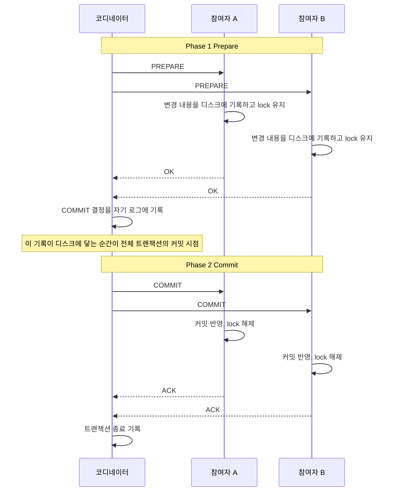

커밋 시점을 쥐고 있는 쪽은 참여자가 아니라 코디네이터의 로그다. 한 참여자가 NO를 내면 코디네이터는 ABORT를 기록하고 모든 참여자에게 ROLLBACK을 보낸다. 아래 위젯은 NO 시나리오와 코디네이터가 죽는 시나리오까지 단계별로 재생한다.

<div class="ygd-2pc-prepare-commit-flow" id="ygd-2pc-prepare-commit-flow">
<style>
.ygd-2pc-prepare-commit-flow{--ygd-bg:#FFFFFF;--ygd-card:#FBFAF8;--ygd-cell:#F1EEEA;--ygd-border:#CFC9C2;--ygd-text:#2B2724;--ygd-muted:#665F58;--ygd-accent:#2F6A80;--ygd-on-accent:#FFFFFF;--ygd-accent-tint:#E3EFF3;--ygd-ok:#1F7A4D;--ygd-ok-tint:#E2F2E9;--ygd-warn:#9A5800;--ygd-warn-tint:#FBEBD3;--ygd-bad:#B3362B;--ygd-bad-tint:#F8E0DC;max-width:760px;margin-left:auto;margin-right:auto;box-sizing:border-box;padding:16px;border:1px solid var(--ygd-border);border-radius:12px;background:var(--ygd-bg);color:var(--ygd-text);font-size:15px;line-height:1.55;overflow:hidden}
body[data-md-color-scheme="slate"] .ygd-2pc-prepare-commit-flow{--ygd-bg:#26221F;--ygd-card:#2E2A27;--ygd-cell:#383330;--ygd-border:#554E48;--ygd-text:#F0EDE9;--ygd-muted:#B5AEA5;--ygd-accent:#7CC0D8;--ygd-on-accent:#1B1816;--ygd-accent-tint:#2F4650;--ygd-ok:#6FD09B;--ygd-ok-tint:#234434;--ygd-warn:#F0B45C;--ygd-warn-tint:#4A3A20;--ygd-bad:#F08A80;--ygd-bad-tint:#4D2A26}
.ygd-2pc-prepare-commit-flow *{box-sizing:border-box}
.ygd-2pc-prepare-commit-flow .ygd-tabs,.ygd-2pc-prepare-commit-flow .ygd-controls{display:flex;flex-wrap:wrap;align-items:center;gap:8px;margin:0 0 10px}
.ygd-2pc-prepare-commit-flow .ygd-btn{appearance:none;min-height:44px;padding:8px 14px;border:1.5px solid var(--ygd-border);border-radius:8px;background:var(--ygd-card);color:var(--ygd-text);font:inherit;font-size:14px;font-weight:600;line-height:1.3;cursor:pointer}
.ygd-2pc-prepare-commit-flow .ygd-btn:hover{border-color:var(--ygd-accent)}
.ygd-2pc-prepare-commit-flow .ygd-btn:focus-visible{outline:3px solid var(--ygd-accent);outline-offset:2px}
.ygd-2pc-prepare-commit-flow .ygd-btn[aria-pressed="true"]{border-color:var(--ygd-accent);background:var(--ygd-accent-tint)}
.ygd-2pc-prepare-commit-flow .ygd-play{background:var(--ygd-accent);border-color:var(--ygd-accent);color:var(--ygd-on-accent)}
.ygd-2pc-prepare-commit-flow .ygd-btn[disabled]{opacity:.5;cursor:default}
.ygd-2pc-prepare-commit-flow .ygd-count{font-size:14px;color:var(--ygd-muted)}
.ygd-2pc-prepare-commit-flow .ygd-stage{border:1px solid var(--ygd-border);border-radius:10px;background:var(--ygd-bg);padding:6px}
.ygd-2pc-prepare-commit-flow .ygd-svg{display:block;width:100%;height:auto}
.ygd-2pc-prepare-commit-flow .ygd-svg text{font-family:inherit}
.ygd-2pc-prepare-commit-flow .ygd-mk-req{fill:var(--ygd-muted)}
.ygd-2pc-prepare-commit-flow .ygd-mk-ok{fill:var(--ygd-accent)}
.ygd-2pc-prepare-commit-flow .ygd-mk-no{fill:var(--ygd-bad)}
.ygd-2pc-prepare-commit-flow .ygd-sep{stroke:var(--ygd-border);stroke-width:1.5;stroke-dasharray:4 4}
.ygd-2pc-prepare-commit-flow .ygd-t{fill:var(--ygd-text);font-size:10px;font-weight:700}
.ygd-2pc-prepare-commit-flow .ygd-band{fill:var(--ygd-muted);font-size:10px}
.ygd-2pc-prepare-commit-flow .ygd-ts{fill:var(--ygd-text);font-size:9px;font-weight:600}
.ygd-2pc-prepare-commit-flow .ygd-ll{stroke:var(--ygd-border);stroke-width:1.5;stroke-dasharray:4 4}
.ygd-2pc-prepare-commit-flow .ygd-hd{fill:var(--ygd-cell);stroke:var(--ygd-border);stroke-width:1.5;transition:fill .3s,stroke .3s}
.ygd-2pc-prepare-commit-flow .ygd-hd.ygd-s-prep,.ygd-2pc-prepare-commit-flow .ygd-hd.ygd-s-doubt{fill:var(--ygd-warn-tint);stroke:var(--ygd-warn)}
.ygd-2pc-prepare-commit-flow .ygd-hd.ygd-s-commit{fill:var(--ygd-ok-tint);stroke:var(--ygd-ok)}
.ygd-2pc-prepare-commit-flow .ygd-hd.ygd-s-no,.ygd-2pc-prepare-commit-flow .ygd-hd.ygd-s-rb{fill:var(--ygd-bad-tint);stroke:var(--ygd-bad)}
.ygd-2pc-prepare-commit-flow .ygd-lk-body{fill:var(--ygd-warn)}
.ygd-2pc-prepare-commit-flow .ygd-lk-sh{fill:none;stroke:var(--ygd-warn);stroke-width:1.2}
.ygd-2pc-prepare-commit-flow .ygd-lk-tx{fill:var(--ygd-warn);font-size:8px;font-weight:700}
.ygd-2pc-prepare-commit-flow .ygd-lk-tx.ygd-lk-off{fill:var(--ygd-muted)}
.ygd-2pc-prepare-commit-flow .ygd-m{transition:opacity .35s}
.ygd-2pc-prepare-commit-flow .ygd-m path{stroke-width:2;fill:none}
.ygd-2pc-prepare-commit-flow .ygd-m text{font-size:9px;font-weight:700}
.ygd-2pc-prepare-commit-flow .ygd-m-req path{stroke:var(--ygd-muted)}
.ygd-2pc-prepare-commit-flow .ygd-m-req text{fill:var(--ygd-muted)}
.ygd-2pc-prepare-commit-flow .ygd-m-ok path{stroke:var(--ygd-accent)}
.ygd-2pc-prepare-commit-flow .ygd-m-ok text{fill:var(--ygd-accent)}
.ygd-2pc-prepare-commit-flow .ygd-m-no path{stroke:var(--ygd-bad)}
.ygd-2pc-prepare-commit-flow .ygd-m-no text{fill:var(--ygd-bad)}
.ygd-2pc-prepare-commit-flow .ygd-ghost{opacity:0}
.ygd-2pc-prepare-commit-flow .ygd-new{animation:ygd-2pc-in .5s ease-out both}
.ygd-2pc-prepare-commit-flow .ygd-x line{stroke:var(--ygd-bad);stroke-width:2.5}
.ygd-2pc-prepare-commit-flow .ygd-x text{fill:var(--ygd-bad);font-size:9px;font-weight:700}
.ygd-2pc-prepare-commit-flow .ygd-co{margin:10px 0 0;font-size:14px}
.ygd-2pc-prepare-commit-flow .ygd-co-k{color:var(--ygd-muted);margin-right:6px}
.ygd-2pc-prepare-commit-flow .ygd-co-v{font-weight:700;color:var(--ygd-text)}
.ygd-2pc-prepare-commit-flow .ygd-cards{display:grid;grid-template-columns:repeat(auto-fit,minmax(150px,1fr));gap:8px;margin:10px 0}
.ygd-2pc-prepare-commit-flow .ygd-card{padding:8px 10px;border:1px solid var(--ygd-border);border-left:4px solid var(--ygd-border);border-radius:8px;background:var(--ygd-card);font-size:13px}
.ygd-2pc-prepare-commit-flow .ygd-card.ygd-c-prep,.ygd-2pc-prepare-commit-flow .ygd-card.ygd-c-doubt{border-left-color:var(--ygd-warn)}
.ygd-2pc-prepare-commit-flow .ygd-card.ygd-c-commit{border-left-color:var(--ygd-ok)}
.ygd-2pc-prepare-commit-flow .ygd-card.ygd-c-no,.ygd-2pc-prepare-commit-flow .ygd-card.ygd-c-rb{border-left-color:var(--ygd-bad)}
.ygd-2pc-prepare-commit-flow .ygd-card-h{font-weight:700;color:var(--ygd-text)}
.ygd-2pc-prepare-commit-flow .ygd-card-s{font-weight:700;color:var(--ygd-accent)}
.ygd-2pc-prepare-commit-flow .ygd-card-lock{color:var(--ygd-warn);font-weight:600}
.ygd-2pc-prepare-commit-flow .ygd-card-lock.ygd-off{color:var(--ygd-muted)}
.ygd-2pc-prepare-commit-flow .ygd-card-d{color:var(--ygd-muted)}
.ygd-2pc-prepare-commit-flow .ygd-caption{margin:0;padding:12px 14px;border:1px solid var(--ygd-border);border-left:4px solid var(--ygd-accent);border-radius:8px;background:var(--ygd-card)}
.ygd-2pc-prepare-commit-flow .ygd-cap-t{margin:0 0 4px;font-size:14px;font-weight:700;color:var(--ygd-accent)}
.ygd-2pc-prepare-commit-flow .ygd-cap-d{font-size:14px;color:var(--ygd-text)}
.ygd-2pc-prepare-commit-flow .ygd-note{margin:12px 0 0;font-size:14px;color:var(--ygd-muted)}
@keyframes ygd-2pc-in{from{opacity:0}to{opacity:1}}
@media (prefers-reduced-motion:reduce){.ygd-2pc-prepare-commit-flow .ygd-hd,.ygd-2pc-prepare-commit-flow .ygd-m{transition:none}.ygd-2pc-prepare-commit-flow .ygd-new{animation:none}}
</style>
<div class="ygd-tabs" role="group" aria-label="시나리오 선택">
<button type="button" class="ygd-btn ygd-tab" data-sc="commit" aria-pressed="true">정상 커밋</button>
<button type="button" class="ygd-btn ygd-tab" data-sc="abort" aria-pressed="false">C가 NO → 전체 롤백</button>
<button type="button" class="ygd-btn ygd-tab" data-sc="doubt" aria-pressed="false">코디네이터 다운 → in-doubt</button>
</div>
<div class="ygd-stage">
<svg class="ygd-svg" viewBox="0 0 380 362" role="img" aria-label="2PC 메시지 흐름 다이어그램">
<defs>
<marker id="ygd-2pc-prepare-commit-flow-mk-req" viewBox="0 0 10 10" refX="9" refY="5" markerWidth="7" markerHeight="7" orient="auto"><path class="ygd-mk-req" d="M0 0L10 5L0 10z"/></marker>
<marker id="ygd-2pc-prepare-commit-flow-mk-ok" viewBox="0 0 10 10" refX="9" refY="5" markerWidth="7" markerHeight="7" orient="auto"><path class="ygd-mk-ok" d="M0 0L10 5L0 10z"/></marker>
<marker id="ygd-2pc-prepare-commit-flow-mk-no" viewBox="0 0 10 10" refX="9" refY="5" markerWidth="7" markerHeight="7" orient="auto"><path class="ygd-mk-no" d="M0 0L10 5L0 10z"/></marker>
</defs>
<g class="ygd-dyn"></g>
</svg>
</div>
<div class="ygd-co"><span class="ygd-co-k">코디네이터 상태:</span><span class="ygd-co-v">대기</span></div>
<div class="ygd-cards">
<div class="ygd-card" data-p="a"><div class="ygd-card-h">참여자 A</div><div class="ygd-card-s"></div><div class="ygd-card-lock"></div><div class="ygd-card-d"></div></div>
<div class="ygd-card" data-p="b"><div class="ygd-card-h">참여자 B</div><div class="ygd-card-s"></div><div class="ygd-card-lock"></div><div class="ygd-card-d"></div></div>
<div class="ygd-card" data-p="c"><div class="ygd-card-h">참여자 C</div><div class="ygd-card-s"></div><div class="ygd-card-lock"></div><div class="ygd-card-d"></div></div>
</div>
<div class="ygd-controls">
<button type="button" class="ygd-btn ygd-play" aria-label="재생">재생</button>
<button type="button" class="ygd-btn ygd-prev">이전</button>
<button type="button" class="ygd-btn ygd-next">다음</button>
<button type="button" class="ygd-btn ygd-reset">처음으로</button>
<span class="ygd-count"></span>
</div>
<div class="ygd-caption" aria-live="polite"><div class="ygd-cap-t"></div><div class="ygd-cap-d"></div></div>
<div class="ygd-note">비유: 여러 사람이 함께 서명하는 계약식이다. 사회자가 모두에게 서명할 준비가 됐는지 묻고, 전원이 예라고 답해야만 서명을 선언한다. 다만 실제 참여자는 PREPARE 뒤 redo/undo log를 디스크에 기록하고 lock을 쥔 채 기다린다는 점이 비유에는 없다.</div>
<script>
(function(){
var root=document.getElementById('ygd-2pc-prepare-commit-flow');
if(!root){return;}
var NS='http://www.w3.org/2000/svg';
var MK='ygd-2pc-prepare-commit-flow-mk-';
var X={co:46,a:142,b:238,c:334};
var NAME={co:'코디네이터',a:'참여자 A',b:'참여자 B',c:'참여자 C'};
var ROWY=[116,138,160,188,210,232,300,322,344];
var ST={
run:['작업 중','작업 중','로컬 변경을 실행한 상태'],
prep:['PREPARED','PREPARED','redo/undo log 기록, 결정 대기'],
no:['NO','NO (실패)','준비 실패를 코디네이터에 알림'],
commit:['COMMITTED','COMMITTED','커밋 반영'],
rb:['ROLLBACK','ROLLED BACK','변경 취소'],
doubt:['IN-DOUBT','IN-DOUBT','COMMIT인지 ROLLBACK인지 모름']
};
function runs(){return [['run',1],['run',1],['run',1]];}
function preps(){return [['prep',1],['prep',1],['prep',1]];}
function mk(slot,from,to,label,type,step){return {slot:slot,from:from,to:to,label:label,type:type,step:step};}
function reqs(){return [mk(0,'co','a','PREPARE','req',1),mk(1,'co','b','PREPARE','req',1),mk(2,'co','c','PREPARE','req',1)];}
function votes(cv){return [mk(3,'a','co','OK','ok',2),mk(4,'b','co','OK','ok',2),mk(5,'c','co',cv,cv==='OK'?'ok':'no',2)];}
function dec(l,t){return [mk(6,'co','a',l,t,3),mk(7,'co','b',l,t,3),mk(8,'co','c',l,t,3)];}
var S0={t:'시작',d:'A·B·C가 각자의 DB에서 로컬 작업을 마쳤다. 변경한 row에는 lock이 걸려 있고, 커밋할지는 아직 정해지지 않았다.',co:['대기','run'],p:runs()};
var S1={t:'Phase 1 · Prepare 요청',d:'코디네이터가 A·B·C 모두에게 "커밋 준비해라"를 보낸다. 참여자는 아직 작업 중이다.',co:['투표 요청','run'],p:runs()};
var S2ok={t:'Phase 1 · 전원 OK',d:'참여자는 redo/undo log를 기록하고 lock을 쥔 채 OK를 보낸다. A·B·C 모두 PREPARED가 됐다.',co:['투표 수집','run'],p:preps()};
var SC={
commit:{label:'정상 커밋',msgs:reqs().concat(votes('OK'),dec('COMMIT','ok')),steps:[
S0,S1,S2ok,
{t:'Phase 2 · COMMIT 결정',d:'전원이 OK라서 코디네이터가 COMMIT을 결정하고 A·B·C에 보낸다. 참여자는 아직 lock을 쥐고 있다.',co:['COMMIT 결정','commit'],p:preps()},
{t:'커밋 완료',d:'참여자가 커밋을 반영하고 lock을 푼다. 이제 다른 요청이 해당 row에 접근할 수 있다.',co:['완료','commit'],p:[['commit',0],['commit',0],['commit',0]]}
]},
abort:{label:'C가 NO, 전체 롤백',msgs:reqs().concat(votes('NO'),dec('ROLLBACK','no')),steps:[
S0,S1,
{t:'Phase 1 · C가 NO',d:'A와 B는 OK를 보내 PREPARED가 됐지만 C는 NO(실패)를 보낸다. A·B는 lock을 쥔 채 결정을 기다린다.',co:['투표 수집','run'],p:[['prep',1],['prep',1],['no',1]]},
{t:'Phase 2 · ABORT 결정',d:'하나라도 NO면 전체 ABORT다. 코디네이터가 OK를 보낸 A·B와 NO를 낸 C 모두에게 ROLLBACK을 보낸다.',co:['ABORT 결정','no'],p:[['prep',1],['prep',1],['no',1]]},
{t:'전체 롤백',d:'세 참여자 모두 롤백되고 lock이 풀린다. 변경은 어디에도 반영되지 않는다.',co:['ABORT 완료','no'],p:[['rb',0],['rb',0],['rb',0]]}
]},
doubt:{label:'코디네이터 다운, in-doubt',msgs:reqs().concat(votes('OK')),steps:[
S0,S1,S2ok,
{t:'COMMIT 결정 직후 코디네이터 다운',d:'코디네이터가 COMMIT을 결정하고 막 보내려는 순간에 죽는다. 참여자는 Commit인지 Rollback인지 결정을 받지 못한다.',co:['다운','no'],p:[['doubt',1],['doubt',1],['doubt',1]]},
{t:'lock을 쥔 채 Blocking',d:'참여자는 lock을 유지한 채 계속 기다린다. 이 row를 수정하거나 FOR UPDATE로 잠그려는 요청은 타임아웃되고, 일반 SELECT는 커밋 전의 값을 읽는다.',co:['다운','no'],p:[['doubt',1,'이 row를 수정하는 요청은 타임아웃'],['doubt',1,'이 row를 수정하는 요청은 타임아웃'],['doubt',1,'이 row를 수정하는 요청은 타임아웃']]},
{t:'복구 경로',d:'코디네이터가 재시작하면 로그를 읽어 COMMIT 기록이면 COMMIT을, ABORT 기록이면 ROLLBACK을 다시 보낸다. 로그를 쓰기 직전에 죽었다면 DBA가 pg_prepared_xacts를 보고 수동으로 정한다.',co:['재시작, 로그 확인','run'],p:[['doubt',1,'복구 전까지 결정 대기'],['doubt',1,'복구 전까지 결정 대기'],['doubt',1,'복구 전까지 결정 대기']]}
]}
};
var dyn=root.querySelector('.ygd-dyn');
var svg=root.querySelector('.ygd-svg');
var playBtn=root.querySelector('.ygd-play');
var prevBtn=root.querySelector('.ygd-prev');
var nextBtn=root.querySelector('.ygd-next');
var resetBtn=root.querySelector('.ygd-reset');
var tabs=root.querySelectorAll('.ygd-tab');
var cur='commit';
var step=0;
var playing=false;
var timer=null;
var refs={};
var msgEls=[];
var crashEl=null;
var doubtEls=[];
var coLine2=null;
function el(tag,attrs,parent,text){
var e=document.createElementNS(NS,tag);
for(var k in attrs){e.setAttribute(k,attrs[k]);}
if(text!==undefined){e.textContent=text;}
if(parent){parent.appendChild(e);}
return e;
}
function build(){
dyn.textContent='';
refs={};msgEls=[];crashEl=null;doubtEls=[];coLine2=null;
var keys=['co','a','b','c'];
el('line',{x1:10,y1:256,x2:370,y2:256,'class':'ygd-sep'},dyn);
el('text',{x:190,y:88,'text-anchor':'middle','class':'ygd-t ygd-band'},dyn,'Phase 1 · Prepare / Vote');
el('text',{x:190,y:272,'text-anchor':'middle','class':'ygd-t ygd-band'},dyn,'Phase 2 · Commit / Abort');
keys.forEach(function(k){
el('line',{x1:X[k],y1:98,x2:X[k],y2:242,'class':'ygd-ll'},dyn);
var l2=el('line',{x1:X[k],y1:282,x2:X[k],y2:354,'class':'ygd-ll'},dyn);
if(k==='co'){coLine2=l2;}
var r=el('rect',{x:X[k]-36,y:6,width:72,height:46,rx:6,'class':'ygd-hd'},dyn);
el('text',{x:X[k],y:23,'text-anchor':'middle','class':'ygd-t'},dyn,NAME[k]);
var stt=el('text',{x:X[k],y:42,'text-anchor':'middle','class':'ygd-ts'},dyn,'');
refs[k]={rect:r,st:stt};
if(k!=='co'){
var g=el('g',{},dyn);
var ic1=el('rect',{x:X[k]-30,y:60,width:8,height:6,rx:1,'class':'ygd-lk-body'},g);
var ic2=el('path',{d:'M'+(X[k]-28.5)+' 60 v-2 a2.5 2.5 0 0 1 5 0 v2','class':'ygd-lk-sh'},g);
var tx=el('text',{x:X[k]-18,y:66,'class':'ygd-lk-tx'},g,'lock 보유');
refs[k].ic1=ic1;refs[k].ic2=ic2;refs[k].lk=tx;
}
});
SC[cur].msgs.forEach(function(m){
var y=ROWY[m.slot];
var x1=X[m.from],x2=X[m.to];
var g=el('g',{'class':'ygd-m ygd-m-'+m.type+' ygd-ghost'},dyn);
el('path',{d:'M'+x1+' '+y+' H'+x2,'marker-end':'url(#'+MK+m.type+')'},g);
var lx=(m.from==='co'?X[m.to]:X[m.from])-8;
el('text',{x:lx,y:y-5,'text-anchor':'end'},g,m.label);
msgEls.push({el:g,step:m.step});
});
if(cur==='doubt'){
crashEl=el('g',{'class':'ygd-x ygd-ghost'},dyn);
el('line',{x1:X.co-6,y1:294,x2:X.co+6,y2:306},crashEl);
el('line',{x1:X.co+6,y1:294,x2:X.co-6,y2:306},crashEl);
['a','b','c'].forEach(function(k){
var t=el('g',{'class':'ygd-x ygd-ghost'},dyn);
el('text',{x:X[k]-8,y:326,'text-anchor':'end'},t,'in-doubt');
doubtEls.push(t);
});
}
}
function update(animate){
var sc=SC[cur];
var s=sc.steps[step];
var last=sc.steps.length-1;
msgEls.forEach(function(m){m.el.classList.remove('ygd-new');});
if(animate){svg.getBoundingClientRect();}
var n=0;
msgEls.forEach(function(m){
m.el.classList.toggle('ygd-ghost',m.step>step);
if(animate&&m.step===step){
m.el.style.animationDelay=(n*0.25)+'s';
m.el.classList.add('ygd-new');
n++;
}
});
refs.co.rect.setAttribute('class','ygd-hd ygd-s-'+s.co[1]);
refs.co.st.textContent=s.co[0];
['a','b','c'].forEach(function(k,i){
var p=s.p[i];
var info=ST[p[0]];
refs[k].rect.setAttribute('class','ygd-hd ygd-s-'+p[0]);
refs[k].st.textContent=info[0];
refs[k].lk.textContent=p[1]?'lock 보유':'lock 해제';
refs[k].lk.setAttribute('class',p[1]?'ygd-lk-tx':'ygd-lk-tx ygd-lk-off');
refs[k].ic1.setAttribute('display',p[1]?'inline':'none');
refs[k].ic2.setAttribute('display',p[1]?'inline':'none');
var card=root.querySelector('.ygd-card[data-p="'+k+'"]');
card.className='ygd-card ygd-c-'+p[0];
card.querySelector('.ygd-card-s').textContent=info[1];
var lk=card.querySelector('.ygd-card-lock');
lk.textContent=p[1]?'lock 보유':'lock 해제';
lk.className=p[1]?'ygd-card-lock':'ygd-card-lock ygd-off';
card.querySelector('.ygd-card-d').textContent=p[2]||info[2];
});
if(cur==='doubt'){
var down=step>=3;
crashEl.classList.toggle('ygd-ghost',!down);
doubtEls.forEach(function(t){t.classList.toggle('ygd-ghost',!down);});
coLine2.setAttribute('y2',down?'300':'354');
}
root.querySelector('.ygd-co-v').textContent=s.co[0];
root.querySelector('.ygd-cap-t').textContent=s.t;
root.querySelector('.ygd-cap-d').textContent=s.d;
root.querySelector('.ygd-count').textContent='단계 '+(step+1)+' / '+(last+1);
prevBtn.disabled=step<=0;
nextBtn.disabled=step>=last;
svg.setAttribute('aria-label','2PC 메시지 흐름 다이어그램, '+sc.label+', '+(step+1)+'단계: '+s.t);
setPlayLabel();
}
function setPlayLabel(){
var last=SC[cur].steps.length-1;
var t=playing?'일시정지':(step>=last?'다시 재생':'재생');
playBtn.textContent=t;
playBtn.setAttribute('aria-label',t);
}
function stop(){
playing=false;
if(timer){clearTimeout(timer);timer=null;}
setPlayLabel();
}
function schedule(){
timer=setTimeout(function(){
var last=SC[cur].steps.length-1;
if(step<last){
step++;
update(true);
}
if(step>=last){stop();}else{schedule();}
},2600);
}
function go(n,animate){
step=n;
update(animate);
}
function setScenario(id){
stop();
cur=id;
Array.prototype.forEach.call(tabs,function(b){
b.setAttribute('aria-pressed',b.getAttribute('data-sc')===id?'true':'false');
});
build();
go(0,false);
}
Array.prototype.forEach.call(tabs,function(b){
b.addEventListener('click',function(){setScenario(b.getAttribute('data-sc'));});
});
playBtn.addEventListener('click',function(){
if(playing){stop();return;}
var last=SC[cur].steps.length-1;
if(step>=last){go(0,false);}
go(step+1,true);
if(step<last){
playing=true;
setPlayLabel();
schedule();
}
});
prevBtn.addEventListener('click',function(){stop();if(step>0){go(step-1,false);}});
nextBtn.addEventListener('click',function(){
stop();
if(step<SC[cur].steps.length-1){go(step+1,true);}
});
resetBtn.addEventListener('click',function(){stop();go(0,false);});
build();
go(0,false);
})();
</script>
</div>

### PostgreSQL에서 XA를 직접 돌려보기

PostgreSQL은 `PREPARE TRANSACTION 'gid'`, `COMMIT PREPARED 'gid'`, `ROLLBACK PREPARED 'gid'` 세 문장으로 2PC 참여자 역할을 한다. `max_prepared_transactions`는 동시에 PREPARED 상태로 있을 수 있는 트랜잭션 수의 상한인데 기본값이 0이다. 설정을 바꾸지 않고 PostgreSQL 16에서 실행하면 첫 PREPARE에서 바로 막힌다.

```
ERROR:  prepared transactions are disabled
HINT:  Set max_prepared_transactions to a nonzero value.
```

#### 단순한 구현이 깨지는 세 곳

예제 코드를 찾아보면 거의 다 이 모양이다. 트랜잭션을 열고, 양쪽에 PREPARE하고, 양쪽에 COMMIT PREPARED하고, 실패하면 catch에서 양쪽에 ROLLBACK PREPARED를 던진다.

```typescript
try {
    // BEGIN, INSERT, PREPARE TRANSACTION x2, COMMIT PREPARED x2
} catch (e) {
    await orderConn.query(`ROLLBACK PREPARED '${xid}-order'`).catch(() => {});
    await paymentConn.query(`ROLLBACK PREPARED '${xid}-payment'`).catch(() => {});
    throw e;
} finally {
    orderConn.release();
    paymentConn.release();
}
```

이 구조를 PostgreSQL 16.15와 node-pg 8.23.1로 돌리면서 실패 지점에 장애를 주입했다.

**PREPARE 전에 실패하는 경우.** payments의 NOT NULL 위반으로 재현했다. `ROLLBACK PREPARED`는 이미 PREPARED된 트랜잭션에만 쓸 수 있다. order 쪽 연결은 `cannot run inside a transaction block`, payment 쪽 연결은 `current transaction is aborted`가 나는데 둘 다 `.catch(() => {})`에 삼켜진다. 두 연결은 `idle in transaction (aborted)` 상태로 풀에 돌아간다. 풀 크기를 1로 두고 다음 요청을 보내면 그 연결의 첫 쿼리가 `current transaction is aborted, commands ignored until end of transaction block`으로 실패한다. 풀이 크면 오염된 연결을 받은 요청만 실패해서 원인을 찾기 어렵다.

**Phase 2에서 실패하는 경우.** orders에 `COMMIT PREPARED`가 끝난 뒤 payments 쪽에서 예외가 나게 했다. catch는 어느 단계에서 실패했는지 구분하지 않으므로 payments의 PREPARED 트랜잭션을 롤백한다. 결과는 orders 1행, payments 0행이고 `pg_prepared_xacts`는 비어 있다. 에러 로그도 남은 흔적도 없이 원자성이 깨진다. 주문은 있고 결제는 없다.

**gid 충돌.** gid를 `xa-${Date.now()}`로 만들면 같은 밀리초에 들어온 두 요청이 같은 gid를 쓴다. 두 번째 PREPARE는 `transaction identifier "..." is already in use`로 실패한다. gid는 `PREPARE TRANSACTION $1`처럼 바인드할 수도 없다(`syntax error at or near "$1"`). 문자열로 끼워 넣어야 하니 UUID처럼 서버가 만든 값만 써야 하고 사용자 입력이 들어가면 안 된다.

#### 결정 로그를 둔 구현

위 세 문제의 뿌리는 같다. 커밋할지 롤백할지를 아는 곳이 코드의 실행 위치(어느 줄에서 예외가 났는가)뿐이다. 프로세스가 죽으면 그 정보도 같이 죽는다. 결정을 코디네이터 쪽 DB에 기록하고, 그 기록이 바뀌는 시점을 기준으로 실패 처리를 나눈다.

```sql
CREATE TABLE xa_log (
    xid        TEXT PRIMARY KEY,
    state      TEXT NOT NULL,   -- PREPARING, COMMITTING, DONE, ABORTED
    created_at TIMESTAMPTZ NOT NULL DEFAULT now()
);
```

상태 전이에서 `COMMITTING`으로 바뀌는 UPDATE가 커밋되는 순간이 전역 커밋 시점이다. 그 앞에서 실패하면 롤백하고, 그 뒤에서 실패하면 롤백하지 않고 끝까지 커밋한다.

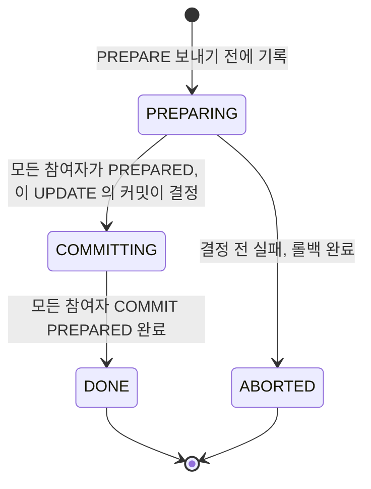

```typescript
import { Pool } from 'pg';
import crypto from 'crypto';

async function commitPrepared(pool: Pool, gid: string): Promise<void> {
    const conn = await pool.connect();
    try {
        await conn.query(`COMMIT PREPARED '${gid}'`);
    } catch (e: any) {
        // 이미 커밋된 gid 도, 롤백돼서 없는 gid 도 같은 메시지가 나온다.
        // xa_log 가 COMMITTING 일 때만 호출하므로 커밋된 것으로 본다
        if (!/does not exist/.test(e.message)) throw e;
    } finally {
        conn.release();
    }
}

async function createOrder(id: string, amount: number): Promise<void> {
    const xid = crypto.randomUUID();
    const orderGid = `${xid}-order`;
    const paymentGid = `${xid}-payment`;
    const orderConn = await orderPool.connect();
    const paymentConn = await paymentPool.connect();
    const prepared = { order: false, payment: false };

    try {
        await coordDb.query(`INSERT INTO xa_log (xid, state) VALUES ($1, 'PREPARING')`, [xid]);

        await orderConn.query('BEGIN');
        await paymentConn.query('BEGIN');
        await orderConn.query('INSERT INTO orders VALUES ($1, $2)', [id, amount]);
        await paymentConn.query('INSERT INTO payments VALUES ($1, $2, $3)', [id, id, amount]);

        await orderConn.query(`PREPARE TRANSACTION '${orderGid}'`);
        prepared.order = true;
        await paymentConn.query(`PREPARE TRANSACTION '${paymentGid}'`);
        prepared.payment = true;

        // 이 UPDATE 가 커밋되는 순간이 전역 커밋 시점이다
        await coordDb.query(`UPDATE xa_log SET state = 'COMMITTING' WHERE xid = $1`, [xid]);
    } catch (e) {
        // 결정 전 실패는 전부 롤백. 연결이 PREPARE 를 지났는지에 따라 명령이 다르다
        await Promise.allSettled([
            prepared.order ? orderPool.query(`ROLLBACK PREPARED '${orderGid}'`) : orderConn.query('ROLLBACK'),
            prepared.payment ? paymentPool.query(`ROLLBACK PREPARED '${paymentGid}'`) : paymentConn.query('ROLLBACK'),
        ]);
        await coordDb.query(`UPDATE xa_log SET state = 'ABORTED' WHERE xid = $1`, [xid]);
        throw e;
    } finally {
        orderConn.release();
        paymentConn.release();
    }

    // Phase 2. 여기서 실패해도 롤백하지 않는다. recover() 가 이어서 커밋한다
    await commitPrepared(orderPool, orderGid);
    await commitPrepared(paymentPool, paymentGid);
    await coordDb.query(`UPDATE xa_log SET state = 'DONE' WHERE xid = $1`, [xid]);
}

async function recover(minAgeSec = 60): Promise<void> {
    const { rows } = await coordDb.query(
        `SELECT xid, state FROM xa_log
          WHERE state IN ('PREPARING', 'COMMITTING')
            AND created_at < now() - make_interval(secs => $1)`,
        [minAgeSec],
    );
    for (const { xid, state } of rows) {
        for (const [pool, gid] of [[orderPool, `${xid}-order`], [paymentPool, `${xid}-payment`]] as const) {
            if (state === 'COMMITTING') {
                await commitPrepared(pool, gid);
            } else {
                // 결정 기록이 없으면 커밋한 참여자가 없으므로 롤백이 안전하다
                await pool.query(`ROLLBACK PREPARED '${gid}'`).catch((e) => {
                    if (!/does not exist/.test(e.message)) throw e;
                });
            }
        }
        await coordDb.query(`UPDATE xa_log SET state = $2 WHERE xid = $1`, [xid, state === 'COMMITTING' ? 'DONE' : 'ABORTED']);
    }
}
```

`recover()`의 `minAgeSec`는 느리지만 아직 살아 있는 요청을 롤백하지 않으려는 안전 간격이다. 0으로 두면 진행 중인 `PREPARING` 행까지 건드린다.

같은 장애를 이 구현에 주입한 결과다.

| 주입한 장애 | 결과 |
|---|---|
| payments INSERT 실패(PREPARE 전) | orders 0행, payments 0행, prepared 0건, `idle in transaction` 0개, xa_log `ABORTED`. 같은 풀로 보낸 다음 요청은 정상 커밋 |
| 결정 기록 뒤 Phase 2에서 payments 쪽 단절 | recover 전에는 prepared 2건에 행은 0개. recover 뒤 양쪽 1행, xa_log `DONE` |
| 두 PREPARE가 끝난 뒤, 결정 기록 전에 프로세스 사망 | recover 뒤 prepared 0건, 행 0개, xa_log `ABORTED` |
| `recover()` 재실행 | 변화 없음 |

### 2PC의 문제점

**1. in-doubt와 blocking**

Phase 1이 끝나고 모든 참여자가 OK를 보냈다. 이때 코디네이터가 죽으면 참여자는 커밋할지 롤백할지 모른 채 lock을 쥐고 기다린다. 이 상태가 **in-doubt**다. 코디네이터가 어느 시점에 죽었는지에 따라 복구 방법이 달라진다.

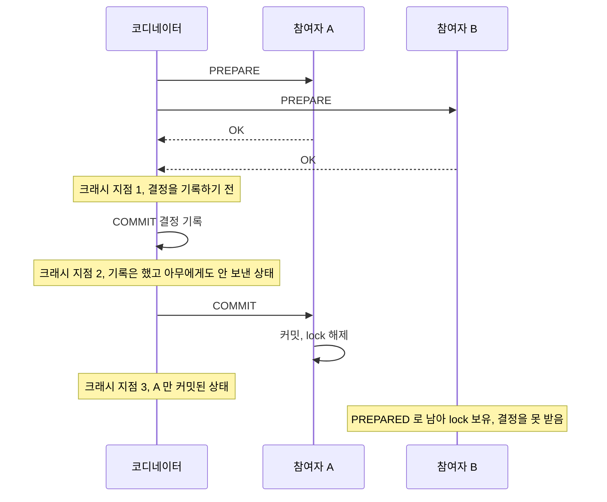

세 지점에서 코디네이터 로그와 참여자 상태, 재시작 뒤 해야 할 일은 이렇게 다르다.

| 크래시 지점 | 코디네이터 로그 | 참여자 상태 | 재시작 뒤 처리 |
|---|---|---|---|
| 1. 결정 기록 전 | 결정 없음 | A, B 모두 PREPARED | ROLLBACK. 커밋한 참여자가 아직 없다 |
| 2. 기록 후, 전파 전 | COMMIT | A, B 모두 PREPARED | 양쪽에 COMMIT 재전송 |
| 3. A에만 전파 | COMMIT | A 커밋, B PREPARED | B에 COMMIT 재전송 |

세 번째 줄이 문제다. 로그가 살아 있으면 B에 COMMIT을 보내면 끝난다. 로그가 없으면 B를 롤백하는 게 안전한 기본값처럼 보이지만 A는 이미 커밋됐다. 로그가 사라지는 경우는 "실제로 겪는 문제들"에서 다시 본다.

PostgreSQL 16.15에서 in-doubt 상태를 직접 만들어 확인한 것들이다.

- PREPARED 트랜잭션은 클라이언트 연결이 끊겨도, 서버를 재시작해도 남는다. lock도 그대로다.
- 같은 row를 UPDATE하거나 `SELECT ... FOR UPDATE`하면 `lock_timeout`에서 실패한다. 다른 row의 UPDATE는 성공한다. 일반 SELECT는 막히지 않고 커밋 전 값을 읽는다. "이 row를 읽는 요청이 전부 타임아웃된다"는 서술은 정확하지 않다. 막히는 쪽은 쓰기와 `FOR UPDATE`다.
- VACUUM도 영향을 받는다. 1,000행 테이블에서 PREPARED 트랜잭션을 걸어둔 채 전체 UPDATE와 500행 DELETE를 하고 `VACUUM VERBOSE`를 돌리면 `1500 are dead but not yet removable`이 나온다. `ROLLBACK PREPARED` 뒤에 다시 돌리면 1,501개가 제거되고 제거 못 한 행은 0이다. 방치된 PREPARED 트랜잭션 하나가 테이블 전체의 bloat 원인이 된다.
- `pg_prepared_xacts`가 보여주는 열은 `transaction`, `gid`, `prepared`, `owner`, `database` 다섯 개뿐이다. 어느 row를 잡고 있는지, 커밋해야 하는지는 나오지 않는다.

**2. 코디네이터 단일 장애점(SPOF)**

코디네이터 하나가 전체 트랜잭션의 생사를 결정한다. 코디네이터를 이중화해도 이중화된 코디네이터들 사이의 합의가 또 다른 분산 합의 문제가 된다.

**3. 성능 저하**

네트워크 왕복이 최소 4번(Prepare 요청, Prepare 응답, Commit 요청, Commit 응답) 필요하고 그 사이에 lock이 유지된다. 트래픽이 몰리면 lock 경합이 커지면서 처리량이 떨어진다.

이런 이유로 마이크로서비스 환경에서는 2PC 대신 Saga 패턴을 주로 쓴다.


## Saga 패턴

Saga는 분산 트랜잭션을 **여러 개의 로컬 트랜잭션**으로 쪼개고, 중간에 실패하면 **보상 트랜잭션(Compensation Transaction)**을 실행해서 이전 단계를 되돌리는 방식이다.

```
정상 흐름:
  T1(주문 생성) → T2(결제 처리) → T3(재고 차감) → 완료

T3 실패 시:
  T1(주문 생성) → T2(결제 처리) → T3(재고 차감 실패!)
                                  → C2(결제 취소) → C1(주문 취소)
```

핵심은 각 로컬 트랜잭션이 **즉시 커밋**된다는 점이다. 2PC처럼 lock을 잡고 기다리지 않는다. 대신 실패 시 보상으로 되돌린다.

### Choreography 방식

중앙 조율자 없이, 각 서비스가 이벤트를 발행하고 다음 서비스가 그 이벤트를 구독해서 자기 작업을 수행한다. 재고 차감이 실패하는 경우의 이벤트 흐름과, 보상이 다시 실패할 수 있는 지점은 다음과 같다.

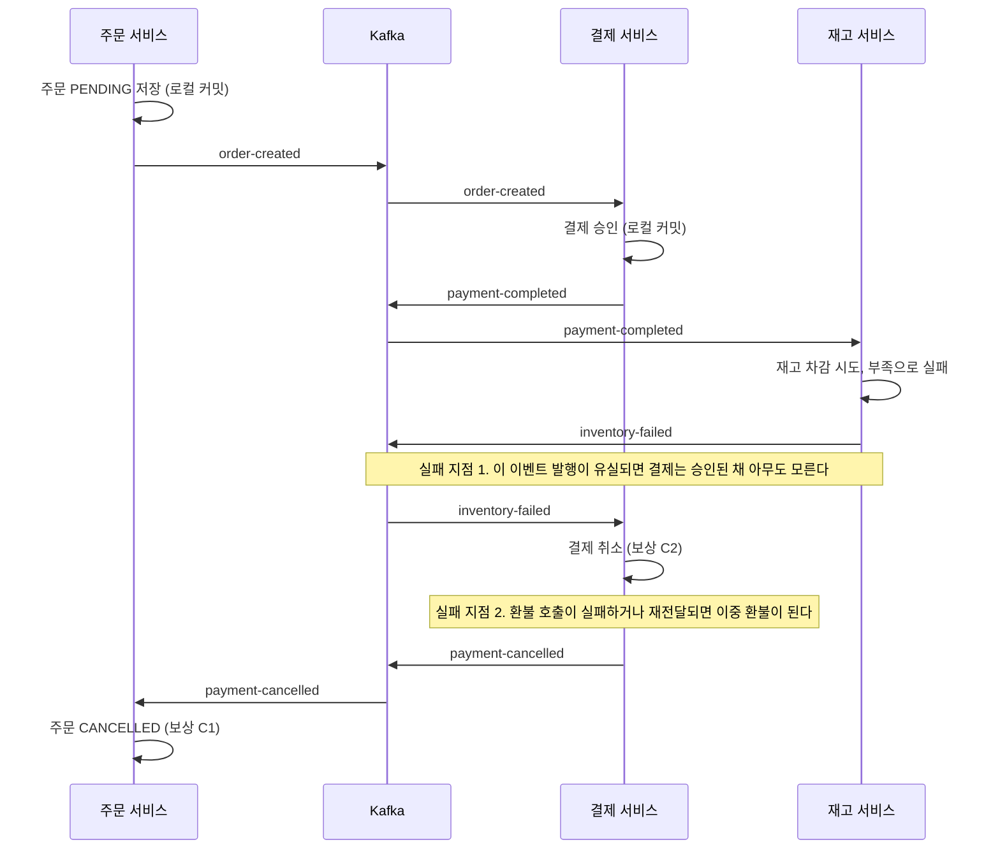

보상은 정방향 흐름을 거꾸로 따라가고, 각 단계가 자기 로컬 트랜잭션을 따로 커밋한다. 다이어그램에서 볼 곳은 두 군데의 `Note`다. 1번은 로컬 커밋과 이벤트 발행이 별개 작업이라서 생기는 문제로, Outbox 절에서 다룬다. 2번은 Kafka가 at-least-once라서 `inventory-failed`가 두 번 도착할 수 있다는 데서 오며, "실제로 겪는 문제들"의 보상 멱등성에서 실험 결과를 적었다.

결제 서비스 쪽 코드만 보면 구조는 단순하다. 구독한 이벤트마다 로컬 트랜잭션 하나를 돌리고, 다음 이벤트를 발행한다.

```typescript
@Injectable()
export class PaymentService {
    async handleOrderCreated(event: OrderCreatedEvent): Promise<void> {
        try {
            const payment = await this.dataSource.transaction((m) =>
                m.save(m.create(Payment, { orderId: event.orderId, amount: event.amount })));
            await this.kafkaProducer.send('payment-completed', {
                orderId: event.orderId, paymentId: payment.id });
        } catch (e) {
            if (!(e instanceof InsufficientBalanceError)) throw e;
            await this.kafkaProducer.send('payment-failed', {
                orderId: event.orderId, reason: e.message });
        }
    }

    // 보상: 재고 실패 → 결제 취소
    async handleInventoryFailed(event: InventoryFailedEvent): Promise<void> {
        await this.dataSource.transaction(async (m) => {
            const payment = await m.findOne(Payment, { where: { orderId: event.orderId } });
            payment.status = 'CANCELLED';
            await m.save(payment);
        });
        await this.kafkaProducer.send('payment-cancelled', { orderId: event.orderId });
    }
}
```

이 코드에는 문제가 둘 있다. `save`가 커밋된 뒤 `send`가 실패하면 결제는 있는데 이벤트는 없다. 그리고 `handleInventoryFailed`는 같은 이벤트가 두 번 와도 그냥 한 번 더 돈다. 상태만 바꾸는 코드라 지금은 무해해 보이지만, 여기에 환불 API 호출이 들어가는 순간 이중 환불이 된다.

Choreography의 구조적 약점은 **서비스가 3~4개만 넘어가도 흐름을 추적하기 어렵다**는 점이다. 누가 어떤 이벤트를 발행하고 구독하는지가 코드 여러 곳에 흩어져 있다. 서비스 간 순환 구독이 생기면 장애 때 이벤트가 어디서 멈췄는지 찾기 힘들다.


### Orchestration 방식

중앙의 Saga Orchestrator가 전체 흐름을 관리한다. 각 서비스에게 명령을 보내고, 응답을 보고 다음 단계를 정한다. Choreography와 같은 시나리오를 그리면 이렇게 된다.

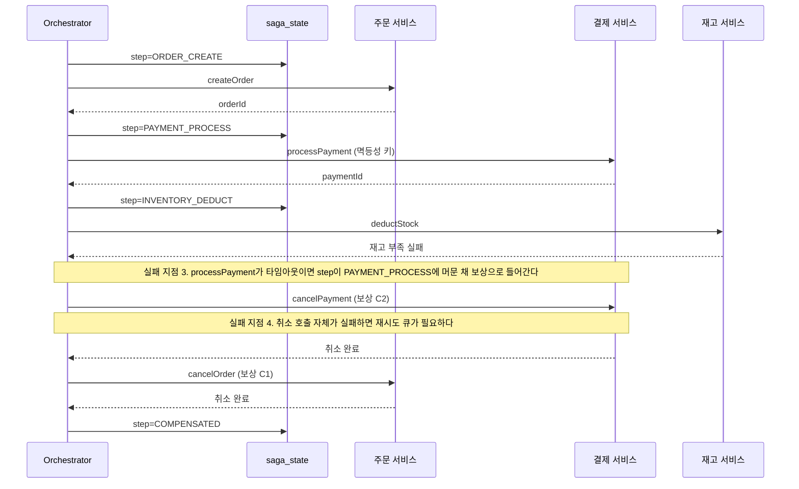

`saga_state`에 단계를 기록하는 줄이 복구 지점이다. Orchestrator가 중간에 죽어도 재시작 후 마지막으로 저장된 step에서 이어갈 수 있다. state가 없으면 처음부터 다시 실행하게 되고 주문이 중복 생성된다. 호출을 보낼 때는 멱등성 키를 같이 보낸다. 타임아웃이 나면 결제가 됐는지 안 됐는지 호출자는 모르기 때문이다.

```typescript
@Injectable()
export class OrderSagaOrchestrator {
    async execute(request: OrderRequest): Promise<void> {
        const state = await this.repo.save({ sagaId: crypto.randomUUID(), step: SagaStep.ORDER_CREATE });
        try {
            const order = await this.orderClient.createOrder(request);
            state.orderId = order.orderId;
            state.step = SagaStep.PAYMENT_PROCESS;
            await this.repo.save(state);

            const payment = await this.paymentClient.processPayment(order.orderId, request.amount);
            state.paymentId = payment.paymentId;
            state.step = SagaStep.INVENTORY_DEDUCT;
            await this.repo.save(state);

            await this.inventoryClient.deductStock(request.productId, request.quantity);
            state.step = SagaStep.COMPLETED;
            await this.repo.save(state);
        } catch (e) {
            await this.compensate(state);
        }
    }

    private async compensate(state: SagaState): Promise<void> {
        if (state.step === SagaStep.INVENTORY_DEDUCT) {
            await this.paymentClient.cancelPayment(state.paymentId);
        }
        if (state.step >= SagaStep.PAYMENT_PROCESS) {
            await this.orderClient.cancelOrder(state.orderId);
        }
        state.step = SagaStep.COMPENSATED;
        await this.repo.save(state);
    }
}
```

이 코드는 위 다이어그램의 실패 지점 3에서 조용히 틀린다. `processPayment`가 타임아웃으로 예외를 던졌는데 결제 서비스는 이미 승인을 끝낸 경우, `state.step`은 아직 `PAYMENT_PROCESS`이고 `state.paymentId`는 비어 있다. `compensate`는 첫 번째 `if`를 건너뛰고 `cancelOrder`만 호출한다. 이 시나리오를 모의 서비스로 돌려보니 호출 기록이 `['cancelOrder']` 하나뿐이었고 결제 쪽 `charged`는 `true`로 남았다. 주문은 취소됐는데 돈은 빠져나간 상태다.

고치려면 결제 호출 전에 `paymentId`(또는 멱등성 키)를 먼저 만들어 state에 저장하고, 보상에서는 `PAYMENT_PROCESS` 단계에서도 그 키로 `cancelPayment`를 부른다. 결제 서비스는 승인된 적 없는 키의 취소를 "할 일 없음"으로 성공 처리해야 한다. 이 두 번째 조건이 빠지면 보상이 실패하고 재시도 루프에 갇힌다. 뒤쪽 TCC 절의 Cancel이 Try보다 먼저 오는 문제와 같은 뿌리다.

Orchestration은 흐름이 한 곳에서 보여서 디버깅이 쉽다. 대신 Orchestrator의 상태 저장과 크래시 복구를 직접 만들어야 한다.

### Choreography vs Orchestration 비교

| 기준 | Choreography | Orchestration |
|------|-------------|---------------|
| 흐름 제어 | 각 서비스가 알아서 | 중앙 오케스트레이터 |
| 결합도 | 이벤트를 통한 느슨한 결합 | 오케스트레이터에 의존 |
| 디버깅 | 이벤트 추적이 어려움 | 한 곳에서 흐름 확인 |
| 서비스 수가 적을 때 | 간단하고 빠름 | 오버엔지니어링 |
| 서비스 수가 많을 때 | 이벤트 스파게티 | 관리가 수월 |
| 장애점 | 분산됨 | 오케스트레이터가 SPOF |

3~4개 서비스 이하의 단순한 흐름은 Choreography로 충분하다. 그 이상이거나 조건 분기가 복잡하면 Orchestration이 맞다.

<div class="ygd-saga-choreography-vs-orchestration" id="ygd-saga-choreography-vs-orchestration">
<style>
.ygd-saga-choreography-vs-orchestration{--ygd-bg:#FFFFFF;--ygd-card:#FBFAF8;--ygd-cell:#F1EEEA;--ygd-border:#CFC9C2;--ygd-text:#2B2724;--ygd-muted:#665F58;--ygd-accent:#2F6A80;--ygd-on-accent:#FFFFFF;--ygd-accent-tint:#E3EFF3;--ygd-bad:#B3362B;--ygd-bad-tint:#F8E0DC;max-width:760px;margin-left:auto;margin-right:auto;box-sizing:border-box;padding:16px;border:1px solid var(--ygd-border);border-radius:12px;background:var(--ygd-bg);color:var(--ygd-text);font-size:15px;line-height:1.55;overflow:hidden}
body[data-md-color-scheme="slate"] .ygd-saga-choreography-vs-orchestration{--ygd-bg:#26221F;--ygd-card:#2E2A27;--ygd-cell:#383330;--ygd-border:#554E48;--ygd-text:#F0EDE9;--ygd-muted:#B5AEA5;--ygd-accent:#7CC0D8;--ygd-on-accent:#1B1816;--ygd-accent-tint:#2F4650;--ygd-bad:#F08A80;--ygd-bad-tint:#4D2A26}
.ygd-saga-choreography-vs-orchestration *{box-sizing:border-box}
.ygd-saga-choreography-vs-orchestration .ygd-title{margin:0 0 10px;font-size:16px;font-weight:700;color:var(--ygd-text)}
.ygd-saga-choreography-vs-orchestration .ygd-tabs{display:flex;flex-wrap:wrap;gap:8px;margin:0 0 10px}
.ygd-saga-choreography-vs-orchestration .ygd-tab{appearance:none;display:flex;flex-direction:column;align-items:flex-start;min-height:44px;padding:8px 14px;border:1.5px solid var(--ygd-border);border-radius:8px;background:var(--ygd-card);color:var(--ygd-text);font:inherit;line-height:1.3;cursor:pointer}
.ygd-saga-choreography-vs-orchestration .ygd-tab-name{font-size:14px;font-weight:700}
.ygd-saga-choreography-vs-orchestration .ygd-tab-sub{font-size:12px;color:var(--ygd-muted)}
.ygd-saga-choreography-vs-orchestration .ygd-tab-on{border-color:var(--ygd-accent);background:var(--ygd-accent-tint)}
.ygd-saga-choreography-vs-orchestration .ygd-tab:hover{border-color:var(--ygd-accent)}
.ygd-saga-choreography-vs-orchestration .ygd-tab:focus-visible,.ygd-saga-choreography-vs-orchestration .ygd-btn:focus-visible{outline:3px solid var(--ygd-accent);outline-offset:2px}
.ygd-saga-choreography-vs-orchestration .ygd-ctrl{display:flex;flex-wrap:wrap;gap:8px;margin:0 0 10px}
.ygd-saga-choreography-vs-orchestration .ygd-btn{appearance:none;min-height:44px;padding:8px 14px;border:1.5px solid var(--ygd-border);border-radius:8px;background:var(--ygd-card);color:var(--ygd-text);font:inherit;font-size:14px;font-weight:600;line-height:1.3;cursor:pointer}
.ygd-saga-choreography-vs-orchestration .ygd-btn:hover{border-color:var(--ygd-accent)}
.ygd-saga-choreography-vs-orchestration .ygd-btn-main{background:var(--ygd-accent);border-color:var(--ygd-accent);color:var(--ygd-on-accent)}
.ygd-saga-choreography-vs-orchestration .ygd-btn[disabled]{opacity:.5;cursor:default}
.ygd-saga-choreography-vs-orchestration .ygd-panel{border:1px solid var(--ygd-border);border-radius:10px;background:var(--ygd-bg);padding:6px}
.ygd-saga-choreography-vs-orchestration .ygd-svg{display:block;width:100%;height:auto}
.ygd-saga-choreography-vs-orchestration .ygd-svg.ygd-off,.ygd-saga-choreography-vs-orchestration .ygd-cmp.ygd-off{display:none}
.ygd-saga-choreography-vs-orchestration .ygd-svg text{font-family:inherit}
.ygd-saga-choreography-vs-orchestration .ygd-mk-ok{fill:var(--ygd-accent)}
.ygd-saga-choreography-vs-orchestration .ygd-mk-bad{fill:var(--ygd-bad)}
.ygd-saga-choreography-vs-orchestration .ygd-life{stroke:var(--ygd-border);stroke-width:1.5;stroke-dasharray:4 4}
.ygd-saga-choreography-vs-orchestration .ygd-head{fill:var(--ygd-cell);stroke:var(--ygd-border);stroke-width:1.5}
.ygd-saga-choreography-vs-orchestration .ygd-head-t{fill:var(--ygd-text);font-size:11px;font-weight:700}
.ygd-saga-choreography-vs-orchestration .ygd-step{transition:opacity .35s}
.ygd-saga-choreography-vs-orchestration .ygd-future{opacity:.35}
.ygd-saga-choreography-vs-orchestration .ygd-arrow{stroke-width:2}
.ygd-saga-choreography-vs-orchestration .ygd-k-ok .ygd-arrow{stroke:var(--ygd-accent)}
.ygd-saga-choreography-vs-orchestration .ygd-k-bad .ygd-arrow{stroke:var(--ygd-bad)}
.ygd-saga-choreography-vs-orchestration .ygd-now .ygd-arrow{stroke-width:3;stroke-dasharray:6 4;animation:ygd-saga-flow .8s linear infinite}
.ygd-saga-choreography-vs-orchestration .ygd-lbl{fill:var(--ygd-text);font-size:10px;font-weight:600}
.ygd-saga-choreography-vs-orchestration .ygd-chip{fill:var(--ygd-accent-tint);stroke:var(--ygd-accent);stroke-width:1.5}
.ygd-saga-choreography-vs-orchestration .ygd-k-bad .ygd-chip{fill:var(--ygd-bad-tint);stroke:var(--ygd-bad)}
.ygd-saga-choreography-vs-orchestration .ygd-chip-t{fill:var(--ygd-text);font-size:11px;font-weight:700}
.ygd-saga-choreography-vs-orchestration .ygd-now .ygd-chip{stroke-width:3}
.ygd-saga-choreography-vs-orchestration .ygd-stub{stroke:var(--ygd-border);stroke-width:1.5}
.ygd-saga-choreography-vs-orchestration .ygd-sbox{fill:var(--ygd-card);stroke:var(--ygd-border);stroke-width:1.5}
.ygd-saga-choreography-vs-orchestration .ygd-sbox.ygd-flash{animation:ygd-saga-flash 1s ease-out}
.ygd-saga-choreography-vs-orchestration .ygd-stub.ygd-flash{stroke:var(--ygd-accent)}
.ygd-saga-choreography-vs-orchestration .ygd-st-k{fill:var(--ygd-muted);font-size:11px;font-weight:700}
.ygd-saga-choreography-vs-orchestration .ygd-st-v{fill:var(--ygd-text);font-size:11px;font-weight:700}
.ygd-saga-choreography-vs-orchestration .ygd-cap{margin:12px 0 0;padding:12px 14px;border:1px solid var(--ygd-border);border-left:4px solid var(--ygd-accent);border-radius:8px;background:var(--ygd-card)}
.ygd-saga-choreography-vs-orchestration .ygd-cap-head{margin:0 0 4px;font-size:14px;font-weight:700;color:var(--ygd-accent)}
.ygd-saga-choreography-vs-orchestration .ygd-cap-body{font-size:14px;color:var(--ygd-text)}
.ygd-saga-choreography-vs-orchestration .ygd-cmp{display:grid;grid-template-columns:repeat(auto-fit,minmax(150px,1fr));gap:8px;margin:12px 0 0}
.ygd-saga-choreography-vs-orchestration .ygd-cmp-i{display:flex;flex-direction:column;padding:8px 10px;border:1px solid var(--ygd-border);border-radius:8px;background:var(--ygd-cell)}
.ygd-saga-choreography-vs-orchestration .ygd-cmp-k{font-size:12px;color:var(--ygd-muted)}
.ygd-saga-choreography-vs-orchestration .ygd-cmp-v{font-size:14px;font-weight:600;color:var(--ygd-text)}
.ygd-saga-choreography-vs-orchestration .ygd-legend,.ygd-saga-choreography-vs-orchestration .ygd-note{margin:12px 0 0;font-size:14px;color:var(--ygd-muted)}
@keyframes ygd-saga-flow{to{stroke-dashoffset:-20}}
@keyframes ygd-saga-flash{0%{fill:var(--ygd-accent-tint)}100%{fill:var(--ygd-card)}}
@media (prefers-reduced-motion:reduce){.ygd-saga-choreography-vs-orchestration .ygd-step{transition:none}.ygd-saga-choreography-vs-orchestration .ygd-now .ygd-arrow,.ygd-saga-choreography-vs-orchestration .ygd-sbox.ygd-flash{animation:none}}
</style>
<div class="ygd-title">재고 차감 실패 시 보상 흐름</div>
<div class="ygd-tabs" role="tablist" aria-label="Saga 조율 방식 선택">
<button type="button" class="ygd-tab ygd-tab-on" role="tab" id="ygd-saga-choreography-vs-orchestration-tab0" aria-selected="true" aria-controls="ygd-saga-choreography-vs-orchestration-panel" tabindex="0"><span class="ygd-tab-name">Choreography</span><span class="ygd-tab-sub">이벤트 연쇄</span></button>
<button type="button" class="ygd-tab" role="tab" id="ygd-saga-choreography-vs-orchestration-tab1" aria-selected="false" aria-controls="ygd-saga-choreography-vs-orchestration-panel" tabindex="-1"><span class="ygd-tab-name">Orchestration</span><span class="ygd-tab-sub">중앙 조율</span></button>
</div>
<div class="ygd-ctrl">
<button type="button" class="ygd-btn ygd-btn-main" data-ygd="play">재생</button>
<button type="button" class="ygd-btn" data-ygd="prev">이전</button>
<button type="button" class="ygd-btn" data-ygd="next">다음</button>
<button type="button" class="ygd-btn" data-ygd="reset">처음으로</button>
</div>
<div class="ygd-panel" id="ygd-saga-choreography-vs-orchestration-panel" role="tabpanel" aria-labelledby="ygd-saga-choreography-vs-orchestration-tab0">
<svg class="ygd-svg" data-ygd="svg0" viewBox="0 0 424 374" preserveAspectRatio="xMidYMid meet" role="img" aria-label="Choreography 방식의 보상 흐름 시퀀스 다이어그램. 주문, 결제, 재고 서비스가 이벤트를 주고받는다. 재고 차감이 실패하면 재고 차감 실패 이벤트에 이어 결제 취소, 주문 취소가 이벤트 연쇄로 진행된다."></svg>
<svg class="ygd-svg ygd-off" data-ygd="svg1" viewBox="0 0 424 414" preserveAspectRatio="xMidYMid meet" role="img" aria-label="Orchestration 방식의 보상 흐름 시퀀스 다이어그램. 오케스트레이터가 주문, 결제, 재고 서비스에 지시하고 응답을 받으며 단계마다 상태 저장소에 진행 상태를 기록한다. 재고 차감이 실패하면 오케스트레이터가 결제 취소, 주문 취소를 지시한다."></svg>
<div class="ygd-cap" aria-live="polite"><div class="ygd-cap-head" data-ygd="caphead"></div><div class="ygd-cap-body" data-ygd="capbody"></div></div>
<div class="ygd-cmp" data-ygd="cmp0"><div class="ygd-cmp-i"><span class="ygd-cmp-k">흐름 제어</span><span class="ygd-cmp-v">각 서비스가 알아서</span></div><div class="ygd-cmp-i"><span class="ygd-cmp-k">결합도</span><span class="ygd-cmp-v">이벤트를 통한 느슨한 결합</span></div><div class="ygd-cmp-i"><span class="ygd-cmp-k">디버깅</span><span class="ygd-cmp-v">이벤트 추적이 어려움</span></div><div class="ygd-cmp-i"><span class="ygd-cmp-k">장애점</span><span class="ygd-cmp-v">분산됨</span></div></div>
<div class="ygd-cmp ygd-off" data-ygd="cmp1"><div class="ygd-cmp-i"><span class="ygd-cmp-k">흐름 제어</span><span class="ygd-cmp-v">중앙 오케스트레이터</span></div><div class="ygd-cmp-i"><span class="ygd-cmp-k">결합도</span><span class="ygd-cmp-v">오케스트레이터에 의존</span></div><div class="ygd-cmp-i"><span class="ygd-cmp-k">디버깅</span><span class="ygd-cmp-v">한 곳에서 흐름 확인</span></div><div class="ygd-cmp-i"><span class="ygd-cmp-k">장애점</span><span class="ygd-cmp-v">오케스트레이터가 SPOF</span></div></div>
</div>
<div class="ygd-legend">파란색은 정상 흐름, 빨간색은 실패와 보상(↩)이다. 점선이 흐르는 화살표가 현재 단계이고, 흐리게 보이는 부분은 아직 진행되지 않은 단계다. T는 로컬 트랜잭션, C는 보상 트랜잭션이다.</div>
<div class="ygd-note">비유: Choreography는 지휘자 없이 서로의 연주를 듣고 이어서 연주하는 합주, Orchestration은 지휘자가 연주자에게 지시하고 진행 위치를 기록해 두는 합주와 비슷하다. 비유일 뿐이고, 실제 Saga에서는 각 로컬 트랜잭션이 즉시 커밋되며 실패하면 보상 트랜잭션으로 되돌린다. 3~4개 서비스 이하의 단순한 흐름은 Choreography로 충분하고, 그 이상이거나 조건 분기가 복잡하면 Orchestration이 맞다.</div>
<script>
(function(){
var P='ygd-saga-choreography-vs-orchestration';
var root=document.getElementById(P);
if(!root){return;}
var NS='http://www.w3.org/2000/svg';
function $(k){return root.querySelector('[data-ygd="'+k+'"]');}
function mk(tag,a,parent){var e=document.createElementNS(NS,tag);for(var k in a){e.setAttribute(k,a[k]);}if(parent){parent.appendChild(e);}return e;}
function txt(parent,x,y,s,cls,anchor){var t=mk('text',{x:x,y:y,'class':cls},parent);if(anchor){t.setAttribute('text-anchor',anchor);}t.textContent=s;return t;}
function defs(svg,pfx){var d=mk('defs',{},svg);['ok','bad'].forEach(function(k){var m=mk('marker',{id:P+'-'+pfx+'-'+k,viewBox:'0 0 10 10',refX:'9',refY:'5',markerWidth:'6',markerHeight:'6',orient:'auto'},d);mk('path',{d:'M0 0L10 5L0 10z','class':'ygd-mk-'+k},m);});}
function life(svg,x,y1,y2){mk('line',{x1:x,y1:y1,x2:x,y2:y2,'class':'ygd-life'},svg);}
function head(svg,cx,w,label){mk('rect',{x:cx-w/2,y:6,width:w,height:34,rx:7,'class':'ygd-head'},svg);txt(svg,cx,28,label,'ygd-head-t','middle');}
function arrow(g,pfx,x1,x2,y,kind,msg,lx){mk('line',{x1:x1,y1:y,x2:x2,y2:y,'class':'ygd-arrow','marker-end':'url(#'+P+'-'+pfx+'-'+kind+')'},g);txt(g,lx,y-9,msg,'ygd-lbl','middle');}
var s0=$('svg0'),s1=$('svg1');
var CX=[78,212,346];
var cho=[
{who:0,chip:'T1 주문 생성',to:1,msg:'주문 생성됨',kind:'ok'},
{who:1,chip:'T2 결제 처리',to:2,msg:'결제 완료됨',kind:'ok'},
{who:2,chip:'T3 재고 차감 실패',to:1,msg:'재고 차감 실패',kind:'bad'},
{who:1,chip:'C2 결제 취소',to:0,msg:'결제 취소됨',kind:'bad'},
{who:0,chip:'C1 주문 취소',kind:'bad'}
];
defs(s0,'c');
['주문 서비스','결제 서비스','재고 서비스'].forEach(function(n,i){head(s0,CX[i],116,n);life(s0,CX[i],40,362);});
var g0=[],k0=[];
cho.forEach(function(r,i){
var y=56+i*70;
var g=mk('g',{'class':'ygd-step ygd-future ygd-k-'+r.kind},s0);
mk('rect',{x:CX[r.who]-70,y:y,width:140,height:26,rx:7,'class':'ygd-chip'},g);
txt(g,CX[r.who],y+18,r.chip,'ygd-chip-t','middle');
if(r.to!==undefined){var d=r.to>r.who?1:-1;arrow(g,'c',CX[r.who]+d*3,CX[r.to]-d*3,y+54,r.kind,r.msg,(CX[r.who]+CX[r.to])/2);}
g0.push(g);k0.push(r.kind);
});
var OX=[50,158,266,374];
var orc=[
{from:0,to:1,msg:'주문 생성해라',kind:'ok',state:'ORDER_CREATE',save:true},
{from:1,to:0,msg:'완료',kind:'ok',state:'PAYMENT_PROCESS',save:true},
{from:0,to:2,msg:'결제 처리해라',kind:'ok',state:'PAYMENT_PROCESS',save:false},
{from:2,to:0,msg:'완료',kind:'ok',state:'INVENTORY_DEDUCT',save:true},
{from:0,to:3,msg:'재고 차감해라',kind:'ok',state:'INVENTORY_DEDUCT',save:false},
{from:3,to:0,msg:'실패',kind:'bad',state:'INVENTORY_DEDUCT',save:false},
{from:0,to:2,msg:'↩ 결제 취소해라',kind:'bad',state:'INVENTORY_DEDUCT',save:false},
{from:0,to:1,msg:'↩ 주문 취소해라',kind:'bad',state:'COMPENSATED',save:true}
];
defs(s1,'o');
['오케스트레이터','주문 서비스','결제 서비스','재고 서비스'].forEach(function(n,i){head(s1,OX[i],96,n);life(s1,OX[i],40,352);});
var stub=mk('line',{x1:50,y1:352,x2:50,y2:366,'class':'ygd-stub'},s1);
var sb=mk('rect',{x:4,y:366,width:416,height:40,rx:8,'class':'ygd-sbox'},s1);
txt(s1,16,391,'Saga 상태 저장소','ygd-st-k','start');
var sv=txt(s1,410,391,'(저장 전)','ygd-st-v','end');
var g1=[],k1=[],sav1=[],st1=[];
orc.forEach(function(r,i){
var y=66+i*38;
var g=mk('g',{'class':'ygd-step ygd-future ygd-k-'+r.kind},s1);
var d=r.to>r.from?1:-1;
var m=Math.max(r.from,r.to);
arrow(g,'o',OX[r.from]+d*3,OX[r.to]-d*3,y,r.kind,r.msg,(OX[m-1]+OX[m])/2);
g1.push(g);k1.push(r.kind);sav1.push(r.save);st1.push(r.state);
});
var CAP0=[
['시작 전','재고 차감이 실패하는 경우의 보상 흐름이다. 중앙 조율자 없이 각 서비스가 이벤트를 발행하고, 다음 서비스가 그 이벤트를 구독해 자기 작업을 수행한다. 재생을 눌러 단계별로 확인한다.'],
['주문 서비스 · 주문 생성됨','주문 서비스가 로컬 트랜잭션(T1)으로 주문을 만들어 즉시 커밋하고 “주문 생성됨” 이벤트를 발행한다. 2PC처럼 lock을 잡고 기다리지 않는다.'],
['결제 서비스 · 결제 완료됨','결제 서비스가 이벤트를 수신해 결제를 처리하고(T2) 로컬 트랜잭션을 커밋한 뒤 “결제 완료됨” 이벤트를 발행한다.'],
['재고 서비스 · 차감 실패','재고 서비스의 재고 차감(T3)이 실패해 “재고 차감 실패” 이벤트를 발행한다. 주문과 결제는 이미 커밋됐으므로 보상 트랜잭션으로 되돌려야 한다.'],
['결제 서비스 · 결제 취소(보상)','결제 서비스가 실패 이벤트를 구독해 결제를 취소하고(C2, 환불 처리) “결제 취소됨” 이벤트를 발행한다.'],
['주문 서비스 · 주문 취소(보상)','주문 서비스가 이 이벤트를 받아 주문을 취소한다(C1). 보상이 이벤트 순서대로 연쇄 진행되는 만큼, 서비스가 늘어나면 전체 흐름을 코드만 봐서는 한눈에 알기 어렵다.']
];
var CAP1=[
['시작 전','Saga Orchestrator가 전체 흐름을 관리한다. 각 서비스에 지시하고 응답을 받아 다음 단계를 정하며, 단계마다 진행 상태를 저장소에 남긴다. 재생을 눌러 단계별로 확인한다.'],
['Saga 시작 · 주문 생성 지시','Orchestrator가 Saga를 시작하며 상태(ORDER_CREATE)를 저장하고 주문 서비스에 “주문 생성해라”를 지시한다.'],
['주문 서비스 완료 응답','주문 서비스가 “완료”로 응답하고 Orchestrator는 상태를 PAYMENT_PROCESS로 저장한다. Orchestrator가 중간에 죽어도 재시작 후 저장된 상태로 어디까지 진행됐는지 알 수 있다.'],
['결제 처리 지시','Orchestrator가 결제 서비스에 “결제 처리해라”를 지시한다. 타임아웃으로 결제 여부를 알 수 없는 경우를 대비해 호출에 멱등성 키를 넣어 재시도해도 중복 결제가 나지 않게 한다.'],
['결제 서비스 완료 응답','결제 서비스가 “완료”로 응답하고 Orchestrator는 상태를 INVENTORY_DEDUCT로 저장한다. 이 상태가 결제까지 성공했다는 기록이 된다.'],
['재고 차감 지시','Orchestrator가 재고 서비스에 “재고 차감해라”를 지시한다.'],
['재고 서비스 실패 응답','재고 서비스가 “실패”로 응답한다. 저장된 상태가 INVENTORY_DEDUCT이므로 Orchestrator는 결제까지 성공했음을 알고 보상을 시작한다.'],
['보상 1 · 결제 취소 지시','Orchestrator가 결제 서비스에 “결제 취소해라”를 지시한다. 보상은 성공했던 단계를 역순으로 되돌린다.'],
['보상 2 · 주문 취소 지시','Orchestrator가 주문 취소를 지시하고 상태를 COMPENSATED로 저장한다. 흐름이 한 곳에서 보여 디버깅이 쉽지만, Orchestrator 자체의 상태 관리와 크래시 복구가 필요하고 장애점이 될 수 있다.']
];
var modes=[
{svg:s0,groups:g0,kinds:k0,n:5,cap:CAP0},
{svg:s1,groups:g1,kinds:k1,n:8,cap:CAP1}
];
var tabs=[$('x')||root.querySelector('#'+P+'-tab0'),root.querySelector('#'+P+'-tab1')];
var panel=root.querySelector('#'+P+'-panel');
var cmps=[$('cmp0'),$('cmp1')];
var bPlay=$('play'),bPrev=$('prev'),bNext=$('next'),bReset=$('reset');
var capHead=$('caphead'),capBody=$('capbody');
var mode=0,step=0,playing=false,timer=null,DELAY=2800;
function setFlash(on){
sb.setAttribute('class','ygd-sbox');stub.setAttribute('class','ygd-stub');
if(on){void sb.getBoundingClientRect();sb.setAttribute('class','ygd-sbox ygd-flash');stub.setAttribute('class','ygd-stub ygd-flash');}
}
function render(){
var M=modes[mode],n=step;
M.groups.forEach(function(g,i){
var st=(i+1<n)?'ygd-done':((i+1===n)?'ygd-now':'ygd-future');
g.setAttribute('class','ygd-step ygd-k-'+M.kinds[i]+' '+st);
});
var c=M.cap[n];
capHead.textContent=(n===0?'':'단계 '+n+' / '+M.n+' · ')+c[0];
capBody.textContent=c[1];
if(mode===1){
sv.textContent=n===0?'(저장 전)':'step = '+st1[n-1];
setFlash(n>0&&sav1[n-1]);
}
bPrev.disabled=(n===0);
bNext.disabled=(n>=M.n);
bPlay.textContent=playing?'일시정지':(n>=M.n?'다시 재생':'재생');
}
function setStep(n){step=Math.max(0,Math.min(modes[mode].n,n));render();}
function stop(){playing=false;clearTimeout(timer);timer=null;render();}
function tick(){
if(!playing){return;}
setStep(step+1);
if(step>=modes[mode].n){stop();return;}
timer=setTimeout(tick,DELAY);
}
function play(){
if(step>=modes[mode].n){setStep(0);}
playing=true;
tick();
}
function switchMode(m,focus){
stop();
mode=m;
tabs.forEach(function(t,i){
var on=(i===m);
t.setAttribute('aria-selected',on?'true':'false');
t.setAttribute('tabindex',on?'0':'-1');
t.setAttribute('class',on?'ygd-tab ygd-tab-on':'ygd-tab');
});
modes.forEach(function(M,i){
M.svg.setAttribute('class',i===m?'ygd-svg':'ygd-svg ygd-off');
cmps[i].setAttribute('class',i===m?'ygd-cmp':'ygd-cmp ygd-off');
});
panel.setAttribute('aria-labelledby',P+'-tab'+m);
step=0;
render();
if(focus){tabs[m].focus();}
}
tabs.forEach(function(t,i){
t.addEventListener('click',function(){switchMode(i,false);});
t.addEventListener('keydown',function(e){
var k=e.key;
if(k==='ArrowRight'){e.preventDefault();switchMode((mode+1)%2,true);}
else if(k==='ArrowLeft'){e.preventDefault();switchMode((mode+1)%2,true);}
else if(k==='Home'){e.preventDefault();switchMode(0,true);}
else if(k==='End'){e.preventDefault();switchMode(1,true);}
});
});
bPlay.addEventListener('click',function(){if(playing){stop();}else{play();}});
bPrev.addEventListener('click',function(){stop();setStep(step-1);});
bNext.addEventListener('click',function(){stop();setStep(step+1);});
bReset.addEventListener('click',function(){stop();setStep(0);});
render();
})();
</script>
</div>


## TCC 패턴 (Try-Confirm-Cancel)

TCC는 비즈니스 로직 수준에서 2PC를 구현한 패턴이다. DB 레벨의 lock 대신 **비즈니스 레벨의 리소스 예약**을 쓴다. Try에서 재고를 `available`에서 `reserved`로 옮기고, Confirm에서 `reserved`를 지워 확정하고, Cancel에서 `available`로 되돌린다. 결제라면 "동결 → 결제 완료 → 잔액 복원", 좌석이라면 "임시 점유 → 확정 → 해제"가 같은 구조다.

2PC와 다른 점은 Try 시점에 이미 로컬 트랜잭션이 커밋된다는 것이다. DB lock을 쥐고 기다리지 않으니 코디네이터가 죽어도 DB가 막히지는 않는다. 대신 "예약" 상태가 비즈니스 데이터로 남아서, 누가 정리해 주지 않으면 그대로 굳는다. 예약 하나의 상태 전이는 이렇게 그려진다.

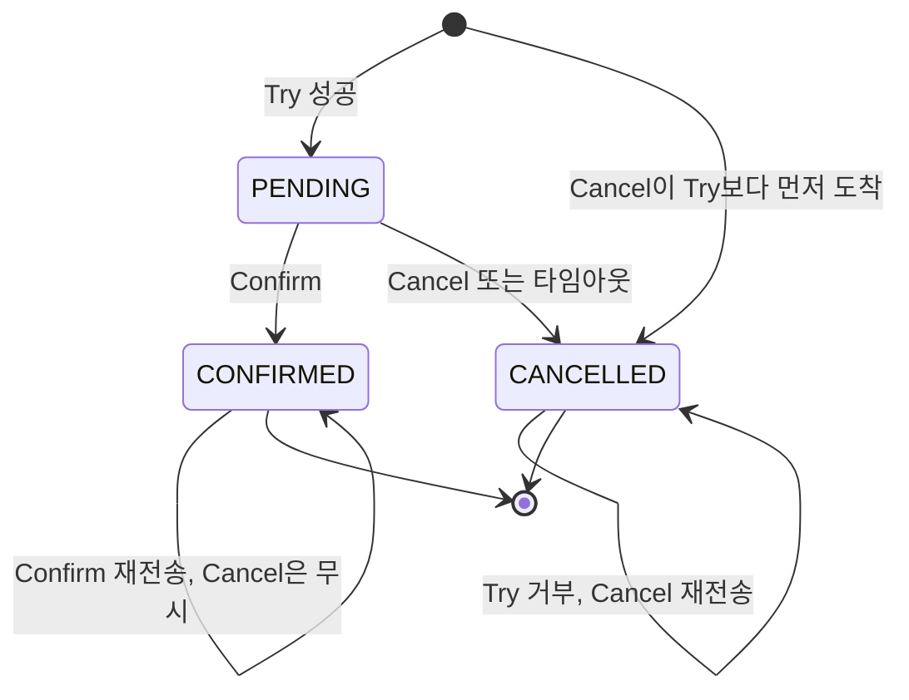

PENDING에서 시작하는 일반 경로보다 `[*] --> CANCELLED` 화살표와 두 개의 자기 루프를 봐야 한다. 네트워크가 메시지 순서를 보장하지 않으므로 Try가 늦게 도착하는 일이 생기고, 그때 시작 상태가 없으면 Cancel을 받은 서비스는 처리할 행이 없다. 이 빈 Cancel을 그냥 성공으로 돌려보내면 뒤늦게 온 Try가 예약을 만들어 영원히 PENDING으로 남는다. 아래 구현은 Cancel이 먼저 오면 CANCELLED 행을 남겨 두고(tombstone), Try가 그 행을 만나면 거부하게 했다.

```typescript
// 재고 서비스 - reservationId 는 호출하는 쪽이 만든다. Try 보다 Cancel 이 먼저 와도 같은 키를 써야 하기 때문이다
class ConfirmRejected extends Error {}

async function inTx<T>(fn: (c: PoolClient) => Promise<T>): Promise<T> {
    const c = await pool.connect();
    try {
        await c.query('BEGIN');
        const r = await fn(c);
        await c.query('COMMIT');
        return r;
    } catch (e) {
        await c.query('ROLLBACK');
        throw e;
    } finally {
        c.release();
    }
}

export async function tryReserve(reservationId: string, productId: string, quantity: number) {
    return inTx(async (c) => {
        const { rows } = await c.query('SELECT status FROM reservation WHERE id = $1 FOR UPDATE', [reservationId]);
        if (rows[0]?.status === 'CANCELLED') throw new Error('이미 Cancel 된 예약');
        if (rows[0]) return;                                   // 재전송된 Try

        const stock = await c.query('SELECT available FROM inventory WHERE product_id = $1 FOR UPDATE', [productId]);
        if (stock.rows[0].available < quantity) throw new Error('재고 부족');
        await c.query('UPDATE inventory SET available = available - $2, reserved = reserved + $2 WHERE product_id = $1', [productId, quantity]);
        await c.query(`INSERT INTO reservation (id, product_id, quantity, status) VALUES ($1, $2, $3, 'PENDING')`, [reservationId, productId, quantity]);
    });
}

export async function confirm(reservationId: string) {
    return inTx(async (c) => {
        const { rows } = await c.query('SELECT product_id, quantity, status FROM reservation WHERE id = $1 FOR UPDATE', [reservationId]);
        if (!rows[0] || rows[0].status === 'CANCELLED') throw new ConfirmRejected('확정할 수 없는 예약');
        if (rows[0].status === 'CONFIRMED') return;            // 재전송된 Confirm
        await c.query('UPDATE inventory SET reserved = reserved - $2 WHERE product_id = $1', [rows[0].product_id, rows[0].quantity]);
        await c.query(`UPDATE reservation SET status = 'CONFIRMED' WHERE id = $1`, [reservationId]);
    });
}

export async function cancel(reservationId: string, productId: string, quantity: number) {
    return inTx(async (c) => {
        const ins = await c.query(
            `INSERT INTO reservation (id, product_id, quantity, status) VALUES ($1, $2, $3, 'CANCELLED')
             ON CONFLICT (id) DO NOTHING RETURNING id`, [reservationId, productId, quantity]);
        if (ins.rowCount) return;                              // Try 가 오기 전에 온 Cancel

        const { rows } = await c.query('SELECT status FROM reservation WHERE id = $1 FOR UPDATE', [reservationId]);
        if (rows[0].status !== 'PENDING') return;              // 재전송된 Cancel 이거나 이미 확정
        await c.query('UPDATE inventory SET available = available + $2, reserved = reserved - $2 WHERE product_id = $1', [productId, quantity]);
        await c.query(`UPDATE reservation SET status = 'CANCELLED' WHERE id = $1`, [reservationId]);
    });
}
```

`cancel`이 `productId`와 `quantity`를 인자로 받는 이유는 예약 행이 아직 없을 수 있어서다. 행에서 읽어 올 수 없으니 호출자가 넘겨야 한다. `confirm`은 반대로 행이 없으면 `ConfirmRejected`를 던진다. 확정할 예약이 없는데 성공을 돌려주면 코디네이터가 확정된 줄 안다.

이 코드를 PostgreSQL 16과 node-pg로 돌려서 다음을 확인했다. 아래 다섯 가지 순서를 각각 실행했고, 마지막 항목은 300번 반복했다.

| 순서 | 결과 |
|---|---|
| Try → Confirm → Confirm 재전송 | 재전송은 무시, 재고 불변 |
| Cancel → Try | Try가 거부되고 `available=10, reserved=0` |
| Try → 타임아웃 Cancel → 뒤늦은 Confirm | `ConfirmRejected`, 재고 원복 상태 유지 |
| Try → Cancel → Cancel 재전송 | 재전송은 무시, 재고 불변 |
| Try와 Cancel 동시 실행 300회 | 매번 `available=10, reserved=0, CANCELLED` |

동시 실행에서는 Try가 거부되는 경로가 기대와 다르게 나왔다. 두 트랜잭션이 거의 동시에 시작하면 Try의 `SELECT ... FOR UPDATE`는 아직 행이 없어서 아무것도 잠그지 못하고, 그 사이 Cancel이 CANCELLED 행을 커밋한다. 그러면 Try는 "이미 Cancel 된 예약"으로 거부되지 않고, 대부분 마지막 `INSERT`에서 `duplicate key value violates unique constraint "reservation_pkey"`로 실패한다. 트랜잭션이 롤백되므로 재고는 안전하지만, 로그에 PK 충돌이 찍힌다. 이걸 장애로 오해해서 Try를 재시도하면 이번에는 CANCELLED를 만나 정상 거부된다. 어느 쪽으로 끝나든 최종 상태는 300번 모두 `available=10, reserved=0`에 예약 CANCELLED였다.

반대로 tombstone 없이 `reservation`이 null일 때 return만 하는 흔한 방어 코드는 조용히 틀린다. Cancel이 먼저 오면 아무 일도 안 하고 성공을 돌려주고, 뒤따라온 Try가 정상 예약을 만든다. 이 시나리오를 돌리면 `available=8, reserved=2`에 예약이 `PENDING`으로 남았고, Confirm도 Cancel도 다시 오지 않는다. 기존에 이 문서에 있던 구현은 한 걸음 더 나빠서 `findOne`이 null을 돌려주면 `reservation.status`에서 `TypeError`가 난다.

<div class="ygd-tcc-reservation-lifecycle" id="ygd-tcc-reservation-lifecycle">
<style>
.ygd-tcc-reservation-lifecycle{--ygd-bg:#FFFFFF;--ygd-card:#FBFAF8;--ygd-cell:#F1EEEA;--ygd-border:#CFC9C2;--ygd-text:#2B2724;--ygd-muted:#665F58;--ygd-accent:#2F6A80;--ygd-on-accent:#FFFFFF;--ygd-accent-tint:#E3EFF3;--ygd-ok:#1F7A4D;--ygd-warn:#9A5800;--ygd-bad:#B3362B;max-width:760px;margin-left:auto;margin-right:auto;box-sizing:border-box;padding:16px;border:1px solid var(--ygd-border);border-radius:12px;background:var(--ygd-bg);color:var(--ygd-text);font-size:15px;line-height:1.55;overflow:hidden}
body[data-md-color-scheme="slate"] .ygd-tcc-reservation-lifecycle{--ygd-bg:#26221F;--ygd-card:#2E2A27;--ygd-cell:#383330;--ygd-border:#554E48;--ygd-text:#F0EDE9;--ygd-muted:#B5AEA5;--ygd-accent:#7CC0D8;--ygd-on-accent:#1B1816;--ygd-accent-tint:#2F4650;--ygd-ok:#6FD09B;--ygd-warn:#F0B45C;--ygd-bad:#F08A80}
.ygd-tcc-reservation-lifecycle *{box-sizing:border-box}
.ygd-tcc-reservation-lifecycle .ygd-title{margin:0 0 4px;font-size:16px;font-weight:700;color:var(--ygd-text)}
.ygd-tcc-reservation-lifecycle .ygd-caption{margin:0 0 12px;font-size:14px;color:var(--ygd-muted)}
.ygd-tcc-reservation-lifecycle .ygd-bar{display:flex;flex-wrap:wrap;gap:8px;margin:0 0 10px}
.ygd-tcc-reservation-lifecycle .ygd-btn{appearance:none;min-height:44px;padding:8px 14px;border:1.5px solid var(--ygd-border);border-radius:8px;background:var(--ygd-card);color:var(--ygd-text);font:inherit;font-size:14px;font-weight:600;line-height:1.3;cursor:pointer}
.ygd-tcc-reservation-lifecycle .ygd-btn:hover{border-color:var(--ygd-accent)}
.ygd-tcc-reservation-lifecycle .ygd-btn:focus-visible{outline:3px solid var(--ygd-accent);outline-offset:2px}
.ygd-tcc-reservation-lifecycle .ygd-btn[aria-pressed="true"]{border-color:var(--ygd-accent);background:var(--ygd-accent-tint)}
.ygd-tcc-reservation-lifecycle .ygd-btn.ygd-primary{background:var(--ygd-accent);border-color:var(--ygd-accent);color:var(--ygd-on-accent)}
.ygd-tcc-reservation-lifecycle .ygd-btn[disabled]{opacity:.5;cursor:default}
.ygd-tcc-reservation-lifecycle .ygd-stage{border:1px solid var(--ygd-border);border-radius:10px;background:var(--ygd-bg);padding:6px}
.ygd-tcc-reservation-lifecycle .ygd-svg{display:block;width:100%;height:auto}
.ygd-tcc-reservation-lifecycle .ygd-svg text{font-family:inherit}
.ygd-tcc-reservation-lifecycle .ygd-row{opacity:.45;transition:opacity .35s}
.ygd-tcc-reservation-lifecycle .ygd-row.ygd-on{opacity:1}
.ygd-tcc-reservation-lifecycle .ygd-card{fill:var(--ygd-card);stroke:var(--ygd-border);stroke-width:1.5;transition:stroke .3s}
.ygd-tcc-reservation-lifecycle .ygd-row.ygd-cur .ygd-card{stroke:var(--ygd-accent);stroke-width:2.5}
.ygd-tcc-reservation-lifecycle .ygd-row.ygd-warn.ygd-cur .ygd-card{stroke:var(--ygd-warn)}
.ygd-tcc-reservation-lifecycle .ygd-cellbg{fill:var(--ygd-cell)}
.ygd-tcc-reservation-lifecycle .ygd-axis{stroke:var(--ygd-border);stroke-width:3;transition:stroke .3s}
.ygd-tcc-reservation-lifecycle .ygd-axis.ygd-done{stroke:var(--ygd-accent)}
.ygd-tcc-reservation-lifecycle .ygd-dot{fill:var(--ygd-bg);stroke:var(--ygd-border);stroke-width:2.5;transition:fill .3s,stroke .3s}
.ygd-tcc-reservation-lifecycle .ygd-row.ygd-on .ygd-dot{stroke:var(--ygd-accent)}
.ygd-tcc-reservation-lifecycle .ygd-row.ygd-cur .ygd-dot{fill:var(--ygd-accent)}
.ygd-tcc-reservation-lifecycle .ygd-dotnum{fill:var(--ygd-text);font-size:12px;font-weight:700;text-anchor:middle}
.ygd-tcc-reservation-lifecycle .ygd-row.ygd-cur .ygd-dotnum{fill:var(--ygd-on-accent)}
.ygd-tcc-reservation-lifecycle .ygd-rt{fill:var(--ygd-text);font-size:14px;font-weight:700}
.ygd-tcc-reservation-lifecycle .ygd-rs{fill:var(--ygd-muted);font-size:12px}
.ygd-tcc-reservation-lifecycle .ygd-lab{fill:var(--ygd-muted);font-size:11px}
.ygd-tcc-reservation-lifecycle .ygd-val{fill:var(--ygd-text);font-size:20px;font-weight:700}
.ygd-tcc-reservation-lifecycle .ygd-val.ygd-chg{fill:var(--ygd-accent)}
.ygd-tcc-reservation-lifecycle .ygd-val.ygd-lock{fill:var(--ygd-warn)}
.ygd-tcc-reservation-lifecycle .ygd-delta{fill:var(--ygd-accent);font-size:13px;font-weight:700}
.ygd-tcc-reservation-lifecycle .ygd-st{font-size:13px;font-weight:700}
.ygd-tcc-reservation-lifecycle .ygd-st-none{fill:var(--ygd-muted)}
.ygd-tcc-reservation-lifecycle .ygd-st-pending{fill:var(--ygd-warn)}
.ygd-tcc-reservation-lifecycle .ygd-st-confirmed{fill:var(--ygd-ok)}
.ygd-tcc-reservation-lifecycle .ygd-st-cancelled{fill:var(--ygd-bad)}
.ygd-tcc-reservation-lifecycle .ygd-panel{margin:12px 0 0;padding:12px 14px;border:1px solid var(--ygd-border);border-left:4px solid var(--ygd-accent);border-radius:8px;background:var(--ygd-card)}
.ygd-tcc-reservation-lifecycle .ygd-step{margin:0 0 4px;font-size:14px;font-weight:700;color:var(--ygd-accent)}
.ygd-tcc-reservation-lifecycle .ygd-desc{margin:0;font-size:14px;color:var(--ygd-text)}
.ygd-tcc-reservation-lifecycle .ygd-analogy{margin:12px 0 0;font-size:14px;color:var(--ygd-muted)}
@media (prefers-reduced-motion:reduce){.ygd-tcc-reservation-lifecycle .ygd-row,.ygd-tcc-reservation-lifecycle .ygd-card,.ygd-tcc-reservation-lifecycle .ygd-axis,.ygd-tcc-reservation-lifecycle .ygd-dot{transition:none}}
</style>
  <p class="ygd-title">재고 예약 하나의 생애: Try, Confirm, Cancel</p>
  <p class="ygd-caption">재고 10개에서 2개를 예약하는 경우. 각 카드는 해당 단계가 끝난 뒤의 재고 수치와 Reservation 상태다.</p>
  <div class="ygd-bar" role="group" aria-label="시나리오 선택">
    <button type="button" class="ygd-btn ygd-tab" data-ygd-scn="normal" aria-pressed="true">정상 Confirm</button>
    <button type="button" class="ygd-btn ygd-tab" data-ygd-scn="cancel" aria-pressed="false">Cancel</button>
    <button type="button" class="ygd-btn ygd-tab" data-ygd-scn="timeout" aria-pressed="false">타임아웃 자동 Cancel</button>
  </div>
  <div class="ygd-bar" role="group" aria-label="재생 제어">
    <button type="button" class="ygd-btn ygd-primary ygd-play">재생</button>
    <button type="button" class="ygd-btn ygd-next">다음 단계</button>
    <button type="button" class="ygd-btn ygd-reset">처음으로</button>
  </div>
  <div class="ygd-stage">
    <svg class="ygd-svg" viewBox="0 0 360 352" role="img" aria-label="재고 수치와 예약 상태 타임라인"></svg>
  </div>
  <div class="ygd-panel" role="status" aria-live="polite">
    <p class="ygd-step"></p>
    <p class="ygd-desc"></p>
  </div>
  <p class="ygd-analogy">비유: 공연 좌석을 결제 전에 임시 점유해 두는 것과 비슷하다. 결제하면 확정되고, 취소하거나 시간이 지나면 자리가 풀린다. 다만 TCC에서 시간 초과 해제는 스케줄러가 cancel을 직접 호출해서 처리한다.</p>
<script>
(function(){
  var root=document.getElementById('ygd-tcc-reservation-lifecycle');
  if(!root) return;
  var NS='http://www.w3.org/2000/svg';
  var svg=root.querySelector('.ygd-svg');
  var stepEl=root.querySelector('.ygd-step');
  var descEl=root.querySelector('.ygd-desc');
  var playBtn=root.querySelector('.ygd-play');
  var nextBtn=root.querySelector('.ygd-next');
  var resetBtn=root.querySelector('.ygd-reset');
  var tabs=root.querySelectorAll('.ygd-tab');
  var MINUS='\u2212';
  var START={title:'시작 \u2014 초기 상태',sub:'재고 10개, 예약 없음',a:10,r:0,st:'none',da:'',dr:'',
    text:'available 10, reserved 0이고 Reservation은 아직 없다. 주문 흐름이 시작되기 전 상태다.'};
  var TRY={title:'Try \u2014 재고 예약',sub:'tryReserve(productId, 2)',a:8,r:2,st:'PENDING',da:MINUS+'2',dr:'+2',
    text:'Try는 재고를 확정 차감하지 않고 예약한다. 비관적 락을 잡은 트랜잭션 안에서 available을 2 줄이고 reserved를 2 늘리며, Reservation을 PENDING으로 저장하고 reservationId를 돌려준다.'};
  var SCN={
    normal:{name:'정상 Confirm',steps:[START,TRY,
      {title:'Confirm \u2014 예약 확정',sub:'Confirm 호출, reservationId 전달',a:8,r:0,st:'CONFIRMED',da:'',dr:MINUS+'2',
       text:'Confirm은 reserved에서 2를 빼고 Reservation을 CONFIRMED로 바꾼다. available은 Try에서 이미 줄어 있으므로 건드리지 않는다. 같은 reservationId로 다시 호출돼도 PENDING이 아니면 무시한다(멱등성).'}]},
    cancel:{name:'Cancel',steps:[START,TRY,
      {title:'Cancel \u2014 예약 취소',sub:'cancel(reservationId)',a:10,r:0,st:'CANCELLED',da:'+2',dr:MINUS+'2',
       text:'Cancel은 예약을 되돌린다. available에 2를 더하고 reserved에서 2를 빼 재고를 원복하며, Reservation은 CANCELLED가 된다. 이미 처리된 예약이면 무시하므로 중복 호출에도 안전하다.'}]},
    timeout:{name:'타임아웃 자동 Cancel',steps:[START,TRY,
      {title:'대기 \u2014 후속 요청 없음',sub:'5분 넘게 PENDING 유지',a:8,r:2,st:'PENDING',da:'',dr:'',warn:true,
       text:'Try 뒤에 Confirm도 Cancel도 오지 않으면 Reservation은 PENDING으로 남고, 재고 2개가 reserved에 계속 묶인다. 그대로 두면 영원히 잠긴다.'},
      {title:'스케줄러 자동 Cancel',sub:'5분 넘은 PENDING \u2192 cancel()',a:10,r:0,st:'CANCELLED',da:'+2',dr:MINUS+'2',
       text:'스케줄러가 주기적으로(문서 예시는 1분마다) 5분 넘게 PENDING인 예약을 찾아 cancel을 호출한다. 결과는 일반 Cancel과 같아서 available 10, reserved 0으로 돌아오고 경고 로그가 남는다.'}]}
  };
  var cur='normal', step=0, playing=false, timer=null;
  var rows=[], segs=[];
  function el(tag,attrs,text){
    var n=document.createElementNS(NS,tag);
    for(var k in attrs){ if(attrs.hasOwnProperty(k)) n.setAttribute(k,attrs[k]); }
    if(text!==undefined) n.textContent=text;
    return n;
  }
  function stLabel(s){ return s==='none'?'없음':s; }
  function summary(sc){
    var parts=[];
    for(var i=0;i<sc.steps.length;i++){
      var s=sc.steps[i];
      parts.push('단계 '+(i+1)+' '+s.title+': available '+s.a+', reserved '+s.r+', 예약 상태 '+stLabel(s.st)+'.');
    }
    return '재고 available과 reserved 수치, 예약 상태가 단계별로 바뀌는 타임라인. '+sc.name+' 시나리오. '+parts.join(' ');
  }
  function build(){
    var sc=SCN[cur], n=sc.steps.length, RH=108, GAP=10;
    var H=4+n*RH+(n-1)*GAP+4;
    while(svg.firstChild) svg.removeChild(svg.firstChild);
    svg.setAttribute('viewBox','0 0 360 '+H);
    svg.setAttribute('aria-label',summary(sc));
    rows=[]; segs=[];
    var i, y;
    for(i=1;i<n;i++){
      var y1=4+(i-1)*(RH+GAP)+22, y2=4+i*(RH+GAP)+22;
      var seg=el('line',{x1:22,x2:22,y1:y1,y2:y2,'class':'ygd-axis'});
      svg.appendChild(seg); segs.push(seg);
    }
    for(i=0;i<n;i++){
      var s=sc.steps[i];
      y=4+i*(RH+GAP);
      var g=el('g',{'class':'ygd-row'+(s.warn?' ygd-warn':'')});
      g.appendChild(el('rect',{x:44,y:y,width:312,height:RH,rx:10,'class':'ygd-card'}));
      g.appendChild(el('circle',{cx:22,cy:y+22,r:11,'class':'ygd-dot'}));
      g.appendChild(el('text',{x:22,y:y+26.5,'class':'ygd-dotnum'},String(i+1)));
      g.appendChild(el('text',{x:58,y:y+24,'class':'ygd-rt'},s.title));
      g.appendChild(el('text',{x:58,y:y+43,'class':'ygd-rs'},s.sub));
      var cells=[
        {x:54,w:80,lab:'available',val:String(s.a),d:s.da,lock:false},
        {x:140,w:80,lab:'reserved',val:String(s.r),d:s.dr,lock:!!s.warn},
        {x:226,w:112,lab:'예약 상태',val:stLabel(s.st),d:'',st:true}
      ];
      for(var c=0;c<cells.length;c++){
        var ce=cells[c], cy=y+54;
        g.appendChild(el('rect',{x:ce.x,y:cy,width:ce.w,height:44,rx:6,'class':'ygd-cellbg'}));
        g.appendChild(el('text',{x:ce.x+8,y:cy+15,'class':'ygd-lab'},ce.lab));
        if(ce.st){
          g.appendChild(el('text',{x:ce.x+8,y:cy+35,'class':'ygd-st ygd-st-'+s.st.toLowerCase()},ce.val));
        } else {
          var vc='ygd-val'+(ce.d?' ygd-chg':'')+(ce.lock?' ygd-lock':'');
          g.appendChild(el('text',{x:ce.x+8,y:cy+37,'class':vc},ce.val));
          if(ce.d) g.appendChild(el('text',{x:ce.x+8+(ce.val.length*12)+8,y:cy+36,'class':'ygd-delta'},ce.d));
        }
      }
      svg.appendChild(g); rows.push(g);
    }
  }
  function render(){
    var sc=SCN[cur], s=sc.steps[step], last=sc.steps.length-1, i;
    for(i=0;i<rows.length;i++){
      rows[i].setAttribute('class','ygd-row'+(sc.steps[i].warn?' ygd-warn':'')+(i<=step?' ygd-on':'')+(i===step?' ygd-cur':''));
    }
    for(i=0;i<segs.length;i++){
      segs[i].setAttribute('class','ygd-axis'+(step>=i+1?' ygd-done':''));
    }
    stepEl.textContent='단계 '+(step+1)+' / '+(last+1)+' \u00B7 '+s.title;
    descEl.textContent=s.text;
    nextBtn.disabled=(step>=last);
    playBtn.textContent=playing?'일시정지':(step>=last&&step>0?'다시 재생':'재생');
    playBtn.setAttribute('aria-label',playBtn.textContent);
  }
  function stop(){
    playing=false;
    if(timer){ clearTimeout(timer); timer=null; }
  }
  function tick(){
    var last=SCN[cur].steps.length-1;
    if(step<last){ step++; }
    if(step>=last){ stop(); render(); return; }
    render();
    timer=setTimeout(tick,1900);
  }
  function play(){
    if(playing){ stop(); render(); return; }
    var last=SCN[cur].steps.length-1;
    if(step>=last) step=0;
    playing=true;
    render();
    timer=setTimeout(tick,1900);
  }
  function select(name){
    stop(); cur=name; step=0;
    for(var i=0;i<tabs.length;i++){
      tabs[i].setAttribute('aria-pressed',tabs[i].getAttribute('data-ygd-scn')===name?'true':'false');
    }
    build(); render();
  }
  for(var t=0;t<tabs.length;t++){
    tabs[t].addEventListener('click',function(){ select(this.getAttribute('data-ygd-scn')); });
  }
  playBtn.addEventListener('click',play);
  nextBtn.addEventListener('click',function(){
    stop();
    if(step<SCN[cur].steps.length-1) step++;
    render();
  });
  resetBtn.addEventListener('click',function(){ stop(); step=0; render(); });
  build(); render();
})();
</script>
</div>

### TCC 구현 시 주의사항

**1. 멱등성(Idempotency)은 필수다**

Confirm이나 Cancel 요청이 네트워크 문제로 중복 전달될 수 있다. 같은 reservationId로 Confirm을 두 번 호출해도 결과가 같아야 한다. 위 코드에서는 상태를 먼저 읽고 이미 CONFIRMED나 CANCELLED면 재고를 건드리지 않는 부분이 멱등성 처리다.

**2. Try 타임아웃 처리**

Try 후 Confirm도 Cancel도 안 오는 경우가 있다. 이러면 리소스가 "예약" 상태로 영원히 잠긴다. 스케줄러를 돌려서 일정 시간(예: 5분) 이상 PENDING 상태인 예약을 자동 Cancel 해야 한다.

```typescript
// setInterval로 1분마다 실행 (또는 cron 라이브러리 사용)
setInterval(async () => {
    const threshold = new Date(Date.now() - 5 * 60 * 1000);
    const expired = await this.reservationRepository.find({
        where: { status: 'PENDING', createdAt: LessThan(threshold) },
    });

    for (const reservation of expired) {
        await cancel(reservation.id, reservation.productId, reservation.quantity);
        logger.warn(`Expired reservation auto-cancelled: ${reservation.id}`);
    }
}, 60_000);
```

**3. 부분 Confirm 문제**

TCC의 Confirm 단계는 2PC의 Phase 2와 같은 문제가 있다. 코디네이터(TCC를 호출하는 쪽)가 서비스 A에 Confirm을 보내고 서비스 B에 Confirm을 보내기 전에 죽으면, A는 CONFIRMED이고 B는 PENDING 상태가 된다. 코디네이터가 재시작할 때 자신이 어디까지 Confirm을 보냈는지 알아야 한다. Orchestration 방식과 마찬가지로, 코디네이터가 각 Confirm 호출 후 상태를 영구 저장해야 한다. 이걸 빼면 TCC가 2PC의 blocking 문제를 없애줘도, 부분 확정 문제는 여전히 남는다.

아래 순서도에서 Note 두 줄 사이가 부분 확정 구간이다. 호출자가 어디까지 Confirm을 보냈는지 저장해 두어야 재시작 후 B에 이어서 보낼 수 있다.

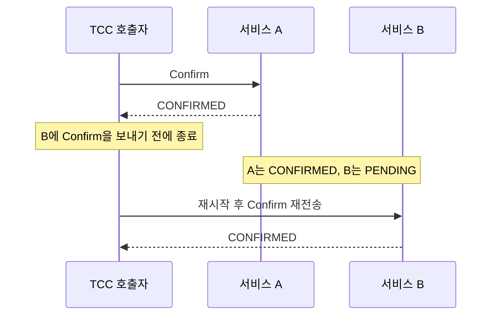

**4. Confirm/Cancel 실패 시**

네트워크 오류 등으로 Confirm이나 Cancel 자체가 실패하는 경우가 있다. 이때는 재시도 로직이 필수다. 재시도가 계속 실패하면 수동 개입이 필요하니, 알림과 함께 별도 테이블에 기록해 두는 게 좋다.


## Outbox 패턴

Saga를 구현하다 보면 빠지기 쉬운 함정이 있다. "DB에 저장하고 이벤트를 발행한다"는 두 동작이 원자적이지 않다는 점이다.

```
문제 상황:
  1. orderRepository.save(order)  → 성공 (DB 커밋 됨)
  2. kafkaTemplate.send(event)    → 실패 (Kafka 다운)
  → DB에는 주문이 있는데, 이벤트는 안 나감
  → 결제 서비스는 주문이 생긴 걸 모름 → 정합성 깨짐

반대 상황:
  1. kafkaTemplate.send(event)    → 성공
  2. orderRepository.save(order)  → 실패 (DB 다운)
  → 이벤트는 나갔는데 주문은 없음 → 정합성 깨짐
```

Outbox 패턴은 이 문제를 **이벤트를 같은 DB 트랜잭션에 함께 저장**하는 방식으로 해결한다.

### 동작 방식

비즈니스 데이터와 이벤트를 **같은 DB 트랜잭션**으로 저장하고, 브로커로 내보내는 일은 별도 프로세스(Relay)가 맡는다. 이벤트를 내보내는 경로는 폴링과 CDC 두 가지다.

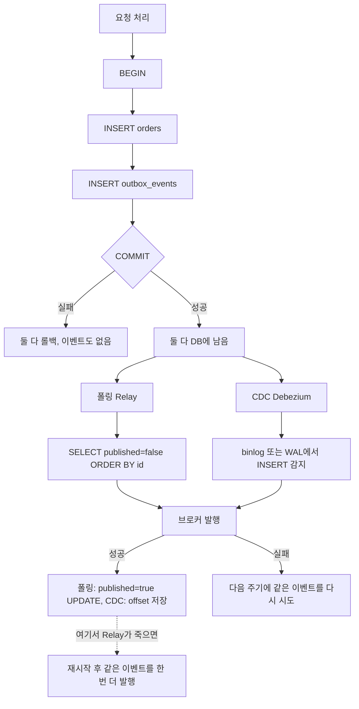

볼 곳은 `COMMIT` 분기와 점선이다. 주문과 이벤트가 한 트랜잭션이라 "주문은 있는데 이벤트가 없다"는 상태가 생기지 않는다. 대신 발행과 완료 표시가 서로 다른 시스템에 걸쳐 있어서 점선 경로(발행 성공 후 표시 전에 Relay 사망)가 남고, 그 결과 같은 이벤트가 두 번 나간다. Outbox는 유실을 없애는 대신 중복을 받아들이는 패턴이다. 소비자 쪽 멱등 처리가 짝으로 붙어야 한다.

<div class="ygd-outbox-relay-flow" id="ygd-outbox-relay-flow">
<style>
.ygd-outbox-relay-flow{--ygd-bg:#FAF8F6;--ygd-box:#FFFFFF;--ygd-bd:#DDD7D0;--ygd-text:#2B2724;--ygd-muted:#5F5A54;--ygd-line:#7A746C;--ygd-accent:#2E6B80;--ygd-on:#FFFFFF;--ygd-ok:#1F7A45;--ygd-bad:#B3302A;--ygd-warn:#8F5A00;--ygd-panel:#F1EDE8;max-width:760px;margin-left:auto;margin-right:auto;box-sizing:border-box;padding:14px;border:1px solid var(--ygd-bd);border-radius:12px;background:var(--ygd-bg);color:var(--ygd-text);font-size:15px;line-height:1.55;overflow:hidden}
body[data-md-color-scheme="slate"] .ygd-outbox-relay-flow{--ygd-bg:#26232A;--ygd-box:#322E36;--ygd-bd:#4A454E;--ygd-text:#F0EDE9;--ygd-muted:#BDB7AF;--ygd-line:#A39D95;--ygd-accent:#7FC4DB;--ygd-on:#1B1A1D;--ygd-ok:#6FCF97;--ygd-bad:#FF8F85;--ygd-warn:#F2C265;--ygd-panel:#302C34}
.ygd-outbox-relay-flow *{box-sizing:border-box}
.ygd-outbox-relay-flow .ygd-title{font-size:16px;font-weight:700;margin:0 0 10px}
.ygd-outbox-relay-flow .ygd-row{display:flex;flex-wrap:wrap;gap:8px;margin:0 0 10px}
.ygd-outbox-relay-flow .ygd-btn{font:inherit;font-size:14px;line-height:1.2;min-height:40px;padding:8px 14px;border:1px solid var(--ygd-line);border-radius:8px;background:var(--ygd-box);color:var(--ygd-text);cursor:pointer;max-width:100%}
.ygd-outbox-relay-flow .ygd-btn:focus-visible{outline:3px solid var(--ygd-accent);outline-offset:2px}
.ygd-outbox-relay-flow .ygd-btn[aria-pressed="true"],.ygd-outbox-relay-flow .ygd-btn-play{background:var(--ygd-accent);color:var(--ygd-on);border-color:var(--ygd-accent);font-weight:700}
.ygd-outbox-relay-flow .ygd-btn:disabled{opacity:.45;cursor:not-allowed}
.ygd-outbox-relay-flow .ygd-panel{min-height:9.2em;padding:10px 12px;margin:0 0 10px;border-radius:8px;background:var(--ygd-panel);border-left:4px solid var(--ygd-accent);font-size:14px;line-height:1.6}
.ygd-outbox-relay-flow .ygd-no{color:var(--ygd-muted)}
.ygd-outbox-relay-flow .ygd-ttl{font-size:15px;font-weight:700;margin:2px 0 4px}
.ygd-outbox-relay-flow .ygd-chips{display:flex;flex-wrap:wrap;gap:8px;margin:0 0 10px}
.ygd-outbox-relay-flow .ygd-chip{display:flex;flex-wrap:wrap;gap:2px 8px;font-size:14px;padding:6px 10px;border:1px solid var(--ygd-bd);border-left:5px solid var(--ygd-line);border-radius:8px;background:var(--ygd-box);max-width:100%}
.ygd-outbox-relay-flow .ygd-chip[hidden]{display:none}
.ygd-outbox-relay-flow .ygd-chip b{font-weight:700}
.ygd-outbox-relay-flow .ygd-chip span{color:var(--ygd-muted)}
.ygd-outbox-relay-flow .ygd-t-ok{border-left-color:var(--ygd-ok)}
.ygd-outbox-relay-flow .ygd-t-w{border-left-color:var(--ygd-warn)}
.ygd-outbox-relay-flow .ygd-t-bad{border-left-color:var(--ygd-bad)}
.ygd-outbox-relay-flow .ygd-stage{max-width:520px;margin:0 auto 10px}
.ygd-outbox-relay-flow .ygd-svg{display:block;width:100%;height:auto;font-family:inherit}
.ygd-outbox-relay-flow .ygd-svg text{fill:var(--ygd-text);font-size:12px}
.ygd-outbox-relay-flow .ygd-s-todo{opacity:.55}
.ygd-outbox-relay-flow .ygd-ln{fill:none;stroke:var(--ygd-muted);stroke-width:1.8;stroke-linecap:round}
.ygd-outbox-relay-flow .ygd-hd{fill:var(--ygd-muted)}
.ygd-outbox-relay-flow .ygd-num,.ygd-outbox-relay-flow .ygd-note{fill:var(--ygd-box);stroke:var(--ygd-line);stroke-width:1.4}
.ygd-outbox-relay-flow .ygd-s-cur .ygd-ln{stroke:var(--ygd-accent);stroke-width:2.8;stroke-dasharray:1;animation:ygd-outbox-relay-flow-draw .7s ease-out both}
.ygd-outbox-relay-flow .ygd-s-cur .ygd-hd{fill:var(--ygd-accent)}
.ygd-outbox-relay-flow .ygd-s-cur .ygd-num{fill:var(--ygd-accent);stroke:var(--ygd-accent)}
.ygd-outbox-relay-flow .ygd-s-cur text{font-weight:700}
.ygd-outbox-relay-flow .ygd-s-cur .ygd-svg-n{fill:var(--ygd-on)}
.ygd-outbox-relay-flow .ygd-s-cur .ygd-hd,.ygd-outbox-relay-flow .ygd-s-cur text,.ygd-outbox-relay-flow .ygd-s-cur .ygd-note{animation:ygd-outbox-relay-flow-fade .6s ease-out both}
.ygd-outbox-relay-flow .ygd-s.ygd-fail .ygd-ln{stroke:var(--ygd-bad);stroke-dasharray:5 4;animation:ygd-outbox-relay-flow-fade .6s ease-out both}
.ygd-outbox-relay-flow .ygd-s.ygd-fail .ygd-hd{fill:var(--ygd-bad)}
.ygd-outbox-relay-flow .ygd-brg-cur .ygd-br{stroke:var(--ygd-accent);stroke-width:2.6}
.ygd-outbox-relay-flow .ygd-brg-todo{opacity:.55}
@keyframes ygd-outbox-relay-flow-draw{from{stroke-dashoffset:1}to{stroke-dashoffset:0}}
@keyframes ygd-outbox-relay-flow-fade{from{opacity:0}to{opacity:1}}
@media (prefers-reduced-motion: reduce){.ygd-outbox-relay-flow .ygd-s *{animation:none !important}}
.ygd-outbox-relay-flow .ygd-analogy{font-size:14px;line-height:1.6;color:var(--ygd-muted);margin:0;padding:8px 12px;border:1px dashed var(--ygd-bd);border-radius:8px}
</style>
<div class="ygd-title">Outbox 패턴 동작 방식</div>
<div class="ygd-row" role="group" aria-label="비교할 시나리오 선택">
<button type="button" class="ygd-btn" data-mode="none" aria-pressed="false">Outbox 없이</button>
<button type="button" class="ygd-btn" data-mode="outbox" aria-pressed="true">Outbox 사용</button>
<button type="button" class="ygd-btn" data-mode="crash" aria-pressed="false">Relay 중단 (중복 발행)</button>
</div>
<div class="ygd-row" role="group" aria-label="재생 제어">
<button type="button" class="ygd-btn ygd-btn-play" data-act="play">재생</button>
<button type="button" class="ygd-btn" data-act="prev">이전</button>
<button type="button" class="ygd-btn" data-act="next">다음</button>
<button type="button" class="ygd-btn" data-act="reset">처음으로</button>
</div>
<div class="ygd-panel" aria-live="polite"><div class="ygd-no"></div><div class="ygd-ttl"></div><div class="ygd-txt"></div></div>
<div class="ygd-chips">
<div class="ygd-chip" data-chip="o"><span>orders</span><b></b></div>
<div class="ygd-chip" data-chip="e"><span>outbox_events</span><b></b></div>
<div class="ygd-chip" data-chip="k"><span>Kafka</span><b></b></div>
</div>
<div class="ygd-stage"><svg class="ygd-svg" viewBox="0 0 420 428" role="img" aria-label="Outbox 패턴 흐름 다이어그램"></svg></div>
<div class="ygd-analogy">비유: 주문을 장부에 적을 때 발송할 것 칸도 같은 장부에 함께 적어 두고, 배송 담당(Relay)이 장부를 훑어 보내는 방식이다. 보낸 뒤 발송 완료 표시를 하기 전에 담당이 쓰러지면 다음에 같은 건을 한 번 더 보낼 수 있다. 실제로는 장부가 DB 의 두 테이블이다.</div>
<script>
(function(){
var root=document.getElementById('ygd-outbox-relay-flow');
if(!root){return;}
var NS='http://www.w3.org/2000/svg';
var svg=root.querySelector('.ygd-svg');
var reduce=!!(window.matchMedia&&window.matchMedia('(prefers-reduced-motion: reduce)').matches);
var C4=[{k:'app',x:46,w:80,n:'주문 서비스'},{k:'db',x:160,w:96,n:'DB'},{k:'relay',x:280,w:100,n:'Outbox Relay'},{k:'kafka',x:378,w:70,n:'Kafka'}];
var C3=[{k:'app',x:55,w:90,n:'주문 서비스'},{k:'db',x:205,w:90,n:'DB'},{k:'kafka',x:365,w:90,n:'Kafka'}];
var TONE={bad:'--ygd-bad',ok:'--ygd-ok',warn:'--ygd-warn'};
var MODES={
none:{label:'Outbox 없이 저장과 발행을 따로',cols:C3,chipE:false,
aria:'Outbox 없이 DB 저장과 Kafka 발행을 따로 하는 흐름. 주문 서비스, DB, Kafka 사이의 세 단계',
intro:'Outbox 없이 DB 저장과 Kafka 발행을 따로 하면 어디서 어긋나는지 본다. 재생을 누르면 단계별로 진행된다.',
steps:[
{t:'DB 저장 성공',d:'주문 서비스가 orders 에 주문을 저장하고 커밋한다. 이 시점에 주문은 DB 에 확정된다.',type:'arrow',from:'app',to:'db',l:['INSERT orders','COMMIT 성공'],s:{o:['저장됨 (커밋)','ok']}},
{t:'Kafka 발행 실패',d:'이어서 Kafka 에 이벤트를 보내는데 Kafka 가 다운돼 있다. DB 커밋은 이미 끝나서 되돌릴 수 없다.',type:'arrow',from:'app',to:'kafka',fail:true,lx:285,l:['send(event)','Kafka 다운 → 실패'],s:{k:['이벤트 0건 (발행 실패)','bad']}},
{t:'정합성 깨짐',d:'DB 에는 주문이 있는데 이벤트는 나가지 않아 결제 서비스는 주문을 모른다. 순서를 바꿔 Kafka 를 먼저 보내면 반대로 이벤트만 나가고 주문은 없는 상황도 생긴다.',type:'note',tone:'bad',l:['DB 에는 주문이 있는데 이벤트는 나가지 않았다','결제 서비스는 주문을 모른다 → 정합성 깨짐']}
]},
outbox:{label:'Outbox 사용',cols:C4,chipE:true,bracket:[0,2],
aria:'Outbox 패턴 흐름. 주문 서비스가 한 트랜잭션으로 orders 와 outbox_events 를 커밋하고, Relay 가 폴링해 Kafka 에 발행한 뒤 published 를 갱신하는 여섯 단계',
intro:'Outbox 를 쓰면 주문과 이벤트를 한 트랜잭션으로 저장하고, 발행은 Relay 가 따로 맡는다. 재생을 누르면 단계별로 진행된다.',
steps:[
{t:'트랜잭션 시작, 주문 저장',d:'주문 서비스가 트랜잭션을 열고 orders 에 주문을 INSERT 한다. 아직 커밋 전이다.',type:'arrow',from:'app',to:'db',l:['BEGIN','INSERT orders'],s:{o:['INSERT 됨 (미커밋)','w']}},
{t:'같은 트랜잭션에 이벤트 저장',d:'같은 트랜잭션 안에서 outbox_events 에도 이벤트를 published = false 로 INSERT 한다. 이 단계에는 Kafka 호출이 없다.',type:'arrow',from:'app',to:'db',l:['INSERT','outbox_events'],s:{e:['published = false (미커밋)','w']}},
{t:'COMMIT',d:'COMMIT 한 번으로 orders 와 outbox_events 두 행이 함께 확정된다. 주문만 남고 이벤트가 빠지는 상태가 생기지 않는다.',type:'arrow',from:'app',to:'db',l:['COMMIT'],s:{o:['저장됨 (커밋)','ok'],e:['published = false','w']}},
{t:'Relay 가 폴링',d:'별도 프로세스인 Relay 가 주기적으로(예제는 1초마다) outbox_events 에서 published = false 인 행을 오래된 순으로 읽는다.',type:'arrow',from:'relay',to:'db',l:['SELECT','published = false']},
{t:'Kafka 로 발행',d:'Relay 가 읽은 이벤트를 Kafka 에 발행한다. 결제 서비스 같은 소비자는 이 시점부터 이벤트를 받을 수 있다.',type:'arrow',from:'relay',to:'kafka',l:['send(event)'],s:{k:['이벤트 1건','ok']}},
{t:'published 갱신',d:'발행에 성공하면 해당 행을 published = true 로 갱신한다. 다음 폴링부터는 이 행이 조회되지 않는다.',type:'arrow',from:'relay',to:'db',l:['UPDATE','published = true'],s:{e:['published = true','ok']}},
{t:'Kafka 장애에도 이벤트는 남는다',d:'Kafka 가 다운이어도 이벤트는 outbox_events 에 남아 있다가 나중에 발행된다. Outbox 없이 하던 때와 달리 이벤트가 사라지지 않는다.',type:'note',tone:'ok',l:['발행이 실패하면','published = false 로 남아 다음 폴링에서 재시도']}
]},
crash:{label:'Relay 가 발행 직후 죽는 경우',cols:C4,chipE:true,crashIdx:3,
aria:'Relay 가 Kafka 발행 직후 죽어 같은 이벤트가 두 번 발행되는 at-least-once 흐름. 여덟 단계',
intro:'Relay 가 Kafka 발행 직후, published 갱신 전에 죽으면 어떻게 되는지 본다. 재생을 누르면 단계별로 진행된다.',
steps:[
{t:'커밋된 상태에서 시작',d:'앞선 흐름처럼 orders 와 outbox_events 가 한 트랜잭션으로 커밋된 상태에서 시작한다. 이벤트는 아직 published = false 다.',type:'arrow',from:'app',to:'db',l:['orders +','outbox_events'],s:{o:['저장됨 (커밋)','ok'],e:['published = false','w']}},
{t:'Relay 가 폴링',d:'Relay 가 published = false 인 행을 읽는다.',type:'arrow',from:'relay',to:'db',l:['SELECT','published = false']},
{t:'Kafka 발행 성공',d:'Kafka 발행에 성공한다. 이 이벤트는 이미 소비자에게 전달될 수 있다.',type:'arrow',from:'relay',to:'kafka',l:['send(event)'],s:{k:['이벤트 1건','ok']}},
{t:'UPDATE 전에 Relay 종료',d:'published = true 로 갱신하기 전에 Relay 가 죽는다. DB 에서 이 행은 여전히 published = false 다.',type:'crash',s:{e:['published = false (갱신 못 함)','bad']}},
{t:'재시작 후 다시 조회',d:'Relay 가 재시작되어 published = false 인 행을 다시 읽는다. 방금 발행한 그 이벤트가 또 조회된다.',type:'arrow',from:'relay',to:'db',l:['재시작 후','SELECT 재조회']},
{t:'같은 이벤트를 다시 발행',d:'Relay 는 이미 보냈다는 사실을 모르므로 같은 이벤트를 한 번 더 보낸다. 이것이 at-least-once 다. 최소 한 번은 전달되지만 중복될 수 있다.',type:'arrow',from:'relay',to:'kafka',l:['send(event)','같은 이벤트'],s:{k:['이벤트 2건 (같은 이벤트 중복)','bad']}},
{t:'published 갱신',d:'이번에는 UPDATE 까지 성공해 행이 정리된다. 하지만 Kafka 에는 같은 이벤트가 이미 두 번 들어갔다.',type:'arrow',from:'relay',to:'db',l:['UPDATE','published = true'],s:{e:['published = true','ok']}},
{t:'중복 처리는 소비자 몫',d:'중복을 막는 책임은 Relay 가 아니라 소비자에게 있다. 앞서 나온 ProcessedEvent 테이블 패턴처럼 이미 처리한 이벤트인지 기록해 두고 걸러야 한다.',type:'note',tone:'warn',l:['소비자가 중복 이벤트를 처리할 수 있어야 한다','ProcessedEvent 테이블 패턴이 여기서 필요하다']}
]}
};
var INIT={o:['없음',''],e:['없음',''],k:['이벤트 0건','']};
var modeKey='outbox',cur=-1,timer=null,groups=[],brackets=[];
var q=function(s){return root.querySelector(s);};
var pNo=q('.ygd-no'),pTtl=q('.ygd-ttl'),pTxt=q('.ygd-txt');
var bPlay=q('[data-act="play"]'),bPrev=q('[data-act="prev"]'),bNext=q('[data-act="next"]');
function mk(tag,a,p){var e=document.createElementNS(NS,tag);for(var k in a){if(Object.prototype.hasOwnProperty.call(a,k)){e.setAttribute(k,a[k]);}}if(p){p.appendChild(e);}return e;}
function tx(p,x,y,s,anchor,cls){var t=mk('text',{x:x,y:y,'text-anchor':anchor||'middle'},p);if(cls){t.setAttribute('class',cls);}t.textContent=s;return t;}
function rt(i){var y=48;while(i-->0){y+=54;}return y;}
function build(){
var m=MODES[modeKey],n=m.steps.length,H=rt(n-1)+56,X={},yEnd=rt(n-1);
svg.textContent='';groups=[];brackets=[];
svg.setAttribute('viewBox','0 0 420 '+H);
svg.setAttribute('aria-label',m.aria);
m.cols.forEach(function(c){
X[c.k]=c.x;
var L='stroke:var(--ygd-line);stroke-width:1;opacity:.6';
if(c.k==='relay'&&m.crashIdx!==undefined){
var a=rt(m.crashIdx)+40,b=rt(m.crashIdx+1)+40;
mk('line',{x1:c.x,y1:38,x2:c.x,y2:a,style:L},svg);
mk('line',{x1:c.x,y1:a,x2:c.x,y2:b,style:'stroke:var(--ygd-bad);stroke-width:1.5;stroke-dasharray:2 4'},svg);
mk('line',{x1:c.x,y1:b,x2:c.x,y2:yEnd,style:L},svg);
}else{mk('line',{x1:c.x,y1:38,x2:c.x,y2:yEnd,style:L},svg);}
});
m.cols.forEach(function(c){
mk('rect',{x:c.x-(c.w>>1),y:6,width:c.w,height:32,rx:8,style:'fill:var(--ygd-box);stroke:var(--ygd-line);stroke-width:1.2'},svg);
tx(svg,c.x,26,c.n,'middle').setAttribute('font-weight','700');
});
if(m.bracket){
var bg=mk('g',{'class':'ygd-brg-todo'},svg);
var y0=rt(m.bracket[0])+12,y1=rt(m.bracket[1])+46;
mk('path',{d:'M172 '+y0+' H178 V'+y1+' H172','class':'ygd-br',style:'fill:none;stroke:var(--ygd-line);stroke-width:1.6'},bg);
tx(bg,188,(y0+y1)/2+4,'한 트랜잭션','start');
brackets.push({g:bg,a:m.bracket[0],b:m.bracket[1]});
}
m.steps.forEach(function(st,i){
var top=rt(i),y=top+40;
var g=mk('g',{'class':'ygd-s ygd-s-todo'+(st.fail?' ygd-fail':'')},svg);
var ny=st.type==='note'?top+28:y;
mk('circle',{cx:13,cy:ny,r:9,'class':'ygd-num'},g);
tx(g,13,ny+4,String(i+1),'middle','ygd-svg-n').style.fontSize='11px';
if(st.type==='arrow'){
var x1=X[st.from],x2=X[st.to],dir=x2>x1?1:-1;
var xe=st.fail?x2-dir*34:x2-dir*8;
var ln=mk('line',{x1:x1,y1:y,x2:xe,y2:y,'class':'ygd-ln'},g);
if(!st.fail){
ln.setAttribute('pathLength','1');
mk('polygon',{points:x2+','+y+' '+(x2-dir*9)+','+(y-4.5)+' '+(x2-dir*9)+','+(y+4.5),'class':'ygd-hd'},g);
}else{
var cx=x2-dir*22;
mk('path',{d:'M'+(cx-6)+' '+(y-6)+' L'+(cx+6)+' '+(y+6)+' M'+(cx-6)+' '+(y+6)+' L'+(cx+6)+' '+(y-6),style:'fill:none;stroke:var(--ygd-bad);stroke-width:2.2;stroke-linecap:round'},g);
}
var lx=st.lx||(x1+x2)/2;
if(st.l.length===2){tx(g,lx,top+16,st.l[0]);tx(g,lx,top+29,st.l[1]);}else{tx(g,lx,top+29,st.l[0]);}
}else if(st.type==='crash'){
var rx=X.relay;
mk('circle',{cx:rx,cy:y,r:9,style:'fill:var(--ygd-box);stroke:var(--ygd-bad);stroke-width:1.6'},g);
mk('path',{d:'M'+(rx-4)+' '+(y-4)+' L'+(rx+4)+' '+(y+4)+' M'+(rx-4)+' '+(y+4)+' L'+(rx+4)+' '+(y-4),style:'fill:none;stroke:var(--ygd-bad);stroke-width:2;stroke-linecap:round'},g);
tx(g,rx+16,top+34,'프로세스 종료','start');
tx(g,rx+16,top+48,'UPDATE 전','start');
}else{
mk('rect',{x:30,y:top+6,width:380,height:44,rx:8,'class':'ygd-note',style:'stroke:var(--'+TONE[st.tone].slice(2)+');stroke-width:1.8'},g);
tx(g,220,top+24,st.l[0]);tx(g,220,top+40,st.l[1]);
}
groups.push(g);
});
}
function setCls(e,c){if(e.getAttribute('class')!==c){e.setAttribute('class',c);}}
function upd(){
var m=MODES[modeKey],n=m.steps.length,S={o:INIT.o,e:INIT.e,k:INIT.k},j,k;
for(j=0;j<=cur;j++){var s=m.steps[j].s;if(s){for(k in s){if(Object.prototype.hasOwnProperty.call(s,k)){S[k]=s[k];}}}}
groups.forEach(function(g,i){
setCls(g,'ygd-s '+(i<cur?'ygd-s-done':i===cur?'ygd-s-cur':'ygd-s-todo')+(m.steps[i].fail?' ygd-fail':''));
});
brackets.forEach(function(b){
setCls(b.g,cur>=b.a&&cur<=b.b?'ygd-brg-cur':cur>b.b?'ygd-brg-done':'ygd-brg-todo');
});
['o','e','k'].forEach(function(key){
var c=q('[data-chip="'+key+'"]');
c.querySelector('b').textContent=S[key][0];
c.className='ygd-chip'+(S[key][1]?' ygd-t-'+S[key][1]:'');
if(key==='e'){c.hidden=!m.chipE;}
});
if(cur<0){pNo.textContent='대기';pTtl.textContent=m.label;pTxt.textContent=m.intro;}
else{pNo.textContent='단계 '+(cur+1)+' / '+n;pTtl.textContent=m.steps[cur].t;pTxt.textContent=m.steps[cur].d;}
bPrev.disabled=cur<0;
bNext.disabled=cur>=n-1;
bPlay.textContent=timer?'일시정지':(cur>=n-1?'다시 재생':'재생');
}
function stop(){if(timer){clearInterval(timer);timer=null;}}
function step(){cur++;upd();}
function play(){
var n=MODES[modeKey].steps.length;
if(timer){stop();upd();return;}
if(cur>=n-1){cur=-1;}
step();
if(cur>=n-1){upd();return;}
timer=setInterval(function(){step();if(cur>=n-1){stop();upd();}},reduce?3200:2800);
upd();
}
root.addEventListener('click',function(e){
var b=e.target.closest?e.target.closest('button'):null;
if(!b||!root.contains(b)){return;}
var n=MODES[modeKey].steps.length;
if(b.getAttribute('data-mode')){
stop();modeKey=b.getAttribute('data-mode');cur=-1;
root.querySelectorAll('[data-mode]').forEach(function(x){x.setAttribute('aria-pressed',x===b?'true':'false');});
build();upd();return;
}
var act=b.getAttribute('data-act');
if(act==='play'){play();return;}
stop();
if(act==='prev'&&cur>=0){cur--;}
else if(act==='next'&&cur<n-1){cur++;}
else if(act==='reset'){cur=-1;}
upd();
});
build();upd();
})();
</script>
</div>

### 구현

```sql
-- Outbox 테이블
CREATE TABLE outbox_events (
    id            BIGINT AUTO_INCREMENT PRIMARY KEY,
    aggregate_type VARCHAR(100) NOT NULL,   -- 예: "Order"
    aggregate_id   VARCHAR(100) NOT NULL,   -- 예: 주문 ID
    event_type    VARCHAR(100) NOT NULL,    -- 예: "OrderCreated"
    payload       JSON NOT NULL,            -- 이벤트 데이터
    created_at    TIMESTAMP DEFAULT CURRENT_TIMESTAMP,
    published     BOOLEAN DEFAULT FALSE
);

CREATE INDEX idx_outbox_unpublished ON outbox_events(published, created_at);
```

```typescript
// 비즈니스 로직과 이벤트를 같은 트랜잭션으로 저장
@Injectable()
export class OrderService {
    constructor(
        private readonly dataSource: DataSource,
    ) {}

    async createOrder(request: OrderRequest): Promise<Order> {
        return this.dataSource.transaction(async (manager) => {
            // 비즈니스 데이터 저장
            const order = await manager.save(Order, Order.create(request));

            // 같은 트랜잭션에서 Outbox에 이벤트 저장
            await manager.save(OutboxEvent, {
                aggregateType: 'Order',
                aggregateId: String(order.id),
                eventType: 'OrderCreated',
                payload: JSON.stringify({ orderId: order.id, amount: request.amount }),
                published: false,
            });

            return order;
        });
    }
}

// Outbox Relay - 폴링 방식
@Injectable()
export class OutboxRelay {
    constructor(
        private readonly outboxEventRepository: OutboxEventRepository,
        private readonly kafkaProducer: KafkaProducer,
        private readonly dataSource: DataSource,
    ) {
        // 1초마다 폴링
        setInterval(() => this.publishEvents(), 1000);
    }

    async publishEvents(): Promise<void> {
        const events = await this.outboxEventRepository.find({
            where: { published: false },
            order: { createdAt: 'ASC' },
            take: 100,
        });

        for (const event of events) {
            try {
                await this.kafkaProducer.send(
                    `${event.aggregateType}.${event.eventType}`,
                    event.aggregateId,
                    event.payload,
                );

                event.published = true;
                await this.outboxEventRepository.save(event);
            } catch (e) {
                logger.error(`Failed to publish outbox event: ${event.id}`, e);
                break;  // 순서 보장을 위해 실패하면 중단
            }
        }
    }
}
```

Outbox Relay는 **at-least-once** 전달을 보장한다. Kafka 발행에 성공했지만 `published = true` 업데이트 전에 Relay가 죽으면, 재시작 시 같은 이벤트를 다시 발행한다. 소비자는 반드시 중복 이벤트를 처리할 수 있어야 한다. 앞서 나온 `ProcessedEvent` 테이블 패턴이 여기서 필요한 이유다.

아래 순서에서 Kafka 발행 성공과 `published = true` 저장 사이에 Relay가 죽는 지점이 중복 발행의 원인이다.

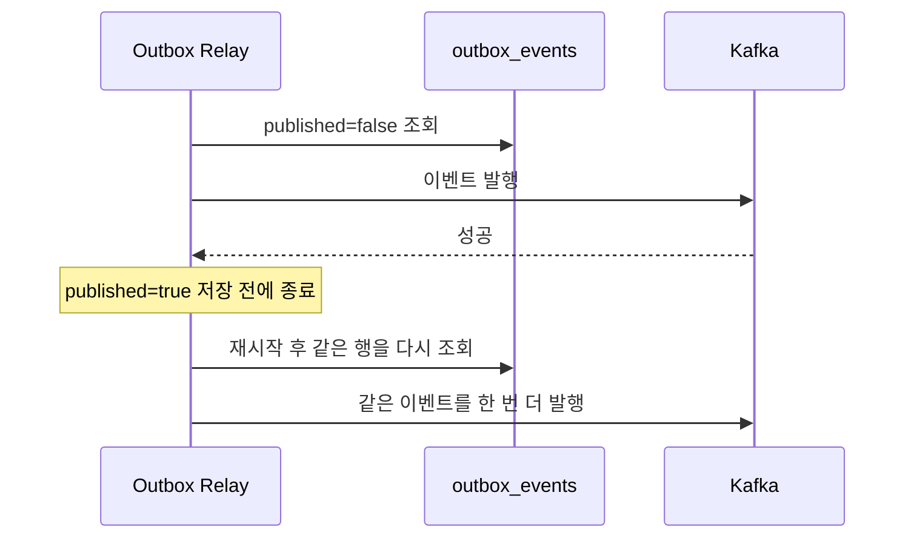

### CDC (Change Data Capture) 방식

폴링 대신 DB의 변경 로그를 직접 읽어서 이벤트를 발행하는 방법도 있다. Debezium 같은 도구가 MySQL의 binlog나 PostgreSQL의 WAL을 읽어서 outbox_events 테이블의 INSERT를 감지하고, 자동으로 Kafka에 발행한다.

```
Debezium 방식:
  orderRepository.save(order)     ← 같은 트랜잭션
  outboxEventRepository.save(event)  ← 같은 트랜잭션

  Debezium → MySQL binlog 감시 → outbox_events INSERT 감지 → Kafka에 발행
```

폴링보다 지연이 적고 DB 부하도 줄어든다. CDC도 at-least-once라 중복 처리는 마찬가지로 소비자가 책임진다. Debezium 자체를 운영해야 하니 인프라 복잡도가 올라간다. 트래픽이 적으면 폴링으로 시작하고, 지연이 문제 되면 CDC로 전환하는 게 현실적이다.

두 방식은 이벤트를 찾는 위치가 다르다. 폴링은 테이블을 조회하고 발행 후 행을 갱신하며, CDC는 로그를 읽고 발행 후 offset을 저장한다.

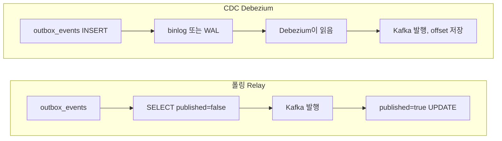


## 실제로 겪는 문제들

패턴을 아무리 잘 설계해도, 분산 환경에서는 정합성이 깨지는 순간이 온다. 아래 중 보상 중복, Cancel 선행, 코디네이터 로그 유실은 **에러 로그 없이** 깨진다. 요청은 전부 성공으로 끝나는데 숫자만 틀어져 있어서 대사(reconciliation) 작업으로 뒤늦게 발견한다.

### 보상 트랜잭션 자체가 실패하는 경우

재고 차감이 실패해서 결제 취소(보상)를 시도하는데, 결제 서비스도 장애인 경우다. 결제는 됐는데 주문은 취소되고 재고는 안 빠진 상태가 된다.

보상 트랜잭션은 반드시 **재시도 가능한 구조**로 만들어야 한다. 실패한 보상을 별도 테이블에 저장해 두고 스케줄러가 성공할 때까지 재시도한다.

```typescript
// 30초마다. status='PENDING' 이고 nextRetryAt 이 지난 보상을 다시 실행
for (const comp of await compensationRepository.find({
    where: { status: 'PENDING', nextRetryAt: LessThan(new Date()) },
})) {
    try {
        await executeCompensation(comp);
        comp.status = 'COMPLETED';
    } catch (e) {
        comp.retryCount += 1;
        if (comp.retryCount >= 10) {
            comp.status = 'FAILED_PERMANENTLY';       // 사람이 개입해야 한다
            await alertService.sendAlert(`보상 영구 실패: ${comp.id}`);
        } else {
            comp.nextRetryAt = new Date(Date.now() + Math.pow(2, comp.retryCount) * 10_000);  // 지수 백오프
        }
    }
    await compensationRepository.save(comp);
}
```

보상 레코드의 상태 전이다. `PENDING`으로 되돌아오는 두 화살표가 백오프 재시도와 중복 실행 틈이다.

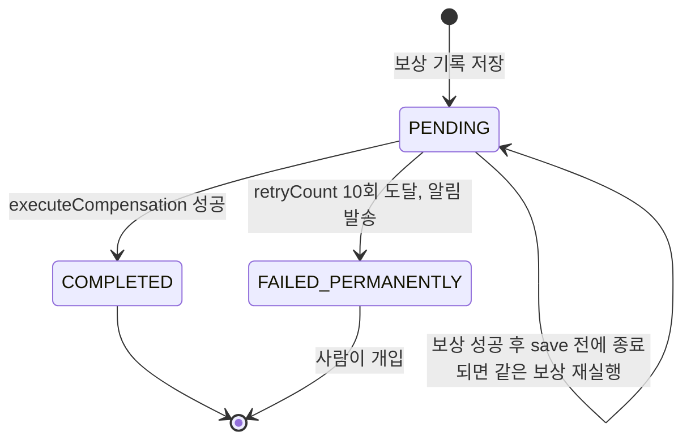

이 루프에는 틈이 있다. `executeCompensation`이 성공한 뒤 `save(comp)`가 실패하거나 프로세스가 죽으면, 보상은 끝났는데 기록은 `PENDING`이라 다음 주기에 같은 보상을 한 번 더 실행한다. 다음 절이 그 결과다.

### 보상이 두 번 실행되는 경우

환불 보상을 예로 든다. 보상 호출이 성공했고 saga 상태를 `COMPLETED`로 저장하기 직전에 프로세스가 죽었다고 하자. 재시작한 쪽은 `COMPLETED`를 못 봤으니 보상을 다시 실행한다. 보상 함수가 "잔액에 금액을 더한다"로 되어 있으면 두 번 더한다. PostgreSQL 16에서 10000원 환불을 이 순서로 재현했더니 잔액이 20000이 됐고, 어떤 에러도 나지 않았다.

아래 순서에서 보상 성공과 `COMPLETED` 저장 사이에 프로세스가 죽는 지점을 보라. 재시작한 쪽은 완료 기록이 없으니 같은 보상을 다시 실행한다.

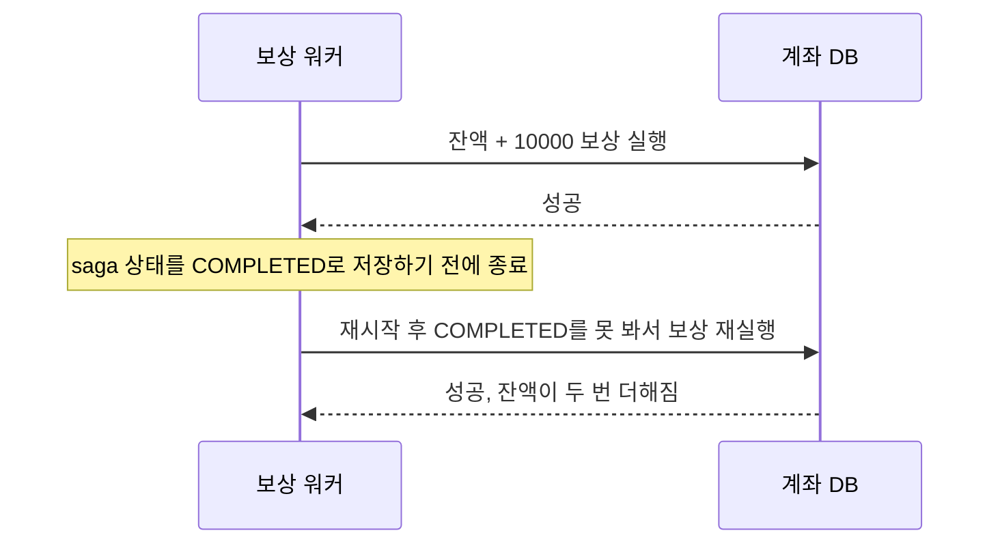

보상은 정방향 작업과 달리 멱등성 키를 받는 API로 만들어 두는 일이 드물어서 놓치기 쉽다. 가장 단순한 방어는 보상을 한 번 적용했다는 기록을 **잔액 변경과 같은 트랜잭션**에 남기는 것이다.

```sql
CREATE TABLE refund_log (
    saga_id text NOT NULL,
    step    text NOT NULL,
    PRIMARY KEY (saga_id, step)
);
```

```typescript
async function refund(c: PoolClient, sagaId: string, accountId: string, amount: number) {
    const r = await c.query(
        `INSERT INTO refund_log (saga_id, step) VALUES ($1, 'REFUND')
         ON CONFLICT DO NOTHING RETURNING saga_id`, [sagaId]);
    if (r.rowCount === 0) return 'skipped';                    // 이미 적용된 보상
    await c.query('UPDATE account SET balance = balance + $2 WHERE id = $1', [accountId, amount]);
    return 'applied';
}
```

같은 호출을 두 번 하면 `applied`, `skipped` 순으로 나오고 잔액은 10000으로 유지됐다. 호출자가 `(sagaId, step)`을 안정적으로 넘겨야 한다는 전제가 있다. 재시도 때마다 새 UUID를 만들면 이 테이블은 아무것도 막지 못한다.

### Cancel이 Try보다 먼저 도착하는 경우 (유령 보상)

TCC에서 Try 요청이 네트워크에서 지연되는 동안, 코디네이터가 타임아웃으로 Cancel을 보내면 Cancel이 먼저 도착한다. 예약이 아직 없으니 서비스는 "취소할 게 없다"며 성공을 돌려주고, 곧이어 도착한 Try가 정상 예약을 만든다. 재고 10개에서 2개를 이렇게 처리했더니 `available=8, reserved=2`에 예약이 `PENDING`으로 영원히 남았다. 코디네이터는 이미 Cancel이 성공했다고 믿으니 아무도 이 예약을 정리하지 않는다.

Cancel이 먼저 도착해 "취소할 것 없음"으로 끝나고, 뒤늦은 Try가 아무도 풀어 주지 않을 예약을 만드는 순서다.

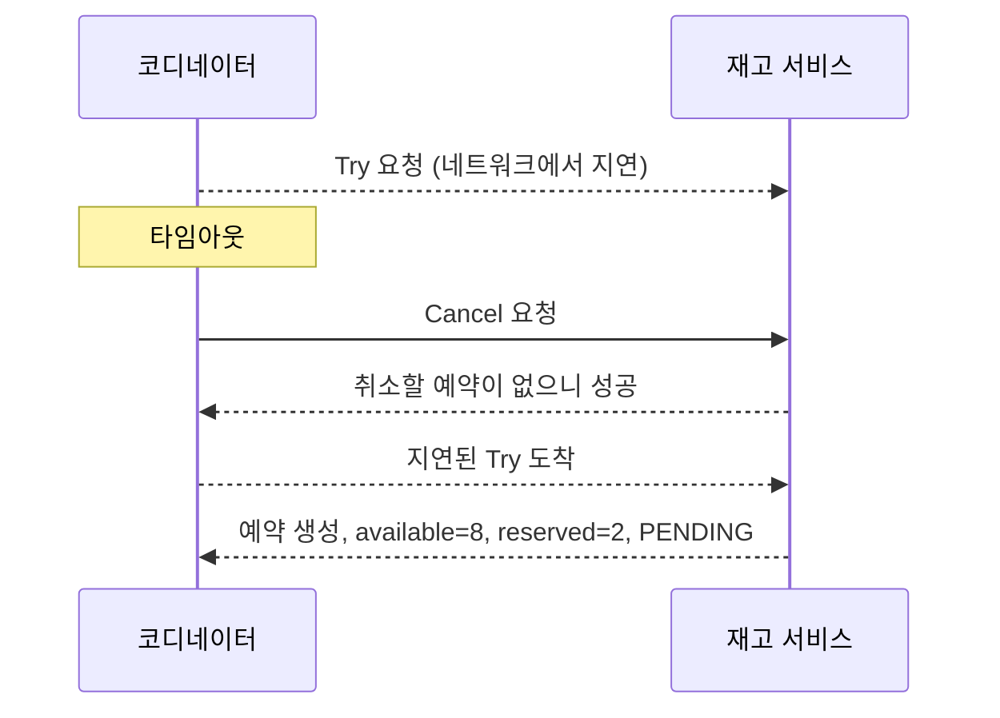

TCC 절의 구현처럼 Cancel이 빈 CANCELLED 행을 먼저 남기게 하면 해결된다. 같은 문제는 Saga에서도 나온다. Orchestrator가 앞서 본 대로 `processPayment` 타임아웃 뒤 보상에 들어갈 때 결제 쪽에서는 아직 승인 전일 수도 있고 이미 끝났을 수도 있다. 보상은 "대상이 있으면 취소하고, 없으면 나중에 올 요청을 막아 둔다"는 두 가지를 같이 해야 한다.

### 2PC 코디네이터 로그가 사라진 경우

2PC 절에서 다뤘다. 코디네이터가 `COMMIT PREPARED`를 일부 참여자에게만 보내고 죽었는데 결정 로그마저 없으면, 남은 참여자는 `pg_prepared_xacts`에 gid와 시각만 보이는 채로 남는다. 어느 쪽이 커밋됐는지는 반대편 DB를 직접 조회해야 알 수 있고, 그 사이 같은 행을 쓰려는 요청은 lock에 걸려 타임아웃된다. 이건 코드로 막을 수 있는 문제가 아니라 로그를 어디에 어떤 내구성으로 두느냐의 문제다.

### 이벤트 순서가 꼬이는 경우

Kafka 파티션이 여러 개면 같은 주문에 대한 이벤트 순서가 보장되지 않는다. "주문 생성 → 주문 취소"가 "주문 취소 → 주문 생성" 순으로 도착하면, 결제 서비스는 없는 주문의 취소를 무시하고 그다음 생성 이벤트로 결제를 진행한다. 이미 취소된 주문에 결제가 걸린다. 앞 절의 Cancel 선행과 같은 구조다.

주문 ID를 키로 쓰지 않아 두 이벤트가 서로 다른 파티션에 들어간 경우다.

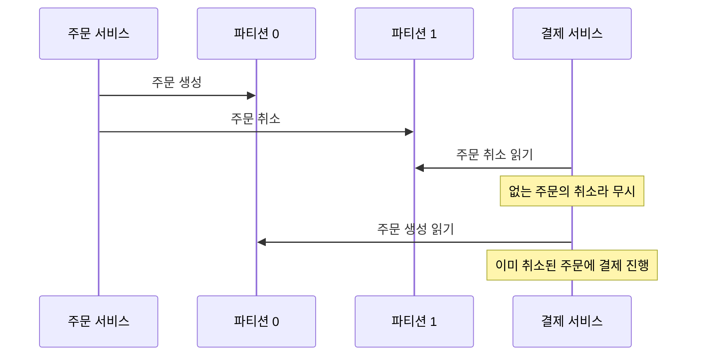

같은 aggregate(예: 같은 주문 ID)의 이벤트는 같은 Kafka 파티션으로 보내야 한다. 주문 ID를 파티션 키로 쓰면 그 주문의 이벤트 순서가 보장된다.

```typescript
await kafkaProducer.send('order-events', String(order.id), eventPayload);   // 키 = 주문 ID
```

### 중복 이벤트 처리

네트워크 재시도나 컨슈머 리밸런싱으로 같은 이벤트가 두 번 올 수 있다. "결제 처리" 이벤트가 두 번 오면 10만원이 20만원으로 결제된다. 모든 이벤트 처리에 멱등성 키를 적용하고, 처리 기록은 비즈니스 변경과 같은 트랜잭션에 넣는다.

```typescript
async handleOrderCreated(event: OrderCreatedEvent): Promise<void> {
    await this.dataSource.transaction(async (manager) => {
        if (await manager.findOne(ProcessedEvent, { where: { eventId: event.eventId } })) return;

        await manager.save(manager.create(Payment, { orderId: event.orderId, amount: event.amount }));
        await manager.save(ProcessedEvent, { eventId: event.eventId });   // 같은 트랜잭션
    });
}
```

위 코드는 `findOne`과 `save` 사이에 틈이 있어서, 같은 이벤트가 두 컨슈머에 동시에 전달되면 둘 다 "처리 안 됨"으로 읽을 수 있다. `ProcessedEvent.eventId`에 PK나 유니크 제약이 있어야 두 번째 트랜잭션의 INSERT가 유니크 위반으로 실패하고 롤백된다. 확인 쿼리는 흔한 중복만 거르고, 동시 도착을 막는 건 제약이다.

같은 이벤트가 두 컨슈머에 동시에 오면 확인 쿼리는 둘 다 통과하고, 유니크 제약이 있는 `ProcessedEvent` INSERT에서만 갈린다.

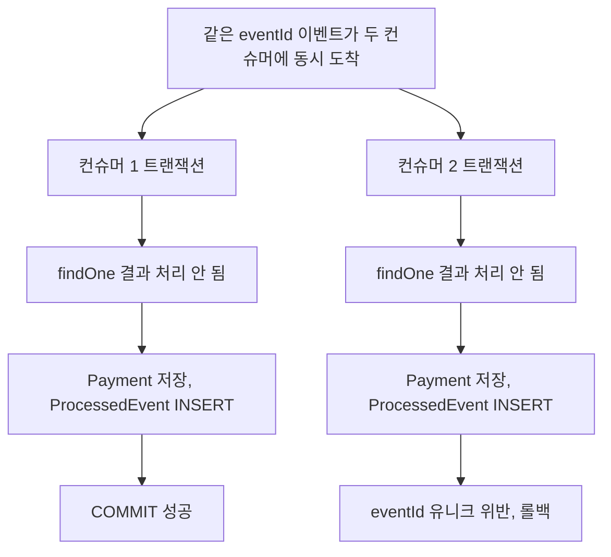

### 타이밍 이슈로 인한 데이터 불일치

주문 서비스에서 주문을 생성하고 이벤트를 발행했는데, 사용자가 그 사이에 주문 상세를 조회하면 결제 상태는 아직 "대기 중"이다. 이건 버그가 아니라 **최종 일관성(Eventual Consistency)**의 특성이다. 사용자가 T2에 조회하면 "대기중", 결제가 끝난 T4에 조회하면 "완료"가 나온다.

UI에서 "처리 중" 상태를 보여주고, 폴링이나 웹소켓으로 상태 변화를 알려주는 게 일반적이다. API 레벨에서는 주문 조회 시 결제 서비스에 실시간으로 물어볼지, 캐시된 상태를 보여줄지 판단해야 한다. 대부분은 캐시된 상태 + 비동기 갱신이면 충분하다.

## 패턴 선택 기준

고르는 순서는 "참여자가 PREPARE를 지원하는가"에서 시작해서 "자원을 먼저 잡아 둬야 하는가", "서비스가 몇 개인가"로 좁혀 간다. 마지막의 Outbox는 앞의 선택과 별개로 이벤트를 쓰는 모든 서비스에 붙는다.

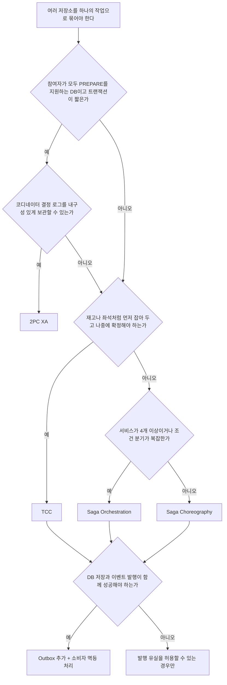

판단이 갈리는 곳은 두 군데다. 첫째, `Q1b`에서 로그를 보관할 자신이 없으면 2PC를 쓰지 않는 쪽이 안전하다. 코디네이터가 로그 없이 죽으면 참여자 일부는 커밋, 일부는 PREPARED로 남아 사람이 직접 풀어야 한다. 둘째, `Q4`에서 "아니오"로 가는 경우는 드물다. 이벤트 유실을 허용하는 서비스는 알림 정도다.

실무에서는 보통 **Saga + Outbox**를 조합해서 쓴다. Saga로 서비스 간 흐름을 관리하고, 각 서비스의 이벤트 발행은 Outbox로 처리한다. TCC는 티켓 예매나 좌석 선점처럼 "예약 → 확정" 흐름이 자연스러운 도메인에 쓴다.

어떤 패턴을 쓰든 분산 환경에서 100% 정합성은 없다. 결국 **멱등성, 재시도, 모니터링, 수동 보정 도구**가 실질적인 안전망이다. 위에서 본 조용한 실패는 전부 "에러 없이 성공으로 끝난다"는 공통점이 있어서, 합계가 맞는지 주기적으로 대조하는 대사 작업이 모니터링의 핵심이 된다.
