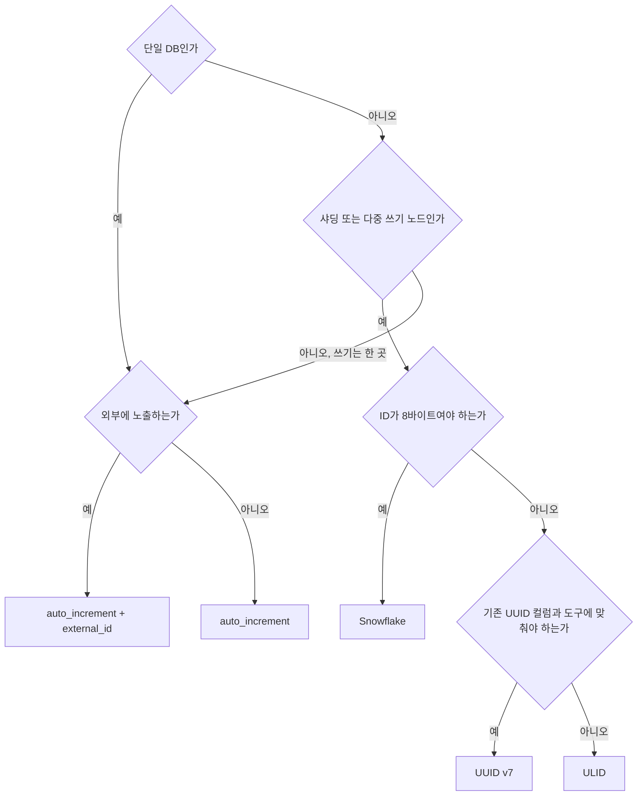
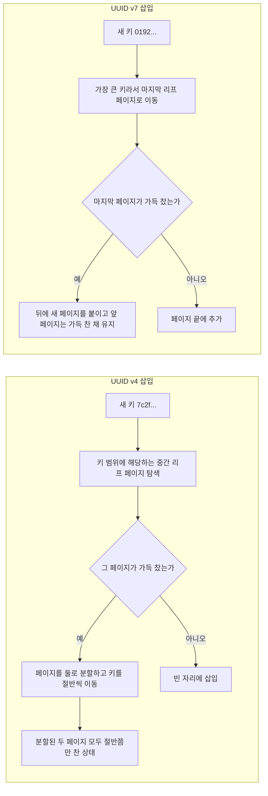
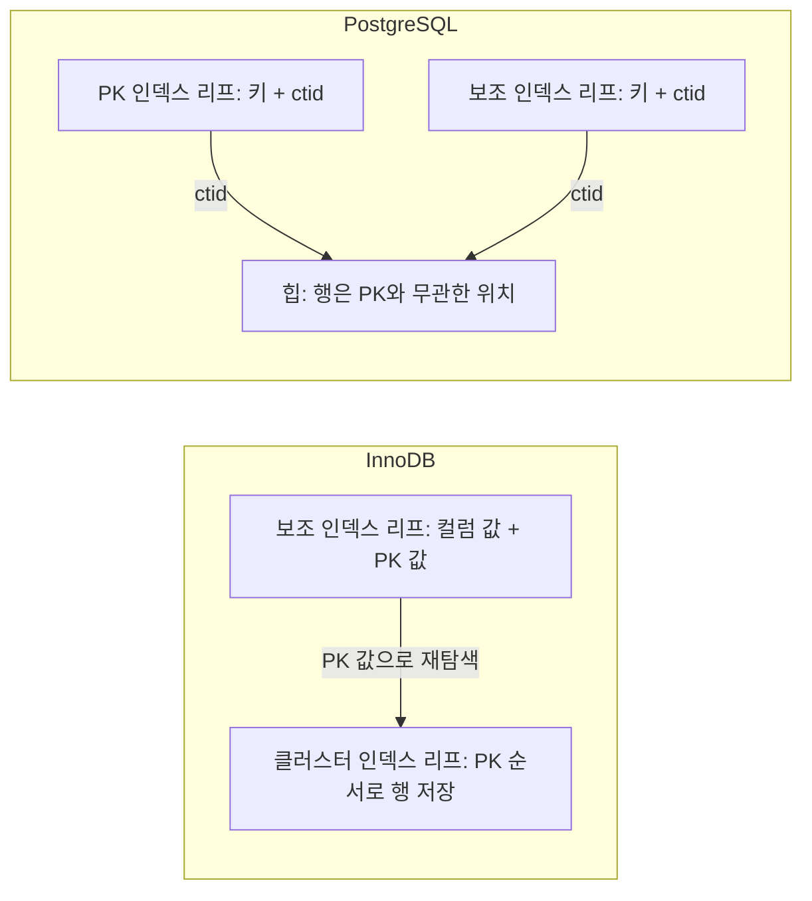
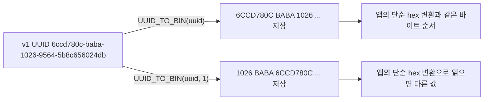
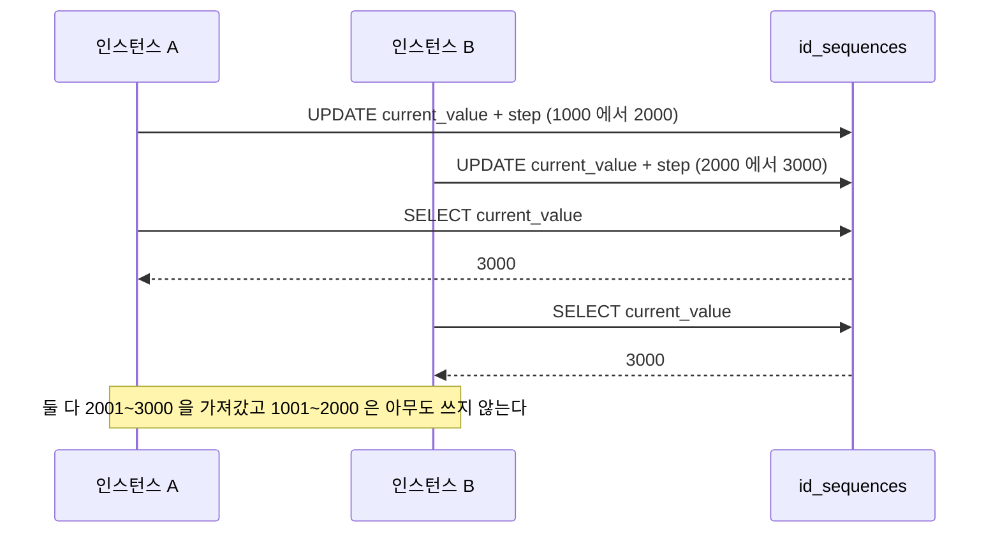
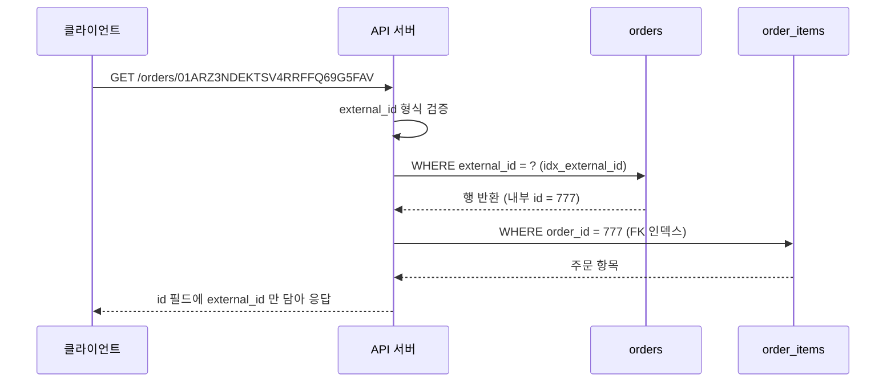
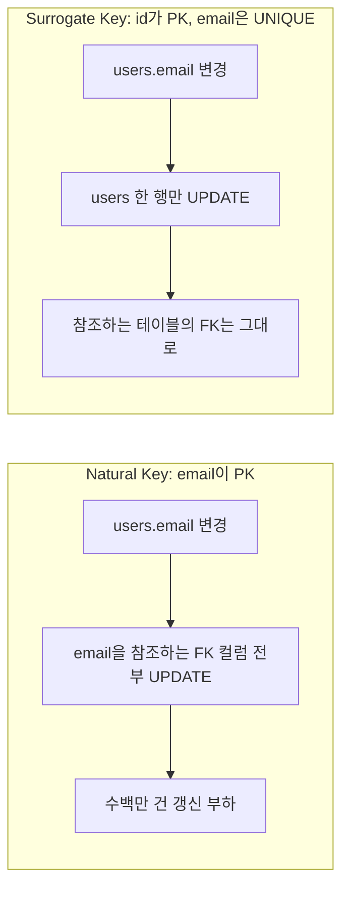
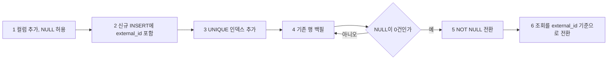

# 식별자 설계

식별자는 설계 초반에 정하면 바꾸기가 어렵다. 데이터가 수천만 건 쌓인 뒤에 PK 타입을 바꾸려면 FK 컬럼과 그 인덱스까지 전부 고쳐야 한다. 처음 어떤 ID 체계를 고르느냐에 따라 단일 서버에서 분산 환경으로 넘어갈 때의 비용이 크게 달라진다.

이 문서의 수치 중 "측정"이라고 적은 것은 MySQL 8.0.46과 PostgreSQL 16 컨테이너에서 직접 돌려서 얻은 값이다. 행 수 100만 건, 한 번 돌린 결과이므로 절대값보다 비율을 보는 용도다.

## 선택 순서

질문은 네 개고, 앞 질문이 뒤 질문을 필요 없게 만든다. 단일 DB면 샤딩은 볼 필요가 없고, 샤딩이나 다중 쓰기 노드가 없으면 ID를 노드에서 만들 이유도 없다.



도식에서 `Q3`의 "아니오"는 DB가 여러 대지만 쓰기는 한 곳뿐인 경우(읽기 전용 복제본, 분석용 사본)다. 이 경우도 auto_increment로 충분하다. `Q4`의 8바이트 제약은 이미 BIGINT로 굳은 스키마, 외부 시스템 연동 규격, 인덱스 크기 예산 같은 것이다. Snowflake를 고르면 워커 ID 관리, 시계 역행 방어, JavaScript 클라이언트의 정수 정밀도 문제가 같이 따라온다는 점을 감안해야 한다.

## auto-increment

가장 단순하다. DB가 순차적으로 증가하는 정수를 할당한다. MySQL에서는 `AUTO_INCREMENT`, PostgreSQL에서는 `SERIAL` 또는 `BIGSERIAL`을 쓴다.

```sql
-- MySQL
CREATE TABLE orders (
    id BIGINT UNSIGNED NOT NULL AUTO_INCREMENT,
    PRIMARY KEY (id)
);

-- PostgreSQL
CREATE TABLE orders (
    id BIGSERIAL PRIMARY KEY
);
```

값이 단조 증가해서 새 행이 InnoDB 클러스터 인덱스의 마지막 리프 페이지에 붙는다. 페이지 분할이 거의 없고 페이지가 가득 찬 채로 쌓인다. 8바이트라서 PK 값을 들고 있는 보조 인덱스와 자식 테이블의 FK 컬럼에도 8바이트만 더해진다. 마지막 부분이 UUID와의 실제 차이를 만드는데, 수치는 "PK 크기가 보조 인덱스마다 곱해진다" 절에 있다.

단점도 분명하다. 단일 DB에 종속된다. 샤딩 환경에서는 서로 다른 샤드에서 같은 ID가 발급된다. 순차적이라 외부에 노출하면 총 레코드 수가 추정된다. 오늘 가입한 유저 ID가 1001이면 유저가 1001명 이하라는 걸 알 수 있다.

롤백한 트랜잭션이 소비한 값은 돌아오지 않아 ID에 구멍이 생기고, `innodb_autoinc_lock_mode`에 따라 다중 행 INSERT의 번호 연속성이 달라진다. 이런 동작은 [AUTO_INCREMENT](Auto_Increment.md)에서 다룬다.

단일 DB 환경에서 외부에 노출하지 않는 내부 식별자로는 auto-increment BIGINT가 가장 무난하다.

## UUID

### v4: 랜덤

UUID v4는 122비트가 랜덤이다. 충돌 확률이 사실상 없고, DB와 무관하게 애플리케이션에서 직접 생성할 수 있다.

```
f47ac10b-58cc-4372-a567-0e02b2c3d479
```

Java에서는 `UUID.randomUUID()`, Node.js에서는 `crypto.randomUUID()`로 생성한다. MySQL의 `UUID()` 함수는 v4가 아니라 v1을 만든다. 세 번째 그룹의 첫 글자(버전 자리)를 찍어 보면 `1`이 나온다. DB 기본값으로 `UUID()`를 걸어 두고 v4라고 믿고 있는 스키마를 가끔 본다.

문제는 InnoDB에서 PK로 쓸 때 생긴다. 삽입 위치가 예측 불가능해서 이미 가득 찬 리프 페이지 중간에 끼워 넣게 되고, 그때마다 페이지가 분할된다. 자세한 동작은 다음 절 "InnoDB UUID PK 페이지 분할"에 있다.

### v1: 타임스탬프 + MAC 주소

UUID v1은 앞 60비트에 타임스탬프를 담지만, 낮은 비트가 앞에 오는 배치라 문자열 그대로는 단조 증가하지 않는다. MAC 주소가 노출되는 프라이버시 문제까지 있어서 신규 설계에서는 거의 쓰지 않는다. MySQL이 `UUID_TO_BIN(uuid, 1)`로 바이트를 재배치해 주는 대상이 이 v1이다.

### v7: 타임스탬프 + 랜덤

UUID v7은 2022년 RFC 9562에서 표준화됐다. 앞 48비트에 밀리초 단위 Unix 타임스탬프, 나머지 74비트에 랜덤값을 담는다. 시간 순으로 커지므로 InnoDB 페이지 분할 문제가 없다.

```
01892f61-7340-7f1a-9f5b-9e3dbf4f1a3e
└─ 타임스탬프 ─┘└─ 버전/랜덤 ──────────┘
```

```typescript
// Node.js 20+: uuid 라이브러리 사용
import { v7 as uuidv7 } from 'uuid';
const uuid = uuidv7();
```

UUID 체계를 유지해야 하는 상황에서 PK로 쓴다면 v4 대신 v7이다. 비트 구조, 언어별 생성 코드, JPA 연동, 같은 밀리초 안의 순서 보장은 [UUID v7](../../Backend/Standards/UUID_v7.md)에 정리돼 있다.

## InnoDB UUID PK 페이지 분할

InnoDB는 PK 순서로 정렬된 B-Tree(클러스터 인덱스)에 행을 저장한다. 리프 페이지 기본 크기는 16KB다. UUID v4 PK는 새 키가 키 공간 어디든 떨어지고, v7은 항상 가장 큰 키로 들어온다. 두 경우 리프 페이지에서 일어나는 일이 다르다.



왼쪽 갈래는 삽입마다 분할이 일어날 수 있고 분할 뒤 페이지가 반쯤 빈다. 오른쪽 갈래는 새 페이지를 뒤에 붙이기만 한다. 분할 자체의 I/O 비용에 더해 같은 데이터를 저장하는 페이지 수가 늘어난다.

얼마나 늘어나는지 쟀다. 같은 100만 건을 BINARY(16) PK로 넣었을 때 클러스터 인덱스가 오름차순 입력에서는 50.6MB, 랜덤(MD5 값) 입력에서는 79.6MB였다. 약 두 배까지 간다고 흔히 말하지만 이 테스트에서는 두 배에 못 미쳤다. 일 삽입이 수십만 건을 넘는 테이블에서 체감이 되는 정도이고, 수만 건 수준에서는 보이지 않는다. 분할 횟수를 직접 세는 방법은 [B-Tree 페이지 분할](B_Tree_Page_Split.md)에 있다.

### 대응 방법

**UUID v7 또는 ULID로 교체**

가장 깔끔하다. 타임스탬프가 앞에 있는 ID는 단조 증가하므로 새 행이 항상 리프 페이지 끝에 붙는다. 이미 v4가 쌓인 테이블에서 넘어갈 때의 주의점은 [UUID v7](../../Backend/Standards/UUID_v7.md)의 "UUIDv4에서 UUIDv7으로 전환 시 주의사항"에 있다.

**UUID_TO_BIN 스왑 플래그**

v1 UUID(MySQL `UUID()`의 결과)를 BINARY(16)에 넣을 때 `UUID_TO_BIN(uuid, 1)`을 쓰면 타임스탬프 바이트가 앞으로 와서 시간 순으로 정렬된다. v4에는 효과가 없다. v4를 계속 쓰면서 이 옵션을 켜면 공간 절약 효과만 남는다.

```sql
CREATE TABLE sessions (
    id BINARY(16) NOT NULL DEFAULT (UUID_TO_BIN(UUID(), 1)),
    PRIMARY KEY (id)
);
```

**innodb_fill_factor 조정**

이미 v4 PK를 쓰고 있고 마이그레이션이 어려울 때 쓰는 단기 완화책으로 알려져 있는데, 동작 범위를 오해하기 쉽다. 이 변수는 정렬된 인덱스 빌드(CREATE INDEX, 테이블 재구성)에서 페이지를 채우는 비율이다. `SET GLOBAL`만 하면 기존 페이지는 그대로고, 재구성을 해야 반영된다.

100만 건 테이블에 랜덤 키 10만 건을 더 넣은 상태에서 `ALTER TABLE ... ENGINE=InnoDB`로 재구성했더니 클러스터 인덱스가 70에서는 84.7MB, 100에서는 63.6MB였다. 빈 자리를 미리 남겨 두는 방식이라 그 자리가 차면 분할이 다시 시작되고, 서버 전체의 인덱스 빌드에 적용되는 전역 설정이라 다른 테이블 재구성도 같이 커진다.

```sql
SET GLOBAL innodb_fill_factor = 80; -- 기본값 100, 이후 재구성하는 인덱스부터 적용
```

## PK 크기가 보조 인덱스마다 곱해진다

InnoDB의 보조 인덱스 리프에는 인덱스 컬럼 값과 함께 PK 값이 들어 있다. 보조 인덱스에서 찾은 PK 값으로 클러스터 인덱스를 한 번 더 탐색해야 행을 읽을 수 있기 때문이다. PK가 16바이트면 보조 인덱스 항목마다 16바이트가 붙는다.


보조 인덱스가 세 개면 PK 값이 클러스터 인덱스에 한 벌, 보조 인덱스에 세 벌 저장된다. PK 폭이 8바이트에서 16바이트로 늘면 이 네 곳이 모두 커진다. 같은 테이블을 PK만 바꿔서 만들고 비교했다.

```sql
CREATE TABLE t8  (id BIGINT NOT NULL,     user_id BIGINT NOT NULL, status TINYINT NOT NULL, created_at DATETIME NOT NULL,
                  PRIMARY KEY (id), KEY idx_user (user_id), KEY idx_status (status), KEY idx_created (created_at));
CREATE TABLE t16 (id BINARY(16) NOT NULL, user_id BIGINT NOT NULL, status TINYINT NOT NULL, created_at DATETIME NOT NULL,
                  PRIMARY KEY (id), KEY idx_user (user_id), KEY idx_status (status), KEY idx_created (created_at));
```

`t8`과 `t16(순차)`는 1부터 100만까지 오름차순으로 넣고, `t16(랜덤)`은 `UNHEX(MD5(n))`으로 넣었다. `ANALYZE TABLE` 뒤에 인덱스별 크기를 읽었다. `information_schema.tables`는 보조 인덱스 합계(`index_length`)만 주기 때문에 인덱스별 크기는 `mysql.innodb_index_stats`에서 읽는다.

```sql
SELECT index_name, ROUND(stat_value * @@innodb_page_size / 1048576, 1) AS mb
FROM mysql.innodb_index_stats
WHERE database_name = 'shop' AND table_name = 't16' AND stat_name = 'size';
```

| 인덱스 (MB) | PK BIGINT (8B) | PK BINARY(16) 순차 | PK BINARY(16) 랜덤 |
|---|---|---|---|
| PRIMARY | 42.6 | 50.6 | 79.6 |
| idx_user (BIGINT) | 38.6 | 52.7 | 53.6 |
| idx_created (DATETIME) | 18.6 | 25.6 | 25.6 |
| idx_status (TINYINT) | 16.5 | 24.6 | 36.6 |
| 보조 인덱스 합계 | 73.7 | 102.8 | 115.8 |
| 테이블 전체 | 116.3 | 153.4 | 195.4 |

`idx_status`가 읽기 좋다. 컬럼이 1바이트짜리인데 인덱스가 16.5MB에서 24.6MB로 늘었고, 차이 8.1MB는 100만 행에 8바이트를 곱한 값(약 7.6MB)에 페이지 오버헤드가 얹힌 크기다. 보조 인덱스 세 개 합계는 29MB 늘었다. 자식 테이블의 FK 컬럼과 그 인덱스도 같은 폭을 상속하므로, 부모 PK를 16바이트로 잡으면 참조하는 테이블마다 같은 비용을 낸다.

PK가 랜덤이면 한 가지가 더 늘어난다. `idx_status`는 같은 status 값 안에서 PK 순으로 정렬되므로 PK가 랜덤이면 보조 인덱스 안의 삽입 위치도 랜덤이 되고, 36.6MB까지 커졌다. `idx_created`는 `created_at`이 입력 순서대로 커지는 값이라 PK가 랜덤이어도 끝에 붙어서 변하지 않았다. 보조 인덱스까지 조각나는지는 그 인덱스 키 값이 PK 순서와 얼마나 어긋나는지에 달려 있다.

## PostgreSQL에서는 양상이 다르다

앞의 두 절은 InnoDB 이야기다. 행이 PK 순서로 저장되고 보조 인덱스가 PK를 들고 있다는 전제가 PostgreSQL에는 없다. 이 전제를 그대로 옮겨서 "v4 UUID는 테이블 페이지를 절반씩 비운다"거나 "PK 폭이 모든 인덱스에 퍼진다"고 말하면 틀린다.

PostgreSQL 테이블은 힙이고, 행은 PK와 무관하게 빈 자리나 끝에 쓰인다. PK 인덱스도 일반 B-Tree 인덱스일 뿐이다. 모든 인덱스 리프는 PK가 아니라 힙 위치(ctid)를 가리킨다. 그래서 v4 UUID PK로 분할되는 건 PK 인덱스 하나고, 힙 페이지는 분할되지 않으며, PK 폭이 다른 인덱스로 번지지 않는다. 100만 건에 `user_id`, `created_at` 인덱스를 둔 같은 구성으로 쟀다.



InnoDB는 보조 인덱스가 PK 값을 거쳐 행에 닿아서 PK 폭이 모든 인덱스에 들어가고, PostgreSQL은 모든 인덱스가 ctid로 힙에 바로 닿아서 PK 폭이 PK 인덱스에만 남는다.

| 대상 (MB) | bigint PK 순차 | uuid PK 랜덤(md5) |
|---|---|---|
| 힙 | 57.4 | 65.1 |
| PK 인덱스 | 21.4 | 38.1 |
| user_id 인덱스 | 7.4 | 7.4 |
| created_at 인덱스 | 21.4 | 21.4 |

보조 인덱스 둘은 크기가 같다. 힙의 7.7MB 차이는 행에 들어가는 id 컬럼이 8바이트 늘어서 생긴 것이다. PK 인덱스의 차이는 키 폭과 랜덤 삽입이 합쳐진 값이고, 이 측정에서 둘의 몫은 나누지 않았다.

PostgreSQL에서 v4 UUID PK의 비용은 PK 인덱스와 그 인덱스의 캐시 지역성에 모인다. v7로 바꾸면 그 인덱스의 삽입이 끝에 모이는 이점은 PostgreSQL에서도 유지된다. `CLUSTER`로 힙을 한 번 정렬할 수는 있지만 이후 삽입에는 유지되지 않는다. PostgreSQL 쪽 v7 생성과 저장은 [UUID v7](../../Backend/Standards/UUID_v7.md)의 PostgreSQL 절에 있다.

## BINARY(16) 저장 방식

UUID를 36자 문자열로 저장하지 않고 BINARY(16)에 넣으면 컬럼과 인덱스가 모두 작아진다. 위 측정의 `t16`이 이 형태다. 삽입과 조회에 쓰는 `UUID_TO_BIN` / `BIN_TO_UUID` 예제와 CHAR(36)과의 크기 비교는 [UUID v7](../../Backend/Standards/UUID_v7.md)의 "MySQL BINARY(16) 저장"에 있어서 여기서는 반복하지 않는다.

여기서 다루는 건 애플리케이션 쪽 변환에서 자주 터지는 문제다. `UUID_TO_BIN(uuid, 1)`로 저장한 컬럼은 바이트 순서가 다르다. v1 UUID `6ccd780c-baba-1026-9564-5b8c656024db`를 넣으면 스왑 없이는 `6CCD780CBABA1026...`, 스왑하면 `1026BABA6CCD780C...`로 저장된다. 아래의 단순 hex 변환은 스왑 없는 형태와 같다. 같은 컬럼을 DB 함수와 이 함수가 섞어서 읽고 쓰면 조회가 빈 결과로 돌아온다. v7은 스왑이 필요 없어서 이 문제가 생기지 않는다.



스왑 여부에 따라 같은 UUID가 서로 다른 바이트열로 저장된다. 아래 변환 함수는 위쪽 갈래와만 맞는다.

```typescript
function uuidToBytes(uuid: string): Buffer {
    return Buffer.from(uuid.replace(/-/g, ''), 'hex');
}

function bytesToUuid(bytes: Buffer): string {
    const hex = bytes.toString('hex');
    return [hex.slice(0, 8), hex.slice(8, 12), hex.slice(12, 16), hex.slice(16, 20), hex.slice(20)].join('-');
}
```

TypeORM에서는 `@Column({ type: 'binary', length: 16 })`과 변환 로직을 조합한다.

```typescript
@Entity()
export class Session {
    @PrimaryColumn({ type: 'binary', length: 16 })
    id: Buffer;

    @BeforeInsert()
    generateId(): void {
        if (!this.id) {
            this.id = uuidToBytes(uuidv7());
        }
    }
}
```

MySQL Workbench나 DBeaver 같은 GUI 툴에서 BINARY(16) 컬럼을 조회하면 바이너리 그대로 보인다. 디버깅할 때는 `BIN_TO_UUID(id)`를 SELECT에 넣어야 읽을 수 있다.

## ULID

ULID(Universally Unique Lexicographically Sortable Identifier)는 128비트다. 앞 48비트에 밀리초 단위 타임스탬프, 나머지 80비트에 랜덤값을 담고 Crockford Base32로 인코딩해 26자리 문자열로 표현한다.

```
01ARZ3NDEKTSV4RRFFQ69G5FAV
└──────────┘└──────────────┘
 타임스탬프      랜덤값
```

타임스탬프가 앞에 있어 InnoDB 페이지 분할이 거의 없다. 하이픈이 없고, Crockford Base32 알파벳은 I·L·O·U를 제외해 숫자 1·0과 헷갈리지 않는다. 문자열 사전 순 비교가 생성 시각 순 정렬과 일치해서 Redis·Cassandra 같은 문자열 비교 기반 저장소에서 인덱스 없이 시각 범위 조회가 가능하다.

Monotonic ULID, MySQL/PostgreSQL 저장 방식, Spring/JPA 통합, UUID v7과의 비교는 [ULID](ULID.md)에서 다룬다.

## Snowflake ID

Twitter에서 설계한 분산 ID 체계다. 64비트 정수로 구성된다.

```
비트 위치: 63   62        21       11      0
           ┌──┬────────────────┬─────────┬────────┐
           │0 │  타임스탬프 41b │ 워커ID 10b │ 시퀀스 12b │
           └──┴────────────────┴─────────┴────────┘
```

41비트 타임스탬프는 에포크부터의 밀리초 차이로 약 69년을 쓴다. 10비트 워커 ID는 최대 1024개 노드를 구분한다. 12비트 시퀀스는 같은 밀리초 안의 순번이라 노드당 밀리초에 4096개까지 발급한다. 결과가 64비트 정수라 BIGINT에 들어가고, DB 없이 ID를 만들 수 있다.

시계에 의존하는 설계라서 세 가지가 운영 부담으로 따라온다. 구현 코드와 재현 결과는 [Snowflake ID](Snowflake_ID.md)에 있고, 여기서는 요약만 둔다.

- 시계 역행: NTP 보정이나 VM 일시 정지로 시계가 뒤로 가면 이미 발급한 ID가 다시 나온다. 역행 폭이 작으면 대기하고 크면 예외를 던지는 방어 코드가 필요하다. "시계가 뒤로 갈 때" 절에서 중복이 나오는 과정을 재현했다.
- 워커 ID 할당: 같은 워커 ID를 두 인스턴스가 쓰면 충돌한다. StatefulSet 순번, Redis 풀, 리스 방식의 장단점은 "워커 ID 할당" 절에 있다.
- 노드 간 순서: 노드마다 시계가 달라서 전역 단조 증가는 아니다. 노드 하나 안에서만 단조라서 InnoDB 끝 삽입 이점은 노드 단위로 유지된다.

### JavaScript 클라이언트에서 잘리는 문제

64비트 정수를 JSON 숫자로 내려보내면 JavaScript 클라이언트가 값을 조용히 바꿔 읽는다. Number는 double이라 2^53(`Number.MAX_SAFE_INTEGER` = 9007199254740991)을 넘으면 정수가 정확하지 않다. 실행해 보면 `JSON.parse('9007199254740993')`은 `9007199254740992`를 돌려주고 에러도 경고도 없다. `{"id":1234567890123456789}`를 파싱하면 실제 보관되는 값은 `1234567890123456768`이다.

Snowflake에서는 이 경계가 일찍 온다. 타임스탬프가 22비트 왼쪽에 있어서 2^53에 닿는 시점이 에포크로부터 2^31ms, 약 24.9일 뒤다. 에포크를 2024-01-01로 잡으면 2024-01-25 20:31 UTC부터 ID가 안전 정수 범위를 넘는다. 3년쯤 지난 ID(4.0 × 10^17 부근)에서는 표현 가능한 값의 간격이 64라서, 같은 노드가 같은 밀리초에 발급한 연속 32개 ID를 JSON으로 보내고 파싱하면 서로 다른 값이 1개만 남았다. 목록에서 어떤 주문을 눌러도 같은 주문이 열리는 식으로 드러난다.

응답에서는 64비트 ID를 문자열로 내려보내고, 클라이언트는 문자열 그대로 들고 있다가 서버로 돌려보낸다. 클라이언트가 ID로 산술을 할 일은 없다. 응답 직렬화와 BigInt 처리 방법은 [Snowflake ID](Snowflake_ID.md)의 "JavaScript에서 64비트 ID가 잘리는 문제"에 있다. auto-increment BIGINT는 2^53에 닿으려면 9×10^15건이 필요해서 보통 걸리지 않지만, 외부 노출용 ID로 쓰는 값이 2^53을 넘을 수 있다면 같은 규칙을 적용한다.


위쪽 갈래는 값이 조용히 바뀌고, 아래쪽 갈래가 위에서 말한 문자열 규칙이다.

## ID 유형 비교

| 항목 | auto-increment | UUID v4 | UUID v7 | ULID | Snowflake |
|------|---------------|---------|---------|------|-----------|
| 크기 | 8바이트 | 16바이트 | 16바이트 | 16바이트 | 8바이트 |
| 단조 증가 | O | X | O | O | 노드 안에서만 O |
| DB 의존성 | 있음 | 없음 | 없음 | 없음 | 없음 |
| 분산 환경 | X | O | O | O | O |
| InnoDB 끝 삽입 | 됨 | 안 됨 | 됨 | 됨 | 노드 단위로 됨 |
| 보조 인덱스에 곱해지는 PK 폭 | 8바이트 | 16바이트 | 16바이트 | 16바이트(BINARY) | 8바이트 |
| 외부 노출 시 순서 추정 | 전체 | 불가 | 시간 단위 | 시간 단위 | 시간+워커 |
| 구현 복잡도 | 낮음 | 낮음 | 낮음 | 낮음 | 높음 |

## 분산 환경 ID 생성

분산 환경에서 ID 생성의 요구사항은 세 가지다. 전역 유일성, DB 없이 생성 가능, 단조 증가(InnoDB 끝 삽입).

### DB 시퀀스 배치 발급

별도 시퀀스 테이블을 두고 여러 서비스 인스턴스가 ID를 배치로 가져가는 방식이다. 인스턴스는 구간 하나를 예약해 메모리에 들고 있다가 소진되면 다시 가져간다.

```sql
CREATE TABLE id_sequences (
    name VARCHAR(50) PRIMARY KEY,
    current_value BIGINT NOT NULL DEFAULT 0,
    step INT NOT NULL DEFAULT 1000
);
```

예약을 `UPDATE`로 올리고 `SELECT`로 읽는 식으로 쓰면 구간이 겹친다. 두 문장 사이에 다른 세션의 UPDATE가 끼어들 수 있기 때문이다. autocommit에서 UPDATE는 끝나는 순간 행 락을 놓는다.



A의 SELECT가 B의 UPDATE 뒤에 실행되면서 A도 3000을 읽는다. A와 B가 같은 구간을 쓰므로 PK 충돌이 나거나, 충돌 제약이 없으면 중복 ID가 생긴다. 구멍(1001~2000)은 낭비일 뿐이라 문제가 아니지만 겹침은 문제다.

`LAST_INSERT_ID(expr)`로 고치면 UPDATE가 올린 값을 같은 세션 안에 보관하고, 다른 세션은 그 값을 건드리지 못한다.

```sql
UPDATE id_sequences
SET current_value = LAST_INSERT_ID(current_value + step)
WHERE name = 'orders';

SELECT LAST_INSERT_ID();
```

`LAST_INSERT_ID()`는 연결 단위 값이라 두 번째 문장이 어느 시점에 실행돼도 자기 UPDATE의 결과를 돌려준다. 인스턴스가 쓸 구간은 `(upper - step + 1)`부터 `upper`까지다. 이 UPDATE를 긴 트랜잭션 안에서 실행하면 그 행 락이 트랜잭션이 끝날 때까지 잡혀 있어 다른 인스턴스가 기다린다. 시퀀스 발급은 별도 연결에서 autocommit으로 하는 쪽이 낫다. `step`을 바꾸면 이미 떠 있는 인스턴스가 옛 값으로 하한을 계산하므로 인스턴스 재시작과 같이 바꾼다.

저장 프로시저로 재현했다. 세션 8개가 각각 2,000번씩, 총 16,000번 구간을 가져가게 했다. UPDATE 후 SELECT 방식은 16,000건 중 서로 다른 상한값이 15,999개였고(같은 구간이 두 번 나간 경우가 1건), `LAST_INSERT_ID` 방식은 16,000건이 모두 달랐다. 한 번 돌린 결과이고 동시성이 낮으면 겹침이 드물게 나온다. 로컬에서 몇 번 돌려서 안 나온다고 안전한 코드가 아니다.

인스턴스가 죽으면 캐싱한 ID 범위가 낭비되어 구멍이 생기는데, PK는 연속일 필요가 없으므로 실제 문제는 아니다.

### Snowflake 워커 ID

워커 ID 할당이 핵심이다. 같은 워커 ID를 두 인스턴스가 쓰면 충돌한다. Kubernetes StatefulSet이라면 Pod 이름 끝의 순번을 쓰고, Deployment처럼 이름이 랜덤이면 Redis 같은 외부 저장소에서 발급받는다. 풀이 마르는 과정, 리스 방식, 같은 워커 ID를 두 Pod가 쓰게 되는 경우는 [Snowflake ID](Snowflake_ID.md)의 "워커 ID 할당"에 있다.

### UUID v7 / ULID

워커 ID 관리 없이 분산 ID를 만든다. 랜덤 비트가 충분히 커서 충돌 가능성이 사실상 없고, 타임스탬프 선두라 단조 증가한다. 구현이 단순하다.

다만 16바이트라 BIGINT보다 2배 크고, 그 차이는 앞서 잰 것처럼 보조 인덱스마다 쌓인다. 수억 건 테이블에서는 누적량이 커진다. 스토리지 비용보다 구현 단순성을 우선하는 상황에 맞는다.

## API에서 내부 ID 노출 여부

내부 DB PK를 API 응답에 그대로 노출하면 문제가 생긴다.

총 레코드 수가 추정된다. `GET /orders/10043`이면 주문이 약 1만 건임을 알 수 있다. 순차 스캔도 쉬워진다. `id=1`부터 하나씩 올리며 다른 사용자 데이터에 접근을 시도하는 걸 자동화할 수 있다. 이것이 IDOR(Insecure Direct Object Reference) 취약점이다. 특정 시간대의 주문 ID 증가 폭으로 주문량을 역산하는 식으로 비즈니스 정보가 경쟁사에 새기도 한다.

내부 ID는 DB 안의 연산(JOIN, FK)에만 쓰고, 외부에는 별도 ID를 노출한다.

```sql
CREATE TABLE orders (
    id BIGINT NOT NULL AUTO_INCREMENT PRIMARY KEY, -- 내부 ID
    external_id CHAR(26) NOT NULL,                -- 외부 노출용 ULID
    user_id BIGINT NOT NULL,
    UNIQUE INDEX idx_external_id (external_id)
);
```

```typescript
// POST /orders
async createOrder(req: OrderRequest): Promise<OrderResponse> {
    const order = await this.orderService.create(req);
    return {
        id: order.externalId, // ULID 노출
        // id: order.id  -- 내부 PK 노출 금지
    };
}
```

요청이 들어오면 external_id로 행을 한 번 찾아 내부 id를 얻고, 그 값으로 자식 테이블을 조회한다. 외부에 보이는 값과 FK로 쓰는 값이 갈라지는 지점이 아래 도식의 두 번째 단계다.



external_id로 ULID나 UUID v4를 쓰면 순차 스캔이 불가능하고 총 건수도 알 수 없다. 이 인덱스는 보조 인덱스라서 v4를 쓰면 이 인덱스 하나만 랜덤 삽입으로 조각나고, ULID나 v7이면 끝에 붙는다. 클러스터 인덱스와 다른 보조 인덱스는 8바이트 PK 그대로다.

HashIds 같은 라이브러리로 숫자 ID를 가역적으로 인코딩하는 방법도 있다.

```javascript
import Hashids from 'hashids';
const hashids = new Hashids('my-secret-salt', 8);

hashids.encode(1234);   // 'NkK9'
hashids.decode('NkK9'); // [1234]
```

HashIds는 암호학적으로 안전하지 않다. salt가 유출되면 역산된다. 레코드 수 추정을 막는 용도로는 충분하지만, 보안이 중요한 리소스에는 쓰지 않는다.

**노출해도 되는 경우**

내부 관리 도구나 B2B API처럼 파트너가 DB 규모를 알아도 상관없는 경우, 또는 external_id 관리가 오히려 복잡도를 키우는 경우에는 내부 ID를 노출해도 된다. 결제나 개인정보 같은 민감한 도메인은 항상 분리한다.

## Surrogate Key vs Natural Key

### Natural Key

실제 도메인에 존재하는 고유 식별자를 PK로 쓰는 방법이다.

```sql
-- 이메일을 PK로
CREATE TABLE users (
    email VARCHAR(254) PRIMARY KEY,
    name VARCHAR(50) NOT NULL
);
```

Natural Key의 문제는 변경 가능성이다. 이메일이 PK면 이메일이 바뀔 때 이를 참조하는 모든 FK 컬럼도 UPDATE해야 한다. `ON UPDATE CASCADE`를 걸어도 수백만 건의 FK 갱신은 부하가 크다. 복합 키면 FK를 여러 컬럼으로 정의해야 해서 인덱스 크기와 조인 조건이 복잡해진다.

```sql
-- 복합 Natural Key를 FK로 참조하는 예
CREATE TABLE orders (
    user_email VARCHAR(254) NOT NULL,
    -- email 변경 시 여기도 UPDATE 필요
    FOREIGN KEY (user_email) REFERENCES users(email)
);
```

VARCHAR PK는 보조 인덱스 항목마다 이메일 길이만큼 붙는다. 앞 절의 8바이트와 16바이트 차이보다 훨씬 큰 폭이다.

자주 변하지 않고 외부 시스템과 연동 기준이 되는 값에만 Natural Key를 고려한다. 국가 코드(CHAR(2)), 통화 코드(CHAR(3)) 같은 ISO 표준값은 사실상 변하지 않으므로 Natural Key도 무방하다.

### Surrogate Key

DB나 애플리케이션이 만드는 인위적인 식별자를 PK로 쓰는 방법이다. auto-increment, UUID, ULID, Snowflake 모두 Surrogate Key다.

```sql
CREATE TABLE users (
    id BIGINT NOT NULL AUTO_INCREMENT PRIMARY KEY,
    email VARCHAR(254) NOT NULL UNIQUE, -- UNIQUE 제약으로 중복 방지
    name VARCHAR(50) NOT NULL
);
```

email은 UNIQUE 제약으로 중복을 막고 PK는 별도 Surrogate Key로 분리한다. 이메일이 바뀌어도 PK는 그대로고, 참조하는 다른 테이블은 영향을 받지 않는다. 도메인 의미가 없어 데이터만 봐서는 연결 관계를 알기 어렵지만, 변경에 강하고 FK 관리가 단순하다. 복합 PK와의 비교, JPA `@GeneratedValue` 방식별 동작, 키 공간 상한은 [대리키](Surrogate_Key.md)에서 다룬다.



이메일이 바뀔 때 갱신 범위가 어디까지 번지는지가 두 방식의 차이다.

### 선택 기준

| 상황 | 선택 |
|------|------|
| 값이 절대 변하지 않고 이미 전역 유일한 경우 (국가코드, 통화코드) | Natural Key |
| 값이 변할 가능성이 있는 경우 (이메일, 전화번호, 사용자명) | Surrogate Key |
| 외부 시스템과 교환하는 기준 키가 필요한 경우 | Natural Key를 UNIQUE, Surrogate Key를 PK |
| 복합 키가 되는 경우 | Surrogate Key |

## 운영 중인 테이블에 external_id 붙이기

auto_increment PK를 이미 API에 노출하고 있는 테이블이 출발점이다. 목표는 PK와 FK는 그대로 두고 외부 노출용 ID만 새로 붙이는 것이다. 자식 테이블의 FK 컬럼을 하나도 건드리지 않으므로 수억 건짜리 자식 테이블을 재구성하지 않는다. 순서는 컬럼 추가, 신규 행 채우기, UNIQUE 인덱스, 기존 행 백필, NOT NULL, 조회 전환이다.

| 단계 | 작업 | 앱이 보는 상태 |
|---|---|---|
| 1 | `external_id`를 NULL 허용으로 추가 | 아무것도 모름 |
| 2 | 앱 배포: 신규 INSERT에서 external_id를 같이 넣음 | 신규 행은 값이 있고 기존 행은 NULL |
| 3 | UNIQUE 인덱스 추가 | NULL은 중복이어도 되므로 백필 전에 걸 수 있음 |
| 4 | 기존 행을 배치로 백필 | NULL이 줄어듦 |
| 5 | NULL이 0건인지 확인 후 NOT NULL 전환 | 모든 행에 값이 있음 |
| 6 | 조회 API를 external_id 기준으로 전환, 응답에서 내부 id 제거 | 클라이언트는 external_id만 봄 |



4단계의 백필은 NULL이 0건이 될 때까지 반복하고, 그 확인을 통과해야 5단계로 넘어간다.

DDL과 백필(1, 3, 4, 5단계)을 MySQL 8.0.46에서 20만 건 테이블로 돌렸다. 백필은 `LIMIT 50000`으로 네 번 돌려 NULL을 비웠다. `order_items.order_id`가 `orders.id`를 FK로 참조하는 구조다.

```sql
-- 1단계: 메타데이터만 바꾼다
ALTER TABLE orders ADD COLUMN external_id BINARY(16) NULL, ALGORITHM=INSTANT;

-- 3단계: 백필 전에 걸어도 된다. DML을 막지 않는다
ALTER TABLE orders ADD UNIQUE INDEX uk_external_id (external_id),
    ALGORITHM=INPLACE, LOCK=NONE;

-- 4단계: 배치 반복. 영향 행이 0이 될 때까지
UPDATE orders SET external_id = UUID_TO_BIN(UUID(), 1)
WHERE external_id IS NULL ORDER BY id LIMIT 5000;

-- 5단계
ALTER TABLE orders MODIFY external_id BINARY(16) NOT NULL,
    ALGORITHM=INPLACE, LOCK=NONE;
```

`ALGORITHM`과 `LOCK`을 명시해 두면 MySQL이 해당 방식으로 못 하는 경우 실행하지 않고 에러를 낸다. 5단계에 `ALGORITHM=INSTANT`를 쓰면 `ERROR 1845: ALGORITHM=INSTANT is not supported for this operation`이 나온다. NULL에서 NOT NULL로 바꾸는 작업은 테이블 재구성이 필요해서 `INPLACE`로만 된다. DML은 막지 않지만 큰 테이블이면 재구성 시간이 걸린다. 마지막 `ALTER`가 성공했다는 것 자체가 NULL이 0건이라는 확인이다. 값이 남아 있으면 이 문장이 실패한다.

백필의 `UUID()`는 앞서 말했듯 v1이다. 같은 컬럼에 신규 행은 앱이 만든 v7이나 ULID가 들어가므로 포맷이 섞인다. API가 UUID 버전을 검증하거나 포맷을 통일해야 하면 백필도 앱 스크립트에서 같은 생성기로 `WHERE id = ?` 단위로 채운다. 배치 크기는 복제 지연을 보면서 정하고, 5000은 예시다.

전환 후 조회는 `idx_external_id`로 한 번, 자식 테이블은 기존 FK 인덱스로 이어진다.

```sql
EXPLAIN SELECT o.id, i.sku
FROM orders o JOIN order_items i ON i.order_id = o.id
WHERE o.external_id = UUID_TO_BIN('...', 1);
-- orders: type=const, key=uk_external_id
-- order_items: type=ref, key=idx_order
```

PK가 UUID v4인 테이블은 사정이 다르다. v4 값이 이미 외부에 나가고 있고 FK 컬럼도 그 16바이트 값을 들고 있다. 외부 노출 문제는 이미 해결돼 있으니 external_id를 새로 만들 필요는 없고, 문제는 PK 자체의 쓰기 비용과 크기다. 선택지는 두 가지다.

- PK 컬럼은 그대로 두고 신규 행만 v7으로 발급한다. FK 컬럼을 건드리지 않는다. 기존 v4 행은 그대로 남는다. 혼재할 때의 영향은 [UUID v7](../../Backend/Standards/UUID_v7.md)에 정리돼 있다.
- PK를 BIGINT로 바꾼다. 이 경로는 자식 테이블의 FK 컬럼도 같이 바꿔야 해서 위의 "FK를 건드리지 않는" 방식이 통하지 않는다. 새 BIGINT 컬럼과 새 FK 컬럼을 추가해 채우고 전환하는 과정을 [gh-ost](gh_ost.md)나 [pt-osc](pt_online_schema_change.md)로 돌려야 하고, 자연키 테이블에 대리키를 뒤늦게 붙이는 단계별 절차는 [대리키](Surrogate_Key.md)의 마이그레이션 절과 같은 모양이다.

v4 PK를 바꾸면 얻는 건 쓰기 비용과 인덱스 크기이고, 치르는 건 모든 자식 테이블의 변경이다. 자식 테이블이 많은데 쓰기 지연이 문제가 되지 않는다면 바꾸지 않는 쪽이 낫다.
