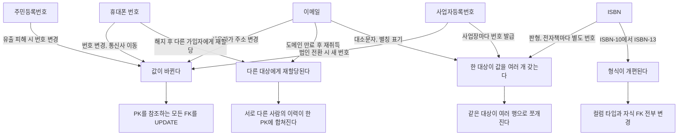
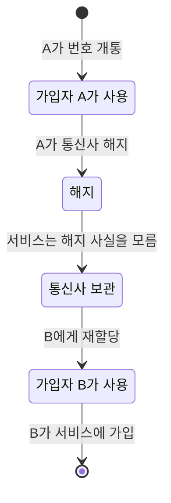
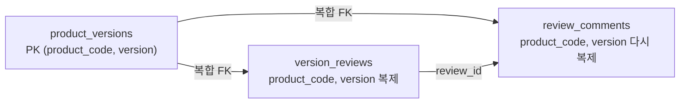
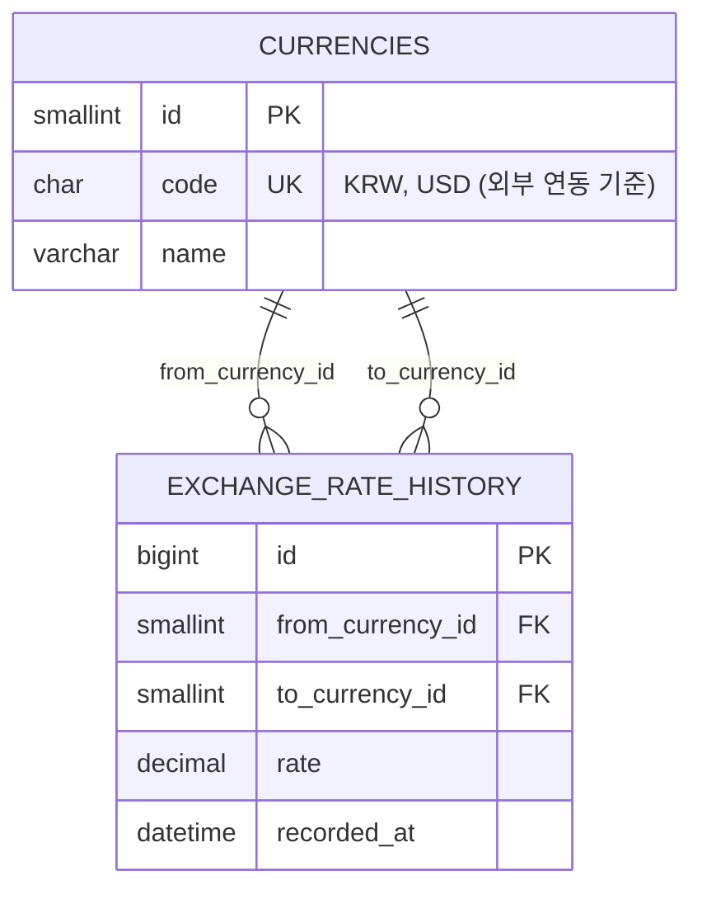

# 자연키

자연키(Natural Key)는 도메인 데이터 자체를 PK로 쓰는 방식이다. 이메일, ISO 국가 코드, 상품 바코드처럼 비즈니스 세계에서 이미 유일성이 보장된다고 가정하는 값이다.

자연키를 PK로 쓰는 결정 자체보다, 그 키가 정말로 "변하지 않는다"는 보장을 누가 어떻게 하는지가 핵심이다. 도메인 설계 초반에는 자명해 보이던 유일성이 시스템이 커지면서 흔들리는 경우가 많다.

## 키 공간

자연키의 유일성 보장 범위를 키 공간이라고 부른다. 기술적으로 표현 가능한 값의 집합과, 실제로 유일하다는 보장이 있는 값의 집합이 일치하지 않는 경우가 많다.

ISO 4217 통화 코드 `CHAR(3)`은 알파벳 3자 조합으로 표현 가능한 값이 수만 가지지만, ISO가 실제로 할당하고 관리하는 코드는 180개 안팎이다. ISO가 이 공간의 유일성을 직접 보증하므로 `KRW`가 다른 통화를 가리키는 일은 표준 위원회가 결정하지 않는 한 발생하지 않는다.

이메일 주소는 표현 가능한 값이 사실상 무한하지만 유일성을 보증하는 중앙 기관이 없다. 도메인 소유권이 만료되면 같은 주소를 다른 사람이 취득한다. 시스템 내에서 `UNIQUE` 제약으로 유일성을 관리하더라도 "이 이메일이 항상 같은 사람을 가리킨다"는 보장은 DB 밖에 있다.

키 공간 크기가 사용 범위에 비해 충분한지 확인한다. 4자리 숫자 사번은 최대 9,999명까지 수용한다. 조직이 성장해 자릿수를 늘리면 PK 컬럼 타입이 바뀌고, FK를 참조하는 모든 자식 테이블도 함께 수정해야 한다.

관리 주체가 외부 기관인지 내부인지 구분한다. 외부 기관이 키 공간을 관리하면 내부 정책 변경과 무관하게 유일성이 유지된다. 내부에서 관리하는 키는 정책 변경, 조직 개편, 시스템 통합 시 키 공간 자체가 흔들린다.

키 공간 자체가 재정의될 가능성도 있다. ISBN-10에서 ISBN-13으로의 전환, 한국 우편번호 6자리→5자리 개편이 여기에 해당한다. 외부 기관이 관리하는 키라도 그 기관이 기준을 바꾸면 기존 키 공간이 무효화된다.

## 자연키가 깨지는 경로

흔한 자연키 후보가 PK 자격을 잃는 경로는 네 가지다. 값이 바뀌거나, 다른 대상에게 재할당되거나, 같은 대상이 값을 둘 이상 갖거나, 형식 자체가 개편된다. 후보마다 어느 경로를 타는지 따져 보는 편이 "이건 안 변하겠지"라는 감보다 정확하다.



위 그림에서 후보 하나에서 나가는 화살표가 둘 이상이면 그 키는 한 가지 이유로만 깨지지 않는다는 뜻이다. 오른쪽 끝 네 상자가 실제로 장애가 되는 결과이고, 이 중 `다른 대상에게 재할당된다`가 가장 늦게 발견된다. 값이 바뀌거나 형식이 바뀌는 건 에러가 나서 바로 알지만, 재할당은 에러 없이 데이터가 섞인다.

주민등록번호는 번호 자체보다 처리 제한이 문제다. 유출 피해가 인정되면 번호를 바꿀 수 있고(2017년 시행), 개인정보보호법상 처리가 원칙적으로 제한돼 있다. PK로 쓰면 이 번호가 자식 테이블, 인덱스, 로그, URL까지 퍼진다.

사업자등록번호는 사업장 단위로 발급되어서 개인사업자 한 명이 여러 번호를 갖는다. 법인으로 전환하면 새 번호를 받는다. "회사 한 곳 = 사업자번호 하나"라는 가정으로 유일 키를 잡으면 B2B 정산 데이터를 합칠 때 같은 거래처가 둘로 갈린다.

### 휴대폰 번호 재할당

휴대폰 번호를 회원 PK로 쓴 시스템에서 가장 늦게 드러나는 사고가 재할당이다. 통신사는 해지된 번호를 일정 기간 뒤 다른 가입자에게 다시 내준다. 그 사이 서비스 쪽에서는 해지를 알 방법이 없다.



서비스 입장에서 `UsedA`에서 `UsedB`까지는 아무 이벤트도 오지 않는다. B가 가입하는 시점에 같은 번호의 A 행이 살아 있다. 이 시점의 DB 반응은 두 갈래로 갈린다. 재현하면 이렇다.

```sql
CREATE TABLE members (phone CHAR(11) PRIMARY KEY, name VARCHAR(50), canceled_at DATETIME NULL);
CREATE TABLE payments (
    id BIGINT AUTO_INCREMENT PRIMARY KEY,
    phone CHAR(11) NOT NULL, amount INT,
    FOREIGN KEY (phone) REFERENCES members(phone)
);

INSERT INTO members VALUES ('01012345678', '김A', NULL);
INSERT INTO payments (phone, amount) VALUES ('01012345678', 30000);
UPDATE members SET canceled_at = NOW() WHERE phone = '01012345678';   -- 소프트 삭제

INSERT INTO members VALUES ('01012345678', '박B', NULL);
-- ERROR 1062 (23000): Duplicate entry '01012345678' for key 'members.PRIMARY'

DELETE FROM members WHERE phone = '01012345678';
-- ERROR 1451 (23000): Cannot delete or update a parent row: a foreign key constraint fails
```

소프트 삭제로 A 행을 남겨두면 B 가입이 PK 중복으로 막힌다. 행을 지우려 해도 A의 결제 이력이 FK로 걸려 있어 지워지지 않는다. 여기서 FK에 `ON DELETE CASCADE`를 걸어 풀면 A의 결제 이력이 사라지고, `canceled_at`을 `NULL`로 되돌려 번호를 B에게 넘기면 A의 결제 이력이 B 계정에 붙는다. 어느 쪽이든 PK가 "사람"이 아니라 "번호"를 가리키는 데서 생긴 문제다.

회원 식별은 대리키로 하고, 번호는 `phone`에 두되 유일성을 "현재 활성 회원 중에서만" 보장하는 쪽으로 푼다. MySQL에는 부분 유니크 인덱스가 없다. `(phone, canceled_at)` 복합 UNIQUE는 `NULL`을 서로 다른 값으로 취급해 활성 회원끼리의 중복을 못 막으니, 활성일 때만 `phone`을 갖고 아니면 `NULL`인 생성 컬럼을 만들어 거기에 UNIQUE를 건다. PostgreSQL은 [부분 인덱스](부분_인덱스.md)로 `WHERE canceled_at IS NULL` 조건을 건다.

### 이메일 대소문자

이메일은 같은 사람이 `Kim@Example.com`과 `kim@example.com`으로 들어오는 경우가 있다. UNIQUE가 이걸 중복으로 보는지는 DB와 collation에 달려 있다.

| DB | 설정 | `'Kim@Example.com'` 뒤에 `'kim@example.com'` INSERT |
|---|---|---|
| MySQL 8.0.46 | 기본 `utf8mb4_0900_ai_ci` | `ERROR 1062 Duplicate entry` |
| PostgreSQL 16 | `varchar` 기본 | 성공, 두 행이 공존 |

같은 스키마가 DB를 바꾸면 유일성의 의미가 달라진다. 자연키로 이메일을 쓰려면 저장 전에 소문자로 정규화하는 규칙을 애플리케이션에 못 박아야 하고, 그 규칙을 지키는 책임이 DB 밖에 있다는 점은 변하지 않는다.

## 자연키가 적합한 경우

자연키를 PK로 쓸 때 가장 중요한 조건은 두 가지다. 값이 바뀌지 않고, 외부 권위 기관이 유일성을 보증한다.

### ISO 코드류

국가 코드(ISO 3166-1 alpha-2), 통화 코드(ISO 4217), 언어 코드(ISO 639-1)는 이 조건을 모두 충족한다.

```sql
CREATE TABLE currencies (
    code          CHAR(3) NOT NULL,   -- KRW, USD, JPY
    name          VARCHAR(50) NOT NULL,
    decimal_places TINYINT NOT NULL DEFAULT 2,
    PRIMARY KEY (code)
);

CREATE TABLE exchange_rates (
    from_currency CHAR(3) NOT NULL,
    to_currency   CHAR(3) NOT NULL,
    rate          DECIMAL(18, 6) NOT NULL,
    updated_at    DATETIME NOT NULL,
    PRIMARY KEY (from_currency, to_currency),
    FOREIGN KEY (from_currency) REFERENCES currencies(code),
    FOREIGN KEY (to_currency)   REFERENCES currencies(code)
);
```

`exchange_rates`에서 `(from_currency, to_currency)` 복합 자연키가 PK다. 'KRW', 'USD' 같은 값은 ISO 표준이 유일성을 보증하고, 실제로 코드가 바뀐 사례가 거의 없다. FK 컬럼 자체에서 의미를 파악할 수 있으므로 `exchange_rate_id=7` 같은 대리키보다 가독성이 높다.

이 경우 대리키를 도입하면 오히려 복잡해진다. 통화 코드 조회 시 조인을 한 번 더 타야 하고, 환율 조회 API에서 `from_currency_id=3`이라는 값을 받으면 별도 조회 없이 의미를 알 수 없다.

IATA 공항 코드('ICN', 'LAX'), ITU 국가 전화 코드도 같은 이유로 자연키가 유효하다. 공통점은 외부 표준 기관이 유일성과 안정성을 관리한다는 점이다.

### 내부 코드 테이블

사내에서 정의하고 변경 권한이 명확한 코드 테이블도 자연키가 가능하다.

```sql
CREATE TABLE order_statuses (
    code        VARCHAR(20) NOT NULL,   -- PENDING, PAID, SHIPPED, CANCELLED
    description VARCHAR(100) NOT NULL,
    PRIMARY KEY (code)
);
```

애플리케이션 코드에 이 status 코드가 enum으로 하드코딩되어 있으면, 실제로 코드 값이 바뀌는 일은 거의 없다. 바꾸려면 코드 배포가 선행돼야 하기 때문이다.

## ON UPDATE CASCADE 한계

자연키에 `ON UPDATE CASCADE`를 걸면 부모 테이블의 키가 바뀔 때 자식 테이블의 FK 컬럼도 자동으로 업데이트된다. 선언적으로 편해 보이지만 실제 운영에서 몇 가지 상황에서 문제가 된다.

### 잠금 범위

MySQL InnoDB에서 `ON UPDATE CASCADE`는 부모 행 수정 시 자식 테이블의 해당 FK 컬럼 전체에 범위 잠금을 건다. 자식 테이블이 크면 잠금 범위가 넓어 다른 쓰기 작업이 대기 상태에 걸린다.

```sql
CREATE TABLE product_categories (
    code VARCHAR(20) NOT NULL,
    name VARCHAR(50) NOT NULL,
    PRIMARY KEY (code)
);

CREATE TABLE products (
    id            BIGINT NOT NULL AUTO_INCREMENT PRIMARY KEY,
    category_code VARCHAR(20) NOT NULL,
    name          VARCHAR(200) NOT NULL,
    FOREIGN KEY (category_code) REFERENCES product_categories(code)
        ON UPDATE CASCADE
);
```

'ELEC' 카테고리에 상품이 50만 건이면 `product_categories.code`를 'ELEC'에서 'ELECTRONICS'로 바꾸는 UPDATE 한 번으로 50만 건 행에 잠금이 발생한다. 이 잠금이 해제되기 전까지 `products` 테이블에 INSERT나 UPDATE를 시도하는 다른 쿼리가 모두 대기한다.

### 연쇄 전파

FK 테이블이 여러 단계로 중첩되면 CASCADE가 연쇄적으로 실행된다.

```
product_categories → products → order_items
```

`product_categories.code`를 바꾸면 `products.category_code`가 바뀌고, `products.id`를 참조하는 `order_items`도 처리 대상이 된다. `order_items`에 `ON UPDATE CASCADE`가 없으면 UPDATE가 실패한다. 있으면 `order_items`까지 잠금이 전파된다. 테이블 구조를 모르는 상태에서 부모 키 하나를 바꿨다가 예상치 못한 테이블까지 영향이 미치는 상황이 생긴다.

### 이력 데이터 오염

변경 이력을 보관하는 테이블에서 CASCADE로 값이 바뀌면 과거 이력이 덮어써진다.

```sql
CREATE TABLE order_history (
    id            BIGINT NOT NULL AUTO_INCREMENT PRIMARY KEY,
    order_id      BIGINT NOT NULL,
    category_code VARCHAR(20) NOT NULL,   -- 주문 당시 카테고리 코드
    changed_at    DATETIME NOT NULL
);
```

`category_code`에 `ON UPDATE CASCADE`가 걸려 있으면, 카테고리 코드가 'ELEC'에서 'ELECTRONICS'로 바뀔 때 과거 이력의 `category_code`도 바뀐다. "이 주문이 생성됐을 당시 어떤 카테고리였는가"를 이 테이블로는 알 수 없게 된다.

자연키에 `ON UPDATE CASCADE`는 키가 절대 바뀌지 않는 환경(ISO 코드류)에서만 안전하다. 조금이라도 변경 가능성이 있는 키라면 대리키로 분리하는 것이 낫다.

## 복합 자연키를 FK로 쓸 때 인덱스 크기와 조인 조건

ISO 코드처럼 단일 컬럼 자연키는 FK 선언이 깔끔하다. 복합 자연키를 자식 테이블이 FK로 참조하는 순간부터 부모의 키 컬럼 전부가 자식 행과 자식의 FK 인덱스에 복제된다. 한 단계 더 내려가 손자 테이블이 생기면 같은 컬럼이 다시 복제된다.



`product_versions`의 키 컬럼 두 개가 `version_reviews`와 `review_comments`에 각각 복제된다. 대리키였다면 두 곳 모두 `version_id` 8바이트 하나다.

### 측정 환경

크기는 추정하지 않고 같은 데이터로 두 구조를 만들어 쟀다. MySQL 8.0.46, InnoDB, 버퍼 풀 기본값 128MB, 문자셋 utf8mb4다.

- 제품 20,000개 × 버전 5개 = `product_versions` 100,000행. `product_code`는 `PROD-000123` 형식 11자 `VARCHAR(20)`
- `version_reviews` 2,000,000행(버전당 20건), `review_comments` 1,000,000행
- 구조 A는 `(product_code, version)` 복합 PK와 복합 FK. 구조 B는 `id BIGINT` PK, 복합 키는 `UNIQUE`, 자식은 `version_id BIGINT` FK
- 부모는 키 순서대로 적재했다. 랜덤 순서로 넣으면 페이지가 덜 차서 두 구조 모두 이보다 커진다

```sql
-- 구조 A: 자식에 복합 FK
CREATE TABLE a_reviews (
  id BIGINT NOT NULL AUTO_INCREMENT PRIMARY KEY,
  product_code VARCHAR(20) NOT NULL,
  version INT NOT NULL,
  reviewer VARCHAR(100) NOT NULL,
  score TINYINT NOT NULL,
  FOREIGN KEY (product_code, version) REFERENCES a_versions(product_code, version)
);

-- 구조 B: 자식에 BIGINT FK 하나
CREATE TABLE b_reviews (
  id BIGINT NOT NULL AUTO_INCREMENT PRIMARY KEY,
  version_id BIGINT NOT NULL,
  reviewer VARCHAR(100) NOT NULL,
  score TINYINT NOT NULL,
  FOREIGN KEY (version_id) REFERENCES b_versions(id)
);
```

### 크기 비교

`information_schema`가 아니라 `mysql.innodb_index_stats`의 `size`(페이지 수 × 16KB)로 인덱스별로 쟀다.

| 테이블 (행 수) | 항목 | A 복합 자연키 | B 대리키 | A / B |
|---|---|---|---|---|
| `version_reviews` (2,000,000) | 클러스터드(데이터) | 103.6MB | 86.6MB | 1.20 |
| | FK 보조 인덱스 | 57.6MB | 41.6MB | 1.38 |
| | 합계 | 161.2MB | 128.2MB | 1.26 |
| `review_comments` (1,000,000) | 클러스터드(데이터) | 55.6MB | 47.6MB | 1.17 |
| | 버전 FK 보조 인덱스 | 28.6MB | 21.6MB | 1.32 |
| | `review_id` 보조 인덱스 | 21.6MB | 21.6MB | 1.00 |
| `product_versions` (100,000) | PK + UNIQUE | 4.5MB | 5.5MB + 3.5MB | 0.50 |
| 세 테이블 합계 | | 271.5MB | 228.0MB | 1.19 |

FK 보조 인덱스 항목 하나는 인덱스 컬럼 값에 클러스터드 PK(8바이트)가 붙는다. A는 `PROD-000123`(11바이트 + 길이 1바이트) + `INT` 4바이트 + PK 8바이트로 24바이트, B는 8 + 8로 16바이트다. 24 대 16이면 1.5배인데 실측은 1.38배였다. 페이지 헤더와 채움률이 고정비로 끼기 때문이다.

클러스터드 인덱스 쪽 차이(2,000,000행에서 17MB)는 행마다 복제된 키 컬럼에서 나온다. 행당 약 8바이트 차이다. 부모 테이블은 B가 오히려 두 배 크지만 10만 행이라 차이가 4.5MB다. 부모에서 늘어난 만큼보다 자식에서 줄어든 만큼이 크고, 자식 테이블이 늘수록 그 폭이 벌어진다.

`product_code`가 11자라서 이 정도다. 실제 SKU나 공급사 코드가 20자를 채우면 A의 FK 인덱스 항목은 30바이트 가까이 간다. 반대로 키가 `CHAR(3)` 통화 코드라면 B와 차이가 거의 없다.

### 조회 시간은 갈리지 않았다

같은 데이터에서 `EXPLAIN`을 보면 단건 조회는 두 구조 모두 `ref` 접근이다. `key_len`만 다르다.

| 쿼리 | A | B |
|---|---|---|
| 부모 조회 `product_code = 'PROD-000300'` | `PRIMARY`, key_len 82 | `uq_product_version`, key_len 82 |
| 자식 조회 | `product_code`, key_len 86 | `version_id`, key_len 8 |

제품 5,000개를 단건 조인으로 돌린 시간은 A가 16.6초와 14.4초, B가 12.3초와 15.6초였다. 두 번 돌렸는데 순서가 뒤집혔으니 차이가 있다고 볼 수 없다. 건당 3ms 안팎이고 대부분 프로시저 루프와 디스크 읽기 시간이다. 인덱스가 커서 단건 조인이 눈에 띄게 느려지는 일은 이 규모에서 없었다.

범위 조건에서는 오히려 A가 빨랐다.

```sql
SELECT COUNT(*), AVG(r.score)
FROM a_versions v
JOIN a_reviews r ON v.product_code = r.product_code AND v.version = r.version
WHERE v.product_code BETWEEN 'PROD-000000' AND 'PROD-009999';
```

A는 2.1~3.0초, B(`ON v.id = r.version_id`)는 7.3~7.5초였다. 이걸 복합 키가 빠르다는 근거로 읽으면 안 된다. A의 `EXPLAIN`은 `a_reviews`를 `type: ALL`(200만 행 전체 스캔)로 읽고 부모는 `eq_ref`로 확인했다. B는 부모 범위 약 5만 행에서 시작해 자식을 `version_id` 인덱스로 찾고, `score`를 읽으려고 클러스터드 인덱스로 100만 번 되돌아간다. 같은 쿼리에서 옵티마이저가 고른 플랜이 달랐고, 버퍼 풀이 128MB라 랜덤 읽기가 비쌌던 결과다. 버퍼 풀이 데이터를 다 품는 서버에서는 순서가 바뀔 수 있다.

복합 자연키의 대가는 속도보다 용량에서 먼저 나온다. 자식 행, FK 인덱스, 손자 테이블의 FK 인덱스까지 키가 복제되면서 버퍼 풀에 올려야 할 페이지가 늘고, 자식 INSERT 한 번이 갱신하는 인덱스 항목도 커진다. 조인 조건이 컬럼 둘이 되는 불편은 쿼리 작성자 몫이다. 복합 PK를 대리키로 바꾸는 판단 기준과 `order_items` 예시는 [대리키](Surrogate_Key.md)의 `복합 PK와 대리키` 절에 있다.

## 복합 자연키의 키 공간 교차 문제

복합 자연키는 개별 컬럼이 각자의 범위에서 유일하더라도 조합의 유일성이 자동으로 보장되지 않는다. `(A, B)` 복합 키의 유효 키 공간은 비즈니스 규칙상 그 조합이 실제로 유일하다는 별도의 보장이 필요하다.

공급사 코드와 제품 SKU를 복합 자연키로 관리하는 경우를 보자.

```sql
CREATE TABLE supplier_products (
    supplier_code VARCHAR(10) NOT NULL,
    product_sku   VARCHAR(20) NOT NULL,
    price         DECIMAL(10, 2) NOT NULL,
    PRIMARY KEY (supplier_code, product_sku)
);
```

`supplier_code`는 공급사별로 유일하고 `product_sku`는 각 공급사가 자체 발급한다. 공급사 A가 공급사 B에 인수되면 두 회사의 SKU를 단일 `supplier_code` 아래로 통합해야 한다. 두 회사가 같은 제품군을 취급했다면 `product_sku`가 겹친다. 기존 `(supplier_code, product_sku)` 복합 키 공간이 충돌하고, PK 중복 오류가 발생한다.

지역 코드와 부서 번호를 복합 PK로 쓰는 경우도 같다.

```sql
CREATE TABLE departments (
    region_code VARCHAR(5) NOT NULL,
    dept_no     INT NOT NULL,
    dept_name   VARCHAR(100) NOT NULL,
    PRIMARY KEY (region_code, dept_no)
);
```

`dept_no`는 각 지역 내에서 순번이다. 두 지역이 합쳐지면 `region_code`가 하나로 통일된다. 두 지역에 각각 `dept_no = 1`이 있었다면 통합 후 충돌이 발생한다. 개별 컬럼은 각자의 키 공간에서 유일했지만, 조합의 유일성이 조직 개편으로 깨진다.

이 복합 키를 FK로 참조하는 테이블이 있으면 키 공간 변경이 전파된다.

```sql
CREATE TABLE employees (
    id          BIGINT NOT NULL AUTO_INCREMENT PRIMARY KEY,
    region_code VARCHAR(5) NOT NULL,
    dept_no     INT NOT NULL,
    FOREIGN KEY (region_code, dept_no)
        REFERENCES departments(region_code, dept_no)
);
```

`departments`의 복합 PK를 재조합하면 `employees`의 복합 FK 값도 전부 바꿔야 한다. `departments`에 대리키를 PK로 두고 복합 자연키를 UNIQUE 제약으로 관리했다면, 재조합 작업은 `departments` 내부로 격리된다. `employees`에서 `dept_id BIGINT` 하나로 참조하는 구조라면 `dept_id` 값은 바꾸지 않아도 된다.

## 자연키+대리키 병행 설계

자연키와 대리키를 병행하는 패턴은 "대리키를 PK로, 자연키를 UNIQUE 제약으로" 구성한다.

```sql
CREATE TABLE currencies (
    id   SMALLINT NOT NULL AUTO_INCREMENT PRIMARY KEY,
    code CHAR(3) NOT NULL,
    name VARCHAR(50) NOT NULL,
    UNIQUE INDEX uq_code (code)
);
```

내부 조인과 FK는 `id`(SMALLINT)를 쓴다. 외부 API나 사람이 읽는 쿼리에서는 `code`('KRW', 'USD')를 쓴다.



PK(`id`)는 내부 테이블끼리의 FK 연결에만 쓰이고, UK(`code`)는 외부 요청을 받는 입구에서 한 번 `id`로 바꾸는 데만 쓰인다. 유일성 제약은 두 곳에 걸려 있지만 참조는 `id` 한 방향으로만 흐른다. `code`가 바뀌거나 형식이 개편돼도 `exchange_rate_history`는 건드리지 않는다.

이 이중 키 구조에서 생기는 비용도 있다. `code`에 걸린 UNIQUE 인덱스 하나가 더 생기고, 외부 입력을 받을 때마다 `code`로 `id`를 찾는 조회가 한 번 끼어든다. 통화처럼 행이 수백 개인 테이블이면 애플리케이션 메모리에 올려두고 쓴다. 행이 수천만 건인 테이블에 같은 구조를 쓰면 이 조회가 요청마다 인덱스 룩업이 된다. 이 구조를 어느 테이블에 적용할지, 전환 순서는 어떻게 되는지는 [대리키](Surrogate_Key.md)와 [식별자 설계](Identifier_Design.md)에서 다룬다.

### 대용량 조인에서 얻는 이점

```sql
CREATE TABLE exchange_rate_history (
    id               BIGINT NOT NULL AUTO_INCREMENT PRIMARY KEY,
    from_currency_id SMALLINT NOT NULL,
    to_currency_id   SMALLINT NOT NULL,
    rate             DECIMAL(18, 6) NOT NULL,
    recorded_at      DATETIME NOT NULL,
    INDEX idx_from_to_time (from_currency_id, to_currency_id, recorded_at),
    FOREIGN KEY (from_currency_id) REFERENCES currencies(id),
    FOREIGN KEY (to_currency_id)   REFERENCES currencies(id)
);
```

`CHAR(3)` FK 대신 `SMALLINT` FK를 쓰면 인덱스 크기가 3분의 1로 줄어든다. 수억 건 환율 이력 테이블에서 복합 인덱스의 크기 차이가 버퍼 풀 효율에 영향을 준다.

조건 필터는 의미 있는 코드로 걸 수 있다.

```sql
SELECT r.rate, r.recorded_at
FROM exchange_rate_history r
JOIN currencies fc ON r.from_currency_id = fc.id
JOIN currencies tc ON r.to_currency_id = tc.id
WHERE fc.code = 'KRW' AND tc.code = 'USD'
ORDER BY r.recorded_at DESC
LIMIT 100;
```

`currencies` 테이블은 코드 수가 180개 안팎으로 작아 인메모리에 캐싱하거나 조인 비용이 거의 없다. 내부적으로 정수 FK로 조인하면서 조건 필터는 의미 있는 코드로 거는 구조다.

### 외부 연동 기준이 자연키일 때

타사 API가 통화 코드를 문자열로 주고받는 경우, `code` 컬럼이 연동 기준이다. 내부 PK를 외부에 노출하지 않아도 되고, 내부 PK가 변경돼도 외부 연동에 영향이 없다.

외부 시스템이 `from_currency=KRW&to_currency=USD` 형태로 요청을 보내면, `currencies` 테이블에서 코드로 조회해 `id`로 변환한 뒤 내부 처리를 한다. 외부 인터페이스와 내부 구조가 분리된다.

## 비즈니스 식별자를 자연키로 쓸 때 유일성 보장 문제

주문번호, 사번, ISBN처럼 비즈니스 세계에서 유일하다고 가정하는 식별자를 PK로 쓰면, 유일성 관리 책임이 애플리케이션으로 넘어온다.

### 주문번호

주문번호는 보통 날짜 + 순번 조합이다. 단일 서버라면 메모리 카운터나 DB 시퀀스로 처리할 수 있다. 서버가 두 대 이상이면 동시에 같은 번호를 생성할 수 있다.

```typescript
// 충돌 가능성이 있는 주문번호 생성
async generateOrderNo(date: Date): Promise<string> {
    const count = await this.orderRepository.countByDate(date);  // SELECT COUNT(*)
    const formatted = date.toISOString().slice(0, 10).replace(/-/g, '');
    return `ORDER-${formatted}-${String(count + 1).padStart(6, '0')}`;
}
// SELECT COUNT(*) 시점과 INSERT 사이에 다른 요청이 끼어들 수 있다
```

`UNIQUE` 제약이 PK라면 충돌 시 예외가 발생하고 재시도 로직이 필요하다. 재시도 로직이 또 충돌하면 무한 루프다.

실무에서 흔한 방식은 주문번호를 비즈니스 식별자로는 관리하되 PK로는 쓰지 않는 것이다.

```sql
CREATE TABLE orders (
    id       BIGINT NOT NULL AUTO_INCREMENT PRIMARY KEY,
    order_no VARCHAR(30) NOT NULL UNIQUE,  -- 고객에게 보여주는 식별자
    user_id  BIGINT NOT NULL,
    total    DECIMAL(12, 2) NOT NULL
);
```

`order_no`는 DB 시퀀스나 별도 채번 서비스로 원자적으로 발급한다. 충돌 시 예외를 잡아 재생성하는 로직은 `order_no` 생성 레이어에만 존재하고, PK 충돌과 섞이지 않는다.

### 사번

사번은 회사 내에서 유일하다는 보장이 있지만 몇 가지 상황에서 문제가 된다.

퇴직자 사번을 신규 입사자에게 재발급하는 정책이 있으면 사번을 PK로 쓸 수 없다. 같은 사번에 급여 내역, 접근 로그, 성과 기록이 뒤섞인다. 두 회사가 합병하면 사번이 겹친다. PK 충돌이 발생하고 데이터 통합 시 기존 PK를 전부 바꿔야 한다. 4자리 사번을 8자리로 바꾸는 정책이 생기면 PK 전체가 바뀐다.

```sql
CREATE TABLE employees (
    id      BIGINT NOT NULL AUTO_INCREMENT PRIMARY KEY,
    emp_no  VARCHAR(10) NOT NULL UNIQUE,  -- 사번은 UNIQUE로만
    name    VARCHAR(50) NOT NULL,
    dept_id BIGINT NOT NULL,
    hired_at DATE NOT NULL
);
```

### ISBN

ISBN-10은 10자리 숫자 코드로 도서 키 공간을 구성했다. 출판 산업이 성장하면서 표현 가능한 10억 개의 공간이 부족해졌고, 2007년부터 ISBN-13으로 전환됐다. 키 공간 크기 자체가 10자리에서 13자리로 확장된 케이스다.

ISBN-10을 PK로 쓰던 시스템은 이 전환에서 세 가지 문제를 마주했다. `CHAR(10)` PK를 `CHAR(13)`으로 바꿔야 하고, 그 FK를 참조하는 모든 자식 테이블의 컬럼 타입도 바꿔야 한다. 기존 ISBN-10을 ISBN-13으로 변환하는 로직(앞에 '978' 접두사 추가 + 체크 디짓 재계산)을 작성하고 변환 결과가 기존 데이터와 충돌하지 않는지 검증해야 한다. 2007년 이후 출간된 도서는 ISBN-10 자체가 존재하지 않는 경우도 생겼다.

```sql
-- ISBN-10 PK 기반 기존 구조
CREATE TABLE books_legacy (
    isbn10 CHAR(10) NOT NULL,
    title  VARCHAR(500) NOT NULL,
    PRIMARY KEY (isbn10)
);

-- 키 공간 전환 후 구조
CREATE TABLE books (
    id     BIGINT NOT NULL AUTO_INCREMENT PRIMARY KEY,
    isbn13 CHAR(13) NOT NULL UNIQUE,
    isbn10 CHAR(10),         -- 구버전 호환용, NULL 가능
    title  VARCHAR(500) NOT NULL
);
```

`isbn10`에 `UNIQUE`를 걸지 않는다. 2007년 이후 발행 도서는 ISBN-10이 없어 NULL로 들어가는데, MySQL은 NULL을 UNIQUE 제약의 중복 판단에서 제외해 여러 행에 NULL이 허용된다. Oracle은 다르게 처리하므로 NULL 허용 컬럼에 UNIQUE를 거는 방식은 DB마다 동작이 달라진다.

### 한국 우편번호 개편

2015년 8월, 한국의 우편번호 체계가 6자리(구 우편번호, 예: `135-080`)에서 5자리(신 우편번호, 예: `06000`)로 전환됐다. 자릿수만 바뀐 것이 아니라 분류 기준이 지번 주소 기반에서 도로명 주소 기반으로 바뀌었다. 구 우편번호 하나가 신 우편번호 여러 개에 대응하거나, 여러 구 우편번호가 신 우편번호 하나로 통합되는 경우도 있었다. 1:1 변환이 불가능했다.

우편번호를 PK로 쓰던 배송 구역 테이블이 있었다면 이 전환이 PK 전체를 건드린다.

```sql
-- 구 우편번호 기반 기존 구조
CREATE TABLE delivery_zones (
    postal_code  CHAR(7) NOT NULL,   -- '135-080' 형식
    region_name  VARCHAR(100) NOT NULL,
    delivery_fee DECIMAL(8, 2) NOT NULL,
    PRIMARY KEY (postal_code)
);

CREATE TABLE orders (
    id          BIGINT NOT NULL AUTO_INCREMENT PRIMARY KEY,
    postal_code CHAR(7) NOT NULL,
    address     VARCHAR(300) NOT NULL,
    FOREIGN KEY (postal_code) REFERENCES delivery_zones(postal_code)
);
```

신 우편번호로 전환하면 `CHAR(7)`이 `CHAR(5)`로 바뀐다. `delivery_zones.postal_code` PK와 `orders.postal_code` FK 컬럼 타입이 모두 바뀌고, 기존 주문 데이터의 구 우편번호를 신 우편번호로 변환하는 로직도 필요하다. 1:1 매핑이 안 되는 케이스는 처리 기준을 별도로 정해야 한다.

대리키를 PK로 분리했다면 우편번호 형식 변환은 `delivery_zones` 내부 문제로 격리된다.

```sql
CREATE TABLE delivery_zones (
    id           BIGINT NOT NULL AUTO_INCREMENT PRIMARY KEY,
    postal_code  CHAR(5) NOT NULL UNIQUE,   -- 신 우편번호
    old_code     CHAR(7),                   -- 구 우편번호, NULL 가능
    region_name  VARCHAR(100) NOT NULL,
    delivery_fee DECIMAL(8, 2) NOT NULL
);

CREATE TABLE orders (
    id      BIGINT NOT NULL AUTO_INCREMENT PRIMARY KEY,
    zone_id BIGINT NOT NULL,
    address VARCHAR(300) NOT NULL,
    FOREIGN KEY (zone_id) REFERENCES delivery_zones(id)
);
```

`orders.zone_id`는 구 우편번호를 신 우편번호로 바꾸는 작업과 무관하다. `delivery_zones`에 신 우편번호 기반 행을 추가하고, 필요한 경우 기존 주문의 `zone_id`를 새 행으로 업데이트하면 된다. 1:1 매핑이 안 되는 경우에도 `zone_id`가 NULL이 되는 것과 PK 충돌은 전혀 다른 문제다.

비즈니스 식별자는 값이 바뀌거나, 재사용되거나, 시스템 통합 시 충돌하는 경우가 생각보다 많다. 외부 기관이 키 공간을 관리하더라도 그 기관이 기준을 바꾸면 내부 시스템이 영향을 받는다. PK로 채택하기 전에 키 공간의 크기, 관리 주체, 변경 가능성을 명시적으로 확인해야 한다.

## 레거시 시스템에서 자연키로 굳어진 경우

오래된 시스템에서 자연키를 PK로 쓰고 수십 개 테이블이 FK로 참조하고 있다. 이 상태를 어떻게 처리하느냐는 상황에 따라 다르다.

### 그대로 유지하는 경우

자연키가 바뀌지 않고, 현재 구조에 실질적인 문제가 없다면 굳이 바꿀 필요가 없다. ISO 코드를 PK로 쓰는 코드 테이블, 변경이 일어나지 않는 사내 상품 코드 테이블이 여기에 해당한다. 마이그레이션 비용이 얻는 이득보다 크다.

### 단계적 전환

자연키가 바뀌기 시작하거나 시스템이 확장되면서 외부 연동이 필요한 상황이다. 핵심은 한 번에 PK를 교체하지 않는 것이다.

대리키 컬럼을 추가하고, 기존 FK 참조 테이블에도 새 컬럼을 추가한 뒤, 애플리케이션 코드를 먼저 전환하고 마지막에 구 컬럼을 제거한다. 자세한 절차는 `Surrogate_Key.md`의 마이그레이션 섹션에서 다룬다.

### 자연키 유지 + 대리키 신규 추가

PK를 바꾸는 대신 대리키 컬럼을 UNIQUE로 추가하고, 새로 생기는 테이블의 참조는 대리키로 연결하는 방식이다.

```sql
-- 기존 테이블의 PK는 유지
ALTER TABLE product_categories
    ADD COLUMN surrogate_id BIGINT NOT NULL AUTO_INCREMENT UNIQUE FIRST;

-- 신규 테이블은 surrogate_id로 참조
CREATE TABLE product_promotions (
    id          BIGINT NOT NULL AUTO_INCREMENT PRIMARY KEY,
    category_id BIGINT NOT NULL,
    discount    DECIMAL(5, 2) NOT NULL,
    FOREIGN KEY (category_id) REFERENCES product_categories(surrogate_id)
);
```

기존 FK는 수정하지 않고 신규 테이블만 대리키를 쓰도록 한다. 레거시 코드에 영향을 최소화하면서 새 설계를 적용할 수 있다.

단점은 두 가지 참조 방식이 혼재한다는 점이다. 어느 테이블이 자연키로 참조하고 어느 테이블이 대리키로 참조하는지 명시하지 않으면 나중에 파악하기 어렵다.

### 애플리케이션 레벨 처리

트래픽이 높아 `pt-online-schema-change` 같은 도구도 쓰기 어렵고, 테이블 재작성이 불가한 상황이다.

```typescript
async changeCategoryCode(oldCode: string, newCode: string): Promise<void> {
    // ON UPDATE CASCADE 대신 애플리케이션에서 순서를 제어
    await this.dataSource.transaction(async (manager) => {
        await manager.query(
            'UPDATE products SET category_code = $1 WHERE category_code = $2',
            [newCode, oldCode]
        );
        // 이력 테이블은 의도적으로 건드리지 않음
        await manager.query(
            'UPDATE product_categories SET code = $1 WHERE code = $2',
            [newCode, oldCode]
        );
    });
}
```

`ON UPDATE CASCADE` 대신 애플리케이션에서 순서를 제어하면 히스토리 테이블을 건드리지 않거나, 테이블마다 다른 처리를 할 수 있다. 자동 CASCADE보다 코드가 길지만 각 테이블에 어떤 처리를 할지 명시할 수 있다.
