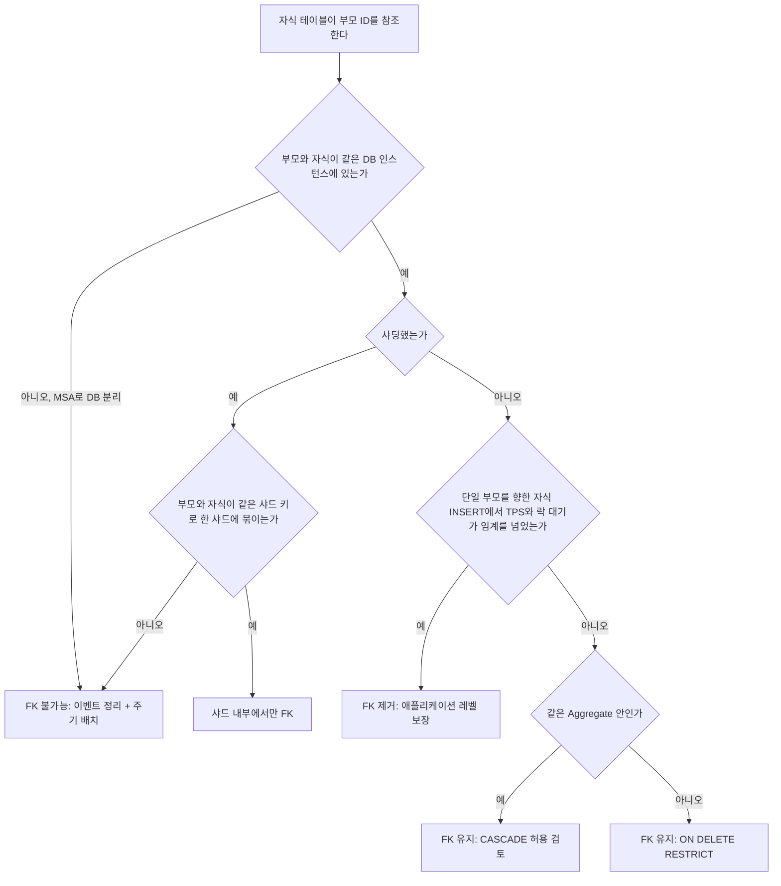
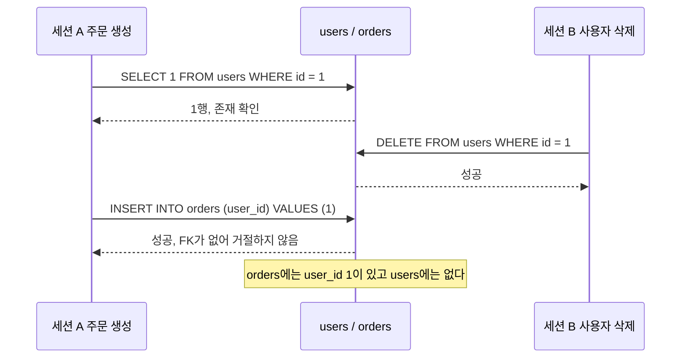
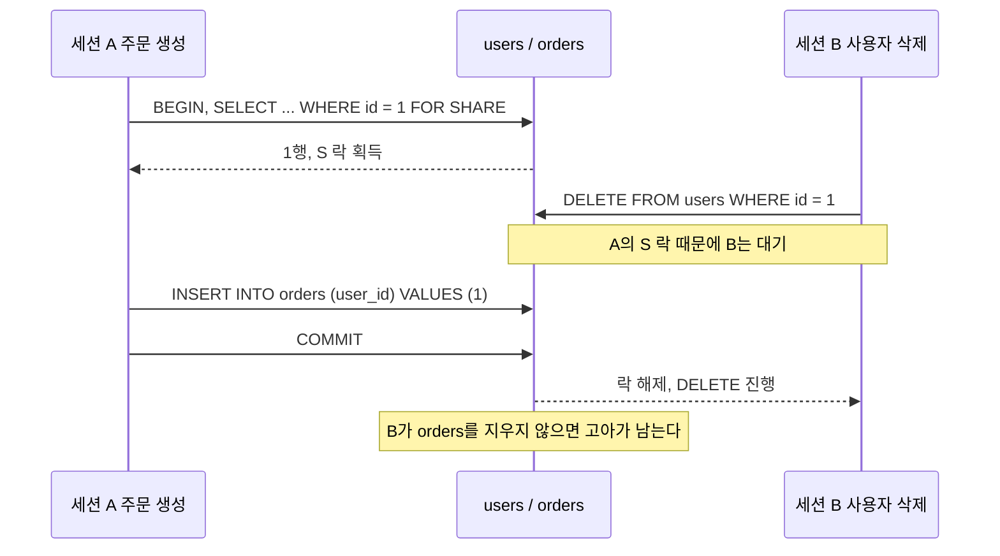
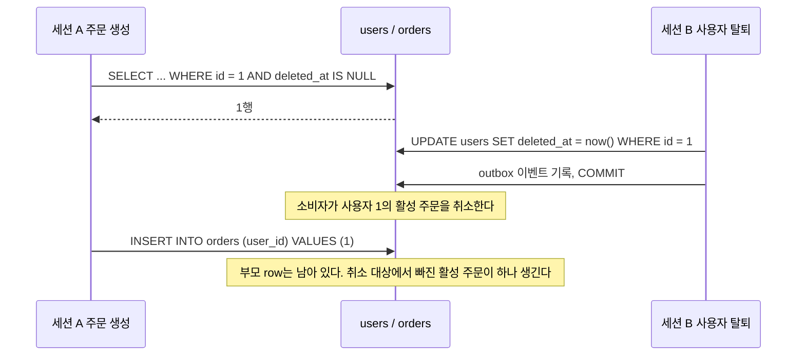
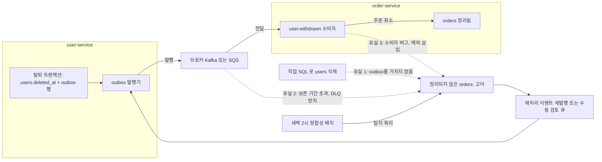

# 외래키 없는 설계

FK(외래키) 제약을 걸지 않는 것은 무결성을 포기하는 게 아니다. DB 레벨 제약이 감당하기 어려운 상황에서 무결성 책임을 애플리케이션 레이어로 옮기는 선택이다. 선택 자체보다 언제 이 선택을 하는지, 그 대가로 무엇을 직접 챙겨야 하는지를 명확히 알고 있어야 한다.

FK 옵션(`ON DELETE`, `ON UPDATE`)과 DB별 동작 차이는 [참조 무결성](Referential_Integrity.md)에 있고, FK 없이 운영하다 쌓인 고아 row를 찾아 지우는 방법은 [고아 레코드](Orphan_Record.md)에 있다. 이 문서는 그 사이를 다룬다. FK를 뺄지 말지 정하는 기준, 빼기 전에 고를 수 있는 중간 선택지, 뺀 뒤에 직접 메워야 하는 부분이다.

---

## FK를 제거하는 판단 기준

### TPS 임계점

InnoDB는 자식 row를 삽입할 때마다 부모 테이블에 S lock을 잡는다. 단일 부모 ID에 여러 트랜잭션이 동시에 자식을 삽입하면 락 경합이 심해진다. 낮은 TPS 환경에서는 이 비용이 무시 가능하지만, 초당 수천 건 이상의 INSERT가 집중되는 테이블이라면 FK가 병목이 된다.

정확한 임계점은 하드웨어와 쿼리 구성에 따라 다르다. 실무에서 경험한 패턴은 단일 부모를 참조하는 자식 INSERT가 초당 2,000~3,000건을 넘어가기 시작할 때 FK 검사 비용이 눈에 띄게 나타났다. `SHOW ENGINE INNODB STATUS`로 락 대기 빈도를 확인하고, `performance_schema`의 `events_waits_summary_by_event_name`에서 `wait/synch/mutex/innodb/lock_mutex`를 추적하면 병목 여부를 판단할 수 있다.

DELETE 경로에서도 마찬가지다. 부모를 삭제할 때 자식 테이블 전체를 스캔해서 참조 여부를 확인하므로, 자식 테이블이 수천만 건 이상이면 삭제 한 번이 테이블 락을 상당 시간 잡는다.

### 샤딩 환경

DB 레벨 FK는 같은 DB 인스턴스 안에서만 동작한다. orders 테이블과 users 테이블이 서로 다른 샤드에 있으면 FK 자체를 걸 수 없다. 샤딩을 도입하는 순간 DB 레벨 참조 무결성은 선택지에서 사라진다.

샤딩 키 설계에 따라 같은 샤드 안에 묶이는 경우도 있다. 예를 들어 user_id 기준으로 샤딩하고 orders도 user_id 기준으로 동일 샤드에 배치하면 같은 DB 안에서 FK가 가능하다. 하지만 대부분의 샤딩 환경에서는 서로 다른 논리 엔티티를 동일 샤드에 묶기 어렵고, 샤드 리밸런싱 시 FK 관계가 깨지는 위험도 있다.

### MSA DB 분리

서비스별로 DB를 완전히 분리하면 물리적으로 FK가 불가능하다. `order-service`의 orders 테이블이 `user-service`의 users 테이블을 직접 참조할 방법이 없다. MSA에서 DB를 공유하면 서비스 간 결합도가 높아져 배포와 스케일링 독립성이 사라지므로, DB 분리는 MSA의 전제 조건에 가깝다.

### DDD Aggregate 경계

DDD에서 Aggregate는 하나의 트랜잭션 경계다. Order Aggregate 안에 OrderItem이 포함된다면 같은 트랜잭션 안에서 일관성이 보장되고, DB 레벨 FK를 걸어두는 게 자연스럽다.

반면 Order와 Product는 서로 다른 Aggregate다. Order가 Product의 ID를 참조하지만, Product 가격이 변해도 주문 당시 가격은 변하면 안 된다. DB 레벨 FK를 걸면 Product가 삭제될 때 관련 Orders를 어떻게 처리할지 CASCADE 정책을 결정해야 하고, 그 결정이 도메인 경계를 무너뜨린다. 서로 다른 Aggregate 간 참조는 DB FK 대신 ID 값으로만 연결하고 무결성은 도메인 레이어가 책임지는 것이 Aggregate 경계 규칙에 맞다.

### 판단 순서

위 네 가지 기준은 따로 보면 서로 충돌한다. 같은 DB, 단일 인스턴스라서 FK가 가능한데 Aggregate가 다르다면 어느 쪽을 따를지가 애매해진다. 물리적으로 불가능한 조건부터 걸러내고, 가능한 경우에만 비용과 도메인 경계를 따지는 순서로 정리하면 결론이 갈린다.



위쪽 두 분기는 선택이 아니라 제약이다. DB가 갈라져 있거나 부모가 다른 샤드에 있으면 FK를 걸 수 없으니 고민할 것도 없다. 아래쪽 두 분기가 실제로 판단하는 자리다. TPS가 임계를 넘지 않았다면 다른 Aggregate를 참조하더라도 FK를 유지하되 `RESTRICT`로 둔다. 부모 삭제가 다른 Aggregate의 자식을 연쇄 삭제하는 일은 막고, 존재 검증은 DB에 맡기는 타협이다. CASCADE는 같은 Aggregate 안에서만 쓴다.

도식의 "샤드 내부에서만 FK"와 "ON DELETE RESTRICT" 말고도, FK를 완전히 빼기 전에 고를 수 있는 선택지가 하나 더 있다. 세 가지를 다음 절에서 다룬다.

---

## FK를 빼기 전에 고를 수 있는 중간 선택지

FK를 두느냐 빼느냐로만 물으면 선택지가 둘뿐이다. 실제로는 FK를 남기면서 문제가 된 부분만 덜어내는 방법이 있고, 이쪽이 운영 부담이 훨씬 적은 경우가 많다.

| 선택지 | 막아주는 것 | 못 막는 것 | 쓸 수 있는 조건 |
|---|---|---|---|
| FK 유지 + `ON DELETE RESTRICT` | 연쇄 삭제로 인한 긴 락, 자식이 있는 부모의 삭제 | 자식 INSERT마다 붙는 부모 S lock | 단일 DB, TPS 병목이 아직 아닐 때 |
| 샤드 내부에서만 FK | 같은 샤드 안 관계의 고아 | 샤드를 넘는 참조 | 샤드 키로 관련 테이블이 한 샤드에 묶일 때 |
| 운영은 FK 없이, 테스트·스테이징에만 FK | 개발 중 삽입·삭제 순서 버그 | 운영에서만 생기는 고아(이벤트 유실, 직접 SQL) | 운영 DB에서 FK를 이미 빼야 하는 경우 |

### FK 유지 + ON DELETE RESTRICT

FK를 빼려는 이유가 CASCADE 때문인 경우가 의외로 많다. 사용자 한 명 삭제가 주문, 주문 항목, 결제 이력으로 번지면서 수백만 행 삭제와 락 대기를 만드는 상황은 [대규모 CASCADE 삭제 폭발](Referential_Integrity.md#대규모-cascade-삭제-폭발)에서 다룬다. 이 문제는 FK를 빼지 않고 `RESTRICT`로 바꾸는 것만으로 사라진다.

```sql
ALTER TABLE orders
  ADD CONSTRAINT fk_orders_user
  FOREIGN KEY (user_id) REFERENCES users (id)
  ON DELETE RESTRICT ON UPDATE RESTRICT;
```

자식이 남아 있는 부모를 지우려 하면 DB가 거절한다. MySQL은 1451(`ER_ROW_IS_REFERENCED_2`), PostgreSQL은 SQLSTATE `23503`이다. InnoDB에서 `NO ACTION`은 `RESTRICT`와 같이 동작한다.

소프트 삭제와 같이 쓰면 효과가 크다. 앞서 소프트 삭제 후 일정 기간이 지나면 물리 삭제 배치를 돌린다고 했는데, 이때 "연관 데이터 정리가 끝났는지"를 배치 코드가 확인하는 대신 DB가 확인해 준다. 정리가 덜 된 사용자를 배치가 지우려 하면 `RESTRICT`가 막고, 배치는 그 건만 건너뛰고 알림을 남기면 된다.

한계는 분명하다. `RESTRICT`는 INSERT 경로의 비용을 건드리지 않는다. 자식 INSERT마다 부모에 S lock을 잡는 부분은 그대로이므로, 앞에서 본 TPS 병목은 이 방법으로 해결되지 않는다. 운영 중인 테이블에 FK를 새로 얹는 절차는 [운영 중인 테이블에 FK 추가](Referential_Integrity.md#운영-중인-테이블에-fk-추가)를 따른다.

### 샤드 내부에서만 FK

샤딩 때문에 FK가 불가능하다는 말은 샤드를 넘는 참조에만 해당한다. 샤드 키가 `user_id`이고 users, orders, order_items가 모두 그 키로 같은 샤드에 들어간다면, 그 안의 관계는 평범한 단일 DB다.

```sql
-- 샤드 키: user_id. users, orders, order_items는 같은 샤드에 둔다
CREATE TABLE orders (
  id      BIGINT NOT NULL,
  user_id BIGINT NOT NULL,
  PRIMARY KEY (id),
  KEY idx_orders_user (user_id),
  CONSTRAINT fk_orders_user FOREIGN KEY (user_id) REFERENCES users (id) ON DELETE RESTRICT
);

CREATE TABLE order_items (
  id         BIGINT NOT NULL,
  order_id   BIGINT NOT NULL,
  product_id BIGINT NOT NULL,   -- products는 다른 샤드라 FK를 걸지 않는다
  PRIMARY KEY (id),
  KEY idx_items_order (order_id),
  CONSTRAINT fk_items_order FOREIGN KEY (order_id) REFERENCES orders (id) ON DELETE RESTRICT
);
```

`order_items.order_id`는 FK로 지키고 `product_id`는 애플리케이션이 지킨다. 한 테이블 안에서도 FK가 있는 컬럼과 없는 컬럼이 섞이는 것이 정상이다.

주의할 점이 둘 있다. 첫째, 샤드 로컬 auto_increment를 쓰면 샤드 사이에서 ID가 겹친다. 샤드를 넘는 참조를 ID 값으로만 걸어야 하므로 스노우플레이크 같은 전역 유일 ID가 필요하다. 둘째, 리밸런싱으로 사용자 일부를 다른 샤드로 옮길 때는 `user_id` 하나에 딸린 users, orders, order_items 전체를 한 단위로 옮겨야 하고, 적재도 부모부터 해야 한다. 순서를 지킬 수 없어 FK 검사를 끄고 적재했다면 끝난 뒤 반드시 재검증한다. 방법은 [대량 적재 뒤 무결성 재검증](Referential_Integrity.md#대량-적재-뒤-무결성-재검증)에 있다.

### 운영은 FK 없이, 테스트와 스테이징에만 FK

운영 DB에서는 FK를 이미 뺐는데 개발 중에는 FK가 없어서 잡히던 버그가 잡히지 않는 경우에 쓴다. 부모 삭제 순서가 틀린 코드, 존재하지 않는 ID로 자식을 넣는 테스트 픽스처, 삭제 시 자식 정리를 빠뜨린 서비스 로직이 대표적이다. 이런 버그는 FK가 있는 DB에서 통합 테스트를 돌리면 에러로 바로 드러난다.

```typescript
// 운영에서는 건너뛰고, 그 외 환경에서만 FK를 만든다
export class AddOrderUserFk1790000000000 implements MigrationInterface {
  async up(queryRunner: QueryRunner): Promise<void> {
    if (process.env.APP_ENV === 'production') return;
    await queryRunner.createForeignKey(
      'orders',
      new TableForeignKey({
        name: 'fk_orders_user',
        columnNames: ['user_id'],
        referencedColumnNames: ['id'],
        referencedTableName: 'users',
        onDelete: 'RESTRICT',
      }),
    );
  }

  async down(queryRunner: QueryRunner): Promise<void> {
    if (process.env.APP_ENV === 'production') return;
    await queryRunner.dropForeignKey('orders', 'fk_orders_user');
  }
}
```

이 방식에는 함정이 세 개 있다.

- 엔티티에 `createForeignKeyConstraints: false`가 있으면 스테이징 DB의 FK는 ORM이 보기에 엔티티에 없는 제약이다. `synchronize: true`를 켜거나 스테이징 DB를 기준으로 `migration:generate`를 돌리면 이 FK를 삭제 대상으로 잡을 수 있다. 스테이징은 마이그레이션 실행만 하고, 마이그레이션 생성은 FK 없는 쪽 DB에서 한다.
- 스테이징에서 통과한 코드가 운영에서도 안전하다는 보장은 없다. 스테이징은 개발 중 논리 버그를 잡는 용도다. 이벤트 유실, 직접 SQL 수정, 대량 적재로 생기는 고아는 운영에만 있으므로 정합성 배치는 그대로 필요하다.
- 환경마다 스키마가 달라지므로 DDL 변경 시 FK 컬럼 타입이나 인덱스를 바꾸는 마이그레이션이 스테이징에서만 실패할 수 있다. 실패하면 FK를 잠깐 지우고 바꾸는 단계를 마이그레이션에 넣어야 한다.

---

## ORM 설정 패턴

### TypeORM: createForeignKeyConstraints

TypeORM에서 FK 제약 없이 관계를 정의하는 방법은 `createForeignKeyConstraints: false` 옵션을 사용하는 것이다.

```typescript
// order.entity.ts
@Entity()
export class Order {
  @PrimaryGeneratedColumn()
  id: number;

  @Column()
  userId: number;

  // DB에 FK 제약 생성 안 함. 타입 힌트와 join 편의만 제공
  @ManyToOne(() => User, (user) => user.orders, {
    createForeignKeyConstraints: false,
  })
  @JoinColumn({ name: 'user_id' })
  user: User;
}
```

이 설정으로 마이그레이션을 실행하면 `user_id` 컬럼은 생성되지만 FK 제약 조건은 DB에 추가되지 않는다. ORM 레벨 관계 탐색(`order.user`)과 TypeORM QueryBuilder의 join 구문은 정상적으로 쓸 수 있다.

기존 엔티티에서 FK를 제거할 때는 마이그레이션에서 직접 DROP CONSTRAINT를 실행해야 한다. TypeORM이 `createForeignKeyConstraints: false`로 바뀐 것을 감지해 자동으로 DROP하지는 않는다.

```typescript
// 마이그레이션 파일에서 FK 제거
export class RemoveOrderUserFk1722300000000 implements MigrationInterface {
  async up(queryRunner: QueryRunner): Promise<void> {
    await queryRunner.dropForeignKey('orders', 'FK_orders_user_id');
  }

  async down(queryRunner: QueryRunner): Promise<void> {
    await queryRunner.createForeignKey(
      'orders',
      new TableForeignKey({
        columnNames: ['user_id'],
        referencedColumnNames: ['id'],
        referencedTableName: 'users',
        onDelete: 'RESTRICT',
      }),
    );
  }
}
```

FK 이름은 DB마다 자동 생성 규칙이 다르다. 실제 이름은 `information_schema.TABLE_CONSTRAINTS`에서 확인한다.

```sql
SELECT CONSTRAINT_NAME
FROM information_schema.TABLE_CONSTRAINTS
WHERE TABLE_NAME = 'orders'
  AND CONSTRAINT_TYPE = 'FOREIGN KEY';
```

### Prisma: 관계 없는 ID 컬럼 단독 정의

Prisma에서 FK 없이 순수 ID 컬럼만 두는 방법은 `@relation`을 쓰지 않고 컬럼을 단독으로 정의하는 것이다.

```prisma
model Order {
  id        Int      @id @default(autoincrement())
  userId    Int      // FK 제약 없음. 단순 컬럼
  createdAt DateTime @default(now())

  @@index([userId])
}
```

`@relation`을 쓰지 않으면 Prisma가 FK 제약을 생성하지 않는다. `prisma db pull`로 스키마를 역으로 가져올 때도 DB에 FK가 없으면 `@relation`이 생기지 않는다.

반면 `@relation`을 쓰면 Prisma는 기본적으로 FK 제약을 생성하려 한다. DB 레벨 FK 없이 `@relation`을 유지하고 싶다면 Prisma 스키마에서 `relationMode = "prisma"`를 설정해야 한다.

```prisma
// schema.prisma
datasource db {
  provider     = "mysql"
  url          = env("DATABASE_URL")
  relationMode = "prisma"  // DB FK 대신 Prisma 레벨에서 관계 관리
}

model Order {
  id     Int  @id @default(autoincrement())
  userId Int
  user   User @relation(fields: [userId], references: [id])

  @@index([userId])
}

model User {
  id     Int     @id @default(autoincrement())
  orders Order[]
}
```

`relationMode = "prisma"`는 PlanetScale처럼 FK를 지원하지 않는 DB를 쓸 때 도입된 옵션이다. DB에 FK 제약이 생기지 않고 Prisma가 런타임에 참조 무결성을 흉내 낸다. 단, Prisma가 처리하지 않는 경로(raw SQL, 직접 DB 접속)에서는 무결성 보장이 없다.

---

## 애플리케이션 레벨 무결성 보장

FK를 제거하면 무결성 책임이 모두 애플리케이션 코드로 온다. 아래 네 가지 방법을 조합해서 쓴다.

### 삽입 전 존재 확인과 TOCTOU 문제

가장 기본적인 방법은 자식 row를 삽입하기 전에 부모가 존재하는지 SELECT로 확인하는 것이다.

```typescript
async createOrder(userId: number, items: OrderItem[]): Promise<Order> {
  const user = await this.userRepository.findOne({ where: { id: userId } });
  if (!user) {
    throw new NotFoundException(`User ${userId} not found`);
  }

  return this.orderRepository.save({
    userId,
    items,
    createdAt: new Date(),
  });
}
```

이 방식은 TOCTOU(Time-Of-Check-To-Time-Of-Use) 경쟁 조건에 취약하다. SELECT로 확인한 직후, INSERT 실행 직전에 해당 사용자가 삭제되는 경우가 있다. FK가 있다면 DB가 INSERT 시점에 부모 존재를 검증하므로 이 경쟁 조건이 없다.



A의 확인과 INSERT 사이 틈에 B의 DELETE가 끼어드는 것이 전부다. 두 세션 모두 에러 없이 끝나므로 로그에도 남지 않는다. PostgreSQL 14에서 FK 없는 두 테이블로 이 순서를 그대로 재현했을 때 고아 row가 1건 남았다.

이 틈을 막는 방법은 락과 소프트 삭제, 두 가지다. 각각 시퀀스가 어떻게 달라지는지를 먼저 보고 코드를 본다.

**FOR SHARE로 부모 row를 잡는 경우.** A가 확인 쿼리에 락을 붙이면 B의 DELETE가 A의 커밋까지 기다린다.



락은 "부모가 없는 상태에서 자식이 들어가는" 경우만 막는다. A가 커밋한 뒤 B의 DELETE가 진행되므로, B가 자식을 정리하지 않으면 결과는 똑같이 고아 1건이다. 같은 실험에서 B가 `DELETE FROM users` 다음에 `DELETE FROM orders WHERE user_id = 1`을 같은 트랜잭션에서 실행하면 0건이 남았고, 순서를 바꿔 자식을 먼저 지우면 1건이 남았다(READ COMMITTED 기준). 삭제하는 쪽도 부모를 먼저 건드려야 이 락의 효과를 본다는 뜻이다. FK가 하던 일을 흉내 내려면 양쪽 코드가 같은 순서로 부모를 먼저 잡아야 한다.

**소프트 삭제를 쓰는 경우.** B가 row를 지우지 않고 `deleted_at`만 채운다.



물리적인 고아는 생기지 않는다. 대신 이벤트 소비자가 주문을 취소한 뒤에 A의 INSERT가 들어오면 탈퇴한 사용자의 활성 주문이 남는다. 이 경우는 뒤에 나오는 "논리 삭제된 사용자 참조" 탐지 쿼리와 주기 배치가 잡는다.

락과 소프트 삭제는 서로 대체재가 아니다. 락은 짧은 시간의 정합성을, 소프트 삭제는 물리 고아가 안 생기는 것을 보장한다. 고부하 경로에서는 부모 락 비용이 부담스러워 소프트 삭제와 배치 쪽으로 기우는 편이다.

락을 쓰는 코드는 이렇다. SELECT FOR UPDATE로 부모 row에 배타 락을 잡고 INSERT한다. 삭제보다 삽입이 먼저 락을 잡으면 삭제는 대기하고, 삭제가 먼저 락을 잡으면 삽입이 없는 사용자로 실패한다.

```typescript
async createOrder(userId: number, items: OrderItem[]): Promise<Order> {
  return this.dataSource.transaction(async (manager) => {
    const user = await manager
      .createQueryBuilder(User, 'u')
      .setLock('pessimistic_write')
      .where('u.id = :userId', { userId })
      .getOne();

    if (!user) {
      throw new NotFoundException(`User ${userId} not found`);
    }

    return manager.save(Order, { userId, items, createdAt: new Date() });
  });
}
```

`pessimistic_write`는 같은 사용자의 주문 생성끼리도 직렬화한다. FK가 하던 것처럼 동시 INSERT는 허용하고 부모 삭제만 막고 싶다면 `pessimistic_read`(`FOR SHARE`)로 충분하다. 삭제 쪽 코드는 부모를 먼저 지우고 자식을 지운다.

```typescript
async purgeUser(userId: number): Promise<void> {
  await this.dataSource.transaction(async (manager) => {
    await manager.delete(User, userId);        // 진행 중인 주문 생성이 커밋될 때까지 여기서 대기
    await manager.delete(Order, { userId });   // 대기가 풀린 뒤라 방금 커밋된 주문까지 지운다
  });
}
```

### 소프트 삭제

`deleted_at` 컬럼을 두고 논리 삭제만 수행한다. FK가 없는 환경에서 부모 row를 물리적으로 삭제하면 이미 존재하는 자식 row들이 고아가 되므로, 소프트 삭제로 부모를 남겨두는 게 현실적인 선택이다.

```typescript
// user.entity.ts
@Entity()
export class User {
  @PrimaryGeneratedColumn()
  id: number;

  @Column({ nullable: true })
  deletedAt: Date | null;
}

// 소프트 삭제 처리
async softDeleteUser(userId: number): Promise<void> {
  await this.userRepository.update(userId, { deletedAt: new Date() });
  // 이벤트 발행: 다른 서비스가 연관 데이터를 비동기로 정리
  await this.eventBus.publish('user.soft-deleted', { userId });
}
```

소프트 삭제를 쓰면 모든 SELECT 쿼리에 `WHERE deleted_at IS NULL` 조건이 따라다닌다. TypeORM `@DeleteDateColumn` 데코레이터나 Prisma의 `softDelete` 미들웨어를 쓰면 이 조건을 자동으로 붙여준다.

```typescript
// TypeORM: @DeleteDateColumn을 쓰면 find 계열에 자동으로 deleted_at IS NULL 필터 적용
@Entity()
export class User {
  @PrimaryGeneratedColumn()
  id: number;

  @DeleteDateColumn()
  deletedAt: Date | null;
}

// softRemove 호출 시 deleted_at을 현재 시각으로 설정
await this.userRepository.softRemove(user);
```

소프트 삭제된 row가 쌓이면 테이블 크기가 계속 커진다. 일정 기간(예: 30일) 후에 물리 삭제하는 배치를 별도로 돌려야 한다. 물리 삭제 전에 연관 데이터 정리가 완료됐는지 확인하는 로직도 배치에 포함시킨다.

### 이벤트 기반 정리

부모 엔티티 삭제 이벤트를 발행하고 소비하는 측에서 연관 데이터를 비동기로 정리하는 방식이다. MSA 환경에서 주로 쓴다.

```typescript
// user-service: 사용자 탈퇴 처리
async withdrawUser(userId: number): Promise<void> {
  await this.dataSource.transaction(async (manager) => {
    await manager.update(User, userId, { deletedAt: new Date() });

    // Outbox 패턴: 이벤트를 같은 트랜잭션 안에서 DB에 기록
    await manager.save(OutboxEvent, {
      eventType: 'user.withdrawn',
      payload: JSON.stringify({ userId }),
      createdAt: new Date(),
      processed: false,
    });
  });
}

// order-service: user.withdrawn 이벤트 수신
@EventPattern('user.withdrawn')
async handleUserWithdrawn(data: { userId: number }): Promise<void> {
  await this.orderRepository.update(
    { userId: data.userId, status: Not(OrderStatus.COMPLETED) },
    { status: OrderStatus.CANCELLED, cancelledAt: new Date() },
  );
}
```

이벤트 유실을 막으려면 Outbox 패턴이 필요하다. 이벤트를 Kafka나 SQS로만 바로 발행하면 DB 트랜잭션은 성공했는데 메시지 브로커 발행이 실패할 수 있다. Outbox 패턴은 이벤트를 DB 트랜잭션과 함께 저장하고, 별도 프로세스가 Outbox 테이블을 폴링해서 발행하므로 유실 가능성이 낮다.

이벤트 기반 정리는 결과적 일관성이다. 이벤트 소비 지연 동안 고아 데이터가 잠시 존재할 수 있다. 이 상태를 애플리케이션이 정상적으로 처리할 수 있도록 설계해야 한다. 예를 들어 탈퇴한 사용자의 주문을 조회할 때 userId로 user-service를 호출하고 404가 오면 "탈퇴한 사용자"로 표시하는 식이다.

### 주기적 정합성 배치

이벤트 처리 실패, 버그, 직접 DB 수정 등으로 고아 데이터가 쌓이는 경우가 있다. 주기적으로 정합성을 확인하는 배치를 돌려 누락된 케이스를 잡아낸다.

```typescript
// 주기 배치: 고아 데이터 탐지 후 처리
@Cron('0 2 * * *')  // 매일 새벽 2시
async detectOrphanedOrders(): Promise<void> {
  // user-service에서 전체 활성 userId 목록 가져오기
  const activeUserIds = await this.userServiceClient.getActiveUserIds();

  // 활성 유저 목록에 없는 userId를 가진 주문 탐지
  const orphanedOrders = await this.orderRepository
    .createQueryBuilder('o')
    .where('o.userId NOT IN (:...activeUserIds)', { activeUserIds })
    .andWhere('o.deletedAt IS NULL')
    .getMany();

  if (orphanedOrders.length > 0) {
    this.logger.warn(`Orphaned orders detected: ${orphanedOrders.length}`);
    // 알림 발송 또는 수동 검토 큐에 적재
    await this.alertService.notify('orphaned-orders', { count: orphanedOrders.length });
  }
}
```

활성 userId 목록을 외부 서비스에서 매번 가져오는 비용이 크다면, 탈퇴 처리 시 `withdrawn_users` 테이블에 ID를 기록하고 그 목록과 비교하는 방식으로 범위를 좁힌다.

### 이벤트가 새는 지점과 배치가 잡는 지점

이벤트 정리와 주기 배치는 둘 중 하나를 고르는 관계가 아니다. 이벤트가 평소의 정리를 맡고, 배치는 이벤트가 샌 자리를 사후에 메운다. 어디서 새는지를 알아야 배치가 무엇을 봐야 하는지 정해진다.



실선이 정상 경로, 점선이 고아가 만들어지는 경로다. 점선 세 개는 서로 원인이 달라서 이벤트 쪽 재시도로는 하나도 고쳐지지 않는다.

- 유실 1은 outbox를 거치지 않는 삭제다. 운영자가 콘솔에서 지운 users 행이나 다른 서비스가 직접 날린 쿼리는 이벤트가 없다. 발행기를 아무리 튼튼하게 만들어도 존재하지 않는 이벤트는 못 보낸다.
- 유실 2는 브로커 보존 기간이 지났거나 DLQ에 쌓인 메시지를 아무도 안 본 경우다. 소비자가 며칠 멈췄다 살아나면 오래된 이벤트는 이미 사라져 있을 수 있다.
- 유실 3은 소비자가 예외를 잡아 삼키고 ack를 보낸 경우다. 브로커 입장에서는 정상 처리라 재전달도 없다.

배치는 이벤트가 아니라 결과 상태를 본다. users에 없거나 `deleted_at`이 찍힌 `user_id`를 가진 활성 주문이 있는지만 확인하므로, 세 경로 모두 같은 쿼리로 잡힌다. 발견한 건은 알림만 보내지 말고 재처리 이벤트로 다시 outbox에 넣는 경로를 두는 편이 낫다. 수동 검토 큐에만 쌓으면 담당자가 바뀌는 순간 방치된다. outbox 테이블에서 `processed = false`로 오래 남은 행의 개수도 같은 배치에서 같이 센다. 발행기가 멈춘 것은 고아가 생기기 전에 알 수 있는 거의 유일한 신호다.

탐지 쿼리 패턴과 대량 정리 시 배치 삭제는 [고아 레코드의 탐지 쿼리](Orphan_Record.md#탐지-쿼리)와 [정리 방법](Orphan_Record.md#정리-방법)에, 서비스 사이 참조에서 고아가 생기는 경로는 [MSA 환경에서 고아 데이터 문제](Referential_Integrity.md#msa-환경에서-고아-데이터-문제)에 있다.

---

## 고아 데이터 탐지 쿼리

같은 DB 안에 두 테이블이 있는 경우 LEFT JOIN으로 고아 row를 탐지한다.

```sql
-- orders 중 존재하지 않는 user_id를 가진 row 탐지
SELECT o.id, o.user_id, o.created_at
FROM orders o
LEFT JOIN users u ON o.user_id = u.id
WHERE u.id IS NULL
  AND o.deleted_at IS NULL;

-- 규모가 클 때: NOT EXISTS가 LEFT JOIN보다 빠른 경우가 있다
SELECT o.id, o.user_id, o.created_at
FROM orders o
WHERE NOT EXISTS (
  SELECT 1 FROM users u WHERE u.id = o.user_id
)
AND o.deleted_at IS NULL
LIMIT 1000;
```

소프트 삭제를 쓰는 경우 부모 테이블의 `deleted_at`도 고려해야 한다. 논리 삭제된 부모를 참조하는 자식 row를 고아로 볼지, 아직 유효한 참조로 볼지는 도메인 정책에 따라 다르다.

```sql
-- 물리 삭제된 사용자 참조 (users 테이블에 없음)
SELECT o.id, o.user_id FROM orders o
LEFT JOIN users u ON o.user_id = u.id
WHERE u.id IS NULL AND o.deleted_at IS NULL;

-- 논리 삭제된 사용자 참조 (users 테이블에 있지만 deleted_at이 있음)
SELECT o.id, o.user_id FROM orders o
JOIN users u ON o.user_id = u.id
WHERE u.deleted_at IS NOT NULL AND o.deleted_at IS NULL;
```

서비스가 분리된 MSA 환경에서는 각 서비스의 DB에 직접 접근하기 어렵다. 이 경우 정기적으로 각 서비스의 ID 목록을 파일이나 공유 스토리지로 내보내고, 데이터 분석 도구(BigQuery, Redshift, 또는 별도 분석 DB)에 모아서 크로스 조인하는 방식을 쓴다.

---

## 인덱스 관리와 성능 트레이드오프

### FK 제거 후 인덱스 관리

InnoDB는 FK 컬럼에 인덱스가 없으면 FK를 허용하지 않고 자동으로 인덱스를 생성한다. FK를 제거하면 이 인덱스도 함께 사라지는 경우가 있다. FK 제거 후 해당 컬럼의 인덱스가 남아 있는지 반드시 확인해야 한다.

```sql
-- MySQL: 테이블 인덱스 확인
SHOW INDEX FROM orders;

-- 없으면 직접 생성
CREATE INDEX idx_orders_user_id ON orders(user_id);
```

FK를 제거한다고 해서 조회 성능이 자동으로 개선되지 않는다. 오히려 FK가 인덱스를 보장하던 것이 사라졌으므로, 명시적으로 인덱스를 관리해야 한다.

### 커버링 인덱스

FK 없는 환경에서 고아 데이터 탐지 쿼리나 관계 조회를 자주 실행한다면 커버링 인덱스를 고려한다.

```sql
-- orders 테이블: user_id + status 복합 인덱스
-- 탈퇴 사용자의 활성 주문을 찾는 쿼리에 인덱스만으로 처리 가능
CREATE INDEX idx_orders_user_status ON orders(user_id, status);

-- 이 쿼리는 테이블 접근 없이 인덱스만으로 처리됨
SELECT user_id, status FROM orders WHERE user_id = 123;
```

### 쓰기 vs 읽기 트레이드오프

FK 제약이 없으면 쓰기 경로에서 부모 조회 오버헤드가 사라진다. 하지만 읽기 경로에서 JOIN 쿼리는 동일하게 발생하므로 읽기 성능 차이는 없다.

트레이드오프가 명확히 드러나는 상황은 배치 INSERT다. FK가 있으면 수십만 건 INSERT 시 매 row마다 부모 존재를 검증하므로 처리 시간이 길어진다. FK가 없으면 이 검증 없이 바로 적재할 수 있다. 단, 검증이 없다는 것은 잘못된 데이터도 그대로 들어간다는 의미다. 배치 입력 전 애플리케이션 레벨에서 유효성 검사를 하거나, 배치 완료 후 정합성 확인 쿼리를 돌려야 한다.

```typescript
// 배치 INSERT 전 유효성 확인
async bulkInsertOrders(orders: CreateOrderDto[]): Promise<void> {
  const userIds = [...new Set(orders.map((o) => o.userId))];
  const existingUsers = await this.userRepository.findBy({ id: In(userIds) });
  const existingUserIds = new Set(existingUsers.map((u) => u.id));

  const invalidOrders = orders.filter((o) => !existingUserIds.has(o.userId));
  if (invalidOrders.length > 0) {
    throw new BadRequestException(
      `Invalid userId in orders: ${invalidOrders.map((o) => o.userId).join(', ')}`,
    );
  }

  await this.orderRepository.insert(orders);
}
```

FK를 제거하면 얻는 것은 쓰기 처리량과 샤딩·서비스 분리의 여지다. 잃는 것은 DB가 자동으로 보장하던 무결성이다. 그 무결성을 코드로 메우지 않으면 시간이 지날수록 데이터 품질이 나빠진다.

---

## 함께 보는 문서

- [참조 무결성](Referential_Integrity.md): `ON DELETE` 옵션, CASCADE 폭발, MySQL과 PostgreSQL의 FK 동작 차이, 운영 테이블에 FK 추가하는 절차. 이 문서의 "중간 선택지"를 고르기 전에 읽는다.
- [고아 레코드](Orphan_Record.md): FK 없이 운영하면서 쌓인 고아 row의 발생 경로, 탐지 쿼리, 정리 방법. 이 문서의 정합성 배치를 만들 때 쓴다.
- [소프트 삭제](Soft_Delete.md): 소프트 삭제 패턴의 설계와 실무에서 걸리는 문제.
