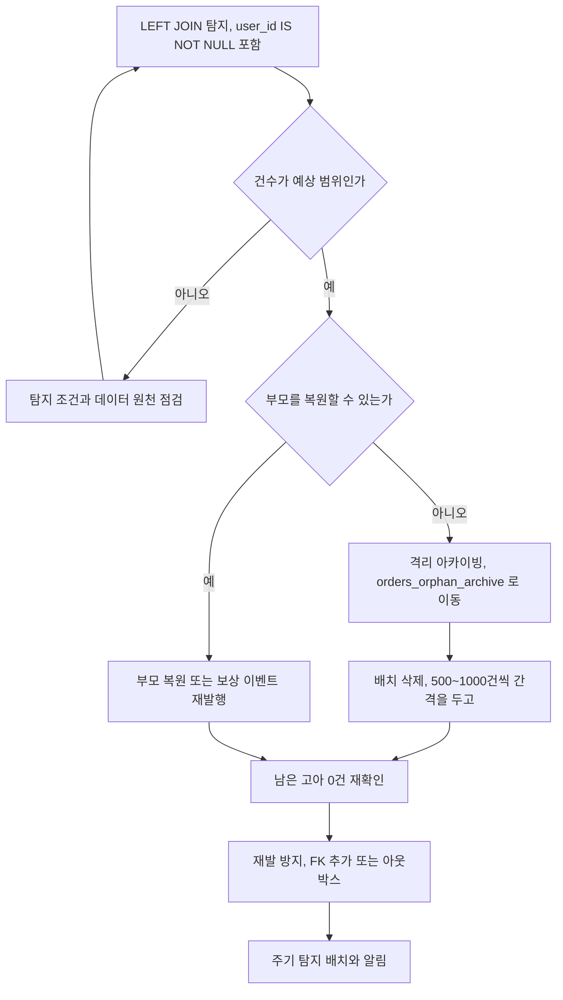
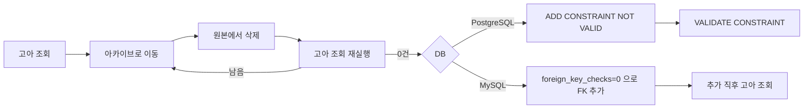
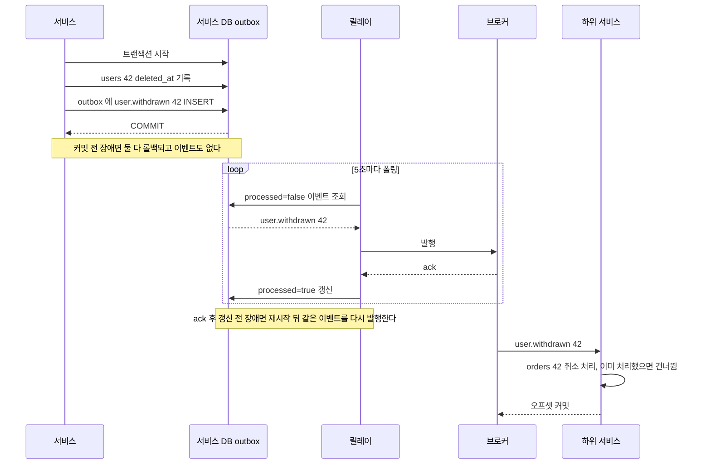

# 고아 레코드

고아 레코드(Orphan Record)는 FK 컬럼이 가리키는 부모 레코드가 더 이상 존재하지 않는 자식 레코드를 말한다. `orders.user_id = 42`인데 `users` 테이블에 id=42가 없는 상태다.

DB 레벨 FK가 걸려 있으면 이런 상태가 원천 차단된다. 문제는 FK가 없는 환경, MSA처럼 DB가 물리적으로 분리된 환경, 마이그레이션 중 제약을 비활성화한 경우, 부모만 소프트 딜리트하는 경우다. 이 네 경우가 실무에서 고아 레코드가 쌓이는 주된 경로다.

[참조 무결성](Referential_Integrity.md)은 FK 제약 자체를 어떻게 설정하는지를 다루고, [FK 없는 설계](No_FK_Design.md)는 FK를 제거하는 판단과 그 대가를 다룬다. 이 문서는 이미 쌓인 고아 레코드를 어떻게 찾고 처리하는지에 집중한다.

---

## 발생 경로

네 경로는 부모가 사라지는 시점과 그때 자식을 막아 줄 장치가 있었는지에서 갈린다. 도식에서 굵은 테두리 노드가 부모가 사라지는 지점이다.

```mermaid
flowchart TD
    subgraph P1["경로 1. FK 미적용"]
        A1["users 42 존재, orders 에 user_id 42 가 쌓임"] --> A2["DBA 스크립트가 users 42 를 DELETE"]
        A2 --> A3["DB 는 자식을 검사하지 않음, orders 42 잔존"]
    end
    subgraph P2["경로 2. MSA DB 분리"]
        B1["user-service 가 탈퇴 처리를 커밋"] --> B2["user.withdrawn 이벤트 발행"]
        B2 --> B3["컨슈머 다운 또는 예외 후 폐기"]
        B3 --> B4["order-service DB 에 orders 42 잔존"]
    end
    subgraph P3["경로 3. 마이그레이션"]
        C1["foreign_key_checks=0 으로 적재 시작"] --> C2["자식 테이블만 먼저 적재되고 부모 행이 누락"]
        C2 --> C3["검사를 다시 켜도 기존 행은 재검증되지 않음"]
    end
    subgraph P4["경로 4. 소프트 딜리트"]
        D1["users.deleted_at 기록, 행은 남음"] --> D2["orders 는 deleted_at NULL 로 그대로"]
        D2 --> D3["조회 API 마다 처리가 갈림"]
    end
    classDef gone stroke-width:4px
    class A2,B1,C2,D1 gone
```



경로 1과 4는 부모가 있던 DB 안에서 일어나고, 경로 2는 부모 삭제 커밋과 자식 정리 사이에 DB 경계가 있다. 경로 3은 부모가 사라진 것이 아니라 적재 시점에 이미 없었던 경우라, 삭제 이력을 뒤져도 원인이 나오지 않는다.

### FK 미적용

FK 제약 없이 `user_id` 컬럼만 두는 설계에서는 DB가 참조 검사를 하지 않는다. 애플리케이션 코드가 삽입 전에 부모 존재를 확인하더라도, 직접 SQL을 실행하는 경로(DBA 작업, 마이그레이션 스크립트, 데이터 픽스)에서는 그 검증이 없다.

```sql
-- FK가 없는 상태에서 users.id=99가 없어도 이 INSERT는 성공한다
INSERT INTO orders (user_id, amount) VALUES (99, 5000);
```

애플리케이션 레이어에서 아무리 꼼꼼하게 검증해도, DB 직접 접근 경로가 하나라도 열려 있으면 결국 고아 레코드는 생긴다.

### MSA DB 분리

`user-service`와 `order-service`가 각각 별도 DB를 쓰는 구성에서는 cross-DB FK가 불가능하다. 의존 관계는 이벤트로만 관리하므로, 이벤트 처리 실패가 곧 고아 레코드 발생으로 이어진다.

가장 흔한 순서는 이렇다.

1. 사용자가 탈퇴 처리됐다. `user-service`에서 `user.withdrawn` 이벤트를 발행한다.
2. Kafka 컨슈머가 다운되거나, 메시지를 처리하다 예외가 났다.
3. `order-service`의 orders 테이블에는 탈퇴한 user_id를 가진 row가 그대로 남는다.

이벤트 처리가 결국 성공한다면 일시적인 불일치지만, 실패가 누적되거나 재시도 없이 버려지면 영구적인 고아 레코드가 된다.

### 마이그레이션 중 제약 비활성화

대용량 데이터 이전 시 FK 검사를 꺼놓는 경우가 있다. 검사 비용 때문에 `foreign_key_checks=0` 상태로 수십만 건을 적재하고 끝낸다. 이때 참조하는 부모 데이터가 누락된 채로 자식 데이터만 들어오면 이후에 FK를 다시 활성화하더라도 이미 쌓인 고아 레코드는 그대로다.

```sql
-- MySQL: FK 검사 비활성화 후 bulk insert
SET foreign_key_checks = 0;
LOAD DATA INFILE '/data/orders.csv' INTO TABLE orders;
SET foreign_key_checks = 1;
-- FK 재활성화 후에도 이미 들어간 잘못된 데이터는 남는다
```

PostgreSQL에서 기존 FK에 `NOT VALID` 옵션으로 이미 있는 데이터를 검사하지 않고 제약만 추가하는 경우도 동일한 상태가 된다.

```sql
-- PostgreSQL: 새 데이터만 검사, 기존 데이터는 검사 안 함
ALTER TABLE orders
ADD CONSTRAINT fk_orders_user FOREIGN KEY (user_id) REFERENCES users(id)
NOT VALID;

-- 나중에 기존 데이터도 검사하려면
ALTER TABLE orders VALIDATE CONSTRAINT fk_orders_user;
-- 이 시점에 고아 레코드가 있으면 에러 발생
```

### 소프트 딜리트 충돌

부모 테이블은 소프트 딜리트(`deleted_at`)를 쓰는데, 자식 테이블은 아무 처리 없이 남아 있는 경우다. 이 상태를 고아로 볼지는 도메인 정책에 따라 다르지만, 실무에서 자주 논란이 된다.

논리 삭제된 사용자의 주문을 "유효한 참조"로 볼 것인지, "고아"로 볼 것인지를 결정하지 않고 방치하면 조회 쿼리마다 처리 방식이 달라진다. 어떤 API는 탈퇴한 사용자의 주문도 보여주고, 어떤 API는 빈 목록을 돌려준다.

---

## 탐지 쿼리

### LEFT JOIN IS NULL 패턴

같은 DB 안에 두 테이블이 있을 때 가장 기본적인 패턴이다.

```sql
-- orders 중 존재하지 않는 user_id를 가진 row
SELECT o.id, o.user_id, o.created_at
FROM orders o
LEFT JOIN users u ON o.user_id = u.id
WHERE o.user_id IS NOT NULL
  AND u.id IS NULL
  AND o.deleted_at IS NULL;
```

`u.id IS NULL`은 LEFT JOIN에서 매칭되는 부모가 없는 경우다. `o.deleted_at IS NULL`은 이미 논리 삭제된 자식은 탐지에서 제외하는 조건이다. 도메인에 따라 이 조건을 조정한다.

`o.user_id IS NOT NULL`을 빼먹기 쉽다. FK 컬럼이 NULL인 행은 참조가 없다는 뜻이지 깨진 참조가 아니다. 비회원 주문이 `user_id NULL`로 들어오는 테이블에서 이 조건 없이 탐지하면 비회원 주문이 전부 고아로 잡히고, 같은 조건으로 삭제 배치를 돌리면 지워진다. 뒤에 나오는 배치 스캔, 삭제, 아카이빙 쿼리에도 같은 조건이 들어간다.

### NOT IN, LEFT JOIN, NOT EXISTS 비교

세 가지 모두 고아를 찾는 데 쓰이는데, 결과 건수와 실행 계획이 다르다. docker 컨테이너의 PostgreSQL 16과 MySQL 8.0.46에 같은 데이터를 만들어 `EXPLAIN`으로 확인했다. `users` 20만 건, `orders` 100만 건, `orders.user_id`에 보조 인덱스를 두고 고아 1,000건과 `user_id NULL` 500건을 심었다.

| 쿼리 | PostgreSQL 16 | MySQL 8.0 |
|---|---|---|
| LEFT JOIN, `IS NOT NULL` 없음 | 1500 | 1500 |
| LEFT JOIN, `IS NOT NULL` 있음 | 1000 | 1000 |
| `NOT EXISTS` | 1500 | 1500 |
| `NOT IN (SELECT id FROM users)` | 1000 | 1000 |

고아는 1,000건인데 LEFT JOIN과 `NOT EXISTS`는 NULL 행 500건을 더해 1,500건을 돌려준다. `NOT IN`은 `NULL NOT IN (...)`이 UNKNOWN이라 NULL 행이 빠져서 1,000건이 맞게 나온다. 결과만 보면 `NOT IN`이 맞는 것처럼 보이지만, 이 방향은 `users.id`가 PK라서 서브쿼리에 NULL이 없기 때문이다. 방향을 뒤집어 자식이 없는 부모를 찾는 `users.id NOT IN (SELECT user_id FROM orders)`는 서브쿼리에 NULL이 한 건만 있어도 0건이 나온다. 3건짜리 임시 테이블로 PostgreSQL과 MySQL 양쪽에서 확인했다(서브쿼리에 NULL 포함 시 0건, `IS NOT NULL` 필터나 `NOT EXISTS`는 2건).

실행 계획은 DB마다 달랐다.

| | LEFT JOIN + `IS NOT NULL` | `NOT EXISTS` | `NOT IN` |
|---|---|---|---|
| PostgreSQL 16 | Parallel Hash Anti Join | 같은 Parallel Hash Anti Join | 병렬 없는 Seq Scan + `hashed SubPlan` |
| 소요 시간(4회) | 1.39~1.70초 | 1.50~2.02초 | 2.59~3.70초 |
| MySQL 8.0 | Nested loop antijoin, `users` PK 단건 조회 | Nested loop antijoin, `users`를 임시 테이블로 materialize 후 조회 | `in_optimizer` 필터 + materialize 한 서브쿼리 |
| 소요 시간(3회) | 2.97~3.13초 | 4.99~5.52초 | 4.40~4.86초 |

MySQL 시간은 컨테이너 안 클라이언트 왕복을 포함한 벽시계 시간이고, PostgreSQL은 `\timing` 값이다. 두 DB의 시간을 서로 비교하는 용도가 아니라 같은 DB 안에서 쿼리 간 순서를 보는 값이다. 데이터가 전부 버퍼에 올라 있는 상태에서 잰 것이라 디스크를 타면 달라진다.

PostgreSQL에서 LEFT JOIN과 `NOT EXISTS`는 플랜이 같고 시간도 겹친다. MySQL에서는 LEFT JOIN이 가장 빨랐고 `NOT EXISTS`가 가장 느렸다. "대용량에서는 `NOT EXISTS`가 낫다"는 말은 이 데이터에서는 어느 쪽에서도 성립하지 않았다. 쿼리를 바꿔 보기 전에 자기 환경에서 `EXPLAIN`부터 확인해야 한다.

`NOT IN`은 느린 것보다 `work_mem`에 걸리는 점이 문제다. 컨테이너 기본 설정에서는 `hashed SubPlan`으로 풀렸지만 `work_mem`을 2MB로 낮추면 해시가 빠지고 `Materialize`를 낀 일반 SubPlan이 남는다. `orders`를 `id <= 500`으로 줄인 슬라이스가 `NOT IN`은 16.2초, `NOT EXISTS`는 1.9ms였다. `id <= 20000` 슬라이스는 `NOT IN`이 `statement_timeout` 30초에 취소됐고 `NOT EXISTS`는 Hash Anti Join(Batches 4, 임시 파일 사용)으로 407ms에 끝났다. 서브쿼리 크기가 `work_mem`을 넘는 순간 시간이 수천 배로 뛰는 쿼리라서 탐지 배치에 넣지 않는다.

```sql
-- 기본으로 쓰는 탐지 쿼리
SELECT o.id, o.user_id, o.created_at
FROM orders o
LEFT JOIN users u ON u.id = o.user_id
WHERE o.user_id IS NOT NULL
  AND u.id IS NULL
  AND o.deleted_at IS NULL
LIMIT 1000;
```

`LIMIT`은 처음 돌릴 때 결과를 눈으로 확인하려고 붙인다. 전체 카운트부터 돌리면 수천만 건 테이블에서 수 분이 걸릴 수 있다.

### 소프트 딜리트 부모 탐지

부모가 물리 삭제된 케이스와 논리 삭제된 케이스를 분리해서 봐야 한다.

```sql
-- 1. 물리 삭제된 사용자를 참조하는 주문 (users 테이블에 아예 없음)
SELECT o.id, o.user_id, o.created_at, 'physically_deleted' AS orphan_type
FROM orders o
LEFT JOIN users u ON o.user_id = u.id
WHERE o.user_id IS NOT NULL AND u.id IS NULL AND o.deleted_at IS NULL;

-- 2. 논리 삭제된 사용자를 참조하는 주문 (users 테이블에 있지만 deleted_at 있음)
SELECT o.id, o.user_id, o.created_at, 'soft_deleted' AS orphan_type
FROM orders o
JOIN users u ON o.user_id = u.id
WHERE u.deleted_at IS NOT NULL AND o.deleted_at IS NULL;
```

두 케이스의 처리 방식이 달라야 하는 경우가 많다. 물리 삭제된 사용자 참조는 즉시 정리 대상이고, 논리 삭제된 사용자 참조는 유예 기간 내라면 아직 유효한 데이터일 수 있다.

### 배치 스캔

수천만 건 테이블에서 한 번에 전체를 스캔하면 운영 중인 DB에 부하가 생긴다. id 범위로 쪼개서 순차 스캔하는 방식이 현실적이다.

```sql
-- id 범위 기반 배치 스캔
SELECT o.id, o.user_id
FROM orders o
LEFT JOIN users u ON o.user_id = u.id
WHERE o.id BETWEEN 1 AND 100000
  AND o.user_id IS NOT NULL
  AND u.id IS NULL
  AND o.deleted_at IS NULL;

-- 다음 배치
-- BETWEEN 100001 AND 200000 ...
```

앞의 100만 건 테이블에서 PostgreSQL 계획을 보면, id 범위는 PK Index Scan으로 줄지만 `users` 20만 건은 배치마다 전체를 읽어 해시를 다시 만든다(`Parallel Hash`, 버퍼 1082개). 범위 100,000건짜리 배치 한 번이 788ms였다. 전체를 한 번에 돌린 1.4~1.7초와 비교하면 배치를 잘게 쪼갤수록 부모 테이블 해시 비용이 배치 수만큼 반복된다. 부하를 나누는 대신 총 시간은 늘어난다.

애플리케이션에서 루프를 돌리는 형태로 만들면 처리 속도와 DB 부하를 조절할 수 있다.

```typescript
async function scanOrphanedOrders(batchSize: number = 100000): Promise<number[]> {
  const maxId: number = await dataSource
    .createQueryBuilder()
    .select('MAX(id)', 'max')
    .from('orders', 'o')
    .getRawOne()
    .then((r) => r.max);

  const orphanIds: number[] = [];

  for (let start = 1; start <= maxId; start += batchSize) {
    const end = start + batchSize - 1;

    const rows = await dataSource.query(
      `SELECT o.id FROM orders o
       LEFT JOIN users u ON o.user_id = u.id
       WHERE o.id BETWEEN ? AND ?
         AND o.user_id IS NOT NULL
         AND u.id IS NULL
         AND o.deleted_at IS NULL`,
      [start, end],
    );

    orphanIds.push(...rows.map((r: { id: number }) => r.id));

    // 배치 간 슬립: 운영 DB 부하 조절
    await new Promise((resolve) => setTimeout(resolve, 100));
  }

  return orphanIds;
}
```

MSA 환경에서 DB가 분리돼 있다면 JOIN이 불가능하다. 이 경우 각 서비스가 보유한 ID 목록을 파일로 내보내서 분석 환경에서 비교하거나, user-service에 활성 사용자 ID 목록을 조회하는 API를 만들어 order-service에서 호출하는 방식을 쓴다.

```typescript
// MSA 환경: user-service에서 활성 ID 목록 조회 후 비교
async function findOrphanedOrdersInMsa(): Promise<Order[]> {
  // 페이지네이션으로 가져와야 할 수 있음
  const activeUserIds = await userServiceClient.getActiveUserIds();
  const activeUserIdSet = new Set(activeUserIds);

  const allOrders = await orderRepository
    .createQueryBuilder('o')
    .where('o.deletedAt IS NULL')
    .getMany();

  return allOrders.filter((o) => !activeUserIdSet.has(o.userId));
}
```

활성 사용자가 수백만 명이라면 이 방식도 부담이 크다. 그 경우에는 user-service가 탈퇴한 사용자 ID만 별도로 관리하고, order-service에서 그 목록과 비교한다.

---

## 정리 방법

탐지에서 정리까지는 한 방향으로 흐른다. 건수가 예상 범위를 벗어나면 삭제로 넘어가지 않고 탐지 조건부터 되짚는다. 도식의 마지막 두 노드가 재발 방지이고, 이 단계를 건너뛰면 몇 주 뒤에 같은 건수가 다시 쌓인다.



### 배치 삭제

고아 레코드를 확인하고 정리 대상임을 확정했으면, 한 번에 전부 삭제하지 않는다. 대량 삭제는 InnoDB 언두 로그를 폭발시키고 락 경합을 만든다.

```sql
-- 배치 단위 삭제: 한 번에 1000건씩
DELETE FROM orders
WHERE id IN (
  SELECT o.id FROM (
    SELECT o.id FROM orders o
    LEFT JOIN users u ON o.user_id = u.id
    WHERE o.user_id IS NOT NULL AND u.id IS NULL AND o.deleted_at IS NULL
    LIMIT 1000
  ) AS sub
);
```

MySQL에서 서브쿼리로 삭제할 때 같은 테이블을 직접 참조하면 에러가 난다. `FROM (...) AS sub` 형태로 한 번 감싸야 한다.

애플리케이션 레벨에서 제어하면 배치 간격을 조절하고 진행 상황을 로깅할 수 있다.

```typescript
@Cron('0 3 * * *') // 새벽 3시 배치
async cleanOrphanedOrders(): Promise<void> {
  let deleted = 0;

  while (true) {
    const result = await dataSource.query(`
      DELETE FROM orders
      WHERE id IN (
        SELECT id FROM (
          SELECT o.id FROM orders o
          LEFT JOIN users u ON o.user_id = u.id
          WHERE o.user_id IS NOT NULL AND u.id IS NULL AND o.deleted_at IS NULL
          LIMIT 500
        ) AS sub
      )
    `);

    deleted += result.affectedRows;

    if (result.affectedRows === 0) break;

    this.logger.log(`Deleted ${deleted} orphaned orders so far`);
    await new Promise((resolve) => setTimeout(resolve, 200));
  }

  this.logger.log(`Orphan cleanup done. Total deleted: ${deleted}`);
}
```

삭제 전 반드시 카운트를 먼저 확인한다. 예상보다 훨씬 많은 건수가 나오면 정리 로직이 잘못됐거나 탐지 쿼리 조건이 틀린 것이다.

```sql
-- 삭제 전 카운트 확인
SELECT COUNT(*) FROM orders o
LEFT JOIN users u ON o.user_id = u.id
WHERE o.user_id IS NOT NULL AND u.id IS NULL AND o.deleted_at IS NULL;
```

### 아카이빙

삭제가 아니라 별도 테이블로 옮겨두는 방식이다. 법적 보관 의무가 있거나, 분석 목적으로 데이터가 필요하거나, 삭제 결정을 되돌릴 가능성이 있을 때 쓴다.

```sql
-- 고아 레코드를 아카이브 테이블로 이동
INSERT INTO orders_archive (id, user_id, amount, created_at, archived_at, archive_reason)
SELECT o.id, o.user_id, o.amount, o.created_at, NOW(), 'orphaned_user'
FROM orders o
LEFT JOIN users u ON o.user_id = u.id
WHERE o.user_id IS NOT NULL AND u.id IS NULL AND o.deleted_at IS NULL;

-- 아카이브 후 원본 삭제
DELETE FROM orders
WHERE id IN (SELECT id FROM orders_archive WHERE archive_reason = 'orphaned_user');
```

아카이브 테이블 구조는 원본과 동일하되 `archived_at`, `archive_reason` 컬럼을 추가하는 게 일반적이다. 나중에 왜 아카이빙됐는지 추적할 수 있어야 한다.

아카이빙 후에도 조회가 빈번하다면 아카이브 테이블에도 인덱스를 걸어야 한다. 조회가 거의 없다면 파티셔닝이나 별도 스토리지(S3 + Parquet 등)를 고려한다.

### FK를 나중에 붙이기 전의 정리 순서

같은 DB 안에서 FK 없이 굴러온 테이블에 FK를 붙이려면 고아가 0건이어야 한다. 순서는 아카이브로 옮기고, 지우고, 한 번 더 조회한 뒤, 제약을 거는 것이다. 제약을 거는 방식과 락 영향은 [운영 중인 테이블에 FK 추가](Referential_Integrity.md#운영-중인-테이블에-fk-추가)에 있어서 여기서는 반복하지 않는다. DB별 절차는 [PostgreSQL의 NOT VALID 후 VALIDATE](Referential_Integrity.md#postgresql의-not-valid-후-validate)와 [MySQL Online DDL 제약과 foreign_key_checks=0](Referential_Integrity.md#mysql-online-ddl-제약과-foreign_key_checks0)을 따른다.



아카이브와 삭제는 한 문장 또는 한 트랜잭션으로 묶어야 한다. 따로 돌리면 INSERT와 DELETE 사이에 부모가 복원되거나 다른 배치가 같은 행을 건드릴 수 있다. PostgreSQL은 `DELETE ... RETURNING`을 CTE로 받아 아카이브에 넣는다.

```sql
CREATE TABLE orders_orphan_archive (
  LIKE orders,
  archived_at    timestamptz NOT NULL DEFAULT now(),
  archive_reason text NOT NULL
);

-- 한 배치. 0건이 나올 때까지 반복한다
WITH moved AS (
  DELETE FROM orders
  WHERE id IN (
    SELECT o.id FROM orders o
    LEFT JOIN users u ON u.id = o.user_id
    WHERE o.user_id IS NOT NULL AND u.id IS NULL
    ORDER BY o.id
    LIMIT 400
  )
  RETURNING id, user_id, amount, deleted_at
)
INSERT INTO orders_orphan_archive (id, user_id, amount, deleted_at, archive_reason)
SELECT id, user_id, amount, deleted_at, 'orphaned_user' FROM moved;

SET lock_timeout = '3s';
ALTER TABLE orders ADD CONSTRAINT fk_orders_user
  FOREIGN KEY (user_id) REFERENCES users (id) NOT VALID;
RESET lock_timeout;

ALTER TABLE orders VALIDATE CONSTRAINT fk_orders_user;
```

위 순서를 `orders` 100만 건, 고아 1,000건, NULL 500건인 테이블에서 PostgreSQL 16으로 돌렸다. 배치 3번(400, 400, 200)으로 1,000건이 아카이브로 옮겨졌고 NULL 행 500건은 `orders`에 그대로 남았다. `VALIDATE` 뒤 `pg_constraint.convalidated`가 `t`였다.

MySQL은 `DELETE ... RETURNING`이 없으므로 트랜잭션 안에서 INSERT 후 JOIN DELETE를 쓴다.

```sql
CREATE TABLE orders_orphan_archive LIKE orders;
ALTER TABLE orders_orphan_archive DROP INDEX idx_orders_user,
  ADD COLUMN archived_at DATETIME NOT NULL DEFAULT CURRENT_TIMESTAMP,
  ADD COLUMN archive_reason VARCHAR(50) NOT NULL DEFAULT 'orphaned_user';

START TRANSACTION;
INSERT INTO orders_orphan_archive (id, user_id, amount, deleted_at)
SELECT o.id, o.user_id, o.amount, o.deleted_at
FROM orders o LEFT JOIN users u ON u.id = o.user_id
WHERE o.user_id IS NOT NULL AND u.id IS NULL
ORDER BY o.id LIMIT 1000;

DELETE o FROM orders o
JOIN orders_orphan_archive a ON a.id = o.id;
COMMIT;

SET SESSION foreign_key_checks = 0;
ALTER TABLE orders ADD CONSTRAINT fk_orders_user
  FOREIGN KEY (user_id) REFERENCES users (id),
  ALGORITHM = INPLACE, LOCK = NONE;
SET SESSION foreign_key_checks = 1;
```

MySQL에서 FK 추가는 기존 행을 검증하지 않는다. 같은 데이터에서 위 절차를 돌린 뒤 FK 추가 직후 고아 조회가 0건이었지만, 이 0건은 ALTER가 확인해 준 것이 아니라 직전에 지워서 0건인 것이다. 아카이빙과 ALTER 사이에 들어온 고아는 ALTER가 막지 못한다. 그래서 ALTER 뒤에 조회를 한 번 더 돌린다. 아카이브 테이블에는 `orders`의 PK만 남기고 보조 인덱스는 뺀다. 인덱스를 그대로 두면 아카이브 INSERT마다 인덱스 갱신 비용이 붙는다.

### 이벤트 기반 보상 처리

MSA 환경에서 이벤트 처리 실패로 쌓인 고아 레코드는, 놓친 이벤트를 다시 재생(replay)하는 방식으로 정리할 수 있다.

이미 처리됐어야 할 이벤트를 다시 발행하거나, 보상 이벤트를 따로 만들어 처리한다. 예를 들어 `user.withdrawn` 이벤트가 누락됐다면, 탈퇴한 사용자 목록을 확인하고 이벤트를 강제로 재발행한다.

```typescript
// 보상 이벤트 발행: 탈퇴 처리됐는데 order-service가 처리 못한 케이스
async compensateWithdrawnUsers(): Promise<void> {
  // user-service에서 탈퇴한 사용자 목록 조회
  const withdrawnUsers = await userRepository.find({
    where: { deletedAt: Not(IsNull()) },
    select: ['id', 'deletedAt'],
  });

  for (const user of withdrawnUsers) {
    // order-service가 처리했는지 확인
    const hasOrphans = await orderServiceClient.checkOrphanedOrders(user.id);

    if (hasOrphans) {
      // 보상 이벤트 재발행
      await eventBus.publish('user.withdrawn.compensate', {
        userId: user.id,
        withdrawnAt: user.deletedAt,
      });
    }
  }
}

// order-service: 보상 이벤트 처리
@EventPattern('user.withdrawn.compensate')
async handleCompensation(data: { userId: number; withdrawnAt: Date }): Promise<void> {
  await orderRepository.update(
    { userId: data.userId, status: Not(OrderStatus.COMPLETED) },
    { status: OrderStatus.CANCELLED, cancelledAt: data.withdrawnAt },
  );

  this.logger.log(`Compensated orphaned orders for userId: ${data.userId}`);
}
```

보상 처리는 멱등성이 보장돼야 한다. 같은 이벤트가 두 번 처리되더라도 결과가 같아야 한다. `CANCELLED` 상태를 다시 `CANCELLED`로 바꾸는 건 문제없지만, 취소 내역을 중복 생성하거나 환불을 두 번 실행하는 경우가 생기지 않도록 처리 전 상태 확인을 넣는다.

---

## 예방 패턴

고아 레코드를 찾아서 정리하는 것보다, 처음부터 생기지 않게 막는 게 비용이 낮다.

### 애플리케이션 레벨 무결성 검사

FK가 없는 환경에서 자식 레코드를 삽입하기 전에 부모 존재를 확인하는 것은 기본이다. 단, SELECT 후 INSERT 사이에 부모가 삭제되는 TOCTOU 경쟁 조건이 있다.

고부하가 아닌 일반 서비스라면 이 경쟁 조건이 실제로 발생할 가능성은 낮지만, 존재한다는 사실을 알고 있어야 한다. 부모 소프트 딜리트를 쓰면 이 문제 자체가 사라진다.

```typescript
async createOrder(userId: number, dto: CreateOrderDto): Promise<Order> {
  const user = await userRepository.findOne({
    where: { id: userId, deletedAt: IsNull() },
  });

  if (!user) {
    throw new NotFoundException(`User ${userId} not found`);
  }

  return orderRepository.save({
    userId,
    amount: dto.amount,
    status: OrderStatus.PENDING,
  });
}
```

배치 INSERT에서는 개별 확인 대신 한 번에 묶어서 확인한다.

```typescript
async bulkCreateOrders(dtos: CreateOrderDto[]): Promise<void> {
  const userIds = [...new Set(dtos.map((d) => d.userId))];

  const existingUsers = await userRepository.find({
    where: { id: In(userIds), deletedAt: IsNull() },
    select: ['id'],
  });

  const validUserIds = new Set(existingUsers.map((u) => u.id));
  const invalid = dtos.filter((d) => !validUserIds.has(d.userId));

  if (invalid.length > 0) {
    throw new BadRequestException(
      `Invalid userIds: ${invalid.map((d) => d.userId).join(', ')}`,
    );
  }

  await orderRepository.insert(dtos.map((d) => ({ ...d, status: OrderStatus.PENDING })));
}
```

### 트랜잭션 아웃박스

MSA 환경에서 이벤트 유실로 인한 고아 레코드를 막는 가장 확실한 방법이다. DB 트랜잭션과 이벤트 발행을 원자적으로 묶어, 이벤트 유실 자체를 없앤다.

핵심은 이벤트를 메시지 브로커로 바로 보내지 않고 같은 DB 트랜잭션 안에서 `outbox` 테이블에 먼저 저장하는 것이다. 별도 프로세스가 outbox를 폴링해서 브로커로 발행한다.

서비스는 브로커를 직접 호출하지 않는다. 커밋 전에 죽으면 탈퇴와 이벤트가 같이 사라지고, 커밋 뒤에 죽으면 둘 다 남아 릴레이가 이어받는다. 도식에서 볼 부분은 릴레이가 브로커 응답을 받은 뒤 `sent` 표시를 하기 전에 죽는 구간이다. 이 구간 때문에 같은 이벤트가 두 번 나가고, 하위 서비스가 멱등 처리를 해야 한다.



```sql
-- outbox 테이블 구조
CREATE TABLE outbox_events (
  id         BIGINT AUTO_INCREMENT PRIMARY KEY,
  event_type VARCHAR(100) NOT NULL,
  payload    JSON NOT NULL,
  created_at DATETIME NOT NULL DEFAULT CURRENT_TIMESTAMP,
  processed  BOOLEAN NOT NULL DEFAULT FALSE,
  processed_at DATETIME,
  retry_count INT NOT NULL DEFAULT 0
);
```

```typescript
// user-service: 탈퇴 처리와 이벤트 저장을 하나의 트랜잭션으로
async withdrawUser(userId: number): Promise<void> {
  await dataSource.transaction(async (manager) => {
    await manager.update(User, userId, { deletedAt: new Date() });

    await manager.save(OutboxEvent, {
      eventType: 'user.withdrawn',
      payload: { userId },
      createdAt: new Date(),
      processed: false,
    });
  });
  // 트랜잭션이 커밋되면 두 작업 모두 성공하거나 둘 다 실패한다
}
```

```typescript
// outbox 폴러: 별도 프로세스 또는 스케줄러
@Cron('*/5 * * * * *') // 5초마다
async publishOutboxEvents(): Promise<void> {
  const events = await outboxRepository.find({
    where: { processed: false, retryCount: LessThan(5) },
    order: { createdAt: 'ASC' },
    take: 100,
  });

  for (const event of events) {
    try {
      await kafkaProducer.send({
        topic: event.eventType,
        messages: [{ value: JSON.stringify(event.payload) }],
      });

      await outboxRepository.update(event.id, {
        processed: true,
        processedAt: new Date(),
      });
    } catch (err) {
      await outboxRepository.increment({ id: event.id }, 'retryCount', 1);
      this.logger.error(`Failed to publish outbox event ${event.id}`, err);
    }
  }
}
```

아웃박스 패턴을 쓰면 이벤트가 최소 한 번 전달된다. 소비하는 쪽은 중복 처리에 대비한 멱등성 처리가 필요하다.

CDC(Change Data Capture) 방식으로 outbox 테이블 변경을 Debezium 같은 도구로 감지해서 브로커에 발행하는 방법도 있다. 폴링 방식보다 지연이 짧고 DB 부하도 낮다.

---

## 탐지와 정리 주기

고아 레코드가 생기는 환경이라면 주기적인 탐지 배치를 상시로 돌리는 것이 낫다. 쌓인 후 정리하는 비용이 예방 비용보다 항상 크다.

탐지 배치는 정리 배치와 분리하는 것이 좋다. 탐지는 빈번하게, 정리는 결과를 확인한 후 신중하게 실행한다. 예상치 못한 건수가 나왔을 때 삭제가 자동으로 실행되면 복구가 어렵다.

탐지 결과를 슬랙 알림이나 모니터링 메트릭으로 쌓아두면, 고아 레코드가 갑자기 증가하는 시점을 잡을 수 있다. 갑자기 증가한다면 이벤트 처리 실패나 버그가 생긴 것이다.
