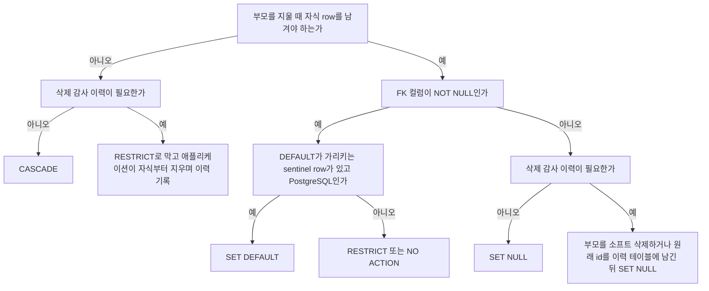
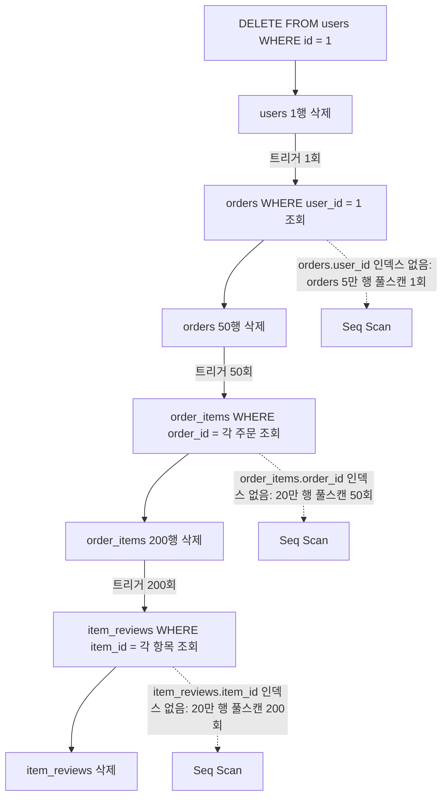
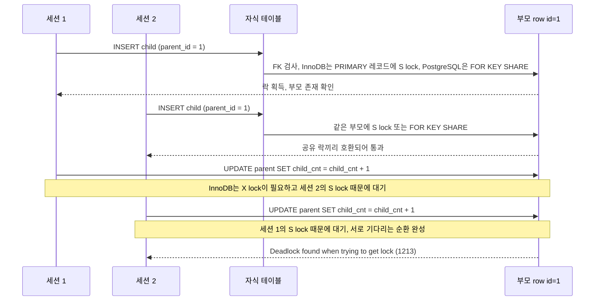
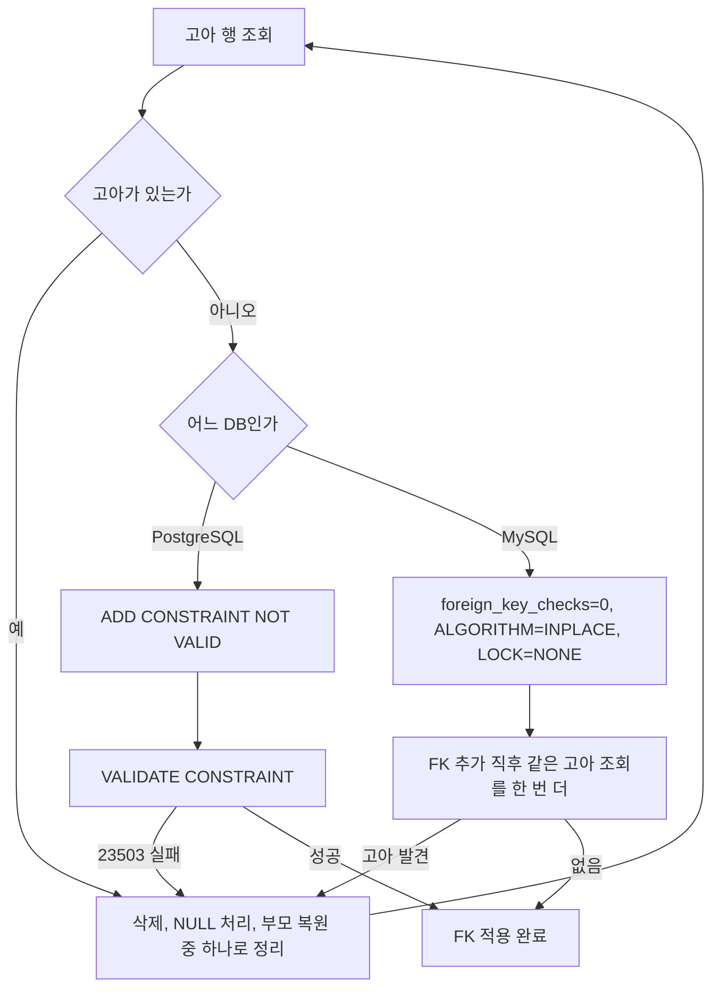
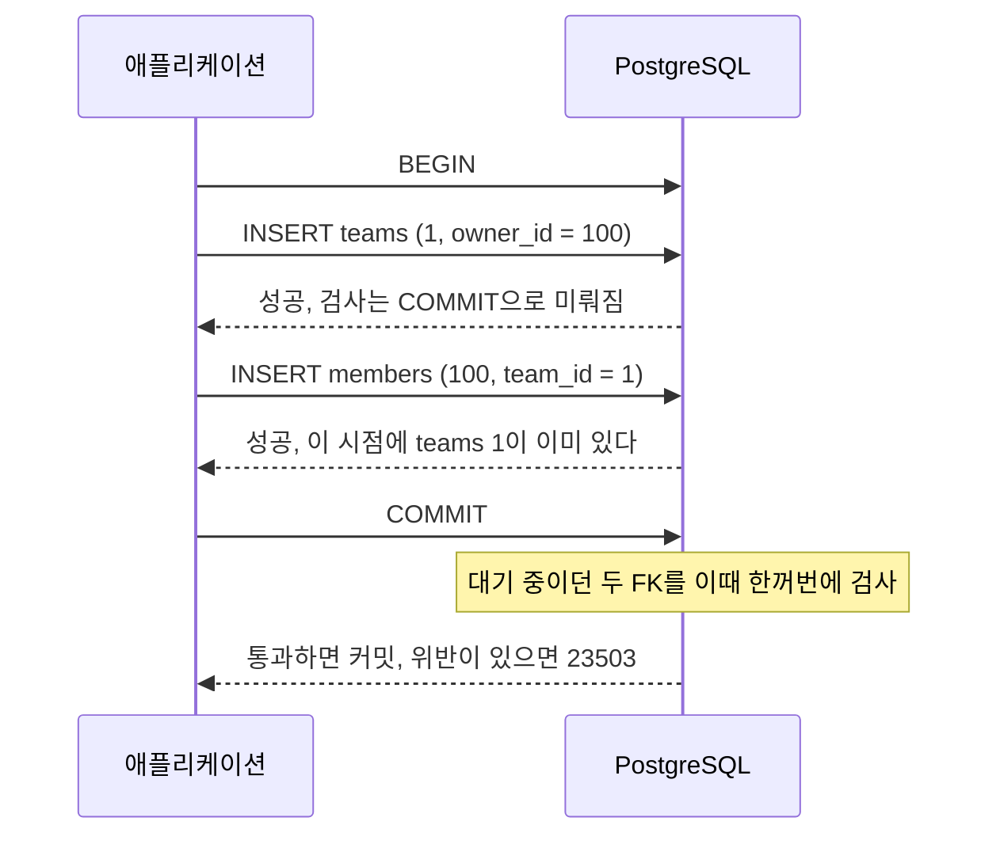
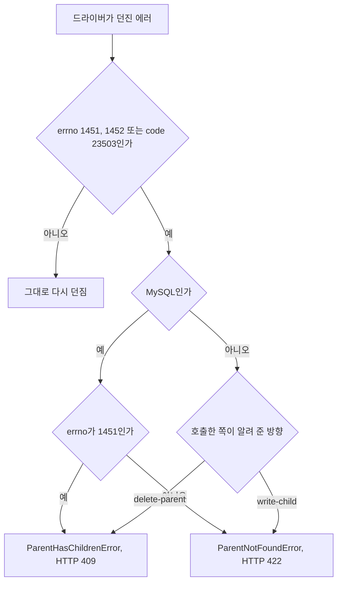
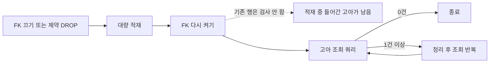

# 참조 무결성

참조 무결성(Referential Integrity)은 FK 컬럼에 존재하지 않는 PK 값이 들어오지 못하도록 막는 제약이다. "orders.user_id에 users 테이블에 없는 값이 절대 들어가지 않는다"를 DB가 보장하는 것이다.

개념 자체는 단순하지만, ON DELETE/ON UPDATE 옵션 선택을 잘못하면 예상치 못한 시점에 데이터가 지워지거나, 대규모 CASCADE가 연쇄적으로 터지거나, MSA 환경에서 DB FK 없이 운영하다가 고아 데이터가 쌓이는 문제로 이어진다.

---

## ON DELETE / ON UPDATE 옵션

FK 제약을 걸 때 부모 row가 삭제되거나 PK가 변경되면 자식 row를 어떻게 처리할지 지정한다.

### RESTRICT

부모를 삭제하려 할 때 자식이 존재하면 즉시 에러를 낸다. 트랜잭션 내에서도 즉각 검사한다.

```sql
ALTER TABLE orders
ADD CONSTRAINT fk_orders_user
FOREIGN KEY (user_id) REFERENCES users(id)
ON DELETE RESTRICT;

-- users에 id=1이 있고 orders에 user_id=1 row가 있을 때
DELETE FROM users WHERE id = 1;
-- ERROR: Cannot delete or update a parent row: a foreign key constraint fails
```

### NO ACTION

RESTRICT와 혼동하는 경우가 많다. 둘의 차이는 검사를 뒤로 미룰 수 있느냐다. NO ACTION은 `DEFERRABLE`을 붙이면 COMMIT 시점까지 검사를 미룰 수 있고, RESTRICT는 `DEFERRABLE INITIALLY DEFERRED`를 붙여도 DELETE 문장에서 바로 실패한다. 둘 다 기본값(`NOT DEFERRABLE`)이면 검사는 문장이 끝날 때 일어난다. NO ACTION이라고 COMMIT까지 기다려 주는 것이 아니다. PostgreSQL 16에서 세 경우를 모두 돌려 확인했다.

MySQL InnoDB에서는 RESTRICT와 NO ACTION이 사실상 동일하게 동작한다. 트랜잭션 내 지연 검사를 지원하지 않아서 두 옵션 모두 즉시 검사한다.

PostgreSQL에서는 `DEFERRABLE INITIALLY DEFERRED`를 쓸 때 차이가 생긴다.

```sql
-- PostgreSQL에서 지연 검사 예시
ALTER TABLE orders
ADD CONSTRAINT fk_orders_user
FOREIGN KEY (user_id) REFERENCES users(id)
ON DELETE NO ACTION
DEFERRABLE INITIALLY DEFERRED;

BEGIN;
DELETE FROM users WHERE id = 1;  -- 아직 에러 없음
INSERT INTO users (id, name) VALUES (1, 'new user');  -- 같은 ID 재삽입
COMMIT;  -- 여기서 검사, 결과적으로 자식 참조 유효
```

이 패턴은 PK를 교체하거나 순환 참조가 있는 데이터를 재정렬할 때 쓴다.

### CASCADE

부모가 삭제되면 자식도 같이 삭제, 부모 PK가 바뀌면 자식 FK도 같이 변경된다.

```sql
ALTER TABLE order_items
ADD CONSTRAINT fk_items_order
FOREIGN KEY (order_id) REFERENCES orders(id)
ON DELETE CASCADE;

-- orders.id=100 삭제 시 order_items.order_id=100인 row도 자동 삭제
DELETE FROM orders WHERE id = 100;
```

편하지만 위험하다. `users → orders → order_items → item_reviews` 같은 계층 구조에 전부 CASCADE가 걸려 있으면, 사용자 한 명 삭제가 테이블 전체를 훑는 연쇄 삭제로 번진다. 이 문제는 뒤에서 따로 다룬다.

ON UPDATE CASCADE는 PK를 수정하는 경우에 쓰는데, 보통 PK를 수정할 일이 없으므로 실무에서 잘 쓰지 않는다. UUID나 시퀀스 PK를 쓰면 이 옵션이 필요한 상황 자체가 생기지 않는다.

### SET NULL

부모가 삭제되면 자식 FK 컬럼을 NULL로 바꾼다. FK 컬럼이 NOT NULL이면 에러가 난다.

```sql
ALTER TABLE posts
ADD CONSTRAINT fk_posts_author
FOREIGN KEY (author_id) REFERENCES users(id)
ON DELETE SET NULL;

-- users.id=5 삭제 후
SELECT author_id FROM posts WHERE id = 10;
-- author_id: NULL
```

작성자가 탈퇴해도 게시글은 남겨야 하는 경우에 쓴다. NULL이 된 author_id를 조회할 때 "탈퇴한 사용자"로 표시하는 로직을 애플리케이션에서 처리해야 한다.

### SET DEFAULT

부모가 삭제되면 자식 FK 컬럼을 컬럼의 DEFAULT 값으로 바꾼다.

MySQL InnoDB는 SET DEFAULT를 파싱은 하지만 실제로는 RESTRICT처럼 동작한다. 공식 문서에도 "syntax is parsed but ignored"라고 나와 있다.

PostgreSQL은 제대로 지원한다. DEFAULT 값이 실제 부모 row를 가리켜야 하므로, 보통 "알 수 없음"을 뜻하는 sentinel row(예: id=0, name='unknown')를 부모 테이블에 두고 그걸 DEFAULT로 설정한다.

```sql
-- PostgreSQL
ALTER TABLE posts
ADD CONSTRAINT fk_posts_author
FOREIGN KEY (author_id) REFERENCES users(id) ON DELETE SET DEFAULT;

ALTER TABLE posts ALTER COLUMN author_id SET DEFAULT 0;
-- users.id=0은 '알 수 없는 사용자' sentinel row
```

실무에서 자주 쓰이지는 않는다. SET NULL이 더 명확하고 sentinel row 관리 부담도 없다.

### 옵션 고르는 순서

다섯 옵션을 외우기보다 질문 세 개로 좁히는 편이 빠르다. 자식을 남겨야 하는가, FK 컬럼이 NOT NULL인가, 삭제 감사 이력이 필요한가 순서로 묻는다.



자식을 지우는 가지에서 감사 이력이 갈림길이 되는 이유는 MySQL InnoDB에서 CASCADE로 지워진 자식 row에는 DELETE 트리거가 발화하지 않기 때문이다. 자식 테이블에 `AFTER DELETE` 트리거로 이력을 쌓아 두었다면 PostgreSQL에서는 CASCADE 삭제에도 트리거가 돌지만(감사 테이블에 2행이 쌓였다), MySQL 8.0에서는 부모를 지워 자식 2행이 사라져도 감사 테이블이 0행이었다. 같은 스키마를 두 DB에서 쓰는 팀은 로컬 PostgreSQL에서 통과한 이력 로직이 운영 MySQL에서 조용히 비는 경우를 겪는다.

자식을 남기는 가지의 SET NULL은 "누구의 글이었는지"를 지운다. 탈퇴 사용자의 id를 나중에 추적해야 한다면 NULL로 바뀌기 전에 어딘가에 남겨 두어야 한다.

---

## DB 레벨 FK vs 애플리케이션 레벨 강제

FK 제약을 DB에 걸지, 애플리케이션 코드로만 관리할지는 선택이 아닌 것처럼 보이지만, 실무에서는 두 방식 모두 쓰인다.

### DB 레벨 FK의 장단점

장점은 명확하다. 어떤 경로로 데이터가 들어오든 DB가 막아준다. 직접 psql 세션을 열어서 잘못된 데이터를 집어넣어도, 배치 스크립트가 검증을 빠트려도, DB에서 걸린다.

단점은 성능이다. InnoDB는 FK 컬럼에 반드시 인덱스를 요구한다(없으면 자동 생성). 부모 삭제 시 자식 테이블을 조회하는 비용, 자식 삽입 시 부모 존재 확인 비용이 추가된다. 높은 TPS에서 이 비용이 쌓인다.

더 큰 문제는 대용량 데이터 마이그레이션이다. FK가 걸린 상태에서 수천만 row를 bulk insert하면 매 row마다 참조 검사가 일어난다. 이 경우 FK를 일시 비활성화하고 작업 후 재활성화하는 패턴을 쓴다.

```sql
-- MySQL: FK 검사 비활성화
SET foreign_key_checks = 0;
-- bulk insert...
SET foreign_key_checks = 1;

-- PostgreSQL: 제약 비활성화
ALTER TABLE order_items DISABLE TRIGGER ALL;
-- bulk insert...
ALTER TABLE order_items ENABLE TRIGGER ALL;
```

MySQL의 `foreign_key_checks=0`은 세션 레벨이라 다른 세션에 영향이 없다. PostgreSQL은 superuser 권한이 필요하다. 테이블 오너 권한의 일반 롤로 실행하면 `permission denied: "RI_ConstraintTrigger_c_16752" is a system trigger`로 거부된다. 다시 켠 뒤에도 그 사이 들어간 고아 행은 검증되지 않는다. 이 문제는 [대량 적재 뒤 무결성 재검증](#대량-적재-뒤-무결성-재검증)에서 다룬다.

### 애플리케이션 레벨 강제

FK 없이 애플리케이션 코드에서 참조 무결성을 관리하는 방식이다. MSA나 대용량 쓰기 시스템에서 선택하는 경우가 많다.

성능은 낫다. DB 레벨의 참조 검사가 없으니 쓰기 처리량이 올라간다. 샤딩 환경에서 양쪽 테이블이 다른 샤드에 있으면 DB 레벨 FK 자체가 불가능하다.

대신 다음 문제가 생긴다.

직접 SQL을 실행하는 경로(DBA 직접 수정, 배치, 데이터 픽스 스크립트)에서 무결성 검사가 없다. 애플리케이션 버그 하나로 고아 데이터가 쌓인다. 한 번 쌓이기 시작하면 발견하기까지 시간이 걸리고, 정리 비용도 크다.

---

## 대규모 CASCADE 삭제 폭발

CASCADE를 여러 테이블에 걸어두면 언젠가 예상보다 훨씬 많은 row가 삭제되는 사고가 발생한다.

```
users (1 row 삭제)
  → orders (50 rows 삭제, CASCADE)
    → order_items (500 rows 삭제, CASCADE)
      → item_reviews (2000 rows 삭제, CASCADE)
        → review_images (5000 rows 삭제, CASCADE)
```

`DELETE FROM users WHERE id = ?` 한 줄이 8000개 이상의 row를 삭제한다.

### 3단 CASCADE와 풀스캔 지점

CASCADE는 부모에서 자식으로 한 단계씩 내려간다. 단계마다 "지워진 부모 row 하나당 자식 테이블을 한 번 조회"하는 내부 쿼리가 돈다. 이 조회가 인덱스를 못 타면 그 단계의 비용이 `삭제된 row 수 × 자식 테이블 크기`가 된다. 점선이 풀스캔이 일어나는 자리다.



PostgreSQL 16에서 users 1000행, orders 5만 행, order_items 20만 행, item_reviews 20만 행을 만들고 FK 세 개를 전부 `ON DELETE CASCADE`로 걸었다. 자식 FK 컬럼에 인덱스가 없을 때 `users` 한 행 삭제는 9188ms였고, 세 컬럼에 인덱스를 만든 뒤 같은 삭제는 8.6ms였다. `EXPLAIN (ANALYZE)`의 트리거 줄이 `calls=1`, `calls=50`, `calls=200`으로 찍히는데, 이 숫자가 곧 각 자식 테이블을 훑은 횟수다.

트리거 내부 쿼리의 플랜은 `auto_explain.log_nested_statements = on`으로 볼 수 있다. 인덱스가 없을 때 이런 쿼리가 `Seq Scan on item_reviews`로 찍혔다.

```
DELETE FROM ONLY "public"."item_reviews" WHERE $1 OPERATOR(pg_catalog.=) "item_id"
```

MySQL InnoDB는 FK를 만들 때 인덱스를 자동으로 붙이므로 이 문제가 생기기 어렵다. 그래서 PostgreSQL에서 넘어온 스키마나 PostgreSQL 쪽 마이그레이션에서 더 자주 터진다. 개발 DB는 users가 수십 행이라 이 비용이 보이지 않고, 운영에서 처음 사용자 삭제 기능을 돌릴 때 드러난다. RESTRICT나 NO ACTION도 자식 존재 여부를 같은 식으로 조회하므로 인덱스가 없으면 부모 삭제가 느려지는 건 마찬가지다.

### 실제로 터지는 패턴

테스트 환경에서는 데이터가 적어 CASCADE 시간이 짧다. 프로덕션에서 데이터가 쌓인 후 삭제 한 번에 락이 수 초간 걸리거나, InnoDB의 경우 대형 삭제가 언두 로그를 폭발시켜 DB 전체 성능이 저하된다.

### 트러블슈팅 방법

먼저 삭제 전에 영향받을 row 수를 파악한다.

```sql
-- 삭제 전 영향 범위 확인
SELECT
    (SELECT COUNT(*) FROM orders WHERE user_id = 1) AS orders_count,
    (SELECT COUNT(*) FROM order_items oi
     JOIN orders o ON oi.order_id = o.id WHERE o.user_id = 1) AS items_count,
    (SELECT COUNT(*) FROM item_reviews ir
     JOIN order_items oi ON ir.item_id = oi.id
     JOIN orders o ON oi.order_id = o.id WHERE o.user_id = 1) AS reviews_count;
```

row 수가 예상보다 많으면 CASCADE 대신 수동으로 하위 테이블부터 순서대로 삭제한다.

```sql
BEGIN;

-- 하위부터 순서대로 삭제
DELETE FROM review_images
WHERE review_id IN (
    SELECT ir.id FROM item_reviews ir
    JOIN order_items oi ON ir.item_id = oi.id
    JOIN orders o ON oi.order_id = o.id
    WHERE o.user_id = 1
);

DELETE FROM item_reviews
WHERE item_id IN (
    SELECT oi.id FROM order_items oi
    JOIN orders o ON oi.order_id = o.id
    WHERE o.user_id = 1
);

DELETE FROM order_items
WHERE order_id IN (SELECT id FROM orders WHERE user_id = 1);

DELETE FROM orders WHERE user_id = 1;

DELETE FROM users WHERE id = 1;

COMMIT;
```

row 수가 수만 건을 넘으면 트랜잭션 하나로 묶지 않고 배치로 나눠 삭제한다. InnoDB는 하나의 트랜잭션에서 대량 삭제 시 언두 로그가 커지고 락 경합이 심해진다.

```sql
-- 배치 삭제 예시 (애플리케이션 레벨 루프)
DELETE FROM order_items
WHERE order_id IN (SELECT id FROM orders WHERE user_id = 1)
LIMIT 1000;
-- 위를 반복
```

---

## MySQL InnoDB vs PostgreSQL FK 동작 차이

### FK 인덱스 요구사항

InnoDB는 FK 컬럼에 인덱스가 없으면 자동으로 생성한다. 인덱스 없이는 FK를 걸 수 없다.

PostgreSQL은 자동 생성하지 않는다. FK를 걸면 부모 테이블의 PK/UNIQUE 제약을 참조하는데, 자식 테이블의 FK 컬럼에 별도 인덱스를 만들지 않으면 자식 조회 시 Seq Scan이 발생한다. 수동으로 인덱스를 추가해야 한다.

```sql
-- PostgreSQL: FK 컬럼에 인덱스 수동 추가
CREATE INDEX idx_orders_user_id ON orders(user_id);
```

### SET DEFAULT

앞서 언급했듯 MySQL InnoDB는 SET DEFAULT를 무시하고 RESTRICT처럼 동작한다. PostgreSQL만 올바르게 지원한다.

### 지연 검사 (DEFERRABLE)

MySQL은 지원하지 않는다. PostgreSQL만 `DEFERRABLE INITIALLY IMMEDIATE`와 `DEFERRABLE INITIALLY DEFERRED`를 지원한다.

```sql
-- PostgreSQL only
ALTER TABLE orders
ADD CONSTRAINT fk_orders_user
FOREIGN KEY (user_id) REFERENCES users(id)
DEFERRABLE INITIALLY DEFERRED;
```

### FK와 락

InnoDB에서 자식 row를 삽입할 때 부모 row에 공유 락(S lock)을 잡는다. 높은 동시성 환경에서 부모 삽입과 자식 삽입이 겹치면 데드락이 발생할 수 있다. 특히 같은 부모 ID를 가진 자식 row를 여러 트랜잭션이 동시에 삽입할 때 발생하는 패턴이 있다.

PostgreSQL에서는 자식 삽입 시 부모 row에 대해 `FOR KEY SHARE` 락을 잡는다. InnoDB보다 락 범위가 좁아 동시성 충돌이 덜하다.

### 자식 INSERT 때 FK 검사 순서와 데드락 경로

자식 row를 넣으면 DB가 부모 row를 찾아 락을 잡고 존재를 확인한다. 이 락은 자식 트랜잭션이 끝날 때까지 풀리지 않는다. 같은 부모를 가리키는 자식을 두 세션이 동시에 넣으면 공유 락이라 둘 다 통과한다. 문제는 그 뒤에 같은 세션이 부모를 수정하는 경우다.



"자식을 넣고 부모의 카운터 컬럼을 올리는" 코드가 전형적인 진입점이다. MySQL 8.0.46에서 두 세션으로 재현하면 `SHOW ENGINE INNODB STATUS`의 `LATEST DETECTED DEADLOCK`에 양쪽 트랜잭션이 모두 `index PRIMARY of table parent ... lock mode S locks rec but not gap`을 쥔 채 `lock_mode X locks rec but not gap waiting`으로 서 있는 것이 찍힌다. 한쪽이 1213으로 롤백되고 다른 쪽은 커밋된다.

PostgreSQL은 같은 코드에서 데드락이 나지 않는다. `FOR KEY SHARE`는 키를 바꾸지 않는 UPDATE(`NO KEY UPDATE`)와 충돌하지 않기 때문이다. 키를 건드리는 문장에서는 같은 경로가 열린다.

| 부모에 하는 작업 | InnoDB | PostgreSQL |
|---|---|---|
| 비키 컬럼 `UPDATE` (카운터 증가) | 데드락 | 둘 다 커밋 |
| `SELECT ... FOR UPDATE` | 데드락 | 데드락 |
| 부모 `DELETE` | 데드락 | 데드락 |

표의 모든 칸은 두 세션을 같은 타이밍으로 돌려 확인한 결과다. 부모 `DELETE` 시나리오에서 InnoDB의 먼저 도착한 세션은 데드락이 아니라 자식이 남아 있다는 1451을 받는다. 데드락 판정은 뒤 세션이 받는다. PostgreSQL에서 `pgrowlocks`로 보면 자식 INSERT가 끝나지 않은 동안 부모 row에 `For Key Share`가 걸려 있다.

카운터를 부모 테이블에 두는 설계라면 InnoDB에서는 자식 INSERT보다 부모 UPDATE를 먼저 하도록 순서를 고정한다. 첫 락이 X라 두 번째 세션이 그 앞에서 줄을 서고, S를 쥔 채 X를 기다리는 순환이 생기지 않는다. 같은 두 세션을 이 순서로 돌렸을 때 둘 다 커밋됐고 카운터는 2가 됐다. 락 모드 자체는 [MySQL InnoDB 락 심화](My_SQL_Inno_DB_Locking_Deep_Dive.md)에 정리돼 있다.

### 두 엔진의 차이 비교표

위에서 나온 차이와 이 문서 뒤쪽에서 다루는 항목을 한 표에 모았다. 버전은 MySQL 8.0.46, PostgreSQL 16.15이고 모든 칸을 직접 실행해서 채웠다.

| 항목 | MySQL InnoDB | PostgreSQL |
|---|---|---|
| FK 컬럼 인덱스 | 없으면 자동 생성. `ALGORITHM=INPLACE, LOCK=NONE`으로 FK를 추가할 때도 `SHOW INDEX`에 제약 이름의 인덱스가 생긴다 | 자동 생성 없음. 부모 쪽은 PK나 UNIQUE가 있어야 하고 자식 쪽 인덱스는 직접 만든다 |
| 검사 시점 | 행 단위로 즉시. 한 문장 안에서 자식이 부모보다 먼저 와도 1452 | 기본 NO ACTION은 문장 끝에 검사. 한 문장 안에서는 순서가 상관없다 |
| DEFERRABLE | 문법 오류(1064) | 지원. RESTRICT는 DEFERRABLE을 붙여도 미뤄지지 않는다 |
| SET DEFAULT | 테이블은 만들어지지만 부모 삭제 시 1451로 막힌다. RESTRICT와 같은 동작 | 동작한다 |
| MATCH FULL | 구문은 받아들이고 무시한다. `SHOW CREATE TABLE`에 남지 않는다 | 지원 |
| SET NULL 대상 컬럼 | 컬럼 지정 불가. 복합 FK에 NOT NULL 컬럼이 있으면 DDL에서 1830 | 15부터 `SET NULL (user_id)`로 컬럼 지정 가능 |
| CASCADE 깊이 | 15단 제한. 16단째에서 3008, 문장 전체가 롤백 | 제한 없음. 20만 단계 체인을 9초에 삭제 |
| CASCADE로 지워진 자식의 트리거 | 발화하지 않음 | 발화함 |
| 자식 INSERT 때 부모 락 | PRIMARY 레코드에 S lock | `FOR KEY SHARE` |
| FK 위반 에러 | 1451, 1452 (SQLSTATE 23000이라 유니크 위반 1062와 같다) | 23503 |
| 고아 행이 있는 채로 FK 추가 | `foreign_key_checks=0`이면 통과 | `NOT VALID`면 통과 |
| FK 추가 중 쓰기 | `foreign_key_checks=0` + INPLACE면 동시 DML 허용. 기본 경로는 COPY + LOCK=SHARED | `NOT VALID` 단계는 양쪽 테이블에 SHARE ROW EXCLUSIVE, `VALIDATE` 단계는 쓰기 허용 |

---

## 운영 중인 테이블에 FK 추가

수천만 행이 쌓인 테이블에 FK를 뒤늦게 붙이는 일은 `CREATE TABLE`에서 거는 것과 다르다. 확인할 것은 두 가지다. 기존 데이터에 고아 행이 있는지, 제약을 만드는 동안 쓰기가 얼마나 막히는지. 락 모드 일반론과 `lock_timeout` 재시도는 [PostgreSQL 스키마 마이그레이션](Postgre_SQL_Schema_Migration.md#외래키-추가)과 [MySQL Online DDL](My_SQL_Online_DDL.md)에 있다. 이 절은 FK여서 달라지는 부분만 적는다.

### 고아 행 먼저 찾기

FK를 걸기 전에 고아 값별 건수부터 센다. FK 컬럼이 NULL인 행은 FK 검사 대상이 아니라서 고아가 아니다. `IS NOT NULL` 조건을 빼면 NULL 행이 전부 후보로 올라온다.

```sql
SELECT o.user_id, COUNT(*) AS cnt
FROM orders o
LEFT JOIN users u ON u.id = o.user_id
WHERE o.user_id IS NOT NULL
  AND u.id IS NULL
GROUP BY o.user_id
ORDER BY cnt DESC
LIMIT 50;
```

10만 행 테이블에 존재하지 않는 `user_id` 5000을 2건, 7777을 1건 심고 MySQL 8.0과 PostgreSQL 16에서 같은 쿼리를 돌렸다. 두 DB 모두 이 두 값을 정확히 찾았다. 값별로 묶어 보면 삭제된 부모 id 한두 개가 수천 행을 만든 경우인지 여기저기 흩어진 경우인지 구분된다. 앞의 경우는 부모를 복원하거나 일괄 정리하면 끝나고, 뒤의 경우는 쓰는 쪽 버그를 같이 찾아야 한다. 정리 방법은 [고아 레코드](Orphan_Record.md)에 있다.

두 DB의 절차는 검증하는 시점이 다르다. PostgreSQL은 제약을 먼저 걸어 새 고아를 막고 기존 행을 나중에 검증한다. MySQL의 빠른 경로는 기존 행을 검증하지 않으므로 조회가 검증 역할을 대신한다.



### PostgreSQL의 NOT VALID 후 VALIDATE

```sql
SET lock_timeout = '3s';
ALTER TABLE orders
  ADD CONSTRAINT fk_orders_user FOREIGN KEY (user_id) REFERENCES users (id) NOT VALID;
RESET lock_timeout;

ALTER TABLE orders VALIDATE CONSTRAINT fk_orders_user;
```

`NOT VALID`는 기존 행을 훑지 않는다. 제약은 만들어지는 순간부터 새 INSERT와 UPDATE를 검사하고, `pg_constraint.convalidated`는 `f`로 남는다. `VALIDATE CONSTRAINT`가 기존 행을 훑는다.

FK에서만 눈여겨볼 점은 부모 테이블에도 락이 걸린다는 것이다. 트랜잭션 안에서 `pg_locks`를 조회해 두 단계의 락을 확인했다.

| 단계 | 자식 테이블(orders) | 부모 테이블(users) | 동시 쓰기 |
|---|---|---|---|
| `ADD CONSTRAINT ... NOT VALID` | SHARE ROW EXCLUSIVE | SHARE ROW EXCLUSIVE | 다른 세션의 orders INSERT와 users INSERT가 모두 대기 (`lock_timeout = 1s`에 취소됨) |
| `VALIDATE CONSTRAINT` | SHARE UPDATE EXCLUSIVE | ROW SHARE | orders INSERT, users INSERT, users DELETE가 대기 없이 통과 |

자식 테이블만 생각하고 `NOT VALID` 단계를 실행하면 부모(users)에 쓰는 트랜잭션도 같이 줄을 선다. 이 단계는 테이블을 훑지 않아 락을 잡는 시간 자체는 짧다. 짧은 시간에도 앞에 오래 도는 트랜잭션이 있으면 그 뒤로 쓰기가 전부 쌓이므로 `lock_timeout`을 걸고 실패하면 재시도한다.

`NOT VALID` 상태에서 고아 행에 어떤 쓰기가 허용되는지도 확인했다.

- 새 고아 INSERT는 23503으로 막힌다.
- 기존 고아 행의 FK 컬럼이 아닌 컬럼 UPDATE는 통과한다.
- 기존 고아 행의 FK 컬럼을 다른 고아 값으로 바꾸면 23503이다.
- 고아가 남은 채 `VALIDATE`하면 23503으로 실패하고, 제약은 `NOT VALID` 그대로 남아 새 쓰기를 계속 막는다. 정리한 뒤 `VALIDATE`를 다시 실행하면 `convalidated`가 `t`가 된다.

`VALIDATE` 에러에는 처음 발견한 위반 값 하나만 나온다. 전체 목록은 앞의 조회 쿼리로 본다. 자식 FK 컬럼 인덱스는 FK 추가와 별개로 만들어 둔다. 방법은 [CONCURRENTLY 인덱스 생성](Postgre_SQL_Schema_Migration.md#concurrently-인덱스-생성과-삭제)에 있다.

### MySQL Online DDL 제약과 foreign_key_checks=0

MySQL에서는 `foreign_key_checks` 값이 알고리즘 선택을 결정한다. 같은 ALTER를 설정만 바꿔 돌린 결과다.

| 설정 | 결과 |
|---|---|
| `foreign_key_checks=1`, `ALGORITHM=INPLACE` | 1846. `Adding foreign keys needs foreign_key_checks=OFF. Try ALGORITHM=COPY.` |
| `foreign_key_checks=1`, `LOCK=NONE` | 1846. `... Try LOCK=SHARED.` |
| `foreign_key_checks=1`, 기본값, 고아 있음 | 1452로 실패. 에러 메시지의 테이블 이름이 임시 테이블 `#sql-1_16`으로 나온다 |
| `foreign_key_checks=0`, `INPLACE`, `LOCK=NONE`, 고아 있음 | 성공. 고아 3건이 그대로 남는다 |

검증이 되는 경로(`foreign_key_checks=1`)는 COPY와 `LOCK=SHARED`만 허용하므로 복사하는 동안 쓰기가 막힌다. 큰 테이블에서는 쓸 수 없다. 그래서 `foreign_key_checks=0`으로 내려가는데, 이 경로가 기존 행을 검증하지 않는다.

```sql
SET SESSION foreign_key_checks = 0;
ALTER TABLE orders
  ADD CONSTRAINT fk_orders_user FOREIGN KEY (user_id) REFERENCES users (id),
  ALGORITHM = INPLACE, LOCK = NONE;
SET SESSION foreign_key_checks = 1;
```

ALTER가 성공하면 `information_schema.TABLE_CONSTRAINTS`에 FK가 정상 등록된다. 제약이 있으니 안전하다고 믿기 쉬운데, 같은 테이블에서 고아 조회를 다시 돌리면 3건이 그대로 나온다. 이후 동작은 이렇다.

- 새 고아 INSERT는 1452로 막힌다.
- 기존 고아 행의 다른 컬럼 UPDATE는 통과한다(2행 변경).
- 기존 고아 행의 FK 컬럼을 다른 고아 값으로 바꾸면 1452다.

ALTER가 끝나기 전 구간에 들어온 행은 FK가 아직 없으니 막히지 않는다. 그래서 FK를 추가한 직후 고아 조회를 한 번 더 돌린다. 세션 변수는 반드시 원복한다. 커넥션 풀에서 꺼낸 커넥션이 `foreign_key_checks=0`을 쥔 채 반환되면 다음 요청이 FK 없이 돌아간다.

FK 컬럼에 인덱스가 없으면 InnoDB가 같은 ALTER 안에서 인덱스를 만든다. 인덱스 없는 컬럼에 `INPLACE, LOCK=NONE`으로 FK를 추가했을 때 `fk_o3`라는 이름의 인덱스가 같이 생겼다. 큰 테이블이면 인덱스 생성 시간이 ALTER 시간에 들어가므로 인덱스를 먼저 따로 추가해 두는 편이 낫다.

---

## 자기 참조 FK와 순환 FK

### 자기 참조의 삽입 순서

`categories.parent_id`, 조직도의 `manager_id`처럼 같은 테이블을 가리키는 FK는 부모 row가 자식보다 먼저 존재해야 한다. 한 문장 안에서 순서가 어긋났을 때 두 DB의 반응이 갈린다.

| 문장 | MySQL 8.0 | PostgreSQL 16 |
|---|---|---|
| `INSERT INTO categories VALUES (2,1),(1,NULL)` 자식이 먼저 | 1452 | 성공 |
| `INSERT INTO categories VALUES (11,NULL),(12,11)` 부모가 먼저 | 성공 | 성공 |
| `INSERT INTO categories VALUES (4,3)` 단독, id 3이 없음 | 1452 | 23503 |

InnoDB는 행 단위로 즉시 검사하고, PostgreSQL의 기본 NO ACTION은 문장이 끝날 때 검사한다. 로컬 PostgreSQL에서 통과한 시드 스크립트가 운영 MySQL에서 1452로 깨지는 경우가 여기서 나온다. 트리 데이터를 적재할 때는 루트부터 깊이 순으로 정렬해서 넣으면 두 DB에서 같게 동작한다.

### 순환 FK

사용자(members)가 팀에 속하고 팀이 소유자(owner)로 사용자를 가리키면 두 테이블이 서로를 참조한다. 한 행씩 INSERT하는 방식으로는 어느 쪽부터 넣어도 상대가 아직 없다.

PostgreSQL은 두 FK를 `DEFERRABLE INITIALLY DEFERRED`로 만들고 한 트랜잭션에서 넣는다.

```sql
CREATE TABLE teams   (id int PRIMARY KEY, owner_id int);
CREATE TABLE members (id int PRIMARY KEY, team_id  int);

ALTER TABLE teams ADD CONSTRAINT fk_t_owner
  FOREIGN KEY (owner_id) REFERENCES members (id) DEFERRABLE INITIALLY DEFERRED;
ALTER TABLE members ADD CONSTRAINT fk_m_team
  FOREIGN KEY (team_id) REFERENCES teams (id) DEFERRABLE INITIALLY DEFERRED;

BEGIN;
INSERT INTO teams   VALUES (1, 100);
INSERT INTO members VALUES (100, 1);
COMMIT;
```



지연 없이 만든 두 FK로 같은 INSERT를 하면 `teams`를 먼저 넣는 순간 23503이다. 한쪽(`teams.owner_id`)만 `DEFERRABLE`로 만들면 `teams`를 먼저 넣는 순서는 통과하고 `members`를 먼저 넣는 순서는 `fk_m_team`의 즉시 검사에 걸린다. 양쪽을 모두 지연으로 두면 순서를 신경 쓸 필요가 없다.

지연 FK의 위반은 INSERT 문장이 아니라 COMMIT에서 터진다. 존재하지 않는 `owner_id` 999를 넣어도 INSERT는 성공하고 COMMIT에서 23503이 나므로, 스택트레이스가 원인 코드를 가리키지 않는다. 의심스러운 지점 바로 뒤에 `SET CONSTRAINTS ALL IMMEDIATE`를 두면 그 자리에서 검사가 일어나 에러 위치가 앞당겨진다.

MySQL은 `DEFERRABLE` 자체가 문법 오류(1064)다. 순환 중 한쪽 컬럼을 NULL 허용으로 두고 세 단계로 넣는다.

```sql
START TRANSACTION;
INSERT INTO members VALUES (100, NULL);
INSERT INTO teams   VALUES (1, 100);
UPDATE members SET team_id = 1 WHERE id = 100;
COMMIT;
```

이 방식은 `members.team_id`가 NOT NULL이면 쓰지 못한다. "사용자는 반드시 팀이 있어야 한다"는 규칙을 DB에서 지켜야 한다면 순환 FK 두 개를 모두 두는 설계 자체를 다시 본다. `foreign_key_checks=0`으로 순서를 무시하는 우회도 가능하지만 쓰지 않는다. 그 사이에 들어간 불일치가 검증되지 않고, 세션 변수가 풀 커넥션에 남을 위험이 있다.

### 자기 참조 CASCADE의 깊이

자기 참조 FK에 `ON DELETE CASCADE`를 걸면 루트 하나를 지울 때 서브트리 전체가 재귀적으로 삭제된다. 두 DB가 이 재귀를 다루는 방식이 크게 다르다.

MySQL은 CASCADE 깊이가 15단으로 제한된다. 체인 길이 15행까지는 루트 삭제가 성공했고 16행, 17행은 `3008 Foreign key cascade delete/update exceeds max depth of 15`로 실패했다. 20행 체인에서 실패했을 때는 삭제 전 20행이 삭제 시도 후에도 20행이라, 문장 전체가 롤백된다. 카테고리 트리는 보통 5단을 넘지 않지만 대댓글 스레드, 조직도, `previous_version_id`로 이어지는 이력 체인은 15단을 넘기도 한다. 이 경우 CASCADE에 맡기지 않고 깊은 쪽부터 지운다.

```sql
CREATE TEMPORARY TABLE sub_ids AS
WITH RECURSIVE sub AS (
  SELECT id, 0 AS depth FROM chain WHERE id = 1
  UNION ALL
  SELECT c.id, sub.depth + 1 FROM chain c JOIN sub ON c.parent_id = sub.id
)
SELECT id, depth FROM sub;

-- depth가 큰 값부터 0까지 애플리케이션이나 프로시저에서 반복
DELETE c FROM chain c JOIN sub_ids s ON s.id = c.id WHERE s.depth = 40;
```

깊이 40, 41행 체인에서 `DELETE FROM chain WHERE id = 1`은 3008이었고, 이 방식으로 depth 40부터 0까지 지우자 0행이 남았다. 각 DELETE가 한 단계만 지우니 CASCADE 깊이에 걸리지 않는다.

PostgreSQL에는 깊이 제한이 없다. 20만 단계 체인의 루트 삭제가 약 9초에 성공했고 스택 한도(`max_stack_depth` 2MB)에도 걸리지 않았다. 대신 자기 참조에서 `parent_id` 인덱스가 없을 때 비용이 제곱으로 늘어난다. 2만 단계 체인에서 루트를 지우는 데 인덱스가 없으면 92초, `parent_id`에 인덱스를 만들면 1.2초였다. 삭제되는 행마다 자식 조회가 한 번씩 돌고 매번 2만 행을 훑기 때문이다. 앞의 3단 CASCADE와 같은 원리가 한 테이블 안에서 반복되는 경우다.

---

## 복합 FK와 MATCH SIMPLE/FULL

복합 키를 참조하는 FK에서 컬럼 일부가 NULL이면 DB는 어떻게 할지 정해야 한다. 기본값인 `MATCH SIMPLE`은 참조 컬럼 중 하나라도 NULL이면 검사를 건너뛴다. `MATCH FULL`은 전부 NULL이거나 전부 NOT NULL이어야 하고 섞이면 거부한다.

`par(tenant_id, id)`를 참조하는 두 자식 테이블로 PostgreSQL 16에서 직접 넣어 본 결과다.

| 입력 `(tenant_id, par_id)` | MATCH SIMPLE | MATCH FULL |
|---|---|---|
| `(1, 10)` 부모 존재 | 통과 | 통과 |
| `(1, 99)` 부모 없음 | 23503 | 23503 |
| `(NULL, 99)` | 통과 | 23503, `MATCH FULL does not allow mixing of null and nonnull key values` |
| `(1, NULL)` | 통과 | 23503, 같은 메시지 |
| `(NULL, NULL)` | 통과 | 통과 |

`(NULL, 99)`는 `par_id`에 99라는 값이 들어 있는데 어떤 부모도 가리키지 않는다. 그런데 SIMPLE에서는 FK가 통과시켜서 고아가 만들어진다. MySQL 8.0도 같은 입력에서 SIMPLE과 똑같이 동작했다. `MATCH FULL` 구문은 받아들이지만 무시한다. `SHOW CREATE TABLE`에 `MATCH FULL`이 남지 않고 `(NULL, 99)`가 그대로 들어갔다. MySQL에서는 복합 FK의 NULL 구멍을 FK 옵션으로 막을 수 없으므로 컬럼을 NOT NULL로 만들어 막는다.

### 멀티테넌트에서 다른 테넌트 참조 막기

테넌트별로 격리된 공유 테이블에서 `orders.user_id`가 다른 테넌트의 사용자를 가리키는 사고는 단일 컬럼 FK로는 막히지 않는다. `users.id`가 존재하기만 하면 통과하기 때문이다. `(tenant_id, id)`를 묶는 복합 FK가 이걸 막는다.

```sql
CREATE TABLE users (
  tenant_id int NOT NULL,
  id        int NOT NULL,
  PRIMARY KEY (id),
  UNIQUE (tenant_id, id)
);

CREATE TABLE orders (
  id        int PRIMARY KEY,
  tenant_id int NOT NULL,
  user_id   int NOT NULL,
  FOREIGN KEY (tenant_id, user_id) REFERENCES users (tenant_id, id)
);
```

테넌트 1의 사용자 100, 테넌트 2의 사용자 200을 만들고 넣어 보면 다음과 같다. `orders(tenant_id=1, user_id=100)`은 통과하고, `orders(tenant_id=1, user_id=200)`은 23503이다. 같은 입력이 `user_id`만 참조하는 단일 컬럼 FK에서는 에러 없이 들어갔다.

이 패턴의 조건이 세 가지 있다. 자식의 `tenant_id`와 `user_id`는 둘 다 NOT NULL이어야 한다. SIMPLE의 NULL 구멍이 여기서 그대로 보안 구멍이 되기 때문이다. 부모에는 `UNIQUE (tenant_id, id)`가 있어야 참조할 수 있다. PK가 `id` 단독이어도 이 UNIQUE를 추가로 만든다. 자식 쪽에는 `(tenant_id, user_id)` 인덱스가 필요한데 MySQL은 자동으로 만들고 PostgreSQL은 직접 만든다.

복합 FK에 `ON DELETE SET NULL`을 걸면 `tenant_id`까지 NULL로 바꾸려 해서 문제가 생긴다.

- PostgreSQL 15 미만은 `tenant_id`가 NOT NULL이라 부모 삭제가 23502(`null value in column "tenant_id" ... violates not-null constraint`)로 실패한다. 15 이상에서는 `ON DELETE SET NULL (user_id)`로 바꿀 컬럼을 지정할 수 있고, 이때 `tenant_id`는 그대로 남고 `user_id`만 NULL이 된다.
- MySQL은 DDL 단계에서 `1830 Column 'tenant_id' cannot be NOT NULL: needed in a foreign key constraint 'posts_ibfk_1' SET NULL`로 거부한다. MySQL에서 이 조합이 필요하면 `RESTRICT`로 두고 소프트 삭제를 쓴다.

멀티테넌시 방식별 비교는 [Shared Table](Shared_Table.md)에, PostgreSQL에서 DB가 테넌트 필터를 강제하는 방법은 [Row Level Security](Row_Level_Security.md)에 있다. 복합 FK는 쓰기 시점의 참조를 막고, RLS는 읽기와 쓰기 시점의 접근을 막는다. 둘은 서로 대체재가 아니다.

---

## FK 위반 에러를 애플리케이션 예외로 매핑

FK가 있는 DB를 쓰면 위반 에러가 `500`으로 새는 경로가 생긴다. 사용자 삭제 API가 `Cannot delete or update a parent row: a foreign key constraint fails (...)`를 그대로 응답에 싣는 경우를 종종 본다. 테이블명과 제약명이 클라이언트에 노출되고, 사용자는 무엇을 해야 하는지 알 수 없다.

두 DB의 에러는 이렇게 생겼다. Node의 `mysql2`와 `pg`로 실제 위반을 일으켜 에러 객체를 찍은 결과다.

| 상황 | MySQL (`mysql2`) | PostgreSQL (`pg`) |
|---|---|---|
| 부모 삭제, 자식 존재 | `errno` 1451, `code` `ER_ROW_IS_REFERENCED_2` | `code` 23503 |
| 자식 INSERT, 부모 없음 | `errno` 1452, `code` `ER_NO_REFERENCED_ROW_2` | `code` 23503 |
| 제약 이름 | `sqlMessage`의 `CONSTRAINT \`fk_orders_user\`` 부분을 정규식으로 추출 | `err.constraint` |

MySQL은 SQLSTATE가 `23000`인데 이 값은 유니크 위반(1062)도 같다. SQLSTATE로 분기하면 둘이 섞이므로 `errno`로 구분한다. PostgreSQL은 두 방향이 같은 23503이라 에러 객체만으로는 어느 쪽인지 알기 어렵다. `err.table`은 두 경우 모두 자식 테이블(`orders_e`)이었고, `err.detail`의 `is still referenced`와 `is not present`는 `lc_messages` 설정에 따라 번역된다. 방향은 호출한 코드가 알고 있으니 그 값을 같이 넘기는 쪽이 안전하다.



```typescript
export class ParentHasChildrenError extends Error {
  constructor(readonly constraint: string) {
    super(`parent row is referenced (${constraint})`);
  }
}

export class ParentNotFoundError extends Error {
  constructor(readonly constraint: string) {
    super(`referenced row does not exist (${constraint})`);
  }
}

type Direction = 'write-child' | 'delete-parent';

export function mapFkError(err: any, direction: Direction): unknown {
  const isMysql = err?.errno === 1451 || err?.errno === 1452;
  const isPg = err?.code === '23503';
  if (!isMysql && !isPg) return err;

  const constraint: string = isPg
    ? err.constraint
    : /CONSTRAINT `([^`]+)`/.exec(err.sqlMessage ?? '')?.[1] ?? 'unknown';

  const deleteSide = isMysql ? err.errno === 1451 : direction === 'delete-parent';
  return deleteSide
    ? new ParentHasChildrenError(constraint)
    : new ParentNotFoundError(constraint);
}

const MESSAGES: Record<string, string> = {
  fk_orders_user: '주문 내역이 있는 사용자는 삭제할 수 없습니다.',
};

export function toHttp(err: unknown): { status: number; body: { message: string } } {
  if (err instanceof ParentHasChildrenError) {
    return { status: 409, body: { message: MESSAGES[err.constraint] ?? '연결된 데이터가 있어 삭제할 수 없습니다.' } };
  }
  if (err instanceof ParentNotFoundError) {
    return { status: 422, body: { message: '존재하지 않는 대상을 참조했습니다.' } };
  }
  return { status: 500, body: { message: 'internal error' } };
}
```

서비스 코드에서는 쓰기 호출을 `try/catch`로 감싸 `mapFkError(e, 'delete-parent')`를 거친 결과를 던진다. 이 코드를 `tsc --strict`로 컴파일하고 두 DB에서 부모 삭제와 자식 INSERT를 실행했을 때 네 경우 모두 409 또는 422로 매핑됐다.

매핑표의 키가 되는 제약 이름은 직접 지정해야 한다. 이름을 안 주면 MySQL은 `orders_ibfk_1`, PostgreSQL은 `orders_user_id_fkey` 같은 자동 이름이 붙는데, 컬럼이나 테이블 이름이 바뀌면 이름도 달라지거나 번호가 밀린다. 사용자에게 "주문 3건이 있어 삭제할 수 없다"처럼 건수까지 보여주려면 409를 만든 뒤 `SELECT COUNT(*)`를 한 번 더 돌린다. 안내용 숫자라서 그 사이 값이 바뀌어도 상관없다.

ORM은 드라이버 에러를 한 번 감싸는 경우가 많다. 위 필드(`errno`, `code`, `constraint`)가 감싼 객체의 어디에 붙는지 먼저 확인하고 매핑 함수에 넘긴다.

FK 위반 뒤 트랜잭션의 상태도 두 DB가 다르다. MySQL은 실패한 문장만 롤백하고 트랜잭션은 이어진다. 한 트랜잭션에 사용자 50 INSERT, 존재하지 않는 부모를 가진 주문 INSERT(1452), 사용자 50을 가진 주문 51 INSERT를 순서대로 실행하면 마지막 COMMIT까지 성공했고 사용자 50과 주문 51이 모두 남았다. PostgreSQL은 같은 순서에서 `current transaction is aborted, commands ignored until end of transaction block`이 나고 COMMIT 후에 사용자 50이 없었다. PostgreSQL에서 FK 위반을 잡고 계속 진행하려면 해당 문장 앞에 `SAVEPOINT`를 잡고 `ROLLBACK TO`로 돌아간다. 이 방식으로 사용자 60과 주문 61이 정상적으로 커밋되는 것을 확인했다.

---

## 대량 적재 뒤 무결성 재검증

대량 적재에서 FK를 끄는 이유와 방법은 앞에서 다뤘다. 문제는 다시 켠 뒤다. 켜는 것은 앞으로의 쓰기를 검사하는 것이고, 그 사이에 들어간 행은 검사하지 않는다. 두 DB에서 고아 행을 일부러 적재하고 다시 켜 본 결과다.

| 단계 | PostgreSQL 16 | MySQL 8.0 |
|---|---|---|
| 끄기 | `ALTER TABLE ... DISABLE TRIGGER ALL` 또는 `session_replication_role = replica` (둘 다 superuser) | `SET foreign_key_checks = 0` |
| 고아 3건 적재 | 성공 | 성공 |
| 다시 켜기 | `ENABLE TRIGGER ALL` | `foreign_key_checks = 1` |
| 켠 직후 기존 고아 | 그대로 남음 | 그대로 남음 |
| 켠 직후 새 고아 INSERT | 23503 | 1452 |
| 재검증 명령 | `VALIDATE CONSTRAINT`는 이미 `convalidated = t`라 아무것도 검사하지 않음 | 없음 |



PostgreSQL에서 `VALIDATE CONSTRAINT fk_li`를 실행하면 에러 없이 끝난다. 고아 2건이 남아 있는데도 그렇다. 제약이 이미 검증된 것으로 표시돼 있어서 DB가 다시 훑지 않는다. 고아 행의 FK 컬럼을 건드리지 않는 `UPDATE`도 통과한다. 그래서 몇 달 뒤에야 조인 결과가 이상하다는 제보로 발견되곤 한다.

PostgreSQL에서 가장 단순한 재검증은 트리거를 끄는 대신 제약을 빼고 적재한 뒤 `NOT VALID`로 다시 거는 것이다. 이 방식은 superuser가 필요 없고 `VALIDATE`가 실제로 검사한다.

```sql
ALTER TABLE line_items DROP CONSTRAINT fk_li_order;

-- 대량 적재

ALTER TABLE line_items
  ADD CONSTRAINT fk_li_order FOREIGN KEY (order_id) REFERENCES orders (id) NOT VALID;
ALTER TABLE line_items VALIDATE CONSTRAINT fk_li_order;
```

고아 1건(order_id 999)을 적재한 상태에서 `VALIDATE`가 23503으로 실패했고 `convalidated`는 `f`였다. 그 행을 지운 뒤 다시 실행하자 `t`가 됐다. 이 방식의 단점은 `DROP` 구간 동안 그 테이블에 FK가 없다는 점이다. 적재 중에 그 테이블에 쓰는 다른 경로가 있다면 그 쓰기도 검사를 받지 않으므로, 적재 창을 짧게 잡거나 다른 쓰기를 막아 둔다. `DROP CONSTRAINT`는 `ACCESS EXCLUSIVE` 락을 잡으니 `lock_timeout`을 같이 건다.

MySQL에는 `VALIDATE`에 해당하는 명령이 없다. `foreign_key_checks`를 다시 켠 뒤 앞의 고아 조회 쿼리를 돌려 결과가 0건인지 본다. FK를 삭제하고 `foreign_key_checks=1`에서 다시 추가하면 검증이 되지만, 고아가 남아 있으면 1452로 실패하고 그때는 FK가 이미 지워진 상태다. 실패 직후 `information_schema`에서 해당 테이블의 FK 개수가 0이었다. 조회로 먼저 고아를 없앤 뒤에 재생성한다. 이 경로는 COPY와 `LOCK=SHARED`라 큰 테이블에서는 쓰기가 막히므로, 운영 중인 테이블에서는 조회로 확인하는 쪽이 현실적이다.

적재 결과를 검증할 때 거는 쿼리는 FK 한 건마다 하나씩 만들어 둔다. 적재 스크립트 마지막에 이 쿼리가 0건이 아니면 실패로 종료하게 만들면, 켜고 잊어버리는 일이 없다. 고아가 이미 쌓인 뒤의 정리는 [고아 레코드](Orphan_Record.md)에 있다.

---

## MSA 환경에서 고아 데이터 문제

MSA에서 서비스별 DB를 분리하면 DB 레벨 FK는 쓸 수 없다. `order-service` DB의 orders 테이블이 `user-service` DB의 users 테이블을 FK로 참조할 방법이 없다.

### 고아 데이터 발생 패턴

1. 사용자 삭제 이벤트가 Kafka로 발행된다.
2. `order-service`가 이벤트를 받아 관련 주문을 정리해야 한다.
3. 이벤트 처리가 실패하거나, 컨슈머가 다운되거나, 이벤트 순서가 뒤틀리면 삭제된 사용자의 주문이 그대로 남는다.

결국 `orders.user_id`가 이미 삭제된 사용자 ID를 가리키는 row가 생긴다.

### 보완 방법

**소프트 삭제(Soft Delete)** 패턴을 쓰면 즉각적인 물리 삭제를 피할 수 있다. `users.deleted_at` 컬럼을 두고 논리적으로만 삭제 처리한다. 이벤트 기반 정리가 완료된 후 물리 삭제한다.

```typescript
// 소프트 삭제
await userRepository.update(userId, { deletedAt: new Date() });
// 이벤트 발행
await eventBus.publish('user.deleted', { userId });

// 이후 order-service에서 처리 완료 확인 후 물리 삭제
// 또는 30일 후 배치로 물리 삭제
```

**주기적 정합성 검사 배치**를 돌리는 방법도 쓴다. 각 서비스가 보유한 외부 ID들을 교차 확인해서 고아 데이터를 찾아낸다.

```typescript
// order-service에서 주기적 실행
const orphanedOrders = await orderRepository
  .createQueryBuilder('o')
  .where('o.user_id NOT IN (:...activeUserIds)', { activeUserIds })
  .getMany();

// 발견된 고아 데이터 처리 (알림 발송, 수동 검토 큐 적재 등)
```

**이벤트 소싱(Event Sourcing)**이나 **아웃박스 패턴(Outbox Pattern)**은 이벤트 유실 자체를 막아준다. 삭제 이벤트가 DB 트랜잭션과 함께 저장되고, 실패 시 재시도가 보장된다.

고아 데이터가 이미 쌓여 있다면 정리 전에 범위를 먼저 파악한다.

```sql
-- user-service DB와 order-service DB를 데이터 분석 도구로 크로스 조인
-- 또는 user-service에서 활성 사용자 ID 목록을 내보내 order-service에서 비교
SELECT o.id, o.user_id, o.created_at
FROM orders o
LEFT JOIN users u ON o.user_id = u.id  -- 같은 DB라면
WHERE u.id IS NULL;
```

---

## ORM의 cascade와 DB 레벨 CASCADE 차이

TypeORM과 Prisma의 cascade 옵션은 DB 레벨 CASCADE와 전혀 다른 레이어에서 동작한다.

### TypeORM cascade 옵션

TypeORM의 `cascade: true`(또는 `cascade: ['insert', 'update', 'remove']`)는 ORM이 부모 엔티티를 저장하거나 삭제할 때 자식 엔티티도 함께 처리하는 **ORM 레벨 동작**이다. DB에 CASCADE 제약이 생기는 게 아니다.

```typescript
@OneToMany(() => Order, (order) => order.user, { cascade: true })
orders: Order[];

// 이 코드는 DB에 ON DELETE CASCADE를 걸지 않는다
// TypeORM이 user를 삭제할 때 orders를 먼저 DELETE 쿼리로 삭제한다
const user = await userRepository.findOne({ where: { id: 1 }, relations: ['orders'] });
await userRepository.remove(user);  // TypeORM이 orders도 DELETE
```

TypeORM cascade의 문제는 `relations`로 로드하지 않은 자식은 삭제되지 않는다는 점이다. 자식이 많으면 전부 로드 후 삭제하므로 메모리를 많이 쓴다.

DB 레벨 CASCADE는 DB가 직접 처리하므로 ORM을 통하지 않아도, 심지어 raw SQL로 삭제해도 동작한다.

```typescript
// DB 레벨 CASCADE가 걸려 있으면
await userRepository.delete(1);  // raw DELETE 쿼리 발행
// DB가 orders도 자동 삭제 — TypeORM은 이 삭제를 모른다

// TypeORM cascade만 있으면
await userRepository.delete(1);  // orders는 삭제 안 됨
// TypeORM의 cascade는 repository.remove()에서만 동작
```

DB 레벨 CASCADE를 걸면서 TypeORM cascade도 같이 켜두면 같은 자식 row에 대해 삭제가 두 번 시도될 수 있다. DB CASCADE가 먼저 지우면 TypeORM이 이미 없는 row를 또 지우려다 에러를 낸다.

### Prisma cascade 옵션

Prisma의 `onDelete`, `onUpdate` 옵션은 DB 레벨 FK 제약으로 생성된다. TypeORM과 달리 실제 DB 스키마에 반영된다.

```prisma
model Order {
  id     Int  @id
  userId Int
  user   User @relation(fields: [userId], references: [id], onDelete: Cascade)
}
```

`prisma migrate`를 실행하면 DB에 `ON DELETE CASCADE` FK 제약이 생긴다. 따라서 Prisma를 통하지 않고 raw SQL로 삭제해도 CASCADE가 작동한다.

단, Prisma의 기본값이 DB 엔진에 따라 다르다. PostgreSQL과 MySQL에서 지원하는 옵션이 다르고, SQLite는 FK를 기본적으로 비활성화(`PRAGMA foreign_keys = ON` 필요)한다.

```typescript
// Prisma에서 raw 쿼리 실행 시에도 DB 레벨 CASCADE 동작
await prisma.$executeRaw`DELETE FROM users WHERE id = 1`;
// orders도 자동 삭제 (DB CASCADE)
```

핵심 차이를 정리하면, TypeORM cascade는 ORM 레이어에서 추가 쿼리를 발행하는 것이고, Prisma onDelete/onUpdate와 DB 레벨 FK는 DB 엔진이 직접 처리하는 것이다. 후자가 더 안전하지만 앞서 설명한 대규모 CASCADE 위험도 함께 온다.
