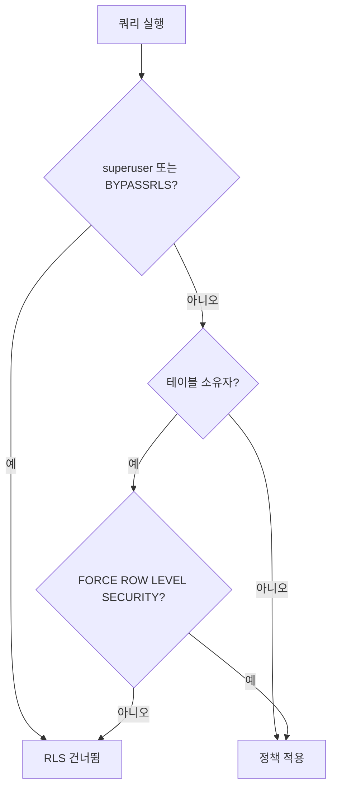
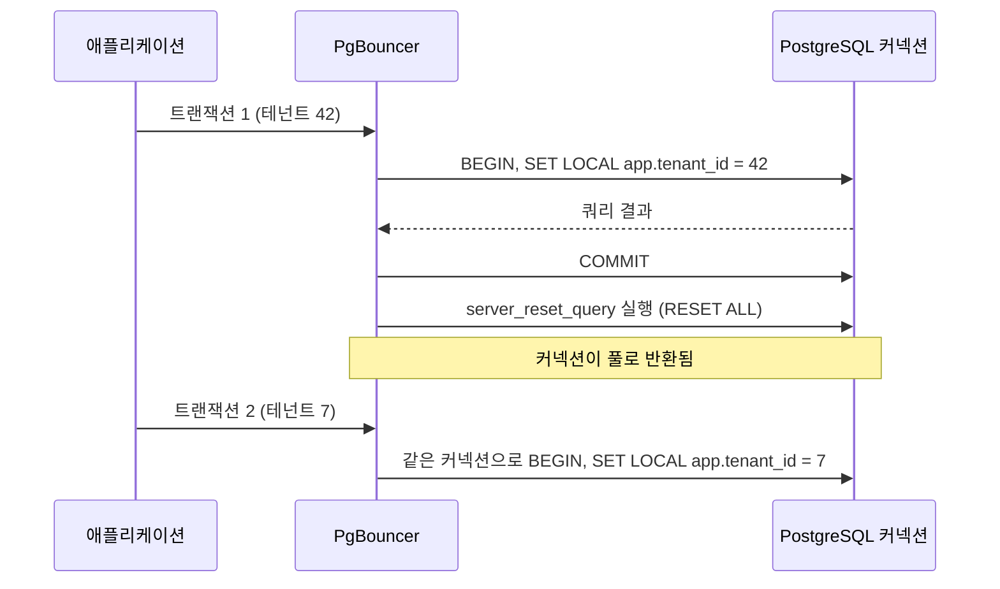
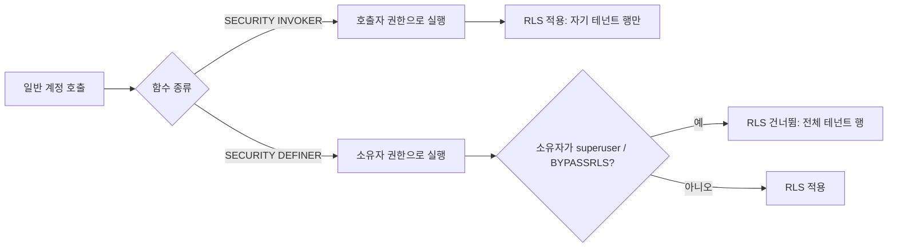
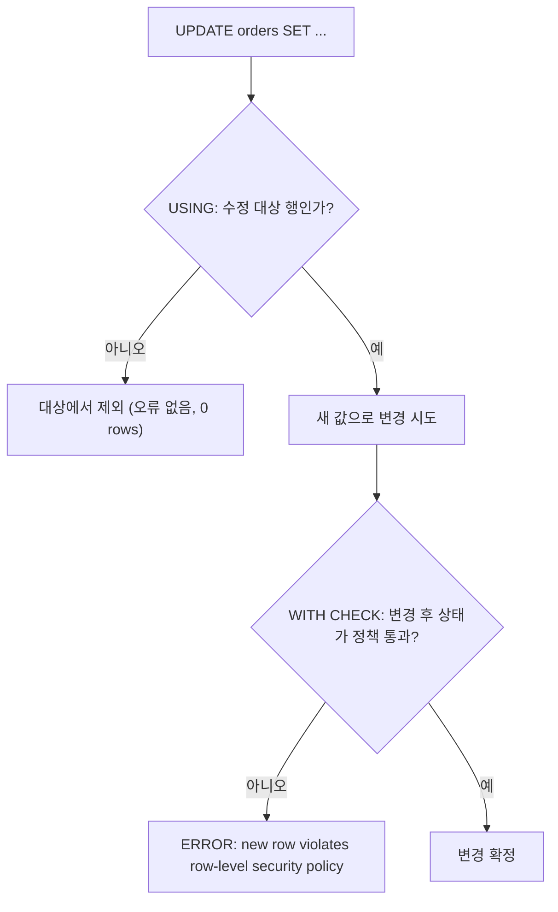
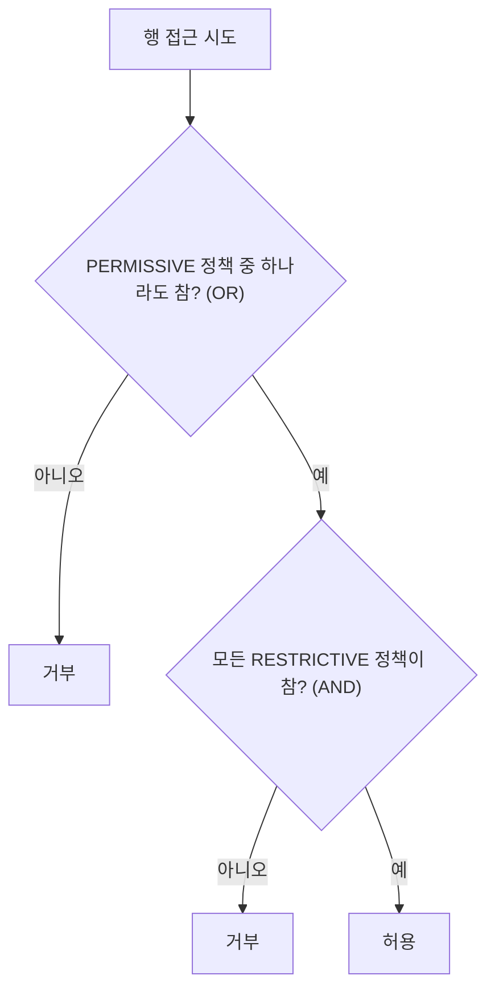
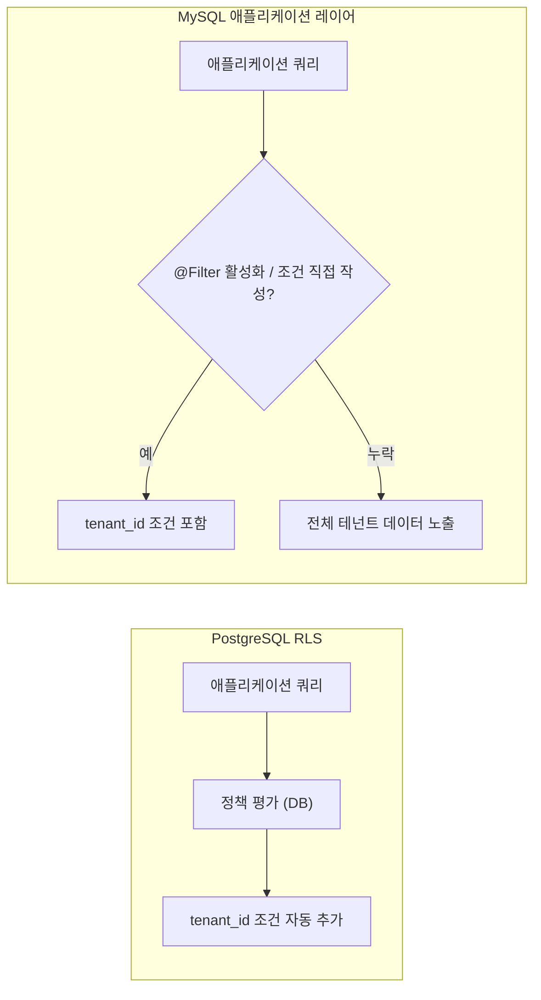
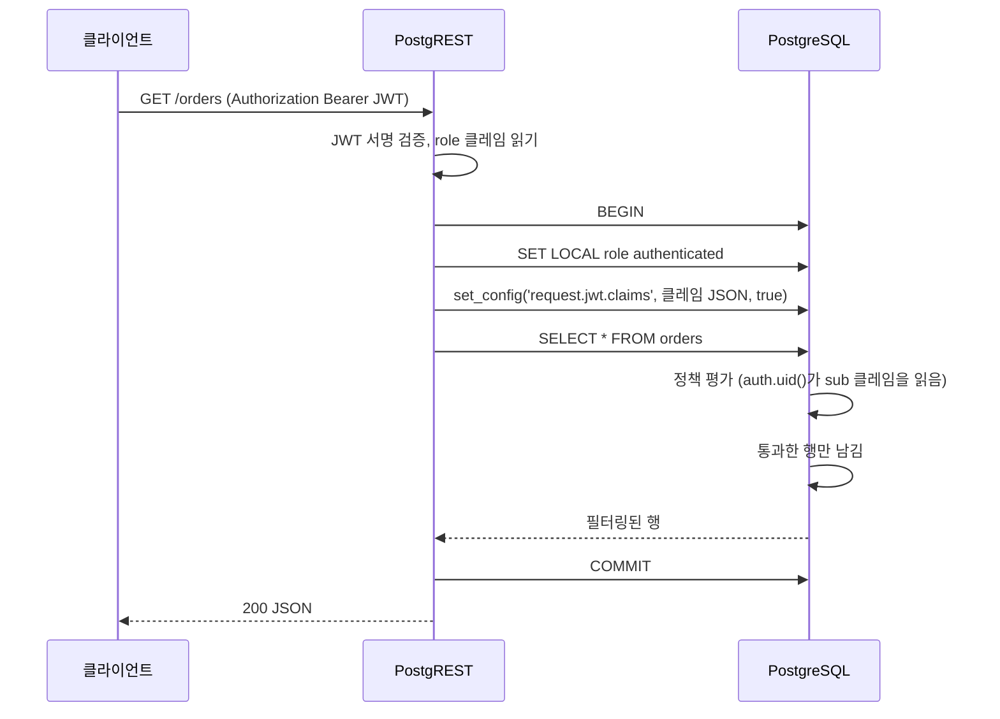

# Row Level Security

RLS(Row Level Security)는 테이블 단위가 아닌 행(row) 단위로 접근을 제어하는 PostgreSQL 기능이다. 멀티테넌트 환경에서 애플리케이션 계층에서만 테넌트 필터링을 하면 쿼리 한 줄 빠졌을 때 다른 테넌트 데이터가 노출된다. RLS는 DB 레벨에서 이걸 막는다.

## ENABLE vs FORCE

```sql
ALTER TABLE orders ENABLE ROW LEVEL SECURITY;
ALTER TABLE orders FORCE ROW LEVEL SECURITY;
```

`ENABLE ROW LEVEL SECURITY`만 걸면 테이블 소유자(owner)는 RLS를 적용받지 않는다. 애플리케이션 계정이 테이블 소유자인 경우 RLS가 걸려도 아무 의미가 없다.

`FORCE ROW LEVEL SECURITY`를 추가해야 소유자에게도 정책이 적용된다. 실무에서는 두 명령을 항상 같이 실행한다. `superuser`는 `FORCE`를 걸어도 RLS를 건너뛴다. superuser로 직접 쿼리를 날리는 배치가 있다면 그 배치는 모든 테넌트 데이터를 볼 수 있다.

아래 도식은 접속한 롤이 정책 평가까지 도달하는지를 가르는 분기다.



## USING vs WITH CHECK

`CREATE POLICY`에는 두 가지 조건절이 있다.

```sql
CREATE POLICY tenant_isolation ON orders
  AS PERMISSIVE
  FOR ALL
  USING (tenant_id = current_setting('app.tenant_id')::bigint)
  WITH CHECK (tenant_id = current_setting('app.tenant_id')::bigint);
```

`USING`은 SELECT, UPDATE, DELETE에서 어느 행을 볼 수 있는지 걸러낸다. `WITH CHECK`는 INSERT와 UPDATE에서 쓰기 후 상태가 정책을 통과하는지 검증한다.

`FOR ALL`로 하나의 정책을 만들면 두 조건이 모두 작동한다. `FOR SELECT`로 한정하면 `WITH CHECK`는 무시된다.

중요한 점은 UPDATE다. UPDATE는 `USING`으로 수정 대상 행을 걸러내고, `WITH CHECK`로 변경 후 상태를 검증한다. 테넌트 A가 자기 행의 `tenant_id`를 B로 바꾸려 하면 `WITH CHECK`에서 걸린다. `USING`만 있으면 이걸 막지 못한다.

`WITH CHECK`를 생략하면 `USING` 조건이 `WITH CHECK`로도 사용된다. 명시적으로 써주는 게 낫다.

명령별로 어느 조건절이 작동하는지는 아래 표로 정리된다.

| 명령 | `USING` | `WITH CHECK` |
|---|---|---|
| SELECT | 적용 | 해당 없음 |
| INSERT | 해당 없음 | 적용 |
| UPDATE | 적용 (대상 행 선별) | 적용 (변경 후 상태 검증) |
| DELETE | 적용 | 해당 없음 |

## 세션 변수와 SET LOCAL

RLS 정책에서 현재 테넌트를 식별하려면 세션 변수를 활용한다.

```sql
-- 트랜잭션 시작 시 바인딩
SET LOCAL app.tenant_id = '42';

-- 정책에서 참조
USING (tenant_id = current_setting('app.tenant_id', true)::bigint)
```

`SET LOCAL`을 써야 하는 이유는 트랜잭션 범위로 값을 한정하기 때문이다. `SET`(LOCAL 없이)은 세션 전체에 값이 남는다. 커넥션 풀을 쓰는 환경에서 커넥션이 재사용되면 이전 트랜잭션의 `tenant_id`가 남아 있다.

`current_setting('app.tenant_id', true)`에서 두 번째 인수 `true`는 설정값이 없을 때 오류 대신 `null`을 반환하게 한다. 정책이 `tenant_id = null::bigint`가 되면 어떤 행도 반환하지 않으니 보안상 안전하다. 그러나 쿼리 결과가 빈 값으로 오는 걸 실수로 넘길 수 있으므로 로그나 APM으로 모니터링해야 한다.

## BYPASSRLS와 superuser

두 경우가 RLS를 건너뛴다.

- `superuser` 권한을 가진 계정
- `BYPASSRLS` 속성이 부여된 롤

```sql
-- 마이그레이션 전용 계정에 부여
CREATE ROLE migrator WITH BYPASSRLS LOGIN PASSWORD '...';
```

애플리케이션 서버가 superuser나 BYPASSRLS 계정으로 DB에 연결하면 RLS가 무력화된다. 배포 스크립트나 마이그레이션 툴이 편의상 superuser를 쓰는 경우가 많은데, 이 계정이 애플리케이션 로직까지 흘러오면 문제가 된다.

롤을 분리하는 게 기본이다. 마이그레이션 계정은 BYPASSRLS를 주고, 애플리케이션 계정은 일반 롤로 RLS를 적용받게 한다. PostgreSQL에서 현재 세션이 RLS를 건너뛰고 있는지 확인하려면:

```sql
SELECT current_user, pg_has_role(current_user, 'pg_bypass_rls', 'USAGE');
```

## PgBouncer transaction mode 문제

PgBouncer를 transaction mode로 운영하면 커넥션이 트랜잭션 단위로 재사용된다. `SET LOCAL`로 세션 변수를 설정했더라도 트랜잭션이 끝나면 커넥션이 반환되고 다음 트랜잭션이 같은 커넥션을 재사용할 때 이전 `SET LOCAL` 값이 남아 있지 않은지 확인이 필요하다.

`SET LOCAL`은 트랜잭션 롤백 시 자동으로 되돌아가지만 커밋 후에는 세션에 값이 남는다. PgBouncer transaction mode에서는 커넥션 반환 전에 `RESET app.tenant_id`를 해주거나 트랜잭션 종료 시 초기화 훅을 걸어야 한다.

더 근본적인 해결책은 PgBouncer의 `server_reset_query` 설정을 활용하는 것이다.

```ini
; pgbouncer.ini
server_reset_query = RESET ALL;
```

아래 도식은 두 트랜잭션이 같은 서버 커넥션을 이어서 쓸 때 `server_reset_query`가 끼어드는 위치를 보여준다.



`RESET ALL`은 커넥션이 풀로 반환될 때 실행되어 세션 변수를 모두 초기화한다. 다만 prepared statement를 사용하는 경우 `RESET ALL`이 이를 날려버리므로 주의가 필요하다.

session mode를 쓰면 이 문제 자체가 없다. 커넥션이 세션 단위로 고정되기 때문이다. 커넥션 수가 많은 환경에서는 session mode가 스케일이 안 되므로 transaction mode를 쓸 수밖에 없고, 그러면 세션 변수 오염 문제를 명시적으로 관리해야 한다.

## SECURITY DEFINER 함수로 RLS 우회

`SECURITY DEFINER`로 선언된 함수는 호출자가 아닌 함수 소유자의 권한으로 실행된다. 소유자가 superuser거나 BYPASSRLS 속성을 가지면 그 함수 안에서는 RLS가 적용되지 않는다.

```sql
-- 위험한 패턴
CREATE OR REPLACE FUNCTION get_all_orders()
RETURNS SETOF orders
LANGUAGE sql
SECURITY DEFINER  -- 소유자가 superuser면 모든 테넌트 데이터 노출
AS $$
  SELECT * FROM orders;
$$;
```

이 함수는 일반 계정이 호출해도 orders 테이블의 모든 행을 반환한다. 관리용 리포트 함수를 이 패턴으로 만들었다가 일반 사용자에게 EXECUTE 권한이 열려 있으면 데이터 유출이 발생한다.

호출자와 함수 소유자 중 어느 쪽 권한으로 RLS가 평가되는지가 핵심이다. 아래 도식에서 `SECURITY DEFINER` 쪽 경로가 호출자의 정책을 거치지 않는다는 점을 보면 된다.



의도적으로 RLS를 우회해야 하는 경우(예: 관리자 통계 집계)라면 함수 안에서 명시적으로 `SET LOCAL row_security = off`를 쓰고, 해당 함수의 EXECUTE 권한을 엄격하게 관리한다.

```sql
-- 의도된 우회라면 명시적으로
CREATE OR REPLACE FUNCTION admin_count_orders()
RETURNS bigint
LANGUAGE plpgsql
SECURITY DEFINER
AS $$
DECLARE
  cnt bigint;
BEGIN
  SET LOCAL row_security = off;
  SELECT count(*) INTO cnt FROM orders;
  RETURN cnt;
END;
$$;

REVOKE EXECUTE ON FUNCTION admin_count_orders() FROM PUBLIC;
GRANT EXECUTE ON FUNCTION admin_count_orders() TO admin_role;
```

## DML별 RLS 적용 방식

### SELECT

`USING` 조건을 WHERE 절처럼 내부적으로 추가한다. 조건을 통과하지 못하는 행은 존재하지 않는 것처럼 처리된다. `permission denied`가 아니라 그냥 빈 결과가 온다.

### INSERT

`WITH CHECK`만 적용된다. `USING`은 없다(삽입 전 기존 행이 없으니 당연하다). `WITH CHECK`를 통과하지 못하면 `ERROR: new row violates row-level security policy`가 발생한다.

### UPDATE

두 단계로 처리된다. `USING`으로 수정할 수 있는 행을 선별하고, 변경 후 결과가 `WITH CHECK`를 통과하는지 검증한다. `WITH CHECK` 실패 시 오류가 발생한다.

아래 도식에서 UPDATE가 두 번 검사를 받는 위치와, 각 단계에서 실패했을 때 결과가 다른 점을 보면 된다.



### DELETE

`USING`만 적용된다. 조건에 맞지 않는 행은 삭제 대상에서 제외되며 오류 없이 0 rows affected로 처리된다.

이 차이를 모르면 DELETE가 왜 오류 없이 아무것도 지우지 않는지 한참 디버깅하게 된다.

## 멀티 정책 합산 방식

한 테이블에 여러 정책이 있을 때 합산 규칙이 있다.

- `PERMISSIVE` 정책끼리는 OR로 합산된다
- `RESTRICTIVE` 정책은 AND로 적용된다
- PERMISSIVE OR 결과와 RESTRICTIVE AND 결과가 모두 통과해야 최종적으로 허용된다

아래 도식은 이 합산 순서를 보여준다. PERMISSIVE 묶음이 하나라도 참이어야 다음 단계로 가고, 거기서 모든 RESTRICTIVE 정책을 다시 통과해야 한다.



```sql
-- 테넌트 격리 (PERMISSIVE)
CREATE POLICY tenant_policy ON orders
  AS PERMISSIVE FOR ALL
  USING (tenant_id = current_setting('app.tenant_id')::bigint);

-- 삭제 금지 (RESTRICTIVE)
CREATE POLICY no_delete_policy ON orders
  AS RESTRICTIVE FOR DELETE
  USING (false);
```

RESTRICTIVE 정책에 `USING (false)`를 넣으면 모든 DELETE를 막는다. 소프트 삭제를 강제할 때 쓸 수 있다.

같은 명령에 대한 PERMISSIVE 정책이 하나도 없으면 기본적으로 아무것도 허용하지 않는다. 정책을 추가하되 일부 명령을 열어두지 않으면 그 명령은 전체 차단 상태가 된다.

## RLS 인덱스 전략

RLS 정책이 `tenant_id = current_setting('app.tenant_id')::bigint` 형태면 모든 쿼리에 `tenant_id` 조건이 자동으로 붙는다. 테이블 크기가 커지면 이 조건이 없는 인덱스는 거의 쓸모가 없어진다.

```sql
-- orders 테이블 기본 인덱스들
CREATE INDEX idx_orders_created_at ON orders (created_at);  -- tenant_id 없음
CREATE INDEX idx_orders_status ON orders (status);          -- tenant_id 없음

-- RLS 환경에서 실제로 쓰이는 인덱스
CREATE INDEX idx_orders_tenant_created ON orders (tenant_id, created_at);
CREATE INDEX idx_orders_tenant_status ON orders (tenant_id, status);
```

`EXPLAIN ANALYZE`로 RLS 정책이 적용된 쿼리를 보면 내부적으로 `tenant_id = 42 AND <원래 조건>`이 생성된다. `tenant_id` 없는 `(created_at)` 인덱스를 타면 시퀀셜 스캔에 가까운 성능이 나온다. 테넌트가 10개면 모르겠지만 수백 개를 넘어가면 인덱스 설계를 반드시 재검토해야 한다.

부분 인덱스로 특정 상태의 행만 인덱싱하는 것도 방법이다.

```sql
CREATE INDEX idx_orders_tenant_pending
  ON orders (tenant_id, created_at)
  WHERE status = 'PENDING';
```

## MySQL 비교: 애플리케이션 레이어 강제

MySQL(8.x 포함)에는 RLS가 없다. 테넌트 격리를 DB 레벨에서 할 수 없어서 애플리케이션에서 모든 쿼리에 `tenant_id` 조건을 강제로 넣어야 한다.

JPA 환경에서는 `@Filter`나 `FilterDef`로 처리한다.

```java
@Entity
@FilterDef(name = "tenantFilter", parameters = {
    @ParamDef(name = "tenantId", type = Long.class)
})
@Filter(name = "tenantFilter", condition = "tenant_id = :tenantId")
public class Order { ... }

// 서비스 레이어에서 활성화
Session session = entityManager.unwrap(Session.class);
session.enableFilter("tenantFilter")
       .setParameter("tenantId", currentTenantId);
```

MyBatis 환경에서는 인터셉터로 SQL을 조작하거나 쿼리마다 직접 조건을 넣는다.

문제는 강제성이 없다는 점이다. `@Filter`를 활성화하는 코드를 빠뜨리거나, 네이티브 쿼리를 쓸 때 조건을 누락하면 전체 테넌트 데이터가 노출된다. PostgreSQL RLS는 DB가 강제하기 때문에 쿼리에서 빠뜨려도 정책이 자동으로 적용된다. MySQL을 쓰면서 멀티테넌트를 구현한다면 네이티브 쿼리 사용을 최소화하고 코드 리뷰에서 tenant_id 누락을 필수 확인 항목으로 다뤄야 한다.

격리를 누가 강제하는지가 두 DB의 차이다. 아래 도식에서 쿼리가 `tenant_id` 조건을 얻는 경로를 비교해 보면, MySQL은 조건을 붙이는 주체가 애플리케이션이라 경로마다 누락 가능성이 생긴다.



또 다른 접근은 뷰(View)를 통해 격리하는 방법이다.

```sql
-- MySQL: tenant_id 필터 뷰
CREATE VIEW tenant_orders AS
  SELECT * FROM orders WHERE tenant_id = @tenant_id;
```

MySQL 세션 변수(`@tenant_id`)를 매 요청마다 설정하고 뷰를 통해서만 접근하게 하면 애플리케이션 쿼리에서 조건을 빠뜨릴 여지가 줄어든다. 다만 뷰를 통한 UPDATE/DELETE의 제약이 있고, 세션 변수 오염 문제는 PgBouncer와 동일하게 발생한다.

MySQL 환경에서 RLS가 필요하다면 PostgreSQL로의 전환을 고려하거나, Vitess처럼 프록시 레이어에서 쿼리를 재작성하는 방식을 써야 한다.

## Supabase에서 이 원리가 쓰이는 방식

Supabase는 위에서 다룬 세션 변수 방식을 그대로 쓴다. 앞에서는 `app.tenant_id`를 직접 `SET LOCAL`했는데, Supabase에서는 PostgREST가 요청마다 JWT를 검증하고 `request.jwt.claims`라는 설정값에 클레임 전체를 JSON으로 넣는다. 정책에 쓰는 `auth.uid()`와 `auth.jwt()`는 이 설정값을 읽는 SQL 함수다.

```sql
-- auth.uid()가 하는 일을 풀어 쓰면 이 정도다
select nullif(
  current_setting('request.jwt.claims', true)::jsonb ->> 'sub',
  ''
)::uuid;
```

`current_setting`의 두 번째 인수가 `true`라서 클레임이 없는 요청(`anon`)에서는 오류 없이 null이 나온다. 앞 절의 `current_setting('app.tenant_id', true)`와 같은 동작이고, 정책이 `user_id = null`이 되어 행이 하나도 안 보이는 것도 같다.

한 요청이 처리되는 순서는 이렇다. 롤을 먼저 바꾸고, 클레임을 넣고, 그다음에 쿼리가 나간다.



`SET LOCAL`과 `set_config(..., true)`가 둘 다 트랜잭션 범위라서 커밋 후 값이 남지 않는다. 앞에서 PgBouncer 오염을 걱정했던 부분을 Supabase는 이 구조로 피한다. 직접 만든 연결(`postgres` 계정으로 붙는 ORM 등)에서 `auth.uid()`를 쓰는 정책을 돌리면 클레임이 비어 있으니 null이 나온다는 점은 알고 있어야 한다.

JWT의 `role` 클레임이 어떤 롤로 붙을지를 정한다. 같은 쿼리가 롤에 따라 전혀 다른 결과를 낸다.

| 롤 | 접속 경로 | RLS 적용 | 비고 |
|---|---|---|---|
| `anon` | 로그인 없이 쓰는 공개 키 | 적용됨 | `auth.uid()`가 null, 정책에 `to anon`이 없으면 대부분 빈 결과 |
| `authenticated` | 로그인한 사용자 JWT | 적용됨 | `sub`가 `auth.uid()`로 나옴 |
| `service_role` | 서버 전용 키 | 우회 | `BYPASSRLS` 속성. `FORCE`를 걸어도 소용없다 |
| `postgres` | SQL Editor, 마이그레이션 | 우회 | 테이블 소유자이고 `BYPASSRLS`도 가짐 |

`FORCE`와 `ENABLE`을 조합했을 때 누가 우회하는지도 정리해 둔다.

| 설정 | 일반 롤 (`anon`, `authenticated`) | 테이블 소유자 | `BYPASSRLS` 롤, superuser |
|---|---|---|---|
| RLS 비활성 | 전체 접근 | 전체 접근 | 전체 접근 |
| `ENABLE`만 | 정책 적용 | 우회 | 우회 |
| `ENABLE` + `FORCE` | 정책 적용 | 정책 적용 | 우회 |

`FORCE`는 소유자까지만 끌어내린다. Supabase의 `postgres`와 `service_role`은 `BYPASSRLS`를 갖고 있어서 `FORCE`를 걸어도 정책을 건너뛴다. SQL Editor에서 쿼리가 잘 나오는데 앱에서는 빈 결과가 오는 이유가 이것이다. 에디터는 `postgres`로 도는 반면 앱은 `anon`이나 `authenticated`로 돈다. 재현하려면 `SET LOCAL role authenticated`와 `set_config('request.jwt.claims', ...)`를 직접 넣고 돌려야 한다.

`SECURITY DEFINER` 함수도 같은 문제를 가진다. 소유자가 `postgres`면 함수 안에서 RLS가 꺼지므로, `public` 스키마에 만들면 PostgREST가 RPC로 노출한다. 롤별 EXECUTE 권한을 확인해야 한다.

정책 작성법, `(select auth.uid())`로 감싸 InitPlan으로 빼는 성능 처리, `service_role` 키 관리는 [Supabase Auth와 RLS](../../Cloud/Supabase/Supabase_Auth_And_RLS.md)에서 다룬다.
