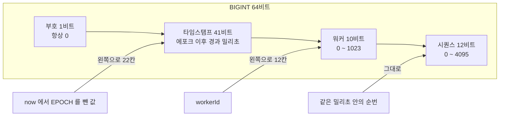
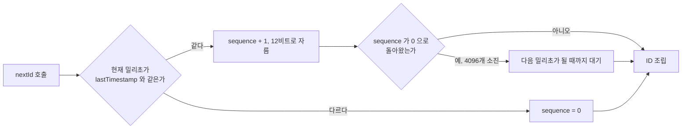
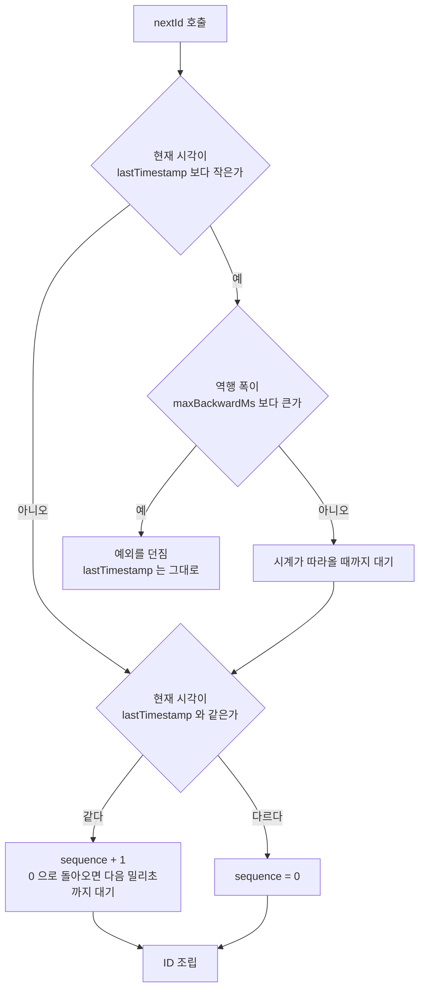
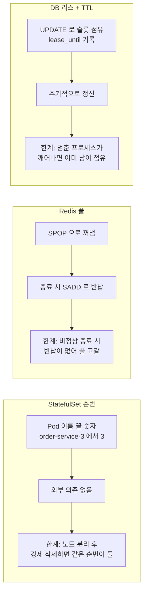
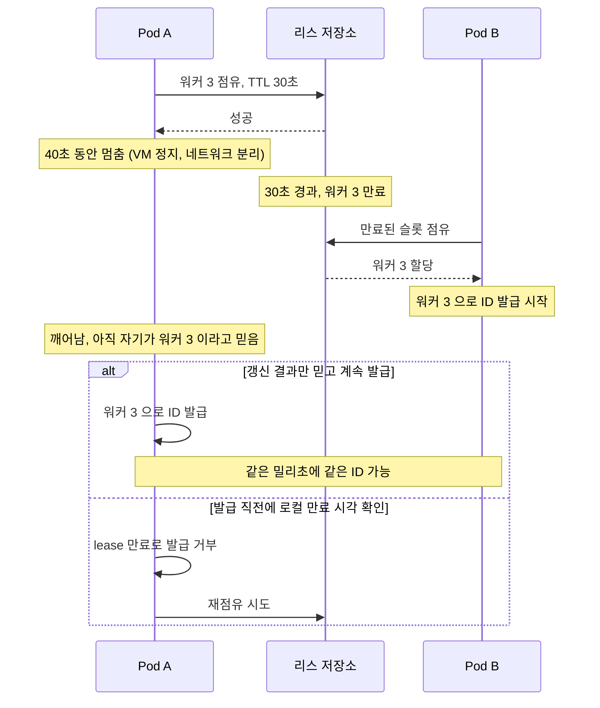
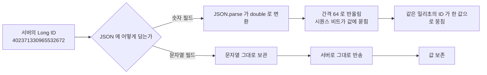
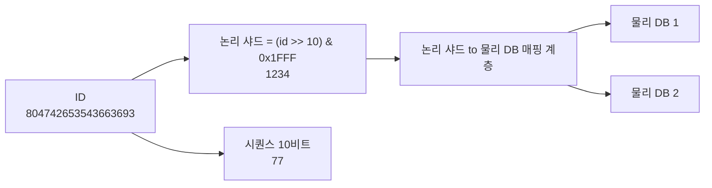
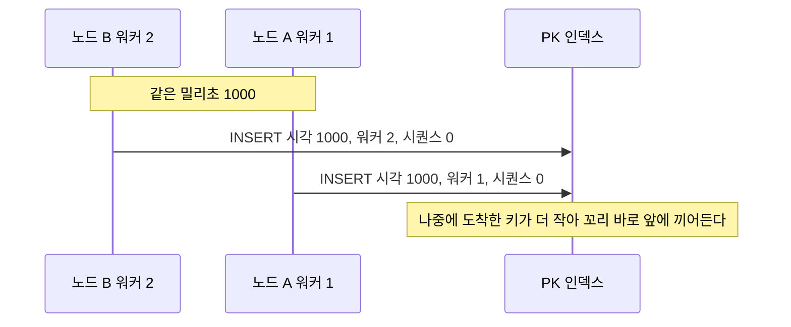
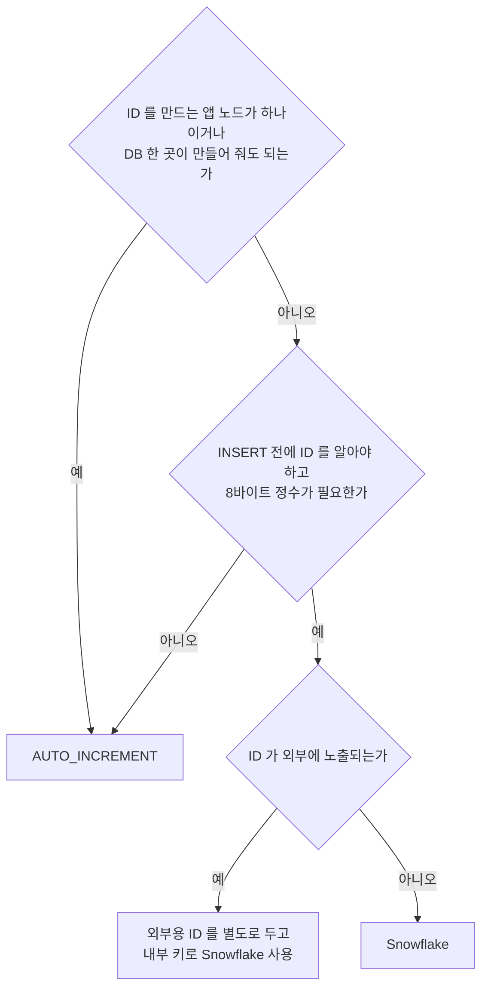

# Snowflake ID

Snowflake는 64비트 정수 하나에 시각, 발급 노드, 순번을 같이 넣는 ID 체계다. DB 없이 애플리케이션 메모리에서 ID를 만들고, 값이 대체로 시간 순으로 커지고, 8바이트 BIGINT에 들어간다. UUID와 auto_increment 사이를 메우는 선택지로 쓰는데, 막상 운영에 올리면 비트 배치보다 세 가지가 사고를 낸다. 시계가 뒤로 가는 일, 워커 ID가 겹치는 일, JavaScript가 값을 반올림하는 일이다.

식별자 유형 전체 비교는 [식별자 설계](Identifier_Design.md)에 있고, 여기서는 Snowflake만 파고든다. 이 문서의 수치는 전부 직접 돌려서 얻은 것이다. 환경은 Node 20, JDK 17 + Jackson 2.17.2, NestJS 10, MySQL 8.0.46, Redis 6.0.16이다.

## 64비트를 나누는 방식

Twitter 원본은 최상위 1비트를 부호로 비우고, 41비트 타임스탬프, 10비트 워커, 12비트 시퀀스로 나눈다.



도식은 세 값이 각자 몇 칸 밀려서 한 정수로 합쳐지는지 보여준다. 코드로는 `((ts - EPOCH) << 22n) | (workerId << 12n) | sequence`가 전부다. 타임스탬프가 가장 위쪽 비트를 차지하니 정수로 비교하면 시각 순서가 되고, 같은 밀리초 안에서는 워커 ID, 그다음 시퀀스 순이다.

한 워커는 밀리초당 4096개, 초당 4,096,000개까지 발급한다. 4096개를 넘으면 시퀀스가 0으로 돌아와 같은 값이 나오기 때문에 다음 밀리초까지 기다려야 한다.



실시계로 20만 건을 연속 발급하면 66~67ms 안에 끝난다. 밀리초 하나에 정확히 4096건이 찍히고 다음 밀리초로 넘어가는 것을 확인했다. 발급한 ID는 전부 유일했고 순서도 단조 증가였다. 이 흐름에서 `lastTimestamp`보다 현재 시각이 작은 경우는 "다르다" 분기로 빠진다는 점이 다음 절의 문제다.

## 시계가 뒤로 갈 때

[식별자 설계](Identifier_Design.md)에 있는 TypeScript 구현은 `timestamp === lastTimestamp`가 아니면 무조건 `sequence = 0`으로 되돌린다. 시계가 뒤로 간 경우도 같은 else로 들어간다.

```mermaid
sequenceDiagram
    participant C as 호출자
    participant G as Generator
    participant K as 시스템 시계
    C->>G: nextId
    G->>K: 현재 시각 조회
    K-->>G: 999ms
    Note over G: last=999, seq=0 으로 ID 발급 (999, 0)
    C->>G: nextId 2회
    G->>K: 현재 시각 조회
    K-->>G: 1000ms
    Note over G: last=1000, ID 발급 (1000, 0), (1000, 1)
    Note over K: NTP 가 시계를 2ms 되돌림
    C->>G: nextId
    G->>K: 현재 시각 조회
    K-->>G: 999ms
    Note over G: 999 는 last 1000 과 다르므로 else 분기, seq=0, last=999
    G-->>C: (999, 0) 이 이미 발급한 ID 와 같다
```



도식의 마지막 줄이 사고 지점이다. 이 시나리오를 구현에 가짜 시계를 주입해서 재현했다. 999ms에 1건, 1000ms에 2건을 발급하고 시계를 999ms로 되돌리자 네 번째 호출이 첫 번째 호출과 같은 `402371330961338368`을 돌려줬다.

피해가 거기서 끝나지 않는다. else 분기가 `lastTimestamp`를 999로 낮춰버려서 시계가 다시 1000ms에 도착하면 `(1000, 0)`, `(1000, 1)`이 한 번 더 나온다. 1000ms에서 3건 발급, 998ms로 후퇴해 3건, 999ms에 1건, 다시 1000ms에서 3건을 발급하는 스크립트로 돌리면 10번 중 마지막 3번이 처음 3건과 겹친다. 중복은 PK 충돌로 INSERT가 깨질 때 드러나는데, 이미 지나간 시각대의 ID가 다시 나오는 것이라 테이블이 커진 뒤에 터지는 경우가 많다.

가상머신이 일시 정지됐다 복귀하거나, NTP가 slew가 아니라 step으로 시계를 맞추거나, 윤초 처리에서 시계가 흔들릴 때 이런 일이 생긴다. 컨테이너 환경에서 호스트 시계가 튀면 그 호스트의 Pod가 전부 같은 영향을 받는다.

### 방어 구현

역행 폭이 작으면 시계가 따라올 때까지 기다리고, 크면 예외를 던진다. 기준은 `maxBackwardMs`로 받는다. 기다릴 수 있는 폭은 서비스의 허용 지연으로 정한다. 아래 코드는 5ms를 기본값으로 둔 것이다.

```typescript
export class SnowflakeGenerator {
    private static readonly EPOCH = 1704067200000n; // 2024-01-01T00:00:00Z
    private static readonly SEQUENCE_MASK = 0xFFFn;

    private sequence = 0n;
    private lastTimestamp = -1n;

    constructor(
        private readonly workerId: bigint,
        private readonly maxBackwardMs: bigint = 5n,
        private readonly now: () => number = Date.now,
    ) {
        if (workerId < 0n || workerId > 1023n) {
            throw new RangeError(`workerId out of range: ${workerId}`);
        }
    }

    nextId(): bigint {
        let ts = BigInt(this.now());

        if (ts < this.lastTimestamp) {
            const drift = this.lastTimestamp - ts;
            if (drift > this.maxBackwardMs) {
                throw new Error(`clock moved backwards by ${drift}ms`);
            }
            while (ts < this.lastTimestamp) ts = BigInt(this.now());
        }

        if (ts === this.lastTimestamp) {
            this.sequence = (this.sequence + 1n) & SnowflakeGenerator.SEQUENCE_MASK;
            if (this.sequence === 0n) {
                while (ts <= this.lastTimestamp) ts = BigInt(this.now());
            }
        } else {
            this.sequence = 0n;
        }

        this.lastTimestamp = ts;
        return ((ts - SnowflakeGenerator.EPOCH) << 22n) | (this.workerId << 12n) | this.sequence;
    }
}
```

`nextId`가 시계 역행을 만났을 때 어느 쪽으로 갈라지는지는 아래 도식과 같다. 역행 폭이 허용 범위 안이면 기다리고, 밖이면 `lastTimestamp`를 건드리지 않고 거부한다.



`now`를 주입받게 해서 시계를 스크립트로 흔들며 검증했다.

| 시나리오 | 결과 |
|---|---|
| 1000ms에서 2건 발급 후 998ms로 2ms 역행, 이후 999·1000·1001ms로 진행 | 대기 후 발급, 3건 모두 유일하고 증가 |
| 1000ms 발급 후 980ms로 20ms 역행 | `clock moved backwards by 20ms` 예외 |
| 예외 직후 같은 시계로 재호출 | 같은 예외. `lastTimestamp`를 낮추지 않으므로 시계가 따라올 때까지 계속 거부 |
| 실시계 20만 건 | 전부 유일, 단조 증가, 297ms |

이 구현도 한계가 있다. `while` 대기는 동기 루프라서 Node에서는 최대 `maxBackwardMs` 동안 이벤트 루프가 멈춘다. 5ms 정도면 감당할 만하지만 값을 키우면 요청 지연으로 보인다. 그리고 `lastTimestamp`가 프로세스 메모리에만 있다. 프로세스가 죽었다 뜨는 사이에 시계가 뒤로 갔으면 방어 코드가 새 프로세스에는 아무것도 기억하지 못한다. 워커 ID 리스 테이블(아래 절)에 마지막 발급 시각을 주기적으로 적어두고, 기동 시 그 값을 넘을 때까지 기다린 뒤 발급을 시작하는 방식으로 보완한다.

## 워커 ID 할당

워커 ID가 같은 두 프로세스가 같은 밀리초에 발급하면 시퀀스 순서까지 똑같이 맞물려 충돌한다. 같은 시계를 쓰는 두 인스턴스가 워커 ID 5로 초당 1만 건씩 만드는 실험에서 한쪽의 1만 건이 전부 상대와 겹쳤다. 10비트 안에서 서로 다른 값을 배정하는 문제이고, 선택지는 세 가지다.



| 방식 | 구성 요소 | 비정상 종료 | 중복 사용 가능성 | 적합한 곳 |
|---|---|---|---|---|
| StatefulSet 순번 | 없음 | 같은 순번으로 재기동 | 강제 삭제나 노드 분리 시 | 노드 수가 고정이고 StatefulSet을 이미 쓰는 서비스 |
| Redis 풀 (SPOP/SADD) | Redis | 반납 안 됨, 풀 고갈 | 복구 절차를 잘못 짜면 발생 | 사실상 권하지 않는다 |
| Redis 리스 (SET NX EX) | Redis | TTL 후 자동 회수 | TTL 지난 뒤 깨어난 프로세스 | 이미 Redis가 있는 서비스 |
| DB 리스 테이블 | RDBMS | TTL 후 자동 회수 | TTL 지난 뒤 깨어난 프로세스 | 마지막 발급 시각도 같이 보관하고 싶을 때 |

### Redis SPOP 풀이 마르는 과정

[식별자 설계](Identifier_Design.md)의 Lua 스크립트는 `SPOP`으로 꺼내고 종료 시 `SADD`로 반납하는 구조다. 정상 종료는 반납이 되지만 OOM kill이나 노드 장애처럼 종료 훅이 돌지 않는 경우는 반납이 없다. 풀을 0~3으로 채워 놓고 네 번 연속 `SPOP` 후 반납 없이 죽이면 다섯 번째 기동은 빈 값을 받는다.

```
start #1 -> 0   (kill -9, 반납 없음)
start #2 -> 1
start #3 -> 3
start #4 -> 2
start #5 ->      remaining=0
```

워커 ID 1024개짜리 풀이면 비정상 종료가 1024번 쌓일 때 서비스가 새 Pod를 못 띄운다. 풀을 수동으로 채워 넣는 운영 절차가 생기는데, 이때 아직 살아 있는 Pod의 ID까지 다시 채우면 중복 사용이 시작된다. 반납에 의존하는 방식 자체가 문제라서 TTL이 붙은 리스로 바꿔야 한다.

### 리스 방식

Redis라면 `SET worker:0 pod-a NX EX 30`으로 점유하고, 갱신은 소유자 확인과 `EXPIRE`를 Lua 한 번으로 묶는다. 확인 없이 `EXPIRE`만 호출하면 이미 남이 가져간 키의 TTL을 연장해버린다.

```lua
if redis.call('get', KEYS[1]) == ARGV[1] then
    return redis.call('expire', KEYS[1], ARGV[2])
else
    return 0
end
```

실험에서 `podA`가 점유한 뒤 `podB`의 같은 요청은 nil, `podA`의 갱신은 1이었다. TTL 2초가 지난 뒤 `podB`의 점유는 OK, 깨어난 `podA`의 갱신은 0이었다.

DB라면 슬롯 행을 미리 만들어 두고 한 문장으로 점유한다.

```sql
CREATE TABLE worker_lease (
    worker_id   SMALLINT    NOT NULL PRIMARY KEY,
    owner       VARCHAR(64) NULL,
    lease_until DATETIME(3) NULL
) ENGINE=InnoDB;

-- 점유: 비었거나 만료된 슬롯 하나를 가져간다
UPDATE worker_lease
   SET owner = :me, lease_until = NOW(3) + INTERVAL 30 SECOND
 WHERE owner IS NULL OR lease_until < NOW(3)
 ORDER BY worker_id LIMIT 1;

-- 갱신: 소유자가 나일 때만
UPDATE worker_lease
   SET lease_until = NOW(3) + INTERVAL 30 SECOND
 WHERE worker_id = :id AND owner = :me;
```

슬롯 4개에 8개 클라이언트가 동시에 점유를 시도하면 `ROW_COUNT()`가 1인 클라이언트가 정확히 4개, 0인 클라이언트가 4개였다. 점유 문장이 슬롯 행에 걸리는 락으로 직렬화되므로 같은 행을 둘이 가져가지 않는다. 앱에서는 갱신 결과가 0행이면 "리스를 잃었다"로 보고 발급을 멈춰야 한다. TTL이 지난 슬롯을 `pod-new`가 가져가자 옛 소유자 8개의 갱신이 전부 0행이었다.

### 같은 워커 ID를 두 Pod가 쓰는 경우

리스를 써도 막지 못하는 구간이 있다. 프로세스가 TTL보다 오래 멈췄다가 깨어나는 경우다. GC 정지, VM 일시 정지, 네트워크 분리 뒤 복귀가 해당한다.



도식의 alt 아래쪽이 방어다. 갱신 스레드가 주기적으로 리스를 연장하고, `nextId()`는 로컬의 만료 시각을 단조 시계(`performance.now()`)로 확인한다. 만료 시각에서 안전 여유를 뺀 시점이 지났으면 발급을 거부한다. 리스 저장소를 호출하지 않으므로 발급 속도에는 영향이 없다.

```typescript
export class LeasedGenerator {
    private deadline = 0;

    constructor(
        private readonly gen: SnowflakeGenerator,
        private readonly ttlMs: number,
        private readonly marginMs: number,
    ) {}

    onRenewed(): void {
        this.deadline = performance.now() + this.ttlMs;
    }

    nextId(): bigint {
        if (performance.now() >= this.deadline - this.marginMs) {
            throw new Error('worker id lease expired or about to expire');
        }
        return this.gen.nextId();
    }
}
```

리스 TTL 30초, 여유 5초로 두고 확인했다. 갱신 전에는 거부, 갱신 직후에는 발급, 남은 시간이 4초일 때는 거부했다. `performance.now()`를 쓰는 이유는 앞 절에서 본 벽시계 역행의 영향을 받지 않기 위해서다. 여유 시간은 갱신 주기와 저장소 응답 지연의 합보다 커야 한다. 갱신 주기를 TTL의 1/3 정도로 잡고, 갱신이 한 번 실패해도 다음 시도가 남도록 한다.

StatefulSet 순번은 쿠버네티스가 같은 순번의 Pod를 동시에 둘 띄우지 않으므로 대부분은 안전하다. 노드가 네트워크에서 분리된 상태에서 Pod를 강제 삭제하면 원래 Pod가 계속 돌고 있는 채로 같은 순번의 새 Pod가 뜰 수 있다. 이 경우 StatefulSet 순번만으로는 막을 수단이 없고, 위의 리스를 같이 두어야 한다.

## JavaScript에서 64비트 ID가 잘리는 문제

JavaScript의 Number는 IEEE 754 double이라서 정수가 정확한 범위가 2^53까지다. `Number.MAX_SAFE_INTEGER`는 9007199254740991이다. 그 위에서는 표현 가능한 값의 간격이 벌어진다.

| 값의 범위 | 표현 가능한 정수의 간격 |
|---|---|
| 2^53 ~ 2^54 | 2 |
| 2^54 ~ 2^55 | 4 |
| 2^56 ~ 2^57 | 16 |
| 2^60 ~ 2^61 | 256 |
| 2^62 ~ 2^63 | 1024 |

`JSON.parse('9007199254740993')`은 `9007199254740992`를 돌려준다. 에러도 경고도 없다.

Snowflake ID에서는 이 경계가 생각보다 일찍 온다. 타임스탬프가 22비트 왼쪽에 있으므로 2^53이 되는 시점은 에포크로부터 2^31ms, 약 24.86일 뒤다. 에포크를 2024-01-01로 잡았다면 2024-01-25 20:31:23(UTC)부터 ID가 안전 정수를 넘는다. 에포크를 서비스 시작일로 잡아도 한 달이 못 간다.

서비스를 3년 굴린 시점의 ID(약 4.0 × 10^17)는 간격이 64다. 같은 워커가 같은 밀리초에 발급한 연속 32개 ID를 JSON으로 보내고 `JSON.parse`하자 서로 다른 값이 1개뿐이었다.

```
발급 값                 402371326771228672, ...673, ...674, ...675 ...
JSON.parse 후           402371326771228672, ...672, ...672, ...672 ...
연속 32개 -> 서로 다른 값의 수: 1
```

워커 비트는 12칸 위에 있어서 간격 64에 가려지지 않는다. 16개 워커가 같은 밀리초에 발급한 값은 파싱 뒤에도 16개로 구분됐다. 같은 노드가 같은 밀리초에 발급한 ID는 시퀀스 비트로만 구분되는데, 그 비트가 간격 안에 묻혀서 전부 한 값으로 뭉친다. 목록에서 어떤 주문을 눌러도 같은 주문이 열리는 식으로 나타난다.

Twitter가 이 문제를 먼저 겪었다. 트윗 API는 숫자 `id`와 문자열 `id_str`을 같이 내려주는데, JavaScript 클라이언트가 숫자 `id`를 파싱하다 값이 틀어지기 때문에 문자열 필드가 추가됐다. 같은 모양의 값으로 확인하면 `{"id":1234567890123456789}`를 파싱한 결과가 `1234567890123456800`으로 출력되고, 실제 저장된 값은 `1234567890123456768`이다. 출력에서 반올림된 것처럼 보이지만 내부 값 자체가 이미 다르다.

### 응답에서는 문자열로

서버가 64비트 ID를 JSON 문자열로 내려주고, 클라이언트는 문자열 그대로 다루다가 서버로 돌려보낸다. 클라이언트에서 ID로 산술을 할 일은 없으므로 문자열이면 충분하다.

같은 서버 값이 JSON에 숫자로 실리느냐 문자열로 실리느냐에 따라 클라이언트에서 갈라지는 경로는 아래와 같다.



Jackson에서는 필드 단위, 타입 전체, 모든 숫자 세 가지 방식이 있고 각각 실행해 확인했다.

```java
public class OrderResponse {
    @JsonSerialize(using = ToStringSerializer.class)
    public Long id = 402371330965532672L;
    public int qty = 3;
}
// {"id":"402371330965532672","qty":3}
```

`@JsonFormat(shape = JsonFormat.Shape.STRING)`도 같은 결과다. 모든 `Long`에 적용하려면 모듈로 등록한다. Spring Boot는 `Module` 타입의 빈을 ObjectMapper에 자동으로 붙여준다.

```java
@Bean
public Module longAsStringModule() {
    SimpleModule m = new SimpleModule();
    m.addSerializer(Long.class, ToStringSerializer.instance);
    m.addSerializer(Long.TYPE, ToStringSerializer.instance);
    return m;
}
```

이 방식은 ID가 아닌 `Long`(건수, 금액)도 전부 문자열이 된다. `JsonGenerator.Feature.WRITE_NUMBERS_AS_STRINGS`는 더 넓어서 `int` 필드인 `qty`까지 `"3"`이 된다. API 호환이 걸려 있으면 ID 필드에만 어노테이션을 붙이는 쪽이 낫다. 역방향은 따로 설정할 게 없다. `{"id":"402371330965532672"}`를 `Long id` 필드로 읽으면 기본 설정에서 그대로 변환됐다.

NestJS에서는 먼저 `bigint`를 반환하면 어떻게 되는지부터 봐야 한다. 컨트롤러가 `{ id: 402371330965532672n }`을 반환하면 500이 난다. `JSON.stringify`가 `TypeError: Do not know how to serialize a BigInt`를 던지기 때문이다. `number`로 바꿔 반환하면 200이 나오지만 본문이 `{"id":402371330965532700}`이라 값이 이미 틀려 있다. 실제 앱을 띄워 세 가지를 확인한 결과는 이렇다.

| 설정 | `bigint` 반환 | DTO(`@Transform`) 반환 | `Number(id)` 반환 |
|---|---|---|---|
| 아무 설정 없음 | 500 | 500 | 200, 값 틀림 |
| `BigInt.prototype.toJSON` 전역 설정 | 200, 문자열 | 200, 문자열 | 200, 값 틀림 |
| `ClassSerializerInterceptor` 전역 | 500 | 200, 문자열 | 200, 값 틀림 |

```typescript
// main.ts: 응답의 모든 bigint 를 문자열로
(BigInt.prototype as any).toJSON = function () { return this.toString(); };

// 또는 DTO 단위
class OrderDto {
    @Transform(({ value }) => value.toString(), { toPlainOnly: true })
    id: bigint;
}
// app.useGlobalInterceptors(new ClassSerializerInterceptor(app.get(Reflector)));
```

`toJSON` 전역 설정은 한 줄이라 편하지만 서드파티 코드가 `JSON.stringify`로 `bigint`를 다루는 경우까지 바꿔버린다. DTO 방식은 반환 객체가 DTO 인스턴스가 아니면(`raw`처럼 리터럴을 바로 반환하면) 변환을 타지 않아 500이 그대로 난다. 어느 쪽이든 마지막 열이 보여주듯 `Number`로 한 번 바꾼 값은 어떤 설정으로도 복구되지 않는다. 서비스 계층에서 ID를 `number`로 들고 다니는 코드가 있으면 거기부터 찾는다.

## 에포크, 만료, 비트 배분

41비트 타임스탬프는 2^41ms, 약 69.68년을 담는다. 에포크 선택이 곧 만료 시점이다.

| 에포크 | 만료 시점 |
|---|---|
| 2024-01-01 | 2093-09-06 |
| Twitter 원본 (1288834974657, 2010-11-04) | 2080-07-10 |

만료되면 `(2^41) << 22`가 2^63이 되어 signed BIGINT의 최댓값 9223372036854775807을 1 넘는다. 언어에 따라 음수로 감기거나 에러가 난다. 에포크를 서비스 시작일에 가깝게 잡으면 수명을 최대한 쓸 수 있다. 한번 정한 에포크는 바꿀 수 없다. 바꾸면 같은 시각이 다른 값이 되어 기존 ID와 겹치거나 정렬이 깨진다. 코드 상수로 박지 말고 설정으로 빼서 모든 노드가 같은 값을 쓰는지 기동 시 확인한다.

비트 배분은 서비스 조건에 맞게 조정한 변형이 많다.

| 변형 | 구성 | 특징 |
|---|---|---|
| Twitter 원본 | 41 시각(ms) + 10 워커 + 12 시퀀스 | 워커 1024개, 워커당 4096/ms |
| 데이터센터 비트 분리 | 41 시각 + 5 데이터센터 + 5 머신 + 12 시퀀스 | 워커 10비트를 둘로 쪼갠 것. 총 개수는 같고 배정 규칙만 달라진다 |
| Sonyflake | 39 시각(10ms 단위) + 8 시퀀스 + 16 머신 | 수명 약 174년, 머신 65,535대, 10ms당 256개라 워커당 초당 25,600개 |
| Instagram | 41 시각(ms) + 13 논리 샤드 + 10 시퀀스 | 샤드 번호가 ID에 들어가 있다. 시퀀스는 1024/ms |

Sonyflake는 시각 해상도를 10ms로 낮춰 시각 비트를 2비트 아끼고, 그만큼을 머신 ID에 몰아준 것이다. 워커 ID를 리스로 관리하면 Pod 수명이 짧아서 ID 소모가 빠르기 때문에 머신 비트를 늘리는 쪽이 이득이다. 대신 초당 발급량이 워커당 4,096,000개에서 25,600개로 줄어든다. 한 Pod가 초당 25,600건 넘게 ID를 만드는 경우는 드물지만, 배치 작업으로 대량 INSERT를 하는 서비스에서는 대기가 생긴다.

Instagram 방식은 샤드 번호를 ID에 넣어서 ID만으로 어느 샤드에 있는 행인지 알 수 있다. 라우팅 테이블 없이 `(id >> 10) & 0x1FFF`로 뽑는다. 샤드 1234, 시퀀스 77로 만든 ID `804742653543663693`에서 샤드 1234와 시퀀스 77이 그대로 복원되는 것을 확인했다. 대가는 리샤딩이다. 샤드 번호가 ID에 박혀 있어서 행을 다른 샤드로 옮기면 ID가 바뀌거나, 논리 샤드(13비트, 8192개)를 물리 DB에 매핑하는 계층을 둬야 한다. 처음부터 논리 샤드를 넉넉히 잡는 것이 이 방식의 전제다.

ID에서 샤드를 뽑아 물리 DB까지 가는 경로와, 리샤딩 때 바뀌는 지점은 아래 도식과 같다. 매핑 계층만 고치면 ID는 그대로 둘 수 있다.



비트 합이 64인 구성(41+13+10)은 최상위 비트까지 쓰므로 signed BIGINT에서는 타임스탬프가 2^40ms를 넘는 순간 음수가 된다. 약 34.8년이다. 부호 비트를 비우고 쓰는 원본과 수명 계산이 다르다.

## 노드가 여럿이면 단조 증가가 깨진다

"Snowflake는 단조 증가해서 InnoDB에 유리하다"는 말은 한 노드 기준으로만 참이다. 노드가 여러 개면 노드 사이의 시계 편차와, 같은 밀리초 안에서 워커 ID로 정렬되는 규칙 때문에 DB에 도착하는 순서와 ID 순서가 어긋난다. 삽입 위치가 PK 인덱스의 맨 끝이 아니라 끝 근처가 된다.

측정 조건은 이렇다. MySQL 8.0.46, `id BIGINT PRIMARY KEY, payload CHAR(100)` 테이블에 30만 건을 1,000건씩 INSERT했다. 요청은 초당 2,000건의 포아송 도착으로 4개 노드에 무작위로 배정했고, 각 노드는 앞 절의 방어 로직(역행 시 마지막 시각에 붙임)으로 ID를 만들었다. 삽입 시점에 "새 키보다 큰 기존 키가 몇 개 있었는가"를 꼬리와의 거리로 쟀다. 처리 속도는 재지 않았다.

| 방식 | 순서가 어긋난 삽입 | 꼬리와의 거리 p99 (최대) | 페이지 수 | 페이지당 행 | page split |
|---|---|---|---|---|---|
| auto_increment | 0건 | 0 (0) | 2,533 | 118.4 | 2,524 |
| Snowflake, 노드 1개 | 0건 | 0 (0) | 2,533 | 118.4 | 2,524 |
| Snowflake, 노드 4개, 시계 일치 | 79,706건 (26.6%) | 3 (8) | 3,108 | 96.5 | 2,668 |
| Snowflake, 노드 4개, 시계 편차 0·+2·-3·+5ms | 210,462건 (70.2%) | 13 (21) | 4,647 | 64.6 | 4,037 |
| Snowflake, 노드 4개, 시계 편차 0·+30·-20·+80ms | 224,883건 (75.0%) | 102 (126) | 5,095 | 58.9 | 4,436 |
| 랜덤 62비트 정수 | 299,989건 (100%) | 258,192 (299,539) | 4,133 | 72.6 | 3,570 |

노드 1개는 auto_increment와 페이지 수, 분할 횟수까지 같았다. 노드 4개에서는 시계가 완벽히 맞아도 26.6%가 어긋났다. 같은 밀리초에 도착한 요청이 두 노드로 나뉘면 ID 순서는 워커 ID가 정하고, 도착 순서는 따로 정해지기 때문이다.



도식은 시계가 완벽히 맞아도 어긋남이 생기는 가장 단순한 경우다. 먼저 도착한 쪽의 워커 ID가 크면 뒤에 온 키가 앞자리를 차지한다.

위치만 보면 끝에서 멀지 않다. 시계 편차가 수 ms면 p99가 13개, 최대 21개 앞이다. 페이지 하나에 118행이 들어가므로 마지막 한 페이지 안에서 일어난다. 버퍼 풀에서 뜨거운 구간이라 랜덤 PK처럼 디스크를 여기저기 읽지는 않는다. 문제는 다른 쪽에서 나타난다. 페이지 수가 auto_increment의 1.8배, 시계 편차가 30~80ms 수준이면 2배로 늘었고, 페이지당 행 수는 랜덤 PK(72.6)보다도 낮았다.

원인은 페이지 분할 방식으로 보인다. 순차 삽입에서는 맨 끝 페이지가 차면 새 페이지를 이어 붙이고 앞 페이지는 거의 꽉 찬 채 남는다. 삽입이 마지막 레코드 뒤가 아니면 페이지가 중간에서 갈라지고, 반쯤 찬 페이지 둘이 생긴다. Snowflake는 이후의 삽입이 전부 더 큰 키로 계속 오기 때문에 그 반쯤 빈 페이지가 다시 채워지지 않는다. 랜덤 PK는 빈 공간에 나중에 삽입이 채워지는데 이쪽은 영영 채워지지 않아서 더 성긴 결과가 나온다. 분할 동작은 [B-Tree 페이지 분할](B_Tree_Page_Split.md)에 있다. 이 해석은 측정 결과와 맞지만 InnoDB 소스까지 따라가 확인한 것은 아니다.

빈 공간은 테이블 재구성으로 회수된다. 시계 편차 수 ms 케이스에서 `ALTER TABLE ... ENGINE=InnoDB` 후 4,647페이지가 2,916페이지로 줄었다(페이지당 102.9행). 대형 테이블에서는 재구성 비용이 크므로 [온라인 DDL](My_SQL_Online_DDL.md)이나 [gh-ost](gh_ost.md) 같은 도구를 쓰게 된다.

실무에서 읽을 수 있는 내용은 두 가지다. Snowflake를 노드 여러 개로 쓰는 순간 "auto_increment처럼 끝에만 붙는다"는 가정은 버려야 한다. 그래도 랜덤 UUID처럼 인덱스 전체에 삽입이 흩어지는 것은 아니라서, 디스크 크기와 버퍼 풀 점유가 늘어나는 정도로 끝난다. 이 측정에서는 시계가 맞으면 1.2배, 편차가 있으면 1.8~2배였다. 시계 편차는 NTP 상태를 모니터링하면 줄일 수 있지만, 같은 밀리초 안의 워커 ID 정렬로 인한 어긋남은 구조상 남는다.

## Snowflake를 쓰지 말아야 할 때

DB가 하나이고 ID를 만드는 애플리케이션 노드도 하나면 auto_increment로 충분하다. 앞 측정에서 노드 1개의 Snowflake는 auto_increment와 페이지 수, 분할 횟수가 똑같았다. 같은 결과를 얻는데 시계 역행 방어, 워커 ID 관리, JavaScript 직렬화까지 떠안는 셈이다.

노드가 여러 개여도 DB 한 곳이 ID를 만들게 두면 해결되는 경우가 많다. 애플리케이션 노드는 여러 대라도 INSERT는 같은 DB로 가고, 배치 INSERT 시점에 ID가 필요하면 `LAST_INSERT_ID()`나 시퀀스 블록 할당으로 충분하다. 이 구조에서 Snowflake를 도입하면 DB가 하던 일을 시계에 의존하는 앱 코드로 옮기는 것이다.

ID에서 시각이 드러나면 곤란한 서비스도 있다. Snowflake ID는 타임스탬프를 쉽게 뽑을 수 있어서 계정이나 주문 ID를 외부에 노출하면 가입 시각과 발급량이 읽힌다. 순차 증가라 다음 값을 추측하는 것도 쉽다. 외부 노출용 ID는 별도로 두는 편이 낫다.

API 응답에서 문자열로 바꾸는 비용도 계산에 넣어야 한다. 브라우저에서 ID를 문자열로 비교하거나 정렬하는 코드가 있으면 자릿수가 같은 동안만 수 순과 사전 순이 일치한다. 에포크 2024-01-01 기준으로 약 7.5년 뒤 ID가 18자리에서 19자리로 넘어가면 정렬이 틀어진다. 이 문제가 부담스러우면 UUID v7이나 [ULID](ULID.md)처럼 처음부터 문자열 표현이 정렬 가능한 형식이 맞다.

Snowflake가 맞는 경우는 이렇다. 애플리케이션 노드가 여럿이고, 각 노드가 DB 왕복 없이 ID를 만들어야 하고(INSERT 전에 ID를 알아야 하는 이벤트 소싱, 분산 샤드, 메시지 키), 8바이트 정수가 필요할 때다. 이 조건이 아니면 [AUTO_INCREMENT](Auto_Increment.md)부터 검토한다.



판단 순서를 정리한 도식이다. 앞의 두 질문에서 대부분 AUTO_INCREMENT로 끝난다.

## 관련 문서

- [식별자 설계](Identifier_Design.md): auto_increment, UUID, ULID, Snowflake 전체 비교
- [AUTO_INCREMENT](Auto_Increment.md): 단일 DB에서 충분한 이유와 한계
- [ULID](ULID.md): 문자열 정렬이 되는 대안
- [B-Tree 페이지 분할](B_Tree_Page_Split.md): 삽입 위치에 따른 분할 동작
- [DDD 빌딩 블록](../../Architecture/DDD/DDD_Building_Blocks.md): 애플리케이션에서 ID를 미리 만드는 이유
