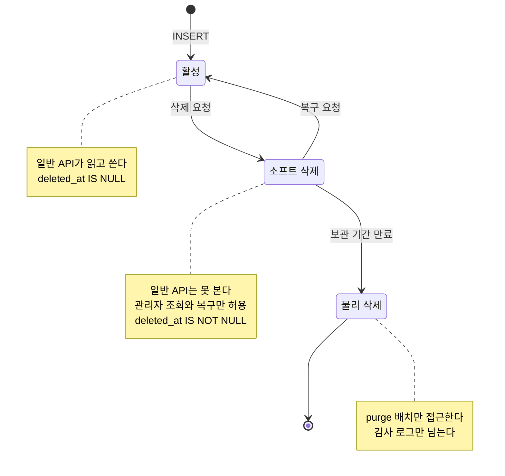
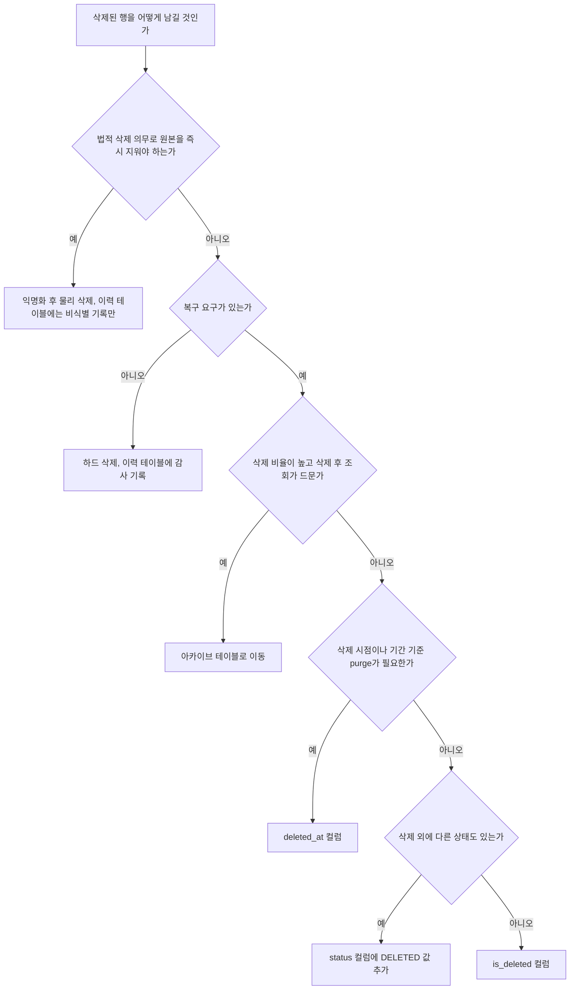
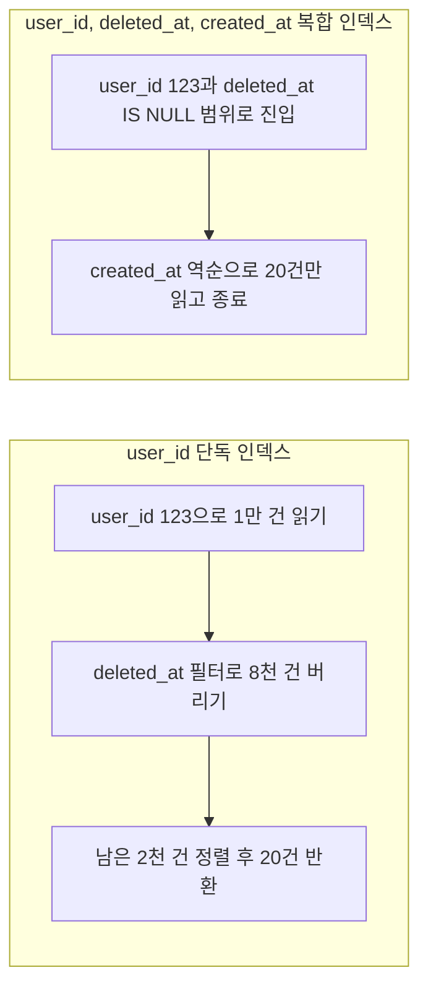
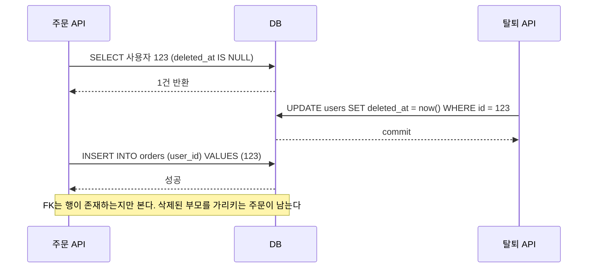
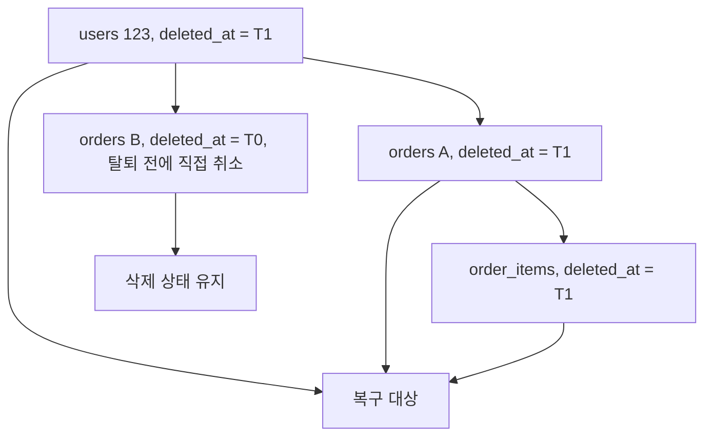
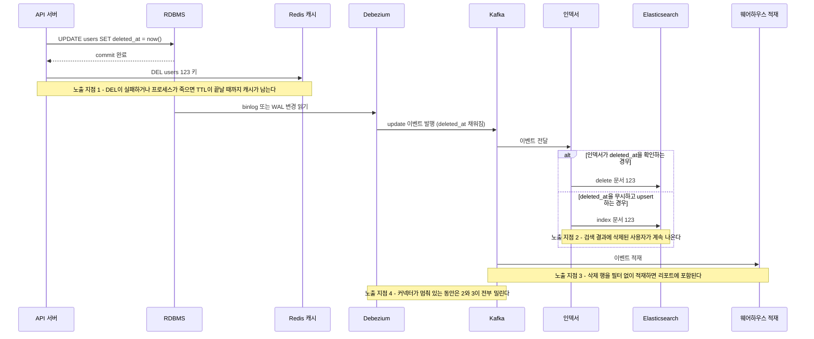
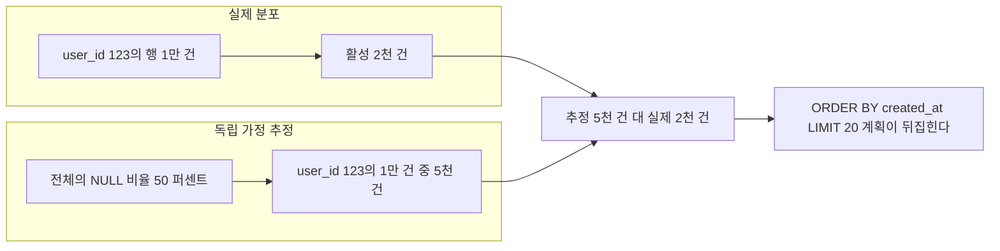
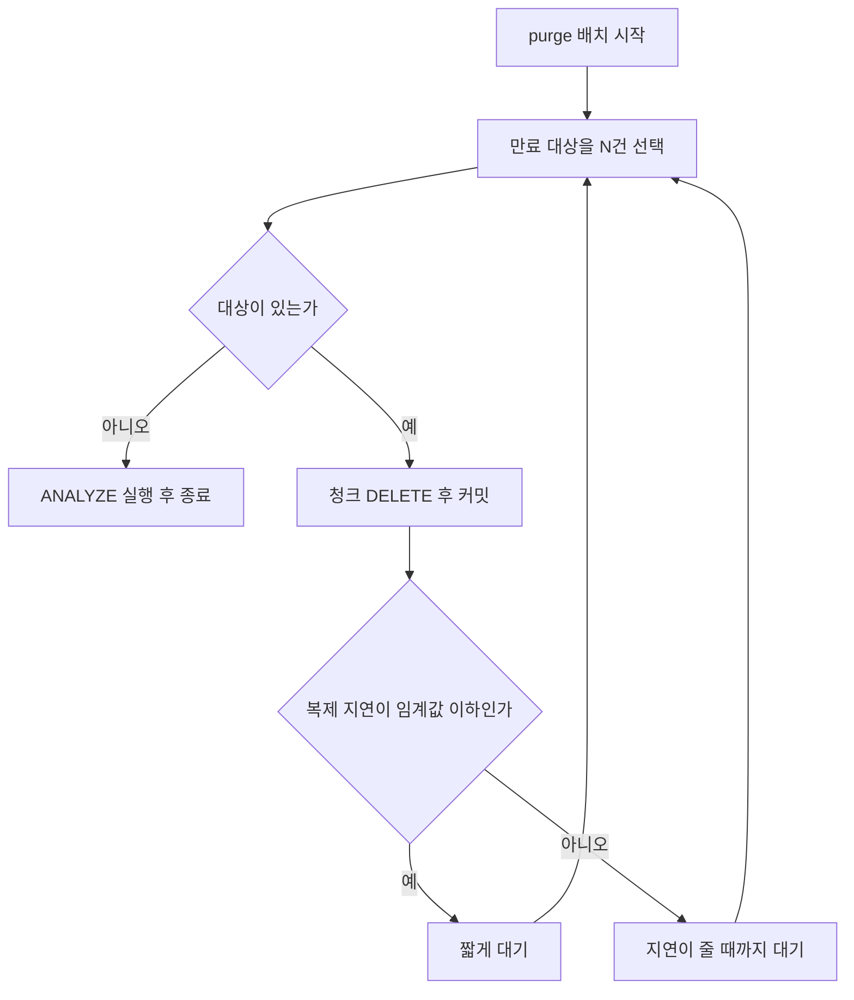

# 소프트 삭제

행을 실제로 지우지 않고 삭제됐다는 표시만 남기는 패턴이다. 데이터를 물리적으로 제거하는 하드 삭제와 달리 row는 테이블에 남아 있고, 애플리케이션이 삭제 여부를 나타내는 컬럼을 보고 필터링한다.

쓰는 이유는 명확하다. 데이터 복구, 감사 이력 보존, 참조 관계 유지다. 그런데 단순해 보이는 이 패턴이 실무에서 꽤 다양한 방식으로 문제를 일으킨다.

---

## 행의 생명주기

`UPDATE ... SET deleted_at = NOW()` 한 줄로 끝나는 것처럼 보이지만, 소프트 삭제된 행은 상태가 하나 더 생긴 것이다. 그 상태에서 누가 무엇을 할 수 있는지를 정해 두지 않으면 복구 API, 정산 배치, purge 배치가 서로 같은 행을 건드린다.

아래 도식은 행이 거치는 상태와 각 전이를 일으키는 주체를 보여준다. 노트에 적은 쿼리 범위가 그 상태에서 허용하는 접근이다.



상태별 규칙은 표로 고정해 두는 편이 낫다. 상태가 늘어나면 이 표를 먼저 고친다.

| 상태 | 허용 쿼리 | 담당 주체 | 막아야 하는 것 |
|---|---|---|---|
| 활성 | SELECT, UPDATE, 소프트 삭제 | 서비스 API | 없음 |
| 소프트 삭제 | 관리자 SELECT, 복구 UPDATE | 운영 도구, CS 담당자 | 일반 API의 SELECT, 자식 행 INSERT |
| 물리 삭제 | 없음 | purge 배치 | 복구 시도, 백업 복원 후 재노출 |

소프트 삭제에서 활성으로 돌아가는 전이가 가장 위험하다. 복구 시점에 같은 email로 가입한 다른 계정이 이미 있을 수 있고, 캐시와 검색 인덱스는 삭제 이벤트를 이미 반영했을 수 있다. 복구는 단순한 UPDATE가 아니라 삭제의 역방향 전파까지 포함한 작업이다.

---

## deleted_at vs is_deleted

컬럼 선택지는 두 가지다.

```sql
-- 방법 1: 타임스탬프
deleted_at TIMESTAMP NULL DEFAULT NULL

-- 방법 2: 불리언 플래그
is_deleted BOOLEAN NOT NULL DEFAULT FALSE
```

`is_deleted`는 단순하다. 인덱스 카디널리티도 낮고, 삭제 여부만 알면 되는 단순 필터링에 쓰기 적합하다. 문제는 정보가 너무 적다는 것이다. 언제 삭제됐는지 알 수 없고, 삭제 시점 기준의 감사 로그 연계나 시간 범위 쿼리를 쓸 수 없다.

`deleted_at`은 삭제 시점 정보가 포함된다. 감사 로그와 연계할 때 "이 행은 2024-03-15 14:32:00에 삭제됐다"는 사실을 테이블에서 바로 알 수 있다. 삭제 여부 필터는 `deleted_at IS NULL`로 쓴다. NULL 체크가 약간 더 복잡해 보이지만 실제 성능 차이는 없다.

실무에서 `deleted_at`이 표준에 가까운 이유는 두 가지다. 복구 시 언제 삭제됐는지 알 수 있고, 감사 로그 테이블과 시간 기반으로 조인할 수 있다. `is_deleted = true`인 행이 언제 삭제됐는지 추적하려면 별도 컬럼이나 별도 테이블이 필요하고, 그러면 `deleted_at` 하나로 해결될 걸 두 곳에 관리하게 된다.

GDPR 요청 처리나 데이터 수명 주기 관리에서 "30일 이상 된 삭제 행을 물리 삭제한다" 같은 정책을 구현할 때도 `deleted_at`이 필요하다. `is_deleted`만 있으면 기간 기준 배치를 쓸 수 없다.

단, 팀 내 히스토리가 `is_deleted`로 쌓여 있고 현재 감사 요구사항이 없다면 굳이 마이그레이션할 필요는 없다. `deleted_at`을 추가할 때의 마이그레이션 비용과 기존 쿼리 수정 범위가 이득보다 크다면 그냥 유지하는 게 맞다.

### 다섯 가지 방식 중 고르기

컬럼 두 개 비교로 끝나는 문제가 아니다. 같은 테이블에 `status` 컬럼이 이미 있는 경우도 많고, 삭제 비율이 높은 테이블은 애초에 삭제 행을 같은 테이블에 두지 않는 편이 낫다. 판단 기준은 복구 요구, 법적 삭제 의무, 삭제 비율, 조회 빈도 네 가지다.

도식은 위에서 아래로 질문에 답하면서 내려가게 짰다. 법적 의무를 가장 먼저 묻는 이유는 그 답이 "예"면 나머지 선택지가 의미 없어지기 때문이다.



| 방식 | 잘 맞는 경우 | 깨지는 경우 |
|---|---|---|
| `deleted_at` | 복구와 기간 기반 purge가 둘 다 필요 | 삭제 비율이 절반을 넘는 대형 테이블 |
| `is_deleted` | 삭제 시점이 필요 없는 내부용 테이블 | 감사나 purge 요구가 나중에 생길 때 |
| `status` 컬럼 | 활성, 정지, 휴면, 삭제가 한 축에 있을 때 | 삭제와 정지가 동시에 성립해야 할 때 |
| 아카이브 테이블 | 삭제 후 조회가 드물고 비율이 높을 때 | 복구 요청이 잦을 때. 이동과 복귀 비용이 든다 |
| 이력 테이블 | 삭제 전 값과 변경 주체를 남겨야 할 때 | 복구를 이 테이블에서 하려고 할 때. 이력은 증거지 원본이 아니다 |

`status` 컬럼에 삭제를 끼워 넣는 선택은 나중에 후회하는 경우가 많다. 휴면 계정이 탈퇴하는 경우처럼 두 상태가 겹치는 순간 enum 하나로는 표현이 안 되고, 복구할 때 "삭제 직전 상태"를 어디선가 따로 기억해야 한다. 상태가 정말 한 줄로 이어지는 흐름일 때만 쓴다. 이력 테이블은 위 선택지와 배타적이지 않아서, `deleted_at`을 쓰면서 감사 테이블을 병행하는 조합이 가장 흔하다.

---

## 인덱스 설계

### 필터링이 항상 따라오는 구조

소프트 삭제 패턴에서 모든 SELECT 쿼리는 `deleted_at IS NULL` 조건을 달고 다닌다. 이 조건 없이 데이터를 조회하면 삭제된 행이 섞여서 나온다. 전체 데이터 중 삭제된 비율이 낮을 때는 괜찮지만, 운영 기간이 길어지면서 삭제된 행이 전체의 30~50%를 넘어가면 쿼리 성능에 직접 영향이 생긴다.

### PostgreSQL: 부분 인덱스

PostgreSQL에서는 부분 인덱스(partial index)로 삭제되지 않은 행만 인덱싱할 수 있다.

```sql
-- 삭제되지 않은 행만 인덱스에 포함
CREATE INDEX idx_users_email_active
  ON users (email)
  WHERE deleted_at IS NULL;

CREATE INDEX idx_orders_user_id_active
  ON orders (user_id)
  WHERE deleted_at IS NULL;
```

부분 인덱스의 장점은 인덱스 크기다. 삭제된 행 50%가 인덱스에서 제외되면 인덱스가 절반 크기로 줄어들고, 메모리 사용량과 스캔 비용이 줄어든다. 쿼리에서 `WHERE deleted_at IS NULL`을 명시하면 옵티마이저가 부분 인덱스를 선택한다.

주의할 점이 있다. 부분 인덱스는 `WHERE deleted_at IS NULL` 조건이 쿼리에 정확히 있을 때만 동작한다. `WHERE deleted_at IS NULL AND user_id = 123`은 부분 인덱스를 쓸 수 있지만, `WHERE deleted_at IS NULL OR is_admin = true`처럼 조건이 복잡해지면 옵티마이저가 부분 인덱스를 포기하고 전체 테이블 스캔으로 빠지는 경우가 있다. `EXPLAIN ANALYZE`로 실행 계획을 확인해야 한다.

### MySQL: 복합 인덱스

MySQL InnoDB는 부분 인덱스를 지원하지 않는다. 대신 `deleted_at`을 인덱스에 포함시켜서 커버링 인덱스나 범위 필터로 처리한다.

```sql
-- deleted_at을 앞에 두는 방법: NULL 값이 먼저 클러스터링됨
CREATE INDEX idx_users_active_email
  ON users (deleted_at, email);

-- 또는 email + deleted_at 순서
CREATE INDEX idx_users_email_deleted
  ON users (email, deleted_at);
```

컬럼 순서 선택이 중요하다. `(email, deleted_at)` 순서면 특정 email을 조회하면서 `deleted_at IS NULL`을 필터로 추가하는 쿼리에 적합하다. 반대로 `(deleted_at, email)`은 삭제되지 않은 전체 사용자를 email 순서로 스캔할 때 유리하다.

MySQL에서 `deleted_at IS NULL` 조건은 NULL 범위 스캔으로 처리된다. InnoDB B-Tree에서 NULL은 가장 작은 값으로 정렬되므로 `deleted_at IS NULL`은 인덱스 앞 부분에 집중된 범위 스캔이 된다. 삭제 비율이 낮으면 이 범위가 좁아서 효율적이지만, 삭제된 행이 많으면 NULL이 아닌 범위가 늘어나고 스캔 범위 자체가 줄어든다. 오히려 삭제가 많을수록 인덱스 효율이 좋아지는 구조다.

### 실제 성능 저하 사례

삭제 비율이 높지 않아서 인덱스 설계를 미룬 테이블에서 다음과 같은 쿼리가 문제가 됐다.

```sql
SELECT * FROM posts
WHERE user_id = 123
  AND deleted_at IS NULL
ORDER BY created_at DESC
LIMIT 20;
```

`user_id` 단독 인덱스만 있을 때, MySQL은 `user_id = 123`으로 row를 찾은 다음 `deleted_at IS NULL`을 필터로 걸고 정렬한다. user_id = 123인 게시물이 1만 건이고 그 중 삭제된 게 8천 건이면, 인덱스로 1만 건을 가져와서 8천 건을 버리고 2천 건에서 정렬해서 20건을 반환한다. 인덱스를 써도 실제로는 거의 풀스캔에 가까운 비용이 된다.

아래 도식은 같은 쿼리가 인덱스 구성에 따라 읽는 행 수가 어떻게 달라지는지 비교한 것이다. 왼쪽은 위 설명 그대로이고, 오른쪽은 바로 이어서 나오는 복합 인덱스를 쓴 경우다.



`(user_id, deleted_at, created_at)` 복합 인덱스를 추가하면, `user_id = 123 AND deleted_at IS NULL`로 범위를 좁힌 후 `created_at DESC`로 정렬된 데이터를 바로 읽을 수 있다.

```sql
CREATE INDEX idx_posts_user_active_date
  ON posts (user_id, deleted_at, created_at DESC);
```

PostgreSQL이면 부분 인덱스로 더 간단하게 해결된다.

```sql
CREATE INDEX idx_posts_user_active
  ON posts (user_id, created_at DESC)
  WHERE deleted_at IS NULL;
```

---

## 외래 키 무결성 문제

소프트 삭제에서 가장 골치 아픈 부분이 외래 키다.

```sql
-- users 테이블: deleted_at 있음
-- orders 테이블: user_id FK로 users 참조

SELECT o.id, u.name
FROM orders o
JOIN users u ON o.user_id = u.id
WHERE o.deleted_at IS NULL;
```

이 쿼리에서 `u.deleted_at IS NULL` 조건이 없으면 소프트 삭제된 사용자의 정보도 같이 나온다. 비즈니스 로직에서 탈퇴한 사용자의 주문이 보이면 안 된다면 JOIN 조건에 `AND u.deleted_at IS NULL`을 추가해야 한다.

더 심각한 경우는 반대 방향이다. users를 소프트 삭제해도 DB 레벨 FK 제약은 그대로 살아 있다. `deleted_at`을 채우는 것은 그냥 UPDATE이므로 FK 검사가 트리거되지 않는다. 따라서 소프트 삭제된 부모를 참조하는 자식 row를 새로 INSERT하는 것이 DB 레벨에서 막히지 않는다. 탈퇴한 사용자 ID로 새 주문이 들어오는 상황이 이론상 가능하다.

이 문제를 처리하는 방법은 세 가지다.

**애플리케이션 레이어에서 검증**: 삽입 전에 부모 row가 소프트 삭제되지 않았는지 확인하는 쿼리를 실행한다. 간단하지만 TOCTOU 경쟁 조건이 생길 수 있다. SELECT로 확인하는 사이에 다른 트랜잭션이 부모를 소프트 삭제할 수 있다.

도식은 그 경쟁이 일어나는 순서다. 주문 API가 사용자를 확인한 시점과 INSERT 시점 사이에 탈퇴 API가 끼어들면, 탈퇴한 사용자를 가리키는 주문이 만들어진다.



확인과 INSERT를 같은 트랜잭션에 넣고 SELECT에 `FOR SHARE`(MySQL은 `LOCK IN SHARE MODE`)를 걸면 탈퇴 쪽 UPDATE가 대기하므로 이 경쟁이 사라진다. 대신 주문 한 건마다 부모 행에 공유 락이 걸려서 인기 있는 부모 행(대형 판매자 계정 같은)에서는 락 경합이 생긴다.

**DB 트리거**: INSERT/UPDATE 시 부모의 `deleted_at IS NULL`을 확인하는 트리거를 건다. DB 레벨 보장이 생기지만 트리거는 디버깅이 어렵고, ORM이 트리거 존재를 모르기 때문에 예상치 못한 에러를 내거나 성능 문제가 생길 수 있다.

**FK를 제거하고 애플리케이션에서 무결성 관리**: 소프트 삭제 패턴을 적극적으로 쓰는 시스템에서 현실적으로 선택하는 방법이다. DB FK 없이 애플리케이션에서 참조 무결성을 관리한다. [외래키 없는 설계](No_FK_Design.md) 문서의 판단 기준을 같이 보면 된다.

---

## unique constraint 충돌

소프트 삭제 패턴에서 UNIQUE 제약이 자주 문제가 된다.

```sql
-- email 유니크 제약
CREATE UNIQUE INDEX uq_users_email ON users (email);
```

user@example.com으로 가입했다가 탈퇴하고, 같은 email로 재가입하려 하면 유니크 제약이 막는다. `deleted_at`이 있는 row가 이미 email 값을 차지하고 있어서다.

**방법 1: deleted_at 포함 복합 유니크는 활성 행을 막지 못한다**

```sql
CREATE UNIQUE INDEX uq_users_email_deleted
  ON users (email, deleted_at);
```

이 인덱스는 흔히 추천되지만 의도대로 동작하지 않는다. 유니크 인덱스는 NULL을 서로 다른 값으로 취급한다(MySQL, PostgreSQL 모두 기본 동작이 그렇다). 활성 행은 `deleted_at`이 전부 NULL이라서 같은 email의 활성 행이 둘 있어도 `(email, NULL)` 쌍이 서로 다른 것으로 비교되어 통과한다. 삭제된 행끼리는 `deleted_at` 값이 달라 통과하니, 결과적으로 이 인덱스는 아무것도 막지 않는다. 가입 API가 SELECT로 중복을 먼저 확인하는 구조라면 경쟁 조건에서 같은 email의 활성 계정 두 개가 생긴다.

이 방식을 쓰려면 활성 행의 `deleted_at`을 NULL이 아닌 센티넬 값(예: `'9999-12-31'`)으로 두거나, PostgreSQL 15 이상의 `NULLS NOT DISTINCT`를 써야 한다. 센티넬은 `deleted_at IS NULL` 필터를 쓰는 모든 쿼리를 바꿔야 해서 기존 시스템에는 비용이 크다.

MySQL에서는 생성 컬럼을 하나 두는 방법이 부분 인덱스를 대신한다.

```sql
-- 활성일 때만 email 값을 갖고, 삭제되면 NULL이 되는 생성 컬럼
ALTER TABLE users
  ADD COLUMN active_email VARCHAR(255)
    GENERATED ALWAYS AS (IF(deleted_at IS NULL, email, NULL)) VIRTUAL,
  ADD UNIQUE INDEX uq_users_active_email (active_email);
```

활성 행은 email 값이 그대로 들어가 유니크가 강제되고, 삭제 행은 NULL이라 서로 충돌하지 않는다. 인덱스가 걸린 VIRTUAL 컬럼은 InnoDB가 지원한다. 쓰기 쿼리의 컬럼 목록에 `active_email`이 섞이지 않도록 ORM 매핑에서 읽기 전용으로 두어야 한다.

**방법 2: 부분 인덱스 (PostgreSQL)**

```sql
CREATE UNIQUE INDEX uq_users_email_active
  ON users (email)
  WHERE deleted_at IS NULL;
```

삭제되지 않은 row에서만 email 유니크를 강제한다. 삭제된 row는 인덱스에 없으므로 같은 email로 재가입이 가능하다. MySQL에는 부분 인덱스가 없으므로 방법 1의 생성 컬럼을 쓴다.

**방법 3: 삭제 시 email 값 변조**

```sql
UPDATE users
SET
  email = CONCAT('deleted_', id, '_', email),
  deleted_at = NOW()
WHERE id = 123;
```

소프트 삭제 시 원본 email을 prefix로 변조한다. 유니크 제약이 그대로 유지되고 재가입이 자유롭다. 단점은 원래 email 값을 알려면 파싱이 필요하고, 감사 로그와 email 기반 추적이 복잡해진다.

---

## 복구 시나리오

소프트 삭제의 장점인 복구는 생각보다 복잡하다.

단순 복구는 `deleted_at`을 NULL로 되돌리면 된다.

```sql
UPDATE users SET deleted_at = NULL WHERE id = 123;
```

문제는 복구 이후다. 이 사용자가 삭제됐다가 복구됐다는 사실을 감사 로그에 남겨야 한다. 삭제된 동안 동일 email로 다른 계정이 생겼다면 유니크 충돌이 발생한다. 연관된 자식 테이블(orders, posts 등)도 같이 복구해야 하는지 결정해야 한다.

자식 테이블이 각자 `deleted_at`을 갖고 있고 부모와 동시에 소프트 삭제됐다면, 부모만 복구하면 자식은 여전히 삭제 상태로 남는다. 일괄 복구 스크립트가 필요하다.

```sql
-- 사용자와 함께 소프트 삭제된 주문 복구
-- 삭제 시점이 비슷한 row만 복구 (같은 트랜잭션에서 삭제된 것으로 가정)
UPDATE orders
SET deleted_at = NULL
WHERE user_id = 123
  AND deleted_at BETWEEN '2024-03-15 14:30:00' AND '2024-03-15 14:35:00';
```

복구 범위를 시간으로 추정해야 한다는 것 자체가 취약하다. 삭제 이벤트와 복구 이벤트를 별도 감사 테이블에 기록하는 게 더 견고하다.

### 감사 로그 연계

```sql
CREATE TABLE audit_log (
  id          BIGINT AUTO_INCREMENT PRIMARY KEY,
  table_name  VARCHAR(64)  NOT NULL,
  record_id   BIGINT       NOT NULL,
  action      ENUM('CREATE', 'UPDATE', 'SOFT_DELETE', 'RESTORE', 'HARD_DELETE') NOT NULL,
  changed_by  BIGINT,
  changed_at  TIMESTAMP    NOT NULL DEFAULT CURRENT_TIMESTAMP,
  before_data JSON,
  after_data  JSON
);
```

소프트 삭제 시 `SOFT_DELETE`, 복구 시 `RESTORE` 액션으로 audit_log에 row를 남긴다. `before_data`와 `after_data`에 변경 전후 상태를 JSON으로 저장하면, 복구 시 무엇이 변경됐는지 추적할 수 있다.

`deleted_at`으로 삭제 시점을 알고, audit_log로 누가 삭제했는지 알면 대부분의 감사 요구사항을 충족한다.

### 연쇄 소프트 삭제와 부분 복구

소프트 삭제에는 `ON DELETE CASCADE`가 없다. 사용자를 지울 때 주문, 주문 항목, 게시물을 같이 지우려면 애플리케이션이 각 테이블에 UPDATE를 직접 날린다. 복구할 때 문제가 되는 건 "무엇을 같이 되살릴 것인가"다.

사용자가 한 달 전에 주문 하나를 직접 취소해서 그 주문이 이미 소프트 삭제돼 있었다고 하자. 나중에 계정을 탈퇴했다가 복구하면, 탈퇴 때문에 같이 지워진 주문은 살아나야 하고 그 전에 사용자가 직접 취소한 주문은 그대로 삭제 상태여야 한다. 둘을 구분하는 단서는 `deleted_at` 값뿐이다.

그래서 연쇄 삭제는 부모와 자식이 정확히 같은 타임스탬프를 쓰게 만든다. 앞에서 본 `BETWEEN` 범위 조건은 다른 시점에 지워진 행을 끌고 올 수 있으므로, 같은 값을 쓰고 등호로 비교한다.

도식의 T1은 탈퇴 시점, T0는 그 전에 사용자가 주문 B를 직접 취소한 시점이다. 복구 기준은 T1이고, 같은 값을 가진 행만 되살아난다.



```sql
-- 삭제: 한 트랜잭션에서 같은 값을 모든 테이블에 쓴다 (MySQL)
START TRANSACTION;
SET @ts = NOW(6);

UPDATE order_items SET deleted_at = @ts
 WHERE deleted_at IS NULL
   AND order_id IN (SELECT id FROM orders WHERE user_id = 123);
UPDATE orders SET deleted_at = @ts WHERE user_id = 123 AND deleted_at IS NULL;
UPDATE users  SET deleted_at = @ts WHERE id = 123 AND deleted_at IS NULL;
COMMIT;
```

MySQL의 `NOW()`는 문장마다 새로 평가되는 시각이라 세 UPDATE에 `NOW()`를 그대로 쓰면 값이 어긋날 수 있다. 사용자 변수에 한 번 담아서 쓴다. PostgreSQL의 `now()`는 트랜잭션 시작 시각을 돌려주므로 같은 트랜잭션 안에서는 자연스럽게 일치한다. 컬럼 정밀도도 `TIMESTAMP(6)`처럼 마이크로초까지 잡아야 한다. 초 단위 정밀도면 같은 초에 따로 지워진 행이 섞인다.

복구는 반대 순서로, 아직 삭제 상태인 부모의 `deleted_at`을 기준값으로 읽어서 일치하는 자식만 되살린다.

```sql
START TRANSACTION;
SELECT deleted_at INTO @ts FROM users WHERE id = 123 AND deleted_at IS NOT NULL FOR UPDATE;

-- 손자부터: 아직 삭제 상태인 부모(orders)로 범위를 좁힌 뒤 부모를 되살린다
UPDATE order_items oi
  JOIN orders o ON o.id = oi.order_id
   SET oi.deleted_at = NULL
 WHERE o.user_id = 123 AND o.deleted_at = @ts AND oi.deleted_at = @ts;

UPDATE orders SET deleted_at = NULL WHERE user_id = 123 AND deleted_at = @ts;
UPDATE users  SET deleted_at = NULL WHERE id = 123 AND deleted_at = @ts;
COMMIT;
```

깊은 쪽부터 되살리는 이유는 부모의 `deleted_at`이 아직 남아 있어야 자식 범위를 찾을 수 있어서다. 한 트랜잭션이라 중간 상태는 밖에서 안 보이고, 마지막 users UPDATE가 유니크 충돌로 실패하면 전체가 롤백된다. 사용자가 직접 취소한 주문은 `deleted_at`이 `@ts`와 다르므로 건드리지 않는다.

자식이 여러 부모에 걸쳐 있거나 삭제 단위를 사람이 추적해야 하면 타임스탬프 대신 `delete_batch_id`(UUID) 컬럼을 두는 쪽이 낫다. 시각 일치는 구현이 간단한 대신, 한 행이 어느 삭제 작업 때문에 지워졌는지는 시각을 읽고 사람이 짐작해야 한다. 배치 ID는 그 짐작을 없앤다.

---

## GDPR Right to Erasure

소프트 삭제가 GDPR 삭제 요청(Right to Erasure, Article 17)에 충분한지 물으면, 답은 "단독으로는 충분하지 않다"다.

GDPR에서 요구하는 삭제는 개인정보의 처리 중단과 복구 불가능한 제거다. `deleted_at`을 채운 소프트 삭제는 데이터가 DB에 그대로 남아 있고, 관리자 권한으로 언제든 조회 가능하다. 이는 "지웠다"는 주장을 뒷받침하기 어렵다.

처리 방법은 두 단계로 나눈다. 도식은 삭제 요청 이후 개인정보가 사라지는 시점을 단계별로 보여준다. 단계 1이 끝난 시점에 이미 식별 가능한 정보는 없고, 행 자체는 단계 2까지 남는다.


**단계 1: 즉시 처리 — 개인정보 익명화**

삭제 요청을 받는 즉시 PII(개인식별정보)를 실제로 제거하거나 대체한다.

```sql
UPDATE users
SET
  email      = CONCAT('deleted_', id, '@deleted.invalid'),
  name       = 'Deleted User',
  phone      = NULL,
  birth_date = NULL,
  address    = NULL,
  deleted_at = NOW()
WHERE id = 123;
```

이렇게 하면 row는 남아 있지만 개인을 식별할 수 있는 정보가 없다. 참조 무결성을 유지하면서 GDPR 요구사항을 충족한다.

**단계 2: 지연 처리 — 물리 삭제**

법적 보존 기간(financial records는 보통 7년)이 지난 후 물리 삭제한다. 보존 기간이 끝나면 배치로 하드 삭제한다.

```sql
-- 삭제된 지 7년 이상 된 row 물리 삭제 (익명화된 상태)
DELETE FROM users
WHERE deleted_at < NOW() - INTERVAL 7 YEAR;
```

감사 로그의 경우, 감사 목적의 로그는 개인정보가 포함되지 않는 수준으로 설계해야 한다. "user_id=123이 2024-03-15에 삭제됐다"는 로그에서 user_id=123이 더 이상 누구인지 알 수 없다면, 감사 로그 자체는 보존해도 된다.

백업 데이터도 처리 대상이다. 소프트 삭제만 하고 익명화를 안 했다면, 어제 만든 DB 백업에 개인정보가 여전히 있다. GDPR 삭제 요청 처리 후 백업에서도 해당 데이터가 복구 불가능해야 하므로, 백업 보존 기간 정책과 암호화 키 관리를 같이 고려해야 한다.

---

## 쿼리 성능 튜닝

소프트 삭제 패턴에서 쿼리 성능 저하가 나타나는 주요 경로는 세 가지다.

**ORM의 자동 필터 누락**: TypeORM의 `@DeleteDateColumn`이나 Hibernate의 `@Where` 같은 ORM 수준 소프트 삭제 필터는 편리하지만, 네이티브 쿼리를 실행하거나 QueryBuilder를 잘못 쓰면 필터가 적용 안 된 쿼리가 나간다. `SHOW PROCESSLIST`나 slow query log에서 `deleted_at IS NULL` 조건 없이 나가는 쿼리를 잡아내야 한다.

```typescript
// TypeORM: softDelete 설정 시
@Entity()
export class User {
  @DeleteDateColumn()
  deletedAt: Date | null;
}

// find()는 deletedAt IS NULL 자동 적용
await userRepo.find({ where: { email: 'user@example.com' } });

// createQueryBuilder()는 기본 필터 적용 안 됨 - 직접 추가 필요
await userRepo.createQueryBuilder('user')
  .where('user.email = :email', { email: 'user@example.com' })
  .andWhere('user.deletedAt IS NULL')  // 반드시 명시
  .getOne();
```

**삭제 비율이 높아진 테이블**: 테이블 전체 row 중 삭제된 비율이 70%를 넘어가면, 전체 테이블을 대상으로 하는 집계 쿼리나 통계 쿼리에서 비용이 높아진다. 이 시점에 `deleted_at IS NOT NULL`인 row를 별도 아카이브 테이블로 이동시키는 데이터 수명 주기 관리를 도입한다.

```sql
-- 1년 이상 된 삭제 row를 아카이브 테이블로 이동
INSERT INTO orders_archive
  SELECT * FROM orders
  WHERE deleted_at < NOW() - INTERVAL 1 YEAR;

DELETE FROM orders
WHERE deleted_at < NOW() - INTERVAL 1 YEAR;
```

**카운트 쿼리**: `COUNT(*)`에 소프트 삭제 필터가 없으면 삭제된 row까지 집계된다. 통계 대시보드에서 숫자가 맞지 않는 버그가 이 원인인 경우가 많다. `COUNT(*) WHERE deleted_at IS NULL`이 표준 패턴이다.

MySQL에서 `COUNT(*) WHERE deleted_at IS NULL` 쿼리가 느리면 커버링 인덱스 여부를 확인한다. `(deleted_at)` 단일 인덱스나 `(deleted_at, id)` 인덱스가 있으면 테이블 접근 없이 인덱스만으로 카운트를 처리할 수 있다.

PostgreSQL에서는 부분 인덱스가 있으면 `COUNT(*) WHERE deleted_at IS NULL`이 인덱스 온리 스캔으로 처리된다.

---

## 삭제가 하위 시스템으로 번지는 경로

DB 행에 `deleted_at`을 채우는 것은 삭제의 시작일 뿐이다. 같은 데이터가 Redis에 캐시돼 있고, Elasticsearch에 색인돼 있고, Debezium이 읽어 Kafka로 내보내고, 웨어하우스에 적재된다. 이 중 한 곳이라도 삭제를 못 받으면 DB에서는 지워진 데이터가 화면에 나온다. 탈퇴한 사용자가 검색에 걸리거나, 삭제한 게시물이 캐시 TTL 동안 열리는 문제는 대부분 이 경로에서 생긴다.

아래 시퀀스는 삭제 요청 한 건이 어디로 퍼지는지와, 각 갈래에서 전파가 끊기면 데이터가 노출되는 지점을 표시한다. 노출 지점 1~4가 그 위치다.



각 지점의 증상과 처리를 표로 정리한다.

| 지점 | 증상 | 처리 |
|---|---|---|
| 1. Redis | 삭제 직후 조회가 캐시에서 나간다. 목록 캐시는 키를 특정할 수 없어 더 오래 남는다 | 커밋 후 DEL, TTL을 짧게, 목록 캐시는 버전 키로 통째로 무효화 |
| 2. Elasticsearch | 검색에서만 보인다. DB 조회는 정상이라 늦게 발견된다 | 인덱서가 `deleted_at`을 보고 delete, 검색 쿼리에도 필터 이중 적용 |
| 3. 웨어하우스 | 리포트 숫자가 서비스 화면과 안 맞는다 | 적재는 `deleted_at`을 컬럼으로 그대로 가져오고 분석용 뷰에서 필터 |
| 4. CDC | 지연 시간만큼 위 세 곳이 전부 오래된 상태다 | 커넥터 lag 알람, 재시작 후 offset 재처리가 멱등한지 확인 |

### Redis는 커밋 이후에 지운다

트랜잭션 안에서 캐시를 먼저 지우면, 커밋 전에 다른 요청이 옛 행을 읽어 캐시에 다시 채운다. 지우는 시점은 커밋 이후다. 그래도 읽기 쪽이 커밋 직전에 옛 값을 읽고 DEL 이후에 캐시에 쓰는 경쟁은 남는다. 이 경우 TTL이 마지막 방어선이라서, 삭제와 관련 있는 캐시는 TTL을 길게 잡지 않는다. DEL 호출이 실패해도 요청은 이미 커밋됐으니 재시도 큐에 넣거나, CDC 이벤트를 소비해서 같은 키를 한 번 더 지우는 방식으로 이중화한다.

### Elasticsearch는 순서 역전을 조심한다

인덱서는 update 이벤트를 받으면 `deleted_at`이 채워져 있는지 먼저 본다. 채워져 있으면 색인이 아니라 delete를 호출한다. 문서가 이미 없어도 404가 나올 뿐이니 무시한다. 순서가 뒤집혀 삭제 이후에 오래된 update 이벤트가 도착하면 삭제한 문서가 되살아난다. 이벤트에 실린 원본 타임스탬프를 외부 버전으로 넘기면 이 경우를 막는다.

```typescript
async function apply(ev: UserChange): Promise<void> {
  const version = ev.sourceTsMs;
  if (ev.op === 'd' || ev.after?.deleted_at) {
    await es.delete(
      { index: 'users', id: String(ev.id), version, version_type: 'external' },
      { ignore: [404, 409] },
    );
    return;
  }
  await es.index({
    index: 'users',
    id: String(ev.id),
    document: toDoc(ev.after),
    version,
    version_type: 'external_gte',
  });
}
```

409는 이미 더 높은 버전이 반영됐다는 뜻이므로 실패가 아니다. 복구는 `deleted_at`이 다시 NULL이 되는 update 이벤트로 오기 때문에 위 코드의 두 번째 분기가 그대로 되살린다.

### Debezium에서 삭제는 두 종류다

소프트 삭제는 DB 입장에서 UPDATE라서 `op=u` 이벤트로 나간다. 삭제 이벤트가 아니다. 소비자가 `op=d`만 삭제로 처리하면 소프트 삭제를 영영 못 받는다. 반대로 purge 배치가 물리 삭제를 하면 그때서야 `op=d` 이벤트가 나가고, 이어서 같은 키의 값이 null인 tombstone 레코드가 한 번 더 나간다. tombstone은 Kafka 로그 컴팩션이 해당 키를 지우게 하려는 레코드인데, 소비자가 value를 역직렬화하다가 null을 만나 NPE로 죽는 일이 흔하다.

```json
{
  "transforms": "unwrap",
  "transforms.unwrap.type": "io.debezium.transforms.ExtractNewRecordState",
  "transforms.unwrap.add.fields": "op,source.ts_ms",
  "transforms.unwrap.delete.handling.mode": "rewrite",
  "tombstones.on.delete": "true"
}
```

`ExtractNewRecordState`의 삭제 처리 옵션 이름은 Debezium 버전마다 다르다(`delete.handling.mode`가 이후 버전에서 `delete.tombstone.handling.mode`로 바뀌는 식이다). 쓰는 버전의 문서를 확인하고, `rewrite`는 삭제 이벤트를 `__deleted` 필드가 붙은 일반 레코드로 바꿔 준다는 정도로만 기억한다. 소비자 코드는 value가 null인 레코드를 먼저 걸러내야 한다. [CDC 파이프라인](CDC_Pipeline.md) 문서의 소비자 멱등성 부분을 같이 본다.

purge가 청크 단위로 수만 행을 지우면 같은 수의 `op=d`와 tombstone이 한꺼번에 흘러간다. 이미 소프트 삭제 시점에 지운 문서에 대한 delete가 대량으로 오는 셈이라, 소비자는 존재하지 않는 문서의 삭제를 에러로 취급하지 않아야 한다.

### 웨어하우스 적재

`updated_at` 기준의 증분 적재는 소프트 삭제를 잡아낼 수 있다. `deleted_at`을 채우는 UPDATE가 `updated_at`도 같이 바꾼다는 전제에서다. MySQL의 `ON UPDATE CURRENT_TIMESTAMP`는 컬럼이 바뀌면 자동으로 갱신해 주지만, 트리거나 ORM을 우회한 배치 UPDATE는 `updated_at`을 안 건드리는 경우가 있어서 삭제가 증분에서 빠진다.

물리 삭제는 증분 적재가 원천적으로 못 잡는다. 지워진 행은 `updated_at`을 가질 수 없다. 그래서 purge 이후에는 웨어하우스에 행이 남는다. 보존 기간이 지난 개인정보를 purge했는데 웨어하우스에 그대로 있으면 삭제 의무를 지킨 것이 아니다. CDC의 `op=d`로 웨어하우스에도 DELETE를 보내거나, 주기적으로 키 목록을 대조해서 사라진 키를 지우는 작업이 따로 필요하다.

---

## 집계 테이블과 카운터 컬럼

삭제된 행이 이미 어딘가에 숫자로 반영돼 있으면 `deleted_at`을 채우는 것만으로는 숫자가 줄지 않는다. 게시물의 `comment_count`, 사용자의 `order_count`, 일별 매출 요약 테이블이 여기에 해당한다. 화면에는 댓글 12개라고 나오는데 열어 보니 9개인 버그가 이 계열이다.

카운터는 소프트 삭제와 같은 트랜잭션에서 줄이고, 줄이는 조건을 "이번 UPDATE가 실제로 행을 바꿨을 때"로 건다. 삭제 API가 재시도로 두 번 호출돼도 카운터가 두 번 줄지 않는다.

```sql
-- PostgreSQL: 한 문장으로 처리. 이미 삭제된 댓글이면 gone이 비어서 카운터는 그대로
WITH gone AS (
  UPDATE comments
     SET deleted_at = now()
   WHERE id = 77 AND deleted_at IS NULL
  RETURNING post_id
)
UPDATE posts p
   SET comment_count = comment_count - 1
  FROM gone
 WHERE p.id = gone.post_id;
```

MySQL의 CTE는 SELECT만 지원해서 같은 방식을 못 쓴다. 한 트랜잭션에서 첫 UPDATE의 affected rows가 1일 때만 두 번째 UPDATE를 실행하도록 애플리케이션에서 분기한다. 복구는 반대로 `deleted_at IS NOT NULL`인 행이 실제로 복구됐을 때만 카운터를 올린다. 연쇄 삭제에서는 자식 수만큼 한 번에 빼야 하므로, 행마다 감소시키지 말고 `COUNT(*)`로 센 값을 한 번에 반영한다.

카운터는 반드시 어긋난다. 경로가 하나라도 빠지면(관리자 도구의 직접 SQL, 오래된 배치) 그때부터 틀린다. 대조 쿼리를 주기적으로 돌려서 어긋난 행을 보정한다.

```sql
SELECT p.id, p.comment_count, COALESCE(c.cnt, 0) AS actual
  FROM posts p
  LEFT JOIN (
    SELECT post_id, COUNT(*) AS cnt
      FROM comments
     WHERE deleted_at IS NULL
     GROUP BY post_id
  ) c ON c.post_id = p.id
 WHERE p.comment_count <> COALESCE(c.cnt, 0);
```

요약 테이블은 마감 여부에 따라 처리가 갈린다.

| 집계 종류 | 삭제 시 처리 | 주의 |
|---|---|---|
| 현재 상태 카운터 | 삭제 트랜잭션에서 즉시 감소 | 복구와 연쇄 삭제 경로 누락 |
| 마감 전 일별 요약 | 해당 일자 행을 재계산 | 재계산 쿼리도 `deleted_at IS NULL` 필터 필수 |
| 마감 후 일별 요약 | 과거 행은 두고 삭제일에 음수 보정 행 추가 | 마감 숫자가 이미 외부에 나갔다면 수정하면 안 된다 |
| 머티리얼라이즈드 뷰 | REFRESH 전까지 삭제 행이 포함된 상태 | 갱신 주기가 곧 노출 시간이다 |

---

## 조회 필터를 DB에서 강제하기

ORM 필터와 코드 리뷰만으로는 `deleted_at IS NULL`이 빠진 쿼리를 막지 못한다. 네이티브 쿼리, 리포트 스크립트, 다른 서비스가 같은 DB를 읽는 경우가 모두 구멍이다. DB가 필터를 강제하게 만들면 그 구멍이 줄어든다.

### 뷰

MySQL과 PostgreSQL 모두 단순 뷰는 갱신 가능하다. 애플리케이션 계정에는 뷰만 열어 주고 기반 테이블 권한은 주지 않는다.

```sql
CREATE VIEW active_users AS
SELECT id, email, name, created_at
  FROM users
 WHERE deleted_at IS NULL
WITH CHECK OPTION;

-- 앱 계정은 뷰만 쓴다. 기반 테이블에는 권한을 주지 않는다
GRANT SELECT, INSERT, UPDATE ON app_db.active_users TO 'app'@'%';
```

`WITH CHECK OPTION`이 있으면 뷰를 통한 INSERT와 UPDATE가 뷰 조건을 벗어나는 결과를 만들지 못한다. 반대 효과도 있다. 뷰를 통해 `deleted_at`을 채우면 결과 행이 뷰에서 사라지므로 거부된다. 소프트 삭제는 기반 테이블 권한이 있는 별도 경로(저장 프로시저를 `SQL SECURITY DEFINER`로 만들어 호출)에서 해야 한다. 이 제약이 오히려 "일반 코드가 삭제와 복구를 직접 못 한다"는 보장으로 쓰이기도 한다.

관리자 화면이 삭제된 행도 봐야 하면 `all_users` 같은 뷰를 따로 만들어 해당 계정에만 연다.

### PostgreSQL의 Row Level Security

PostgreSQL은 행 수준 정책으로 같은 효과를 낸다. 테이블 이름이 그대로라서 쿼리를 하나도 고치지 않아도 된다. 자세한 문법은 [Row Level Security](Row_Level_Security.md)에서 다룬다.

```sql
ALTER TABLE users ENABLE ROW LEVEL SECURITY;
ALTER TABLE users FORCE ROW LEVEL SECURITY;

CREATE POLICY users_select_active ON users
  FOR SELECT USING (deleted_at IS NULL);

CREATE POLICY users_update_active ON users
  FOR UPDATE USING (deleted_at IS NULL) WITH CHECK (true);

CREATE POLICY users_insert_active ON users
  FOR INSERT WITH CHECK (deleted_at IS NULL);

-- 복구와 purge는 정책을 우회하는 전용 롤로 돌린다
CREATE ROLE maintenance LOGIN BYPASSRLS;
```

`FORCE`를 빼면 테이블 소유자는 정책을 안 받는다. 마이그레이션 계정이 소유자인 환경에서 앱이 같은 계정으로 접속하고 있다면 정책이 통째로 무력하다. 슈퍼유저와 `BYPASSRLS` 롤은 FORCE와 상관없이 항상 우회한다.

세 가지는 먼저 확인하고 쓴다.

- 유니크, 기본 키, 외래 키 검사는 RLS를 우회한다. 소프트 삭제된 행이 보이지 않아도 같은 email의 유니크 인덱스에는 걸리고, 에러 메시지로 존재 여부가 드러난다. 앞에서 본 부분 유니크 인덱스를 같이 써야 한다.
- 소프트 삭제 UPDATE에 `RETURNING`을 붙이면, 바뀐 행이 SELECT 정책을 통과하지 못해 정책 위반으로 실패하는 경우가 있다. 삭제 API가 `RETURNING *`을 쓰고 있다면 도입 전에 테스트한다.
- 정책 조건은 쿼리에 자동으로 AND로 붙는다. `deleted_at IS NULL`이 그대로 들어가므로 부분 인덱스와 궁합이 맞지만, 실행 계획에 정말 반영되는지는 `EXPLAIN`으로 본다.

---

## 행이 쌓이면 옵티마이저가 틀린다

소프트 삭제 행이 쌓인 테이블은 쿼리 자체가 같아도 어느 날부터 느려진다. 인덱스가 사라진 것이 아니라 옵티마이저의 행 수 추정이 어긋나서 다른 계획을 고르기 때문이다. 원인은 두 가지다. 통계가 삭제 이전 상태에 머물러 있거나, 통계가 컬럼을 서로 독립으로 가정한다.

[쿼리 옵티마이저](쿼리_옵티마이저.md)가 `deleted_at IS NULL`의 선택도를 어떻게 추정하는지가 출발점이다. 이 조건이 전체 행의 몇 퍼센트에 해당하는지는 컬럼 통계(NULL 비율)에서 나오고, `user_id = 123`의 선택도는 별도 통계에서 나온다. 두 조건이 AND로 묶이면 각 비율을 곱한다.



사용자 한 명의 삭제가 몰려 있으면 컬럼별 통계는 이 쏠림을 모른다. 정렬 컬럼 인덱스를 거꾸로 훑으면서 필터로 거르는 계획이 싸 보이면 옵티마이저는 그쪽을 고르고, 활성 행이 드문 사용자에게는 수만 건을 읽고 버리는 계획이 된다.

### PostgreSQL

PostgreSQL의 autovacuum은 변경된 행이 테이블의 일정 비율(`autovacuum_analyze_scale_factor`, 기본 0.1)을 넘으면 ANALYZE를 돌린다. 소프트 삭제 UPDATE도 변경으로 센다. 1억 행 테이블이면 1천만 행이 바뀌어야 통계가 갱신되므로, 삭제가 많은 큰 테이블은 비율을 낮춘다.

```sql
SELECT attname, null_frac, n_distinct
  FROM pg_stats
 WHERE tablename = 'posts' AND attname IN ('deleted_at', 'user_id');

ALTER TABLE posts SET (autovacuum_analyze_scale_factor = 0.01);

-- user_id와 deleted_at의 상관을 통계에 반영 (PostgreSQL 12 이상의 mcv)
CREATE STATISTICS st_posts_user_deleted (mcv) ON user_id, deleted_at FROM posts;
ANALYZE posts;
```

`CREATE STATISTICS`는 만든 뒤 ANALYZE를 돌려야 채워진다. 만든 다음 같은 쿼리의 `EXPLAIN`에서 추정 행 수가 실제에 가까워졌는지 직접 확인한다. 기능 의존성(`dependencies`) 통계는 등호 조건 중심이라 `IS NULL`에 쓰일지는 버전에 따라 달라서, `mcv`를 먼저 시도하는 편이 안전하다.

### MySQL

InnoDB는 영구 통계를 기본으로 쓰고, 테이블의 10%가 바뀌면 자동으로 다시 계산한다(`innodb_stats_auto_recalc`). 샘플링 페이지 수가 작아서 쏠린 분포에서는 카디널리티 추정이 크게 흔들릴 수 있다. 8.0부터는 히스토그램을 만들 수 있다.

```sql
ANALYZE TABLE posts;
ANALYZE TABLE posts UPDATE HISTOGRAM ON deleted_at, user_id WITH 64 BUCKETS;

SELECT COLUMN_NAME, HISTOGRAM->>'$."last-updated"' AS last_updated
  FROM information_schema.COLUMN_STATISTICS
 WHERE TABLE_NAME = 'posts';
```

히스토그램은 자동으로 갱신되지 않는다. 대량 삭제나 purge 이후에 직접 다시 만들어야 한다. 컬럼별로 따로 만들기 때문에 `user_id`와 `deleted_at`의 상관은 여기서도 모른다. 인덱스가 걸린 컬럼은 옵티마이저가 인덱스 범위를 직접 찔러서 행 수를 세는 경우도 있어서, 히스토그램이 효과를 내는 곳은 주로 인덱스가 없는 컬럼의 필터와 조인 순서 판단이다. 이 부분의 실제 효과는 EXPLAIN의 `filtered` 값이 바뀌는지로 확인한다.

두 DB 모두 purge가 끝난 뒤에 ANALYZE를 한 번 돌리는 것을 배치의 마지막 단계에 넣어 둔다.

---

## 보관 기간 만료 후 purge

소프트 삭제 행은 언젠가 지운다. GDPR 단계 2의 `DELETE FROM users WHERE deleted_at < ...` 한 줄은 개념 설명용이고, 운영 테이블에서 그대로 돌리면 사고가 난다. 수천만 행을 한 트랜잭션으로 지우면 락을 오래 쥐고, undo와 WAL이 폭증하고, 복제 지연이 그 시간만큼 쌓인다.

### 청크 단위로 지운다

청크 DELETE는 한 번에 지우는 행 수를 천 건 안팎으로 제한하고 커밋한 뒤 잠깐 쉰다. 도식은 그 반복과, 복제 지연이 임계값을 넘으면 멈추는 지점을 보여준다.



```sql
-- MySQL: (deleted_at, id) 복합 인덱스 위에서 오래된 순으로 잘라낸다
DELETE FROM orders
 WHERE deleted_at < NOW() - INTERVAL 90 DAY
 ORDER BY deleted_at, id
 LIMIT 1000;
-- ROW_COUNT()가 0이 될 때까지 애플리케이션이 반복 호출
```

```sql
-- PostgreSQL: 삭제 대상만 담는 부분 인덱스
CREATE INDEX CONCURRENTLY idx_orders_purge
  ON orders (deleted_at)
  WHERE deleted_at IS NOT NULL;

WITH victim AS (
  SELECT id FROM orders
   WHERE deleted_at IS NOT NULL
     AND deleted_at < now() - interval '90 days'
   ORDER BY deleted_at
   LIMIT 1000
   FOR UPDATE SKIP LOCKED
)
DELETE FROM orders o USING victim v WHERE o.id = v.id;
```

PostgreSQL에는 `DELETE ... LIMIT`이 없어서 서브쿼리로 id를 먼저 뽑는다. `SKIP LOCKED`는 다른 트랜잭션이 잡고 있는 행을 건너뛰어 purge가 서비스 쓰기를 기다리지 않게 한다. 활성 행용 부분 인덱스(`WHERE deleted_at IS NULL`)는 이 조회에 쓰이지 않는다. purge 대상 조회용으로 `IS NOT NULL` 쪽 부분 인덱스를 따로 만들면, 삭제 행이 전체의 일부일 때 크기도 작다. 이 인덱스에 걸려 있는 행은 지워지면서 같이 빠지므로 크기가 계속 줄어든다. [부분 인덱스](부분_인덱스.md) 문서에 조건 일치 규칙이 있다.

MySQL은 부분 인덱스가 없어서 `(deleted_at, id)` 인덱스 하나가 활성 행의 NULL 엔트리까지 함께 가진다. `deleted_at < X` 범위 조회는 NULL을 건너뛰고 오래된 쪽부터 읽으므로 비용은 작다.

### 락과 복제 지연

InnoDB의 DELETE는 스캔한 인덱스 레코드에 락을 건다. REPEATABLE READ에서는 범위의 시작 지점에 걸리는 갭 락 때문에 신규 INSERT가 잠깐 대기하는 경우가 있다. purge 세션만 `SET SESSION transaction_isolation = 'READ-COMMITTED'`로 낮추면 갭 락이 줄어든다. 청크 크기는 처음에 작게 시작해서 슬로우 쿼리 로그와 락 대기를 보면서 키운다.

복제 지연은 청크 사이의 대기 시간으로 제어한다. 대기 시간을 고정으로 두는 것보다 매 청크 후에 지연을 읽어서 임계값을 넘으면 멈추는 쪽이 안전하다. MySQL은 `SHOW REPLICA STATUS`의 `Seconds_Behind_Source`, PostgreSQL은 `pg_stat_replication`의 `replay_lag`를 본다. 읽기 전용 복제본에서 이 지연이 곧 삭제 데이터가 보이는 시간이므로, 소프트 삭제 직후 복제본 조회에 노출될 수 있다는 점은 [읽기 전용 복제본](읽기_전용_복제본.md)에서 다룬다.

지운 뒤에도 파일이 줄지 않는다. PostgreSQL은 DELETE가 행을 죽은 튜플로 표시할 뿐이고, 일반 VACUUM은 빈 공간을 재사용 가능하게 만들 뿐 파일을 OS에 돌려주지 않는다(맨 끝 페이지가 전부 비었을 때만 잘라낸다). InnoDB도 `.ibd` 파일이 그대로다. 공간을 실제로 돌려받으려면 `pg_repack`이나 `OPTIMIZE TABLE`, [gh-ost](gh_ost.md) 같은 테이블 재구성이 필요하다.

### 아카이브 테이블로 옮기는 경우의 함정

앞에서 본 아카이브 이동 쿼리는 `INSERT ... SELECT`와 `DELETE`를 따로 날리고 두 문장 모두 `NOW() - INTERVAL 1 YEAR`를 쓴다. 두 문장이 실행되는 시각이 다르기 때문에, 그 사이에 기준선을 넘어간 행은 복사되지 않았는데 삭제 대상에는 포함될 수 있다. 데이터 유실이다. 기준 시각을 변수로 고정하거나, 한 문장 안에서 옮긴다.

```sql
-- PostgreSQL: 삭제된 행을 그대로 아카이브에 넣는다. 한 문장이라 기준이 흔들리지 않는다
WITH moved AS (
  DELETE FROM orders
   WHERE id IN (
     SELECT id FROM orders
      WHERE deleted_at < now() - interval '1 year'
      ORDER BY deleted_at
      LIMIT 1000
   )
  RETURNING *
)
INSERT INTO orders_archive SELECT * FROM moved;
```

MySQL에서는 `SET @cutoff = NOW() - INTERVAL 1 YEAR`를 한 번 계산하고 두 문장이 같은 변수를 쓰게 하거나, 복사한 id 목록으로 DELETE를 건다. [아카이브 테이블](Archive_Table.md) 문서에 이동 방식별 비교가 있다.

### 파티션 DROP

행 단위 DELETE 대신 파티션 통째로 지우면 락과 복제 지연, 죽은 튜플이 전부 사라진다. `DROP PARTITION`은 메타데이터 작업이라 지울 행 수와 무관하게 짧다. 대신 소프트 삭제 테이블에 바로 적용하기는 어렵다.

| 제약 | 내용 |
|---|---|
| 파티션 키와 유니크 | MySQL은 모든 유니크 키(기본 키 포함)에 파티션 컬럼이 들어가야 하고, PostgreSQL도 기본 키가 파티션 키를 포함해야 한다 |
| NULL | 활성 행의 `deleted_at`은 NULL이다. MySQL은 NULL을 가장 낮은 파티션에 넣고, PostgreSQL의 range 파티션은 NULL을 받으려면 default 파티션이 필요하다 |
| 행 이동 | 소프트 삭제 UPDATE가 `deleted_at`을 바꾸면 행이 다른 파티션으로 옮겨진다. 일반 UPDATE보다 비싸다 |
| 외래 키 | MySQL의 파티션된 InnoDB 테이블은 외래 키를 지원하지 않는다 |

그래서 활성 테이블은 그대로 두고, 삭제된 지 일정 기간이 지난 행을 `deleted_at` 기준으로 파티셔닝한 별도 테이블로 옮기는 두 단계 구조를 쓴다. 옮기는 건 앞의 청크 방식이고, 만료는 파티션 DROP이다.

```sql
-- PostgreSQL: 삭제 행 전용 파티션 테이블
CREATE TABLE orders_deleted (
  id         bigint      NOT NULL,
  user_id    bigint      NOT NULL,
  payload    jsonb,
  deleted_at timestamptz NOT NULL,
  PRIMARY KEY (id, deleted_at)
) PARTITION BY RANGE (deleted_at);

CREATE TABLE orders_deleted_2026_07 PARTITION OF orders_deleted
  FOR VALUES FROM ('2026-07-01') TO ('2026-08-01');

-- 만료: 분리부터 한다. CONCURRENTLY는 PostgreSQL 14 이상
ALTER TABLE orders_deleted
  DETACH PARTITION orders_deleted_2026_07 CONCURRENTLY;
DROP TABLE orders_deleted_2026_07;
```

MySQL은 `ALTER TABLE orders_deleted DROP PARTITION p202607;` 한 줄이지만 외래 키 제약을 쓸 수 없고, 파티션을 미리 만들어 두는 작업이 월 단위로 필요하다. 파티션 생성이 누락되면 INSERT가 실패하므로 생성 배치에 알람을 건다.

이 방식의 한계는 보관 기간이 파티션 경계 단위로만 정해진다는 점이다. 월 단위 파티션이면 한 달 안에서 특정 사용자만 먼저 지워 달라는 GDPR 요청은 파티션 DROP으로 해결되지 않고, 행 단위 DELETE나 익명화 UPDATE가 별도로 필요하다.
