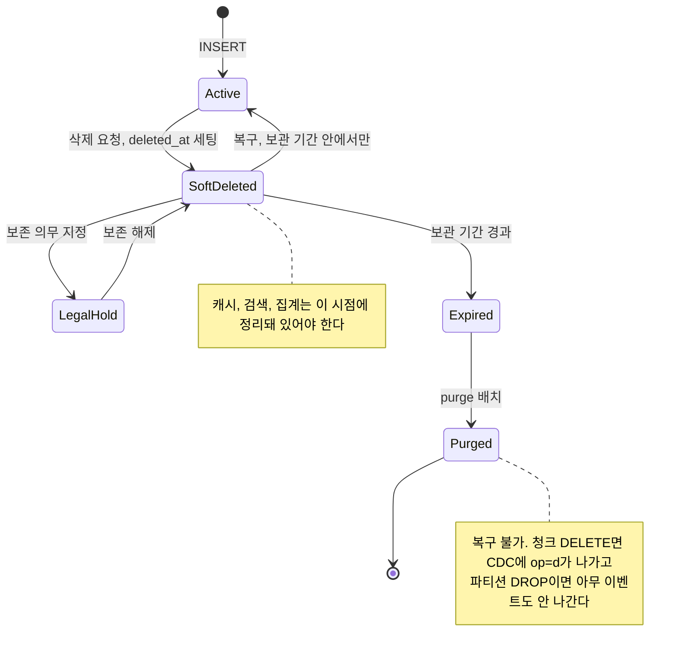
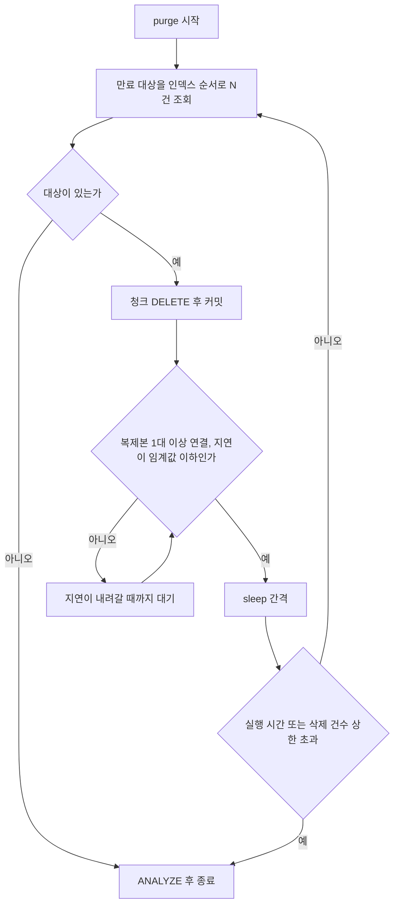
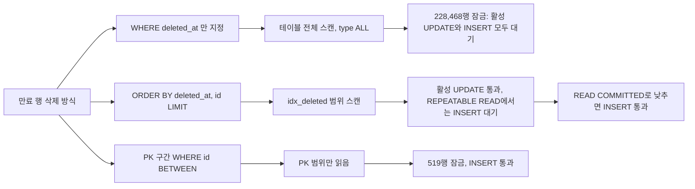
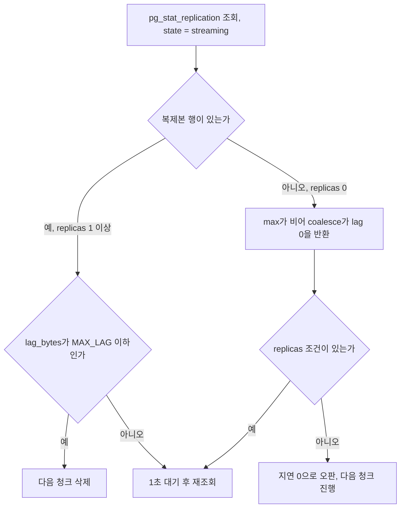
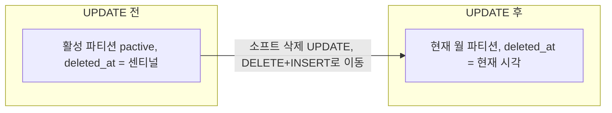
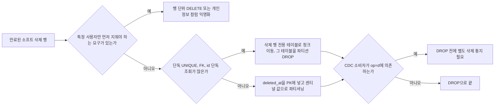
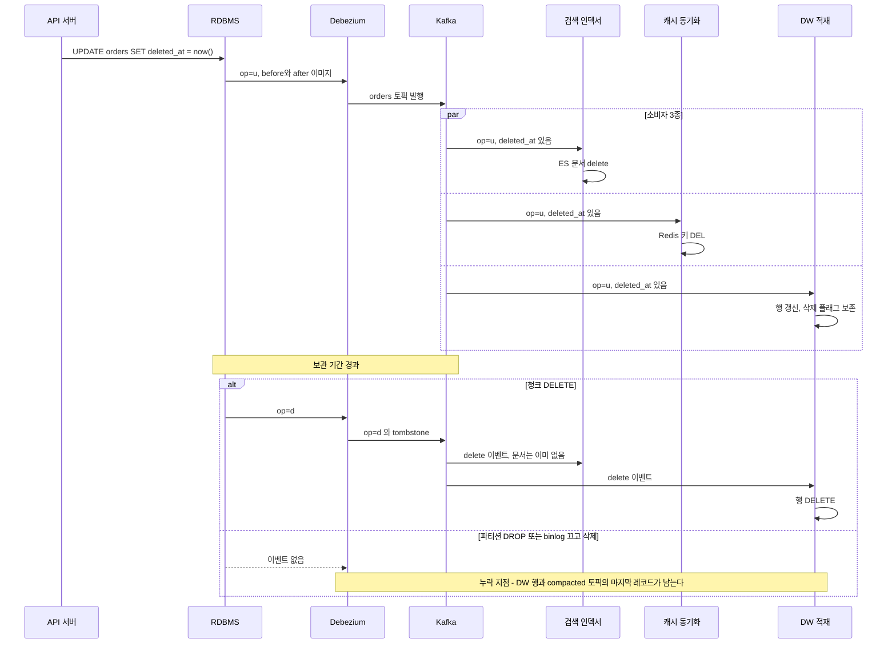
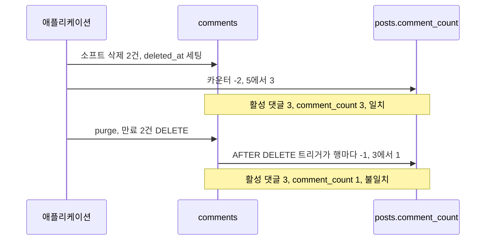

# 소프트 삭제 이후의 purge와 전파

[소프트 삭제](Soft_Delete.md)는 컬럼, 인덱스, FK, unique 충돌까지가 설계 영역이다. 운영에서 사고가 나는 곳은 그다음이다. 보관 기간이 끝난 행을 언제 어떻게 지울지, 지우는 순간 CDC와 검색, 캐시, 웨어하우스가 그 사실을 알게 되는지, 지운 뒤 카운터가 맞는지가 이 문서의 범위다.

아래 내용은 로컬 Docker에서 MySQL 8.0.46과 PostgreSQL 16.15를 띄워 직접 실행한 결과다. 데이터는 `orders` 테이블에 MySQL 약 22만 행(만료 대상 58,276행), PostgreSQL 10만 행(만료 대상 25,834행)을 넣은 작은 규모라서 절대 수치는 벤치마크가 아니다. 경향과 에러 메시지, 락 대기 여부처럼 규모와 무관하게 재현되는 것 위주로 쓴다. Redis, Elasticsearch, Debezium 소비자는 이 환경에서 돌리지 않았고, 그쪽은 DB가 내보내는 이벤트의 모양까지만 확인했다.

## 삭제 생명주기에서 purge가 끼는 자리

소프트 삭제된 행은 `Active`와 `Purged` 사이에 상태가 세 개 더 있다. 보존 의무가 걸린 상태, 보관 기간이 끝나 지울 수 있는 상태, 실제로 지워진 상태다. 이 상태를 코드나 컬럼으로 구분하지 않으면 purge 배치가 보존 의무 대상까지 지운다.



그림에서 볼 곳은 두 군데다. `SoftDeleted`로 들어가는 시점에 하위 시스템 정리가 끝나야 하고, `Purged`로 나가는 방식에 따라 CDC가 알 수 있는지가 갈린다. 뒤의 두 절에서 둘 다 실행 결과로 보인다.

## 보관 기간을 정하는 근거

보관 기간을 "일단 90일"로 박아 두는 경우가 많다. 근거가 되는 숫자는 세 가지이고 모두 테이블마다 다르다.

**복구 요청이 실제로 얼마나 늦게 오는가.** 복구 API가 호출될 때 `restore_log`에 삭제 시각과 복구 시각을 남기고 있으면 분포를 바로 볼 수 있다. 아래는 더미 3,000건(내가 지수분포로 만든 값이라 실서비스 수치가 아니다)으로 돌린 PostgreSQL 쿼리다.

```sql
SELECT count(*) AS restores,
       round(percentile_cont(0.5)  WITHIN GROUP (ORDER BY extract(epoch FROM restored_at - deleted_at)/86400)::numeric, 1) AS p50_days,
       round(percentile_cont(0.95) WITHIN GROUP (ORDER BY extract(epoch FROM restored_at - deleted_at)/86400)::numeric, 1) AS p95_days,
       round(percentile_cont(0.99) WITHIN GROUP (ORDER BY extract(epoch FROM restored_at - deleted_at)/86400)::numeric, 1) AS p99_days,
       round(max(extract(epoch FROM restored_at - deleted_at)/86400)::numeric, 1) AS max_days
  FROM restore_log;
```

```
 restores | p50_days | p95_days | p99_days | max_days
----------+----------+----------+----------+----------
     3000 |      1.5 |      6.4 |      9.7 |     17.7
```

복구의 96.4%가 7일 안, 99.93%가 14일 안에 끝나는 분포다. 이런 결과가 실제로 나오면 90일은 대부분 쓰이지 않는 보관이다. 반대로 `restore_log` 자체가 없으면 이 판단을 할 수 없다. 복구 API만 로그를 남기고 CS 담당자가 DB에서 직접 `deleted_at`을 NULL로 돌리는 경로가 있다면 그 요청은 분포에 안 잡힌다. 분포를 믿기 전에 복구 경로가 몇 개인지부터 센다. MySQL에는 `percentile_cont`가 없어서 같은 분포를 보려면 윈도 함수로 순위를 매겨 직접 뽑아야 한다.

**법적 보존 의무.** 주문처럼 거래 기록이 걸린 테이블은 복구 필요 기간과 상관없이 보존 기간이 정해진다. 전자상거래법의 계약·결제 기록 보존 기간이 5년인 것이 흔한 예인데, 업종과 기록 종류마다 달라서 법무 확인이 먼저다. 여기서 흔히 놓치는 점은 개인정보 파기 의무와 부딪친다는 것이다. 같은 행에 "5년 보존"과 "탈퇴 후 즉시 파기"가 같이 걸린다. 행을 통째로 보존하려 하지 말고, 개인정보 컬럼만 익명화해서 거래 행을 남기는 쪽으로 풀어야 한다. 이 구분은 [GDPR과 개인정보 컴플라이언스](../../Security/GDPR_and_Privacy_Compliance.md)와 [아카이브 테이블](Archive_Table.md)에서 다룬다.

**용량 증가율.** 정상 상태에서 소프트 삭제 행의 수는 `하루 삭제 건수 × 보관 일수`다. 그 이상으로 늘어난다면 purge가 못 따라가고 있다는 신호다. 월별 삭제량과 행 크기는 이렇게 본다.

```sql
SELECT date_trunc('month', deleted_at)::date AS month,
       count(*) AS rows,
       pg_size_pretty(sum(pg_column_size(o.*))) AS row_bytes
  FROM orders o
 WHERE deleted_at IS NOT NULL
 GROUP BY 1 ORDER BY 1 DESC LIMIT 4;
```

로컬 더미에서는 월 2,500행 안팎에 행 데이터 약 565kB가 나왔다. 인덱스와 죽은 튜플은 `pg_column_size`에 안 잡히므로 `pg_total_relation_size`와 같이 본다. 이 숫자에 보관 일수를 곱한 값이 디스크 예산이다.

## purge 한 사이클

purge는 "대상 조회 → 청크 삭제 → 복제 지연 검사 → 대기"를 반복하고 종료 조건을 둘 이상 갖는다. 대상이 없을 때뿐 아니라 실행 시간이나 삭제 건수 상한에서도 끝나야 한다. 상한이 없으면 소프트 삭제가 폭증한 날 배치가 밤새 돌아서 아침 트래픽과 겹친다.



`복제본 1대 이상 연결`이라는 조건이 노드에 들어간 이유는 아래 PostgreSQL 절에서 나온다. 복제본이 끊겼을 때 지연이 0으로 읽혀서 배치가 제동 없이 달리는 사고를 직접 재현했다.

### MySQL에서 한 번에 지우면 막히는 것

만료 행 58,276건을 다음 다섯 방식으로 지우면서, 삭제 트랜잭션을 열어 둔 채 다른 세션에서 네 가지 쓰기를 `innodb_lock_wait_timeout=1`로 시도했다.

| 삭제 방식 (REPEATABLE READ) | 읽은 경로 | 잠근 행 | 삭제 행 | 활성 행 UPDATE | 활성 행 soft delete | 신규 INSERT | 범위 안 행 복구 |
|---|---|---|---|---|---|---|---|
| `DELETE ... WHERE deleted_at < cutoff` | 테이블 전체 스캔 | 228,468 | 58,279 | 대기 | 대기 | 대기 | 대기 |
| `... ORDER BY deleted_at, id LIMIT 60000` | `idx_deleted` 범위 | 116,670 | 58,276 | 통과 | 통과 | 대기 | 대기 |
| 위와 같고 READ COMMITTED | `idx_deleted` 범위 | 116,552 | 58,276 | 통과 | 통과 | 통과 | 대기 |
| `... ORDER BY deleted_at, id LIMIT 1000` | `idx_deleted` 범위 | 2,002 | 1,000 | 통과 | 통과 | 대기 | 대기 |
| `... WHERE id BETWEEN 1000 AND 1999 AND deleted_at < cutoff` | PK 범위 | 519 | 140 | 통과 | 통과 | 통과 | 창 밖 id라 무관 |

"대기"는 전부 `ERROR 1205 Lock wait timeout exceeded`로 끝났다. 삭제 행이 58,279와 58,276으로 갈리는 것은 중간 실험에서 만료 행 3개를 복구해 되살렸기 때문이다.

첫 줄이 가장 눈에 띈다. 만료 행이 전체의 약 26%인 이 테이블에서 옵티마이저가 `idx_deleted` 인덱스를 두고도 `type: ALL`로 테이블 전체를 읽었다. `EXPLAIN DELETE`로 확인한 결과다. REPEATABLE READ에서 전체 스캔 DELETE는 읽은 행을 전부 잠그기 때문에 삭제 대상이 아닌 활성 행의 UPDATE까지 막혔다. 같은 조건에 `ORDER BY deleted_at, id LIMIT`를 붙이면 인덱스 경로로 바뀌어 활성 행 UPDATE가 풀렸다. 청크 DELETE의 이점은 짧은 트랜잭션만이 아니고 이렇게 실행 계획이 바뀌는 쪽에도 있다.

그래도 REPEATABLE READ에서는 인덱스를 타는 청크도 새 활성 행의 INSERT를 막았다. 청크가 1,000건이어도 마찬가지였다. `(deleted_at, id)` 인덱스에서 NULL이 가장 앞에 오기 때문에 스캔 시작 지점의 갭이 잠겨 NULL 엔트리를 넣는 INSERT가 기다리는 것으로 본다. 갭 락이라는 설명은 추정이고, READ COMMITTED로 낮추면 INSERT가 통과한다는 사실은 확인했다. PK 범위로 자르면 읽은 PK 행만 잠그고(519개 중 140개를 삭제), 신규 INSERT는 범위 밖 id라서 통과한다.

세 방식이 어떤 경로로 읽어서 어디까지 막는지는 아래 그림으로 비교한다. 읽는 경로가 갈리는 첫 분기가 잠금 범위를 정한다.



```sql
-- 인덱스 정렬 청크. purge 세션만 READ COMMITTED로 낮춘다
SET SESSION transaction_isolation = 'READ-COMMITTED';
DELETE FROM orders
 WHERE deleted_at < NOW() - INTERVAL 90 DAY
 ORDER BY deleted_at, id
 LIMIT 1000;

-- PK 구간 청크
DELIMITER //
CREATE PROCEDURE purge_pk(IN width INT)
BEGIN
  DECLARE lo BIGINT DEFAULT 0; DECLARE mx BIGINT;
  SELECT MAX(id) INTO mx FROM orders;
  WHILE lo <= mx DO
    DELETE FROM orders
     WHERE id > lo AND id <= lo + width
       AND deleted_at < NOW() - INTERVAL 90 DAY;
    SET lo = lo + width;
  END WHILE;
END//
DELIMITER ;
```

두 방식의 차이는 읽는 양이다. PK 구간은 구간 안의 행을 만료 여부와 상관없이 읽는다. 만료 행이 1,000개 중 140개인 구간도 519개를 잠갔다. 만료 행이 id 전체에 듬성듬성하면 대부분의 구간이 거의 빈손으로 끝난다. 인덱스 정렬 방식은 만료 행만 읽지만 `(deleted_at, id)` 인덱스가 있어야 하고 REPEATABLE READ에서는 INSERT 경합이 남는다. 신규 INSERT 경합이 문제였다면 READ COMMITTED 청크나 PK 구간으로 간다.

전체를 지우는 데 걸린 시간은 단일 DELETE가 5.5초, 1,000건 청크(대기 없이 약 60회)가 9.7초, 5,000 id 구간이 5.7초였다. binlog에 쌓인 양은 세 방식 모두 약 10.8MB로 같았다. 청크는 총 시간을 늘리고 그 대가로 락 점유를 쪼갠다.

한 번에 지웠을 때 흔히 거론되는 undo 폭증은 이 규모에서 재현하지 못했다. undo 파일은 `undo_001`, `undo_002`가 32MB로 그대로였다. 확인된 것은 단일 트랜잭션의 `trx_rows_modified`가 58,276이었다는 점과, 이 트랜잭션을 `ROLLBACK`하는 데 2.6초가 걸렸다는 점이다. 수억 행이면 롤백 시간도 삭제 시간만큼 커진다. 무거운 DELETE를 보고 `KILL`을 눌러도 그 뒤에 롤백이 이어지는 동안 락이 풀리지 않는다.

`trx_rseg_history_len` 지표는 오독하기 쉽다. 장시간 읽기 스냅샷(`START TRANSACTION WITH CONSISTENT SNAPSHOT`)을 열어 둔 채 돌렸더니 청크 방식은 5에서 66으로, 단일 DELETE는 70에서 71로 올랐다. 이 값은 undo 용량이 아니고 커밋된 트랜잭션의 undo 로그 개수다. 청크는 커밋 횟수만큼 수치가 오르므로 이 숫자만 보고 청크가 undo를 더 먹는다고 판단하면 안 된다.

### PostgreSQL에서는 락보다 WAL과 복제

같은 시나리오를 PostgreSQL에서 돌리면 락 쪽은 훨씬 조용하다. 단일 DELETE 트랜잭션을 열어 둔 상태에서 활성 행 UPDATE, 활성 행 soft delete, 신규 INSERT가 모두 통과했고, 지워지는 중인 만료 행을 복구하려는 UPDATE만 `lock_timeout` 1초에 `canceling statement due to lock timeout`으로 실패했다. 읽기 일관성이 MVCC로 풀리기 때문에 삭제 대상 행 외에는 잠기지 않는다.

PostgreSQL에서 문제가 되는 것은 WAL, 죽은 튜플, 복제본이다. 삭제 직후 `n_dead_tup`이 25,834로 삭제 건수와 같았고, `pg_relation_size('orders')`는 DELETE 전후와 일반 `VACUUM` 뒤가 모두 22,757,376바이트로 그대로였다. 파일은 줄지 않는다.

WAL 양은 방식 비교가 어려웠다. 같은 25,834행 DELETE를 매번 `CHECKPOINT` 직후에 돌렸는데도 단일 DELETE가 7.8MB에서 21.2MB, 청크가 9.3MB에서 22.8MB까지 흔들렸다. `full_page_writes`가 체크포인트 직후 처음 건드리는 페이지마다 8KB 전체를 WAL에 쓰기 때문이다. 이걸 임시로 껐더니(측정용이고 운영에서 끄면 안 된다) 값이 고정됐다.

| 방식 (`full_page_writes=off`) | WAL |
|---|---|
| 단일 DELETE | 1.87MB |
| 청크, `FOR UPDATE SKIP LOCKED` | 3.38~3.55MB |
| 청크, 락 없이 `IN (SELECT ...)` | 2.10MB |

`SKIP LOCKED`로 행 락을 먼저 잡는 쪽은 락 기록이 WAL에 한 번 더 남아 단일 DELETE의 약 1.8배, 락 없는 청크의 약 1.6배가 나왔다. 서비스 쓰기와 부딪칠 일이 거의 없는 테이블이면 락 없는 청크가 WAL을 덜 쓴다. 청크 프로시저는 이렇게 쓴다. 프로시저 안에서 `COMMIT`을 호출하려면 `DO`가 아니라 `CALL`로 실행해야 한다.

```sql
CREATE OR REPLACE PROCEDURE purge_chunks(chunk int) LANGUAGE plpgsql AS $$
DECLARE n int := 1;
BEGIN
  WHILE n > 0 LOOP
    WITH victim AS (
      SELECT id FROM orders
       WHERE deleted_at IS NOT NULL AND deleted_at < now() - interval '90 days'
       ORDER BY deleted_at LIMIT chunk FOR UPDATE SKIP LOCKED)
    DELETE FROM orders o USING victim v WHERE o.id = v.id;
    GET DIAGNOSTICS n = ROW_COUNT;
    COMMIT;
  END LOOP;
END $$;
```

이 프로시저에는 복제 지연 검사가 없다. 스트리밍 복제본 하나를 `pg_basebackup`으로 붙이고, 청크마다 지연을 확인하는 셸 스크립트로 바꿨다. 아래 스크립트에서 `psql` 호출만 일반 접속으로 바꿨고 나머지는 실행한 그대로다.

```bash
#!/usr/bin/env bash
CHUNK=1000
MAX_LAG=$((2 * 1024 * 1024))
PSQL="psql -U postgres -tA"

while :; do
  deleted=$($PSQL -c "
    WITH victim AS (
      SELECT id FROM orders
       WHERE deleted_at IS NOT NULL AND deleted_at < now() - interval '90 days'
       ORDER BY deleted_at LIMIT $CHUNK FOR UPDATE SKIP LOCKED),
    d AS (DELETE FROM orders o USING victim v WHERE o.id = v.id RETURNING 1)
    SELECT count(*) FROM d")
  [ "$deleted" -eq 0 ] && break

  while :; do
    read -r replicas lag < <($PSQL -F' ' -c "
      SELECT count(*), coalesce(max(pg_wal_lsn_diff(pg_current_wal_lsn(), replay_lsn)), 0)::bigint
        FROM pg_stat_replication WHERE state = 'streaming'")
    echo "chunk=$deleted replicas=$replicas lag_bytes=$lag"
    [ "$replicas" -ge 1 ] && [ "$lag" -le "$MAX_LAG" ] && break
    sleep 1
  done
done
```

정상 복제 중에는 청크마다 `lag_bytes=0`이 찍히고 끝까지 돌았다. 복제본에서 `pg_wal_replay_pause()`를 호출한 뒤 다시 돌리면 첫 청크 직후 `lag_bytes=36138344`(내가 되살려 넣은 행의 WAL이 포함된 값)가 찍히고, 스크립트는 1초마다 같은 줄을 반복하며 더 지우지 않았다. `pg_wal_replay_resume()` 3초 뒤에 지연이 0으로 돌아왔다.

스크립트 안쪽 루프의 판정을 복제본 상태별로 펼치면 아래와 같다. `replicas` 조건이 없을 때만 오른쪽 아래 경로로 빠져 제동이 풀린다.



`replicas` 조건을 넣은 이유가 이 부분이다. 복제본 컨테이너를 내리고 같은 쿼리를 돌리면 `count=0, lag=0`이 나온다. `pg_stat_replication`에 행이 없으니 `max`가 비고 `coalesce`가 0을 돌려준다. 지연이 0이라는 판정은 복제본이 연결돼 있을 때만 의미가 있다. 이 조건이 없으면 복제본이 죽은 날 purge가 제동 없이 달리고, 복제본이 돌아오면 밀린 WAL을 한꺼번에 받는다. MySQL의 `Seconds_Behind_Source`도 복제 스레드가 멈추면 NULL이 나오는 것으로 알려져 있어 같은 방어가 필요하다고 보지만, 이 환경에는 MySQL 복제본이 없어서 확인하지 못했다.

## 파티션 DROP이 소프트 삭제 테이블에 안 맞는 이유

파티션 DROP은 행 DELETE의 락, WAL, 죽은 튜플을 전부 피한다. 문제는 `deleted_at`을 파티션 키로 잡는 순간 부딪치는 제약이다. 기존 [소프트 삭제](Soft_Delete.md) 문서가 표로 요약한 제약을 실제 에러 메시지로 확인했다.

| 시도 | MySQL 8.0.46 | PostgreSQL 16.15 |
|---|---|---|
| `PRIMARY KEY (id)`, `deleted_at`으로 파티셔닝 | `ERROR 1503 A PRIMARY KEY must include all columns in the table's partitioning function` | `unique constraint on partitioned table must include all partitioning columns` |
| `PRIMARY KEY (id, deleted_at)`, `deleted_at NULL` 허용 | `ERROR 1171 All parts of a PRIMARY KEY must be NOT NULL` | 에러 없이 생성. `\d`에서 `deleted_at`이 `not null`로 바뀌어 있다 |
| NULL 값 INSERT | (위에서 막힘) | `no partition of relation found for row` |
| 위 PK에 `UNIQUE (email)` 추가 | `ERROR 1503 A UNIQUE INDEX must include all columns` | `unique constraint on partitioned table must include all partitioning columns` |
| `UNIQUE (email, deleted_at)` | 가능 | 가능 |

세 번째 줄이 핵심이다. PK에 `deleted_at`을 넣으면 NOT NULL이 강제되므로 "활성 행은 `deleted_at IS NULL`"이라는 전제가 깨진다. MySQL은 거부하고, PostgreSQL은 조용히 NOT NULL로 바꿔 놓는다. 기존 문서가 "MySQL은 NULL을 가장 낮은 파티션에 넣는다"고 쓴 동작은 PK에 포함되지 않는 컬럼으로 파티셔닝할 때의 이야기이고, PK 조건을 맞추면 NULL이 들어갈 자리 자체가 없다.

결국 활성 행에 센티널 값을 넣어야 한다. MySQL은 `'9999-12-31 00:00:00'`, PostgreSQL은 `'infinity'`를 썼다. 센티널을 쓰면 세 가지가 따라온다.

첫째, 모든 활성 행 필터가 바뀐다. 센티널로 만든 MySQL 테이블에서 `WHERE deleted_at IS NULL`은 0건이고 `WHERE deleted_at = '9999-12-31 00:00:00'`은 56,323건이었다. PostgreSQL에서는 `deleted_at IS NULL` 쿼리의 실행 계획이 `One-Time Filter: false`가 됐다. 쿼리 로직을 건드리지 않으면 "활성 데이터가 사라졌다"는 증상으로 나타난다. ORM의 소프트 삭제 필터도 같이 바꿔야 한다. 이 부분은 [JPA Soft Delete](../../Framework/Java/Spring/JPA_Soft_Delete.md)에서 이어진다.

둘째, PK만으로 조회하면 모든 파티션을 뒤진다. MySQL에서 `EXPLAIN SELECT ... WHERE id = 5`가 파티션 15개를 전부 나열했고, `deleted_at = '9999-12-31 00:00:00'`을 같이 주자 `pactive` 하나만 남았다. PostgreSQL도 `WHERE id = 1`은 파티션 3개에 비트맵 스캔을 각각 걸었고, `deleted_at = 'infinity'`를 같이 주면 `q4_active_pkey` 하나만 탔다. 외부 API가 id만 들고 들어오는 경로가 많다면 파티션 수만큼 조회 비용이 곱해진다.

셋째, 소프트 삭제 UPDATE가 행을 파티션 사이로 옮긴다. `deleted_at`을 센티널에서 현재 시각으로 바꾸면 활성 파티션에서 현재 월 파티션으로 이동한다. MySQL의 `information_schema.partitions`와 PostgreSQL의 `tableoid`로 둘 다 확인했다. 단순 UPDATE보다 비싼 DELETE+INSERT가 일어난다.

행이 어느 파티션에서 어느 파티션으로 넘어가는지는 아래처럼 한 방향이다. 소프트 삭제 UPDATE 한 번이 파티션 이동 한 번이다.



PostgreSQL에서 마지막 파티션 경계를 `TO ('infinity')`로 잡으면 상한이 배타라서 `infinity` 행이 들어갈 곳이 없다. `no partition of relation found for row` 에러가 났고, `TO (MAXVALUE)`로 바꿔서 해결했다. 센티널을 쓰는 전제에서 한 번쯤 밟는 함정이다.

그래서 파티션 DROP을 쓰려면 활성 테이블을 그대로 두고 삭제 행 전용 테이블을 따로 파티셔닝하는 두 단계 구조가 현실적이다. 이동은 청크로 하고 만료는 파티션 DROP으로 한다. 어떤 방식을 고를지는 아래 순서로 갈린다.



마지막 분기가 다음 절의 주제다.

## 전파의 누락 지점

소프트 삭제 시점과 purge 시점에 DB가 내보내는 이벤트는 서로 다르다. MySQL과 PostgreSQL 양쪽에서 같은 순서로 `UPDATE ... SET deleted_at`, `DELETE`, 로그 우회 삭제, 파티션 제거를 실행하고 변경 로그를 디코딩했다.



위쪽 반은 소프트 삭제 때 정상 경로다. 아래쪽 `alt`가 purge이고, 청크 DELETE만 `op=d`를 낸다. 아래 로그는 MySQL `mysqlbinlog -vv --base64-output=decode-rows`와 PostgreSQL `test_decoding` 슬롯에서 읽은 것이다.

```
-- MySQL binlog (binlog_row_image=FULL)
Update_rows  UPDATE evt
  WHERE  @1=1 @2='kim' @3=NULL
  SET    @1=1 @2='kim' @3='2026-10-21 10:00:00'
Delete_rows  DELETE FROM evt
  WHERE  @1=1 @2='kim' @3='2026-10-21 10:00:00'
(sql_log_bin=0 으로 id=2 삭제)  -> 이벤트 없음. 테이블에서는 사라짐
ALTER TABLE evtp DROP PARTITION p_old  -> Query 이벤트 하나, 행 이벤트 없음

-- PostgreSQL test_decoding (기본 REPLICA IDENTITY)
table public.evt: UPDATE: id[bigint]:1 name[text]:'kim' deleted_at[...]:'2026-10-21 10:00:00+00'
table public.evt: DELETE: id[bigint]:1
ALTER TABLE q4 DETACH PARTITION q4_old CONCURRENTLY; DROP TABLE q4_old;  -> 변경 레코드 없음
```

여기서 확인된 사실이 네 가지다.

소프트 삭제는 UPDATE, purge는 DELETE로 따로 나간다. 소비자가 `op=d`만 삭제로 보면 소프트 삭제를 놓치고, 반대로 `deleted_at`만 보면 purge를 놓친다. 둘 다 처리해야 한다.

MySQL의 `Delete_rows`는 행 전체 이미지를 싣는다. 그 안의 `deleted_at`이 채워져 있으니 소비자는 "이 키는 이미 소프트 삭제 이벤트로 처리했다"고 판단하고 건너뛸 수 있다. PostgreSQL은 기본 `REPLICA IDENTITY`에서 `DELETE`에 PK만 싣는다. 소비자가 purge로 인한 삭제와 소프트 삭제 없이 바로 일어난 하드 삭제를 구분할 수 없고, 문서 라우팅에 필요한 `tenant_id` 같은 컬럼도 알 수 없다. `REPLICA IDENTITY FULL`로 바꾸면 전체 이미지가 실린다는 것은 알고 있지만 이 환경에서는 실행해 보지 않았다.

`SET sql_log_bin=0`으로 purge 세션의 binlog를 끄는 방법이 복제 지연을 줄이려는 용도로 돌아다닌다. 이 방식으로 지운 행은 복제본에도, CDC에도 전달되지 않는다. 테이블에서만 조용히 사라진다. 복제본과 원본의 데이터가 어긋나는 문제는 별도로 하고, CDC 관점에서는 `op=d`가 영원히 오지 않는다.

파티션 DROP도 같다. MySQL은 DDL 문장만 binlog에 남고, PostgreSQL은 변경 레코드가 하나도 안 나갔다. `Purged` 상태에 들어갔는데 CDC는 모른다. 소프트 삭제 때 `op=u`로 `deleted_at`이 채워진 레코드가 Kafka compacted 토픽에 마지막 값으로 남고, 삭제를 알리는 tombstone이 없으니 그 키의 마지막 레코드가 그대로 남는다. 개인정보가 들어 있었다면 토픽에 계속 남는다. 웨어하우스도 같다.

### Redis, Elasticsearch, 웨어하우스에서 purge 때 할 일

Redis와 Elasticsearch는 소프트 삭제 시점에 이미 정리하는 것이 원칙이라 purge 시점에 할 일은 거의 없다. 그 코드는 [소프트 삭제](Soft_Delete.md)의 하위 시스템 절에 있다. purge에서 새로 생기는 일은 소비자가 대량의 `op=d`를 받는 상황이다. 청크 1,000건이면 한 번에 1,000개의 delete와 tombstone이 흐른다. 소비자는 존재하지 않는 키의 삭제를 에러로 취급하면 안 되고, 위에서 본 MySQL처럼 `before` 이미지에 `deleted_at`이 있는 이벤트면 아예 건너뛴다. 이 판별이 안 되는 PostgreSQL 기본 설정에서는 `op=d`가 올 때마다 DEL과 ES delete를 한 번씩 더 부른다. 대부분 404나 0을 돌려받고 끝나지만 트래픽이 소비자 처리량을 잡아먹는 시간이 생긴다.

Elasticsearch 전체 reindex는 다른 위험이다. reindex 쿼리가 `deleted_at IS NULL` 조건 없이 테이블을 읽으면 소프트 삭제된 행이 새 인덱스로 들어간다. 라이브 인덱서가 delete를 보내도 새 인덱스를 가리키는 alias 전환 전이면 그 delete는 옛 인덱스에만 적용된다. reindex 쿼리에 필터를 넣고, 전환 직전에 reindex 시작 이후의 이벤트를 새 인덱스에 다시 흘려야 한다. 이 순서는 로직으로 따진 것이고 이 환경에서 돌려 보지는 않았다.

웨어하우스는 두 가지를 정해야 한다. 소프트 삭제된 행을 적재 테이블에 `deleted_at` 컬럼과 함께 남기고 분석 뷰에서 필터하는 방식은 일반적이고, purge 이후 DW에서도 지울지는 보존 정책이 정한다. 개인정보가 들어 있으면 지워야 하고, 그러면 `op=d` 소비 또는 키 대조 배치가 필요하다. 위에서 본 대로 파티션 DROP이나 로그 우회 삭제는 `op=d`를 못 만든다. 그 경로를 쓰면 DW 삭제는 키 대조 배치만 남는다.

## purge가 건드리는 카운터

카운터 보정은 소프트 삭제 시점에 이미 끝나 있어야 한다. 그런데 purge 쪽에서 같은 카운터를 한 번 더 깎는 경로가 생긴다. `comments` 테이블에 `AFTER DELETE` 트리거로 `posts.comment_count`를 줄이는 코드를 넣고 확인했다. 소프트 삭제 때는 애플리케이션이 카운터를 같이 줄이도록 했다.

```sql
-- 댓글 5개, comment_count=5
-- 소프트 삭제 2건 + 애플리케이션이 카운터 -2
-- comment_count=3, 활성 댓글=3  (일치)

DELETE FROM comments WHERE deleted_at < now() - interval '90 days';
-- 트리거가 삭제된 2행마다 -1
-- comment_count=1, 활성 댓글=3  (불일치)
```

같은 두 단계를 순서대로 그리면 어디서 카운터가 두 번 깎이는지 보인다. 두 번째 감소가 purge 쪽 트리거에서 나온다.



MySQL과 PostgreSQL이 똑같이 `counter=1, actual=3`이 됐다. 원인은 카운터 감소가 "행이 삭제될 때"에도 걸려 있고 "`deleted_at`이 채워질 때"에도 걸려 있었기 때문이다. DB 트리거, JPA의 `@PreRemove` 콜백, 삭제 이벤트를 소비해서 카운터를 깎는 소비자가 모두 같은 위험을 갖는다. 카운터는 `deleted_at`이 NULL에서 값으로 바뀌는 전이에만 묶고, 물리 삭제 경로에는 아무것도 걸지 않아야 한다.

purge 전에 하나 더 챙길 것이 있다. 카운터와 실제 값의 대조 쿼리([소프트 삭제](Soft_Delete.md)의 집계 절에 있다)는 원본 행이 있어야 돌아간다. purge 이후에는 어긋난 카운터를 맞출 기준이 사라진다. purge 배치의 첫 단계로 대조를 돌리고, 어긋난 행이 있으면 보정한 뒤 지운다.

## 관련 문서

- [소프트 삭제](Soft_Delete.md): 컬럼, 인덱스, FK, unique 충돌 설계
- [아카이브 테이블](Archive_Table.md): 삭제 행을 별도 저장소로 옮기는 방식
- [CDC 파이프라인](CDC_Pipeline.md): 소비자 멱등성과 이벤트 순서
- [GDPR과 개인정보 컴플라이언스](../../Security/GDPR_and_Privacy_Compliance.md): 파기 의무와 보존 의무의 충돌
- [JPA Soft Delete](../../Framework/Java/Spring/JPA_Soft_Delete.md): 센티널 값으로 바꿀 때 ORM 필터 수정
