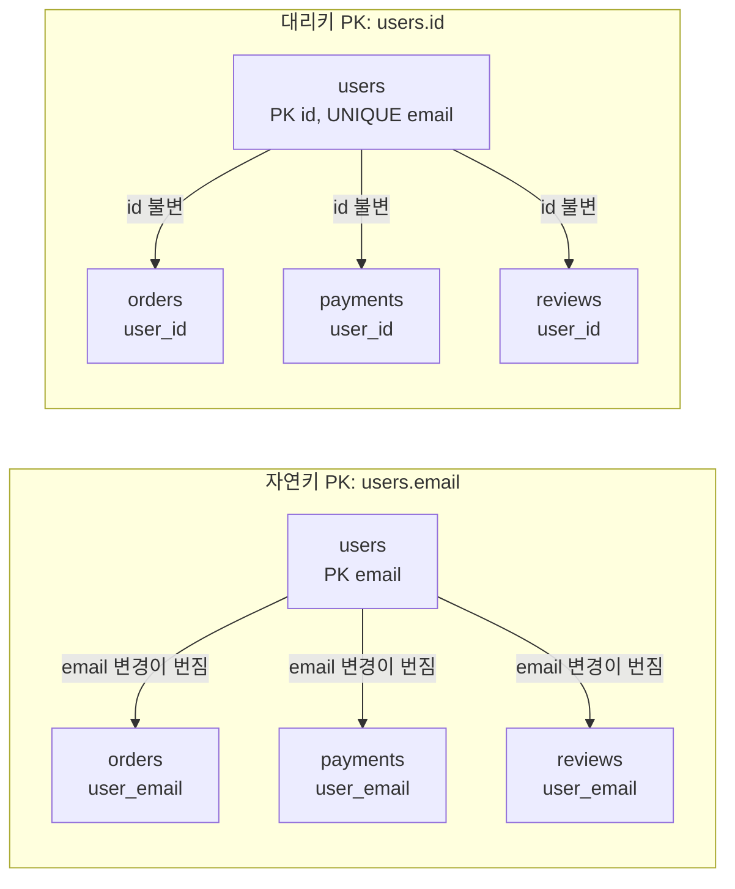
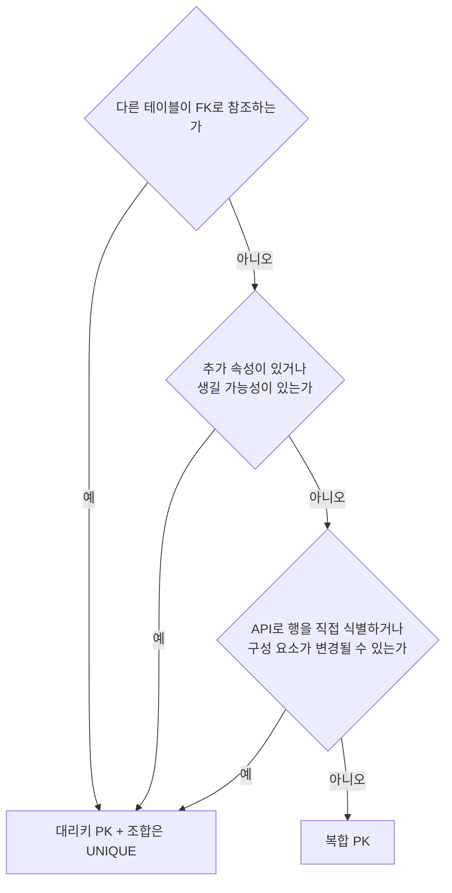
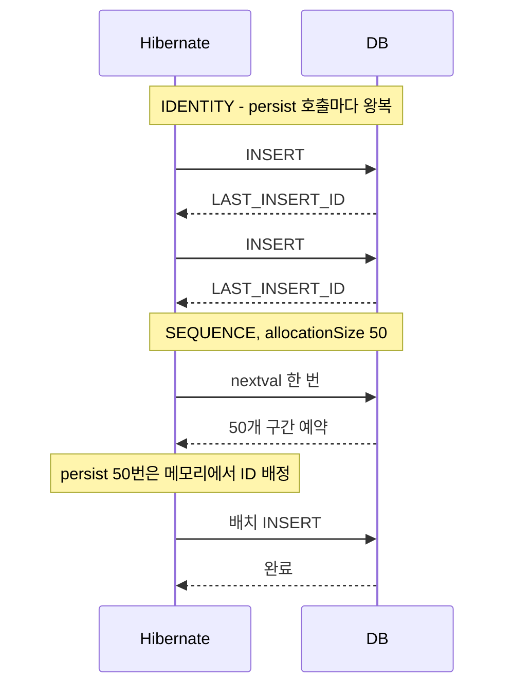
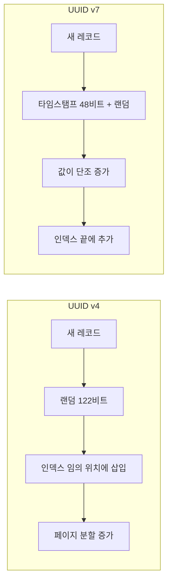
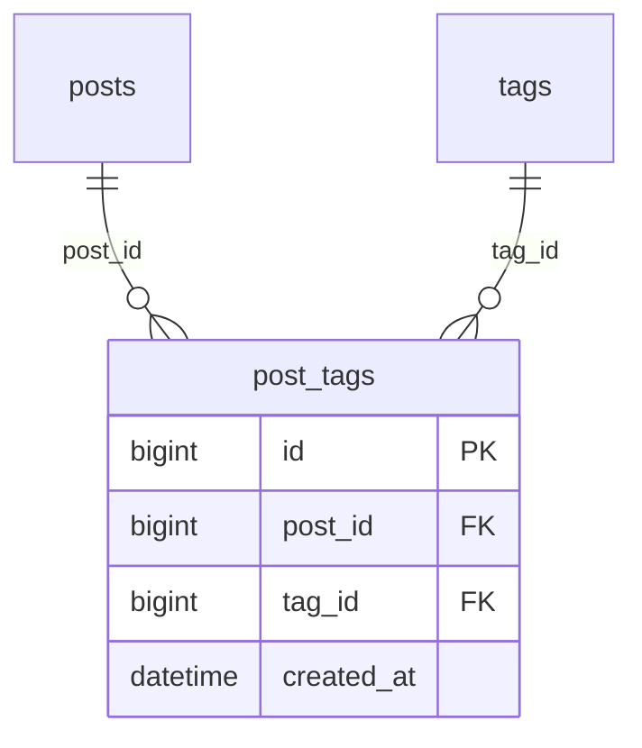
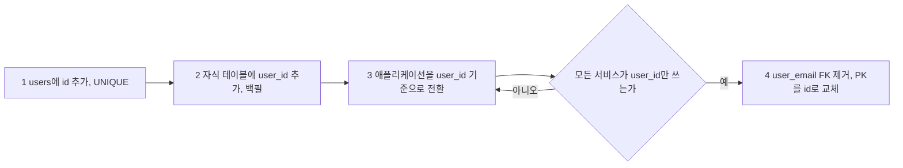
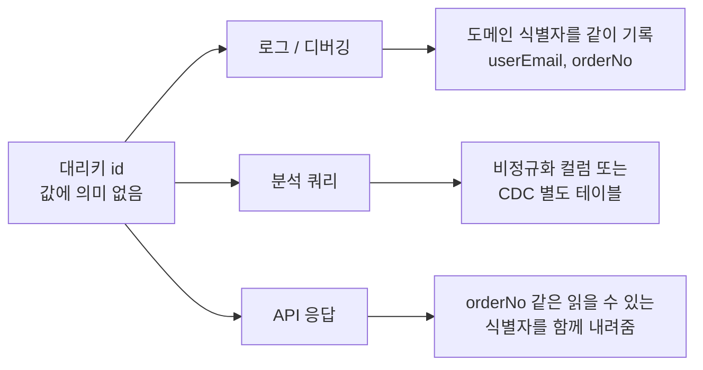

# 대리키

대리키(Surrogate Key)는 도메인 의미 없이 시스템이 만들어 주는 식별자를 PK로 쓰는 방식이다. auto-increment, UUID, ULID, Snowflake ID가 모두 여기에 해당한다. 도메인 값 자체를 PK로 삼는 자연키(Natural Key)와 대비된다.

실무에서 자연키를 PK로 설계했다가 나중에 대리키로 바꾸는 작업은 생각보다 훨씬 고통스럽다. 데이터가 수백만 건 쌓인 뒤에는 FK 컬럼 전체를 바꿔야 하고, 그 과정에서 쓰기가 막히는 구간이 생긴다. 이 문서는 자연키 PK를 대리키로 분리했을 때 구조가 어떻게 달라지는지, 복합 PK를 언제 대리키로 바꿔야 하는지, ID 생성 방식이 쓰기 성능에 주는 영향, 운영 중인 테이블에 대리키를 붙이는 마이그레이션을 다룬다.

같은 주제를 다루는 문서가 셋이라 역할을 나눠 둔다.

| 문서 | 맡는 내용 |
|---|---|
| 이 문서 | 자연키 PK와 대리키 PK의 구조 비교, 복합 PK 전환 기준, ID 생성 방식별 동작, 마이그레이션 |
| [자연키](Natural_Key.md) | 자연키가 맞는 경우, `ON UPDATE CASCADE`의 잠금·연쇄·이력 문제, 유일성이 깨지는 사례 |
| [식별자 설계](Identifier_Design.md) | auto-increment, UUID, ULID, Snowflake 중 무엇을 고를지에 대한 선택 순서와 성능 수치 |

## 자연키를 PK로 두면 변경이 어디까지 번지는가

`users.email`을 PK로 쓰고 `orders`, `payments`, `reviews`가 `user_email`로 참조하는 구조를 예로 든다. 이메일이 바뀌는 순간 참조하는 테이블 셋이 모두 영향을 받는다. 대리키 `id`를 PK로 세우고 `email`을 UNIQUE로 내리면 `users` 한 행만 바뀐다.



왼쪽은 `users.email` 한 번의 UPDATE가 자식 테이블 세 곳의 `user_email`까지 바꿔야 끝난다. 오른쪽은 이메일이 바뀌어도 자식 테이블이 들고 있는 `user_id`는 그대로다.

MySQL 8.0.46에서 왼쪽 구조를 그대로 돌려보면 동작이 갈린다. FK에 `ON UPDATE CASCADE`가 없으면 부모 행의 PK를 바꾸는 UPDATE가 자식 행이 하나라도 있는 순간 에러로 끝난다.

```
ERROR 1451 (23000): Cannot delete or update a parent row: a foreign key constraint fails
```

`ON UPDATE CASCADE`를 걸면 UPDATE는 성공하고 자식 테이블의 `user_email`도 같이 바뀐다. 이메일 변경 한 번이 자식 테이블 행 수만큼의 쓰기로 커지는 셈이다. 잠금 범위, 여러 단계로 이어지는 연쇄, 이력 테이블이 덮어써지는 문제는 [자연키](Natural_Key.md)의 `ON UPDATE CASCADE 한계` 절에서 다룬다.

```sql
CREATE TABLE users (
    id    BIGINT NOT NULL AUTO_INCREMENT PRIMARY KEY,
    email VARCHAR(254) NOT NULL,
    name  VARCHAR(50) NOT NULL,
    UNIQUE INDEX uq_email (email)
);
```

대리키로 분리해도 이메일의 중복 방지는 `uq_email`이 맡는다. 잃는 것은 PK 값만 보고 행을 알아볼 수 있다는 점이고, 이 문제는 이 문서 끝의 `대리키만으로는 관계를 파악할 수 없는 문제` 절에서 다룬다. 국가 코드나 통화 코드처럼 사실상 변하지 않는 값은 자연키로 두는 편이 낫다. 기준은 [자연키](Natural_Key.md)에 있다.

## 복합 PK와 대리키

N:M 관계 테이블은 복합 PK로 시작하는 경우가 많다. 직관적이고 별도 컬럼이 필요 없다. 문제는 그 테이블이 단순 연결 이상의 역할을 맡기 시작할 때 생긴다.

### 복합 PK로 충분한 경우

값이 변하지 않고, 다른 테이블이 FK로 참조하지 않고, 이 테이블의 행을 API로 직접 가리킬 일이 없을 때다.

```sql
CREATE TABLE user_roles (
    user_id  BIGINT NOT NULL,
    role_id  BIGINT NOT NULL,
    PRIMARY KEY (user_id, role_id),
    FOREIGN KEY (user_id) REFERENCES users(id),
    FOREIGN KEY (role_id) REFERENCES roles(id)
);
```

삽입, 삭제, 조회가 전부라면 `(user_id, role_id)` 복합 PK 하나로 끝난다.

### 복합 PK가 문제가 되는 경우

```sql
CREATE TABLE order_items (
    order_id    BIGINT NOT NULL,
    product_id  BIGINT NOT NULL,
    quantity    INT NOT NULL,
    unit_price  DECIMAL(10, 2) NOT NULL,
    PRIMARY KEY (order_id, product_id)
);
```

`order_items`를 참조하는 테이블이 생기면 FK가 `(order_id, product_id)` 두 컬럼이 된다. 자식 테이블에 컬럼이 둘 늘고, 인덱스가 커지고, 조인 조건이 길어진다. 같은 상품을 다른 옵션으로 두 번 주문하는 요구가 들어오면 PK 자체를 바꿔야 한다. 이때는 대리키를 PK로 세우고 기존 조합을 UNIQUE로 내린다.

```sql
CREATE TABLE order_items (
    id          BIGINT NOT NULL AUTO_INCREMENT PRIMARY KEY,
    order_id    BIGINT NOT NULL,
    product_id  BIGINT NOT NULL,
    quantity    INT NOT NULL,
    unit_price  DECIMAL(10, 2) NOT NULL,
    UNIQUE INDEX uq_order_product (order_id, product_id),
    FOREIGN KEY (order_id)   REFERENCES orders(id),
    FOREIGN KEY (product_id) REFERENCES products(id)
);
```

옵션 구분이 필요해지면 `uq_order_product`만 `(order_id, product_id, option_id)`로 바꾸면 되고 PK와 자식 테이블의 FK는 건드리지 않는다.

| 상황 | 선택 |
|------|------|
| 단순 연결 테이블이고 다른 테이블에서 FK로 참조되지 않음 | 복합 PK |
| 연결 테이블에 추가 속성이 있거나 생길 가능성이 있음 | 대리키 |
| 연결 테이블 자체를 API로 직접 식별해야 함 | 대리키 |
| 구성 요소 중 하나가 변경될 수 있음 | 대리키 |

확장 가능성이 조금이라도 보이면 처음부터 대리키가 낫다. 나중에 바꾸는 비용은 아래 마이그레이션 절에서 본다.



위 표의 네 행을 순서대로 묻는 절차로 바꾼 것이다. 하나라도 걸리면 대리키 쪽으로 간다.

## ID 생성 방식별 동작

대리키를 어떻게 만드느냐에 따라 INSERT가 DB 왕복 몇 번으로 끝나는지가 달라진다. Java의 JPA(Hibernate)와 TypeORM에서 각각 확인한다. 어떤 ID 체계를 고를지는 [식별자 설계](Identifier_Design.md)의 `선택 순서`를 먼저 보고, 여기서는 고른 뒤 ORM에서 어떻게 선언하는지를 다룬다.

### IDENTITY와 AUTO_INCREMENT

DB가 INSERT 시점에 값을 정한다. ORM은 INSERT가 끝나야 PK를 알 수 있다. MySQL에서는 `LAST_INSERT_ID()`, PostgreSQL에서는 `RETURNING id`로 받아온다.

```java
@Entity
public class Orders {
    @Id
    @GeneratedValue(strategy = GenerationType.IDENTITY)
    private Long id;
}
```

Hibernate는 `persist()` 시점에 엔티티를 영속성 컨텍스트에 넣으려면 PK가 필요해서 IDENTITY일 때는 flush를 기다리지 않고 즉시 INSERT를 실행한다. 그래서 JDBC 배치 INSERT가 꺼진다. 엔티티 100개를 `persist()`하면 INSERT 100번이 각각 왕복한다.

TypeORM의 `@PrimaryGeneratedColumn()`은 MySQL에서 AUTO_INCREMENT, PostgreSQL에서 SERIAL로 매핑된다.

```typescript
@Entity()
export class Order {
    @PrimaryGeneratedColumn()
    id: number;
}
```

반복문 안에서 `await manager.save()`를 부르면 생성 방식과 무관하게 호출마다 쿼리가 나간다. 대량 저장이 필요하면 배열을 한 번에 넘기거나 `insert()`를 쓴다.

```typescript
// 건별 왕복: 100건이면 쿼리 100번
for (const order of orders) {
    await manager.save(Order, order);
}

// 한 번에 전달
await manager.insert(Order, orders);
```

### SEQUENCE

PostgreSQL과 Oracle의 시퀀스 객체에서 값을 먼저 받아온다. INSERT 전에 PK를 알 수 있어 Hibernate가 JDBC 배치를 쓸 수 있다.

```java
@Id
@GeneratedValue(strategy = GenerationType.SEQUENCE, generator = "orders_seq")
@SequenceGenerator(name = "orders_seq", sequenceName = "orders_seq", allocationSize = 50)
private Long id;
```

```sql
CREATE SEQUENCE orders_seq START WITH 1 INCREMENT BY 50;
```

`allocationSize = 50`은 시퀀스를 한 번 호출할 때 50개 구간을 예약해 메모리에서 나눠 쓴다는 뜻이다. 50번의 `persist()` 동안 시퀀스 조회가 한 번이다. DB 시퀀스의 `INCREMENT BY`와 `allocationSize`가 어긋나면 ID가 겹치거나 건너뛰는 문제가 생기니 둘을 같은 값으로 맞춘다.



IDENTITY는 INSERT가 끝나야 PK를 알 수 있어 건별로 왕복하고, SEQUENCE는 구간을 한 번 예약해 두면 INSERT를 모아 보낼 수 있다.

TypeORM에는 `allocationSize` 같은 구간 예약이 없다. `@PrimaryGeneratedColumn('increment')`는 PostgreSQL에서 시퀀스를 쓰는 SERIAL 컬럼일 뿐이고, 행마다 값이 하나씩 배정된다.

MySQL에는 시퀀스 객체가 없다. Hibernate는 테이블로 에뮬레이션한다. 5.x는 `hibernate_sequence` 하나를 공유하고, 6.x는 엔티티별 `<엔티티>_SEQ` 테이블을 만든다.

```sql
CREATE TABLE hibernate_sequence (next_val BIGINT);
```

MySQL에서 SEQUENCE를 고르면 값을 받아올 때마다 이 테이블의 행에 UPDATE 잠금이 걸린다. `allocationSize` 덕분에 호출은 구간당 한 번이라 대부분은 문제가 안 되지만, 인스턴스가 많고 `allocationSize`가 1이면 이 한 행이 병목이 된다. MySQL에서는 IDENTITY가 단순하고, 배치 INSERT가 꼭 필요할 때만 SEQUENCE 에뮬레이션이나 `JdbcTemplate` 배치를 따로 검토한다.

### TABLE

시퀀스 에뮬레이션 테이블을 직접 정의하는 방식이다. 이식성은 가장 높고 잠금 경합도 가장 크다. 실무에서 쓸 일이 거의 없다.

### UUID

```typescript
@Entity()
export class Session {
    @PrimaryGeneratedColumn('uuid')
    id: string;
}
```

`'uuid'`는 UUID v4를 만든다. InnoDB에서 PK로 쓰면 페이지 분할이 많아진다. 수치와 대응 방법은 [식별자 설계](Identifier_Design.md)의 `InnoDB UUID PK 페이지 분할` 절에 있다. UUID를 PK로 쓸 거면 애플리케이션에서 v7을 만들어 `@PrimaryColumn`에 넣는다.

```typescript
import { v7 as uuidv7 } from 'uuid';

@Entity()
export class Session {
    @PrimaryColumn('uuid')
    id: string;

    @BeforeInsert()
    generateId(): void {
        if (!this.id) {
            this.id = uuidv7();
        }
    }
}
```

`@PrimaryGeneratedColumn('uuid')`는 생성을 TypeORM에 맡기고, `@PrimaryColumn`과 `@BeforeInsert()`를 조합하면 생성 시점과 버전을 직접 정한다.

## 키 공간 설계

대리키 타입을 고를 때는 발급 가능한 값의 범위(키 공간)를 먼저 따진다. 단일 DB의 `AUTO_INCREMENT`와 노드마다 독립적으로 만드는 UUID, ULID는 설계 전제가 다르다. 어떤 조건에서 무엇을 고를지는 [식별자 설계](Identifier_Design.md)의 `선택 순서` 도식을 따르고, 이 절은 키 공간 숫자만 정리한다.

### AUTO_INCREMENT 상한

```sql
-- INT: 상한 2,147,483,647 (약 21억)
CREATE TABLE events (id INT NOT NULL AUTO_INCREMENT PRIMARY KEY);

-- BIGINT: 상한 9,223,372,036,854,775,807 (약 922경)
CREATE TABLE events (id BIGINT NOT NULL AUTO_INCREMENT PRIMARY KEY);
```

INT 상한은 초당 1만 건 삽입 기준으로 약 59시간이면 소진된다. 트래픽을 예측하기 어렵다면 처음부터 BIGINT를 쓴다. BIGINT는 초당 100만 건을 넣어도 약 29만 년이 걸리므로 단일 DB에서는 한계가 아니다. 상한에 닿은 뒤의 증상과 대응은 [AUTO_INCREMENT](Auto_Increment.md)에 있다.

`AUTO_INCREMENT`는 서버 하나가 카운터를 쥐고 있어서 여러 노드가 독립적으로 발급할 수 없다.

### UUID 비트 배치

UUID는 128비트 고정 길이이고 v4와 v7은 비트를 쓰는 방식이 다르다.

```
UUID v4  xxxxxxxx-xxxx-4xxx-yxxx-xxxxxxxxxxxx
  버전 4비트 + 배리언트 2비트 = 6비트 고정
  랜덤 122비트 → 키 공간 2^122 ≈ 5.3 × 10^36

UUID v7  tttttttt-tttt-7xxx-yxxx-xxxxxxxxxxxx
  타임스탬프 48비트 (Unix epoch 밀리초)
  버전 4비트 + 밀리초 내 랜덤/시퀀스 12비트
  배리언트 2비트 + 랜덤 62비트
  밀리초 내 랜덤 74비트 (12 + 62)
```

v4는 키 공간이 넓지만 완전한 랜덤이라 InnoDB 클러스터드 인덱스의 임의 위치에 삽입된다. v7은 앞 48비트가 시간이라 값이 단조 증가하고 새 레코드가 인덱스 끝에 붙는다. 전체 분석은 [식별자 설계](Identifier_Design.md)와 [B-Tree 페이지 분할](B_Tree_Page_Split.md)에 있다.



같은 128비트라도 앞쪽 비트가 랜덤이냐 시간이냐에 따라 클러스터드 인덱스에 들어가는 위치가 갈린다는 점을 보면 된다.

### ULID

ULID는 타임스탬프 48비트와 랜덤 80비트를 Crockford Base32 26자로 인코딩한 값이다. 128비트 구조는 UUID v7과 같고 밀리초 내 랜덤이 74비트가 아니라 80비트다. 타임스탬프 48비트의 표현 범위는 약 8,900년이다.

```
01ARZ3NDEKTSV4RRFFQ69G5FAV

┌──────────────────────┬─────────────────────────────────────────┐
│  타임스탬프 48비트    │              랜덤 80비트                 │
└──────────────────────┴─────────────────────────────────────────┘
```

같은 밀리초 안에서 생성 순서까지 보장해야 하면 `monotonicFactory`를 쓴다.

```typescript
import { monotonicFactory } from 'ulid';

const ulid = monotonicFactory();

const id1 = ulid();
const id2 = ulid(); // 같은 밀리초여도 id1 < id2
```

같은 밀리초에는 랜덤 부분을 1씩 올려서 단조성을 유지한다. 한 밀리초에 2^80개를 넘게 만들 일은 없으니 오버플로는 이론상 한계다. 인코딩과 라이브러리 비교는 [ULID](ULID.md)에서 다룬다.

### 충돌 확률

생일 문제 근사식 `P ≈ k² / 2n`으로 계산한다(k개를 크기 n인 공간에서 뽑을 때, k가 √n보다 훨씬 작을 때). v7과 ULID는 밀리초마다 랜덤이 새로 뽑히므로 같은 밀리초에 몇 건이 생성되는지가 k다.

| 타입 | 랜덤 비트 | 키 공간 n | 조건 | 충돌 확률 |
|------|----------|-----------|------|----------|
| UUID v4 | 122 | 2^122 ≈ 5.3 × 10^36 | 누적 10억 개 | ≈ 9.4 × 10^-20 |
| UUID v7 | 74 | 2^74 ≈ 1.9 × 10^22 | 같은 밀리초에 10만 건 | ≈ 2.6 × 10^-13 |
| ULID | 80 | 2^80 ≈ 1.2 × 10^24 | 같은 밀리초에 10만 건 | ≈ 4.1 × 10^-15 |

v7과 ULID의 값은 밀리초 하나에 대한 확률이다. 한 노드가 밀리초에 10만 건을 계속 찍는 일은 현실에 거의 없고, 밀리초당 수십 건 수준이면 확률은 더 몇 자리 내려간다.

실제 분산 환경에서 대리키 충돌이 난 사례는 UUID가 아니라 `타임스탬프 + 서버 ID + 시퀀스` 형태로 직접 만든 ID에서 나왔다. 서버 ID를 두 대에 똑같이 설정했거나 NTP 재동기화로 시계가 되돌아간 경우가 대부분이었다.

## 브릿지 테이블에 대리키 추가

N:M 관계를 풀어낸 연결 테이블에 대리키를 두는 구조다.



`posts`와 `tags`는 각각 `post_tags`와 1:N이다. `post_tags`의 PK는 `id`이고 `(post_id, tag_id)` 조합의 유일성은 UNIQUE 인덱스가 맡는다.

### 처음부터 설계하는 경우

```sql
CREATE TABLE post_tags (
    id         BIGINT NOT NULL AUTO_INCREMENT PRIMARY KEY,
    post_id    BIGINT NOT NULL,
    tag_id     BIGINT NOT NULL,
    created_at DATETIME NOT NULL DEFAULT CURRENT_TIMESTAMP,
    UNIQUE INDEX uq_post_tag (post_id, tag_id),
    FOREIGN KEY (post_id) REFERENCES posts(id) ON DELETE CASCADE,
    FOREIGN KEY (tag_id)  REFERENCES tags(id)  ON DELETE CASCADE
);
```

`UNIQUE INDEX (post_id, tag_id)`는 `post_id` 단독 검색에는 쓰이지만 `tag_id` 단독 검색에는 쓰이지 않는다. 태그로 포스트를 찾는 쿼리가 있으면 `tag_id` 인덱스를 따로 만든다.

```sql
INDEX idx_tag_id (tag_id)
```

### TypeORM에서 엔티티로 분리

단순 N:M은 `@ManyToMany`로 매핑하면 되지만, 연결 테이블에 컬럼이 붙거나 행을 직접 가리켜야 하면 엔티티로 뺀다.

```typescript
@Entity('post_tags')
export class PostTag {
    @PrimaryGeneratedColumn()
    id: number;

    @ManyToOne(() => Post, { lazy: true })
    @JoinColumn({ name: 'post_id' })
    post: Post;

    @ManyToOne(() => Tag, { lazy: true })
    @JoinColumn({ name: 'tag_id' })
    tag: Tag;

    @Column({ name: 'created_at', type: 'timestamp', default: () => 'CURRENT_TIMESTAMP' })
    createdAt: Date;
}
```

`Post`와 `Tag`에서는 `@OneToMany(() => PostTag, (pt) => pt.post)`, `@OneToMany(() => PostTag, (pt) => pt.tag)`로 양방향을 잡는다. 중복 방지는 DB의 UNIQUE 인덱스가 하고, 애플리케이션은 unique 위반 예외를 잡아 처리한다.

## 자연키 테이블에 대리키 후행 추가

자연키를 PK로 쓰던 테이블에 대리키를 붙이는 작업은 단계를 나눠야 한다. 한 번에 PK를 바꾸면 자식 테이블까지 잠금과 재작성이 번진다.

### 출발 상태

`email`이 PK인 `users`를 자식 테이블이 `user_email`로 참조한다. 자식은 3개이고 아래는 `orders`만 적었다.

```sql
CREATE TABLE users (
    email VARCHAR(254) PRIMARY KEY,
    name  VARCHAR(50) NOT NULL
);

CREATE TABLE orders (
    id         BIGINT AUTO_INCREMENT PRIMARY KEY,
    user_email VARCHAR(254) NOT NULL,
    CONSTRAINT fk_orders_user_email FOREIGN KEY (user_email) REFERENCES users(email)
);
```

단계는 네 개이고, 3단계까지는 `email` 컬럼이 살아 있어서 되돌릴 수 있다. 4단계부터는 되돌릴 수 없다.



### 1단계: users에 id 추가

```sql
ALTER TABLE users
    ADD COLUMN id BIGINT NOT NULL AUTO_INCREMENT UNIQUE FIRST;
```

`PRIMARY KEY`는 아직 건드리지 않고 `UNIQUE`만 건다. 기존 행에 1부터 값이 채워지고 새 삽입에도 자동으로 증가한다.

이 단계는 무중단이 아니다. MySQL 8.0.46에서 `LOCK=NONE`을 명시하면 거부된다.

```
ERROR 1846 (0A000): LOCK=NONE is not supported. Reason: Adding an auto-increment column requires a lock. Try LOCK=SHARED.
```

`LOCK=SHARED`로는 실행되지만 그동안 `users`에 쓰기가 막힌다. 행이 적은 테이블이면 짧게 끝나고, 큰 테이블이면 쓰기가 막히는 시간이 그만큼 길어진다. `users`는 자식 테이블의 FK가 참조하고 있어서 [gh-ost](gh_ost.md)는 못 쓴다. [pt-osc](pt_online_schema_change.md)의 외래키 처리 옵션을 쓰거나 쓰기가 적은 시간대에 직접 실행한다.

### 2단계: 자식 테이블에 새 FK 컬럼

```sql
ALTER TABLE orders ADD COLUMN user_id BIGINT;

UPDATE orders o
    JOIN users u ON o.user_email = u.email
    SET o.user_id = u.id;

ALTER TABLE orders
    MODIFY user_id BIGINT NOT NULL,
    ADD FOREIGN KEY (user_id) REFERENCES users(id);
```

행이 많으면 `UPDATE`를 나눠서 돌려야 한다. 조인 `UPDATE`에 `LIMIT`을 붙이면 MySQL이 거부한다.

```
UPDATE orders o JOIN users u ON ... SET o.user_id = u.id WHERE o.user_id IS NULL LIMIT 10000;
ERROR 1221 (HY000): Incorrect usage of UPDATE and LIMIT
```

`orders.id` 구간으로 자르면 된다.

```sql
-- 구간을 옮겨가며 반복. 구간 크기는 락 대기 시간을 보고 조절한다
UPDATE orders o
    JOIN users u ON o.user_email = u.email
    SET o.user_id = u.id
WHERE o.id BETWEEN 1 AND 10000
  AND o.user_id IS NULL;
```

`orders`의 최대 `id`까지 구간을 이동하고, 끝나면 `SELECT COUNT(*) FROM orders WHERE user_id IS NULL`이 0인지 확인한 뒤 `NOT NULL`을 건다. 단일 테이블 `UPDATE`는 `SET user_id = (SELECT id FROM users WHERE email = orders.user_email) WHERE user_id IS NULL ORDER BY id LIMIT 10000` 형태로 `LIMIT`을 쓸 수 있다.

### 3단계: 애플리케이션 전환

조회와 조인을 `user_id` 기준으로 바꾸고 배포한다. `user_email` 컬럼과 FK가 그대로 있으므로 문제가 생기면 이전 배포로 돌아갈 수 있다. 쓰기 경로에서 `user_id`와 `user_email`을 둘 다 채우지 않는 서비스가 하나라도 남아 있으면 4단계로 넘어가지 않는다. 배치 작업과 다른 팀의 읽기 쿼리가 흔히 마지막까지 남는다.

### 4단계: 옛 FK 제거와 PK 교체

```sql
ALTER TABLE orders
    DROP FOREIGN KEY fk_orders_user_email,
    DROP COLUMN user_email;

ALTER TABLE users
    DROP PRIMARY KEY,
    MODIFY id BIGINT NOT NULL AUTO_INCREMENT,
    ADD PRIMARY KEY (id),
    MODIFY email VARCHAR(254) NOT NULL,
    ADD UNIQUE INDEX uq_email (email);

ALTER TABLE users DROP INDEX id;
```

마지막 줄을 빼먹기 쉽다. 1단계에서 `UNIQUE`로 만든 인덱스는 이름이 `id`로 남는데, PK가 된 뒤에도 같은 컬럼에 중복 인덱스가 하나 더 붙은 채로 있다. MySQL 8.0.46에서 위 두 `ALTER`까지만 돌리면 `PRIMARY KEY (id)`와 `UNIQUE KEY id (id)`가 함께 보인다. `DROP INDEX id`로 정리한다.

`users`의 PK 교체는 테이블을 다시 쓴다. 자식 테이블이 FK로 참조하는 상태이므로 gh-ost는 쓸 수 없고, pt-osc는 `--alter-foreign-keys-method`를 정해야 한다. 옵션별 정합성 차이는 [pt-osc](pt_online_schema_change.md)의 `외래키 처리` 절에 정리돼 있다.

## 대리키만으로는 관계를 파악할 수 없는 문제

대리키의 가장 큰 단점은 값에 의미가 없다는 점이다. `order_id = 4827`만 봐서는 어떤 주문인지 알 수 없다. 이 문제는 로그, 분석 쿼리, API 응답에서 나타난다.



세 곳에서 증상이 다르게 나타나지만 대응은 모두 사람이 읽을 수 있는 식별자를 따로 두는 쪽으로 모인다. 아래에서 순서대로 본다.

### 로그와 디버깅

장애 로그에 `user_id=3401, order_id=8821`이 찍혀 있어도 레코드를 조회하기 전까지는 무엇인지 모른다. 로그에는 사람이 읽을 수 있는 식별자를 같이 남긴다.

```typescript
logger.error('결제 처리 실패', {
    userId: user.id,
    userEmail: user.email,
    orderId: order.id,
    orderNo: order.orderNo,
});
```

`orderNo`는 `2024-08-001234` 같은 도메인 주문번호이고, DB PK와 별도 컬럼으로 둔다.

```sql
CREATE TABLE orders (
    id         BIGINT NOT NULL AUTO_INCREMENT PRIMARY KEY,
    order_no   VARCHAR(20) NOT NULL UNIQUE,
    user_id    BIGINT NOT NULL,
    created_at DATETIME NOT NULL DEFAULT CURRENT_TIMESTAMP
);
```

### 분석 쿼리

대리키만 있으면 사람이 아는 값(이메일, 주문번호)으로 거르려고 할 때마다 조인이 하나 늘어난다.

```sql
SELECT u.email, COUNT(o.id) AS order_count
FROM orders o
JOIN users u ON o.user_id = u.id
WHERE o.created_at >= '2024-01-01'
GROUP BY u.id, u.email;
```

대응은 두 갈래다. 하나는 자주 쓰는 식별 정보를 비정규화해 자식 테이블에 둔다.

```sql
CREATE TABLE orders (
    id          BIGINT NOT NULL AUTO_INCREMENT PRIMARY KEY,
    user_id     BIGINT NOT NULL,
    user_email  VARCHAR(254) NOT NULL,
    created_at  DATETIME NOT NULL DEFAULT CURRENT_TIMESTAMP
);
```

`users.email`이 바뀌어도 `orders.user_email`은 주문 당시 값으로 남는다. 현재 이메일이 필요한 쿼리에서는 이게 틀린 값이고, 주문 시점의 이메일을 보존해야 하는 도메인에서는 맞는 값이다. 어느 쪽인지 정하고 컬럼 이름에 드러낸다(`ordered_email` 등).

다른 하나는 운영 DB는 정규화를 유지하고, 분석 쿼리는 CDC나 배치로 비정규화해 올린 별도 테이블에서 돌리는 방식이다. 운영 DB의 조인 부담이 줄고 분석 쿼리도 단순해진다.

### API 응답

대리키만 내려주면 클라이언트 로그와 고객 응대에서 리소스를 추적하기 어렵다.

```json
{
    "orderId": 8821,
    "orderNo": "2024-08-001234",
    "status": "FAILED"
}
```

`orderNo`처럼 사람이 읽는 식별자를 같이 내려주면 문의가 들어왔을 때 DB 조회 없이 맥락을 잡을 수 있다. 내부 PK를 외부에 노출할지 말지는 [식별자 설계](Identifier_Design.md)의 `API에서 내부 ID 노출 여부` 절에서 다룬다.
