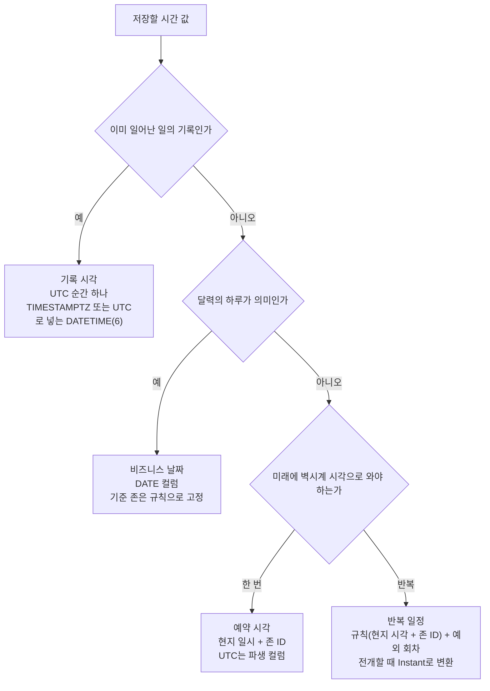
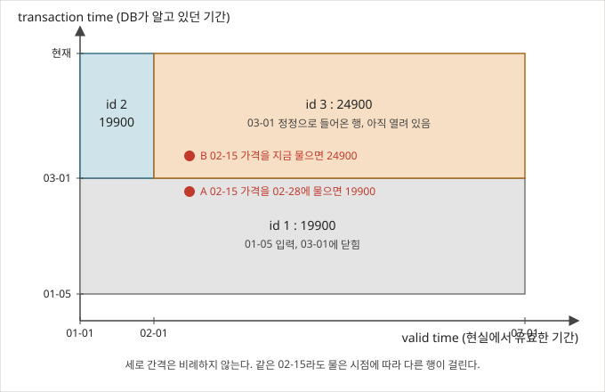
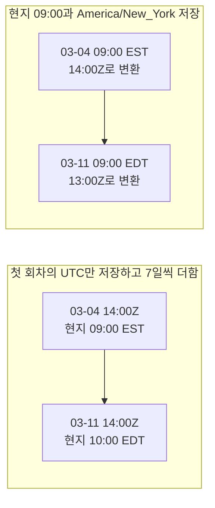
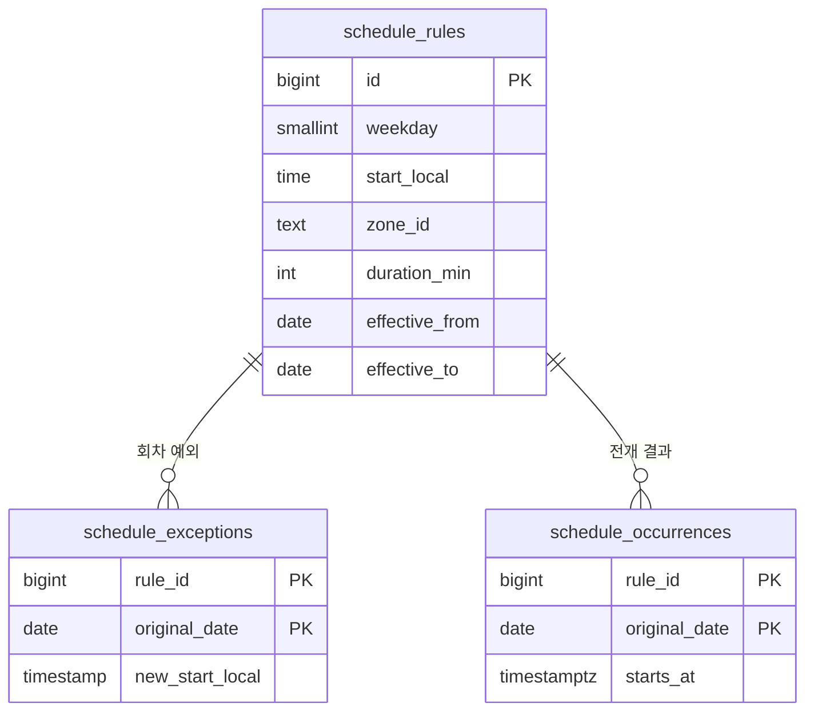

# 시간 데이터 모델링

시간 컬럼은 타입 하나 고르면 끝나는 것처럼 보인다. 실제로는 컬럼에 들어 있는 값이 무슨 종류냐에 따라 타입, 타임존 처리, 인덱스, 마이그레이션 방법이 전부 갈린다. 처음에 종류를 잘못 나누면 나중에 데이터를 옮겨야 한다.

이 문서의 SQL은 MySQL 8.0.46과 PostgreSQL 16.15에서 실행해 결과를 확인한 것만 실었다. 앱 계층의 타입 선택(`Instant`, `LocalDateTime`)과 DST 경계 동작은 [Backend/Standards](../../Backend/Standards/index.md)에서 다루고, 여기서는 DB 컬럼과 쿼리 쪽만 본다.

## 컬럼을 고르기 전에 값의 종류부터 나눈다

`created_at`, 생일, "매주 월요일 오전 9시"는 모두 시간 값처럼 보이지만 같은 타입으로 저장하면 안 된다. 아래 흐름은 값의 성격을 세 가지로 나눠서 컬럼 모양을 정한다.



기록 시각은 과거에 일어난 순간이라 변환 규칙이 나중에 바뀌어도 값이 변하지 않는다. 나머지 두 가지는 사용자가 정한 벽시계가 정답이고, UTC로 바꾼 값은 그 시점의 존 규칙이 박힌 사본이다. 이 구분이 이 문서 전체의 뼈대다. 마지막 절의 반복 일정이 같은 원리를 가장 심하게 건드린다.

## MySQL TIMESTAMP와 DATETIME

두 타입의 차이는 타임존 처리에서 갈린다.

| 항목 | TIMESTAMP | DATETIME |
|------|-----------|----------|
| 저장 방식 | UTC로 변환해서 저장 | 입력값 그대로 저장 |
| 타임존 적용 | 세션 `time_zone`으로 입출력 변환 | 없음 |
| 범위 | 1970-01-01 00:00:01 ~ 2038-01-19 03:14:07 (UTC) | 1000-01-01 ~ 9999-12-31 |
| 저장 크기 | 4바이트 (소수초 없을 때) | 5바이트 (소수초 없을 때) |
| NULL | 8.0 기본값(`explicit_defaults_for_timestamp=ON`)에서는 NULL 허용 | NULL 허용 |

마지막 줄은 옛 자료에서 "TIMESTAMP는 기본 NOT NULL"이라고 적은 것을 많이 본다. 8.0 이전 기본 설정의 동작이고, 8.0.46에서 `CREATE TABLE ts_null (a TIMESTAMP, b DATETIME)`를 만들어 `SHOW COLUMNS`로 보면 두 컬럼 다 `Null: YES`다.

같은 값을 넣고 세션 존만 바꿔 읽으면 차이가 보인다.

```sql
CREATE TABLE logs   (id BIGINT NOT NULL AUTO_INCREMENT, created_at TIMESTAMP NOT NULL, PRIMARY KEY (id));
CREATE TABLE events (id BIGINT NOT NULL AUTO_INCREMENT, start_at   DATETIME  NOT NULL, PRIMARY KEY (id));

SET time_zone = 'Asia/Seoul';
INSERT INTO logs   (created_at) VALUES ('2024-01-01 10:00:00');
INSERT INTO events (start_at)   VALUES ('2024-01-01 10:00:00');

SET time_zone = 'UTC';
SELECT created_at FROM logs;     -- 2024-01-01 01:00:00
SELECT start_at   FROM events;   -- 2024-01-01 10:00:00
```

`created_at`, `updated_at` 같은 기록 시각은 TIMESTAMP가 맞다. 2038년이 걸리면 애플리케이션에서 UTC로 변환해 `DATETIME`에 넣는다. 반대로 예약 시각을 `DATETIME`에 넣으면 세션 존이 바뀌어도 값이 안 변하니 안전해 보이지만, 그 값이 UTC인지 현지 시각인지는 컬럼이 말해 주지 않는다. 예약처럼 현지 시각이 정답인 값은 존 ID 컬럼을 같이 둬야 의미가 확정된다(마지막 절). 서버·세션 존을 UTC로 고정하는 방법과 JPA 매핑은 [UTC 저장](../../Backend/Standards/UTC_Storage.md)에 정리했다.

## PostgreSQL TIMESTAMPTZ는 존을 저장하지 않는다

`TIMESTAMPTZ`는 이름과 달리 타임존을 같이 저장하지 않는다. UTC로 환산한 순간 하나만 저장하고, 읽을 때 세션 존으로 바꿔 보여준다.

```sql
SET TIME ZONE 'Asia/Seoul';
INSERT INTO logs (created_at) VALUES ('2024-01-01 10:00:00+09');

SET TIME ZONE 'UTC';
SELECT created_at FROM logs;   -- 2024-01-01 01:00:00+00

SET TIME ZONE 'America/New_York';
SELECT created_at FROM logs;   -- 2023-12-31 20:00:00-05
```

저장값 하나가 세션에 따라 세 가지 모양으로 보이니 DB 클라이언트로 직접 조회할 때 혼란이 생긴다. 사용자가 입력한 존까지 보존해야 하면 `zone_id` 컬럼을 따로 둔다.

### AT TIME ZONE은 입력 타입에 따라 방향이 반대다

```sql
SELECT pg_typeof(now() AT TIME ZONE 'Asia/Seoul');
-- timestamp without time zone   (TIMESTAMPTZ 입력: 그 존의 현지 시각을 꺼낸다)

SELECT '2024-01-01 10:00:00'::timestamp AT TIME ZONE 'Asia/Seoul';
-- 2024-01-01 01:00:00+00 , 타입은 timestamp with time zone   (현지 시각을 그 존의 순간으로 해석한다)
```

TIMESTAMPTZ 컬럼에 `AT TIME ZONE`을 붙이면 존 없는 TIMESTAMP가 나오고, 이 값을 문자열 리터럴과 비교하면 리터럴도 존 없는 TIMESTAMP로 해석된다. 옛 자료에는 이때 리터럴이 "세션 존 기준으로 해석된다"고 적힌 경우가 있는데 틀리다. 세션을 `UTC`와 `America/New_York`으로 바꿔 같은 쿼리를 돌려봤더니 결과 행이 같았다. 이 쿼리는 의미는 맞고, 컬럼에 함수가 씌워져서 인덱스를 못 타는 것이 진짜 문제다(다음 절).

범위 조건은 오프셋을 명시한 TIMESTAMPTZ 리터럴로 쓰면 컬럼이 그대로 노출되고 세션 존에도 영향을 받지 않는다.

```sql
SELECT * FROM orders
WHERE created_at >= '2024-01-01 00:00:00+09'
  AND created_at <  '2024-01-02 00:00:00+09';
```

### 전환 구간의 로컬 시각

현지 시각을 존과 함께 TIMESTAMPTZ로 바꾸는 순간 gap(존재하지 않는 시각)과 overlap(두 번 있는 시각)이 나온다. 2024년 뉴욕 기준으로 PostgreSQL 16에서 돌린 결과다.

| 입력 (`::timestamp AT TIME ZONE 'America/New_York'`) | 결과 | 해석 |
|---|---|---|
| 2024-03-10 02:30 (gap) | 07:30Z | 03:30 EDT로 전진 |
| 2024-11-03 01:30 (overlap) | 06:30Z | 01:30 EST, 뒤쪽(표준시) |

overlap에서 앞쪽(EDT)을 고르는 라이브러리가 많아서 PostgreSQL도 그럴 거라고 짐작하기 쉽다. PostgreSQL은 뒤쪽을 고른다. 서버가 변환하는 값과 앱 라이브러리가 변환하는 값이 1시간 어긋나는 경로가 여기다. 라이브러리별 비교표와 입력 검증 방법은 [DST](../../Backend/Standards/DST.md)에 있다.

## 날짜 경계와 인덱스

UTC로 저장한 `created_at`에 `DATE(created_at) = '2024-01-01'`을 걸면 UTC 날짜 기준이다. 서울 사용자의 1월 1일은 UTC로 12월 31일 15:00부터다. 사용자 존 기준 하루는 그 존의 자정 두 개를 UTC로 바꿔서 반열린 구간으로 조회한다. 경계 계산 코드는 [UTC 저장](../../Backend/Standards/UTC_Storage.md)의 "사용자 존 기준 오늘의 경계"에 있다.

```sql
SELECT COUNT(*) FROM orders
WHERE created_at >= '2023-12-31 15:00:00'   -- KST 2024-01-01 00:00
  AND created_at <  '2024-01-01 15:00:00';  -- KST 2024-01-02 00:00
```

이 구간 변환은 앱이 책임지고, 컬럼에 함수를 씌우지 않는다. PostgreSQL에서 400,000행 테이블로 `EXPLAIN`을 찍어 비교했다.

| 쿼리 | 계획 |
|---|---|
| `(created_at AT TIME ZONE 'Asia/Seoul')::date = '2024-01-01'` | Parallel Seq Scan |
| `created_at >= '2024-01-01 00:00:00+09' AND created_at < '2024-01-02 00:00:00+09'` | Index Only Scan |

### 날짜 컬럼을 같이 둘 때

범위 변환을 매번 앱에서 하기 어렵거나 "KST 일자별 집계"가 반복되면 파생 날짜 컬럼에 인덱스를 건다. MySQL 8.0은 생성 컬럼이다.

```sql
ALTER TABLE orders
  ADD COLUMN created_date_kst DATE
    GENERATED ALWAYS AS (DATE(CONVERT_TZ(created_at, '+00:00', '+09:00'))) STORED;

CREATE INDEX idx_orders_created_date_kst ON orders (created_date_kst);
```

`STORED`여야 인덱스를 만들 수 있다. `CONVERT_TZ`에 `'Asia/Seoul'` 같은 이름을 쓰는 DDL도 8.0.46에서 통과하지만 두 가지를 조심한다. 타임존 테이블(`mysql_tzinfo_to_sql`)이 로드되지 않은 서버에서는 NULL을 반환한다. 그리고 STORED 값은 쓰는 시점에 계산되어 굳기 때문에, DST가 있는 존을 이름으로 쓰면 tzdata가 바뀐 뒤에도 기존 행의 값은 그대로다. 한국처럼 고정 오프셋인 존만 `'+09:00'`으로 쓴다.

PostgreSQL은 표현식 인덱스다. 같은 쿼리에 같은 표현식을 쓰면 `EXPLAIN`이 Index Scan으로 바뀐다.

```sql
CREATE INDEX idx_orders_created_date_kst
  ON orders (((created_at AT TIME ZONE 'Asia/Seoul')::date));
ANALYZE orders;

SELECT * FROM orders
WHERE (created_at AT TIME ZONE 'Asia/Seoul')::date = '2024-01-01';
```

`date(timezone('Asia/Seoul', created_at))`처럼 같은 표현식으로 정규화되는 형태도 이 인덱스를 탔다. 다만 존 이름 대신 `'+09'`를 쓰거나 `::timestamp`를 한 번 더 거치는 식으로 표현식 자체가 달라지면 다른 인덱스가 필요하다. 인덱스 표현식은 `IMMUTABLE`이어야 해서 존 이름이 상수로 박혀 있을 때만 만들 수 있고, 사용자별 존 기준 집계에는 쓸 수 없다.

## 레거시 DATETIME을 UTC로 옮기기

서버 존이 KST이던 시절에 `DATETIME`에 KST를 그대로 넣었다가 UTC로 바꿔야 하는 일이 생긴다. 변환 자체는 한 줄이고, 어려운 쪽은 범위 파악과 검증이다.

### 변환 대상 파악

`TIMESTAMP` 컬럼은 내부적으로 UTC라 건드리지 않는다. `DATETIME`만 대상이다. 서버 존이 바뀐 시점이 있으면 그 전후 데이터는 변환 방향이 다르다. 설정 이력이 없으면 `MIN(created_at)`, 서비스 런칭일, 로그 시각과 맞춰서 추정한다. 존 정보가 없는 타임스탬프의 기준을 추정하는 방법은 [DST](../../Backend/Standards/DST.md)의 "레거시 데이터의 DST 버그 진단"에 있다.

### MySQL

```sql
UPDATE orders
SET created_at = CONVERT_TZ(created_at, '+09:00', '+00:00'),
    updated_at = CONVERT_TZ(updated_at, '+09:00', '+00:00')
WHERE id BETWEEN 1 AND 100000;
-- 다음 구간: id BETWEEN 100001 AND 200000 ... 반복
```

`updated_at`을 `SET`에 빼먹으면 안 된다. 컬럼이 `ON UPDATE CURRENT_TIMESTAMP`로 정의돼 있으면 이 UPDATE가 `updated_at`을 현재 시각으로 덮어쓴다. 3행짜리 테이블에서 `created_at`만 변환했더니 `updated_at`이 전부 실행 시각으로 바뀌었다. 한 번 덮어쓰면 원래 값은 백업에서만 복구된다.

전체를 한 번에 UPDATE하면 락이 오래 잡히고 undo 로그가 쌓이니 id 구간으로 나눈다. 고정 오프셋 `'+09:00'`을 쓰는 이유는 한국이 DST를 안 쓰고 타임존 테이블 의존도 없애기 위해서다. 1987~88년 데이터에는 이 가정이 틀린다.

### PostgreSQL

컬럼 교체는 새 컬럼에 변환값을 채우고 이름을 바꾸는 순서다.

```sql
ALTER TABLE orders ADD COLUMN created_at_new TIMESTAMPTZ;

UPDATE orders SET created_at_new = created_at AT TIME ZONE 'Asia/Seoul';

SELECT COUNT(*) FROM orders
WHERE created_at_new IS NULL AND created_at IS NOT NULL;   -- 0 이어야 한다

BEGIN;
ALTER TABLE orders RENAME COLUMN created_at TO created_at_old;
ALTER TABLE orders RENAME COLUMN created_at_new TO created_at;
ALTER TABLE orders ALTER COLUMN created_at SET NOT NULL;
COMMIT;
```

`created_at`이 `TIMESTAMP`이므로 `AT TIME ZONE 'Asia/Seoul'`은 "서울 현지 시각으로 해석해 순간으로 바꾼다"로 동작한다. `'2024-01-01 09:00:00'`은 `2024-01-01 00:00:00+00`이 되고, `'2024-03-31 23:30:00'`은 `14:30:00+00`이 된다.

테이블이 작으면 `ALTER COLUMN ... TYPE TIMESTAMPTZ USING created_at AT TIME ZONE 'Asia/Seoul'`로 한 번에 끝내도 된다. `USING`이 있으면 테이블 전체를 다시 쓰고 `ACCESS EXCLUSIVE` 락을 잡는다. 반대로 값이 이미 UTC로 들어 있어서 `USING` 없이 세션 존 `UTC`에서 타입만 바꾸는 경우는 재작성 없이 끝난다. 16.15에서 `pg_relation_filenode`가 바뀌지 않는 것으로 확인했다. `USING t AT TIME ZONE 'UTC'`를 붙이면 같은 변환인데도 파일이 새로 만들어졌다.

### 무중단 순서

서비스를 세우지 못하면 컬럼을 추가하고 앱이 두 컬럼에 동시에 쓰는 구간을 둔다. 백필을 마친 뒤 일 단위 집계가 일치하는지 보고 읽기를 넘긴다.


3번에서 백필 범위를 시작 시점의 최대 id로 고정한다. 이중 쓰기가 시작된 뒤 들어오는 행은 처음부터 UTC로 들어가므로 백필이 다시 변환하면 9시간이 이중으로 빠진다. 4번 검증은 변환 전 `DATE(created_at)` 집계와 변환 후 `DATE(CONVERT_TZ(created_at, '+00:00', '+09:00'))` 집계를 같은 기간으로 돌려 대조한다. 합계가 같아도 일별 숫자가 다르면 경계 시각(KST 00:00~08:59)이 전날로 밀린 행이 있거나 백필 중 신규 행이 섞인 것이다. 읽기를 넘긴 뒤에도 6번 전까지는 옛 컬럼에 계속 쓰고 있으므로, 문제가 나오면 읽기만 되돌리면 된다.

## 감사 컬럼과 soft delete

```sql
CREATE TABLE orders (
    id         BIGINT      NOT NULL AUTO_INCREMENT,
    user_id    BIGINT      NOT NULL,
    status     VARCHAR(20) NOT NULL DEFAULT 'PENDING',
    created_at DATETIME(6) NOT NULL DEFAULT CURRENT_TIMESTAMP(6),
    updated_at DATETIME(6) NOT NULL DEFAULT CURRENT_TIMESTAMP(6)
                                    ON UPDATE CURRENT_TIMESTAMP(6),
    deleted_at DATETIME(6) NULL,
    PRIMARY KEY (id)
);
```

`DATETIME(6)`은 마이크로초까지 저장한다. 같은 밀리초에 쌓이는 이벤트 로그가 아니면 `DATETIME`이나 `DATETIME(3)`이면 충분하다. 기본값 `CURRENT_TIMESTAMP`는 세션 존의 현지 시각이므로 세션을 UTC로 고정하지 않으면 UTC 컬럼에 현지 시각이 들어간다.

`ON UPDATE CURRENT_TIMESTAMP`는 행의 어떤 컬럼이든 값이 바뀌면 작동한다. `deleted_at`만 채워도 `updated_at`이 같이 바뀐다. 위 마이그레이션 UPDATE가 `updated_at`을 덮어쓴 것도 같은 규칙이다. "누가 어떤 컬럼을 언제 바꿨는지"가 중요한 감사라면 이 자동 갱신 대신 앱이 명시적으로 값을 넣는다.

`deleted_at IS NULL`을 거의 모든 쿼리에 붙이면 `user_id` 단독 인덱스로는 이 조건을 인덱스에서 걸러내지 못한다. MySQL은 `(user_id, deleted_at)` 복합 인덱스를 만들면 `WHERE user_id = 100 AND deleted_at IS NULL`이 이 인덱스를 `ref`로 탄다. PostgreSQL은 삭제되지 않은 행만 담는 부분 인덱스가 작고 정확하다.

```sql
CREATE INDEX idx_orders_user_active ON orders (user_id) WHERE deleted_at IS NULL;
```

100,000행 중 3분의 1을 삭제 상태로 만들고 `EXPLAIN`을 찍으면 이 인덱스를 Bitmap Index Scan으로 쓴다. 삭제 비율이 낮은 테이블에서는 일반 인덱스와 크기 차이가 거의 없다. 삭제 데이터를 어떻게 치울지는 [소프트 삭제](Soft_Delete.md)와 [소프트 삭제 purge와 전파](Soft_Delete_Purge_And_Propagation.md)에서 다룬다.

## 이력을 남기는 두 가지 방법

### 수정 시점마다 이전 값을 이력 테이블로 보내기

MariaDB의 `WITH SYSTEM VERSIONING`이나 SQL:2011 `FOR SYSTEM_TIME` 구문을 못 쓰는 환경(MySQL, PostgreSQL)에서는 트리거가 이전 행을 이력 테이블에 넣는다.

```sql
CREATE TABLE products (
    id         BIGINT        NOT NULL AUTO_INCREMENT,
    name       VARCHAR(100)  NOT NULL,
    price      DECIMAL(10,2) NOT NULL,
    updated_at DATETIME(6)   NOT NULL DEFAULT CURRENT_TIMESTAMP(6)
                                      ON UPDATE CURRENT_TIMESTAMP(6),
    PRIMARY KEY (id)
);

CREATE TABLE products_history (
    history_id BIGINT        NOT NULL AUTO_INCREMENT,
    product_id BIGINT        NOT NULL,
    price      DECIMAL(10,2) NOT NULL,
    valid_from DATETIME(6)   NOT NULL,
    valid_to   DATETIME(6)   NOT NULL,
    PRIMARY KEY (history_id),
    INDEX idx_ph_product_time (product_id, valid_from, valid_to)
);

DELIMITER $$
CREATE TRIGGER trg_products_after_update
AFTER UPDATE ON products
FOR EACH ROW
BEGIN
    INSERT INTO products_history (product_id, price, valid_from, valid_to)
    VALUES (OLD.id, OLD.price, OLD.updated_at, NEW.updated_at);
END$$
DELIMITER ;
```

`updated_at`에 `ON UPDATE`를 걸어야 한다. 이 컬럼을 `DEFAULT CURRENT_TIMESTAMP(6)`만 두고 앱이 직접 갱신하게 하면, `UPDATE products SET price = 300`처럼 `updated_at`을 안 건드린 UPDATE에서는 `NEW.updated_at`이 `OLD.updated_at`과 같아 `valid_from = valid_to`인 길이 0 이력이 쌓인다. `ON UPDATE`를 건 테이블에서 `price`만 두 번 바꿔 보면 이력 두 건 모두 `valid_to > valid_from`이다.

### Valid Time과 Transaction Time을 같이 쓰기

이력 테이블은 "언제 바뀌었나"만 답한다. 소급 수정이 있는 데이터(보험료, 급여, 가격표)에서는 두 질문이 따로 필요하다. 이 가격이 현실에서 언제부터 유효했는지(valid time), 그리고 DB가 그 사실을 언제부터 알았는지(transaction time)다. 이 문서에서는 한 사례만 보고, 구현 패턴과 인덱스 설계는 [Bitemporal](Bitemporal.md), [Valid Time](Valid_Time.md), [Transaction Time](Transaction_Time.md)에 나눠 정리돼 있다.

사례는 이렇다. 1월 5일에 "1월~6월 가격은 19,900원"이라고 입력했다. 3월 1일에 "사실은 2월부터 24,900원이었다"는 정정이 들어왔다. 행 세 개가 두 축 위에서 어떻게 놓이는지 본다.



가로가 현실에서 유효한 기간, 세로가 DB가 알고 있던 기간이다. 3월 1일 정정이 `id 1`의 세로 구간을 닫고, 가로를 둘로 쪼갠 `id 2`, `id 3`을 연다. 점 A와 B는 같은 02-15 가격을 묻는 두 질문이다. 점이 어느 사각형에 떨어지는지가 답이다.

```sql
CREATE TABLE product_prices (
    id            BIGINT        NOT NULL AUTO_INCREMENT,
    product_id    BIGINT        NOT NULL,
    price         DECIMAL(10,2) NOT NULL,
    valid_from    DATE          NOT NULL,                              -- 포함
    valid_to      DATE          NOT NULL DEFAULT '9999-12-31',         -- 미포함
    recorded_from DATETIME(6)   NOT NULL DEFAULT CURRENT_TIMESTAMP(6), -- 포함
    recorded_to   DATETIME(6)   NOT NULL DEFAULT '9999-12-31 23:59:59.999999', -- 미포함
    PRIMARY KEY (id),
    INDEX idx_pp_valid    (product_id, valid_from, valid_to),
    INDEX idx_pp_recorded (product_id, recorded_from, recorded_to)
);

-- 1월 5일 입력. 7월 1일 전까지(반열린 구간)
INSERT INTO product_prices (product_id, price, valid_from, valid_to, recorded_from)
VALUES (1, 19900, '2024-01-01', '2024-07-01', '2024-01-05 09:00:00');

-- 3월 1일 정정: 기존 행을 닫고 둘로 쪼갠 행을 연다. 한 트랜잭션이어야 한다
START TRANSACTION;
UPDATE product_prices SET recorded_to = '2024-03-01 09:00:00'
 WHERE product_id = 1 AND recorded_to = '9999-12-31 23:59:59.999999';
INSERT INTO product_prices (product_id, price, valid_from, valid_to, recorded_from) VALUES
 (1, 19900, '2024-01-01', '2024-02-01', '2024-03-01 09:00:00'),
 (1, 24900, '2024-02-01', '2024-07-01', '2024-03-01 09:00:00');
COMMIT;
```

예시에서는 재현하려고 `recorded_from`을 고정값으로 넣었다. 실제로는 기본값 `CURRENT_TIMESTAMP(6)`을 쓰고 `recorded_to`를 닫는 시각과 새 행의 `recorded_from`이 같은 값이어야 한다. 한 트랜잭션 안에서 `NOW(6)`을 변수에 담아 두 곳에 쓰면 사이에 빈틈이나 겹침이 없다.

기간 경계는 반열린 `[from, to)`로 쓴다. `valid_to`를 `'2024-01-31'`처럼 마지막 날 포함으로 쓰면 월 길이에 따라 값이 달라지고, 다음 행의 `valid_from`과 맞닿는지를 쿼리마다 확인해야 한다. 반열린이면 `valid_to`와 다음 행의 `valid_from`이 같아서 이어 붙는다.

```sql
-- 지금 알고 있는 2024-02-15 가격 (점 B)
SELECT price FROM product_prices
WHERE product_id = 1
  AND valid_from <= '2024-02-15' AND valid_to > '2024-02-15'
  AND recorded_from <= NOW(6)  AND recorded_to > NOW(6);                  -- 24900

-- 2월 28일 시점의 시스템이 알던 2024-02-15 가격 (점 A)
SELECT price FROM product_prices
WHERE product_id = 1
  AND valid_from <= '2024-02-15' AND valid_to > '2024-02-15'
  AND recorded_from <= '2024-02-28' AND recorded_to > '2024-02-28';       -- 19900
```

## 시간으로 파티셔닝하기

시간 컬럼 파티셔닝은 조회가 최근 기간에 몰리거나, 오래된 데이터를 파티션 단위로 버려야 할 때 쓴다. MySQL에서는 파티션 키가 PK에 포함되어야 한다.

```sql
CREATE TABLE logs (
    id BIGINT NOT NULL AUTO_INCREMENT,
    created_at DATETIME NOT NULL,
    PRIMARY KEY (id)
) PARTITION BY RANGE (...);
-- ERROR 1503: A PRIMARY KEY must include all columns in the table's partitioning function
```

그래서 PK를 `(id, created_at)`으로 넓힌다. 이러면 `id` 단독 조회는 모든 파티션을 훑는다. 파티션 간 글로벌 인덱스가 없어서, 조회 경로에 `created_at` 범위를 같이 실어 보내야 한다.

옛 자료에서 흔히 보는 `PARTITION BY RANGE (YEAR(created_at) * 100 + MONTH(created_at))` 형태는 쓰지 않는다. 8.0.46에서 이 파티션 테이블에 `WHERE created_at >= '2024-01-01' AND created_at < '2024-02-01'`을 걸고 `EXPLAIN`을 보면 `partitions` 열에 `p202401,p202402,p_future`가 모두 나왔다. 프루닝이 되지 않는다. 컬럼 값을 직접 비교하는 `RANGE COLUMNS`는 같은 조건에서 `p202401`만 나왔다.

```sql
CREATE TABLE access_logs (
    id         BIGINT       NOT NULL,
    user_id    BIGINT       NOT NULL,
    path       VARCHAR(500) NOT NULL,
    created_at DATETIME     NOT NULL,
    PRIMARY KEY (id, created_at)
)
PARTITION BY RANGE COLUMNS (created_at) (
    PARTITION p202401  VALUES LESS THAN ('2024-02-01'),
    PARTITION p202402  VALUES LESS THAN ('2024-03-01'),
    PARTITION p_future VALUES LESS THAN (MAXVALUE)
);

-- 새 달 추가는 p_future를 쪼갠다
ALTER TABLE access_logs REORGANIZE PARTITION p_future INTO (
    PARTITION p202403  VALUES LESS THAN ('2024-04-01'),
    PARTITION p_future VALUES LESS THAN (MAXVALUE)
);

-- 오래된 달 삭제는 파티션째 버린다
ALTER TABLE access_logs DROP PARTITION p202401;
```

`WHERE MONTH(created_at) = 1`처럼 컬럼에 함수를 씌운 조건은 `RANGE COLUMNS`에서도 전 파티션을 본다(`p202401,p202402,p_future`). `DROP PARTITION`은 파티션 파일을 지우는 메타 작업이라 행 단위 `DELETE`보다 훨씬 빠르다. `TIMESTAMP` 컬럼은 `RANGE (UNIX_TIMESTAMP(created_at))`로 프루닝이 된다.

## 시간 범위 겹침을 DB가 막게 하기

앱에서 겹침을 검사해도 동시 요청 두 개가 둘 다 "겹치지 않음"을 보고 통과한다. 겹침 조건 자체는 `기존.start < 새.end AND 기존.end > 새.start`이고, 경계가 맞닿는 예약(14:00 끝과 14:00 시작)은 겹침으로 잡히지 않는다.

PostgreSQL은 범위 타입과 `EXCLUDE` 제약으로 DB가 직접 거절한다.

```sql
CREATE EXTENSION IF NOT EXISTS btree_gist;

CREATE TABLE reservations (
    id          BIGINT    NOT NULL GENERATED ALWAYS AS IDENTITY,
    resource_id BIGINT    NOT NULL,
    during      TSTZRANGE NOT NULL,
    PRIMARY KEY (id),
    EXCLUDE USING GIST (resource_id WITH =, during WITH &&)
);

INSERT INTO reservations (resource_id, during)
VALUES (5, '[2024-03-15 13:00+09, 2024-03-15 14:00+09)');       -- 성공

INSERT INTO reservations (resource_id, during)
VALUES (5, '[2024-03-15 13:30+09, 2024-03-15 15:00+09)');
-- ERROR: conflicting key value violates exclusion constraint

INSERT INTO reservations (resource_id, during)
VALUES (5, '[2024-03-15 14:00+09, 2024-03-15 15:00+09)');       -- 성공, 맞닿기만 한다
```

컬럼 타입은 `TSRANGE`가 아니라 `TSTZRANGE`로 한다. `TSRANGE`는 존 없는 현지 시각 범위라서 서버 세션 존이 바뀌거나 사용자 존이 다르면 같은 예약이 겹치는지 안 겹치는지의 판단 기준이 흔들린다. `TSTZRANGE`는 UTC 순간으로 비교한다. 16.15에서 오프셋이 `+09`인 입력이 `04:00:00+00`~`05:00:00+00`으로 저장되는 것을 확인했다. 두 번째 INSERT가 거절되고 세 번째는 통과한다.

MySQL에는 `EXCLUDE`가 없어서 같은 트랜잭션에서 잠그고 확인한다.

```sql
START TRANSACTION;

SELECT id FROM reservations
WHERE resource_id = 5
  AND start_at < '2024-03-15 15:00:00' AND end_at > '2024-03-15 14:00:00'
  AND deleted_at IS NULL
FOR UPDATE;

-- 결과가 비어 있으면
INSERT INTO reservations (resource_id, user_id, start_at, end_at)
VALUES (5, 100, '2024-03-15 14:00:00', '2024-03-15 15:00:00');

COMMIT;
```

`FOR UPDATE`는 읽힌 행에 잠금을 건다. 결과가 비어 있으면 잠글 행이 없다. 이때 인덱스 구간에 gap lock이 걸리는지는 격리 수준과 인덱스 모양에 달려 있어서, 동시 요청이 서로 대기하거나 데드락으로 한쪽이 죽을 수 있다. 충돌 검사 트랜잭션은 재시도하게 짠다. 예약 대상(`resource`)이 별도 테이블에 있으면 그 행을 먼저 `FOR UPDATE`로 잠그고 검사하는 방법이 더 예측하기 쉽다.

## 반복 일정은 현지 시각과 존 ID로 저장한다

"매주 월요일 오전 9시"를 저장하는 방법은 둘로 나뉜다. 첫 회차를 UTC로 바꿔서 7일씩 더하는 방법과, 현지 시각 `09:00`과 존 ID `America/New_York`을 규칙으로 저장하고 회차마다 Instant로 푸는 방법이다. 앞 방법은 DST가 없는 존에서는 맞고, 있는 존에서는 DST가 지나는 순간 어긋난다.

### UTC로 저장한 반복이 어긋나는 모습

뉴욕은 2024-03-10에 DST가 시작된다. 3월 4일(월) 09:00 EST는 14:00Z다. 이 값에 7일씩 더하면 계속 14:00Z가 나오고, DST가 시작된 뒤의 14:00Z는 현지로 10:00 EDT다.



왼쪽은 참석자에게 "월요일 9시"가 DST 이후 10시로 보인다. 오른쪽은 회차마다 그날의 오프셋을 다시 구하니 현지 09:00이 유지되고, UTC 값이 14:00Z에서 13:00Z로 한 시간 움직인다. UTC로 저장한 값은 "그 시각이 지나갈 때의 규칙"을 박제한 사본이라, 반복에서는 회차마다 규칙이 바뀐다는 사실을 담지 못한다.

PostgreSQL의 `timestamptz + interval '7 days'`는 한술 더 떠서 세션 존에 따라 결과가 갈린다. 같은 `'2024-03-04 14:00+00'`에 7일씩 더했을 때 세션 `UTC`에서는 14:00Z가 유지되고, 세션 `America/New_York`에서는 현지 09:00이 유지되어 `03-11 09:00:00-04`가 나왔다. 어떤 쪽이 맞는지는 우연히 세션이 결정한다. 반복 계산은 세션 존에 기대지 말고 현지 일시에서 출발해 존을 명시하는 쪽으로 쓴다.

### 규칙, 예외 회차, 전개 결과

테이블은 세 개다. 규칙은 현지 시각과 존 ID를 갖고, 예외는 이 회차만 옮기거나 지운다. 전개 결과는 조회와 알림 발송용 캐시다.



`schedule_rules`와 `schedule_exceptions`가 정답이고, `schedule_occurrences.starts_at`은 이 둘에서 계산한 파생 캐시다. 이 구조는 [UTC 저장](../../Backend/Standards/UTC_Storage.md)의 "미래 일정" 절과 같은 원리다. 규칙에서 UTC로 가는 변환은 항상 한 방향이고, 거꾸로 `starts_at`을 읽어서 규칙을 다시 만들지 않는다.

```sql
CREATE TABLE schedule_rules (
    id             bigint   GENERATED ALWAYS AS IDENTITY PRIMARY KEY,
    title          text     NOT NULL,
    weekday        smallint NOT NULL CHECK (weekday BETWEEN 1 AND 7),  -- ISO, 1=월
    start_local    time     NOT NULL,
    zone_id        text     NOT NULL,                                  -- IANA ID
    duration_min   int      NOT NULL,
    effective_from date     NOT NULL,
    effective_to   date
);

CREATE TABLE schedule_exceptions (
    rule_id         bigint    NOT NULL REFERENCES schedule_rules(id),
    original_date   date      NOT NULL,   -- 원래 발생했을 날짜가 회차의 식별자
    new_start_local timestamp,            -- NULL이면 그 회차 취소
    PRIMARY KEY (rule_id, original_date)
);

CREATE TABLE schedule_occurrences (
    rule_id       bigint      NOT NULL REFERENCES schedule_rules(id),
    original_date date        NOT NULL,
    starts_at     timestamptz NOT NULL,
    PRIMARY KEY (rule_id, original_date)
);
CREATE INDEX idx_occ_starts ON schedule_occurrences (starts_at);
```

예외의 식별자를 `original_date`로 두는 이유는 회차를 다른 날로 옮겨도 "원래 3월 18일 회차"를 가리킬 수 있어야 하기 때문이다. 옮긴 결과 날짜를 키로 쓰면 규칙이 바뀔 때 예외가 어느 회차 것이었는지 찾지 못한다.

### 전개

규칙 한 줄을 날짜 범위로 풀면서 현지 시각 `d + start_local`에 `zone_id`를 붙여 Instant로 바꾼다. 3월 18일 회차를 3월 19일 10:30으로 옮기고 3월 25일 회차를 취소한 상태에서 3월 1일~4월 15일을 전개한 결과다.

```sql
SELECT r.id,
       d::date AS original_date,
       COALESCE(e.new_start_local, d + r.start_local) AT TIME ZONE r.zone_id AS starts_at
FROM schedule_rules r
CROSS JOIN LATERAL generate_series(
        GREATEST(r.effective_from, DATE '2024-03-01')::timestamp,
        LEAST(COALESCE(r.effective_to, DATE '2024-04-15'), DATE '2024-04-15')::timestamp,
        interval '1 day') AS d
LEFT JOIN schedule_exceptions e ON e.rule_id = r.id AND e.original_date = d::date
WHERE EXTRACT(isodow FROM d) = r.weekday
  AND (e.rule_id IS NULL OR e.new_start_local IS NOT NULL)
ORDER BY original_date;
```

| original_date | starts_at (UTC) | 비고 |
|---|---|---|
| 2024-03-04 | 14:00Z | EST |
| 2024-03-11 | 13:00Z | DST 시작 후에도 현지 09:00 |
| 2024-03-19 (원래 03-18) | 14:30Z | 예외로 옮긴 회차, 현지 10:30 EDT |
| 2024-04-01 | 13:00Z | 03-25는 취소 |

쿼리에서 세 곳이 틀리기 쉽다. 첫째, `generate_series`에 `date` 두 개와 `interval`을 주면 반환 타입이 `timestamptz`다. 그대로 쓰면 날짜가 세션 존 자정의 순간으로 잡혀서 3월 4일 09:00 EST 회차가 `04:00`으로 나오는 식으로 엉뚱한 시각이 나온다. 위 쿼리는 `::timestamp`로 먼저 존 없는 타입으로 만든다. 둘째, `AT TIME ZONE`은 `+`보다 우선순위가 높다. `d + time '02:30' AT TIME ZONE 'America/New_York'`은 `time AT TIME ZONE ...`이 먼저 계산되어 날짜가 하루 밀린 `2024-03-11 02:30:00+00`이 나왔다. 괄호로 `(d + r.start_local) AT TIME ZONE r.zone_id`로 묶는다. 셋째, 전환일 02:30은 PostgreSQL이 07:30Z(03:30 EDT)로 조용히 밀어 준다. 서비스 정책에 따라 그날 회차를 건너뛸지 밀지는 [DST](../../Backend/Standards/DST.md)의 스케줄러 절을 보고 정한다.

### 캐시 갱신

`schedule_occurrences`를 채우는 함수는 같은 쿼리를 `INSERT ... ON CONFLICT`로 감싼 것이다.

```sql
CREATE OR REPLACE FUNCTION expand_occurrences(p_from date, p_to date)
RETURNS void LANGUAGE sql AS $$
INSERT INTO schedule_occurrences (rule_id, original_date, starts_at)
SELECT r.id, d::date,
       COALESCE(e.new_start_local, d + r.start_local) AT TIME ZONE r.zone_id
FROM schedule_rules r
CROSS JOIN LATERAL generate_series(
        GREATEST(r.effective_from, p_from)::timestamp,
        LEAST(COALESCE(r.effective_to, p_to), p_to)::timestamp,
        interval '1 day') AS d
LEFT JOIN schedule_exceptions e ON e.rule_id = r.id AND e.original_date = d::date
WHERE EXTRACT(isodow FROM d) = r.weekday
  AND (e.rule_id IS NULL OR e.new_start_local IS NOT NULL)
ON CONFLICT (rule_id, original_date)
DO UPDATE SET starts_at = EXCLUDED.starts_at
WHERE schedule_occurrences.starts_at IS DISTINCT FROM EXCLUDED.starts_at
$$;
```

배치가 미래 N주치를 이 함수로 채우면 기간 조회와 알림 대상 선별은 `starts_at` 인덱스 하나로 끝난다. 규칙의 `zone_id`나 `start_local`을 바꾼 뒤, 또는 tzdata를 올린 뒤 같은 함수를 다시 돌리면 값이 바뀐 행만 갱신된다. 규칙의 존을 `America/New_York`에서 `Europe/London`으로 바꿔 다시 돌렸더니 `03-04` 회차가 14:00Z에서 09:00Z로 갱신됐다. 규칙 쪽만 고치면 캐시가 따라온다는 뜻이다.

이 함수는 지워진 회차를 치우지 않는다. 예외로 회차를 취소하면 이미 만들어진 `schedule_occurrences` 행은 남으므로, 예외를 저장하는 트랜잭션에서 그 행을 같이 지운다. 이미 지나간 회차의 `starts_at`을 다시 계산하면 과거 기록이 바뀌므로, 갱신 범위는 오늘 이후로 자른다.

MySQL에는 `timestamptz`가 없어서 같은 구조를 `start_local TIME`, `zone_id VARCHAR(64)`, `starts_at DATETIME`(UTC)으로 옮기되 전개는 앱의 `ZonedDateTime`(Java) 같은 라이브러리에서 한다. SQL 안에서 `CONVERT_TZ`로 하려면 타임존 테이블이 로드되어 있어야 하고, gap과 overlap을 어떻게 처리하는지 따로 검증해야 한다.
