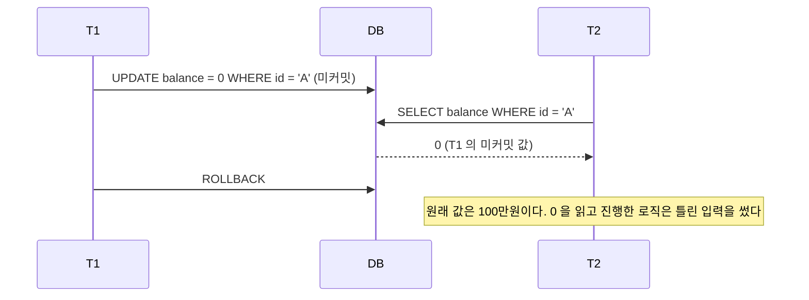
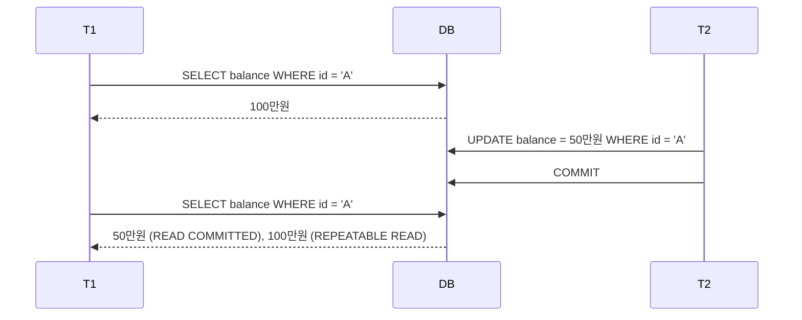
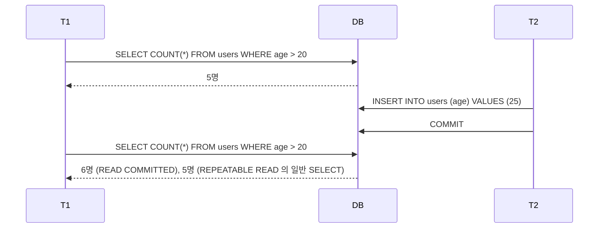
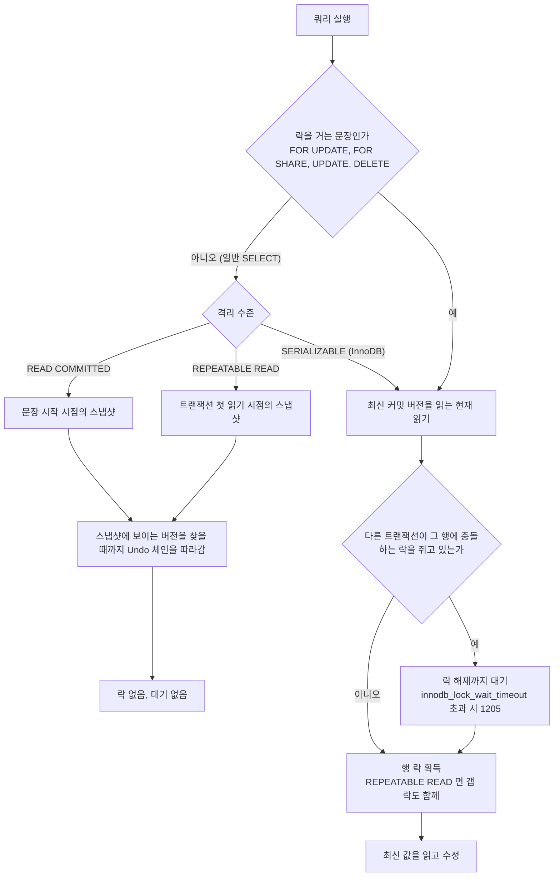
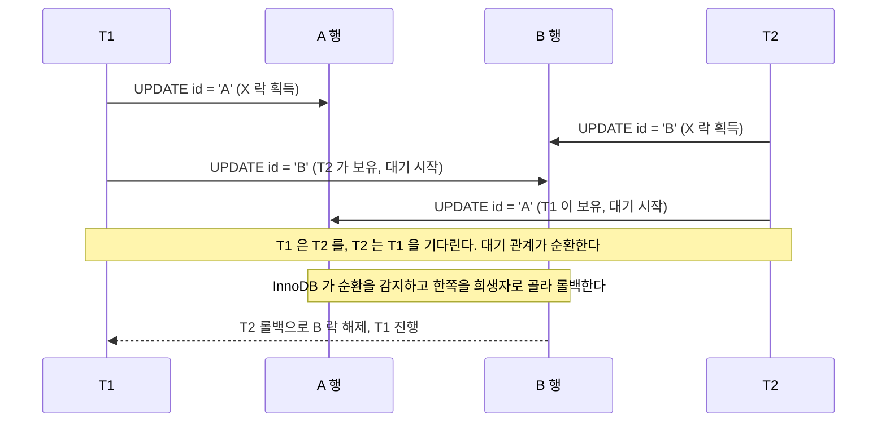
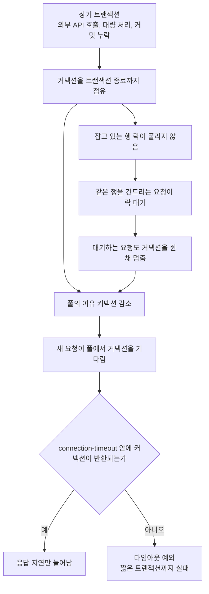
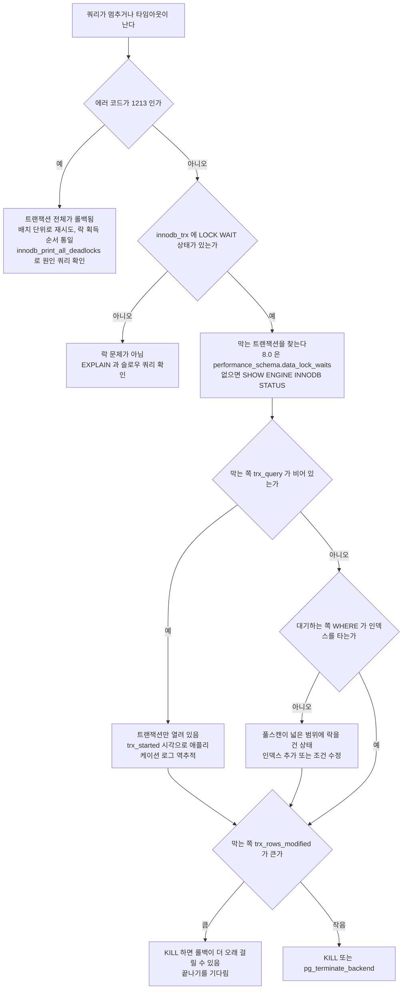

# 트랜잭션과 Lock

> Spring 에서는 `@Transactional(isolation = ...)` 로 이 문서의 격리 수준을 지정하고, 행 락은 JPA 의 `@Lock(LockModeType.PESSIMISTIC_WRITE)` 같은 락 모드로 건다. 프록시가 BEGIN 과 COMMIT 을 끼워 넣는 과정, 전파 옵션, 롤백 규칙은 [Spring AOP & 트랜잭션 심화](../../Framework/Java/Spring/AOP_트랜잭션.md)에서 다룬다. 이 문서는 그 아래에서 DB 가 실제로 하는 일을 본다.

## 개요

트랜잭션(Transaction)은 데이터베이스에서 **하나의 논리적 작업 단위**이다. 여러 SQL 문을 묶어 전부 성공하거나 전부 실패하도록 보장한다. Lock은 동시에 여러 트랜잭션이 같은 데이터에 접근할 때 **일관성을 유지**하기 위한 메커니즘이다.

```
트랜잭션 없이:
  계좌 A에서 100만원 출금 → 성공
  계좌 B에 100만원 입금 → 실패 (네트워크 오류)
  → 100만원이 증발!

트랜잭션 사용:
  BEGIN
    계좌 A에서 100만원 출금
    계좌 B에 100만원 입금
  COMMIT (전부 성공) 또는 ROLLBACK (전부 취소)
  → 데이터 일관성 보장
```

## ACID 속성과 동시성 제어
### 1. ACID 속성

| 속성 | 의미 | 보장 메커니즘 |
|------|------|-------------|
| **Atomicity** (원자성) | 전부 성공 or 전부 실패 | Undo Log (롤백) |
| **Consistency** (일관성) | 트랜잭션 전후 데이터 무결성 유지 | 제약 조건, 트리거 |
| **Isolation** (격리성) | 동시 실행 트랜잭션이 서로 영향 없음 | Lock, MVCC |
| **Durability** (지속성) | 커밋된 데이터는 영구 보존 | Redo Log (WAL) |

```
ACID와 실제 DB 내부 구조:

┌─────────────────────────────────────────────────┐
│                   트랜잭션                        │
│                                                   │
│   SQL 실행 ──→ Buffer Pool (메모리)               │
│       │              │                            │
│       ▼              ▼                            │
│   Undo Log      Redo Log (WAL)                    │
│   (롤백용)       (복구용)                          │
│       │              │                            │
│   ROLLBACK 시    COMMIT 시                        │
│   이전 상태로    디스크에 기록 보장                  │
│   되돌림         (fsync)                          │
└─────────────────────────────────────────────────┘
```

```sql
-- 트랜잭션 기본
BEGIN;

UPDATE accounts SET balance = balance - 1000000
WHERE id = 'A';

UPDATE accounts SET balance = balance + 1000000
WHERE id = 'B';

-- 둘 다 성공하면
COMMIT;

-- 문제 발생 시
ROLLBACK;
```

### 2. 격리 수준 (Isolation Level)

동시 트랜잭션 간 **얼마나 격리할 것인가**를 결정한다.

#### 동시성 문제

세 가지 이상 현상은 두 트랜잭션의 실행 순서만 보면 구분된다. 아래 타임라인은 위에서 아래로 시간이 흐른다.

**Dirty Read** — 커밋되지 않은 값을 읽는다. T1 이 롤백하면 T2 는 존재한 적 없는 값을 근거로 후속 로직을 돌린 셈이 된다. READ UNCOMMITTED 에서만 일어난다.



**Non-Repeatable Read** — 같은 행을 두 번 읽었는데 값이 다르다. 두 번째 SELECT 직전에 T2 가 커밋한 값을 T1 이 그대로 본다. READ COMMITTED 는 문장마다 새 스냅샷을 잡으므로 이 현상이 일어나고, REPEATABLE READ 부터는 T1 이 계속 100만원을 읽는다.



**Phantom Read** — 같은 조건으로 조회했는데 행 수가 달라진다. 값이 바뀐 것이 아니라 조건에 맞는 새 행이 생긴 경우다. 행 하나하나에 거는 락으로는 아직 존재하지 않는 행을 막지 못하기 때문에, InnoDB 는 인덱스 사이의 구간에 갭 락을 건다.



마지막 줄의 REPEATABLE READ 결과는 일반 SELECT 가 스냅샷을 읽기 때문이다. `FOR UPDATE` 나 `UPDATE` 같은 현재 읽기는 스냅샷이 아니라 최신 데이터를 보므로, 이쪽을 막는 것이 갭 락이다. 두 읽기가 갈리는 지점은 MVCC 절의 흐름도에 정리했다.

#### 격리 수준 비교

| 격리 수준 | Dirty Read | Non-Repeatable Read | Phantom Read | 성능 |
|----------|-----------|-------------------|-------------|------|
| **READ UNCOMMITTED** | 발생 | 발생 | 발생 | 가장 빠름 |
| **READ COMMITTED** | 방지 | 발생 | 발생 | 빠름 |
| **REPEATABLE READ** | 방지 | 방지 | 발생 (InnoDB 방지) | 보통 |
| **SERIALIZABLE** | 방지 | 방지 | 방지 | 느림 |

```sql
-- 격리 수준 설정
SET TRANSACTION ISOLATION LEVEL READ COMMITTED;

-- MySQL 전역 설정
SET GLOBAL transaction_isolation = 'REPEATABLE-READ';

-- PostgreSQL
SET default_transaction_isolation = 'read committed';
```

#### 각 격리 수준 상세

```
READ UNCOMMITTED:
  다른 트랜잭션의 미커밋 데이터도 읽음
  사용: 거의 안 함 (로그 조회 등 극히 제한적)

READ COMMITTED (PostgreSQL 기본):
  커밋된 데이터만 읽음
  매 쿼리마다 최신 스냅샷 사용
  사용: 대부분의 OLTP 시스템

REPEATABLE READ (MySQL/InnoDB 기본):
  트랜잭션 시작 시점의 스냅샷 사용
  같은 쿼리는 항상 같은 결과
  InnoDB는 갭 락으로 Phantom Read도 방지
  사용: 금융, 재고 관리

SERIALIZABLE:
  트랜잭션을 완전히 순차 실행하는 것처럼 동작
  모든 SELECT에 공유 락
  사용: 극도의 정합성 필요 (결제 핵심 로직)
```

### 3. Lock (잠금)

#### Lock 종류

| Lock 유형 | 영문 | 동작 | 호환성 |
|----------|------|------|--------|
| **공유 락 (S Lock)** | Shared Lock | 읽기 허용, 쓰기 차단 | S + S 호환 |
| **배타 락 (X Lock)** | Exclusive Lock | 읽기/쓰기 모두 차단 | 모든 Lock과 충돌 |
| **의도 락 (IS/IX)** | Intention Lock | 테이블 레벨 의도 표시 | 행 락 효율화 |
| **갭 락 (Gap Lock)** | Gap Lock | 인덱스 사이 구간 잠금 | Phantom Read 방지 |

```sql
-- 공유 락 (SELECT ... FOR SHARE)
SELECT * FROM products WHERE id = 1 FOR SHARE;
-- 다른 트랜잭션도 읽기 가능, 쓰기는 대기

-- 배타 락 (SELECT ... FOR UPDATE)
SELECT * FROM products WHERE id = 1 FOR UPDATE;
-- 다른 트랜잭션은 읽기/쓰기 모두 대기

-- NOWAIT / SKIP LOCKED (대기 안 하고 즉시 처리)
SELECT * FROM orders WHERE status = 'PENDING'
FOR UPDATE SKIP LOCKED LIMIT 10;
-- 이미 락이 걸린 행은 건너뜀 (작업 큐 패턴)
```

#### Lock 범위

```
행 락 (Row Lock):
  특정 행만 잠금 → 동시성 높음
  InnoDB 기본 동작

페이지 락 (Page Lock):
  데이터 페이지 단위 잠금

테이블 락 (Table Lock):
  테이블 전체 잠금 → 동시성 낮음
  DDL 작업 시 자동 적용

갭 락 (Gap Lock):
  인덱스 값 사이의 "틈"을 잠금
  Phantom Read 방지

  예: age 인덱스에 10, 20, 30이 있을 때
  SELECT * WHERE age BETWEEN 10 AND 30 FOR UPDATE;
  → 10~30 사이 갭도 잠금 → INSERT age=25 차단
```

```
Lock 호환성 매트릭스:

            요청하는 Lock
보유 Lock   │  S (공유)  │  X (배타)
────────────┼───────────┼──────────
S (공유)    │  허용      │  대기
X (배타)    │  대기      │  대기

  T1이 S Lock 보유 → T2가 S Lock 요청 → 즉시 획득
  T1이 S Lock 보유 → T2가 X Lock 요청 → T1 해제까지 대기
  T1이 X Lock 보유 → T2가 아무 Lock 요청 → T1 해제까지 대기
```

#### 락 모니터링

운영 환경에서 느린 쿼리나 타임아웃이 발생하면 락 상태부터 확인한다.

**MySQL (InnoDB)**

```sql
-- 현재 실행 중인 트랜잭션 확인
SELECT trx_id, trx_state, trx_started, trx_wait_started,
       trx_mysql_thread_id, trx_query
FROM information_schema.innodb_trx;

-- 락 대기 관계 확인 (누가 누구를 막고 있는지)
SELECT
    r.trx_id AS waiting_trx_id,
    r.trx_query AS waiting_query,
    b.trx_id AS blocking_trx_id,
    b.trx_query AS blocking_query,
    b.trx_started AS blocking_since
FROM information_schema.innodb_lock_waits w
JOIN information_schema.innodb_trx b ON b.trx_id = w.blocking_trx_id
JOIN information_schema.innodb_trx r ON r.trx_id = w.requesting_trx_id;

-- MySQL 8.0 이상에서는 performance_schema 사용
SELECT * FROM performance_schema.data_lock_waits;
SELECT * FROM performance_schema.data_locks;

-- 오래 실행 중인 트랜잭션 찾기 (5분 이상)
SELECT trx_id, trx_state, trx_started,
       TIMESTAMPDIFF(SECOND, trx_started, NOW()) AS running_seconds,
       trx_rows_locked, trx_rows_modified
FROM information_schema.innodb_trx
WHERE TIMESTAMPDIFF(SECOND, trx_started, NOW()) > 300;
```

**PostgreSQL**

```sql
-- 현재 락 보유/대기 현황
SELECT pid, mode, relation::regclass, granted,
       pg_blocking_pids(pid) AS blocked_by
FROM pg_locks
WHERE NOT granted;

-- 락 대기 중인 쿼리와 블로킹 쿼리를 함께 조회
SELECT
    blocked.pid AS blocked_pid,
    blocked.query AS blocked_query,
    blocking.pid AS blocking_pid,
    blocking.query AS blocking_query,
    NOW() - blocked.query_start AS waiting_duration
FROM pg_stat_activity blocked
JOIN pg_locks blocked_locks ON blocked.pid = blocked_locks.pid
JOIN pg_locks blocking_locks ON blocked_locks.relation = blocking_locks.relation
    AND blocked_locks.pid != blocking_locks.pid
JOIN pg_stat_activity blocking ON blocking_locks.pid = blocking.pid
WHERE NOT blocked_locks.granted;

-- 오래 실행 중인 트랜잭션
SELECT pid, state, query_start,
       NOW() - query_start AS duration,
       query
FROM pg_stat_activity
WHERE state != 'idle'
  AND query_start < NOW() - INTERVAL '5 minutes';
```

```
락 모니터링 시 확인 흐름:

1. 느린 쿼리/타임아웃 발생
      │
      ▼
2. innodb_trx / pg_stat_activity로 실행 중인 트랜잭션 확인
      │
      ▼
3. 락 대기 관계 확인 (누가 누구를 블로킹하는지)
      │
      ▼
4. 블로킹 트랜잭션의 쿼리/시작 시간 확인
      │
      ▼
5. 판단: 대기 or 강제 종료 (KILL / pg_terminate_backend)
```

### 4. MVCC (다중 버전 동시성 제어)

Lock 대신 **데이터의 여러 버전을 유지**하여 읽기와 쓰기가 서로 차단하지 않는 방식.

```
MVCC 동작 (PostgreSQL):

T1 시작 (txid=100)
T2 시작 (txid=101)

  데이터: balance = 100만원 (version: txid=99)

T2: UPDATE balance = 50만원; COMMIT;
  → 새 버전 생성: balance = 50만원 (version: txid=101)

T1: SELECT balance
  → T1 시작 시점(txid=100) 기준 → 100만원 (이전 버전 읽음)
  → T2의 변경은 T1에게 보이지 않음 (Snapshot Isolation)
```

MVCC 라고 모든 읽기가 락 없이 끝나는 것은 아니다. 일반 SELECT 는 스냅샷에서 이전 버전을 읽어 아무도 기다리지 않지만, `SELECT ... FOR UPDATE` 와 UPDATE, DELETE 는 이전 버전이 아니라 **최신 커밋 버전**에 락을 걸고 읽는다. 이 읽기를 현재 읽기(current read)라고 부른다. 같은 트랜잭션 안에서 스냅샷 읽기 결과와 현재 읽기 결과가 다르게 나오는 경우가 여기서 생긴다.



흐름도에서 갈리는 지점은 두 곳이다. 첫째는 문장이 락을 거는가이고, 둘째는 격리 수준이다. InnoDB 의 SERIALIZABLE 은 autocommit 이 꺼진 상태에서 일반 SELECT 를 `FOR SHARE` 로 바꿔 실행하므로 현재 읽기 쪽으로 넘어간다. 그래서 "읽기는 안 막는다"는 MVCC 의 성질이 SERIALIZABLE 에서는 성립하지 않는다.

PostgreSQL 은 현재 읽기의 동작이 다르다. REPEATABLE READ 에서 스냅샷 이후 다른 트랜잭션이 바꾼 행을 `FOR UPDATE` 하거나 UPDATE 하면, 대기 후 최신 값으로 진행하지 않고 `could not serialize access due to concurrent update` 로 실패한다. 애플리케이션은 이 에러를 받아 트랜잭션을 처음부터 다시 실행해야 한다.

```
MVCC 버전 관리 방식 비교:

PostgreSQL (다중 버전 저장):
┌──────────────┐
│ 원본 행        │  xmin=99, xmax=101 (dead tuple)
├──────────────┤
│ 새 행          │  xmin=101, xmax=∞   (live tuple)
└──────────────┘
→ UPDATE 시 원본 행을 지우지 않고 새 행을 추가
→ dead tuple이 누적됨 → VACUUM으로 정리

MySQL/InnoDB (Undo Log 방식):
┌──────────────┐
│ 최신 데이터     │  ← 테이블 공간에 저장
└──────┬───────┘
       │ roll_pointer
       ▼
┌──────────────┐
│ Undo Log      │  ← 이전 버전 (롤백 세그먼트에 저장)
└──────┬───────┘
       │ roll_pointer
       ▼
┌──────────────┐
│ Undo Log      │  ← 더 이전 버전
└──────────────┘
→ 테이블에는 최신 데이터만 유지
→ 이전 버전은 Undo Log 체인으로 추적
→ purge thread가 불필요한 Undo Log 정리
```

| 비교 | Lock 기반 | MVCC |
|------|----------|------|
| **읽기-쓰기 충돌** | 대기 (블로킹) | **대기 없음** |
| **읽기-읽기** | 동시 가능 | 동시 가능 |
| **쓰기-쓰기** | 대기 | 대기 (또는 충돌 감지) |
| **오버헤드** | 락 관리 | 버전 저장 공간 |
| **사용 DB** | 전통적 RDBMS | PostgreSQL, MySQL/InnoDB, Oracle |

#### MVCC 버전 정리 — VACUUM과 Purge

MVCC는 이전 버전 데이터를 보관하기 때문에, 정리하지 않으면 디스크와 성능에 문제가 생긴다.

**PostgreSQL — VACUUM**

PostgreSQL은 UPDATE/DELETE 시 기존 행을 바로 삭제하지 않는다. dead tuple로 남겨두고, 나중에 VACUUM이 정리한다.

```sql
-- 테이블별 dead tuple 확인
SELECT relname, n_live_tup, n_dead_tup,
       ROUND(n_dead_tup::numeric / NULLIF(n_live_tup + n_dead_tup, 0) * 100, 2) AS dead_ratio
FROM pg_stat_user_tables
ORDER BY n_dead_tup DESC;

-- 수동 VACUUM (일반)
VACUUM VERBOSE my_table;

-- VACUUM FULL (테이블 재작성 — 배타 락 걸림, 운영 중 주의)
VACUUM FULL my_table;
```

```
VACUUM 동작:

VACUUM (일반):
  dead tuple 공간을 "재사용 가능"으로 표시
  테이블 크기는 줄어들지 않음
  락 안 걸림, 운영 중 실행 가능

VACUUM FULL:
  테이블을 새로 작성하여 물리적으로 축소
  배타 락 걸림 → 운영 중 실행하면 서비스 중단
  대안: pg_repack 사용 (온라인으로 테이블 재작성)
```

autovacuum이 기본으로 켜져 있지만, 대량 UPDATE가 발생하는 테이블에서는 autovacuum이 따라가지 못하는 경우가 있다. 이때 흔히 발생하는 문제:

- **테이블 bloat**: dead tuple이 쌓여서 테이블 크기가 실제 데이터 대비 2~3배까지 커짐
- **인덱스 bloat**: 인덱스도 dead tuple을 참조하기 때문에 같이 비대해짐
- **Transaction ID Wraparound**: PostgreSQL의 txid는 32bit이므로 약 21억 개까지 사용 가능. VACUUM이 밀리면 wraparound 방지를 위해 DB가 강제로 읽기 전용 모드로 전환됨

```sql
-- autovacuum 설정 조정 (대량 쓰기 테이블)
ALTER TABLE high_write_table SET (
    autovacuum_vacuum_scale_factor = 0.01,    -- 기본 0.2 → 더 자주 실행
    autovacuum_analyze_scale_factor = 0.005,
    autovacuum_vacuum_cost_delay = 2          -- 기본 20ms → 더 공격적으로
);

-- Transaction ID 나이 확인 (wraparound 위험도)
SELECT relname, age(relfrozenxid) AS xid_age,
       pg_size_pretty(pg_relation_size(oid)) AS table_size
FROM pg_class
WHERE relkind = 'r'
ORDER BY age(relfrozenxid) DESC
LIMIT 10;
```

**MySQL/InnoDB — Purge**

InnoDB는 Undo Log에 이전 버전을 저장한다. purge thread가 더 이상 필요 없는 Undo Log를 삭제한다.

```sql
-- Undo Log 상태 확인
SHOW ENGINE INNODB STATUS\G
-- History list length 값 확인 → 높으면 purge가 밀리고 있다는 뜻

-- History list length 모니터링
SELECT NAME, COUNT FROM information_schema.innodb_metrics
WHERE NAME = 'trx_rseg_history_len';
```

```
History list length가 높아지는 원인:
  1. 장기 실행 트랜잭션이 오래된 스냅샷을 잡고 있음
     → purge가 해당 시점 이후의 Undo Log를 지울 수 없음
  2. purge thread가 쓰기 부하를 따라가지 못함
     → innodb_purge_threads 값 증가 고려 (기본 4)

History list length가 계속 증가하면:
  - Undo tablespace 크기 증가
  - 쿼리 성능 저하 (Undo Log 체인이 길어져서 이전 버전 조회가 느려짐)
  - 디스크 공간 부족
```

### 5. SAVEPOINT

트랜잭션 전체를 롤백하지 않고, **특정 지점까지만 되돌리고 싶을 때** 사용한다. 배치 처리에서 한 건 실패했다고 전체를 롤백하면 이미 처리한 건까지 날아가므로, SAVEPOINT로 부분 롤백하는 방식을 쓴다.

```sql
BEGIN;

INSERT INTO orders (id, amount) VALUES (1, 10000);
SAVEPOINT sp1;

INSERT INTO orders (id, amount) VALUES (2, 20000);
SAVEPOINT sp2;

INSERT INTO orders (id, amount) VALUES (3, 30000);
-- 3번 주문에 문제가 생겼다면
ROLLBACK TO SAVEPOINT sp2;
-- 1번, 2번 주문은 유지됨

-- 나머지 처리 후
COMMIT;
```

```
SAVEPOINT 동작:

BEGIN
  │
  ├── INSERT 1 ──→ SAVEPOINT sp1
  │                    │
  │                    ├── INSERT 2 ──→ SAVEPOINT sp2
  │                    │                    │
  │                    │                    ├── INSERT 3 (실패)
  │                    │                    │
  │                    │               ROLLBACK TO sp2
  │                    │               (INSERT 3만 취소)
  │                    │
  │                    ├── INSERT 4
  │                    │
COMMIT (INSERT 1, 2, 4 반영)
```

배치 처리에서의 활용:

```typescript
async processBatch(orders: Order[]): Promise<BatchResult> {
    let success = 0;
    let failed = 0;

    await this.dataSource.transaction(async (manager) => {
        for (const order of orders) {
            // SAVEPOINT 생성
            await manager.query(`SAVEPOINT sp_order_${order.id}`);
            try {
                await this.orderService.processOrder(order, manager);
                success++;
            } catch (e) {
                // 해당 건만 롤백
                await manager.query(`ROLLBACK TO SAVEPOINT sp_order_${order.id}`);
                failed++;
                logger.warn('주문 처리 실패', { orderId: order.id, error: e });
            }
        }
    });
    // 성공한 건들은 COMMIT됨
    return new BatchResult(success, failed);
}
```

주의사항:

- SAVEPOINT는 중첩할 수 있지만, 너무 많이 만들면 Undo Log가 커진다
- `ROLLBACK TO SAVEPOINT`는 SAVEPOINT를 제거하지 않는다. 같은 이름으로 다시 ROLLBACK 가능
- `RELEASE SAVEPOINT`로 명시적으로 제거할 수 있다
- MySQL에서는 DDL 문(ALTER TABLE 등)이 실행되면 모든 SAVEPOINT가 사라진다

### 6. 낙관적 vs 비관적 잠금

#### 비관적 잠금 (Pessimistic Lock)

**충돌이 자주 발생**할 것으로 예상할 때 사용. 데이터를 읽는 시점에 락을 건다.

```typescript
// TypeORM 비관적 잠금
async findByIdWithLock(id: number): Promise<Product> {
    return this.productRepository.findOne({
        where: { id },
        lock: { mode: 'pessimistic_write' },
    });
}

// 사용
async decreaseStock(productId: number, quantity: number): Promise<void> {
    await this.dataSource.transaction(async (manager) => {
        const product = await manager.findOne(Product, {
            where: { id: productId },
            lock: { mode: 'pessimistic_write' },
        });
        product.decreaseStock(quantity);  // 재고 감소
        await manager.save(product);
        // 트랜잭션 종료 시 락 해제
    });
}
```

```sql
-- SQL
BEGIN;
SELECT * FROM products WHERE id = 1 FOR UPDATE;  -- 락 획득
UPDATE products SET stock = stock - 1 WHERE id = 1;
COMMIT;  -- 락 해제
```

#### 낙관적 잠금 (Optimistic Lock)

**충돌이 드물게 발생**할 것으로 예상할 때 사용. 커밋 시점에 충돌을 감지한다.

```typescript
@Entity()
export class Product {
    @PrimaryGeneratedColumn()
    id: number;

    @VersionColumn()  // 낙관적 잠금용 버전 컬럼
    version: number;

    @Column()
    stock: number;
}

// 사용
async decreaseStock(productId: number, quantity: number): Promise<void> {
    await this.dataSource.transaction(async (manager) => {
        const product = await manager.findOne(Product, {
            where: { id: productId },
            lock: { mode: 'optimistic', version: undefined },
        });
        product.decreaseStock(quantity);
        await manager.save(product);
        // 커밋 시 version 체크 → 변경되었으면 OptimisticLockVersionMismatchError
    });
}
```

```sql
-- SQL (수동 구현)
SELECT id, stock, version FROM products WHERE id = 1;
-- 결과: stock=10, version=3

UPDATE products
SET stock = 9, version = 4
WHERE id = 1 AND version = 3;
-- 영향받은 행 0 → 다른 트랜잭션이 먼저 수정함 → 재시도
```

#### 재시도 패턴

```typescript
async decreaseStock(productId: number, quantity: number, attempt = 0): Promise<void> {
    const maxAttempts = 3;
    try {
        await this.dataSource.transaction(async (manager) => {
            const product = await manager.findOne(Product, { where: { id: productId } });
            product.decreaseStock(quantity);
            await manager.save(product);
        });
    } catch (e) {
        if (e instanceof OptimisticLockVersionMismatchError && attempt < maxAttempts - 1) {
            await new Promise((res) => setTimeout(res, 100));
            return this.decreaseStock(productId, quantity, attempt + 1);
        }
        throw e;
    }
}
```

| 비교 | 비관적 잠금 | 낙관적 잠금 |
|------|-----------|-----------|
| **잠금 시점** | 데이터 읽기 시 | 데이터 커밋 시 |
| **충돌 처리** | 대기 (블로킹) | 예외 발생 → 재시도 |
| **동시성** | 낮음 | 높음 |
| **데드락 가능** | 있음 | 없음 |
| **적합한 경우** | 충돌 빈번 (재고 차감) | 충돌 드묾 (프로필 수정) |
| **구현** | `FOR UPDATE` | `@Version` |

### 7. 데드락 (Deadlock)

두 트랜잭션이 서로가 가진 락을 기다리며 **무한 대기**하는 상태.

락을 잡는 순서가 서로 반대면 생긴다. 한 트랜잭션만 보면 정상인 코드가 두 개 동시에 돌 때만 터지기 때문에 테스트에서는 잘 안 보이고 트래픽이 붙은 뒤에 나타난다. 아래는 계좌 이체 두 건이 반대 방향으로 겹친 경우다.



타임아웃이 끝나기를 기다리는 것이 아니다. InnoDB 는 락 대기 그래프에서 순환이 생기는 즉시 감지해 한쪽에 1213 을 돌려준다. 희생자로 뽑히는 쪽은 보통 변경한 행이 적은 트랜잭션이다. 어느 쪽이 죽을지는 애플리케이션이 정할 수 없으므로, 호출하는 쪽에서 재시도할 수 있게 짜두어야 한다.

```sql
-- 데드락 발생 예시
-- T1
BEGIN;
UPDATE accounts SET balance = balance - 100 WHERE id = 'A';  -- Lock A
-- T2
BEGIN;
UPDATE accounts SET balance = balance - 200 WHERE id = 'B';  -- Lock B

-- T1
UPDATE accounts SET balance = balance + 100 WHERE id = 'B';  -- Lock B 대기 (T2가 보유)
-- T2
UPDATE accounts SET balance = balance + 200 WHERE id = 'A';  -- Lock A 대기 (T1이 보유)

-- → DEADLOCK! DB가 한쪽 트랜잭션을 강제 롤백
```

#### 데드락 방지

```sql
-- 1. 자원 접근 순서 통일
-- 항상 ID가 작은 것부터 잠금
BEGIN;
SELECT * FROM accounts WHERE id IN ('A', 'B')
ORDER BY id FOR UPDATE;  -- A → B 순서 보장

-- 2. 타임아웃 설정
SET innodb_lock_wait_timeout = 5;  -- 5초 대기 후 포기

-- 3. 트랜잭션 크기 최소화
-- 락 보유 시간을 줄임
```

```sql
-- 데드락 조회 (MySQL)
SHOW ENGINE INNODB STATUS;  -- LATEST DETECTED DEADLOCK 섹션 확인

-- PostgreSQL 데드락 로그
-- postgresql.conf: log_lock_waits = on
```

### 8. 트랜잭션 실무 주의사항

트랜잭션을 잘못 사용할 때 빈번하게 발생하는 문제들이 있다.

#### 내부 호출 시 트랜잭션 미적용 문제

같은 클래스 내부에서 트랜잭션 메서드를 직접 호출하면 **별도 트랜잭션이 시작되지 않아** 의도한 원자성이 보장되지 않는다.

```typescript
@Injectable()
export class OrderService {

    createOrder(request: OrderRequest): void {
        // 이 호출은 dataSource.transaction 밖에서 실행 → 트랜잭션 미적용
        this.processPayment(request);
    }

    async processPayment(request: OrderRequest): Promise<void> {
        // 트랜잭션이 걸려야 하지만, 내부 호출이라 안 걸림
        await this.dataSource.transaction(async (manager) => {
            await manager.save(Payment, payment);
            await manager.update(Account, { userId: request.userId }, { balance: () => `balance - ${request.amount}` });
        });
    }
}
```

```
트랜잭션 범위 동작 방식:

올바른 호출 (트랜잭션 적용됨):
  Controller ──→ PaymentService.processPayment()
                     │
                     └── dataSource.transaction() → BEGIN / COMMIT 처리

내부 호출 (트랜잭션 미적용):
  OrderService.createOrder() ──→ this.processPayment()
                                   │
                                   └── 별도 트랜잭션 없음 → dataSource.transaction() 미호출
```

해결 방법:

```typescript
// 방법 1: 별도 서비스로 분리 (권장)
@Injectable()
export class OrderService {
    constructor(private readonly paymentService: PaymentService) {}

    async createOrder(request: OrderRequest): Promise<void> {
        await this.paymentService.processPayment(request);  // 별도 서비스에서 트랜잭션 처리
    }
}

@Injectable()
export class PaymentService {
    constructor(private readonly dataSource: DataSource) {}

    async processPayment(request: OrderRequest): Promise<void> {
        await this.dataSource.transaction(async (manager) => {
            // 트랜잭션 정상 동작
        });
    }
}
```

#### 읽기 전용 커넥션과 쓰기 혼용 문제

읽기 전용 복제본(replica) 커넥션에서 쓰기 메서드를 호출하면, **읽기 전용 커넥션에서 쓰기가 실패**하는 경우가 있다.

```typescript
@Injectable()
export class ReportService {
    constructor(
        private readonly reportRepository: ReportRepository,
        private readonly auditService: AuditService,
    ) {}

    // 읽기 전용 연결로 실행
    async generateReport(userId: number): Promise<Report> {
        const report = await this.reportRepository.calculate(userId);

        // 문제: auditService는 읽기 전용 연결로 쓰기를 시도하면 실패 가능
        await this.auditService.logReportGeneration(userId);  // 쓰기 동작 → 실패 가능

        return report;
    }
}

@Injectable()
export class AuditService {
    constructor(private readonly dataSource: DataSource) {}

    async logReportGeneration(userId: number): Promise<void> {
        // 별도 트랜잭션으로 쓰기 처리
        await this.dataSource.transaction(async (manager) => {
            await manager.save(AuditLog, { userId, action: 'REPORT_GENERATED' });
        });
    }
}
```

```
읽기 전용 커넥션 혼용 상황:

generateReport() → 읽기 전용 커넥션 사용
    │
    ├── SELECT (정상)
    │
    └── logReportGeneration() → 쓰기 시도
            │
            └── 읽기 전용 커넥션에서 INSERT 시도
                → 실패 (read-only connection error)
```

해결:

```typescript
@Injectable()
export class AuditService {
    constructor(private readonly dataSource: DataSource) {}

    // 항상 별도 트랜잭션으로 실행
    async logReportGeneration(userId: number): Promise<void> {
        await this.dataSource.transaction(async (manager) => {
            await manager.save(AuditLog, { userId, action: 'REPORT_GENERATED' });
        });
    }
}
```

#### 에러 발생 시 롤백 동작

TypeScript/Node.js에서는 `dataSource.transaction()` 내부에서 에러가 throw되면 **항상 자동으로 롤백**된다. Java Spring과 달리 checked/unchecked 예외 구분이 없다.

```typescript
// 문제 없음: TypeScript/Node.js에는 checked/unchecked 구분이 없음
// throw된 에러는 항상 트랜잭션 롤백 트리거
async transferMoney(from: number, to: number, amount: number): Promise<void> {
    await this.dataSource.transaction(async (manager) => {
        await this.accountRepository.withdraw(from, amount, manager);
        await this.accountRepository.deposit(to, amount, manager);

        if (someConditionFails()) {
            // 에러를 throw하면 트랜잭션이 롤백됨
            throw new InsufficientBalanceError('잔액 부족');
        }
    });
}
```

```
dataSource.transaction() 롤백 규칙 (TypeScript/TypeORM):

  throw Error (모든 종류) → 롤백 O
  정상 종료               → 커밋 O
  → Java의 checked exception 문제 없음
```

해결:

```typescript
// TypeScript에서는 모든 에러가 throw되면 트랜잭션 롤백됨 — 별도 설정 불필요
async transferMoney(from: number, to: number, amount: number): Promise<void> {
    await this.dataSource.transaction(async (manager) => {
        await this.accountRepository.withdraw(from, amount, manager);
        await this.accountRepository.deposit(to, amount, manager);
    });
    // 에러 발생 시 자동 롤백
}

// 커스텀 에러 클래스 (TypeScript)
export class InsufficientBalanceError extends Error {
    constructor(message: string) {
        super(message);
        this.name = 'InsufficientBalanceError';
    }
}
```

TypeScript/Node.js에서는 모든 에러가 동일하게 처리되므로 `dataSource.transaction()` 내부에서 throw된 에러는 종류에 관계없이 항상 롤백된다.

### 9. 장기 트랜잭션과 커넥션 풀 고갈

트랜잭션이 오래 열려 있으면 그 트랜잭션이 점유한 DB 커넥션은 풀에 반환되지 않는다. 동시 요청이 많은 상황에서 장기 트랜잭션 몇 개가 커넥션 풀을 고갈시키면 **전체 서비스가 멈춘다**.

풀 크기가 10이고 8개가 사용 중인 상태에서 그중 3개가 외부 API 호출이나 대량 처리로 수 분간 반환되지 않는다고 하자. 새 요청 7개가 들어오면 남은 커넥션은 2개라 5개가 대기하고, 대기가 타임아웃을 넘으면 짧은 트랜잭션까지 실패한다.



흐름도에서 "대기하는 요청도 커넥션을 쥔 채 멈춤"에서 풀로 되돌아가는 화살표를 봐야 한다. 장기 트랜잭션이 행 락까지 쥐고 있으면, 그 행을 기다리는 요청들이 각자 커넥션을 하나씩 쥔 채 멈춘다. 풀 고갈은 장기 트랜잭션 개수보다 훨씬 빠르게 진행되고, 이때 증상은 "DB 가 느리다"가 아니라 "애플리케이션이 커넥션을 못 얻는다"로 나타난다. DB CPU 는 한가한데 서비스가 죽어 있으면 이 경로를 의심한다.

흔히 발생하는 원인:

```typescript
// 문제 1: 트랜잭션 안에서 외부 API 호출
async processOrder(order: Order): Promise<void> {
    await this.dataSource.transaction(async (manager) => {
        await manager.save(Order, order);

        // 외부 API 호출 — 응답이 3초 걸림
        // 이 시간 동안 DB 커넥션을 잡고 있음
        const result = await this.paymentGateway.charge(order.amount);

        order.paymentId = result.id;
        await manager.save(Order, order);
    });
}

// 해결: 트랜잭션 밖에서 외부 호출
async processOrder(order: Order): Promise<void> {
    // 1단계: 주문 저장 (짧은 트랜잭션)
    await this.orderService.saveOrder(order);

    // 2단계: 외부 API 호출 (트랜잭션 밖)
    const result = await this.paymentGateway.charge(order.amount);

    // 3단계: 결과 저장 (짧은 트랜잭션)
    await this.orderService.updatePaymentResult(order.id, result);
}
```

```typescript
// 문제 2: 대량 데이터 처리를 한 트랜잭션으로
async migrateAllUsers(): Promise<void> {
    await this.dataSource.transaction(async (manager) => {
        const users = await manager.find(User);  // 100만 건
        for (const user of users) {
            user.status = 'MIGRATED';
            // 100만 건 처리 동안 커넥션 점유
        }
        await manager.save(User, users);
    });
}

// 해결: 배치 단위로 분할
async migrateAllUsers(): Promise<void> {
    const batchSize = 1000;
    let page = 0;
    let hasMore = true;

    while (hasMore) {
        const batch = await this.userRepository.find({
            skip: page * batchSize,
            take: batchSize,
        });
        if (batch.length === 0) { hasMore = false; break; }
        await this.migrateService.migrateBatch(batch);  // 별도 트랜잭션
        page++;
    }
}

async migrateBatch(users: User[]): Promise<void> {
    await this.dataSource.transaction(async (manager) => {
        // 1000건씩만 처리 → 커넥션 빨리 반환
        users.forEach((u) => { u.status = 'MIGRATED'; });
        await manager.save(User, users);
    });
}
```

HikariCP 설정에서 `leak-detection-threshold`를 설정하면 커넥션을 오래 잡고 있는 코드를 로그로 잡아낼 수 있다:

```yaml
# application.yml
spring:
  datasource:
    hikari:
      maximum-pool-size: 10
      connection-timeout: 3000          # 커넥션 대기 최대 3초
      leak-detection-threshold: 30000   # 30초 이상 반환 안 하면 경고 로그
```

### 10. 실전 패턴

#### 재고 차감 (동시성 핵심)

```typescript
// 방법 1: 비관적 잠금
async order(productId: number, qty: number): Promise<void> {
    await this.dataSource.transaction(async (manager) => {
        const p = await manager.findOne(Product, {
            where: { id: productId },
            lock: { mode: 'pessimistic_write' },
        });
        p.decreaseStock(qty);
        await manager.save(p);
    });
}

// 방법 2: 낙관적 잠금 + 재시도
async order(productId: number, qty: number, attempt = 0): Promise<void> {
    try {
        await this.dataSource.transaction(async (manager) => {
            const p = await manager.findOne(Product, { where: { id: productId } });
            p.decreaseStock(qty);
            await manager.save(p);
        });
    } catch (e) {
        if (e instanceof OptimisticLockVersionMismatchError && attempt < 2) {
            return this.order(productId, qty, attempt + 1);
        }
        throw e;
    }
}

// 방법 3: DB 레벨 원자적 연산 (가장 단순)
async decreaseStock(id: number, qty: number): Promise<number> {
    const result = await this.productRepository
        .createQueryBuilder()
        .update(Product)
        .set({ stock: () => `stock - ${qty}` })
        .where('id = :id AND stock >= :qty', { id, qty })
        .execute();
    return result.affected ?? 0;
    // 반환값 0이면 재고 부족 → 예외 처리
}

// 방법 4: Redis 분산 락 (MSA 환경)
async order(productId: number, qty: number): Promise<void> {
    const lockKey = `lock:product:${productId}`;
    const locked = await this.redis.set(lockKey, '1', 'EX', 5, 'NX');
    if (!locked) throw new ConcurrencyError();
    try {
        // 재고 차감 로직
    } finally {
        await this.redis.del(lockKey);
    }
}
```

| 방법 | 장점 | 단점 | 적합한 경우 |
|------|------|------|-----------|
| 비관적 잠금 | 확실한 동시성 제어 | 대기 시간, 데드락 가능 | 재고 차감, 좌석 예약 |
| 낙관적 잠금 | 높은 동시성 | 충돌 시 재시도 비용 | 게시글 수정, 설정 변경 |
| DB 원자적 연산 | 단순, 빠름 | 복잡한 로직 불가 | 단순 카운터 |
| Redis 분산 락 | MSA 환경 지원 | 인프라 의존 | 분산 시스템 |

#### SKIP LOCKED 작업 큐

```sql
-- 작업 큐 패턴 (여러 워커가 동시에 작업 가져감)
BEGIN;
SELECT * FROM tasks
WHERE status = 'PENDING'
ORDER BY created_at
FOR UPDATE SKIP LOCKED
LIMIT 1;

UPDATE tasks SET status = 'PROCESSING', worker_id = 'worker-1'
WHERE id = ?;
COMMIT;

-- SKIP LOCKED: 이미 다른 워커가 락 건 행은 건너뜀
-- → 동일 작업을 중복 처리하지 않음
```

### 11. 락 때문에 멈췄을 때 보는 순서

"쿼리가 느리다"와 "쿼리가 락을 기다린다"는 대응이 완전히 다르다. 인덱스를 아무리 손봐도 후자는 안 풀린다.

전체 순서는 아래 흐름도와 같다. 에러 코드부터 갈라지고, 락 대기 중이면 막는 쪽을 찾아 원인을 가른 뒤, 마지막에 지금 풀어야 하는지를 판단한다. 각 단계의 근거는 이어지는 소절에 있다.



#### 먼저 구분한다

```sql
-- MySQL: 상태가 LOCK WAIT 인 트랜잭션이 있는가
SELECT trx_id, trx_state, trx_started, trx_query
FROM information_schema.innodb_trx
WHERE trx_state = 'LOCK WAIT';
```

`LOCK WAIT`가 없으면 락 문제가 아니다. 있으면 **막고 있는 쪽**을 찾는다. 여기서 위 모니터링 쿼리에 함정이 하나 있다. 이 문서가 먼저 제시한 `information_schema.innodb_lock_waits`는 **MySQL 8.0에서 `INNODB_LOCKS`와 함께 제거되어 performance_schema로 옮겨갔다.** 장애 한복판에서 이 쿼리가 "Unknown table" 계열 에러로 죽으면 시간을 버린다. 어느 쪽이 있는지 평상시에 확인해두고, 확인된 쿼리를 런북에 박아둔다.

```sql
-- 이 서버에 무엇이 있는지 먼저 본다
SELECT table_schema, table_name FROM information_schema.tables
WHERE table_name IN ('INNODB_LOCK_WAITS','data_lock_waits');
```

`performance_schema.data_lock_waits`가 있으면 그쪽을 쓴다. **컬럼 이름이 구 테이블과 다르므로**(`REQUESTING_*` / `BLOCKING_*` 접두) 쿼리를 그대로 옮겨 쓸 수 없다. 먼저 컬럼을 확인하고 조합한다.

```sql
SHOW COLUMNS FROM performance_schema.data_lock_waits;
```

가장 확실한 건 서버가 직접 제공하는 요약이다. 버전을 안 타고, 대기 관계와 블로킹 트랜잭션의 쿼리를 한 번에 보여준다.

```sql
SHOW ENGINE INNODB STATUS\G
-- TRANSACTIONS 섹션에서 "TRX HAS BEEN WAITING ... FOR THIS LOCK TO BE GRANTED" 를 찾는다
```

#### 막고 있는 쪽의 `trx_query`가 비어 있으면

가장 흔한 형태다. **트랜잭션은 열려 있는데 지금 아무 쿼리도 실행하고 있지 않다.** 애플리케이션이 `BEGIN` 이후에 외부 API를 호출 중이거나, 커밋을 안 하고 커넥션을 반납한 경우다. 실행 중인 쿼리가 없으니 슬로우 쿼리 로그에도 안 남는다.

이럴 때 범인을 찾는 단서는 `trx_started`다. 그 시각에 어떤 요청이 들어왔는지 애플리케이션 로그에서 역추적한다. §9의 "트랜잭션 안에서 외부 API 호출"이 정확히 이 그림을 만든다 — 결제 게이트웨이가 3초 응답하는 동안 그 트랜잭션이 잡은 행을 다른 요청들이 전부 기다린다.

#### 인덱스가 없으면 행 락이 사실상 테이블 락이 된다

InnoDB의 행 락은 **인덱스 레코드에 걸린다.** WHERE 조건이 인덱스를 못 타면 풀스캔을 하면서 훑는 모든 행에 락을 건다. 결과적으로 테이블 전체가 잠긴다.

```sql
-- status 에 인덱스가 없으면
UPDATE orders SET status = 'DONE' WHERE status = 'PENDING';
-- 조건에 맞는 행이 3건이어도 스캔한 100만 행이 전부 잠긴다
```

`SELECT ... FOR UPDATE`도 같다. 위 "재고 차감" 예제가 PK로 조회하니 안전한 것이지, 조건이 인덱스 없는 컬럼으로 바뀌는 순간 성격이 달라진다. 락 대기가 갑자기 늘었다면 최근에 추가된 `FOR UPDATE`나 `UPDATE`의 WHERE 절이 인덱스를 타는지 `EXPLAIN`으로 확인한다.

REPEATABLE READ에서는 갭 락까지 붙어서 **조건에 맞는 행이 하나도 없어도 그 구간에 INSERT가 막힌다.** "조회 결과가 0건인데 왜 락이 걸리냐"의 답이 이것이다.

#### 데드락이 나면 SAVEPOINT는 소용없다

§5의 배치 처리 코드는 건별 실패를 `ROLLBACK TO SAVEPOINT`로 흡수한다. 애플리케이션 예외(검증 실패, 중복 키 등)에는 맞다. 문제는 **데드락(1213)**이다. InnoDB가 데드락을 감지하면 한쪽을 희생자로 골라 **트랜잭션 전체를 롤백한다.** 그 시점에 SAVEPOINT는 이미 존재하지 않으므로 `ROLLBACK TO SAVEPOINT`가 실패하거나, 통과하더라도 이후 작업이 트랜잭션 없이 도는 셈이 된다. 루프는 계속 돌고 `success` 카운터는 올라가는데 실제로는 아무것도 저장되지 않는, **성공했다고 보고하는 실패**가 만들어진다.

```
Deadlock found when trying to get lock; try restarting transaction   (1213)
```

메시지가 "try restarting transaction"인 이유가 그것이다 — 이 트랜잭션은 되살릴 수 없으니 처음부터 다시 하라는 뜻이다.

락 대기 타임아웃(1205)은 성격이 다르다. **기본 설정에서는 실패한 문장 하나만 롤백되고 트랜잭션은 살아 있다.** `innodb_rollback_on_timeout`을 켜면 데드락처럼 전체가 롤백된다. 두 에러를 같은 분기에 넣기 전에 이 변수 값을 확인해야 한다.

```sql
SHOW VARIABLES LIKE 'innodb_rollback_on_timeout';
SHOW VARIABLES LIKE 'innodb_lock_wait_timeout';
```

데드락은 루프를 중단하고 배치 단위로 재시도하는 게 맞다.

```typescript
catch (e: any) {
  if (e.errno === 1213) {          // 데드락 — 트랜잭션이 이미 사라졌다
    throw e;                        // 루프 중단, 배치 전체 재시도
  }
  if (e.errno === 1205) {          // 락 대기 타임아웃 — 위 변수 설정에 따라 갈린다
    throw e;                        // 확인 전까지는 보수적으로 중단한다
  }
  await manager.query(`ROLLBACK TO SAVEPOINT sp_order_${order.id}`);
  failed++;
}
```

덧붙여 `SAVEPOINT sp_order_${order.id}`는 식별자를 데이터로 만든다. 주문 ID가 숫자라면 동작하지만 문자열 키가 섞이면 문법 오류나 인젝션이 된다. 인덱스 번호(`sp_${i}`)를 쓰는 편이 안전하다.

#### 강제 종료는 마지막 수단이다

```sql
-- MySQL: 블로킹 트랜잭션의 스레드를 종료
KILL 12345;

-- PostgreSQL: 쿼리만 취소 → 그래도 안 되면 세션 종료
SELECT pg_cancel_backend(12345);
SELECT pg_terminate_backend(12345);
```

`KILL`은 그 트랜잭션을 롤백시킨다. 대량 UPDATE 중이었다면 **롤백 자체가 원래 작업보다 오래 걸릴 수 있고, 그동안 락은 그대로 잡혀 있다.** 죽였는데 더 안 풀리는 상황이 여기서 나온다. `trx_rows_modified`를 먼저 보고 판단한다.

```sql
SELECT trx_id, trx_rows_locked, trx_rows_modified,
       TIMESTAMPDIFF(SECOND, trx_started, NOW()) AS age
FROM information_schema.innodb_trx;
```

`trx_rows_modified`가 크면 죽이는 것보다 끝나기를 기다리는 게 빠를 수 있다.

#### 재현되지 않는 락 문제를 잡으려면

락 대기는 순간이라 사람이 조회할 때쯤이면 이미 풀려 있다. 상시로 남겨두는 설정이 필요하다.

```sql
-- MySQL: 데드락이 날 때마다 에러 로그에 기록 (기본 OFF)
SET GLOBAL innodb_print_all_deadlocks = ON;

-- 락 대기 한계. 기본 50초는 사용자 응답 기준으로 너무 길다
SET GLOBAL innodb_lock_wait_timeout = 5;
```

```conf
# PostgreSQL: postgresql.conf
log_lock_waits = on
deadlock_timeout = 1s          # 이 시간을 넘겨 대기하면 로그에 남는다
log_min_duration_statement = 1000
```

`SHOW ENGINE INNODB STATUS`의 `LATEST DETECTED DEADLOCK`은 **마지막 한 건만** 보관한다. 다음 데드락이 나면 덮어쓴다. 사후 분석을 하려면 `innodb_print_all_deadlocks`로 로그에 쌓아두는 수밖에 없다.

## 참고

- [MySQL InnoDB Locking](https://dev.mysql.com/doc/refman/8.0/en/innodb-locking.html)
- [PostgreSQL Transaction Isolation](https://www.postgresql.org/docs/current/transaction-iso.html)
- [인덱스 전략](RDBMS에서의%20index.md) — 인덱스와 락의 관계
- [성능 튜닝](데이터베이스_성능_튜닝.md) — 쿼리 최적화
- [Deadlock](../../OS/Process%20%26%20Thread/Deadlock.md) — OS 레벨 데드락 개념

---
이 문서는 [트랜잭션과 동시성 허브](../../_hub/트랜잭션과_동시성.md)의 일부입니다.
